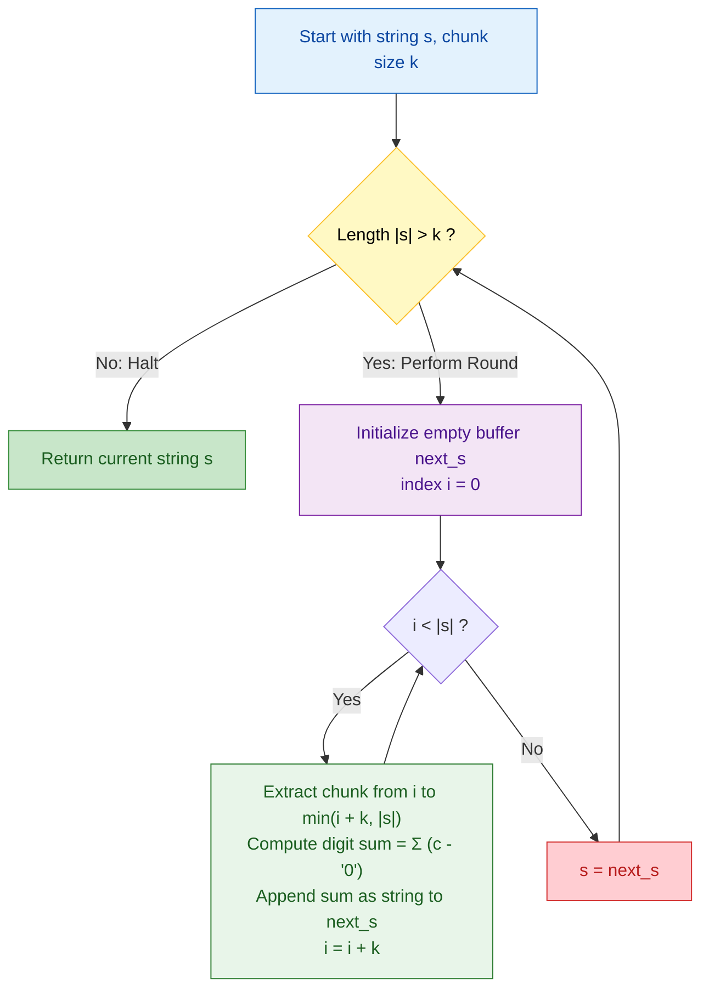

# LeetCode Problem of the Day: Calculate Digit Sum of a String

- **Problem Link:** [LeetCode 2243 - Calculate Digit Sum of a String](https://leetcode.com/problems/calculate-digit-sum-of-a-string/)
- **Difficulty:** Easy
- **Topic Tags:** String, Simulation, Number Theory, Implementation, Recursion
- **Target Audience:** POTD Solvers, Computer Science Students, Competitive Programmers, Technical Interview Candidates (Amazon, Microsoft, Google, Adobe, Bloomberg)

---

## 1. Problem Statement

You are given a string `s` consisting of numerical digits (`'0'` through `'9'`) and an integer `k`.

A round of transformation can be completed if the length of `s` is **strictly greater** than `k` ($|s| > k$). In a single round, do the following:
1. **Divide:** Partition `s` into consecutive groups of size `k` such that the first group has size `k`, the second has size `k`, and so on. The final group may have a size less than or equal to `k`.
2. **Sum:** Replace each group with a string representing the numerical sum of all its digits. (For example, `"346"` is replaced with `"13"` because $3 + 4 + 6 = 13$).
3. **Merge:** Concatenate all the resulting digit sum strings together in original group order to form a new string `s`.

Repeat this three-step process until the length of `s` is **less than or equal to $k$** ($|s| \le k$). Return the final string `s`.

---

### Mathematical Model

Let $s^{(0)} = s$ be the initial string of length $L_0 = |s|$.  
At round $t \ge 0$, if $L_t = |s^{(t)}| > k$:
1. The string is partitioned into $m_t = \lceil L_t / k \rceil$ contiguous blocks:
   $$s^{(t)} = G_0 \circ G_1 \circ \dots \circ G_{m_t - 1}$$
   where block $G_j$ spans indices $[j \cdot k, \; \min((j + 1)k, L_t) - 1]$.
2. For each block $G_j$, compute the digit sum:
   $$\sigma_j = \sum_{c \in G_j} (c - \text{'0'})$$
3. Form the next round's string by stringifying each $\sigma_j$:
   $$s^{(t+1)} = \text{str}(\sigma_0) \circ \text{str}(\sigma_1) \circ \dots \circ \text{str}(\sigma_{m_t - 1})$$

The process halts at round $T$ when $L_T = |s^{(T)}| \le k$, returning $s^{(T)}$.

---

## 2. Examples & Visual Walkthroughs

### Example 1

- **Input:** `s = "11111222223"`, `k = 3`
- **Output:** `"135"`

#### Execution Walkthrough:

```
Initial String: "11111222223"  (Length = 11 > 3)

┌────────────────────────────────────────────────────────┐
│                        ROUND 1                         │
├──────────────┬──────────────┬──────────────┬───────────┤
│ Group 0      │ Group 1      │ Group 2      │ Group 3   │
│ "111"        │ "112"        │ "222"        │ "23"      │
│ 1 + 1 + 1    │ 1 + 1 + 2    │ 2 + 2 + 2    │ 2 + 3     │
│ = 3          │ = 4          │ = 6          │ = 5       │
│ "3"          │ "4"          │ "6"          │ "5"       │
└──────────────┴──────────────┴──────────────┴───────────┘
Merged String s: "3465"  (Length = 4 > 3, Continue!)

┌────────────────────────────────────────────────────────┐
│                        ROUND 2                         │
├─────────────────────────────┬──────────────────────────┤
│ Group 0                     │ Group 1                  │
│ "346"                       │ "5"                      │
│ 3 + 4 + 6                   │ 5                        │
│ = 13                        │ = 5                      │
│ "13"                        │ "5"                      │
└─────────────────────────────┴──────────────────────────┘
Merged String s: "135"  (Length = 3 <= 3, STOP!)
```

- **Final Answer:** `"135"`

---

### Example 2

- **Input:** `s = "00000000"`, `k = 3`
- **Output:** `"000"`

#### Execution Walkthrough:
1. **Initial Length:** $|s| = 8 > 3$.
2. **Groups:** `"000"`, `"000"`, `"00"`.
3. **Digit Sums:**
   - `"000"` $\to 0 + 0 + 0 = 0 \to \text{"0"}$
   - `"000"` $\to 0 + 0 + 0 = 0 \to \text{"0"}$
   - `"00"` $\to 0 + 0 = 0 \to \text{"0"}$
4. **Merged:** `"000"`.
5. **Length Check:** $|s| = 3 \le 3 \implies$ **Halt.**
- **Final Answer:** `"000"`

---

### Example 3

- **Input:** `s = "456"`, `k = 3`
- **Output:** `"456"`
- **Explanation:** $|s| = 3 \le 3$. The initial condition $|s| > k$ is false, so zero rounds are performed. The original string is returned unchanged.

---

## 3. Constraints & Scale Analysis

| Parameter | Constraint Range | Algorithmic Implications |
| :--- | :--- | :--- |
| String Length $\|s\|$ | $1 \le \|s\| \le 100$ | Small input size guarantees that even straightforward simulation runs in sub-millisecond time. |
| Group Size $k$ | $2 \le k \le 100$ | Since $k \ge 2$, each chunk of $k$ digits produces a sum $\le 9k \le 900$ (at most 3 digits). |
| Characters | Only digits `'0'` to `'9'` | Direct integer arithmetic via `c - '0'` without input sanitization needed. |
| Convergence Rate | Rapid shrinkage | In each round, $k \ge 2$ characters collapse into at most 2 to 3 characters. The loop terminates in $\mathcal{O}(\log_k n)$ rounds. |
| Target Time Complexity | $\mathcal{O}(n \log_k n)$ | Negligible runtime ($< 1\text{ ms}$). |
| Target Space Complexity | $\mathcal{O}(n)$ | Buffer for constructing intermediate strings. |

---

## 4. Visual Architecture: The Chunk-Sum Pipeline



---

## 5. Step-by-Step Simulation Table

### Detailed Simulation for `s = "11111222223"`, `k = 3`

| Round | Input String | Length | Condition $(> 3)$ | Chunks Extracted | Sum per Chunk | Chunk Strings | Merged Result |
| :---: | :---: | :---: | :---: | :---: | :---: | :---: | :---: |
| **1** | `"11111222223"` | 11 | True | `["111", "112", "222", "23"]` | `[3, 4, 6, 5]` | `["3", "4", "6", "5"]` | `"3465"` |
| **2** | `"3465"` | 4 | True | `["346", "5"]` | `[13, 5]` | `["13", "5"]` | `"135"` |
| **3** | `"135"` | 3 | False | — | — | — | **Halt** |

**Final String:** `"135"`

---

## 6. Approaches: Naive to Pro

```
┌─────────────────────────────────────────────────────────────────────────────┐
│                             ALGORITHM BENCHMARK                             │
├────────────────────┬─────────────────┬─────────────────┬────────────────────┤
│ Method             │ Time Complexity │ Auxiliary Space │ Verdict            │
├────────────────────┼─────────────────┼─────────────────┼────────────────────┤
│ 1. Recursive Slice │ O(n log_k n)    │ O(n log_k n)    │ Accepted (Stack)   │
│ 2. String Concats  │ O(n^2 log_k n)  │ O(n)            │ Accepted (Copying) │
│ 3. StringBuilder   │ O(n log_k n)    │ O(n)            │ Optimal (Pro Best) │
└────────────────────┴─────────────────┴─────────────────┴────────────────────┘
```

---

## 7. Pseudo-Code

### Optimal Iterative Simulation with String Builder
```text
function digitSum(s, k):
    while length(s) > k:
        builder = new StringBuilder()
        i = 0
        while i < length(s):
            sum = 0
            end = min(i + k, length(s))
            for j from i to end - 1:
                sum = sum + (s[j] - '0')
            builder.append(toString(sum))
            i = i + k
        s = builder.toString()
    return s
```

---

## 8. Complete Multi-Language Implementations

### Java

```java
class Solution {
    public String digitSum(String s, int k) {
        // Continue rounds while the string length strictly exceeds k
        while (s.length() > k) {
            StringBuilder nextRound = new StringBuilder();
            int n = s.length();

            for (int i = 0; i < n; i += k) {
                int sum = 0;
                int end = Math.min(i + k, n);

                // Sum all digits in the current chunk [i, end)
                for (int j = i; j < end; j++) {
                    sum += s.charAt(j) - '0';
                }

                // Append the digit sum string representation
                nextRound.append(sum);
            }

            s = nextRound.toString();
        }

        return s;
    }
}
```

---

### Python3

```python
class Solution:
    def digitSum(self, s: str, k: int) -> str:
        """
        Simulates digit sum rounds until length <= k.
        Time Complexity: O(n log_k n)
        Auxiliary Space: O(n)
        """
        while len(s) > k:
            chunks = []
            for i in range(0, len(s), k):
                # Calculate sum of digits in the slice s[i : i + k]
                chunk_sum = sum(ord(c) - 48 for c in s[i : i + k])
                chunks.append(str(chunk_sum))
            
            s = "".join(chunks)

        return s
```

---

### C

```c
#include <stdio.h>
#include <stdlib.h>
#include <string.h>

char* digitSum(char* s, int k) {
    int len = strlen(s);
    char* cur = (char*)malloc(len + 1);
    strcpy(cur, s);

    // Buffer for constructing the next round's string
    char* next = (char*)malloc(len * 4 + 100);

    while (len > k) {
        int next_len = 0;

        for (int i = 0; i < len; i += k) {
            int sum = 0;
            int end = (i + k < len) ? (i + k) : len;

            for (int j = i; j < end; j++) {
                sum += (cur[j] - '0');
            }

            // Append digit sum using sprintf
            next_len += sprintf(next + next_len, "%d", sum);
        }

        strcpy(cur, next);
        len = next_len;
    }

    free(next);
    return cur;
}
```

---

### C++

```cpp
#include <string>
#include <algorithm>

using namespace std;

class Solution {
public:
    string digitSum(string s, int k) {
        while (s.length() > static_cast<size_t>(k)) {
            string next_round;
            size_t n = s.length();

            for (size_t i = 0; i < n; i += k) {
                int sum = 0;
                size_t end = min(i + k, n);

                for (size_t j = i; j < end; j++) {
                    sum += (s[j] - '0');
                }

                next_round += to_string(sum);
            }

            s = move(next_round);
        }

        return s;
    }
};
```

---

### C#

```csharp
using System;
using System.Text;

public class Solution {
    public string DigitSum(string s, int k) {
        while (s.Length > k) {
            StringBuilder sb = new StringBuilder();
            int n = s.Length;

            for (int i = 0; i < n; i += k) {
                int sum = 0;
                int end = Math.Min(i + k, n);

                for (int j = i; j < end; j++) {
                    sum += (s[j] - '0');
                }

                sb.Append(sum);
            }

            s = sb.ToString();
        }

        return s;
    }
}
```

---

### Javascript

```javascript
/**
 * @param {string} s
 * @param {number} k
 * @return {string}
 */
var digitSum = function(s, k) {
    while (s.length > k) {
        let nextRound = "";
        const n = s.length;

        for (let i = 0; i < n; i += k) {
            let sum = 0;
            const end = Math.min(i + k, n);

            for (let j = i; j < end; j++) {
                sum += s.charCodeAt(j) - 48;
            }

            nextRound += sum.toString();
        }

        s = nextRound;
    }

    return s;
};
```

---

### Typescript

```typescript
function digitSum(s: string, k: number): string {
    while (s.length > k) {
        let nextRound = "";
        const n = s.length;

        for (let i = 0; i < n; i += k) {
            let sum = 0;
            const end = Math.min(i + k, n);

            for (let j = i; j < end; j++) {
                sum += s.charCodeAt(j) - 48;
            }

            nextRound += sum.toString();
        }

        s = nextRound;
    }

    return s;
}
```

---

## 9. Complexity Analysis Summary

| Metric | Complexity | Details |
| :--- | :--- | :--- |
| **Time Complexity** | $\mathbf{\mathcal{O}(n \log_k n)}$ | In each round, every character of the current string is visited once to compute sums ($\mathcal{O}(L)$ work). The string length shrinks at each round by a factor roughly proportional to $k$ ($L_{t+1} \approx \frac{L_t}{k} \times \text{digits}$). Total work across all $\mathcal{O}(\log_k n)$ rounds sums to $\mathcal{O}(n \log_k n)$. For $n \le 100$, total steps $< 300$, running in $< 1\text{ ms}$. |
| **Auxiliary Space** | $\mathbf{\mathcal{O}(n)}$ | Space required to store the intermediate transformed string buffer in each round before reassigning to $s$. |

---

## 10. Edge Cases & Interview Insights

1. **Initial Length Already $\le k$:**
   - e.g., $s = \text{"123"}, k = 3$ or $k = 5$.
   - The loop condition $|s| > k$ evaluates to `false` immediately. The function returns $s$ untouched in $\mathcal{O}(1)$ time.

2. **Last Chunk with Incomplete Size:**
   - The loop chunk boundary $\min(i + k, n)$ handles the final incomplete chunk (length $< k$) naturally without requiring explicit conditional checks.

3. **Strings with Repeated Zeroes:**
   - e.g., $s = \text{"00000000"}, k = 3$.
   - Each group of `'0'`s sums to `0`, resulting in single-character `"0"` chunks. Concatenating yields `"000"`, which cleanly satisfies $|s| \le 3$.

4. **Multi-Digit Intermediate Sums:**
   - e.g., $s = \text{"999"}, k = 3$.
   - $9 + 9 + 9 = 27$ produces two characters `"27"`, which is smaller than $k = 3$, halting correctly after 1 round.
