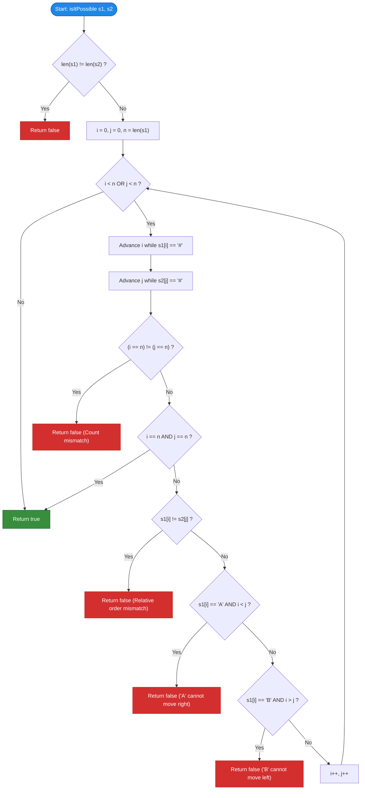

# GeeksforGeeks Problem of the Day: Convert One String to Another with Constraints

- **Problem Link:** [GeeksforGeeks - Convert One String to Another with Constraints](https://www.geeksforgeeks.org/problems/check-if-it-is-possible-to-convert-one-string-into-another-with-given-constraints4116/1)
- **Difficulty:** Easy
- **Topic Tags:** Strings, Two Pointers, Greedy, Invariant Analysis
- **Target Audience:** POTD Solvers, Computer Science Students, Competitive Programmers, Technical Interview Preparation (FAANG/Tier-1 Tech)

---

## 1. Problem Statement

Given two strings $s_1$ and $s_2$ of equal length containing only three types of characters: `'A'`, `'B'`, and `'#'`.

You can perform the following transformation operations on string $s_1$ any number of times:
1. **Movement of `'A'`:** A character `'A'` can move **only to the left** by swapping with an immediately adjacent `'#'` (i.e., `"##A"` $\to$ `"#A#"` $\to$ `"A##"`).
2. **Movement of `'B'`:** A character `'B'` can move **only to the right** by swapping with an immediately adjacent `'#'` (i.e., `"B##"` $\to$ `"#B#"` $\to$ `"##B"`).
3. **Impassable Barrier:** Characters `'A'` and `'B'` **cannot cross or leap over each other**. The relative ordering of `'A'` and `'B'` must remain strictly preserved throughout all operations.
4. The character `'#'` denotes an empty cell / space.

Your task is to determine whether it is **possible** to transform string $s_1$ into string $s_2$ using any sequence of valid operations. Return `true` if it is possible, and `false` otherwise.

---

## 2. Examples & Explanations

### Example 1
- **Input:** `s1 = "#A#B#B#"`, `s2 = "A###B#B"`
- **Lengths:** $|s_1| = 7, |s_2| = 7$
- **Step-by-Step Transformation Analysis:**
  1. The non-`'#'` characters in $s_1$ are `"ABB"`.
  2. The non-`'#'` characters in $s_2$ are `"ABB"`. The relative sequence matches!
  3. **First `'A'`:**
     - In $s_1$, index $i = 1$.
     - In $s_2$, target index $j = 0$.
     - Since $j \le i$ ($0 \le 1$), `'A'` moves left by 1 position $\implies$ **Valid**.
  4. **First `'B'`:**
     - In $s_1$, index $i = 3$.
     - In $s_2$, target index $j = 4$.
     - Since $j \ge i$ ($4 \ge 3$), `'B'` moves right by 1 position $\implies$ **Valid**.
  5. **Second `'B'`:**
     - In $s_1$, index $i = 5$.
     - In $s_2$, target index $j = 6$.
     - Since $j \ge i$ ($6 \ge 5$), `'B'` moves right by 1 position $\implies$ **Valid**.
- **Output:** `true`

---

### Example 2 (Relative Order Mismatch / Crossing Violation)
- **Input:** `s1 = "#A#B#"`, `s2 = "#B#A#"`
- **Analysis:**
  - In $s_1$, the non-`'#'` sequence is `"AB"`.
  - In $s_2$, the non-`'#'` sequence is `"BA"`.
  - For $s_1$ to become $s_2$, `'B'` would have to cross over `'A'`.
  - Crossing is strictly forbidden by the problem rules.
- **Output:** `false`

---

### Example 3 (Directional Restriction Violation)
- **Input:** `s1 = "#A#B#"`, `s2 = "##A#B"`
- **Analysis:**
  - Non-`'#'` sequence in both is `"AB"`.
  - For `'A'`: $s_1$ has `'A'` at index $1$, but $s_2$ has `'A'` at index $2$.
  - This would require `'A'` to move **right** ($j = 2 > i = 1$).
  - However, `'A'` can **only move left**!
  - Therefore, this conversion is physically impossible.
- **Output:** `false`

---

## 3. Constraints & Complexity Targets

- $1 \le |s_1|, |s_2| \le 10^5$
- Both strings contain only characters `'A'`, `'B'`, and `'#'`.
- **Target Time Complexity:** $\mathcal{O}(N)$ where $N = |s_1|$
- **Target Auxiliary Space:** $\mathcal{O}(1)$ in-place constant memory

---

## 4. Visual Architecture & Invariant Theorems

### 4.1 The Three Fundamental Invariants

```
========================================================================================
                      STRING TRANSFORMATION INVARIANT THEOREMS
========================================================================================

 1. THE NON-CROSSING INVARIANT:
    Stripping all '#' from s1 and s2 MUST yield the exact same string.
    s1:  #  A  #  B  #  B  #  ──►  "A B B"
    s2:  A  #  #  #  B  #  B  ──►  "A B B"   (Order preserved!)

 2. THE LEFTWARD MONOTONICITY OF 'A':
    'A' can only swap with '#' to its left:
         [ # ] <--- [ A ]   (Index must decrease: target_j <= initial_i)
    If j > i, 'A' would have to move right, which is FORBIDDEN.

 3. THE RIGHTWARD MONOTONICITY OF 'B':
    'B' can only swap with '#' to its right:
         [ B ] ---> [ # ]   (Index must increase: target_j >= initial_i)
    If j < i, 'B' would have to move left, which is FORBIDDEN.
========================================================================================
```

### 4.2 Why These Invariants Are Necessary and Sufficient
- Since any sequence of adjacent swaps preserves relative order, the non-crossing invariant is strictly necessary.
- Since `'A'` can only move left and `'B'` can only move right, the directional index inequalities $i \ge j$ (for `'A'`) and $i \le j$ (for `'B'`) are strictly necessary.
- Furthermore, because `'#'` acts as an empty fluid buffer, as long as these conditions hold for each matched pair and the relative order is intact, there are enough spaces to execute the swaps independently without obstruction. Hence, these conditions are **necessary and sufficient**.

---

## 5. Step-by-Step Simulation & Detailed Trace Table

### Trace for `s1 = "#A#B#B#"`, `s2 = "A###B#B"` ($N = 7$)

| Step | Pointer $i$ in $s_1$ | Character $s_1[i]$ | Pointer $j$ in $s_2$ | Character $s_2[j]$ | Invariant Checked | Result |
| :---: | :---: | :---: | :---: | :---: | :---: | :---: |
| 1 | Skip `s1[0]='#'` $\to i = 1$ | `'A'` | Skip nothing $\to j = 0$ | `'A'` | $s_1[i] == s_2[j]$ (`'A' == 'A'`) and $i \ge j$ ($1 \ge 0$) |  Valid (moves left) |
| 2 | Skip `s1[2]='#'` $\to i = 3$ | `'B'` | Skip `s2[1..3]='#'` $\to j = 4$ | `'B'` | $s_1[i] == s_2[j]$ (`'B' == 'B'`) and $i \le j$ ($3 \le 4$) |  Valid (moves right) |
| 3 | Skip `s1[4]='#'` $\to i = 5$ | `'B'` | Skip `s2[5]='#'` $\to j = 6$ | `'B'` | $s_1[i] == s_2[j]$ (`'B' == 'B'`) and $i \le j$ ($5 \le 6$) |  Valid (moves right) |
| 4 | Skip `s1[6]='#'` $\to i = 7$ | End | Skip none $\to j = 7$ | End | Both pointers reach string end simultaneously |  **Conversion Possible** |

**Final Return Value:** `true`.

---

## 6. Algorithmic Flowchart



---

## 7. From Naive to Pro: Algorithmic Progression

### Method 1: State-Space Search / BFS (Naive Brute Force)
- **Concept:** Model the transformation as a graph traversal. At each state, branch into all possible valid swaps of adjacent `'A#'` $\to$ `'#A'` or `'#B'` $\to$ `'B#'`. Search using BFS/DFS to see if $s_2$ is reachable.
- **Complexity:**
  - Time: $\mathcal{O}(2^N)$ — completely impractical for $N = 10^5$.
  - Space: $\mathcal{O}(2^N)$ for queue/visited set $\implies$ **Memory Limit Exceeded / TLE**.

---

### Method 2: Positional Extraction Vectors ($\mathcal{O}(N)$ Time, $\mathcal{O}(N)$ Space)
- **Concept:** Filter out all `'#'` from both strings into lists of tuples `(char, index)`.
  1. If lengths of filtered lists differ, return `false`.
  2. For each pair $(c_1, i)$ and $(c_2, j)$:
     - If $c_1 \neq c_2$, return `false`.
     - If $c_1 == \text{'A'}$ and $i < j$, return `false`.
     - If $c_1 == \text{'B'}$ and $i > j$, return `false`.
- **Complexity:**
  - Time: $\mathcal{O}(N)$ (two passes).
  - Space: $\mathcal{O}(N)$ (allocates extra arrays/lists).

#### Pseudo-Code:
```text
function isItPossibleFiltered(s1, s2):
    list1 = [(s1[i], i) for i in 0..n-1 if s1[i] != '#']
    list2 = [(s2[j], j) for j in 0..n-1 if s2[j] != '#']
    
    if len(list1) != len(list2): return false
    
    for k from 0 to len(list1) - 1:
        c1, i = list1[k]
        c2, j = list2[k]
        if c1 != c2: return false
        if c1 == 'A' and i < j: return false
        if c1 == 'B' and i > j: return false
        
    return true
```

---

### Method 3: In-Place Two-Pointer Stream Scan (Pro Optimal)
- **Concept:** Maintain two pointers $i$ and $j$ initialized at $0$.
  - Increment $i$ to skip `'#'` in $s_1$.
  - Increment $j$ to skip `'#'` in $s_2$.
  - Perform the exact same invariant checks directly on the original strings in a single pass.
- **Complexity:**
  - Time: $\mathcal{O}(N)$ (each pointer moves at most $N$ times).
  - Auxiliary Space: $\mathcal{O}(1)$ (pure constant overhead, zero memory allocation).

#### Pseudo-Code:
```text
function isItPossible(s1, s2):
    if length(s1) != length(s2): return false
    n = length(s1)
    i = 0, j = 0
    
    while i < n or j < n:
        while i < n and s1[i] == '#': i += 1
        while j < n and s2[j] == '#': j += 1
        
        if (i == n) != (j == n): return false
        if i == n and j == n: return true
        
        if s1[i] != s2[j]: return false
        if s1[i] == 'A' and i < j: return false
        if s1[i] == 'B' and i > j: return false
        
        i += 1
        j += 1
        
    return true
```

---

## 8. Complexity Comparison Table

| Approach | Time Complexity | Auxiliary Space | Passes | Status |
| :--- | :---: | :---: | :---: | :---: |
| **Method 1: State-Space BFS** | $\mathcal{O}(2^N)$ | $\mathcal{O}(2^N)$ | Exponential | ❌ TLE / MLE |
| **Method 2: Positional Extraction** | $\mathcal{O}(N)$ | $\mathcal{O}(N)$ | 2 Passes |  Accepted (Extra RAM) |
| **Method 3: In-Place Two Pointers (Pro)** | $\mathbf{\mathcal{O}(N)}$ | $\mathbf{\mathcal{O}(1)}$ | **1 Pass** | ** Optimal & Fastest** |

---

## 9. Comprehensive Corner Cases Handled

1. **Unequal String Lengths ($|s_1| \neq |s_2|$):**
   - Immediate early exit with `false`.
2. **Strings with Only Empty Spaces (`"####"` vs `"####"`):**
   - Both pointers skip all `'#'` and reach index $N$ simultaneously, returning `true`.
3. **Mismatched Character Counts (`"#A#B#"` vs `"#A#B#B#"`):**
   - One pointer reaches the end while the other still points to a character, correctly returning `false`.
4. **Already Identical Strings (`s1 == s2`):**
   - Loops process each corresponding character where $i = j$, trivially satisfying $i \ge j$ and $i \le j$, returning `true`.
5. **Opposite Direction Movements (`"#A"` vs `"A#"` vs `"B#"` vs `"#B"`):**
   - `s1 = "#A", s2 = "A#"`: $i = 1, j = 0 \implies i \ge j \implies$ `true`.
   - `s1 = "A#", s2 = "#A"`: $i = 0, j = 1 \implies i < j \implies$ `false`.
   - `s1 = "B#", s2 = "#B"`: $i = 0, j = 1 \implies i \le j \implies$ `true`.
   - `s1 = "#B", s2 = "B#"`: $i = 1, j = 0 \implies i > j \implies$ `false`.

---

## 10. Complete Multi-Language Implementations

### Java (21)

```java
/**
 * Problem: Convert One String to Another with Constraints
 * Language: Java 21
 * Time Complexity: O(N)
 * Space Complexity: O(1)
 */
class Solution {
    public boolean isItPossible(String s1, String s2) {
        if (s1.length() != s2.length()) {
            return false;
        }

        int n = s1.length();
        int i = 0;
        int j = 0;

        while (i < n || j < n) {
            // Advance pointer i to next non-'#' character in s1
            while (i < n && s1.charAt(i) == '#') {
                i++;
            }
            // Advance pointer j to next non-'#' character in s2
            while (j < n && s2.charAt(j) == '#') {
                j++;
            }

            // If one string runs out of characters before the other
            if ((i == n) != (j == n)) {
                return false;
            }

            // If both strings have been completely traversed
            if (i == n && j == n) {
                return true;
            }

            // Characters must be identical (non-crossing invariant)
            if (s1.charAt(i) != s2.charAt(j)) {
                return false;
            }

            // 'A' can only move left: target index j must be <= source index i
            if (s1.charAt(i) == 'A' && i < j) {
                return false;
            }

            // 'B' can only move right: target index j must be >= source index i
            if (s1.charAt(i) == 'B' && i > j) {
                return false;
            }

            i++;
            j++;
        }

        return true;
    }
};
```

---

### Python3

```python
"""
Problem: Convert One String to Another with Constraints
Language: Python 3
Time Complexity: O(N)
Space Complexity: O(1)
"""
class Solution:
    def isItPossible(self, s1: str, s2: str) -> bool:
        if len(s1) != len(s2):
            return False

        n = len(s1)
        i = 0
        j = 0

        while i < n or j < n:
            # Skip empty cells '#' in s1
            while i < n and s1[i] == '#':
                i += 1
            # Skip empty cells '#' in s2
            while j < n and s2[j] == '#':
                j += 1

            # Check if count of characters matches
            if (i == n) != (j == n):
                return False

            # If both reached the end, transformation is successful
            if i == n and j == n:
                return True

            # Relative order must match
            if s1[i] != s2[j]:
                return False

            # 'A' can only move left (i >= j)
            if s1[i] == 'A' and i < j:
                return False

            # 'B' can only move right (i <= j)
            if s1[i] == 'B' and i > j:
                return False

            i += 1
            j += 1

        return True
```

---

### C++ (17)

```cpp
/**
 * Problem: Convert One String to Another with Constraints
 * Language: C++ 17
 * Time Complexity: O(N)
 * Space Complexity: O(1)
 */
#include <string>

using namespace std;

class Solution {
public:
    bool isItPossible(string &s1, string &s2) {
        if (s1.length() != s2.length()) {
            return false;
        }

        int n = static_cast<int>(s1.length());
        int i = 0;
        int j = 0;

        while (i < n || j < n) {
            // Skip '#' in s1
            while (i < n && s1[i] == '#') {
                i++;
            }
            // Skip '#' in s2
            while (j < n && s2[j] == '#') {
                j++;
            }

            // If one reaches end earlier than the other
            if ((i == n) != (j == n)) {
                return false;
            }

            // Both strings exhausted simultaneously
            if (i == n && j == n) {
                return true;
            }

            // Non-crossing constraint: matching character order
            if (s1[i] != s2[j]) {
                return false;
            }

            // 'A' can only move to the left (i >= j)
            if (s1[i] == 'A' && i < j) {
                return false;
            }

            // 'B' can only move to the right (i <= j)
            if (s1[i] == 'B' && i > j) {
                return false;
            }

            i++;
            j++;
        }

        return true;
    }
};
```

---

### C#

```csharp
/**
 * Problem: Convert One String to Another with Constraints
 * Language: C#
 * Time Complexity: O(N)
 * Space Complexity: O(1)
 */
class Solution {
    public bool isItPossible(string s1, string s2) {
        if (s1.Length != s2.Length) {
            return false;
        }

        int n = s1.Length;
        int i = 0;
        int j = 0;

        while (i < n || j < n) {
            // Skip '#' in s1
            while (i < n && s1[i] == '#') {
                i++;
            }
            // Skip '#' in s2
            while (j < n && s2[j] == '#') {
                j++;
            }

            // Check if one ended before the other
            if ((i == n) != (j == n)) {
                return false;
            }

            // Both strings fully processed
            if (i == n && j == n) {
                return true;
            }

            // Non-crossing check
            if (s1[i] != s2[j]) {
                return false;
            }

            // 'A' can only move left
            if (s1[i] == 'A' && i < j) {
                return false;
            }

            // 'B' can only move right
            if (s1[i] == 'B' && i > j) {
                return false;
            }

            i++;
            j++;
        }

        return true;
    }
}
```

---

### Javascript (Node v22)

```javascript
/**
 * Problem: Convert One String to Another with Constraints
 * Language: Javascript (Node v22)
 * Time Complexity: O(N)
 * Space Complexity: O(1)
 * 
 * @param {string} s1
 * @param {string} s2
 * @return {boolean}
 */
class Solution {
    isItPossible(s1, s2) {
        if (s1.length !== s2.length) {
            return false;
        }

        const n = s1.length;
        let i = 0;
        let j = 0;

        while (i < n || j < n) {
            // Skip '#' in s1
            while (i < n && s1[i] === '#') {
                i++;
            }
            // Skip '#' in s2
            while (j < n && s2[j] === '#') {
                j++;
            }

            // Unequal character counts
            if ((i === n) !== (j === n)) {
                return false;
            }

            // Both reached the end successfully
            if (i === n && j === n) {
                return true;
            }

            // Matching character identity
            if (s1[i] !== s2[j]) {
                return false;
            }

            // 'A' can only move left: target j <= i
            if (s1[i] === 'A' && i < j) {
                return false;
            }

            // 'B' can only move right: target j >= i
            if (s1[i] === 'B' && i > j) {
                return false;
            }

            i++;
            j++;
        }

        return true;
    }
};
```

---

## 11. Key Takeaways & Technical Summary

1. **Relative Order Invariance:** Because `'A'` and `'B'` cannot cross each other, the non-empty string sequences of $s_1$ and $s_2$ must be identical.
2. **Directional Inequalities:**
   - For `'A'`: Initial index $i \ge$ Target index $j$ (can only move left).
   - For `'B'`: Initial index $i \le$ Target index $j$ (can only move right).
3. **In-Place Two-Pointer Scan:** By skipping `'#'` dynamically on the fly, the algorithm achieves an optimal $\mathcal{O}(N)$ time and $\mathcal{O}(1)$ space solution with zero allocations.
