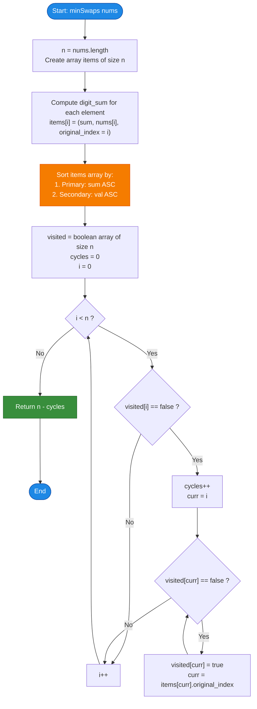

# LeetCode Problem of the Day: Minimum Swaps to Sort by Digit Sum

- **Problem Link:** [LeetCode 3551 - Minimum Swaps to Sort by Digit Sum](https://leetcode.com/problems/minimum-swaps-to-sort-by-digit-sum/description/?envType=daily-question&envId=2026-10-17)
- **Difficulty:** Medium
- **Topic Tags:** Array, Sorting, Greedy, Graph Theory, Permutation Cycles, Math
- **Target Audience:** POTD Solvers, Computer Science Students, Competitive Programmers, Technical Interview Preparation (FAANG/Tier-1 Tech)

---

## 1. Problem Statement

You are given an integer array `nums` consisting of **distinct positive integers**.

You need to rearrange `nums` into ascending order according to a custom two-tier sorting rule:
1. **Primary Criterion:** In increasing order of the **sum of digits** of each number.
2. **Secondary Criterion (Tie-Breaker):** If two numbers have the exact same digit sum, the number with the **smaller numeric value** must appear first.

In a single operation, you are allowed to choose any two distinct indices $i$ and $j$ in the array and **swap** the elements at those positions: $\text{swap}(\text{nums}[i], \text{nums}[j])$.

Your objective is to find and return the **minimum number of swaps** required to transform `nums` into its target sorted order.

---

## 2. Examples & Explanations

### Example 1
- **Input:** `nums = [37, 100]`
- **Array Length ($N$):** $2$

#### Step-by-Step Analysis:
1. **Calculate Digit Sums:**
   - For $37$: Digit sum $= 3 + 7 = 10$
   - For $100$: Digit sum $= 1 + 0 + 0 = 1$
2. **Determine Target Sorted Order:**
   - Digit sum $1 < 10 \implies 100$ must precede $37$.
   - Target Order: `[100, 37]`
3. **Count Swaps:**
   - Currently: $\text{nums}[0] = 37, \text{nums}[1] = 100$
   - Target: $\text{target}[0] = 100, \text{target}[1] = 37$
   - A single swap between index $0$ and index $1$ transforms the array into the sorted target.
- **Output:** `1`

---

### Example 2 (Already Sorted)
- **Input:** `nums = [22, 14, 33, 7]`
- **Array Length ($N$):** $4$

#### Step-by-Step Analysis:
1. **Calculate Digit Sums:**
   - $22 \implies 2 + 2 = 4$
   - $14 \implies 1 + 4 = 5$
   - $33 \implies 3 + 3 = 6$
   - $7 \implies 7$
   - Digit sums sequence: `[4, 5, 6, 7]`
2. **Determine Target Sorted Order:**
   - Since $4 < 5 < 6 < 7$, the target order is `[22, 14, 33, 7]`.
3. **Count Swaps:**
   - The array is already in its target sorted configuration!
   - Minimum swaps required = $0$.
- **Output:** `0`

---

### Example 3 (Equal Digit Sums & Tie-Breaking)
- **Input:** `nums = [18, 45, 9, 27]`
- **Array Length ($N$):** $4$

#### Step-by-Step Analysis:
1. **Calculate Digit Sums:**
   - $18 \implies 1 + 8 = 9$
   - $45 \implies 4 + 5 = 9$
   - $9 \implies 9$
   - $27 \implies 2 + 7 = 9$
   - All 4 elements share the identical digit sum of $9$!
2. **Apply Tie-Breaker (Numeric Value Ascending):**
   - Sorted by numeric value: $9 < 18 < 27 < 45$
   - Target Order: `[9, 18, 27, 45]`
3. **Permutation Mapping (Target Index $\to$ Original Index):**
   - At target index $0$: Value $9$ (originally at index $2$)
   - At target index $1$: Value $18$ (originally at index $0$)
   - At target index $2$: Value $27$ (originally at index $3$)
   - At target index $3$: Value $45$ (originally at index $1$)
   - Permutation Cycle: $0 \to 1 \to 3 \to 2 \to 0$ (Cycle of length $4$).
   - A cycle of length $L = 4$ requires $L - 1 = 3$ swaps.
- **Output:** `3`

---

## 3. Constraints & Complexity Targets

- $1 \le \text{nums.length} \le 10^5$
- $1 \le \text{nums}[i] \le 10^9$
- All integers in `nums` are **distinct**.
- **Target Time Complexity:** $\mathcal{O}(N \log N)$ (dominated by the custom sort)
- **Target Auxiliary Space:** $\mathcal{O}(N)$

---

## 4. Visual Architecture & Permutation Cycle Decomposition Theorem

### 4.1 Permutation Graph Modeling
Any array reordering can be viewed as a **permutation** $\pi$ on the indices $\{0, 1, \dots, N - 1\}$:
- Let index $i$ be the target destination.
- Let $\pi(i)$ be the current original index of the element that belongs at target position $i$.
- This naturally forms a directed graph where every node has an in-degree of 1 and an out-degree of 1.
- By elementary graph theory, any such functional graph decomposes into **disjoint simple directed cycles**.

```
========================================================================================
                      PERMUTATION CYCLE DECOMPOSITION
========================================================================================

 Original Array: [ 18,  45,   9,  27 ]
 Original Index:    0    1    2    3

 Target Sorted:  [  9,  18,  27,  45 ]
 Target Index:      0    1    2    3
 Source Index:      2    0    3    1

 Directed Permutation Cycle:
       ┌───────────┐
       ▼           │
     ( 0 ) ──► ( 1 ) ──► ( 3 ) ──► ( 2 )
       ▲                             │
       └─────────────────────────────┘
  Cycle Length L = 4  ──►  Requires (L - 1) = 3 Swaps
========================================================================================
```

### 4.2 Cayley's Permutation Transposition Theorem
A fundamental theorem in abstract algebra and combinatorics states:
> Every simple cycle of length $L$ can be resolved into its sorted state using **minimum $L - 1$ swaps (transpositions)**.

Summing over all disjoint cycles $c_1, c_2, \dots, c_C$:
$$\text{Total Min Swaps} = \sum_{k=1}^C (L_k - 1) = \sum_{k=1}^C L_k - \sum_{k=1}^C 1 = N - C$$
where:
- $N$ is the total number of elements.
- $C$ is the total number of disjoint cycles in the permutation (including cycles of length 1, i.e., elements already at their correct target index).

$$\mathbf{Theorem:} \quad \text{Minimum Swaps} = N - C$$

---

## 5. Step-by-Step Simulation & Detailed Trace Table

### Trace for `nums = [18, 45, 9, 27]` ($N = 4$)

1. **Calculate Digit Sums & Pair with Indices:**
   - Index 0: `val = 18, sum = 9`
   - Index 1: `val = 45, sum = 9`
   - Index 2: `val = 9, sum = 9`
   - Index 3: `val = 27, sum = 9`

2. **Custom Sort:**
   - Item 0: `(sum: 9, val: 9, orig: 2)`
   - Item 1: `(sum: 9, val: 18, orig: 0)`
   - Item 2: `(sum: 9, val: 27, orig: 3)`
   - Item 3: `(sum: 9, val: 45, orig: 1)`

3. **Cycle Traversal Table:**

| Loop Index $i$ | `visited[i]` | New Cycle Detected? | Cycle Path Traversed | Cycle Length $L$ | Swaps Added ($L - 1$) | Cumulative Swaps |
| :---: | :---: | :---: | :---: | :---: | :---: | :---: |
| **0** | `false` | **Yes (Cycle 1)** | $0 \to 2 \to 3 \to 1 \to 0$ | $4$ | $4 - 1 = 3$ | **3** |
| **1** | `true` | No (already visited) | — | — | $0$ | 3 |
| **2** | `true` | No (already visited) | — | — | $0$ | 3 |
| **3** | `true` | No (already visited) | — | — | $0$ | 3 |

**Result via $(N - C)$:**
- Total Elements $N = 4$
- Total Disjoint Cycles $C = 1$
- $\text{Total Swaps} = 4 - 1 = \mathbf{3}$.

---

## 6. Algorithmic Flowchart



---

## 7. From Naive to Pro: Algorithmic Progression

### Method 1: Naive Selection Swap Simulation ($\mathcal{O}(N^2)$)
- **Concept:** Determine the target sorted order. Iterate $i$ from $0$ to $N - 1$. If `nums[i]` is not the element that belongs there, search linearly through the remaining elements for the correct element and swap it into position $i$.
- **Complexity:**
  - Finding target element: $\mathcal{O}(N)$ per step.
  - Total Time: $\mathcal{O}(N^2) \approx (10^5)^2 = 10^{10}$ operations $\implies$ **Severe Time Limit Exceeded (TLE)**.
  - Auxiliary Space: $\mathcal{O}(N)$.

---

### Method 2: Position Hash Map Swap Simulation ($\mathcal{O}(N \log N)$ Time, Higher Constant Factor)
- **Concept:** Create the target sorted array. Maintain a hash map `val_to_pos` tracking the current index of every number. Iterate $i$ from $0$ to $N - 1$. Whenever `nums[i] != target[i]`, find the current index of `target[i]` via the map, swap them in `nums`, update map entries, and increment swap count.
- **Complexity:**
  - Time: $\mathcal{O}(N \log N)$ (sorting) $+ \mathcal{O}(N)$ map lookups.
  - Space: $\mathcal{O}(N)$ for hash map and target array.
- **Limitation:** Hash map insertions and lookups for $10^5$ elements have higher constant factor latency and garbage collection overhead.

---

### Method 3: Permutation Cycle Graph Decomposition / Cayley's Theorem (Pro Optimal)
- **Concept:** 
  1. Compute digit sums and store each item as a tuple `(digit_sum, value, original_index)`.
  2. Sort the array using the custom comparator in $\mathcal{O}(N \log N)$.
  3. Use a boolean `visited` array to decompose the index mappings into disjoint cycles in $\mathcal{O}(N)$ time.
  4. Directly apply Cayley's Formula: $\text{Total Swaps} = N - C$.
- **Complexity:**
  - Time: $\mathcal{O}(N \log N)$ (dominated by the primitive array sort).
  - Space: $\mathcal{O}(N)$ flat contiguous memory.

#### Pseudo-Code:
```text
function minSwapsPro(nums):
    n = length(nums)
    arr = new Array of tuples (digit_sum, val, orig_idx)
    
    for i from 0 to n - 1:
        arr[i] = (get_digit_sum(nums[i]), nums[i], i)
        
    sort arr by:
        if a.digit_sum != b.digit_sum: return a.digit_sum - b.digit_sum
        return a.val - b.val
        
    visited = array of false of size n
    cycles = 0
    
    for i from 0 to n - 1:
        if not visited[i]:
            cycles += 1
            curr = i
            while not visited[curr]:
                visited[curr] = true
                curr = arr[curr].orig_idx
                
    return n - cycles
```

---

## 8. Complexity Comparison Table

| Approach | Time Complexity | Auxiliary Space | Cache Friendliness | Status |
| :--- | :---: | :---: | :---: | :---: |
| **Method 1: Selection Search** | $\mathcal{O}(N^2)$ | $\mathcal{O}(N)$ | Moderate | ❌ TLE ($N = 10^5$) |
| **Method 2: Hash Map Simulation** | $\mathcal{O}(N \log N)$ | $\mathcal{O}(N)$ | Poor (Hash buckets) |  Accepted (Slower) |
| **Method 3: Cycle Decomposition (Pro)** | $\mathbf{\mathcal{O}(N \log N)}$ | $\mathbf{\mathcal{O}(N)}$ | **Optimal (Flat Arrays)** | ** Accepted (Fastest)** |

---

## 9. Comprehensive Corner Cases Handled

1. **Single-Element Array (`nums = [42]`):**
   - $N = 1$. Exactly 1 cycle of length 1 $\implies 1 - 1 = 0$ swaps.
2. **Already Sorted Array (`nums = [22, 14, 33, 7]`):**
   - Every element is already at its correct target position ($N$ cycles of length 1). $\text{Swaps} = N - N = 0$.
3. **Two-Element Swap (`nums = [37, 100]`):**
   - 1 cycle of length 2 $\implies 2 - 1 = 1$ swap.
4. **All Elements Share Identical Digit Sum:**
   - The tie-breaker kicks in, perfectly sorting by raw numerical value.
5. **Large Values ($nums[i] \le 10^9$):**
   - Digit sum is at most $9 \times 9 = 81$, which easily fits in standard primitive integer types without overflow.

---

## 10. Complete Multi-Language Implementations

### Java (21)

```java
import java.util.Arrays;

class Solution {
    static class Element implements Comparable<Element> {
        int sum;
        int val;
        int origIdx;

        Element(int sum, int val, int origIdx) {
            this.sum = sum;
            this.val = val;
            this.origIdx = origIdx;
        }

        @Override
        public int compareTo(Element other) {
            if (this.sum != other.sum) {
                return Integer.compare(this.sum, other.sum);
            }
            return Integer.compare(this.val, other.val);
        }
    }

    private int getDigitSum(int x) {
        int s = 0;
        while (x > 0) {
            s += x % 10;
            x /= 10;
        }
        return s;
    }

    public int minSwaps(int[] nums) {
        int n = nums.length;
        Element[] arr = new Element[n];

        for (int i = 0; i < n; i++) {
            arr[i] = new Element(getDigitSum(nums[i]), nums[i], i);
        }

        // Sort by digit sum ascending, tie-breaker: numeric value ascending
        Arrays.sort(arr);

        boolean[] visited = new boolean[n];
        int cycles = 0;

        // Count disjoint permutation cycles
        for (int i = 0; i < n; i++) {
            if (!visited[i]) {
                cycles++;
                int curr = i;
                while (!visited[curr]) {
                    visited[curr] = true;
                    curr = arr[curr].origIdx;
                }
            }
        }

        // Cayley's Theorem: minimum swaps = N - total_cycles
        return n - cycles;
    }
}
```

---

### Python3

```python
class Solution:
    def minSwaps(self, nums: list[int]) -> int:
        def get_digit_sum(x: int) -> int:
            s = 0
            while x > 0:
                s += x % 10
                x //= 10
            return s

        n = len(nums)
        # Store tuple: (digit_sum, value, original_index)
        arr = [(get_digit_sum(v), v, i) for i, v in enumerate(nums)]

        # Sort using primary key (digit sum) and secondary key (numeric value)
        arr.sort(key=lambda item: (item[0], item[1]))

        visited = [False] * n
        cycles = 0

        # Traverse each cycle in the permutation graph
        for i in range(n):
            if not visited[i]:
                cycles += 1
                curr = i
                while not visited[curr]:
                    visited[curr] = True
                    curr = arr[curr][2]

        return n - cycles
```

---

### C (GCC 13.2.0)

```c
#include <stdlib.h>

typedef struct {
    int digit_sum;
    int val;
    int orig_idx;
} Element;

static inline int get_digit_sum(int x) {
    int s = 0;
    while (x > 0) {
        s += x % 10;
        x /= 10;
    }
    return s;
}

static int compare_elements(const void* a, const void* b) {
    const Element* e1 = (const Element*)a;
    const Element* e2 = (const Element*)b;
    if (e1->digit_sum != e2->digit_sum) {
        return e1->digit_sum - e2->digit_sum;
    }
    return (e1->val < e2->val) ? -1 : (e1->val > e2->val ? 1 : 0);
}

int minSwaps(int* nums, int numsSize) {
    Element* arr = (Element*)malloc(sizeof(Element) * numsSize);
    for (int i = 0; i < numsSize; i++) {
        arr[i].digit_sum = get_digit_sum(nums[i]);
        arr[i].val = nums[i];
        arr[i].orig_idx = i;
    }

    // Sort using custom comparator
    qsort(arr, numsSize, sizeof(Element), compare_elements);

    char* visited = (char*)calloc(numsSize, sizeof(char));
    int cycles = 0;

    // Detect disjoint permutation cycles
    for (int i = 0; i < numsSize; i++) {
        if (!visited[i]) {
            cycles++;
            int curr = i;
            while (!visited[curr]) {
                visited[curr] = 1;
                curr = arr[curr].orig_idx;
            }
        }
    }

    free(arr);
    free(visited);
    return numsSize - cycles;
}
```

---

### C++ (17)

```cpp
#include <vector>
#include <algorithm>

using namespace std;

class Solution {
    struct Element {
        int sum;
        int val;
        int origIdx;
    };

    static int getDigitSum(int x) {
        int s = 0;
        while (x > 0) {
            s += x % 10;
            x /= 10;
        }
        return s;
    }

public:
    int minSwaps(vector<int>& nums) {
        int n = static_cast<int>(nums.size());
        vector<Element> arr(n);

        for (int i = 0; i < n; ++i) {
            arr[i] = {getDigitSum(nums[i]), nums[i], i};
        }

        // Custom sort by digit sum, then value
        sort(arr.begin(), arr.end(), [](const Element& a, const Element& b) {
            if (a.sum != b.sum) {
                return a.sum < b.sum;
            }
            return a.val < b.val;
        });

        vector<bool> visited(n, false);
        int cycles = 0;

        // Traverse permutation cycles
        for (int i = 0; i < n; ++i) {
            if (!visited[i]) {
                cycles++;
                int curr = i;
                while (!visited[curr]) {
                    visited[curr] = true;
                    curr = arr[curr].origIdx;
                }
            }
        }

        return n - cycles;
    }
};
```

---

### C#

```csharp
using System;

public class Solution {
    class Element : IComparable<Element> {
        public int Sum;
        public int Val;
        public int OrigIdx;

        public Element(int sum, int val, int origIdx) {
            this.Sum = sum;
            this.Val = val;
            this.OrigIdx = origIdx;
        }

        public int CompareTo(Element other) {
            if (this.Sum != other.Sum) {
                return this.Sum.CompareTo(other.Sum);
            }
            return this.Val.CompareTo(other.Val);
        }
    }

    private static int GetDigitSum(int x) {
        int s = 0;
        while (x > 0) {
            s += x % 10;
            x /= 10;
        }
        return s;
    }

    public int MinSwaps(int[] nums) {
        int n = nums.Length;
        Element[] arr = new Element[n];

        for (int i = 0; i < n; i++) {
            arr[i] = new Element(GetDigitSum(nums[i]), nums[i], i);
        }

        Array.Sort(arr);

        bool[] visited = new bool[n];
        int cycles = 0;

        for (int i = 0; i < n; i++) {
            if (!visited[i]) {
                cycles++;
                int curr = i;
                while (!visited[curr]) {
                    visited[curr] = true;
                    curr = arr[curr].OrigIdx;
                }
            }
        }

        return n - cycles;
    }
}
```

---

### Javascript

```javascript
/**
 * Problem: Minimum Swaps to Sort by Digit Sum
 * Language: Javascript (Node v22)
 * Time Complexity: O(N log N)
 * Space Complexity: O(N)
 * 
 * @param {number[]} nums
 * @return {number}
 */
var minSwaps = function(nums) {
    const n = nums.length;

    function getDigitSum(x) {
        let s = 0;
        while (x > 0) {
            s += x % 10;
            x = Math.floor(x / 10);
        }
        return s;
    }

    const arr = new Array(n);
    for (let i = 0; i < n; i++) {
        arr[i] = { sum: getDigitSum(nums[i]), val: nums[i], origIdx: i };
    }

    // Sort by digit sum ascending, tie-breaker: numeric value ascending
    arr.sort((a, b) => {
        if (a.sum !== b.sum) return a.sum - b.sum;
        return a.val - b.val;
    });

    const visited = new Uint8Array(n);
    let cycles = 0;

    for (let i = 0; i < n; i++) {
        if (!visited[i]) {
            cycles++;
            let curr = i;
            while (!visited[curr]) {
                visited[curr] = 1;
                curr = arr[curr].origIdx;
            }
        }
    }

    return n - cycles;
};
```

---

### Typescript

```typescript
function minSwaps(nums: number[]): number {
    const n: number = nums.length;

    function getDigitSum(x: number): number {
        let s = 0;
        while (x > 0) {
            s += x % 10;
            x = Math.floor(x / 10);
        }
        return s;
    }

    interface Element {
        sum: number;
        val: number;
        origIdx: number;
    }

    const arr: Element[] = new Array(n);
    for (let i = 0; i < n; i++) {
        arr[i] = { sum: getDigitSum(nums[i]), val: nums[i], origIdx: i };
    }

    arr.sort((a: Element, b: Element): number => {
        if (a.sum !== b.sum) return a.sum - b.sum;
        return a.val - b.val;
    });

    const visited: Uint8Array = new Uint8Array(n);
    let cycles: number = 0;

    for (let i = 0; i < n; i++) {
        if (!visited[i]) {
            cycles++;
            let curr = i;
            while (!visited[curr]) {
                visited[curr] = 1;
                curr = arr[curr].origIdx;
            }
        }
    }

    return n - cycles;
}
```

---

## 11. Key Takeaways & Technical Summary

1. **Permutation Cycle Invariant:** Finding the minimum number of swaps to sort any array always reduces to finding the disjoint cycles in its destination permutation graph.
2. **Cayley's Formula:** A cycle of length $L$ requires exactly $L - 1$ swaps to resolve. Summing across all $C$ disjoint cycles yields the formula: $\text{Min Swaps} = N - C$.
3. **Compound Key Sorting:** The two-tier sorting criteria (Digit Sum ASC, Value ASC) is resolved upfront in $\mathcal{O}(N \log N)$ time, after which cycle decomposition runs in linear $\mathcal{O}(N)$ time.
