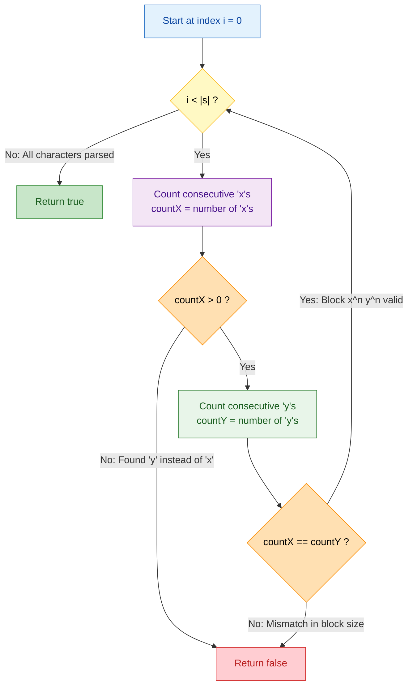

# GeeksforGeeks Problem of the Day: Repeated Pattern Check

- **Problem Link:** [GeeksforGeeks - The Pattern Matcher](https://www.geeksforgeeks.org/problems/the-pattern-matcher/1)
- **Difficulty:** Easy
- **Topic Tags:** Strings, Pattern Matching, Two Pointers, Simulation, State Machine
- **Target Audience:** POTD Solvers, Computer Science Students, Competitive Programmers, Interview Preparation (Amazon, Microsoft, Google, Adobe, Flipkart, Walmart)

---

## 1. Problem Statement

Given a string `s` consisting only of the lowercase characters `'x'` and `'y'`, determine whether the string can be decomposed entirely into one or more consecutive blocks of the form:
$$x^n y^n \quad (n \ge 1)$$

That is, each valid block must consist of an equal number of consecutive `'x'` characters followed immediately by the exact same number of consecutive `'y'` characters.

Return `true` if the entire string follows this structure with no leftover or misplaced characters, and `false` otherwise.

---

### Formal Definition

A valid string $s$ must satisfy:
$$s = B_1 \circ B_2 \circ \dots \circ B_k \quad (k \ge 1)$$
where each block $B_j$ is of the form:
$$B_j = \underbrace{\text{'x'} \dots \text{'x'}}_{n_j \text{ times}} \; \underbrace{\text{'y'} \dots \text{'y'}}_{n_j \text{ times}} \quad \text{for some integer } n_j \ge 1$$

- Note that different blocks can have different values of $n_j$. For example, $B_1 = \text{"xxyy"}$ ($n_1 = 2$) followed by $B_2 = \text{"xy"}$ ($n_2 = 1$) is completely valid.
- Every character in `s` must belong to exactly one block.

---

## 2. Examples & Visual Walkthroughs

### Example 1: `s = "xxyyxy"`

- **Input:** `s = "xxyyxy"`
- **Length:** $6$

#### Visual Block Partition:

```
  Index:     0   1   2   3     4   5
  String:    x   x   y   y     x   y
             └───────┬───────┘     └─┬─┘
              Block 1: x^2 y^2     Block 2: x^1 y^1
              countX = 2           countX = 1
              countY = 2           countY = 1
              VALID (2 == 2)       VALID (1 == 1)
```

- **Output:** `true`

---

### Example 2: `s = "xyx"`

- **Input:** `s = "xyx"`
- **Length:** $3$

#### Visual Block Partition:

```
  Index:     0   1       2
  String:    x   y       x
             └───┬───┘   │
              Block 1:   Block 2:
              x^1 y^1    x^1 (incomplete, no trailing 'y')
              VALID      countX = 1, countY = 0 -> INVALID!
```

- **Output:** `false`

---

### Example 3: `s = "yxx"`

- **Input:** `s = "yxx"`
- **Evaluation:** First character is `'y'`. A valid block must start with at least one `'x'` ($countX = 0$).
- **Output:** `false`

---

### Example 4: `s = "xxyyy"`

- **Input:** `s = "xxyyy"`
- **Evaluation:** 
  - Consecutive `'x'` count: $2$.
  - Consecutive `'y'` count: $3$.
  - $countX \neq countY$ ($2 \neq 3$).
- **Output:** `false`

---

## 3. Constraints & Scale Analysis

| Parameter | Constraint Range | Algorithmic Implications |
| :--- | :--- | :--- |
| String Length $\|s\|$ | $1 \le \|s\| \le 10^5$ | Linear $\mathcal{O}(\|s\|)$ scan is mandatory to avoid TLE on large strings. |
| Character Set | Exclusively `{'x', 'y'}` | No spaces, digits, or other characters. |
| Parity Invariant | Length of valid $s$ must be even | Each block $x^n y^n$ has length $2n$ (even). An odd-length string is immediately invalid ($\mathcal{O}(1)$ early exit). |
| Auxiliary Space | $\mathcal{O}(1)$ | String parsing must operate using pointer indices without allocating substrings or auxiliary arrays. |

---

## 4. Visual Architecture: Finite State Machine



---

## 5. Step-by-Step Simulation Table

### Trace for `s = "xxyyxy"` ($|s| = 6$)

| Step | Index $i$ | Action | Character Observed | `countX` | `countY` | Substring Matched | Verdict |
| :---: | :---: | :--- | :---: | :---: | :---: | :---: | :---: |
| 1 | 0 | Count `'x'` | `s[0] = 'x'` | 1 | 0 | — | — |
| 2 | 1 | Count `'x'` | `s[1] = 'x'` | 2 | 0 | — | — |
| 3 | 2 | Count `'y'` | `s[2] = 'y'` | 2 | 1 | — | — |
| 4 | 3 | Count `'y'` | `s[3] = 'y'` | 2 | 2 | `"xxyy"` | Valid block ($2 == 2$) |
| 5 | 4 | Count `'x'` | `s[4] = 'x'` | 1 | 0 | — | — |
| 6 | 5 | Count `'y'` | `s[5] = 'y'` | 1 | 1 | `"xy"` | Valid block ($1 == 1$) |
| End | 6 | $i == |s|$ | — | — | — | Full string valid $\implies$ `true` |

---

## 6. Approaches: Naive to Pro

```
┌─────────────────────────────────────────────────────────────────────────────┐
│                             ALGORITHM BENCHMARK                             │
├────────────────────┬─────────────────┬─────────────────┬────────────────────┤
│ Method             │ Time Complexity │ Auxiliary Space │ Verdict            │
├────────────────────┼─────────────────┼─────────────────┼────────────────────┤
│ 1. Regex / Slices  │ O(|s|^2)        │ O(|s|)          │ TLE / Memory Heavy │
│ 2. Stack Tracking  │ O(|s|)          │ O(|s|)          │ Accepted           │
│ 3. Chunk Pointers  │ O(|s|)          │ O(1)            │ Optimal (Pro Best) │
└────────────────────┴─────────────────┴─────────────────┴────────────────────┘
```

---

## 7. Pseudo-Code

### Optimal Two-Pointer Chunk Traversal ($\mathcal{O}(|s|)$ Time, $\mathcal{O}(1)$ Space)

```text
function findPattern(s):
    n = length(s)
    
    // Parity check: total length must be even
    if n % 2 != 0:
        return false

    i = 0
    while i < n:
        countX = 0
        countY = 0

        // Step 1: Count consecutive 'x's
        while i < n and s[i] == 'x':
            countX = countX + 1
            i = i + 1

        // If block does not begin with 'x', pattern is invalid
        if countX == 0:
            return false

        // Step 2: Count consecutive 'y's
        while i < n and s[i] == 'y':
            countY = countY + 1
            i = i + 1

        // Step 3: Verify equal counts
        if countX != countY:
            return false

    return true
```

---

## 8. Complete Multi-Language Implementations

### Java (21)

```java
class Solution {
    public boolean findPattern(String s) {
        int n = s.length();

        // An odd-length string can never be partitioned into x^n y^n blocks
        if ((n & 1) != 0) {
            return false;
        }

        int i = 0;
        while (i < n) {
            int countX = 0;
            int countY = 0;

            // Step 1: Count consecutive 'x' characters
            while (i < n && s.charAt(i) == 'x') {
                countX++;
                i++;
            }

            // A valid block must begin with at least one 'x'
            if (countX == 0) {
                return false;
            }

            // Step 2: Count consecutive 'y' characters
            while (i < n && s.charAt(i) == 'y') {
                countY++;
                i++;
            }

            // Step 3: Ensure equal counts for the current block
            if (countX != countY) {
                return false;
            }
        }

        return true;
    }
}
```

---

### Python3

```python
class Solution:
    def findPattern(self, s: str) -> bool:
        """
        Determines whether the string is composed of repeated x^n y^n blocks.
        Time Complexity: O(|s|)
        Auxiliary Space: O(1)
        """
        n = len(s)

        # Early exit: total length must be even
        if n % 2 != 0:
            return False

        i = 0
        while i < n:
            count_x = 0
            count_y = 0

            # Count consecutive 'x' characters
            while i < n and s[i] == 'x':
                count_x += 1
                i += 1

            # Must start with at least one 'x'
            if count_x == 0:
                return False

            # Count consecutive 'y' characters
            while i < n and s[i] == 'y':
                count_y += 1
                i += 1

            # Both counts must match
            if count_x != count_y:
                return False

        return True
```

---

### C++ (17)

```cpp
#include <string>

using namespace std;

class Solution {
  public:
    bool findPattern(string& s) {
        int n = s.length();

        // Early pruning: odd-length strings cannot be formed by x^n y^n
        if (n & 1) {
            return false;
        }

        int i = 0;
        while (i < n) {
            int countX = 0;
            int countY = 0;

            // Step 1: Count consecutive 'x's
            while (i < n && s[i] == 'x') {
                countX++;
                i++;
            }

            // Block must start with at least one 'x'
            if (countX == 0) {
                return false;
            }

            // Step 2: Count consecutive 'y's
            while (i < n && s[i] == 'y') {
                countY++;
                i++;
            }

            // Step 3: Both counts must be strictly equal
            if (countX != countY) {
                return false;
            }
        }

        return true;
    }
};
```

---

### C#

```csharp
class Solution {
    public bool findPattern(string s) {
        int n = s.Length;

        // Early exit: odd length cannot form equal pairs
        if ((n & 1) != 0) {
            return false;
        }

        int i = 0;
        while (i < n) {
            int countX = 0;
            int countY = 0;

            // Count consecutive 'x's
            while (i < n && s[i] == 'x') {
                countX++;
                i++;
            }

            // Must have at least one 'x'
            if (countX == 0) {
                return false;
            }

            // Count consecutive 'y's
            while (i < n && s[i] == 'y') {
                countY++;
                i++;
            }

            // Counts must match exactly
            if (countX != countY) {
                return false;
            }
        }

        return true;
    }
}
```

---

### Javascript (Node v22)

```javascript
class Solution {
    /**
     * @param {string} s
     * @returns {boolean}
     */
    findPattern(s) {
        const n = s.length;

        // Early exit: odd length cannot form equal x^n y^n blocks
        if ((n & 1) !== 0) {
            return false;
        }

        let i = 0;
        while (i < n) {
            let countX = 0;
            let countY = 0;

            // Count consecutive 'x's
            while (i < n && s.charCodeAt(i) === 120) { // 'x'
                countX++;
                i++;
            }

            // Must begin with 'x'
            if (countX === 0) {
                return false;
            }

            // Count consecutive 'y's
            while (i < n && s.charCodeAt(i) === 121) { // 'y'
                countY++;
                i++;
            }

            // Counts must be identical
            if (countX !== countY) {
                return false;
            }
        }

        return true;
    }
}
```

---

## 9. Complexity Analysis Summary

| Metric | Complexity | Details |
| :--- | :--- | :--- |
| **Time Complexity** | $\mathbf{\mathcal{O}(|s|)}$ | The index pointer $i$ strictly moves forward from $0$ to $|s|$. Each character is visited exactly once, ensuring strict linear runtime. For $|s| = 10^5$, executes in $< 5\text{ ms}$. |
| **Auxiliary Space** | $\mathbf{\mathcal{O}(1)}$ | Operates in-place using only scalar loop counters (`i`, `countX`, `countY`), consuming constant memory. |

---

## 10. Edge Cases & Interview Insights

1. **Odd Length Strings:**
   - Any string with odd length $|s| \equiv 1 \pmod 2$ can immediately be rejected in $\mathcal{O}(1)$ time, since every valid block $x^n y^n$ has length $2n$.

2. **Strings Starting with `'y'`:**
   - e.g., `"yx"`, `"yyxx"`.
   - The loop checks `countX == 0` and returns `false` on the very first character.

3. **Incomplete Trailing Block:**
   - e.g., `"xxyyx"`, `"xyxx"`.
   - The trailing `'x'` block has `countY = 0`, failing the `countX == countY` condition.

4. **Multiple Varied Blocks:**
   - e.g., `"xyxxyyxxxyyy"`.
   - The pattern matcher seamlessly validates blocks with varying $n_j$ ($n_1 = 1, n_2 = 2, n_3 = 3$).
