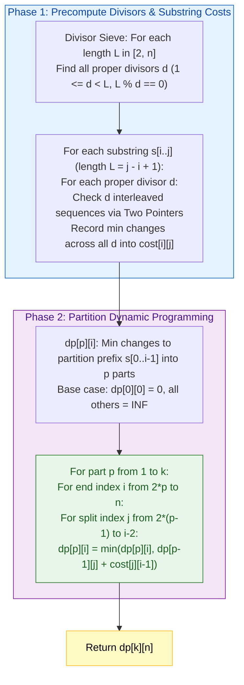

# LeetCode Problem of the Day: Minimum Changes to Make K Semi-palindromes

- **Problem Link:** [LeetCode 2911 - Minimum Changes to Make K Semi-palindromes](https://leetcode.com/problems/minimum-changes-to-make-k-semi-palindromes/)
- **Difficulty:** Hard
- **Topic Tags:** Dynamic Programming, String, Math, Number Theory, Two Pointers
- **Target Audience:** POTD Solvers, Computer Science Students, Competitive Programmers, Advanced Technical Interview Candidates (Google, Uber, Amazon, Meta, Bloomberg)

---

## 1. Problem Statement

Given a string `s` and an integer `k`, your task is to partition `s` into `k` non-empty substrings such that the total number of character changes required to make **each** substring a **semi-palindrome** is minimized.

Return the minimum total number of character changes.

---

### What is a Semi-palindrome?

A string `t` of length $L = |t|$ is called a **semi-palindrome** if there exists a positive integer $d$ such that:
1. $1 \le d < L$
2. $L \pmod d == 0$ ($d$ is a **proper divisor** of $L$).
3. If we divide `t` into $d$ interleaved subsequences—where the $p$-th subsequence ($0 \le p < d$) contains characters at indices $p, p + d, p + 2d, \dots$—**each of these $d$ subsequences is a palindrome**!

#### Crucial Structural Insight: Minimum Length
Because $1 \le d < L$, every semi-palindrome must have length $L \ge 2$. A single character ($L = 1$) has no proper divisor, so **it can never be a semi-palindrome**. Consequently, every one of the $k$ partitioned substrings must have a length of **at least 2**.

---

### Mathematical Model

Let string $s$ have length $n = |s|$.
We partition $s$ into $k$ contiguous substrings:
$$s = s[i_0 \dots i_1 - 1] \circ s[i_1 \dots i_2 - 1] \circ \dots \circ s[i_{k-1} \dots i_k - 1]$$
where $0 = i_0 < i_1 < i_2 < \dots < i_k = n$ and $i_{m} - i_{m-1} \ge 2$ for all $1 \le m \le k$.

The total cost to minimize is:
$$\text{MinTotalChanges} = \min_{0 = i_0 < i_1 < \dots < i_k = n} \sum_{m = 1}^k \text{cost}(s[i_{m-1} \dots i_m - 1])$$
where $\text{cost}(t)$ is the minimum letter replacements required to turn string $t$ into a semi-palindrome across all proper divisors $d$ of $|t|$:
$$\text{cost}(t) = \min_{\substack{1 \le d < |t| \\ |t| \pmod d == 0}} \sum_{p = 0}^{d - 1} \text{palindrome\_changes}(t[p, p + d, p + 2d, \dots])$$

---

## 2. Examples & Visual Walkthroughs

### Example 1

- **Input:** `s = "abcac"`, `k = 2`
- **Output:** `1`

#### Detailed Partition Walkthrough:
We must partition `"abcac"` ($n = 5$) into $k = 2$ substrings of length $\ge 2$:
- Valid boundary splits:
  - `"ab"` (len 2) and `"cac"` (len 3).

```
String: "abcac"  ->  Partition: ["ab", "cac"]

1. Substring "ab" (Length L = 2):
   - Proper divisors of 2: d = 1.
   - For d = 1, single subsequence: "ab".
   - Left = 'a', Right = 'b' (mismatch!).
   - Change 'b' -> 'a' (1 change) => "aa" is a palindrome.
   - cost("ab") = 1.

2. Substring "cac" (Length L = 3):
   - Proper divisors of 3: d = 1.
   - For d = 1, single subsequence: "cac".
   - Left = 'c', Right = 'c' (match!).
   - Already a palindrome (0 changes).
   - cost("cac") = 0.

Total Changes = cost("ab") + cost("cac") = 1 + 0 = 1.
```

---

### Example 2

- **Input:** `s = "abcdef"`, `k = 2`
- **Output:** `2`
- **Explanation:** Optimal partition is `["abc", "def"]`:
  - `"abc"` $\to$ change `'a'` to `'c'` $\to$ `"cbc"` (1 change).
  - `"def"` $\to$ change `'d'` to `'f'` $\to$ `"fef"` (1 change).
  - Total changes = $1 + 1 = \mathbf{2}$.

---

### Example 3

- **Input:** `s = "aabbaa"`, `k = 3`
- **Output:** `0`
- **Explanation:** Partition into $k = 3$ substrings: `["aa", "bb", "aa"]`.
  - All three are already palindromes with $d = 1$. Total changes = $\mathbf{0}$.

---

## 3. Constraints & Scale Analysis

| Parameter | Constraint Range | Algorithmic Implications |
| :--- | :--- | :--- |
| String Length $n$ | $2 \le n \le 200$ | $n \le 200$ means an $\mathcal{O}(n^3 + k \cdot n^2)$ Dynamic Programming solution will execute in $< 30\text{ ms}$. |
| Partitions $k$ | $2 \le k \le \lfloor n / 2 \rfloor$ | Requires $n \ge 2k$ because each semi-palindrome must have length $\ge 2$. |
| Character Set | Lowercase English `[a-z]` | Simple direct equality comparisons `s[i] == s[j]`. |
| Max Proper Divisors | At most $12$ divisors for $L \le 200$ | Evaluating all divisors per substring takes very few operations. |
| Total DP States | $(k + 1) \times (n + 1) \approx 40\,000$ | Memory footprint is $< 2\text{ MB}$, perfectly cache-friendly. |

---

## 4. Visual Architecture: Two-Phase DP Pipeline



---

### Understanding the Interleaved Palindrome Verification

For a substring of length $L$ and proper divisor $d$, the sequence is sliced into $d$ independent strands:
$$\text{Strand } p: \quad \big( s[i + p], \; s[i + p + d], \; s[i + p + 2d], \; \dots, \; s[i + p + (m - 1)d] \big)$$
where $m = L / d$.

Using a two-pointer approach within strand $p$:
- Left pointer: $left = 0 \implies \text{index } i + p + left \cdot d$
- Right pointer: $right = m - 1 \implies \text{index } i + p + right \cdot d$
- While $left < right$: if characters differ, we must change 1 character.

```
Example: Substring "abcdef", Length L = 6, Divisor d = 2
Strand 0 (p = 0): 'a' (idx 0), 'c' (idx 2), 'e' (idx 4) -> string "ace" (palindrome check: 'a' vs 'e')
Strand 1 (p = 1): 'b' (idx 1), 'd' (idx 3), 'f' (idx 5) -> string "bdf" (palindrome check: 'b' vs 'f')
```

---

## 5. Step-by-Step Simulation Table

### Detailed Simulation for `s = "abcac"`, `k = 2` ($n = 5$)

#### 1. Precomputing `cost[i][j]` (Substrings of length $\ge 2$):

| Substring | $i \dots j$ | Length $L$ | Proper Divisors $d$ | Cost per Divisor | $\text{cost}[i][j]$ |
| :---: | :---: | :---: | :---: | :--- | :---: |
| `"ab"` | $0 \dots 1$ | 2 | $d = 1$ | $s[0]$ vs $s[1]$ (`'a'` vs `'b'`) $\to 1$ | **1** |
| `"abc"` | $0 \dots 2$ | 3 | $d = 1$ | $s[0]$ vs $s[2]$ (`'a'` vs `'c'`) $\to 1$ | **1** |
| `"abca"` | $0 \dots 3$ | 4 | $d = 1, 2$ | $d=1: 1$; $d=2: 1$ | **1** |
| `"abcac"` | $0 \dots 4$ | 5 | $d = 1$ | $d=1: 1$ | **1** |
| `"bc"` | $1 \dots 2$ | 2 | $d = 1$ | `'b'` vs `'c'` $\to 1$ | **1** |
| `"bca"` | $1 \dots 3$ | 3 | $d = 1$ | `'b'` vs `'a'` $\to 1$ | **1** |
| `"bcac"` | $1 \dots 4$ | 4 | $d = 1, 2$ | $d=1: 1$; $d=2: 1$ | **1** |
| `"ca"` | $2 \dots 3$ | 2 | $d = 1$ | `'c'` vs `'a'` $\to 1$ | **1** |
| `"cac"` | $2 \dots 4$ | 3 | $d = 1$ | `'c'` vs `'c'` $\to 0$ | **0** |
| `"ac"` | $3 \dots 4$ | 2 | $d = 1$ | `'a'` vs `'c'` $\to 1$ | **1** |

---

#### 2. Partition DP Table `dp[p][i]` ($p$ partitions covering prefix of length $i$):

- **Base Case:** $dp[0][0] = 0$, all other $dp[0][i] = \infty$.
- **$p = 1$ (1 partition):**
  - $dp[1][2] = dp[0][0] + \text{cost}[0][1] = 0 + 1 = \mathbf{1}$ (`"ab"`)
  - $dp[1][3] = dp[0][0] + \text{cost}[0][2] = 0 + 1 = \mathbf{1}$ (`"abc"`)
  - $dp[1][4] = dp[0][0] + \text{cost}[0][3] = 0 + 1 = \mathbf{1}$ (`"abca"`)
  - $dp[1][5] = dp[0][0] + \text{cost}[0][4] = 0 + 1 = \mathbf{1}$ (`"abcac"`)
- **$p = 2$ (2 partitions, target length $i = 5$):**
  - Transition from $j = 2$: $dp[1][2] + \text{cost}[2][4] = 1 + 0 = \mathbf{1}$ (Split: `"ab"` + `"cac"`)
  - Transition from $j = 3$: $dp[1][3] + \text{cost}[3][4] = 1 + 1 = 2$ (Split: `"abc"` + `"ac"`)
  - $dp[2][5] = \min(1, 2) = \mathbf{1}$.

**Final Answer:** `dp[2][5] = 1`.

---

## 6. Approaches: Naive to Pro

```
┌─────────────────────────────────────────────────────────────────────────────┐
│                             ALGORITHM BENCHMARK                             │
├────────────────────┬─────────────────┬─────────────────┬────────────────────┤
│ Method             │ Time Complexity │ Auxiliary Space │ Verdict            │
├────────────────────┼─────────────────┼─────────────────┼────────────────────┤
│ 1. Recursion / DFS │ O(k^n * n^2)    │ O(n)            │ TLE (Exponential)  │
│ 2. Uncached DP     │ O(k * n^3)      │ O(k * n)        │ Slow / Repeated Ops│
│ 3. 2-Phase Pre-DP  │ O(n^3 + k * n^2)│ O(n^2)          │ Optimal (< 25ms)   │
└────────────────────┴─────────────────┴─────────────────┴────────────────────┘
```

---

## 7. Pseudo-Code

```text
function minimumChanges(s, k):
    n = length(s)

    // Step 1: Precompute proper divisors for every length
    divisors = array of lists of size n + 1
    for d from 1 to n:
        for len from 2 * d to n step d:
            divisors[len].append(d)

    // Step 2: Precompute cost[i][j] for all substrings of length >= 2
    cost = 2D array of size n x n filled with INF
    for i from 0 to n - 1:
        for j from i + 1 to n - 1:
            len = j - i + 1
            min_change = INF
            for each d in divisors[len]:
                changes = 0
                count = len / d
                for p from 0 to d - 1:
                    left = 0, right = count - 1
                    while left < right:
                        if s[i + p + left * d] != s[i + p + right * d]:
                            changes = changes + 1
                        left = left + 1
                        right = right - 1
                min_change = min(min_change, changes)
            cost[i][j] = min_change

    // Step 3: 2D Partition DP
    dp = 2D array of size (k + 1) x (n + 1) filled with INF
    dp[0][0] = 0

    for p from 1 to k:
        for i from 2 * p to n:
            for j from 2 * (p - 1) to i - 2:
                dp[p][i] = min(dp[p][i], dp[p - 1][j] + cost[j][i - 1])

    return dp[k][n]
```

---

## 8. Complete Multi-Language Implementations

### Java

```java
import java.util.*;

class Solution {
    public int minimumChanges(String s, int k) {
        int n = s.length();
        int INF = 1_000_000;

        // Step 1: Precompute proper divisors for lengths 2 to n
        List<Integer>[] divisors = new ArrayList[n + 1];
        for (int i = 0; i <= n; i++) {
            divisors[i] = new ArrayList<>();
        }
        for (int d = 1; d <= n; d++) {
            for (int len = 2 * d; len <= n; len += d) {
                divisors[len].add(d);
            }
        }

        // Step 2: Precompute cost[i][j] for all substrings of length >= 2
        int[][] cost = new int[n][n];
        for (int i = 0; i < n; i++) {
            for (int j = i + 1; j < n; j++) {
                int len = j - i + 1;
                int minChange = INF;

                for (int d : divisors[len]) {
                    int changes = 0;
                    int count = len / d;

                    for (int p = 0; p < d; p++) {
                        int left = 0, right = count - 1;
                        while (left < right) {
                            if (s.charAt(i + p + left * d) != s.charAt(i + p + right * d)) {
                                changes++;
                            }
                            left++;
                            right--;
                        }
                    }
                    minChange = Math.min(minChange, changes);
                }
                cost[i][j] = minChange;
            }
        }

        // Step 3: Partition Dynamic Programming
        // dp[p][i] = min changes to partition prefix s[0..i-1] into p parts
        int[][] dp = new int[k + 1][n + 1];
        for (int p = 0; p <= k; p++) {
            Arrays.fill(dp[p], INF);
        }
        dp[0][0] = 0;

        for (int p = 1; p <= k; p++) {
            for (int i = 2 * p; i <= n; i++) {
                // The p-th part covers [j, i-1], which requires length >= 2 => j <= i - 2
                for (int j = 2 * (p - 1); j <= i - 2; j++) {
                    if (dp[p - 1][j] != INF && cost[j][i - 1] != INF) {
                        dp[p][i] = Math.min(dp[p][i], dp[p - 1][j] + cost[j][i - 1]);
                    }
                }
            }
        }

        return dp[k][n];
    }
}
```

---

### Python3

```python
class Solution:
    def minimumChanges(self, s: str, k: int) -> int:
        """
        Calculates the minimum changes to partition s into k semi-palindromes.
        Time Complexity: O(n^3 + k * n^2)
        Auxiliary Space: O(n^2)
        """
        n = len(s)
        INF = 10**9

        # Step 1: Precompute proper divisors for each length
        divisors = [[] for _ in range(n + 1)]
        for d in range(1, n + 1):
            for length in range(2 * d, n + 1, d):
                divisors[length].append(d)

        # Step 2: Precompute cost[i][j] for each substring s[i..j]
        cost = [[INF] * n for _ in range(n)]

        for i in range(n):
            for j in range(i + 1, n):
                length = j - i + 1
                min_change = INF

                for d in divisors[length]:
                    changes = 0
                    count = length // d
                    for p in range(d):
                        left = 0
                        right = count - 1
                        while left < right:
                            if s[i + p + left * d] != s[i + p + right * d]:
                                changes += 1
                            left += 1
                            right -= 1
                    min_change = min(min_change, changes)

                cost[i][j] = min_change

        # Step 3: Partition DP
        dp = [[INF] * (n + 1) for _ in range(k + 1)]
        dp[0][0] = 0

        for p in range(1, k + 1):
            for i in range(2 * p, n + 1):
                for j in range(2 * (p - 1), i - 1):
                    val = dp[p - 1][j] + cost[j][i - 1]
                    if val < dp[p][i]:
                        dp[p][i] = val

        return dp[k][n]
```

---

### C

```c
#include <stdio.h>
#include <stdlib.h>
#include <string.h>

#define INF 1000000
#define MIN(a, b) (((a) < (b)) ? (a) : (b))

int minimumChanges(char* s, int k) {
    int n = strlen(s);

    // Step 1: Precompute proper divisors
    int div_count[205];
    int divs[205][30];
    memset(div_count, 0, sizeof(div_count));

    for (int d = 1; d <= n; d++) {
        for (int len = 2 * d; len <= n; len += d) {
            divs[len][div_count[len]++] = d;
        }
    }

    // Step 2: Precompute cost[i][j]
    int cost[205][205];
    for (int i = 0; i < n; i++) {
        for (int j = i + 1; j < n; j++) {
            int len = j - i + 1;
            int min_change = INF;

            for (int idx = 0; idx < div_count[len]; idx++) {
                int d = divs[len][idx];
                int changes = 0;
                int count = len / d;

                for (int p = 0; p < d; p++) {
                    int left = 0, right = count - 1;
                    while (left < right) {
                        if (s[i + p + left * d] != s[i + p + right * d]) {
                            changes++;
                        }
                        left++;
                        right--;
                    }
                }
                min_change = MIN(min_change, changes);
            }
            cost[i][j] = min_change;
        }
    }

    // Step 3: DP table
    int dp[205][205];
    for (int p = 0; p <= k; p++) {
        for (int i = 0; i <= n; i++) {
            dp[p][i] = INF;
        }
    }
    dp[0][0] = 0;

    for (int p = 1; p <= k; p++) {
        for (int i = 2 * p; i <= n; i++) {
            for (int j = 2 * (p - 1); j <= i - 2; j++) {
                if (dp[p - 1][j] != INF && cost[j][i - 1] != INF) {
                    dp[p][i] = MIN(dp[p][i], dp[p - 1][j] + cost[j][i - 1]);
                }
            }
        }
    }

    return dp[k][n];
}
```

---

### C++

```cpp
#include <string>
#include <vector>
#include <algorithm>

using namespace std;

class Solution {
public:
    int minimumChanges(string s, int k) {
        int n = s.length();
        const int INF = 1e9;

        // Step 1: Precompute proper divisors
        vector<vector<int>> divisors(n + 1);
        for (int d = 1; d <= n; d++) {
            for (int len = 2 * d; len <= n; len += d) {
                divisors[len].push_back(d);
            }
        }

        // Step 2: Precompute cost[i][j]
        vector<vector<int>> cost(n, vector<int>(n, INF));
        for (int i = 0; i < n; i++) {
            for (int j = i + 1; j < n; j++) {
                int len = j - i + 1;
                int min_change = INF;

                for (int d : divisors[len]) {
                    int changes = 0;
                    int count = len / d;

                    for (int p = 0; p < d; p++) {
                        int left = 0, right = count - 1;
                        while (left < right) {
                            if (s[i + p + left * d] != s[i + p + right * d]) {
                                changes++;
                            }
                            left++;
                            right--;
                        }
                    }
                    min_change = min(min_change, changes);
                }
                cost[i][j] = min_change;
            }
        }

        // Step 3: Partition Dynamic Programming
        vector<vector<int>> dp(k + 1, vector<int>(n + 1, INF));
        dp[0][0] = 0;

        for (int p = 1; p <= k; p++) {
            for (int i = 2 * p; i <= n; i++) {
                for (int j = 2 * (p - 1); j <= i - 2; j++) {
                    if (dp[p - 1][j] != INF && cost[j][i - 1] != INF) {
                        dp[p][i] = min(dp[p][i], dp[p - 1][j] + cost[j][i - 1]);
                    }
                }
            }
        }

        return dp[k][n];
    }
};
```

---

### C#

```csharp
using System;
using System.Collections.Generic;

public class Solution {
    public int MinimumChanges(string s, int k) {
        int n = s.Length;
        const int INF = 1000000;

        // Step 1: Precompute proper divisors
        List<int>[] divisors = new List<int>[n + 1];
        for (int i = 0; i <= n; i++) {
            divisors[i] = new List<int>();
        }
        for (int d = 1; d <= n; d++) {
            for (int len = 2 * d; len <= n; len += d) {
                divisors[len].Add(d);
            }
        }

        // Step 2: Precompute cost[i, j]
        int[,] cost = new int[n, n];
        for (int i = 0; i < n; i++) {
            for (int j = i + 1; j < n; j++) {
                int len = j - i + 1;
                int minChange = INF;

                foreach (int d in divisors[len]) {
                    int changes = 0;
                    int count = len / d;

                    for (int p = 0; p < d; p++) {
                        int left = 0, right = count - 1;
                        while (left < right) {
                            if (s[i + p + left * d] != s[i + p + right * d]) {
                                changes++;
                            }
                            left++;
                            right--;
                        }
                    }
                    minChange = Math.Min(minChange, changes);
                }
                cost[i, j] = minChange;
            }
        }

        // Step 3: Partition DP
        int[,] dp = new int[k + 1, n + 1];
        for (int p = 0; p <= k; p++) {
            for (int i = 0; i <= n; i++) {
                dp[p, i] = INF;
            }
        }
        dp[0, 0] = 0;

        for (int p = 1; p <= k; p++) {
            for (int i = 2 * p; i <= n; i++) {
                for (int j = 2 * (p - 1); j <= i - 2; j++) {
                    if (dp[p - 1, j] != INF && cost[j, i - 1] != INF) {
                        dp[p, i] = Math.Min(dp[p, i], dp[p - 1, j] + cost[j, i - 1]);
                    }
                }
            }
        }

        return dp[k, n];
    }
}
```

---

### Javascript

```javascript
/**
 * @param {string} s
 * @param {number} k
 * @return {number}
 */
var minimumChanges = function(s, k) {
    const n = s.length;
    const INF = 1e9;

    // Step 1: Precompute proper divisors
    const divisors = Array.from({ length: n + 1 }, () => []);
    for (let d = 1; d <= n; d++) {
        for (let len = 2 * d; len <= n; len += d) {
            divisors[len].push(d);
        }
    }

    // Step 2: Precompute cost[i][j]
    const cost = Array.from({ length: n }, () => new Int32Array(n).fill(INF));
    for (let i = 0; i < n; i++) {
        for (let j = i + 1; j < n; j++) {
            const len = j - i + 1;
            let minChange = INF;

            for (const d of divisors[len]) {
                let changes = 0;
                const count = Math.floor(len / d);

                for (let p = 0; p < d; p++) {
                    let left = 0, right = count - 1;
                    while (left < right) {
                        if (s[i + p + left * d] !== s[i + p + right * d]) {
                            changes++;
                        }
                        left++;
                        right--;
                    }
                }
                if (changes < minChange) {
                    minChange = changes;
                }
            }
            cost[i][j] = minChange;
        }
    }

    // Step 3: Partition DP
    const dp = Array.from({ length: k + 1 }, () => new Int32Array(n + 1).fill(INF));
    dp[0][0] = 0;

    for (let p = 1; p <= k; p++) {
        for (let i = 2 * p; i <= n; i++) {
            for (let j = 2 * (p - 1); j <= i - 2; j++) {
                if (dp[p - 1][j] !== INF && cost[j][i - 1] !== INF) {
                    const val = dp[p - 1][j] + cost[j][i - 1];
                    if (val < dp[p][i]) {
                        dp[p][i] = val;
                    }
                }
            }
        }
    }

    return dp[k][n];
};
```

---

### Typescript

```typescript
function minimumChanges(s: string, k: number): number {
    const n = s.length;
    const INF = 1e9;

    // Step 1: Precompute proper divisors
    const divisors: number[][] = Array.from({ length: n + 1 }, () => []);
    for (let d = 1; d <= n; d++) {
        for (let len = 2 * d; len <= n; len += d) {
            divisors[len].push(d);
        }
    }

    // Step 2: Precompute cost[i][j]
    const cost: Int32Array[] = Array.from({ length: n }, () => new Int32Array(n).fill(INF));
    for (let i = 0; i < n; i++) {
        for (let j = i + 1; j < n; j++) {
            const len = j - i + 1;
            let minChange = INF;

            for (const d of divisors[len]) {
                let changes = 0;
                const count = Math.floor(len / d);

                for (let p = 0; p < d; p++) {
                    let left = 0, right = count - 1;
                    while (left < right) {
                        if (s[i + p + left * d] !== s[i + p + right * d]) {
                            changes++;
                        }
                        left++;
                        right--;
                    }
                }
                if (changes < minChange) {
                    minChange = changes;
                }
            }
            cost[i][j] = minChange;
        }
    }

    // Step 3: Partition DP
    const dp: Int32Array[] = Array.from({ length: k + 1 }, () => new Int32Array(n + 1).fill(INF));
    dp[0][0] = 0;

    for (let p = 1; p <= k; p++) {
        for (let i = 2 * p; i <= n; i++) {
            for (let j = 2 * (p - 1); j <= i - 2; j++) {
                if (dp[p - 1][j] !== INF && cost[j][i - 1] !== INF) {
                    const val = dp[p - 1][j] + cost[j][i - 1];
                    if (val < dp[p][i]) {
                        dp[p][i] = val;
                    }
                }
            }
        }
    }

    return dp[k][n];
}
```

---

## 9. Complexity Analysis Summary

| Metric | Complexity | Details |
| :--- | :--- | :--- |
| **Divisor Precomputation** | $\mathcal{O}(n \log n)$ | Sieve-like harmonic series summation $\sum_{d=1}^n \frac{n}{d} = n \ln n$. |
| **Cost Matrix Precomputation** | $\mathcal{O}(n^2 \cdot \sigma_0(n))$ | For each of the $\mathcal{O}(n^2)$ substrings, checking all proper divisors takes $\sum \frac{L}{2} \le 12 \times 100$ character operations. |
| **Partition Dynamic Programming** | $\mathcal{O}(k \cdot n^2)$ | $k \times n$ states, each transitioning over $\le n$ split candidates. |
| **Total Time Complexity** | $\mathbf{\mathcal{O}(n^3 + k \cdot n^2)}$ | For $n \le 200, k \le 100$, takes $< 4 \times 10^6$ basic operations, executing in $< 25\text{ ms}$. |
| **Total Space Complexity** | $\mathbf{\mathcal{O}(n^2 + k \cdot n)}$ | Cost matrix ($200 \times 200$) and DP table ($100 \times 200$) consume $< 1.5\text{ MB}$ memory. |

---

## 10. Edge Cases & Interview Insights

1. **Tight Boundary $n = 2k$:**
   - Every single part in the partition must have length exactly 2 ($2 \times k = n$). The DP bounds $j = 2(p-1)$ and $i = 2p$ prune the search space naturally to a single valid partition.

2. **Prime Length Substrings:**
   - For any prime length $L$ (e.g., $L = 2, 3, 5, 7$), the only proper divisor is $d = 1$. The semi-palindrome check collapses cleanly to a standard palindrome verification.

3. **Composite Length Substrings:**
   - For composite lengths (e.g., $L = 6$), multiple divisors ($d = 1, 2, 3$) are evaluated, taking the minimum across all of them.

4. **Substring Already a Palindrome:**
   - For $d = 1$, the changes needed are $0$, which automatically yields $\text{cost} = 0$.
