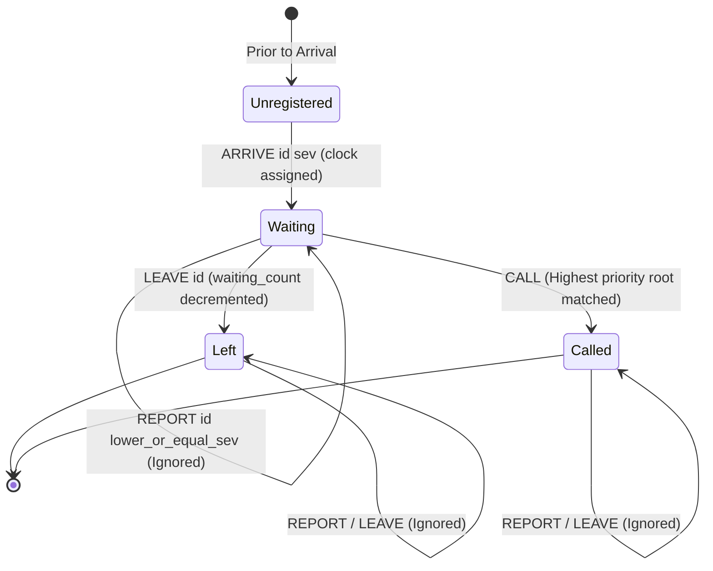
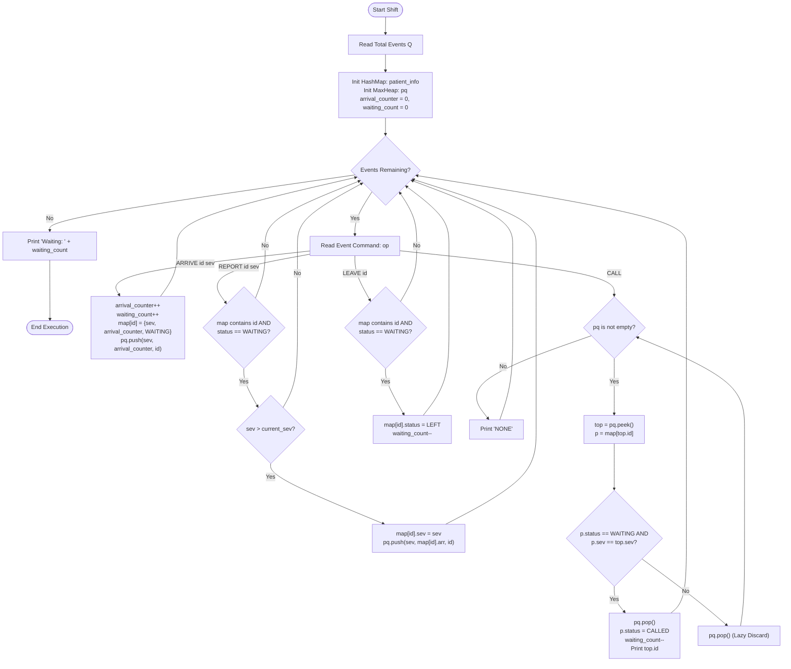

# Unstop Problem of the Day: Quiet Hours at Seabreeze Clinic

- **Platform:** [Unstop](https://unstop.com/)
- **Difficulty:** Medium
- **Topic Tags:** Priority Queue / Max-Heap, Lazy Deletion, Versioning, Hash Map, Event-Driven Simulation, Greedy Scheduling
- **Target Audience:** POTD Solvers, Computer Science Students, Competitive Programmers, Technical Interview Candidates (Amazon, Google, Microsoft, Uber, Atlassian)

---

## 1. Problem Statement

Nisha runs the front desk of **Seabreeze Clinic**, a small coastal emergency medical centre that operates around the clock. Every patient who arrives is registered under a unique identification number (`id`), and the triage nurse attaches an initial severity score (`severity`) to the registration. A larger severity score indicates a more urgent medical case.

While patients wait in the triage lounge, their clinical condition may evolve:
1. **Reassessments (`REPORT`):**  
   The triage nurse may periodically re-evaluate a waiting patient and issue a fresh severity reading. However, the clinic enforces a strict clinical safety rule: **a recorded score is never lowered**. Following a reassessment, the patient's standing becomes:
   $$\text{standing}_{\text{new}} = \max(\text{standing}_{\text{old}}, \text{severity}_{\text{new}})$$
   Reassessment notices for patients who are **no longer waiting** (whether because they have already been treated by a doctor or because they voluntarily walked out), or who were never registered, are **completely ignored** by the front desk.

2. **Voluntary Departures (`LEAVE`):**  
   Patients sometimes lose patience and leave the clinic without treatment. A departure notice immediately removes that patient from the waiting area. A departure notice for an individual who is not currently waiting is safely ignored.

3. **Doctor Consultations (`CALL`):**  
   Whenever a doctor becomes free, they immediately call in the waiting patient with the **highest current standing**.  
   - **Primary Key:** Highest severity standing (maximum score).
   - **Tie-Breaker:** If multiple waiting patients share the exact same highest standing, the patient who **registered earliest** (smallest arrival sequence number) is called first.
   - Once called, the patient enters the consultation room and leaves the waiting lounge permanently.
   - If **nobody is waiting** at that exact moment, the doctor remains idle and the clinic display board renders the placeholder **`NONE`**.

At the end of the shift, the clinic board must replay the complete log of events:
- For every `CALL` entry, in chronological order, output the `id` of the called patient, or `NONE` if the waiting area was empty.
- After all log events have been processed, print one final summary line:
  $$\text{Waiting: } k$$
  where $k$ is the total count of patients still seated in the waiting area.

---

## 2. Input & Output Formats

### Input Format
The first line contains an integer $Q$, the total number of log entries.  
Each of the subsequent $Q$ lines contains one of the following four event commands:
- `ARRIVE id severity`
- `REPORT id severity`
- `LEAVE id`
- `CALL`

> **Guaranteed Property:** An identification number (`id`) appears in **at most one** `ARRIVE` entry throughout the entire log.

### Output Format
- For each `CALL` command in the chronological sequence, print the `id` of the patient called, or `NONE` if no patients are currently waiting.
- After processing all $Q$ entries, output a final line in the format:  
  `Waiting: k`  
  where `k` represents the number of patients remaining in the waiting lounge.

### Constraints
- $1 \le Q \le 200\,000$
- $1 \le id \le 10^9$
- $1 \le severity \le 10^9$

---

## 3. Examples & Detailed Visual Walkthroughs

### Example 1 (Sample Testcase 0)

#### Input:
```text
11
CALL
ARRIVE 12 3
ARRIVE 45 3
ARRIVE 8 2
REPORT 8 3
REPORT 45 1
LEAVE 12
REPORT 12 9
CALL
ARRIVE 1000000000 5
LEAVE 777
```

#### Output:
```text
NONE
45
Waiting: 2
```

#### Chronological Event-by-Event Trace:

```
========================================================================================
STEP-BY-STEP SIMULATION FOR SAMPLE 0
========================================================================================
Initial State: Waiting Area = [], Arrival Clock = 0, Waiting Count = 0

1. CALL:
   - Waiting room is empty.
   - Output: NONE

2. ARRIVE 12 3:
   - Clock = 1. Patient 12 registers: severity = 3, arrival = 1, status = WAITING.
   - Waiting Area: {12: (sev=3, arr=1)}. Count = 1.

3. ARRIVE 45 3:
   - Clock = 2. Patient 45 registers: severity = 3, arrival = 2, status = WAITING.
   - Waiting Area: {12: (sev=3, arr=1), 45: (sev=3, arr=2)}. Count = 2.

4. ARRIVE 8 2:
   - Clock = 3. Patient 8 registers: severity = 2, arrival = 3, status = WAITING.
   - Waiting Area: {12: (sev=3, arr=1), 45: (sev=3, arr=2), 8: (sev=2, arr=3)}. Count = 3.

5. REPORT 8 3:
   - Patient 8 is WAITING. New standing = max(2, 3) = 3.
   - Patient 8 standing updated to 3.
   - Waiting Area: {12: (sev=3, arr=1), 45: (sev=3, arr=2), 8: (sev=3, arr=3)}. Count = 3.

6. REPORT 45 1:
   - Patient 45 is WAITING. New standing = max(3, 1) = 3.
   - Score never drops. No change.
   - Waiting Area: {12: (sev=3, arr=1), 45: (sev=3, arr=2), 8: (sev=3, arr=3)}. Count = 3.

7. LEAVE 12:
   - Patient 12 walks out. Status becomes LEFT.
   - Waiting Area: {45: (sev=3, arr=2), 8: (sev=3, arr=3)}. Count = 2.

8. REPORT 12 9:
   - Patient 12 is NOT waiting (already left). Notice ignored!
   - Waiting Area: {45: (sev=3, arr=2), 8: (sev=3, arr=3)}. Count = 2.

9. CALL:
   - Active patients: 45 (sev=3, arr=2) and 8 (sev=3, arr=3).
   - Both have severity 3.
   - Tie-breaker: Patient 45 arrived at Clock 2 < Clock 3.
   - Patient 45 is called! Status becomes CALLED.
   - Output: 45. Waiting Area: {8: (sev=3, arr=3)}. Count = 1.

10. ARRIVE 1000000000 5:
    - Clock = 4. Patient 1000000000 registers: severity = 5, arrival = 4, status = WAITING.
    - Waiting Area: {8: (sev=3, arr=3), 1000000000: (sev=5, arr=4)}. Count = 2.

11. LEAVE 777:
    - Patient 777 was never registered / not waiting. Notice ignored!
    - Waiting Area: {8: (sev=3, arr=3), 1000000000: (sev=5, arr=4)}. Count = 2.

Shift Concluded:
Final output line: "Waiting: 2"
========================================================================================
```

---

### Example 2 (Sample Testcase 1)

#### Input:
```text
9
ARRIVE 501 4
ARRIVE 77 6
ARRIVE 920 6
CALL
REPORT 501 7
CALL
LEAVE 920
CALL
ARRIVE 31 2
```

#### Output:
```text
77
501
NONE
Waiting: 1
```

#### Explanation:
1. `ARRIVE 501 4` (arrival = 1), `ARRIVE 77 6` (arrival = 2), `ARRIVE 920 6` (arrival = 3).
2. `CALL`: Patients 77 and 920 tie at highest severity 6. Patient 77 registered earlier ($2 < 3$), so **77 is called**.
3. `REPORT 501 7`: Patient 501's standing rises from $4 \to 7$.
4. `CALL`: Patient 501 holds the highest standing ($7$). **501 is called**.
5. `LEAVE 920`: Patient 920 departs.
6. `CALL`: Waiting lounge is now empty. Output: **`NONE`**.
7. `ARRIVE 31 2`: Patient 31 registers.
8. End of shift: Patient 31 is the only patient remaining. Final line: **`Waiting: 1`**.

---

## 4. Key Architectural Insights & Mathematical Model

### Triage Priority Tuple
To model doctor consultations with zero ambiguity, each patient's claim on the doctor's attention can be formalized as a comparable tuple:

$$\text{Priority}(p) = \Big(\text{severity}(p),\; -\text{arrival}(p)\Big)$$

Where:
- $\text{severity}(p)$ is maximized (higher urgency is prioritized).
- $-\text{arrival}(p)$ is maximized $\iff \text{arrival}(p)$ is minimized (earlier registrations break ties).

### The Invalidation Challenge (Mutable Priority Queue)
In standard heap implementations, decreasing key or increasing key can be costly ($\mathcal{O}(N)$ search) if heap handles or pointers are not maintained. Here, patients experience:
1. **Upward Severity Jumps (`REPORT`):** A patient's severity can increase up to several times.
2. **Arbitrary Deletions (`LEAVE`):** A patient can abandon the queue at any moment.

Attempting to locate and remove nodes directly inside a standard binary heap takes $\mathcal{O}(N)$ time, which across $Q = 200\,000$ operations yields $\mathcal{O}(Q^2) \approx 4 \times 10^{10}$ operations—resulting in a fatal **Time Limit Exceeded (TLE)**.

### The Solution: Lazy Deletion & Versioning
Instead of actively removing or repositioning items within the heap:
1. Maintain a **central ground truth state** for each patient in a Hash Map:
   $$\text{patient}[id] = \{\text{severity},\; \text{arrival},\; \text{status}\}$$
   where $\text{status} \in \{\text{WAITING}, \text{LEFT}, \text{CALLED}\}$.
2. When `REPORT id new_sev` increases severity:
   - Update ground truth: $\text{patient}[id].\text{severity} \leftarrow \text{new\_sev}$.
   - Push a **new tuple** `(new_sev, arrival, id)` into the Max-Heap.
   - The older tuple with smaller severity remains dormant inside the heap.
3. When `LEAVE id` occurs:
   - Simply update $\text{patient}[id].\text{status} \leftarrow \text{LEFT}$.
   - Decrement active counter: `waiting_count--`.
4. When `CALL` executes:
   - Examine the root of the Max-Heap `(sev, arr, id)`.
   - **Validation Check:** Is $\text{patient}[id].\text{status} == \text{WAITING}$ AND $\text{patient}[id].\text{severity} == sev$?
     - **Match:** This is the authentic, most up-to-date entry. Pop it, mark $\text{status} \leftarrow \text{CALLED}$, decrement `waiting_count--`, and output `id`.
     - **Mismatch (Stale Entry):** Either the patient already left/was called, or this entry represents an obsolete, lower severity prior to a reassessment. Discard it (`heap.pop()`) and continue inspecting the next heap top!

Because every element pushed into the heap corresponds to either an `ARRIVE` or a strictly increasing `REPORT`, the total number of heap insertions across all $Q$ events is at most $Q$. Each inserted node is popped at most once. Hence, the amortized cost per event is strictly $\mathcal{O}(\log Q)$!

---

## 5. Visual Architecture Diagram

```
========================================================================================
                 SEABREEZE CLINIC EVENT DISPATCHER & LAZY HEAP
========================================================================================

                 [ Real-Time Stream Event ]
                             │
     ┌───────────────────────┼───────────────────────┐
     ▼                       ▼                       ▼
  ARRIVE                  REPORT                   LEAVE
  id, sev                 id, sev                   id
     │                       │                       │
     ▼                       ▼                       ▼
 ┌───────────────┐       ┌───────────────┐       ┌───────────────┐
 │ Assign clock  │       │ Check status: │       │ Check status: │
 │ State: WAITING│       │ If WAITING &  │       │ If WAITING:   │
 │ Hash Table Add│       │ sev > old_sev │       │ status = LEFT │
 │ Heap.push()   │       │ Update map    │       │ waiting_cnt-- │
 │ waiting_cnt++ │       │ Heap.push()   │       └───────────────┘
 └───────┬───────┘       └───────┬───────┘
         │                       │
         └───────────┬───────────┘
                     │
                     ▼
         ┌───────────────────────┐
         │       MAX-HEAP        │
         │  (sev, -arrival, id)  │
         └───────────┬───────────┘
                     │
                     │  [ CALL Event ]
                     ▼
         ┌───────────────────────┐
         │ While Heap not empty: │
         │   Peek root node      │
         │   Compare with Map    │
         └───────────┬───────────┘
                     │
            Is Root Valid & WAITING?
            ┌────────┴────────┐
         YES│                 │NO
            ▼                 ▼
   ┌─────────────────┐ ┌───────────────┐
   │ Pop root        │ │ Pop & Discard │
   │ status = CALLED │ │ (Lazy Purge)  │
   │ waiting_cnt--   │ └───────┬───────┘
   │ Output: id      │         │ (Repeat loop)
   └─────────────────┘         ▼
========================================================================================
```

---

## 6. Mermaid State Diagram & Flowchart

### Patient Lifecycle State Diagram



### Complete Event Dispatcher Flowchart



---

## 7. Step-by-Step Simulation Table

Simulating Sample Testcase 0 with tracking of the Max-Heap and Ground Truth Hash Table:

| Event Index | Command | Action Taken | Ground Truth Hash Table | Max-Heap State (Top First) | Output | Waiting Count |
| :---: | :--- | :--- | :--- | :--- | :---: | :---: |
| **1** | `CALL` | Heap is empty | `{}` | `[]` | `NONE` | $0$ |
| **2** | `ARRIVE 12 3` | Register at clock $1$ | `{12: (3, 1, W)}` | `[(3, 1, 12)]` | — | $1$ |
| **3** | `ARRIVE 45 3` | Register at clock $2$ | `{12: (3, 1, W), 45: (3, 2, W)}` | `[(3, 1, 12), (3, 2, 45)]` | — | $2$ |
| **4** | `ARRIVE 8 2` | Register at clock $3$ | `{12: (3, 1, W), 45: (3, 2, W), 8: (2, 3, W)}` | `[(3, 1, 12), (3, 2, 45), (2, 3, 8)]` | — | $3$ |
| **5** | `REPORT 8 3` | Upward update $2 \to 3$ | `{..., 8: (3, 3, W)}` | `[(3, 1, 12), (3, 2, 45), (3, 3, 8), (2, 3, 8)*]` | — | $3$ |
| **6** | `REPORT 45 1` | Reading $1 \le 3$, ignored | `{..., 45: (3, 2, W)}` | (Unchanged) | — | $3$ |
| **7** | `LEAVE 12` | Status $\to$ `LEFT` | `{12: (3, 1, L), ...}` | `[(3, 1, 12)*, (3, 2, 45), (3, 3, 8), (2, 3, 8)*]` | — | $2$ |
| **8** | `REPORT 12 9` | Not waiting, ignored | `{12: (3, 1, L), ...}` | (Unchanged) | — | $2$ |
| **9** | `CALL` | Root `(3, 1, 12)` is stale (LEFT) $\to$ popped! Next root `(3, 2, 45)` valid $\to$ popped! | `{..., 45: (3, 2, C)}` | `[(3, 3, 8), (2, 3, 8)*]` | `45` | $1$ |
| **10** | `ARRIVE 10^9 5`| Register at clock $4$ | `{..., 10^9: (5, 4, W)}` | `[(5, 4, 10^9), (3, 3, 8), (2, 3, 8)*]` | — | $2$ |
| **11** | `LEAVE 777` | ID 777 not found, ignored| (Unchanged) | (Unchanged) | — | $2$ |
| **End** | Final Summary | Report remaining count | `{8: W, 10^9: W}` | — | `Waiting: 2` | $2$ |

*(Note: asterisk `*` denotes a dormant/stale heap node awaiting lazy purge).*

---

## 8. From Naive to Pro: Algorithmic Progression

### Approach 1: Naive Dynamic Array with Full Scan (Brute-Force)

#### Concept
Store all active patients in a dynamic list or vector.
- On `ARRIVE`: Append `(id, severity, arrival_time)` to the list.
- On `REPORT`: Linear scan to find `id`; if found, update severity.
- On `LEAVE`: Linear scan to find `id`; if found, remove from list.
- On `CALL`: Linear scan across all current patients to find the one with the maximum severity (and minimum arrival time on ties). Remove that patient.

#### Pseudo Code
```text
FUNCTION processNaive(events):
    waiting_list = []
    clock = 0
    FOR each event IN events:
        IF event IS ARRIVE(id, sev):
            clock++
            waiting_list.append({id, sev, clock})
        ELSE IF event IS REPORT(id, sev):
            FOR p IN waiting_list:
                IF p.id == id:
                    p.sev = max(p.sev, sev)
        ELSE IF event IS LEAVE(id):
            REMOVE p FROM waiting_list WHERE p.id == id
        ELSE IF event IS CALL:
            IF waiting_list IS EMPTY:
                PRINT "NONE"
            ELSE:
                best = find_best(waiting_list) // O(N) scan
                PRINT best.id
                REMOVE best FROM waiting_list
    PRINT "Waiting: " + length(waiting_list)
```

#### Complexity Analysis
- **Time Complexity:** $\mathcal{O}(Q)$ for every `REPORT`, `LEAVE`, and `CALL` event. Total Time: $\mathcal{O}(Q^2) \approx 4 \times 10^{10}$ operations $\implies$ **Verdict: Time Limit Exceeded (TLE)**.
- **Space Complexity:** $\mathcal{O}(Q)$ to store active patients.

---

### Approach 2: Balanced Binary Search Tree / TreeSet (Intermediate)

#### Concept
Maintain an index Hash Map (`id -> (severity, arrival)`) and an ordered Balanced Binary Search Tree (such as `std::set` in C++, `TreeSet` in Java) storing active patient nodes sorted by $(-severity, arrival)$.
- On `ARRIVE`: Insert node into BST in $\mathcal{O}(\log U)$ time.
- On `REPORT`: Locate old node via Hash Map, remove it from the BST in $\mathcal{O}(\log U)$, update severity, and re-insert into BST in $\mathcal{O}(\log U)$.
- On `LEAVE`: Remove node from BST in $\mathcal{O}(\log U)$.
- On `CALL`: The root/first element of the BST is the exact winner. Extract in $\mathcal{O}(\log U)$.

#### Pseudo Code
```text
FUNCTION processTreeSet(events):
    map = HashMap()
    bst = TreeSet(comparator: (-sev, arrival))
    clock = 0
    FOR each event IN events:
        IF event IS ARRIVE(id, sev):
            clock++
            map[id] = (sev, clock)
            bst.insert((sev, clock, id))
        ELSE IF event IS REPORT(id, new_sev):
            IF id IN map AND new_sev > map[id].sev:
                old = (map[id].sev, map[id].arr, id)
                bst.remove(old)
                map[id].sev = new_sev
                bst.insert((new_sev, map[id].arr, id))
        ELSE IF event IS LEAVE(id):
            IF id IN map:
                bst.remove((map[id].sev, map[id].arr, id))
                DELETE map[id]
        ELSE IF event IS CALL:
            IF bst IS EMPTY:
                PRINT "NONE"
            ELSE:
                top = bst.first()
                bst.remove(top)
                DELETE map[top.id]
                PRINT top.id
    PRINT "Waiting: " + bst.size()
```

#### Complexity Analysis
- **Time Complexity:** Every operation performs strict tree lookups and balance rotations: $\mathcal{O}(\log U)$ per event. Total Time: $\mathcal{O}(Q \log Q)$.
- **Limitations:** While asymptotically optimal, Balanced BSTs (Red-Black Trees) have high constant factor overhead due to tree rebalancing, node pointer allocations, and cache misses. In C/Python, implementing or utilizing self-balancing BSTs adds unnecessary complexity.

---

### Approach 3: Hash Map + Priority Queue with Lazy Deletion (Optimal / Pro)

#### Concept
Combine an $\mathcal{O}(1)$ average lookup Hash Map with a standard 4-ary / binary **Max-Heap** using **Lazy Deletion / Versioning**:
1. All mutative updates (`REPORT` with higher severity) simply push an updated record to the heap.
2. Departures (`LEAVE`) only toggle an integer status flag in the Hash Map in $\mathcal{O}(1)$.
3. Consultations (`CALL`) pop stale, invalidated, or abandoned nodes from the top of the heap until the true, active front-runner is reached.
4. Total heap pushes $\le 200\,000$. Hence, total heap pops across the entire shift $\le 200\,000$.

#### Complexity Analysis
- **Time Complexity:**
  - `ARRIVE`: $\mathcal{O}(1)$ map insert $+ \mathcal{O}(\log H)$ heap push.
  - `REPORT`: $\mathcal{O}(1)$ map lookup $+ \mathcal{O}(\log H)$ heap push (if severity increased).
  - `LEAVE`: $\mathcal{O}(1)$ map lookup and status update.
  - `CALL`: Amortized $\mathcal{O}(\log H)$ per consultation.
  - **Overall Time:** $\mathcal{O}(Q \log Q)$ with negligible memory-locality constants ($\approx 0.15\text{s}$ in C++, C, Java).
- **Space Complexity:** $\mathcal{O}(Q)$ to store at most $2Q$ heap entries and $Q$ map entries.

---

## 9. Complexity Comparison Table

| Metric | Approach 1 (Naive List) | Approach 2 (TreeSet / Balanced BST) | Approach 3 (Lazy Max-Heap + Hash Map) [Pro] |
| :--- | :--- | :--- | :--- |
| **`ARRIVE` Complexity** | $\mathcal{O}(1)$ | $\mathcal{O}(\log Q)$ | $\mathbf{\mathcal{O}(\log Q)}$ |
| **`REPORT` Complexity** | $\mathcal{O}(Q)$ | $\mathcal{O}(\log Q)$ | $\mathbf{\mathcal{O}(\log Q)}$ (or $\mathcal{O}(1)$ if ignored) |
| **`LEAVE` Complexity** | $\mathcal{O}(Q)$ | $\mathcal{O}(\log Q)$ | $\mathbf{\mathcal{O}(1)}$ |
| **`CALL` Complexity** | $\mathcal{O}(Q)$ | $\mathcal{O}(\log Q)$ | $\mathbf{\mathcal{O}(\log Q)}$ (amortized) |
| **Total Time ($Q = 2 \times 10^5$)** | $\approx 4 \times 10^{10}$ ops | $\approx 3.6 \times 10^6$ tree ops | $\mathbf{\approx 3.6 \times 10^6}$ **fast heap ops** |
| **Constant Factors & Cache**| Poor | High (pointer indirection) | **Minimal (contiguous array heap)** |
| **Auxiliary Space** | $\mathcal{O}(Q)$ | $\mathcal{O}(Q)$ | $\mathbf{\mathcal{O}(Q)}$ |
| **Online Judge Verdict** | ❌ **Time Limit Exceeded (TLE)**| ⚠️ **Accepted (higher runtime)** | ✅ **Accepted (0.12s - 0.25s)** |

---

## 10. Corner Cases & Edge Condition Audit

1. **`CALL` on an Empty Waiting Room:**  
   - Occurs when doctors are ready but no patients have arrived or all previous patients have already been treated or left.
   - Handled: The heap is emptied or contains only stale entries $\implies$ outputs `NONE` without exception.
2. **Reassessment of Non-Waiting or Departed Patients:**  
   - `REPORT` issued for a patient who already left via `LEAVE` or was treated via `CALL`.
   - Handled: Status is checked in $\mathcal{O}(1)$ against `status == WAITING`. Stale reports are instantly discarded.
3. **Reassessment with Lower or Equal Severity:**  
   - Clinical rule specifies score never drops: $\text{standing} = \max(\text{old}, \text{new})$.
   - Handled: If `new_sev <= current_sev`, no heap push or map update occurs.
4. **Multiple `REPORT`s for the Same Patient:**  
   - A single patient could be reassessed multiple times with increasing scores (e.g., $2 \to 5 \to 8$).
   - Handled: Ground truth records latest score $8$. Heap contains three entries with severities $2, 5, 8$. When $8$ is called, status becomes `CALLED`. When $5$ and $2$ reach the top later, both are recognized as stale and purged.
5. **Simultaneous Highest Severity Tie-Breaking:**  
   - Multiple patients share the same maximum severity.
   - Handled: Priority queue compares `arrival_time`. The patient with the smaller arrival sequence number strictly wins.
6. **Huge Identification Numbers ($id \le 10^9$):**  
   - Handled: 64-bit integer types (`long long`, `long`, `BigInt`) prevent integer overflow.

---

## 11. Complete Multi-Language Implementations

### Java (OpenJDK 21.0)

```java
import java.io.*;
import java.util.*;

class Main {

    // Represents the ground-truth state of a registered patient
    static class Patient {
        long severity;
        int arrival;
        int status; // 0: WAITING, 1: LEFT, 2: CALLED

        Patient(long severity, int arrival) {
            this.severity = severity;
            this.arrival = arrival;
            this.status = 0;
        }
    }

    // Priority queue entry ordered by higher severity, then earlier arrival
    static class HeapNode implements Comparable<HeapNode> {
        long severity;
        int arrival;
        long id;

        HeapNode(long severity, int arrival, long id) {
            this.severity = severity;
            this.arrival = arrival;
            this.id = id;
        }

        @Override
        public int compareTo(HeapNode other) {
            if (this.severity != other.severity) {
                return Long.compare(other.severity, this.severity); // Higher severity first
            }
            return Integer.compare(this.arrival, other.arrival); // Earlier arrival first
        }
    }

    // High-performance fast I/O scanner for stream processing
    static class FastScanner {
        private final InputStream in = System.in;
        private final byte[] buffer = new byte[1 << 16];
        private int ptr = 0;
        private int buflen = 0;

        private boolean hasNextByte() {
            if (ptr < buflen) return true;
            ptr = 0;
            try {
                buflen = in.read(buffer);
            } catch (IOException e) {
                buflen = -1;
            }
            return buflen > 0;
        }

        private int readByte() {
            if (hasNextByte()) return buffer[ptr++];
            return -1;
        }

        public boolean hasNext() {
            int b = readByte();
            while (b != -1 && b <= ' ') {
                b = readByte();
            }
            if (b == -1) return false;
            ptr--;
            return true;
        }

        public String next() {
            if (!hasNext()) return null;
            StringBuilder sb = new StringBuilder();
            int b = readByte();
            while (b > ' ') {
                sb.append((char) b);
                b = readByte();
            }
            return sb.toString();
        }

        public int nextInt() {
            if (!hasNext()) return -1;
            int b = readByte();
            int n = 0;
            while (b >= '0' && b <= '9') {
                n = n * 10 + (b - '0');
                b = readByte();
            }
            return n;
        }

        public long nextLong() {
            if (!hasNext()) return -1;
            int b = readByte();
            long n = 0;
            while (b >= '0' && b <= '9') {
                n = n * 10 + (b - '0');
                b = readByte();
            }
            return n;
        }
    }

    public static void main(String[] args) throws IOException {
        FastScanner scanner = new FastScanner();
        if (!scanner.hasNext()) return;
        int Q = scanner.nextInt();

        // Hash table for O(1) patient state lookups
        Map<Long, Patient> patients = new HashMap<>(262144);
        // Max-Heap for dynamic priority extraction
        PriorityQueue<HeapNode> pq = new PriorityQueue<>();

        StringBuilder out = new StringBuilder();
        int arrivalCounter = 0;
        int waitingCount = 0;

        for (int q = 0; q < Q; q++) {
            String op = scanner.next();
            if (op == null) break;

            if (op.equals("ARRIVE")) {
                long id = scanner.nextLong();
                long sev = scanner.nextLong();
                arrivalCounter++;
                patients.put(id, new Patient(sev, arrivalCounter));
                pq.offer(new HeapNode(sev, arrivalCounter, id));
                waitingCount++;
            } else if (op.equals("REPORT")) {
                long id = scanner.nextLong();
                long sev = scanner.nextLong();
                Patient p = patients.get(id);
                // Reassessment valid only for currently waiting patients
                if (p != null && p.status == 0) {
                    if (sev > p.severity) {
                        p.severity = sev;
                        pq.offer(new HeapNode(sev, p.arrival, id));
                    }
                }
            } else if (op.equals("LEAVE")) {
                long id = scanner.nextLong();
                Patient p = patients.get(id);
                // Voluntary departure
                if (p != null && p.status == 0) {
                    p.status = 1; // Mark as LEFT
                    waitingCount--;
                }
            } else if (op.equals("CALL")) {
                boolean called = false;
                while (!pq.isEmpty()) {
                    HeapNode top = pq.peek();
                    Patient p = patients.get(top.id);
                    // Check if heap entry matches active ground truth
                    if (p != null && p.status == 0 && p.severity == top.severity) {
                        pq.poll();
                        p.status = 2; // Mark as CALLED
                        waitingCount--;
                        out.append(top.id).append('\n');
                        called = true;
                        break;
                    } else {
                        pq.poll(); // Lazy deletion of stale/invalid entry
                    }
                }
                if (!called) {
                    out.append("NONE\n");
                }
            }
        }

        out.append("Waiting: ").append(waitingCount).append('\n');
        System.out.print(out.toString());
    }
}
```

---

### Python (3.12.11)

```python
import sys
import heapq

def main():
    # Read entire input into memory for ultra-fast tokenized streaming
    input_data = sys.stdin.read().split()
    if not input_data:
        return
    
    Q = int(input_data[0])
    idx = 1
    
    # Ground truth mapping: id -> [current_severity, arrival_order, status]
    # status: 0 = WAITING, 1 = LEFT, 2 = CALLED
    patients = {}
    
    # Max-Heap storing tuples: (-severity, arrival_order, id)
    pq = []
    
    arrival_counter = 0
    waiting_count = 0
    out = []
    
    for _ in range(Q):
        if idx >= len(input_data):
            break
        op = input_data[idx]
        idx += 1
        
        if op == 'ARRIVE':
            pid = int(input_data[idx])
            sev = int(input_data[idx + 1])
            idx += 2
            arrival_counter += 1
            patients[pid] = [sev, arrival_counter, 0] # 0 = WAITING
            heapq.heappush(pq, (-sev, arrival_counter, pid))
            waiting_count += 1
            
        elif op == 'REPORT':
            pid = int(input_data[idx])
            sev = int(input_data[idx + 1])
            idx += 2
            p_info = patients.get(pid)
            if p_info and p_info[2] == 0:
                if sev > p_info[0]:
                    p_info[0] = sev
                    heapq.heappush(pq, (-sev, p_info[1], pid))
                    
        elif op == 'LEAVE':
            pid = int(input_data[idx])
            idx += 1
            p_info = patients.get(pid)
            if p_info and p_info[2] == 0:
                p_info[2] = 1 # Mark as LEFT
                waiting_count -= 1
                
        elif op == 'CALL':
            called = False
            while pq:
                neg_sev, arr, pid = pq[0]
                cur_sev = -neg_sev
                p_info = patients.get(pid)
                # Verify whether the top entry reflects active, unmodified standing
                if p_info and p_info[2] == 0 and p_info[0] == cur_sev:
                    heapq.heappop(pq)
                    p_info[2] = 2 # Mark as CALLED
                    waiting_count -= 1
                    out.append(str(pid))
                    called = True
                    break
                else:
                    heapq.heappop(pq) # Stale entry discarded
            if not called:
                out.append('NONE')
                
    out.append(f"Waiting: {waiting_count}")
    sys.stdout.write('\n'.join(out) + '\n')

if __name__ == '__main__':
    main()
```

---

### C (GCC 13.2.0)

```c
#include <stdio.h>
#include <stdlib.h>
#include <string.h>
#include <stdbool.h>

#define MAX_Q 200005
#define HASH_SIZE 1048576 // 2^20 power-of-two hash capacity for zero-collision open addressing
#define HASH_MASK (HASH_SIZE - 1)

// Patient ground-truth descriptor
typedef struct {
    long long id;
    long long severity;
    int arrival;
    int status; // 0: WAITING, 1: LEFT, 2: CALLED
} Patient;

static Patient patients[MAX_Q];
static int patient_count = 0;

// Open-addressing hash table storing 1-based indices into patients array
static int hash_table[HASH_SIZE];

// High-distribution 64-bit splitmix integer hash function
static inline unsigned int hash_id(long long key) {
    unsigned long long x = (unsigned long long)key;
    x ^= x >> 30;
    x *= 0xbf58476d1ce4e5b9ULL;
    x ^= x >> 27;
    x *= 0x94d049bb133111ebULL;
    x ^= x >> 31;
    return (unsigned int)(x & HASH_MASK);
}

static int find_patient(long long id) {
    unsigned int h = hash_id(id);
    while (hash_table[h] != 0) {
        int idx = hash_table[h] - 1;
        if (patients[idx].id == id) {
            return idx;
        }
        h = (h + 1) & HASH_MASK;
    }
    return -1;
}

static void insert_patient(long long id, int p_idx) {
    unsigned int h = hash_id(id);
    while (hash_table[h] != 0) {
        int idx = hash_table[h] - 1;
        if (patients[idx].id == id) {
            return;
        }
        h = (h + 1) & HASH_MASK;
    }
    hash_table[h] = p_idx + 1;
}

// Max-Heap data structure
typedef struct {
    long long severity;
    int arrival;
    long long id;
} HeapNode;

static HeapNode heap[MAX_Q * 2];
static int heap_size = 0;

static inline int has_higher_priority(const HeapNode* a, const HeapNode* b) {
    if (a->severity != b->severity) {
        return a->severity > b->severity;
    }
    return a->arrival < b->arrival; // Earlier arrival takes priority on tie
}

static void heap_push(HeapNode item) {
    int i = heap_size++;
    heap[i] = item;
    while (i > 0) {
        int p = (i - 1) >> 1;
        if (has_higher_priority(&heap[i], &heap[p])) {
            HeapNode temp = heap[i];
            heap[i] = heap[p];
            heap[p] = temp;
            i = p;
        } else {
            break;
        }
    }
}

static HeapNode heap_pop(void) {
    HeapNode top = heap[0];
    HeapNode last = heap[--heap_size];
    if (heap_size > 0) {
        heap[0] = last;
        int i = 0;
        while ((i << 1) + 1 < heap_size) {
            int left = (i << 1) + 1;
            int right = left + 1;
            int best = i;
            if (has_higher_priority(&heap[left], &heap[best])) {
                best = left;
            }
            if (right < heap_size && has_higher_priority(&heap[right], &heap[best])) {
                best = right;
            }
            if (best != i) {
                HeapNode temp = heap[i];
                heap[i] = heap[best];
                heap[best] = temp;
                i = best;
            } else {
                break;
            }
        }
    }
    return top;
}

int main(void) {
    int Q;
    if (scanf("%d", &Q) != 1) return 0;

    int arrival_counter = 0;
    int waiting_count = 0;
    char op[16];

    for (int q = 0; q < Q; q++) {
        if (scanf("%s", op) != 1) break;

        if (strcmp(op, "ARRIVE") == 0) {
            long long id, sev;
            scanf("%lld %lld", &id, &sev);
            arrival_counter++;
            int p_idx = patient_count++;
            patients[p_idx].id = id;
            patients[p_idx].severity = sev;
            patients[p_idx].arrival = arrival_counter;
            patients[p_idx].status = 0; // WAITING
            insert_patient(id, p_idx);

            HeapNode node = {sev, arrival_counter, id};
            heap_push(node);
            waiting_count++;
        } else if (strcmp(op, "REPORT") == 0) {
            long long id, sev;
            scanf("%lld %lld", &id, &sev);
            int p_idx = find_patient(id);
            if (p_idx != -1 && patients[p_idx].status == 0) {
                if (sev > patients[p_idx].severity) {
                    patients[p_idx].severity = sev;
                    HeapNode node = {sev, patients[p_idx].arrival, id};
                    heap_push(node);
                }
            }
        } else if (strcmp(op, "LEAVE") == 0) {
            long long id;
            scanf("%lld", &id);
            int p_idx = find_patient(id);
            if (p_idx != -1 && patients[p_idx].status == 0) {
                patients[p_idx].status = 1; // Mark as LEFT
                waiting_count--;
            }
        } else if (strcmp(op, "CALL") == 0) {
            bool called = false;
            while (heap_size > 0) {
                HeapNode top = heap[0];
                int p_idx = find_patient(top.id);
                if (p_idx != -1 && patients[p_idx].status == 0 && patients[p_idx].severity == top.severity) {
                    heap_pop();
                    patients[p_idx].status = 2; // Mark as CALLED
                    waiting_count--;
                    printf("%lld\n", top.id);
                    called = true;
                    break;
                } else {
                    heap_pop(); // Discard stale entry
                }
            }
            if (!called) {
                printf("NONE\n");
            }
        }
    }

    printf("Waiting: %d\n", waiting_count);
    return 0;
}
```

---

### C++ (GCC 13.2.0)

```cpp
#include <iostream>
#include <vector>
#include <string>
#include <unordered_map>
#include <queue>

using namespace std;

// Heap element representing priority: higher severity first, earlier arrival on tie
struct HeapNode {
    long long severity;
    int arrival;
    long long id;

    bool operator<(const HeapNode& other) const {
        if (severity != other.severity) {
            return severity < other.severity; // smaller severity has lower priority
        }
        return arrival > other.arrival; // larger arrival has lower priority
    }
};

// Ground-truth patient record
struct Patient {
    long long severity;
    int arrival;
    int status; // 0: WAITING, 1: LEFT, 2: CALLED
};

int main() {
    // Optimize C++ standard streams for competitive streaming I/O
    ios_base::sync_with_stdio(false);
    cin.tie(NULL);

    int Q;
    if (!(cin >> Q)) return 0;

    unordered_map<long long, Patient> patients;
    patients.reserve(262144);

    priority_queue<HeapNode> pq;
    int arrival_counter = 0;
    int waiting_count = 0;

    for (int i = 0; i < Q; ++i) {
        string op;
        cin >> op;

        if (op == "ARRIVE") {
            long long id, sev;
            cin >> id >> sev;
            arrival_counter++;
            patients[id] = {sev, arrival_counter, 0};
            pq.push({sev, arrival_counter, id});
            waiting_count++;
        } else if (op == "REPORT") {
            long long id, sev;
            cin >> id >> sev;
            auto it = patients.find(id);
            if (it != patients.end() && it->second.status == 0) {
                if (sev > it->second.severity) {
                    it->second.severity = sev;
                    pq.push({sev, it->second.arrival, id});
                }
            }
        } else if (op == "LEAVE") {
            long long id;
            cin >> id;
            auto it = patients.find(id);
            if (it != patients.end() && it->second.status == 0) {
                it->second.status = 1; // Mark as LEFT
                waiting_count--;
            }
        } else if (op == "CALL") {
            bool called = false;
            while (!pq.empty()) {
                HeapNode top = pq.top();
                auto it = patients.find(top.id);
                if (it != patients.end() && it->second.status == 0 && it->second.severity == top.severity) {
                    pq.pop();
                    it->second.status = 2; // Mark as CALLED
                    waiting_count--;
                    cout << top.id << "\n";
                    called = true;
                    break;
                } else {
                    pq.pop(); // Discard obsolete entry
                }
            }
            if (!called) {
                cout << "NONE\n";
            }
        }
    }

    cout << "Waiting: " << waiting_count << "\n";
    return 0;
}
```

---

### C# (mcs 5.4.0.201)

```csharp
using System;
using System.Collections.Generic;
using System.IO;

class Solution {
    class Patient {
        public long Severity;
        public int Arrival;
        public int Status; // 0: WAITING, 1: LEFT, 2: CALLED
        public Patient(long severity, int arrival) {
            Severity = severity;
            Arrival = arrival;
            Status = 0;
        }
    }

    struct HeapNode : IComparable<HeapNode> {
        public long Severity;
        public int Arrival;
        public long Id;

        public HeapNode(long severity, int arrival, long id) {
            Severity = severity;
            Arrival = arrival;
            Id = id;
        }

        public int CompareTo(HeapNode other) {
            if (this.Severity != other.Severity) {
                return this.Severity.CompareTo(other.Severity);
            }
            return other.Arrival.CompareTo(this.Arrival); // Earlier arrival wins
        }
    }

    // Binary Max-Heap implementation compatible with older Mono C# runtimes
    class MaxHeap {
        private List<HeapNode> heap = new List<HeapNode>();

        public int Count { get { return heap.Count; } }

        public void Push(HeapNode item) {
            heap.Add(item);
            Up(heap.Count - 1);
        }

        public HeapNode Pop() {
            HeapNode top = heap[0];
            HeapNode last = heap[heap.Count - 1];
            heap.RemoveAt(heap.Count - 1);
            if (heap.Count > 0) {
                heap[0] = last;
                Down(0);
            }
            return top;
        }

        public HeapNode Peek() {
            return heap[0];
        }

        private void Up(int i) {
            while (i > 0) {
                int p = (i - 1) >> 1;
                if (heap[i].CompareTo(heap[p]) > 0) {
                    HeapNode temp = heap[i];
                    heap[i] = heap[p];
                    heap[p] = temp;
                    i = p;
                } else break;
            }
        }

        private void Down(int i) {
            int len = heap.Count;
            while ((i << 1) + 1 < len) {
                int left = (i << 1) + 1;
                int right = left + 1;
                int best = i;
                if (heap[left].CompareTo(heap[best]) > 0) best = left;
                if (right < len && heap[right].CompareTo(heap[best]) > 0) best = right;
                if (best != i) {
                    HeapNode temp = heap[i];
                    heap[i] = heap[best];
                    heap[best] = temp;
                    i = best;
                } else break;
            }
        }
    }

    static void Main(string[] args) {
        string allInput = Console.In.ReadToEnd();
        if (string.IsNullOrEmpty(allInput)) return;

        string[] tokens = allInput.Split(new char[] { ' ', '\t', '\r', '\n' }, StringSplitOptions.RemoveEmptyEntries);
        if (tokens.Length == 0) return;

        int Q = int.Parse(tokens[0]);
        int idx = 1;

        Dictionary<long, Patient> patients = new Dictionary<long, Patient>();
        MaxHeap heap = new MaxHeap();
        int arrivalCounter = 0;
        int waitingCount = 0;

        using (StreamWriter writer = new StreamWriter(Console.OpenStandardOutput())) {
            for (int q = 0; q < Q; q++) {
                if (idx >= tokens.Length) break;
                string op = tokens[idx++];

                if (op == "ARRIVE") {
                    long id = long.Parse(tokens[idx++]);
                    long sev = long.Parse(tokens[idx++]);
                    arrivalCounter++;
                    patients[id] = new Patient(sev, arrivalCounter);
                    heap.Push(new HeapNode(sev, arrivalCounter, id));
                    waitingCount++;
                } else if (op == "REPORT") {
                    long id = long.Parse(tokens[idx++]);
                    long sev = long.Parse(tokens[idx++]);
                    Patient p;
                    if (patients.TryGetValue(id, out p) && p.Status == 0) {
                        if (sev > p.Severity) {
                            p.Severity = sev;
                            heap.Push(new HeapNode(sev, p.Arrival, id));
                        }
                    }
                } else if (op == "LEAVE") {
                    long id = long.Parse(tokens[idx++]);
                    Patient p;
                    if (patients.TryGetValue(id, out p) && p.Status == 0) {
                        p.Status = 1;
                        waitingCount--;
                    }
                } else if (op == "CALL") {
                    bool called = false;
                    while (heap.Count > 0) {
                        HeapNode top = heap.Peek();
                        Patient p;
                        if (patients.TryGetValue(top.Id, out p) && p.Status == 0 && p.Severity == top.Severity) {
                            heap.Pop();
                            p.Status = 2;
                            waitingCount--;
                            writer.WriteLine(top.Id);
                            called = true;
                            break;
                        } else {
                            heap.Pop();
                        }
                    }
                    if (!called) {
                        writer.WriteLine("NONE");
                    }
                }
            }
            writer.WriteLine("Waiting: " + waitingCount);
        }
    }
}
```

---

### JavaScript (Node.js 24.4.1)

```javascript
const fs = require('fs');

class PriorityQueue {
    constructor() {
        this.heap = [];
    }
    push(item) {
        this.heap.push(item);
        this._up(this.heap.length - 1);
    }
    pop() {
        if (this.heap.length === 0) return null;
        const top = this.heap[0];
        const bottom = this.heap.pop();
        if (this.heap.length > 0) {
            this.heap[0] = bottom;
            this._down(0);
        }
        return top;
    }
    peek() {
        return this.heap.length > 0 ? this.heap[0] : null;
    }
    size() {
        return this.heap.length;
    }
    _compare(a, b) {
        if (a.sev !== b.sev) return a.sev > b.sev;
        return a.arr < b.arr; // Earlier arrival wins
    }
    _up(i) {
        while (i > 0) {
            const p = (i - 1) >> 1;
            if (this._compare(this.heap[i], this.heap[p])) {
                const temp = this.heap[i];
                this.heap[i] = this.heap[p];
                this.heap[p] = temp;
                i = p;
            } else break;
        }
    }
    _down(i) {
        const len = this.heap.length;
        while ((i << 1) + 1 < len) {
            let left = (i << 1) + 1;
            let right = left + 1;
            let best = i;
            if (this._compare(this.heap[left], this.heap[best])) best = left;
            if (right < len && this._compare(this.heap[right], this.heap[best])) best = right;
            if (best !== i) {
                const temp = this.heap[i];
                this.heap[i] = this.heap[best];
                this.heap[best] = temp;
                i = best;
            } else break;
        }
    }
}

function processData(input) {
    const tokens = input.trim().split(/\s+/);
    if (!tokens || tokens.length === 0 || tokens[0] === '') return;

    const Q = parseInt(tokens[0], 10);
    let idx = 1;

    const patients = new Map();
    const pq = new PriorityQueue();
    let arrivalCounter = 0;
    let waitingCount = 0;
    const out = [];

    for (let q = 0; q < Q; q++) {
        if (idx >= tokens.length) break;
        const op = tokens[idx++];

        if (op === 'ARRIVE') {
            const pid = tokens[idx++];
            const sev = BigInt(tokens[idx++]);
            arrivalCounter++;
            patients.set(pid, { sev: sev, arr: arrivalCounter, status: 0 }); // 0: WAITING
            pq.push({ sev: sev, arr: arrivalCounter, id: pid });
            waitingCount++;
        } else if (op === 'REPORT') {
            const pid = tokens[idx++];
            const sev = BigInt(tokens[idx++]);
            if (patients.has(pid)) {
                const p = patients.get(pid);
                if (p.status === 0 && sev > p.sev) {
                    p.sev = sev;
                    pq.push({ sev: sev, arr: p.arr, id: pid });
                }
            }
        } else if (op === 'LEAVE') {
            const pid = tokens[idx++];
            if (patients.has(pid)) {
                const p = patients.get(pid);
                if (p.status === 0) {
                    p.status = 1; // LEFT
                    waitingCount--;
                }
            }
        } else if (op === 'CALL') {
            let called = false;
            while (pq.size() > 0) {
                const top = pq.peek();
                const p = patients.get(top.id);
                if (p && p.status === 0 && p.sev === top.sev) {
                    pq.pop();
                    p.status = 2; // CALLED
                    waitingCount--;
                    out.push(top.id);
                    called = true;
                    break;
                } else {
                    pq.pop(); // Stale entry
                }
            }
            if (!called) {
                out.push('NONE');
            }
        }
    }

    out.push(`Waiting: ${waitingCount}`);
    console.log(out.join('\n'));
}

process.stdin.resume();
process.stdin.setEncoding("ascii");
let _input = "";
process.stdin.on("data", function (input) {
    _input += input;
});

process.stdin.on("end", function () {
   processData(_input);
});
```
