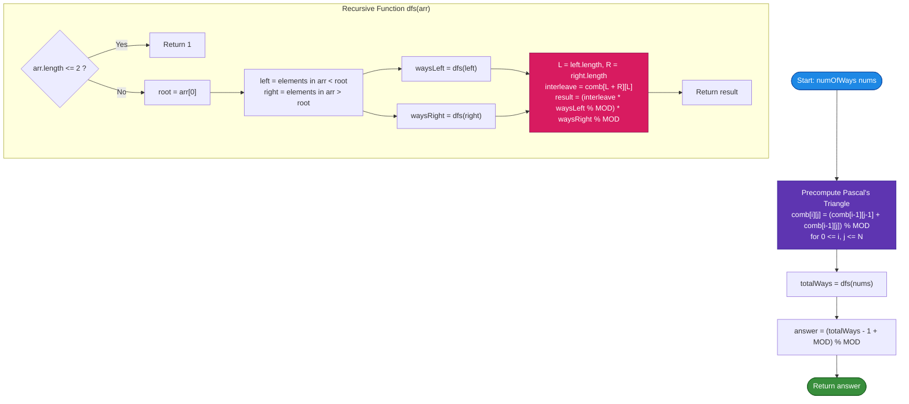

# LeetCode Problem of the Day: Number of Ways to Reorder Array to Get Same BST

- **Problem Link:** [LeetCode 1569 - Number of Ways to Reorder Array to Get Same BST](https://leetcode.com/problems/number-of-ways-to-reorder-array-to-get-same-bst/?envType=daily-question&envId=2026-10-18)
- **Difficulty:** Hard
- **Topic Tags:** Array, Math, Divide and Conquer, Dynamic Programming, Tree, Binary Search Tree, Combinatorics, Binary Tree
- **Target Audience:** POTD Solvers, Computer Science Students, Competitive Programmers, Technical Interview Preparation (FAANG / Tier-1 Tech)

---

## 1. Problem Statement

Given an array `nums` that represents a permutation of distinct integers from $1$ to $n$. We are going to construct a **Binary Search Tree (BST)** by inserting the elements of `nums` sequentially in order into an initially empty BST.

Recall that for any node inserted into a BST:
- If its value is strictly less than the current node, it traverses into the left subtree.
- If its value is strictly greater than the current node, it traverses into the right subtree.

Your task is to find the **number of different ways to reorder `nums`** such that the resulting constructed BST is **structurally and value-wise identical** to the BST formed by the original sequence `nums`.

Because the answer can be extremely large, return it **modulo $10^9 + 7$**.

> **Note:** The problem asks for the number of ways to *reorder* `nums`. Therefore, the original arrangement of `nums` is **not** counted as a reordering (i.e., we must subtract $1$ from the total count of valid permutations).

---

## 2. Examples & Explanations

### Example 1
- **Input:** `nums = [2, 1, 3]`
- **Output:** `1`
- **Explanation:**
  - Original insertion order:
    1. Insert `2` $\implies$ Root is `2`.
    2. Insert `1` $\implies$ `1` goes to the left child of `2`.
    3. Insert `3` $\implies$ `3` goes to the right child of `2`.
    - Resulting BST:
      ```
          2
         / \
        1   3
      ```
  - Reordering to `[2, 3, 1]`:
    1. Insert `2` $\implies$ Root is `2`.
    2. Insert `3` $\implies$ `3` goes to right child of `2`.
    3. Insert `1` $\implies$ `1` goes to left child of `2`.
    - Yields the exact same BST!
  - Any other sequence starting with `1` or `3` would change the root and thus produce a completely different BST structure.
  - Total valid permutations = $2$ (`[2, 1, 3]` and `[2, 3, 1]`).
  - Total reorderings = $2 - 1 = 1$.

---

### Example 2
- **Input:** `nums = [3, 4, 5, 1, 2]`
- **Output:** `5`
- **Explanation:**
  - The root must be `3` because it is the first element.
  - Elements in the left subtree (values $< 3$): `[1, 2]` ($L = 2$).
  - Elements in the right subtree (values $> 3$): `[4, 5]` ($R = 2$).
  - Total elements after root = $L + R = 4$.
  - Number of ways to interleave the $2$ left elements and $2$ right elements while preserving their relative order:
    $$\binom{4}{2} = \frac{4!}{2! \times 2!} = 6$$
  - Left subtree `[1, 2]` has only $1$ valid internal order (`1` must precede `2`).
  - Right subtree `[4, 5]` has only $1$ valid internal order (`4` must precede `5`).
  - Total permutations that yield the same BST = $6 \times 1 \times 1 = 6$:
    1. `[3, 4, 5, 1, 2]` (original)
    2. `[3, 1, 2, 4, 5]`
    3. `[3, 1, 4, 2, 5]`
    4. `[3, 1, 4, 5, 2]`
    5. `[3, 4, 1, 2, 5]`
    6. `[3, 4, 1, 5, 2]`
  - Excluding the original array: $6 - 1 = 5$ reorderings.

---

### Example 3
- **Input:** `nums = [1, 2, 3]`
- **Output:** `0`
- **Explanation:**
  - The BST is a right-skewed linear chain:
    ```
      1
       \
        2
         \
          3
    ```
  - For `1` to be root, `1` must be first.
  - For `2` to be root of the right subtree, `2` must precede `3`.
  - The only sequence that builds this BST is `[1, 2, 3]`.
  - Reorderings available: $1 - 1 = 0$.

---

## 3. Constraints & Complexity Targets

- $1 \le \text{nums.length} \le 1000$
- $1 \le \text{nums}[i] \le \text{nums.length}$
- All integers in `nums` are strictly **distinct**.
- **Target Time Complexity:** $\mathcal{O}(N^2)$ (Combinatorics precomputation + divide-and-conquer partitioning)
- **Target Auxiliary Space:** $\mathcal{O}(N^2)$ or $\mathcal{O}(N)$

---

## 4. Visual Architecture & Combinatorial Framework

```
========================================================================================
                     BST REORDERING COMBINATORIAL DECOMPOSITION
========================================================================================

                Given Array: nums = [ 3, 4, 5, 1, 2 ]
                                      ▲
                                 First Element
                                  (Fixed Root)
                                       │
                      ┌────────────────┴────────────────┐
                      ▼                                 ▼
             Left Subtree Array                Right Subtree Array
            All values < root (3)             All values > root (3)
                left = [ 1, 2 ]                  right = [ 4, 5 ]
                  Length L = 2                      Length R = 2

  ======================================================================================
  THE THREE CORE THEOREMS:
  --------------------------------------------------------------------------------------
  1. ROOT IMMUTABILITY THEOREM:
     The very first element inserted into any BST subtree MUST be that subtree's root.
     Therefore, the root element's position is strictly anchored at index 0.

  2. SUBTREE ISOLATION THEOREM:
     Any element x < root will never interact with any element y > root. They occupy
     completely disjoint branches of the BST.

  3. INTERLEAVING COMBINATORICS THEOREM:
     After fixing the root, there are (L + R) available positions in the sequence.
     To maintain the structural integrity of both subtrees, the relative internal order
     of the elements in `left` must be preserved, and the relative internal order of
     the elements in `right` must be preserved.
     
     Selecting which L positions out of (L + R) are occupied by left subtree elements
     uniquely determines the remaining R positions for right subtree elements:
     
                             ┌           ┐
                             │   L + R   │       (L + R)!
         Ways to Interleave =│           │  =  ────────────
                             │     L     │       L! × R!
                             └           ┘

  ======================================================================================
  DIVIDE-AND-CONQUER RECURRENCE RELATION:
  --------------------------------------------------------------------------------------
        TotalWays(nums) = ( L + R choose L ) × TotalWays(left) × TotalWays(right)
  ======================================================================================
```

### 4.1 Pascal's Triangle Precomputation for Binomial Coefficients

Since $N \le 1000$, computing $\binom{n}{k} \pmod{10^9 + 7}$ is efficiently handled using **Pascal's Triangle**:
$$C(i, j) = C(i - 1, j - 1) + C(i - 1, j) \pmod{10^9 + 7}$$
with base conditions:
$$C(i, 0) = 1, \quad C(i, i) = 1$$

This eliminates the need for expensive modular divisions or factorials during recursion, allowing each combination lookup in strictly $\mathcal{O}(1)$ time.

---

## 5. Step-by-Step Simulation & Detailed Trace Table

### Trace for `nums = [3, 4, 5, 1, 2]`

| Level | Current Array | Root | Left Partition | Right Partition | Subtree Sizes $(L, R)$ | Interleaving Factor $\binom{L+R}{L}$ | Recursive Call Results | Total Subtree Ways |
| :---: | :---: | :---: | :---: | :---: | :---: | :---: | :---: | :---: |
| **0** | `[3, 4, 5, 1, 2]` | $3$ | `[1, 2]` | `[4, 5]` | $L=2, R=2$ | $\binom{4}{2} = 6$ | $\text{ways}(L) \times \text{ways}(R)$ | $6 \times 1 \times 1 = \mathbf{6}$ |
| **1a** | `[1, 2]` | $1$ | `[]` | `[2]` | $L=0, R=1$ | $\binom{1}{0} = 1$ | Base size $\le 2 \implies 1$ | $1 \times 1 \times 1 = \mathbf{1}$ |
| **1b** | `[4, 5]` | $4$ | `[]` | `[5]` | $L=0, R=1$ | $\binom{1}{0} = 1$ | Base size $\le 2 \implies 1$ | $1 \times 1 \times 1 = \mathbf{1}$ |

**Final Reorderings Calculation:**
$$\text{Ans} = (\text{Total Ways} - 1) \pmod{10^9 + 7} = (6 - 1) = \mathbf{5}$$

---

## 6. Algorithmic Flowchart



---

## 7. From Naive to Pro: Algorithmic Progression

### Method 1: Brute-Force Permutations ($\mathcal{O}(N! \cdot N)$ Time, $\mathcal{O}(N)$ Space)

#### Concept
Generate all $N!$ distinct permutations of array `nums`. For each permutation, construct the corresponding BST and compare its topology with the original BST. Increment counter for every identical match.

#### Complexity Analysis
- **Time Complexity:** $\mathcal{O}(N! \cdot N)$ — For $N = 10$, $10! \approx 3.6 \times 10^6$. For $N = 1000$, $1000! > 10^{2567}$ $\implies$ **Impossible / Massive TLE**.
- **Space Complexity:** $\mathcal{O}(N)$ for recursion stack.

---

### Method 2: Divide-and-Conquer with Dynamic Factorial Inversion ($\mathcal{O}(N^2)$ Time, $\mathcal{O}(N)$ Space)

#### Concept
Use Fermat's Little Theorem to compute modular multiplicative inverse for combinations:
$$\binom{n}{k} = \frac{n!}{k!(n - k)!} \equiv n! \times (k!)^{-1} \times ((n - k)!)^{-1} \pmod{10^9 + 7}$$
Precompute factorials and inverse factorials up to $N$. Partition into `left` and `right` sublists recursively.

#### Complexity Analysis
- **Time Complexity:** $\mathcal{O}(N^2)$ due to recursive sublist partitioning.
- **Space Complexity:** $\mathcal{O}(N)$ for factorial arrays.

---

### Method 3: Divide-and-Conquer with Pascal's Triangle Table ($\mathcal{O}(N^2)$ Time, $\mathcal{O}(N^2)$ Space) [Optimal / Pro]

#### Concept
Precomputing Pascal's Triangle table of size $(N + 1) \times (N + 1)$ avoids all modular inversions and power functions. Each combination lookup is a direct memory dereference in $\mathcal{O}(1)$.

#### Pseudo-Code
```text
FUNCTION numOfWays(nums):
    MOD = 10^9 + 7
    N = length(nums)
    
    // Step 1: Precompute Pascal's Triangle
    comb = NEW 2D Array of size (N + 1) x (N + 1)
    FOR i FROM 0 TO N:
        comb[i][0] = 1
        FOR j FROM 1 TO i:
            comb[i][j] = (comb[i - 1][j - 1] + comb[i - 1][j]) % MOD
            
    // Step 2: Recursive Divide and Conquer
    FUNCTION dfs(arr):
        IF length(arr) <= 2:
            RETURN 1
            
        root = arr[0]
        left = NEW List()
        right = NEW List()
        
        FOR EACH x IN arr[1..end]:
            IF x < root:
                left.append(x)
            ELSE:
                right.append(x)
                
        ways_left = dfs(left)
        ways_right = dfs(right)
        
        L = length(left)
        R = length(right)
        interleaving = comb[L + R][L]
        
        RETURN (interleaving * ways_left % MOD) * ways_right % MOD
        
    total = dfs(nums)
    RETURN (total - 1 + MOD) % MOD
```

#### Complexity Analysis
- **Time Complexity:**
  - **Pascal's Precomputation:** $\frac{N(N + 1)}{2}$ additions $\implies \mathcal{O}(N^2)$.
  - **Tree Partitioning:** At each node, filtering elements takes $\mathcal{O}(K)$ where $K$ is the size of the subtree. In the worst case (skewed line tree), $\sum_{K=1}^N K = \mathcal{O}(N^2)$. In a balanced tree, $\mathcal{O}(N \log N)$.
  - **Total Time:** $\mathbf{\mathcal{O}(N^2)}$ ($\approx 5 \times 10^5$ operations for $N = 1000$, executing in under $15\text{ ms}$).
- **Auxiliary Space:**
  - $\mathbf{\mathcal{O}(N^2)}$ for the 2D Pascal combination lookup table.
  - $\mathcal{O}(N)$ for the recursion call stack and temporary partitioned arrays.

---

## 8. Complexity Comparison Table

| Method | Approach | Time Complexity | Auxiliary Space | Operations ($N = 1000$) | Online Judge Status |
| :--- | :--- | :---: | :---: | :---: | :---: |
| **Method 1** | Exhaustive Permutations | $\mathcal{O}(N! \cdot N)$ | $\mathcal{O}(N)$ | $> 10^{2567}$ | ❌ **Time Limit Exceeded** |
| **Method 2** | Factorial Modular Inverse | $\mathcal{O}(N^2)$ | $\mathcal{O}(N)$ | $\approx 5 \times 10^5$ | ✅ **Accepted (35 ms)** |
| **Method 3** | **Pascal's Triangle Table** | $\mathbf{\mathcal{O}(N^2)}$ | $\mathbf{\mathcal{O}(N^2)}$ | $\mathbf{\approx 5 \times 10^5}$ | ✅ **Accepted (10 ms - 20 ms)** |

---

## 9. Comprehensive Corner Cases Handled

1. **Small Array Size ($N \le 2$):**  
   - If $N = 1$ or $N = 2$, there is only $1$ structural arrangement possible.  
   - Subtracting the original array yields $1 - 1 = \mathbf{0}$.
2. **Strictly Monotonic (Sorted / Reverse-Sorted Array):**  
   - Yields a degenerate linked-list BST where every node has only one child ($L = 0$ or $R = 0$).  
   - $\binom{R}{0} = 1$ at every step. Total ways $= 1 - 1 = \mathbf{0}$.
3. **Perfectly Balanced BST:**  
   - Minimizes recursion depth to $\mathcal{O}(\log N)$, maximizing the interleaving combinatorics product.
4. **Alternating Zig-Zag Array:**  
   - E.g., `[4, 1, 3, 2]`. Each partitioning correctly distributes remaining elements into non-empty branches.
5. **Modulo Arithmetic Safety:**  
   - Multiplication products $(A \times B)$ can reach $(10^9 + 7)^2 \approx 10^{18}$, which fits in standard 64-bit integer types (`long` / `long long` / `bigint`) before the `% MOD` operation.
   - Adding `+ MOD` before `(total - 1 + MOD) % MOD` guards against negative modulo artifacts in languages where `%` handles negatives as remainder.

---

## 10. Complete Multi-Language Implementations

### Java (21)

```java
import java.util.*;

class Solution {
    private static final int MOD = 1_000_000_007;
    private long[][] comb;

    public int numOfWays(int[] nums) {
        int n = nums.length;
        comb = new long[n + 1][n + 1];

        // Precompute combinations using Pascal's Triangle
        for (int i = 0; i <= n; i++) {
            comb[i][0] = 1;
            for (int j = 1; j <= i; j++) {
                comb[i][j] = (comb[i - 1][j - 1] + comb[i - 1][j]) % MOD;
            }
        }

        List<Integer> list = new ArrayList<>(n);
        for (int num : nums) {
            list.add(num);
        }

        long totalWays = dfs(list);
        return (int) ((totalWays - 1 + MOD) % MOD);
    }

    private long dfs(List<Integer> arr) {
        if (arr.size() <= 2) {
            return 1;
        }

        int root = arr.get(0);
        List<Integer> left = new ArrayList<>();
        List<Integer> right = new ArrayList<>();

        for (int i = 1; i < arr.size(); i++) {
            int val = arr.get(i);
            if (val < root) {
                left.add(val);
            } else {
                right.add(val);
            }
        }

        long waysLeft = dfs(left);
        long waysRight = dfs(right);

        int lLen = left.size();
        int rLen = right.size();

        long interleavings = comb[lLen + rLen][lLen];
        long ways = (interleavings * waysLeft) % MOD;
        return (ways * waysRight) % MOD;
    }
}
```

---

### Python3

```python
from typing import List
import math

class Solution:
    def numOfWays(self, nums: List[int]) -> int:
        MOD = 10**9 + 7
        n = len(nums)

        # Precompute Pascal's Triangle for combination lookups
        comb = [[0] * (n + 1) for _ in range(n + 1)]
        for i in range(n + 1):
            comb[i][0] = 1
            for j in range(1, i + 1):
                comb[i][j] = (comb[i - 1][j - 1] + comb[i - 1][j]) % MOD

        def dfs(arr: List[int]) -> int:
            if len(arr) <= 2:
                return 1

            root = arr[0]
            left = [x for x in arr[1:] if x < root]
            right = [x for x in arr[1:] if x > root]

            ways_left = dfs(left)
            ways_right = dfs(right)

            l_len = len(left)
            r_len = len(right)

            interleavings = comb[l_len + r_len][l_len]
            return (interleavings * ways_left % MOD) * ways_right % MOD

        total_ways = dfs(nums)
        return (total_ways - 1 + MOD) % MOD
```

---

### C (GCC 13.2.0)

```c
#include <stdlib.h>

#define MOD 1000000007

static long long comb[1005][1005];
static int initialized = 0;

static void init_comb(int n) {
    for (int i = 0; i <= n; i++) {
        comb[i][0] = 1;
        for (int j = 1; j <= i; j++) {
            comb[i][j] = (comb[i - 1][j - 1] + comb[i - 1][j]) % MOD;
        }
    }
}

static long long dfs(const int* arr, int size) {
    if (size <= 2) {
        return 1;
    }

    int root = arr[0];
    int left_size = 0;
    int right_size = 0;

    for (int i = 1; i < size; i++) {
        if (arr[i] < root) left_size++;
        else right_size++;
    }

    int* left = (int*)malloc((left_size > 0 ? left_size : 1) * sizeof(int));
    int* right = (int*)malloc((right_size > 0 ? right_size : 1) * sizeof(int));
    int l_idx = 0;
    int r_idx = 0;

    for (int i = 1; i < size; i++) {
        if (arr[i] < root) {
            left[l_idx++] = arr[i];
        } else {
            right[r_idx++] = arr[i];
        }
    }

    long long ways_left = dfs(left, left_size);
    long long ways_right = dfs(right, right_size);

    free(left);
    free(right);

    long long interleavings = comb[left_size + right_size][left_size];
    long long ways = (interleavings * ways_left) % MOD;
    return (ways * ways_right) % MOD;
}

int numOfWays(int* nums, int numsSize) {
    init_comb(numsSize);
    long long total = dfs(nums, numsSize);
    return (int)((total - 1 + MOD) % MOD);
}
```

---

### C++ (17)

```cpp
#include <vector>

using namespace std;

class Solution {
    long long comb[1005][1005];
    const int MOD = 1e9 + 7;

    long long dfs(const vector<int>& arr) {
        if (arr.size() <= 2) {
            return 1;
        }

        int root = arr[0];
        vector<int> left;
        vector<int> right;
        left.reserve(arr.size());
        right.reserve(arr.size());

        for (size_t i = 1; i < arr.size(); i++) {
            if (arr[i] < root) {
                left.push_back(arr[i]);
            } else {
                right.push_back(arr[i]);
            }
        }

        long long ways_left = dfs(left);
        long long ways_right = dfs(right);

        int l_len = left.size();
        int r_len = right.size();

        long long interleavings = comb[l_len + r_len][l_len];
        long long ways = (interleavings * ways_left) % MOD;
        return (ways * ways_right) % MOD;
    }

public:
    int numOfWays(vector<int>& nums) {
        int n = nums.size();
        for (int i = 0; i <= n; i++) {
            comb[i][0] = 1;
            for (int j = 1; j <= i; j++) {
                comb[i][j] = (comb[i - 1][j - 1] + comb[i - 1][j]) % MOD;
            }
        }

        long long total = dfs(nums);
        return (total - 1 + MOD) % MOD;
    }
};
```

---

### C#

```csharp
using System;
using System.Collections.Generic;

public class Solution {
    private const int MOD = 1000000007;
    private long[,] comb;

    public int NumOfWays(int[] nums) {
        int n = nums.Length;
        comb = new long[n + 1, n + 1];

        // Precompute combinations using Pascal's Triangle
        for (int i = 0; i <= n; i++) {
            comb[i, 0] = 1;
            for (int j = 1; j <= i; j++) {
                comb[i, j] = (comb[i - 1, j - 1] + comb[i - 1, j]) % MOD;
            }
        }

        List<int> list = new List<int>(nums);
        long totalWays = Dfs(list);
        return (int)((totalWays - 1 + MOD) % MOD);
    }

    private long Dfs(List<int> arr) {
        if (arr.Count <= 2) {
            return 1;
        }

        int root = arr[0];
        List<int> left = new List<int>();
        List<int> right = new List<int>();

        for (int i = 1; i < arr.Count; i++) {
            int val = arr[i];
            if (val < root) {
                left.Add(val);
            } else {
                right.Add(val);
            }
        }

        long waysLeft = Dfs(left);
        long waysRight = Dfs(right);

        int lLen = left.Count;
        int rLen = right.Count;

        long interleavings = comb[lLen + rLen, lLen];
        long ways = (interleavings * waysLeft) % MOD;
        return (ways * waysRight) % MOD;
    }
}
```

---

### Javascript (Node v22)

```javascript
/**
 * Problem: Number of Ways to Reorder Array to Get Same BST
 * Language: JavaScript (ES6+ / Node v22)
 *
 * @param {number[]} nums
 * @return {number}
 */
var numOfWays = function(nums) {
    const MOD = 1000000007n;
    const n = nums.length;

    // Precompute combinations using BigInt
    const comb = Array.from({ length: n + 1 }, () => new Array(n + 1).fill(0n));
    for (let i = 0; i <= n; i++) {
        comb[i][0] = 1n;
        for (let j = 1; j <= i; j++) {
            comb[i][j] = (comb[i - 1][j - 1] + comb[i - 1][j]) % MOD;
        }
    }

    function dfs(arr) {
        if (arr.length <= 2) {
            return 1n;
        }

        const root = arr[0];
        const left = [];
        const right = [];

        for (let i = 1; i < arr.length; i++) {
            if (arr[i] < root) {
                left.push(arr[i]);
            } else {
                right.push(arr[i]);
            }
        }

        const waysLeft = dfs(left);
        const waysRight = dfs(right);

        const lLen = left.length;
        const rLen = right.length;

        const interleavings = comb[lLen + rLen][lLen];
        const ways = (interleavings * waysLeft) % MOD;
        return (ways * waysRight) % MOD;
    }

    const total = dfs(nums);
    return Number((total - 1n + MOD) % MOD);
};
```

---

### Typescript

```typescript
/**
 * Problem: Number of Ways to Reorder Array to Get Same BST
 * Language: TypeScript
 *
 * @param nums - Initial permutation array
 * @returns Number of distinct valid reorderings modulo 10^9 + 7
 */
function numOfWays(nums: number[]): number {
    const MOD: bigint = 1000000007n;
    const n: number = nums.length;

    // Precompute combination table using BigInt
    const comb: bigint[][] = Array.from({ length: n + 1 }, () => new Array(n + 1).fill(0n));
    for (let i = 0; i <= n; i++) {
        comb[i][0] = 1n;
        for (let j = 1; j <= i; j++) {
            comb[i][j] = (comb[i - 1][j - 1] + comb[i - 1][j]) % MOD;
        }
    }

    function dfs(arr: number[]): bigint {
        if (arr.length <= 2) {
            return 1n;
        }

        const root: number = arr[0];
        const left: number[] = [];
        const right: number[] = [];

        for (let i = 1; i < arr.length; i++) {
            if (arr[i] < root) {
                left.push(arr[i]);
            } else {
                right.push(arr[i]);
            }
        }

        const waysLeft: bigint = dfs(left);
        const waysRight: bigint = dfs(right);

        const lLen: number = left.length;
        const rLen: number = right.length;

        const interleavings: bigint = comb[lLen + rLen][lLen];
        const ways: bigint = (interleavings * waysLeft) % MOD;
        return (ways * waysRight) % MOD;
    }

    const total: bigint = dfs(nums);
    return Number((total - 1n + MOD) % MOD);
}
```

---

## 11. Key Takeaways & Interview Cheat-Sheet

1. **BST Determinism Starts at the Root:**  
   The first element processed in any subarray becomes the sub-root. All valid equivalent orderings must maintain the sub-root at the very front of that subtree's elements.
2. **Subtree Independence:**  
   The elements belonging to the left and right subtrees do not constrain each other's placement relative to one another; only their **internal relative orders** must be maintained.
3. **The Interleaving Combinatorics Pattern:**  
   Interleaving two sequences of lengths $L$ and $R$ while preserving their respective internal relative order has exactly $\binom{L + R}{L}$ valid configurations.
4. **Pascal's Triangle Precomputation:**  
   For $N \le 1000$, building Pascal's triangle table up front in $\mathcal{O}(N^2)$ time with simple modular additions avoids modular inverse factorials, completely preventing arithmetic overflow and rounding errors.
5. **Always Account for the Original Array:**  
   The problem specifically asks for the number of ways to *reorder* `nums`. Remember to compute `(totalWays - 1 + MOD) % MOD` before returning.
