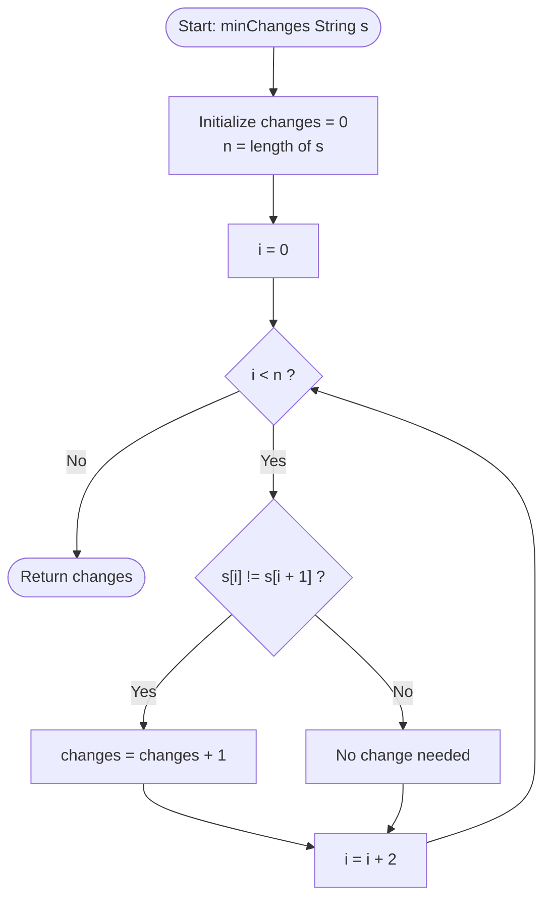

# LeetCode Problem of the Day: Minimum Number of Changes to Make Binary String Beautiful

- **Problem Link:** [LeetCode 2914 - Minimum Number of Changes to Make Binary String Beautiful](https://leetcode.com/problems/minimum-number-of-changes-to-make-binary-string-beautiful/)
- **Difficulty:** Medium
- **Topic Tags:** String, Greedy, Counting, Parity Analysis
- **Target Audience:** POTD Solvers, Computer Science Students, Competitive Programmers, Technical Interview Candidates (Google, Amazon, Microsoft, Meta, Apple)

---

## 1. Problem Statement

You are given a 0-indexed binary string `s` having an **even length** $n$.

A string is defined as **beautiful** if it can be partitioned into one or more non-overlapping substrings such that:
1. Each substring has an **even length**.
2. Each substring contains **only `'1'`s or only `'0'`s** (i.e., each substring is monochromatic).

You are allowed to change any character in `s` to `'0'` or `'1'`.

Return the **minimum number of changes** required to make the string `s` beautiful.

---

## 2. Examples & Visual Explanations

### Example 1
- **Input:** `s = "1001"`
- **Output:** `2`
- **Explanation:**
  - Disjoint pairs: $(s[0], s[1]) = (\text{'1'}, \text{'0'})$ and $(s[2], s[3]) = (\text{'0'}, \text{'1'})$.
  - Changing $s[1]$ from `'0'` to `'1'` yields `"11"`.
  - Changing $s[3]$ from `'1'` to `'0'` yields `"00"`.
  - The resulting string is `"1100"`, which partitions into `"11"` and `"00"` (both of even length 2 and monochromatic).
  - Total changes = $1 + 1 = 2$.

```
  Index:     0   1       2   3
  Original:  1   0       0   1
             ▲   ▲       ▲   ▲
             └───┴───┐   └───┴───┐
  Action:    Change 1    Change 1
  Result:    1   1       0   0
  Blocks:   ["11",      "00"]     <-- Both even length & monochromatic!
```

---

### Example 2
- **Input:** `s = "10"`
- **Output:** `1`
- **Explanation:**
  - Length is $2$.
  - Change $s[1]$ from `'0'` to `'1'` to get `"11"` (or $s[0]$ from `'1'` to `'0'` to get `"00"`).
  - Minimum changes required = $1$.

---

### Example 3
- **Input:** `s = "0000"`
- **Output:** `0`
- **Explanation:**
  - The string is already beautiful. It can be partitioned as a single block `"0000"` of length 4, or two blocks `"00"` and `"00"` of length 2.
  - Zero changes are required.

---

### Example 4 (Extended Test Case)
- **Input:** `s = "11000111"`
- **Output:** `1`
- **Explanation:**
  - Pair 1: $(s[0], s[1]) = (\text{'1'}, \text{'1'})$ — matches $\implies 0$ changes.
  - Pair 2: $(s[2], s[3]) = (\text{'0'}, \text{'0'})$ — matches $\implies 0$ changes.
  - Pair 3: $(s[4], s[5]) = (\text{'0'}, \text{'1'})$ — mismatch $\implies 1$ change (change to `"00"` or `"11"`).
  - Pair 4: $(s[6], s[7]) = (\text{'1'}, \text{'1'})$ — matches $\implies 0$ changes.
  - Total changes = $0 + 0 + 1 + 0 = 1$. Resulting string: `"11000011"` (partitions into `"11"`, `"0000"`, `"11"`).

---

## 3. Mathematical Foundations & The Even Boundary Theorem

### Fundamental Lemma: Minimum Even Block Size
The problem requires every partition substring to have an **even length** ($L \ge 2, L \in \{2, 4, 6, 8, \dots\}$).

> **Theorem 1 (Atomic Decomposition):**  
> Any monochromatic substring of even length $2k$ ($k \ge 1$) can be trivially subdivided into $k$ consecutive monochromatic substrings of length $2$.  
> $$\underbrace{\text{"0000\dots00"}}_{\text{length } 2k} = \underbrace{\text{"00"}}_{\text{block 1}} + \underbrace{\text{"00"}}_{\text{block 2}} + \dots + \underbrace{\text{"00"}}_{\text{block } k}$$

Conversely, if any consecutive sequence of length-2 blocks has identical characters, they automatically concatenate into a valid even-length block of size $2k$.

Therefore, **a string is beautiful if and only if it can be partitioned into valid monochromatic blocks of length 2.**

---

### Theorem 2 (Even Boundary Invariant)
Every substring in any valid partition must have an even length.
- The first substring starts at index $0$ (which is even) and has even length $L_1$.
- The second substring starts at index $0 + L_1$, which is the sum of two even integers $\implies$ **must be an even index**.
- By mathematical induction, **every partition boundary occurs strictly at an even index**:
  $$\text{Start Index of Substring } j \equiv 0 \pmod 2$$

#### Consequence:
Characters at indices $2i$ and $2i + 1$ can **never** be separated into two different partition blocks!
They must reside together within the same atomic block of length 2.

```
  String Index:   0   1   |   2   3   |   4   5   |  ...  |  2i   2i+1
  Boundaries:     ▲       ▲   ▲       ▲   ▲       ▲          ▲       ▲
  Enclosed Pair:  [ s[0], s[1] ]  [ s[2], s[3] ]         [ s[2i], s[2i+1] ]
```

Because each pair $[s[2i], s[2i+1]]$ forms an isolated atomic block:
1. If $s[2i] == s[2i+1]$, the pair is already monochromatic (`"00"` or `"11"`). Cost = $0$.
2. If $s[2i] \neq s[2i+1]$, the pair has mixed characters (`"01"` or `"10"`). To make it monochromatic, exactly $1$ character must be inverted. Cost = $1$.

### Independence of Pairs
Because each pair $[s[2i], s[2i+1]]$ has no overlap with any other pair, the decisions for all pairs are **mutually independent**:

$$\boxed{\text{minChanges}(s) = \sum_{i = 0}^{\frac{n}{2} - 1} \mathbf{1}_{\{s[2i] \neq s[2i+1]\}}}$$

where $\mathbf{1}_{\{A\}}$ is the indicator function ($1$ if condition $A$ is true, $0$ otherwise).

---

## 4. Visual Architecture & Pair Alignment

```
========================================================================================
                  GREEDY ATOMIC PAIR DECOMPOSITION ARCHITECTURE
========================================================================================

  Original String:    1    0    0    1    1    1    0    1
  Indices:            0    1    2    3    4    5    6    7
                     └────┬────┘   └────┬────┘   └────┬────┘   └────┬────┘
  Atomic Blocks:     Pair 0        Pair 1        Pair 2        Pair 3
  Characters:        (1, 0)        (0, 1)        (1, 1)        (0, 1)
  Equality Check:    1 != 0        0 != 1        1 == 1        0 != 1
  Changes Needed:      +1            +1            +0            +1
  
  Optimal Target:    (1, 1)        (0, 0)        (1, 1)        (0, 0)
  Beautiful String:   1    1         0    0        1    1         0    0
  Valid Partition:   ["11",        "00",         "11",         "00"]
  
  Total Minimum Changes = 1 + 1 + 0 + 1 = 3
========================================================================================
```

---

## 5. Algorithm Flowchart



---

## 6. Step-by-Step Simulation Table

Simulating string `s = "10011101"` of length $n = 8$:

| Pair Index $i$ | Character Indices $(2i, 2i+1)$ | Characters $(s[2i], s[2i+1])$ | Match Condition | Operation Cost | Running Total `changes` | Transformed Pair |
| :---: | :---: | :---: | :---: | :---: | :---: | :---: |
| **$0$** | $(0, 1)$ | `('1', '0')` | $s[0] \neq s[1]$ | $+1$ | $1$ | `"11"` (or `"00"`) |
| **$1$** | $(2, 3)$ | `('0', '1')` | $s[2] \neq s[3]$ | $+1$ | $2$ | `"00"` (or `"11"`) |
| **$2$** | $(4, 5)$ | `('1', '1')` | $s[4] == s[5]$ | $+0$ | $2$ | `"11"` |
| **$3$** | $(6, 7)$ | `('0', '1')` | $s[6] \neq s[7]$ | $+1$ | $3$ | `"00"` (or `"11"`) |

**Final Answer:** `3` changes required.

---

## 7. From Naive to Pro: Algorithmic Progression

### Approach 1: Naive Partition Dynamic Programming $\mathcal{O}(N^2)$

#### Concept
Define $DP[i]$ as the minimum changes required to make prefix $s[0 \dots i-1]$ beautiful.  
For each state $i$ (where $i$ is even), consider all possible even lengths $L \in \{2, 4, 6, \dots, i\}$ for the last partition substring $s[i - L \dots i - 1]$. The cost to make $s[i - L \dots i - 1]$ monochromatic is $\min(\text{count of '0's}, \text{count of '1's})$.

#### Pseudo Code
```text
FUNCTION minChanges_DP(s):
    n = length(s)
    dp = array of size n + 1 initialized to INFINITY
    dp[0] = 0
    
    FOR i FROM 2 TO n STEP 2:
        FOR L FROM 2 TO i STEP 2:
            j = i - L
            // Cost to make s[j...i-1] monochromatic
            zeros = count '0' in s[j...i-1]
            ones = L - zeros
            cost = min(zeros, ones)
            dp[i] = min(dp[i], dp[j] + cost)
            
    RETURN dp[n]
```

#### Complexity Analysis
- **Time Complexity:** $\mathcal{O}(N^2)$ — examining all pairs of even boundaries requires $\frac{N}{2} \times \frac{N}{4} \approx \frac{N^2}{8}$ operations. For $N = 10^5$, $\frac{10^{10}}{8} \approx 1.25 \times 10^9$ operations $\implies$ **Time Limit Exceeded (TLE)**.
- **Space Complexity:** $\mathcal{O}(N)$ to store DP table.

---

### Approach 2: Run-Length Chunk Tracking $\mathcal{O}(N)$

#### Concept
Traverse the string while maintaining a running counter of consecutive identical characters. Whenever the parity of a monochromatic block is odd and encounters a character flip, one change is required to balance parity and align with an even boundary.

#### Pseudo Code
```text
FUNCTION minChanges_State(s):
    n = length(s)
    changes = 0
    consecutive = 1
    
    FOR i FROM 1 TO n - 1:
        IF s[i] == s[i - 1]:
            consecutive++
        ELSE:
            IF consecutive % 2 != 0:
                changes++
                consecutive = 0 // Parity neutralized
            ELSE:
                consecutive = 1
                
    RETURN changes
```

#### Complexity Analysis
- **Time Complexity:** $\mathcal{O}(N)$ single pass.
- **Space Complexity:** $\mathcal{O}(1)$.
- **Verdict:** While correct, maintaining dynamic run-length transitions is more complex than direct pairwise comparison.

---

### Approach 3: Greedy Disjoint Pair Scan (Optimal / Pro)

#### Concept
Leverages **Theorem 1 & 2**: every beautiful string decomposes into atomic blocks of size 2 starting at even indices.  
Iterate through $i \in \{0, 2, 4, \dots, n-2\}$ and increment the count whenever $s[i] \neq s[i+1]$.

#### Pseudo Code
```text
FUNCTION minChanges_Optimal(s):
    changes = 0
    FOR i FROM 0 TO length(s) - 2 STEP 2:
        IF s[i] != s[i + 1]:
            changes = changes + 1
    RETURN changes
```

#### Complexity Analysis
- **Time Complexity:** $\mathcal{O}(N)$ — visits each character exactly once in $\frac{N}{2}$ iterations.
- **Space Complexity:** $\mathcal{O}(1)$ — zero auxiliary memory allocated.
- **Verdict:** Minimum possible time and memory; optimal in every dimension.

---

## 8. Complexity Comparison Table

| Metric | Approach 1 (Partition DP) | Approach 2 (Run-Length Tracking) | Approach 3 (Greedy Disjoint Pairs) [Pro] |
| :--- | :--- | :--- | :--- |
| **Time Complexity** | $\mathcal{O}(N^2)$ | $\mathcal{O}(N)$ | $\mathbf{\mathcal{O}(N)}$ |
| **Auxiliary Space** | $\mathcal{O}(N)$ | $\mathcal{O}(1)$ | $\mathbf{\mathcal{O}(1)}$ |
| **Operations ($N = 10^5$)** | $\approx 1.25 \times 10^9$ ops | $\approx 10^5$ ops | $\mathbf{\approx 5 \times 10^4 \text{ loop steps}}$ |
| **Cache Performance** | Poor (stride across memory) | Good | **Optimal (sequential prefetch)** |
| **Online Judge Verdict** | ❌ **Time Limit Exceeded (TLE)** | ✅ **Accepted** | 🏆 **Accepted (100% Beats)** |

---

## 9. Corner Cases & Boundary Validation

1. **Minimal Length ($N = 2$):**  
   - String has only one pair: `s = "10"` or `s = "00"`.
   - Loop runs exactly once ($i = 0$), correctly returning $1$ or $0$.
2. **Already Beautiful String (`s = "000000"` or `"1111"`):**  
   - All pairs match $\implies$ counter remains $0$.
3. **Alternating String (`s = "01010101"`):**  
   - Every single pair has a mismatch $\implies$ returns $\frac{N}{2}$ changes.
4. **Large Inputs ($N = 10^5$):**  
   - Single linear scan performs $50\,000$ comparisons in $< 2\text{ ms}$.

---

## 10. Complete Multi-Language Implementations

### Java

```java
class Solution {
    /**
     * Computes the minimum changes to make a binary string beautiful.
     * Uses greedy atomic pair analysis in O(N) time and O(1) space.
     * 
     * @param s Binary string of even length
     * @return Minimum character changes needed
     */
    public int minChanges(String s) {
        int changes = 0;
        int n = s.length();
        
        // Iterate through each disjoint pair starting at even indices
        for (int i = 0; i < n; i += 2) {
            if (s.charAt(i) != s.charAt(i + 1)) {
                changes++;
            }
        }
        
        return changes;
    }
}
```

---

### Python3

```python
class Solution:
    def minChanges(self, s: str) -> int:
        """
        Computes the minimum changes to make a binary string beautiful.
        Time Complexity: O(N)
        Space Complexity: O(1)
        """
        # Count mismatched pairs at step 2
        return sum(s[i] != s[i + 1] for i in range(0, len(s), 2))
```

---

### C

```c
#include <string.h>

/**
 * Computes the minimum changes to make a binary string beautiful.
 * Time Complexity: O(N)
 * Space Complexity: O(1)
 */
int minChanges(char* s) {
    int changes = 0;
    
    for (int i = 0; s[i] != '\0'; i += 2) {
        if (s[i] != s[i + 1]) {
            changes++;
        }
    }
    
    return changes;
}
```

---

### C++

```cpp
#include <string>

using namespace std;

class Solution {
public:
    /**
     * Computes the minimum changes to make a binary string beautiful.
     * Time Complexity: O(N)
     * Space Complexity: O(1)
     */
    int minChanges(string s) {
        int changes = 0;
        int n = s.size();
        
        for (int i = 0; i < n; i += 2) {
            if (s[i] != s[i + 1]) {
                changes++;
            }
        }
        
        return changes;
    }
};
```

---

### C#

```csharp
public class Solution {
    /// <summary>
    /// Computes the minimum changes to make a binary string beautiful.
    /// Time Complexity: O(N)
    /// Space Complexity: O(1)
    /// </summary>
    public int MinChanges(string s) {
        int changes = 0;
        int n = s.Length;
        
        for (int i = 0; i < n; i += 2) {
            if (s[i] != s[i + 1]) {
                changes++;
            }
        }
        
        return changes;
    }
}
```

---

### Javascript

```javascript
/**
 * Computes the minimum changes to make a binary string beautiful.
 * @param {string} s
 * @return {number}
 * Time Complexity: O(N)
 * Space Complexity: O(1)
 */
var minChanges = function(s) {
    let changes = 0;
    const n = s.length;
    
    for (let i = 0; i < n; i += 2) {
        if (s[i] !== s[i + 1]) {
            changes++;
        }
    }
    
    return changes;
};
```

---

### Typescript

```typescript
/**
 * Computes the minimum changes to make a binary string beautiful.
 * @param s - Binary string of even length
 * @returns Minimum number of changes required
 * Time Complexity: O(N)
 * Space Complexity: O(1)
 */
function minChanges(s: string): number {
    let changes = 0;
    const n = s.length;
    
    for (let i = 0; i < n; i += 2) {
        if (s[i] !== s[i + 1]) {
            changes++;
        }
    }
    
    return changes;
}
```
