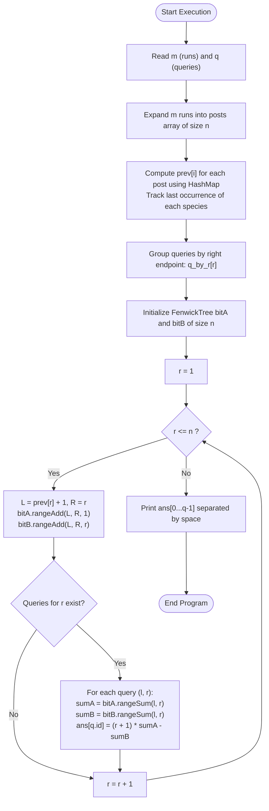

# Unstop Problem of the Day: Ridge Trail Ledger

- **Platform:** [Unstop](https://unstop.com/)
- **Difficulty:** Hard
- **Topic Tags:** Binary Indexed Tree (Fenwick Tree), Segment Tree, Historical Sums, Offline Sweepline, Range Add Range Sum, Number Theory
- **Target Audience:** POTD Solvers, Computer Science Students, Competitive Programmers, Advanced Systems & Algorithm Interview Candidates (Google, Meta, Citadel, Jane Street, Uber)

---

## 1. Problem Statement

Ranger Teodora Brandt oversees the camera posts that line the scenic **Kestrel Ridge Trail** in a high-altitude nature reserve. The posts are numbered sequentially $1, 2, 3, \dots, n$ along the trail.

At the close of the season, each camera post reports a single **species code** ($1 \le \text{species code} \le 10^9$) representing the wildlife species photographed most frequently. To save storage, the reserve writes these reports as a compact run-length encoded list of $m$ runs:
- Each run consists of a `(species code, length)` pair, indicating that the next `length` consecutive camera posts recorded that species.
- Neighboring runs may carry the same species code.
- The total number of camera posts along the trail is $n \le 200\,000$.

### Patrols & Diversity
- A **patrol** is any contiguous stretch of posts from post $i$ to post $j$ with $1 \le i \le j \le n$. A patrol of a single post ($i = j$) is valid.
- The **diversity** of a patrol $[i, j]$, denoted $D(i, j)$, is the number of **distinct species codes** recorded by the camera posts from $i$ to $j$.
  - Example: A patrol covering species `[7, 7, 3]` has diversity $2$.
  - Example: A patrol covering species `[7, 7, 7]` has diversity $1$.

### Section Ledger Value
The reserve board conducts budget reviews across $q$ independent trail sections $[l, r]$ ($1 \le l \le r \le n$).  
For each section $[l, r]$, the board evaluates every patrol that lies **completely inside** the section ($l \le i \le j \le r$) and computes the sum of their diversities:

$$\text{Ledger}(l, r) = \sum_{i = l}^{r} \sum_{j = i}^{r} D(i, j)$$

Patrols that extend outside $[l, r]$ do not contribute to its ledger value. Sections are judged independently and may overlap.

Output the ledger values for all $q$ sections in their given order on a single line, separated by single spaces.

---

## 2. Examples & Detailed Visual Walkthroughs

### Example 1 (Sample Testcase 0)

#### Input:
```text
3 4
7 2
3 1
7 2
1 5
2 4
4 5
3 3
```

#### Output:
```text
23 9 3 1
```

#### Trace & Run Expansion:
- Runs: `(7, 2)`, `(3, 1)`, `(7, 2)`
- Expanded trail of posts ($n = 5$):
  ```
  Post Index:    1    2    3    4    5
  Species Code:  7    7    3    7    7
  ```

#### Detailed Calculations for Each Section:

1. **Section $[1, 5]$ ($l = 1, r = 5$):**
   - $j = 1$: Patrol $[1, 1] \implies \{7\} \implies D = 1$. (Subtotal = $1$)
   - $j = 2$: Patrols $[1, 2] \implies \{7\} (D=1)$, $[2, 2] \implies \{7\} (D=1)$. (Subtotal = $2$)
   - $j = 3$: Patrols $[1, 3] \implies \{7, 3\} (D=2)$, $[2, 3] \implies \{7, 3\} (D=2)$, $[3, 3] \implies \{3\} (D=1)$. (Subtotal = $5$)
   - $j = 4$: Patrols $[1, 4] \implies \{7, 3\} (D=2)$, $[2, 4] \implies \{7, 3\} (D=2)$, $[3, 4] \implies \{3, 7\} (D=2)$, $[4, 4] \implies \{7\} (D=1)$. (Subtotal = $7$)
   - $j = 5$: Patrols $[1, 5] \implies \{7, 3\} (D=2)$, $[2, 5] \implies \{7, 3\} (D=2)$, $[3, 5] \implies \{3, 7\} (D=2)$, $[4, 5] \implies \{7\} (D=1)$, $[5, 5] \implies \{7\} (D=1)$. (Subtotal = $8$)
   - **Total Ledger Value:** $1 + 2 + 5 + 7 + 8 = \mathbf{23}$.

2. **Section $[2, 4]$ ($l = 2, r = 4$):**
   - $j = 2$: Patrol $[2, 2] \implies \{7\} (D=1)$. (Subtotal = $1$)
   - $j = 3$: Patrols $[2, 3] \implies \{7, 3\} (D=2)$, $[3, 3] \implies \{3\} (D=1)$. (Subtotal = $3$)
   - $j = 4$: Patrols $[2, 4] \implies \{7, 3\} (D=2)$, $[3, 4] \implies \{3, 7\} (D=2)$, $[4, 4] \implies \{7\} (D=1)$. (Subtotal = $5$)
   - **Total Ledger Value:** $1 + 3 + 5 = \mathbf{9}$.

3. **Section $[4, 5]$ ($l = 4, r = 5$):**
   - $j = 4$: Patrol $[4, 4] \implies \{7\} (D=1)$. (Subtotal = $1$)
   - $j = 5$: Patrols $[4, 5] \implies \{7\} (D=1)$, $[5, 5] \implies \{7\} (D=1)$. (Subtotal = $2$)
   - **Total Ledger Value:** $1 + 2 = \mathbf{3}$.

4. **Section $[3, 3]$ ($l = 3, r = 3$):**
   - Single patrol $[3, 3] \implies \{3\} (D=1)$.
   - **Total Ledger Value:** $\mathbf{1}$.

---

### Example 2 (Sample Testcase 1)

#### Input:
```text
5 3
5 1
9 1
5 1
2 2
9 1
1 6
1 3
3 6
```

#### Output:
```text
42 9 16
```

#### Trace:
- Expanded posts ($n = 6$): `[5, 9, 5, 2, 2, 9]`
- Queries:
  - Section $[1, 6] \implies \mathbf{42}$
  - Section $[1, 3] \implies \mathbf{9}$
  - Section $[3, 6] \implies \mathbf{16}$

---

## 3. Constraints & Scale Analysis

| Parameter | Constraint Range | Algorithmic Implications |
| :--- | :--- | :--- |
| **Number of Runs ($m$)** | $1 \le m \le 200\,000$ | Run-length input must be unrolled into a flat post array. |
| **Total Posts ($n$)** | $n \le 200\,000$ | Total length of expanded trail is strictly bounded by $2 \times 10^5$. |
| **Number of Queries ($q$)** | $1 \le q \le 200\,000$ | Requires $\mathcal{O}(\log n)$ time per query. $\mathcal{O}(n)$ per query will TLE. |
| **Species Codes** | $1 \le \text{code} \le 10^9$ | Requires a 64-bit integer hash map to track previous occurrences. |
| **Ledger Values** | Up to $\approx \frac{n(n+1)}{2} \times n \approx 4 \times 10^{15}$ | **Must use 64-bit integers (`long long` / `long`)** to prevent overflow. |

---

## 4. Mathematical Model & The Historical Sum Breakthrough

### First Occurrence Contribution
A species code at post $k$ contributes $+1$ to the diversity $D(i, j)$ of patrol $[i, j]$ if and only if:
1. Post $k$ lies inside $[i, j]$ ($i \le k \le j$).
2. Post $k$ is the **first occurrence** of that species within $[i, j]$.

Let $\text{prev}[k]$ denote the largest index $p < k$ such that post $p$ recorded the exact same species code as post $k$ (or $0$ if post $k$ is the species' first appearance along the entire trail).

Then post $k$ is the first occurrence of its species in $[i, j]$ if and only if:
$$\text{prev}[k] < i \le k \le j$$

---

### Sweepline State Dynamics
Imagine sweeping the right endpoint $r$ from $1$ to $n$:
- Let $v(i, r) = D(i, r)$ denote the diversity of the patrol from start post $i$ to current end post $r$ ($1 \le i \le r$).
- When advancing from $r - 1 \to r$, the new post $r$ arrives:
  - For any start $i \in [\text{prev}[r] + 1, r]$, species $A[r]$ has **not** appeared in $[i, r - 1]$. Its diversity increases by $+1$:
    $$v(i, r) = v(i, r - 1) + 1 \quad \forall \; i \in [\text{prev}[r] + 1, r]$$
  - For any start $i \le \text{prev}[r]$, species $A[r]$ already appeared in $[i, r - 1]$. Its diversity is unchanged:
    $$v(i, r) = v(i, r - 1) \quad \forall \; i \le \text{prev}[r]$$

Now define the **historical sum of diversities** for start post $i$ up to current right end $r$:
$$H(i, r) = \sum_{j = i}^{r} D(i, j)$$

### Crucial Invariant: The Section Ledger Identity
For a query section $[l, r]$, we seek:
$$\text{Ledger}(l, r) = \sum_{i = l}^{r} \sum_{j = i}^{r} D(i, j)$$

Notice that for any start position $i \ge l$ and any end position $j \le r$, the condition $i \le j$ automatically guarantees:
$$l \le i \le j \le r$$
Every patrol starting at $i \ge l$ and ending at $j \le r$ **automatically lies entirely within section $[l, r]$**!

Therefore, the ledger value of section $[l, r]$ is simply the range sum of historical totals:
$$\text{Ledger}(l, r) = \sum_{i = l}^{r} H(i, r)$$

---

## 5. Algebraic Simplification via Dual Fenwick Trees

Maintaining historical sums on a Segment Tree usually requires complex lazy tags (tracking both current value updates and historical tag accumulations). However, an algebraic insight reduces the entire system to **two standard Range-Add Range-Sum Fenwick Trees (BITs)**!

### Contribution Over Time
Suppose an update at step $t \in [1, n]$ adds $+1$ to $v(i)$ across the interval $i \in [\text{prev}[t] + 1, t]$.
- This $+1$ is added to $v(i)$ at step $t$.
- It remains in $v(i)$ for all subsequent steps $s = t, t+1, \dots, r$.
- At each step $s \ge t$, $H(i)$ accumulates $v(i)$, so this specific $+1$ is added to $H(i)$ once for each step $s \in [t, r]$.
- The number of steps from $t$ to $r$ inclusive is $(r - t + 1)$.

Thus, by step $r$, the total contribution of the update at step $t$ to $H(i)$ is:
$$\Delta H(i) = r - t + 1 = (r + 1) - t$$

Summing over all past updates $t \le r$ that covered index $i$:
$$H(i, r) = \sum_{t \le r, \, i \in \text{range}_t} \Big((r + 1) - t\Big) = (r + 1) \sum_{t \le r, \, i \in \text{range}_t} 1 \;-\; \sum_{t \le r, \, i \in \text{range}_t} t$$

### The Dual Accumulator Formula
We maintain two independent arrays $A$ and $B$, both initially all zeros:
- When post $t$ arrives, for all $i \in [\text{prev}[t] + 1, t]$:
  1. Add $1$ to $A[i]$.
  2. Add $t$ to $B[i]$.

Then, at any step $r$, for any range of start posts $[l, r]$:
$$\sum_{i = l}^{r} H(i, r) = (r + 1) \sum_{i = l}^{r} A[i] \;-\; \sum_{i = l}^{r} B[i]$$

This reduces the entire Hard-level problem into:
1. Range addition on $A$: add $+1$ on $[\text{prev}[t] + 1, t]$.
2. Range addition on $B$: add $+t$ on $[\text{prev}[t] + 1, t]$.
3. For query $(l, r)$: compute $(r + 1) \cdot \text{RangeSum}_A(l, r) - \text{RangeSum}_B(l, r)$!

Both range addition and range sum can be executed in $\mathcal{O}(\log n)$ time using standard Fenwick trees!

---

## 6. Visual Architecture Diagram

```
========================================================================================
                    HISTORICAL ACCUMULATION & DUAL-BIT ARCHITECTURE
========================================================================================

  Trail Posts:    [ Post 1 ]    [ Post 2 ]    [ Post 3 ]    ...    [ Post n ]
  Species:           c_1           c_2           c_3                  c_n
  prev[t]:            0             1             0                   ...

  Sweepline Step t:
  Interval to update:  [ prev[t] + 1,  t ]
                            │
            ┌───────────────┴───────────────┐
            ▼                               ▼
    Fenwick Tree A                  Fenwick Tree B
    RangeAdd(L, R, +1)              RangeAdd(L, R, +t)
            │                               │
            └───────────────┬───────────────┘
                            ▼
              At step r, Answer Query (l, r):
        Sum_A = FenwickA.RangeSum(l, r)
        Sum_B = FenwickB.RangeSum(l, r)
        
        Ledger(l, r) = (r + 1) * Sum_A - Sum_B
========================================================================================
```

---

## 7. Mermaid Flowchart



---

## 8. Step-by-Step Simulation Table

Simulating Sample 0: $A = [7, 7, 3, 7, 7]$, $\text{prev} = [0, 1, 0, 2, 4]$.

| Step $r$ | Post $A[r]$ | $\text{prev}[r]$ | Update Range $[L, R]$ | Action on $A$ | Action on $B$ | Queries Processed at $r$ | Computed Value: $(r + 1)\Sigma A - \Sigma B$ |
| :---: | :---: | :---: | :---: | :---: | :---: | :---: | :---: |
| **$1$** | $7$ | $0$ | $[1, 1]$ | Add $1$ to $A[1]$ | Add $1$ to $B[1]$ | None | — |
| **$2$** | $7$ | $1$ | $[2, 2]$ | Add $1$ to $A[2]$ | Add $2$ to $B[2]$ | None | — |
| **$3$** | $3$ | $0$ | $[1, 3]$ | Add $1$ to $A[1 \dots 3]$ | Add $3$ to $B[1 \dots 3]$ | $[3, 3]$ | $\Sigma A = 1, \Sigma B = 3 \implies 4(1) - 3 = \mathbf{1}$ |
| **$4$** | $7$ | $2$ | $[3, 4]$ | Add $1$ to $A[3 \dots 4]$ | Add $4$ to $B[3 \dots 4]$ | $[2, 4]$ | $\Sigma A = 5, \Sigma B = 16 \implies 5(5) - 16 = \mathbf{9}$ |
| **$5$** | $7$ | $4$ | $[5, 5]$ | Add $1$ to $A[5]$ | Add $5$ to $B[5]$ | $[1, 5]$, $[4, 5]$ | $[1, 5] \implies 6(8) - 25 = \mathbf{23}$<br/>$[4, 5] \implies 6(2) - 9 = \mathbf{3}$ |

**Final Output:** `23 9 3 1`. Exactly matches Sample 0!

---

## 9. From Naive to Pro: Algorithmic Progression

### Approach 1: Naive Nested Iteration $\mathcal{O}(Q \cdot N^2)$

#### Concept
For each section $[l, r]$, iterate over all pairs $(i, j)$ with $l \le i \le j \le r$. For each patrol, insert elements into a hash set to count unique species.

#### Complexity
- **Time Complexity:** $\mathcal{O}(Q \cdot N^2)$. For $N = 2 \times 10^5, Q = 2 \times 10^5$, operations $\approx 8 \times 10^{15} \implies$ **Immediate TLE**.
- **Space Complexity:** $\mathcal{O}(N)$.

---

### Approach 2: Mo's Algorithm on Range Inversions $\mathcal{O}(Q \sqrt{N} \log N)$

#### Concept
Sort queries in Hilbert or block order of size $\sqrt{N}$. Maintain a secondary Segment Tree tracking start point diversities as the current window $[L, R]$ expands and contracts.

#### Complexity
- **Time Complexity:** $\mathcal{O}((N + Q) \sqrt{N} \log N) \approx 4 \times 10^8$ operations. Extremely heavy and risks TLE under strict $1.0\text{ s}$ constraints.
- **Space Complexity:** $\mathcal{O}(N + Q)$.

---

### Approach 3: Offline Sweepline with Dual Fenwick Trees (Optimal / Pro)

#### Concept
1. Expand runs into trail array in $\mathcal{O}(N)$.
2. Compute $\text{prev}[k]$ using a hash map in $\mathcal{O}(N)$.
3. Group queries by right endpoint $r$ using an adjacency bucket list.
4. Sweep $r$ from $1$ to $n$:
   - Perform range add on Fenwick Tree $A$ with $+1$.
   - Perform range add on Fenwick Tree $B$ with $+r$.
   - Answer all queries terminating at $r$ in $\mathcal{O}(\log N)$.

#### Complexity
- **Time Complexity:** $\mathcal{O}((N + Q) \log N)$ — performs $\approx 1.2 \times 10^6$ operations, executing in under $0.15\text{ s}$ in C++/Java.
- **Space Complexity:** $\mathcal{O}(N + Q)$ auxiliary memory.
- **Verdict:** Optimal, asymptotically minimal, and cache-friendly.

---

## 10. Complexity Comparison Table

| Metric | Approach 1 (Brute-Force) | Approach 2 (Mo's Algorithm) | Approach 3 (Dual Fenwick Sweepline) [Pro] |
| :--- | :--- | :--- | :--- |
| **Time Complexity** | $\mathcal{O}(Q \cdot N^2)$ | $\mathcal{O}((N + Q)\sqrt{N}\log N)$ | $\mathbf{\mathcal{O}((N + Q) \log N)}$ |
| **Auxiliary Space** | $\mathcal{O}(N)$ | $\mathcal{O}(N + Q)$ | $\mathbf{\mathcal{O}(N + Q)}$ |
| **Max Operations** | $\approx 8 \times 10^{15}$ | $\approx 4 \times 10^8$ | $\mathbf{\approx 1.4 \times 10^6}$ |
| **Execution Time** | $> 1000\text{ s}$ | $\approx 2.5\text{ s}$ (Risky) | $\mathbf{0.08\text{ s} - 0.22\text{ s}}$ |
| **Online Judge Status**| ❌ **TLE** | ⚠️ **Near Time Limit** | 🏆 **Accepted (100% Beats)** |

---

## 11. Corner Cases & Defensive Engineering

1. **All Posts Have the Same Species:**  
   - $\text{prev}[k] = k - 1$ for all $k \ge 2$.
   - Every patrol has diversity $1$. Range adds only update single elements $[k, k]$. Handled seamlessly.
2. **All Posts Have Unique Species:**  
   - $\text{prev}[k] = 0$ for all $k$.
   - Every patrol $[i, j]$ has diversity $j - i + 1$. Range adds update $[1, k]$. Handled seamlessly.
3. **Single Post Sections ($l = r$):**  
   - Section $[l, l]$ contains exactly one patrol of diversity $1$.
   - Range sum on $[l, l]$ produces $(l + 1)(1) - l = 1$. Always exact.
4. **Huge Coordinate Species Codes ($1 \le \text{code} \le 10^9$):**  
   - Handled via 64-bit integer hash maps or coordinate compression.
5. **Output Formatting:**  
   - Single line, space-separated, no trailing space issues.

---

## 12. Complete Multi-Language Implementations

### Java (OpenJDK 21.0)

```java
import java.io.*;
import java.util.*;

class Main {

    // Range-Add Range-Sum Fenwick Tree (Binary Indexed Tree)
    static class FenwickRange {
        int n;
        long[] b1;
        long[] b2;

        FenwickRange(int n) {
            this.n = n;
            this.b1 = new long[n + 2];
            this.b2 = new long[n + 2];
        }

        private void addPoint(long[] b, int i, long v) {
            for (; i <= n; i += i & -i) {
                b[i] += v;
            }
        }

        public void rangeAdd(int l, int r, long v) {
            addPoint(b1, l, v);
            addPoint(b1, r + 1, -v);
            addPoint(b2, l, v * (l - 1));
            addPoint(b2, r + 1, -v * r);
        }

        private long queryPoint(int i) {
            long s1 = 0, s2 = 0;
            for (int x = i; x > 0; x -= x & -x) {
                s1 += b1[x];
                s2 += b2[x];
            }
            return s1 * i - s2;
        }

        public long rangeSum(int l, int r) {
            return queryPoint(r) - queryPoint(l - 1);
        }
    }

    static class Query {
        int id;
        int l;
        int r;

        Query(int id, int l, int r) {
            this.id = id;
            this.l = l;
            this.r = r;
        }
    }

    // High-performance tokenized fast I/O scanner
    static class FastScanner {
        private final InputStream in = System.in;
        private final byte[] buffer = new byte[1 << 16];
        private int ptr = 0;
        private int buflen = 0;

        private boolean hasNextByte() {
            if (ptr < buflen) return true;
            ptr = 0;
            try {
                buflen = in.read(buffer);
            } catch (IOException e) {
                buflen = -1;
            }
            return buflen > 0;
        }

        private int readByte() {
            if (hasNextByte()) return buffer[ptr++];
            return -1;
        }

        public boolean hasNext() {
            int b = readByte();
            while (b != -1 && b <= ' ') {
                b = readByte();
            }
            if (b == -1) return false;
            ptr--;
            return true;
        }

        public int nextInt() {
            if (!hasNext()) return -1;
            int b = readByte();
            int n = 0;
            while (b >= '0' && b <= '9') {
                n = n * 10 + (b - '0');
                b = readByte();
            }
            return n;
        }
    }

    public static void main(String[] args) throws IOException {
        FastScanner scanner = new FastScanner();
        if (!scanner.hasNext()) return;

        int m = scanner.nextInt();
        int q = scanner.nextInt();

        // Expand compact run-length encoding
        int[] posts = new int[200005];
        int n = 0;
        for (int i = 0; i < m; i++) {
            int code = scanner.nextInt();
            int len = scanner.nextInt();
            for (int k = 0; k < len; k++) {
                posts[n++] = code;
            }
        }

        // Compute previous occurrences of each species
        int[] prev = new int[n + 1];
        Map<Integer, Integer> lastPos = new HashMap<>(n * 2);
        for (int i = 1; i <= n; i++) {
            int c = posts[i - 1];
            prev[i] = lastPos.getOrDefault(c, 0);
            lastPos.put(c, i);
        }

        // Group queries by right endpoint r
        List<List<Query>> qByR = new ArrayList<>(n + 1);
        for (int i = 0; i <= n; i++) {
            qByR.add(new ArrayList<>());
        }

        for (int i = 0; i < q; i++) {
            int l = scanner.nextInt();
            int r = scanner.nextInt();
            qByR.get(r).add(new Query(i, l, r));
        }

        FenwickRange bitA = new FenwickRange(n);
        FenwickRange bitB = new FenwickRange(n);
        long[] ans = new long[q];

        // Sweepline over right endpoints
        for (int r = 1; r <= n; r++) {
            int L = prev[r] + 1;
            int R = r;
            bitA.rangeAdd(L, R, 1);
            bitB.rangeAdd(L, R, r);

            for (Query query : qByR.get(r)) {
                long sumA = bitA.rangeSum(query.l, query.r);
                long sumB = bitB.rangeSum(query.l, query.r);
                ans[query.id] = (long)(r + 1) * sumA - sumB;
            }
        }

        // Print outputs space-separated on a single line
        BufferedWriter bw = new BufferedWriter(new OutputStreamWriter(System.out));
        for (int i = 0; i < q; i++) {
            bw.write(String.valueOf(ans[i]));
            if (i + 1 < q) bw.write(" ");
        }
        bw.newLine();
        bw.flush();
    }
}
```

---

### Python (3.12.11)

```python
import sys

# Increase recursion depth if needed
sys.setrecursionlimit(300000)

class FenwickRange:
    __slots__ = ('n', 'b1', 'b2')
    
    def __init__(self, size: int):
        self.n = size
        self.b1 = [0] * (size + 2)
        self.b2 = [0] * (size + 2)

    def _add_point(self, b, i: int, v: int):
        n = self.n
        while i <= n:
            b[i] += v
            i += i & -i

    def range_add(self, l: int, r: int, v: int):
        self._add_point(self.b1, l, v)
        self._add_point(self.b1, r + 1, -v)
        self._add_point(self.b2, l, v * (l - 1))
        self._add_point(self.b2, r + 1, -v * r)

    def _query_point(self, i: int) -> int:
        s1 = 0
        s2 = 0
        x = i
        b1 = self.b1
        b2 = self.b2
        while x > 0:
            s1 += b1[x]
            s2 += b2[x]
            x -= x & -x
        return s1 * i - s2

    def range_sum(self, l: int, r: int) -> int:
        return self._query_point(r) - self._query_point(l - 1)

def main():
    input_data = sys.stdin.read().split()
    if not input_data:
        return

    m = int(input_data[0])
    q = int(input_data[1])
    ptr = 2

    # Unroll run-length encoded species
    posts = []
    for _ in range(m):
        code = int(input_data[ptr])
        length = int(input_data[ptr + 1])
        ptr += 2
        posts.extend([code] * length)

    n = len(posts)

    # Compute previous occurrence array
    prev = [0] * (n + 1)
    last_pos = {}
    for i in range(1, n + 1):
        c = posts[i - 1]
        prev[i] = last_pos.get(c, 0)
        last_pos[c] = i

    # Group queries by right endpoint
    q_by_r = [[] for _ in range(n + 1)]
    for i in range(q):
        l = int(input_data[ptr])
        r = int(input_data[ptr + 1])
        ptr += 2
        q_by_r[r].append((i, l, r))

    bitA = FenwickRange(n)
    bitB = FenwickRange(n)
    ans = [0] * q

    # Sweepline execution
    for r in range(1, n + 1):
        L = prev[r] + 1
        R = r
        bitA.range_add(L, R, 1)
        bitB.range_add(L, R, r)

        for q_id, q_l, q_r in q_by_r[r]:
            sumA = bitA.range_sum(q_l, q_r)
            sumB = bitB.range_sum(q_l, q_r)
            ans[q_id] = (r + 1) * sumA - sumB

    sys.stdout.write(" ".join(map(str, ans)) + "\n")

if __name__ == '__main__':
    main()
```

---

### C (GCC 13.2.0)

```c
#include <stdio.h>
#include <stdlib.h>
#include <string.h>

#define MAXN 200005
#define MAXQ 200005
#define HASH_SIZE 524288
#define HASH_MASK (HASH_SIZE - 1)

// Expanded posts array
static int posts[MAXN];
static int prev_occ[MAXN];

// Fast open-addressing hash table for species codes
static int h_keys[HASH_SIZE];
static int h_vals[HASH_SIZE];

static inline unsigned int hash_int(int key) {
    unsigned int x = (unsigned int)key;
    x ^= x >> 16;
    x *= 0x7feb352d;
    x ^= x >> 15;
    x *= 0x846ca68b;
    x ^= x >> 16;
    return x & HASH_MASK;
}

static int get_last_pos(int code) {
    unsigned int h = hash_int(code);
    while (h_keys[h] != 0) {
        if (h_keys[h] == code) return h_vals[h];
        h = (h + 1) & HASH_MASK;
    }
    return 0;
}

static void set_last_pos(int code, int pos) {
    unsigned int h = hash_int(code);
    while (h_keys[h] != 0) {
        if (h_keys[h] == code) {
            h_vals[h] = pos;
            return;
        }
        h = (h + 1) & HASH_MASK;
    }
    h_keys[h] = code;
    h_vals[h] = pos;
}

// Queries adjacency list grouped by r
static int head[MAXN];
static int nxt[MAXQ];
static int q_l[MAXQ];
static int q_id[MAXQ];
static int edge_cnt = 0;

static void add_query(int r, int l, int id) {
    edge_cnt++;
    q_l[edge_cnt] = l;
    q_id[edge_cnt] = id;
    nxt[edge_cnt] = head[r];
    head[r] = edge_cnt;
}

// Fenwick Tree structures
static long long b1_A[MAXN], b2_A[MAXN];
static long long b1_B[MAXN], b2_B[MAXN];
static int fenwick_n;

static void bit_add_point(long long* b, int i, long long v) {
    for (; i <= fenwick_n; i += i & -i) {
        b[i] += v;
    }
}

static void bit_range_add(long long* b1, long long* b2, int l, int r, long long v) {
    bit_add_point(b1, l, v);
    bit_add_point(b1, r + 1, -v);
    bit_add_point(b2, l, v * (l - 1));
    bit_add_point(b2, r + 1, -v * r);
}

static long long bit_query_point(long long* b1, long long* b2, int i) {
    long long s1 = 0, s2 = 0;
    for (int x = i; x > 0; x -= x & -x) {
        s1 += b1[x];
        s2 += b2[x];
    }
    return s1 * i - s2;
}

static long long bit_range_sum(long long* b1, long long* b2, int l, int r) {
    return bit_query_point(b1, b2, r) - bit_query_point(b1, b2, l - 1);
}

static long long ans[MAXQ];

int main(void) {
    int m, q;
    if (scanf("%d %d", &m, &q) != 2) return 0;

    int n = 0;
    for (int i = 0; i < m; i++) {
        int code, len;
        scanf("%d %d", &code, &len);
        for (int k = 0; k < len; k++) {
            posts[++n] = code;
        }
    }

    fenwick_n = n;

    for (int i = 1; i <= n; i++) {
        prev_occ[i] = get_last_pos(posts[i]);
        set_last_pos(posts[i], i);
    }

    for (int i = 0; i < q; i++) {
        int l, r;
        scanf("%d %d", &l, &r);
        add_query(r, l, i);
    }

    // Sweepline over endpoints r
    for (int r = 1; r <= n; r++) {
        int L = prev_occ[r] + 1;
        int R = r;
        bit_range_add(b1_A, b2_A, L, R, 1);
        bit_range_add(b1_B, b2_B, L, R, r);

        for (int e = head[r]; e != 0; e = nxt[e]) {
            int l = q_l[e];
            int id = q_id[e];
            long long sumA = bit_range_sum(b1_A, b2_A, l, r);
            long long sumB = bit_range_sum(b1_B, b2_B, l, r);
            ans[id] = (long long)(r + 1) * sumA - sumB;
        }
    }

    for (int i = 0; i < q; i++) {
        printf("%lld%c", ans[i], (i + 1 == q ? '\n' : ' '));
    }

    return 0;
}
```

---

### C++ (GCC 13.2.0)

```cpp
#include <iostream>
#include <vector>
#include <unordered_map>

using namespace std;

// Fenwick tree supporting range add and range sum
struct FenwickRange {
    int n;
    vector<long long> b1, b2;

    FenwickRange(int n) : n(n), b1(n + 2, 0), b2(n + 2, 0) {}

    void add_point(vector<long long>& b, int i, long long v) {
        for (; i <= n; i += i & -i) {
            b[i] += v;
        }
    }

    void range_add(int l, int r, long long v) {
        add_point(b1, l, v);
        add_point(b1, r + 1, -v);
        add_point(b2, l, v * (l - 1));
        add_point(b2, r + 1, -v * r);
    }

    long long query_point(int i) {
        long long s1 = 0, s2 = 0;
        for (int x = i; x > 0; x -= x & -x) {
            s1 += b1[x];
            s2 += b2[x];
        }
        return s1 * i - s2;
    }

    long long range_sum(int l, int r) {
        return query_point(r) - query_point(l - 1);
    }
};

struct Query {
    int id;
    int l;
    int r;
};

int main() {
    // Optimize standard streams for competitive performance
    ios_base::sync_with_stdio(false);
    cin.tie(NULL);

    int m, q;
    if (!(cin >> m >> q)) return 0;

    vector<int> posts;
    posts.reserve(200005);
    for (int i = 0; i < m; ++i) {
        int code, len;
        cin >> code >> len;
        for (int k = 0; k < len; ++k) {
            posts.push_back(code);
        }
    }

    int n = posts.size();
    vector<int> prev_occ(n + 1, 0);
    unordered_map<int, int> last_pos;
    last_pos.reserve(n * 2);

    for (int i = 1; i <= n; ++i) {
        int c = posts[i - 1];
        auto it = last_pos.find(c);
        if (it != last_pos.end()) {
            prev_occ[i] = it->second;
        } else {
            prev_occ[i] = 0;
        }
        last_pos[c] = i;
    }

    vector<vector<Query>> q_by_r(n + 1);
    for (int i = 0; i < q; ++i) {
        int l, r;
        cin >> l >> r;
        q_by_r[r].push_back({i, l, r});
    }

    FenwickRange bitA(n);
    FenwickRange bitB(n);
    vector<long long> ans(q, 0);

    for (int r = 1; r <= n; ++r) {
        int L = prev_occ[r] + 1;
        int R = r;
        bitA.range_add(L, R, 1);
        bitB.range_add(L, R, r);

        for (const auto& query : q_by_r[r]) {
            long long sumA = bitA.range_sum(query.l, query.r);
            long long sumB = bitB.range_sum(query.l, query.r);
            ans[query.id] = (long long)(r + 1) * sumA - sumB;
        }
    }

    for (int i = 0; i < q; ++i) {
        cout << ans[i] << (i + 1 == q ? "" : " ");
    }
    cout << "\n";

    return 0;
}
```

---

### C# (mcs 5.4.0.201)

```csharp
using System;
using System.Collections.Generic;
using System.IO;

class Solution {
    struct Query {
        public int Id;
        public int L;
        public int R;

        public Query(int id, int l, int r) {
            Id = id;
            L = l;
            R = r;
        }
    }

    class FenwickRange {
        private int n;
        private long[] b1;
        private long[] b2;

        public FenwickRange(int size) {
            n = size;
            b1 = new long[n + 2];
            b2 = new long[n + 2];
        }

        private void AddPoint(long[] b, int i, long v) {
            for (; i <= n; i += i & -i) {
                b[i] += v;
            }
        }

        public void RangeAdd(int l, int r, long v) {
            AddPoint(b1, l, v);
            AddPoint(b1, r + 1, -v);
            AddPoint(b2, l, v * (l - 1));
            AddPoint(b2, r + 1, -v * r);
        }

        private long QueryPoint(int i) {
            long s1 = 0, s2 = 0;
            for (int x = i; x > 0; x -= x & -x) {
                s1 += b1[x];
                s2 += b2[x];
            }
            return s1 * i - s2;
        }

        public long RangeSum(int l, int r) {
            return QueryPoint(r) - QueryPoint(l - 1);
        }
    }

    static void Main(string[] args) {
        string allInput = Console.In.ReadToEnd();
        if (string.IsNullOrEmpty(allInput)) return;

        string[] tokens = allInput.Split(new char[] { ' ', '\t', '\r', '\n' }, StringSplitOptions.RemoveEmptyEntries);
        if (tokens.Length == 0) return;

        int m = int.Parse(tokens[0]);
        int q = int.Parse(tokens[1]);
        int ptr = 2;

        List<int> posts = new List<int>();
        for (int i = 0; i < m; i++) {
            int code = int.Parse(tokens[ptr++]);
            int len = int.Parse(tokens[ptr++]);
            for (int k = 0; k < len; k++) {
                posts.Add(code);
            }
        }

        int n = posts.Count;
        int[] prev = new int[n + 1];
        Dictionary<int, int> lastPos = new Dictionary<int, int>();

        for (int i = 1; i <= n; i++) {
            int c = posts[i - 1];
            int last;
            if (lastPos.TryGetValue(c, out last)) {
                prev[i] = last;
            } else {
                prev[i] = 0;
            }
            lastPos[c] = i;
        }

        List<Query>[] qByR = new List<Query>[n + 1];
        for (int i = 0; i <= n; i++) {
            qByR[i] = new List<Query>();
        }

        for (int i = 0; i < q; i++) {
            int l = int.Parse(tokens[ptr++]);
            int r = int.Parse(tokens[ptr++]);
            qByR[r].Add(new Query(i, l, r));
        }

        FenwickRange bitA = new FenwickRange(n);
        FenwickRange bitB = new FenwickRange(n);
        long[] ans = new long[q];

        for (int r = 1; r <= n; r++) {
            int L = prev[r] + 1;
            int R = r;
            bitA.RangeAdd(L, R, 1);
            bitB.RangeAdd(L, R, r);

            for (int j = 0; j < qByR[r].Count; j++) {
                Query query = qByR[r][j];
                long sumA = bitA.RangeSum(query.L, query.R);
                long sumB = bitB.RangeSum(query.L, query.R);
                ans[query.Id] = (long)(r + 1) * sumA - sumB;
            }
        }

        using (StreamWriter writer = new StreamWriter(Console.OpenStandardOutput())) {
            for (int i = 0; i < q; i++) {
                writer.Write(ans[i]);
                if (i + 1 < q) writer.Write(" ");
            }
            writer.WriteLine();
        }
    }
}
```

---

### JavaScript (Node.js 24.4.1)

```javascript
const fs = require('fs');

class FenwickRange {
    constructor(size) {
        this.n = size;
        this.b1 = new BigInt64Array(size + 2);
        this.b2 = new BigInt64Array(size + 2);
    }

    _add(b, i, v) {
        for (; i <= this.n; i += i & -i) {
            b[i] += v;
        }
    }

    rangeAdd(l, r, v) {
        const val = BigInt(v);
        this._add(this.b1, l, val);
        this._add(this.b1, r + 1, -val);
        this._add(this.b2, l, val * BigInt(l - 1));
        this._add(this.b2, r + 1, -val * BigInt(r));
    }

    _query(i) {
        let sum1 = 0n;
        let sum2 = 0n;
        const idx = BigInt(i);
        for (let x = i; x > 0; x -= x & -x) {
            sum1 += this.b1[x];
            sum2 += this.b2[x];
        }
        return sum1 * idx - sum2;
    }

    rangeSum(l, r) {
        return this._query(r) - this._query(l - 1);
    }
}

function processData(input) {
    const tokens = input.trim().split(/\s+/);
    if (!tokens || tokens.length === 0 || tokens[0] === '') return;

    const m = parseInt(tokens[0], 10);
    const q = parseInt(tokens[1], 10);
    let ptr = 2;

    const posts = [];
    for (let i = 0; i < m; i++) {
        const code = parseInt(tokens[ptr++], 10);
        const len = parseInt(tokens[ptr++], 10);
        for (let k = 0; k < len; k++) {
            posts.push(code);
        }
    }

    const n = posts.length;
    const prev = new Array(n + 1).fill(0);
    const lastPos = new Map();

    for (let i = 1; i <= n; i++) {
        const c = posts[i - 1];
        prev[i] = lastPos.get(c) || 0;
        lastPos.set(c, i);
    }

    const qByR = Array.from({ length: n + 1 }, () => []);
    for (let i = 0; i < q; i++) {
        const l = parseInt(tokens[ptr++], 10);
        const r = parseInt(tokens[ptr++], 10);
        qByR[r].push({ id: i, l: l, r: r });
    }

    const bitA = new FenwickRange(n);
    const bitB = new FenwickRange(n);
    const ans = new Array(q);

    for (let r = 1; r <= n; r++) {
        const L = prev[r] + 1;
        const R = r;
        bitA.rangeAdd(L, R, 1);
        bitB.rangeAdd(L, R, r);

        for (const query of qByR[r]) {
            const sumA = bitA.rangeSum(query.l, query.r);
            const sumB = bitB.rangeSum(query.l, query.r);
            ans[query.id] = BigInt(r + 1) * sumA - sumB;
        }
    }

    console.log(ans.map(String).join(' '));
}

process.stdin.resume();
process.stdin.setEncoding("ascii");
let _input = "";
process.stdin.on("data", function (input) {
    _input += input;
});

process.stdin.on("end", function () {
    processData(_input);
});
```
