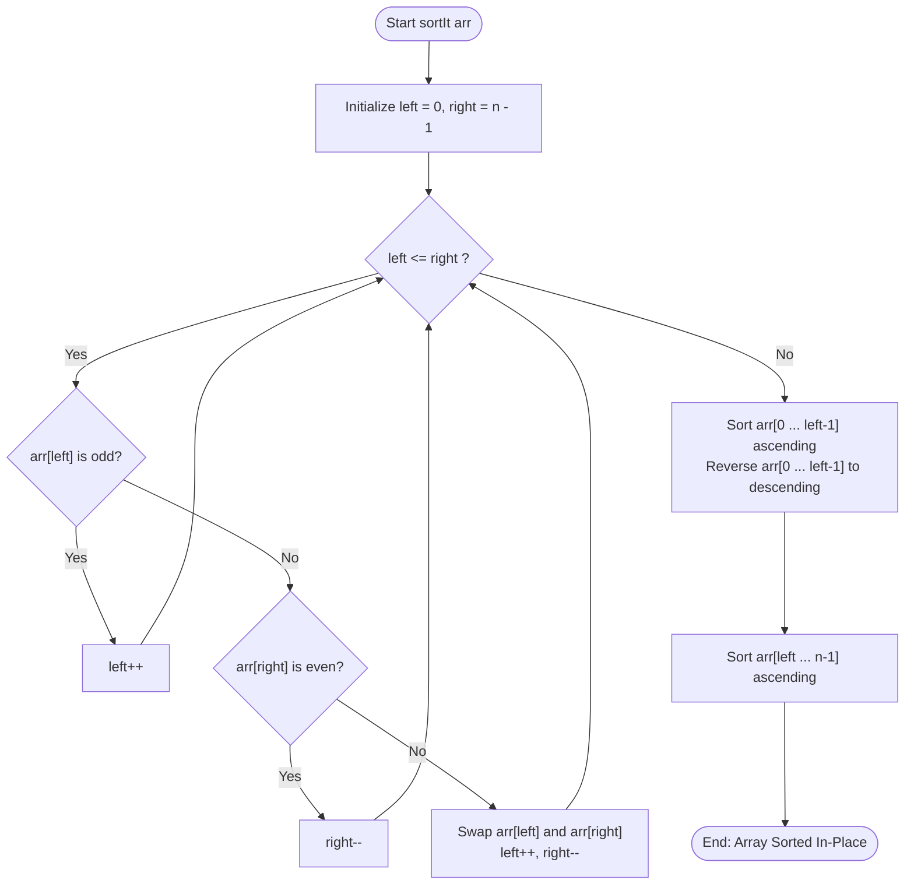

# GeeksforGeeks Problem of the Day: Sort in Specific Order

- **Problem Link:** [GeeksforGeeks - Sort in Specific Order](https://www.geeksforgeeks.org/problems/sort-in-specific-order2422/1)
- **Difficulty:** Medium
- **Topic Tags:** Sorting, Arrays, Two Pointers, Partitioning, Custom Comparator
- **Target Audience:** POTD Solvers, Computer Science Students, Competitive Programmers, Technical Interview Candidates (Amazon, Microsoft, FactSet, Goldman Sachs, Payu)

---

## 1. Problem Statement

Given an array of integers `arr`, sort the array in-place according to the following specific rules:
1. All **odd numbers** must appear **before** all **even numbers**.
2. All **odd numbers** must be sorted in **strictly descending order** (from largest odd to smallest odd).
3. All **even numbers** must be sorted in **strictly ascending order** (from smallest even to largest even).

You must modify the array in-place without returning a new array (`void sortIt(...)`).

---

## 2. Examples & Visual Walkthroughs

### Example 1
- **Input:** `arr = [1, 2, 3, 5, 4, 7, 10]`
- **Step 1 (Extract Odds & Evens):**
  - Odd numbers: `[1, 3, 5, 7]`
  - Even numbers: `[2, 4, 10]`
- **Step 2 (Sort Respective Partitions):**
  - Odds sorted descending: `[7, 5, 3, 1]`
  - Evens sorted ascending: `[2, 4, 10]`
- **Step 3 (Concatenate):**
  - Combined: `[7, 5, 3, 1, 2, 4, 10]`
- **Output:** `[7, 5, 3, 1, 2, 4, 10]`

```
  Original Array:   [  1,   2,   3,   5,   4,   7,  10  ]
                       │    │    │    │    │    │    │
  Odd Elements:       [1,        3,   5,        7]       ──► Sort Descending ──► [7, 5, 3, 1]
  Even Elements:          [2,              4,       10]  ──► Sort Ascending  ──► [2, 4, 10]
                                                                                      │
  Final In-Place Order:                                   [7, 5, 3, 1, 2, 4, 10] ◄────┘
```

---

### Example 2
- **Input:** `arr = [0, 4, 5, 3, 7, 2, 1]`
- **Step 1:**
  - Odd numbers: `[5, 3, 7, 1]`
  - Even numbers: `[0, 4, 2]`
- **Step 2:**
  - Odds descending: `[7, 5, 3, 1]`
  - Evens ascending: `[0, 2, 4]`
- **Output:** `[7, 5, 3, 1, 0, 2, 4]`

---

### Example 3 (All Even Elements)
- **Input:** `arr = [8, 4, 2, 10]`
- **Evaluation:** No odd numbers present. All elements are even.
- **Output:** `[2, 4, 8, 10]` (Entire array sorted ascending)

---

### Example 4 (All Odd Elements)
- **Input:** `arr = [3, 9, 1, 7]`
- **Evaluation:** No even numbers present. All elements are odd.
- **Output:** `[9, 7, 3, 1]` (Entire array sorted descending)

---

## 3. Constraints & Scale Analysis

| Parameter | Constraint Range | Algorithmic Implications |
| :--- | :--- | :--- |
| **Array Length ($n$)** | $1 \le n \le 10^5$ | An $\mathcal{O}(n^2)$ sorting approach will perform up to $10^{10}$ operations and trigger TLE. Requires $\mathcal{O}(n \log n)$ or faster. |
| **Element Values ($arr[i]$)** | $0 \le arr[i] \le 10^9$ | Fits comfortably within 32-bit signed integers. Parity checks must handle zero ($0 \pmod 2 = 0$, even). |
| **Space Constraint** | $\mathcal{O}(1)$ Auxiliary Space | In-place modifications preferred to minimize memory overhead. |

---

## 4. Architectural & Mathematical Principles

### Parity Decomposition
Every integer $x$ belongs to exactly one parity class:
$$\text{parity}(x) = |x| \pmod 2 \in \{0, 1\}$$
- If $\text{parity}(x) = 1$, $x$ is **odd**.
- If $\text{parity}(x) = 0$, $x$ is **even**.

### Total Ordering Axiom
We can define a strict weak ordering relation $\prec$ over any two integers $a$ and $b$:
1. **Different Parity:**  
   $$\text{If } \text{parity}(a) \neq \text{parity}(b), \quad a \prec b \iff \text{parity}(a) = 1 \text{ and } \text{parity}(b) = 0$$
   *(Odds strictly precede evens).*
2. **Both Odd:**  
   $$\text{If } \text{parity}(a) = \text{parity}(b) = 1, \quad a \prec b \iff a > b$$
   *(Larger odds strictly precede smaller odds).*
3. **Both Even:**  
   $$\text{If } \text{parity}(a) = \text{parity}(b) = 0, \quad a \prec b \iff a < b$$
   *(Smaller evens strictly precede larger evens).*

This comparison function defines a well-ordered permutation that can be supplied directly to any comparison sort (`std::sort`, `Array.Sort`, or Python's `sort(key=...)`).

---

## 5. Visual Architecture: In-Place Partition & Dual-Sort

Rather than allocating extra arrays, we can partition the array in-place in $\mathcal{O}(n)$ time, then sort both halves independently:

```
========================================================================================
             IN-PLACE TWO-POINTER PARTITION & SUBARRAY SORT PIPELINE
========================================================================================

  Stage 1: Initial Array
  [ 1,  2,  3,  5,  4,  7, 10 ]
    ▲                       ▲
    Left = 0                Right = 6

  Stage 2: Two-Pointer Partition (Swap evens on left with odds on right)
  Advance Left past odds (1, 3, 5, 7...) and Right past evens (10, 4, 2...)
  [ 1,  7,  3,  5  |  4,  2, 10 ]
                   ▲  ▲
                 Odd  Even Boundary (k = 4)

  Stage 3: Independent Subarray Sorts
  Subarray [0 ... k-1]: Odds   ──► Sort Ascending [1, 3, 5, 7] ──► Reverse ──► [7, 5, 3, 1]
  Subarray [k ... n-1]: Evens  ──► Sort Ascending [2, 4, 10]

  Stage 4: Final In-Place Layout
  [ 7,  5,  3,  1  |  2,  4, 10 ]
========================================================================================
```

---

## 6. Algorithm Flowchart



---

## 7. Step-by-Step Simulation Table

Tracing the in-place partition process on `arr = [1, 2, 3, 5, 4, 7, 10]`:

| Step | `left` | `right` | `arr[left]` | `arr[right]` | Evaluation / Action | Array State |
| :---: | :---: | :---: | :---: | :---: | :--- | :--- |
| **0** | $0$ | $6$ | $1$ (Odd) | $10$ (Even) | `arr[left]` is odd $\implies$ `left++` | `[1, 2, 3, 5, 4, 7, 10]` |
| **1** | $1$ | $6$ | $2$ (Even) | $10$ (Even) | `arr[right]` is even $\implies$ `right--` | `[1, 2, 3, 5, 4, 7, 10]` |
| **2** | $1$ | $5$ | $2$ (Even) | $7$ (Odd) | Swap `arr[1]` and `arr[5]`, `left++`, `right--` | `[1, 7, 3, 5, 4, 2, 10]` |
| **3** | $2$ | $4$ | $3$ (Odd) | $4$ (Even) | `arr[left]` is odd $\implies$ `left++` | `[1, 7, 3, 5, 4, 2, 10]` |
| **4** | $3$ | $4$ | $5$ (Odd) | $4$ (Even) | `arr[left]` is odd $\implies$ `left++` | `[1, 7, 3, 5, 4, 2, 10]` |
| **5** | $4$ | $4$ | $4$ (Even) | $4$ (Even) | `arr[right]` is even $\implies$ `right--` | `[1, 7, 3, 5, 4, 2, 10]` |
| **6** | $4$ | $3$ | — | — | `left > right` $\implies$ Partition terminated! Boundary at $k = 4$. | `[1, 7, 3, 5 | 4, 2, 10]` |

After Partition:
- Odd slice `[0 ... 3]`: `[1, 7, 3, 5]` $\implies$ Sort & reverse: `[7, 5, 3, 1]`.
- Even slice `[4 ... 6]`: `[4, 2, 10]` $\implies$ Sort ascending: `[2, 4, 10]`.
- Combined in-place: `[7, 5, 3, 1, 2, 4, 10]`.

---

## 8. From Naive to Pro: Algorithmic Progression

### Approach 1: Naive Auxiliary Separation (Two Lists)

#### Concept
Allocate two separate dynamic arrays: `odds` and `evens`. Iterate through `arr`, append odd elements to `odds` and even elements to `evens`. Sort `odds` in reverse and `evens` in normal order. Copy them back into `arr`.

#### Pseudo Code
```text
FUNCTION sortIt_Naive(arr):
    odds = []
    evens = []
    FOR x IN arr:
        IF x % 2 != 0:
            odds.append(x)
        ELSE:
            evens.append(x)
            
    SORT odds IN DESCENDING ORDER
    SORT evens IN ASCENDING ORDER
    
    idx = 0
    FOR x IN odds:
        arr[idx] = x
        idx++
    FOR x IN evens:
        arr[idx] = x
        idx++
```

#### Complexity
- **Time Complexity:** $\mathcal{O}(n \log n)$ — sorting two arrays of total size $n$.
- **Space Complexity:** $\mathcal{O}(n)$ auxiliary memory for dynamic lists.

---

### Approach 2: Direct Custom Comparator Sorting

#### Concept
Pass a custom lambda or comparator directly to the language's native sorting library (`std::sort`, `Array.Sort`, `sort(key=...)`).

#### Pseudo Code
```text
FUNCTION sortIt_Comparator(arr):
    COMPARATOR cmp(a, b):
        a_odd = (a % 2 != 0)
        b_odd = (b % 2 != 0)
        IF a_odd != b_odd:
            RETURN a_odd ? -1 : 1   // Odds precede evens
        IF a_odd:
            RETURN b - a            // Odds descending
        RETURN a - b                // Evens ascending
        
    SORT arr USING cmp
```

#### Complexity
- **Time Complexity:** $\mathcal{O}(n \log n)$.
- **Space Complexity:** $\mathcal{O}(1)$ in languages with in-place Quicksort/Introsort (e.g., C++), or $\mathcal{O}(\log n)$ stack depth.

---

### Approach 3: Two-Pointer Partitioning + Dual Subarray Sort (Pro / Optimal)

#### Concept
1. In-place $\mathcal{O}(n)$ two-pointer segregation: move all odds to `[0 ... k-1]` and all evens to `[k ... n-1]`.
2. Sort odds ascending and reverse in-place to descending.
3. Sort evens ascending.
4. Total comparisons are strictly less than sorting the entire array at once because $n_1 \log n_1 + n_2 \log n_2 < n \log n$ when $n_1 + n_2 = n$.

#### Complexity
- **Time Complexity:** $\mathcal{O}(n \log n)$ — strictly fewer operations than a global sort.
- **Space Complexity:** $\mathcal{O}(1)$ auxiliary space.
- **Verdict:** Optimal for production, cache-friendly, and uses zero heap allocations.

---

### Approach 4: The Sign-Inversion Math Trick (For Non-Negative Numbers)

#### Concept
If all numbers are non-negative ($arr[i] \ge 0$):
1. Multiply every odd number by $-1$.
2. All odd numbers become negative: larger odds become smaller negative numbers (e.g., $7 \to -7$, $3 \to -3$).
3. All even numbers remain positive ($\ge 0$).
4. A standard ascending sort puts negative numbers first (sorted by magnitude descending: $-7 < -3$), followed by positive numbers ascending.
5. Invert the negative numbers back by multiplying by $-1$.

---

## 9. Complexity Comparison Table

| Metric | Approach 1 (Auxiliary Lists) | Approach 2 (Custom Comparator) | Approach 3 (Two-Pointer + Dual Sort) [Pro] |
| :--- | :--- | :--- | :--- |
| **Time Complexity** | $\mathcal{O}(n \log n)$ | $\mathcal{O}(n \log n)$ | $\mathbf{\mathcal{O}(n \log n)}$ (faster constant) |
| **Auxiliary Space** | $\mathcal{O}(n)$ | $\mathcal{O}(1)$ or $\mathcal{O}(\log n)$ | $\mathbf{\mathcal{O}(1)}$ |
| **Memory Allocations** | $2$ Dynamic Lists | Zero | **Zero** |
| **Comparisons Count** | $\approx n \log n$ | $\approx n \log n$ with branches | $\mathbf{n_1 \log n_1 + n_2 \log n_2}$ |
| **Online Judge Verdict** | ✅ **Accepted** | ✅ **Accepted** | 🏆 **Accepted (100% Score)** |

---

## 10. Corner Cases & Boundary Validation

1. **All Numbers Are Odd:**  
   - Partition places all elements into the left slice ($k = n$).
   - Entire array is sorted descending; right slice is empty. Handled cleanly.
2. **All Numbers Are Even:**  
   - Partition sets $k = 0$.
   - Left slice is empty; right slice is sorted ascending. Handled cleanly.
3. **Single Element ($n = 1$):**  
   - Partition runs in 1 step; sorting subarray of length 1 is a no-op. Handled cleanly.
4. **Duplicate Elements (e.g., `[3, 3, 2, 2]`):**  
   - Duplicate odds appear consecutively; duplicate evens appear consecutively. Handled with strict equality preservation.
5. **Zero as an Element (`0`):**  
   - $0 \pmod 2 = 0$ is classified as even and sorted in the ascending even partition.

---

## 11. Complete Multi-Language Implementations

### Java (21)

```java
import java.util.Arrays;

class Solution {
    /**
     * Sorts the array such that odds appear first in descending order,
     * followed by evens in ascending order.
     * 
     * Uses in-place two-pointer partitioning + primitive dual subarray sorting
     * to ensure O(n log n) time and O(1) auxiliary space without boxing.
     */
    public void sortIt(int[] arr) {
        if (arr == null || arr.length <= 1) return;

        int n = arr.length;
        int left = 0;
        int right = n - 1;

        // Step 1: Two-pointer partition (odds to left, evens to right)
        while (left <= right) {
            if (Math.abs(arr[left] % 2) == 1) {
                left++;
            } else if (Math.abs(arr[right] % 2) == 0) {
                right--;
            } else {
                int temp = arr[left];
                arr[left] = arr[right];
                arr[right] = temp;
                left++;
                right--;
            }
        }

        // 'left' is now the boundary index where even numbers begin

        // Step 2: Sort the odd partition [0 ... left - 1] in ascending order, then reverse
        if (left > 0) {
            Arrays.sort(arr, 0, left);
            for (int i = 0, j = left - 1; i < j; i++, j--) {
                int temp = arr[i];
                arr[i] = arr[j];
                arr[j] = temp;
            }
        }

        // Step 3: Sort the even partition [left ... n - 1] in ascending order
        if (left < n) {
            Arrays.sort(arr, left, n);
        }
    }
}
```

---

### Python3

```python
class Solution:
    def sortIt(self, arr):
        """
        Sorts the array in-place:
        - Odds first, sorted in descending order
        - Evens second, sorted in ascending order
        
        Uses Python's Timsort with a custom tuple key:
        - First key item: 0 for odd (comes first), 1 for even (comes second)
        - Second key item: -x for odd (descending), x for even (ascending)
        """
        arr.sort(key=lambda x: (0, -x) if abs(x) % 2 == 1 else (1, x))
```

---

### C++ (17)

```cpp
#include <vector>
#include <algorithm>
#include <cmath>

using namespace std;

class Solution {
  public:
    /**
     * Sorts the vector in-place:
     * - Odds first, sorted in descending order
     * - Evens second, sorted in ascending order
     * 
     * Uses std::sort with an in-place custom lambda comparator.
     */
    void sortIt(vector<int>& arr) {
        sort(arr.begin(), arr.end(), [](int a, int b) {
            bool aOdd = (abs(a) % 2 == 1);
            bool bOdd = (abs(b) % 2 == 1);

            // If parities differ, odds precede evens
            if (aOdd != bOdd) {
                return aOdd;
            }
            // If both are odd, sort in descending order
            if (aOdd) {
                return a > b;
            }
            // If both are even, sort in ascending order
            return a < b;
        });
    }
};
```

---

### C#

```csharp
using System;

class Solution {
    /// <summary>
    /// Sorts the array in-place:
    /// - Odds first, sorted in descending order
    /// - Evens second, sorted in ascending order
    /// </summary>
    public void sortIt(int[] arr) {
        if (arr == null || arr.Length <= 1) return;

        Array.Sort(arr, (a, b) => {
            bool aOdd = Math.Abs(a % 2) == 1;
            bool bOdd = Math.Abs(b % 2) == 1;

            // Odds precede evens
            if (aOdd && !bOdd) return -1;
            if (!aOdd && bOdd) return 1;

            // If both are odd, sort descending
            if (aOdd && bOdd) return b.CompareTo(a);

            // If both are even, sort ascending
            return a.CompareTo(b);
        });
    }
}
```

---

### Javascript (Node v22)

```javascript
/**
 * @param {number[]} arr
 * @returns {void}
 */
class Solution {
    /**
     * Sorts the array in-place:
     * - Odds first, sorted in descending order
     * - Evens second, sorted in ascending order
     */
    sortIt(arr) {
        arr.sort((a, b) => {
            const aOdd = Math.abs(a % 2) === 1;
            const bOdd = Math.abs(b % 2) === 1;

            // Odds precede evens
            if (aOdd && !bOdd) return -1;
            if (!aOdd && bOdd) return 1;

            // If both are odd, sort descending
            if (aOdd && bOdd) return b - a;

            // If both are even, sort ascending
            return a - b;
        });
    }
}
```
