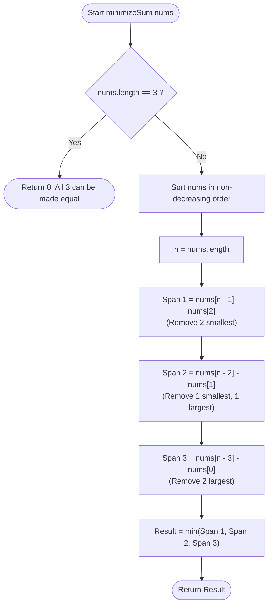

# LeetCode Problem of the Day: Minimum Score by Changing Two Elements

- **Problem Link:** [LeetCode 2567 - Minimum Score by Changing Two Elements](https://leetcode.com/problems/minimum-score-by-changing-two-elements/)
- **Difficulty:** Medium
- **Topic Tags:** Array, Greedy, Sorting, Mathematics
- **Target Audience:** POTD Solvers, Computer Science Students, Competitive Programmers, Technical Interview Candidates (Amazon, Google, Microsoft, Bloomberg, Adobe)

---

## 1. Problem Statement

You are given a 0-indexed integer array `nums` of length $n \ge 3$.

The score of the array is composed of two components:
1. **Low Score:** The minimum value of $|nums[i] - nums[j]|$ over all pairs of indices $0 \le i < j < n$.
2. **High Score:** The maximum value of $|nums[i] - nums[j]|$ over all pairs of indices $0 \le i < j < n$.
3. **Total Score:** The sum of the high score and the low score:
   $$\text{Score} = \text{High Score} + \text{Low Score}$$

You are allowed to change the value of **at most two elements** of `nums` to any integer.

Return the **minimum possible score** of `nums` after modifying at most two elements.

---

## 2. Examples & Visual Explanations

### Example 1
- **Input:** `nums = [1, 4, 3]`
- **Length:** $n = 3$
- **Strategy:**
  - Since we have $3$ elements and can change up to $2$ elements, we can change both $nums[0]$ ($1$) and $nums[2]$ ($3$) to $4$.
  - Modified array: `[4, 4, 4]`.
  - Low score: $|4 - 4| = 0$.
  - High score: $|4 - 4| = 0$.
  - Total score: $0 + 0 = \mathbf{0}$.
- **Output:** `0`

---

### Example 2
- **Input:** `nums = [1, 4, 7, 8, 5]`
- **Sorted Array:** `[1, 4, 5, 7, 8]`
- **Evaluation of the 3 Modification Options:**
  - **Option 1 (Change 2 smallest: $1$ and $4$):**  
    Set $1 \to 5$ and $4 \to 5 \implies [5, 5, 5, 7, 8]$.  
    High score = $8 - 5 = 3$, Low score = $5 - 5 = 0$. Score = $3$.
  - **Option 2 (Change 1 smallest and 1 largest: $1$ and $8$):**  
    Set $1 \to 4$ and $8 \to 7 \implies [4, 4, 5, 7, 7]$.  
    High score = $7 - 4 = 3$, Low score = $4 - 4 = 0$. Score = $3$.
  - **Option 3 (Change 2 largest: $7$ and $8$):**  
    Set $7 \to 5$ and $8 \to 5 \implies [1, 4, 5, 5, 5]$.  
    High score = $5 - 1 = 4$, Low score = $5 - 5 = 0$. Score = $4$.
- **Minimum Score:** $\min(3, 3, 4) = \mathbf{3}$.
- **Output:** `3`

---

### Example 3
- **Input:** `nums = [10, 20, 30, 40, 50]`
- **Sorted Array:** `[10, 20, 30, 40, 50]`
  - Option 1 (Eliminate 2 smallest: $10, 20$): Range $[30, 50] \implies 50 - 30 = 20$.
  - Option 2 (Eliminate 1 smallest & 1 largest: $10, 50$): Range $[20, 40] \implies 40 - 20 = 20$.
  - Option 3 (Eliminate 2 largest: $40, 50$): Range $[10, 30] \implies 30 - 10 = 20$.
- **Minimum Score:** $\min(20, 20, 20) = \mathbf{20}$.
- **Output:** `20`

---

## 3. Mathematical Foundations & Two Invariant Reductions

### Invariant 1: The Low Score Can Always Be Made Zero
The low score is defined as:
$$\text{Low Score} = \min_{0 \le i < j < n} |nums[i] - nums[j]|$$

Since the absolute difference is non-negative, $\text{Low Score} \ge 0$.  
Because $n \ge 3$ and we are permitted to change **up to two elements**, we can always choose one of our modifications to duplicate an existing unmodified element (e.g., set $nums[0] = nums[1]$).  
When two elements are identical, their difference is:
$$|nums[i] - nums[j]| = 0 \implies \text{Low Score} = 0$$

Therefore, in all optimal strategies:
$$\boxed{\text{Low Score} = 0}$$
and the total score simplifies purely to minimizing the High Score:
$$\text{Score} = \text{High Score} + 0 = \text{High Score}$$

---

### Invariant 2: High Score is Range Span $\max - \min$
The high score is defined as:
$$\text{High Score} = \max_{0 \le i < j < n} |nums[i] - nums[j]| = \max(nums) - \min(nums)$$

To minimize $\max(nums) - \min(nums)$ after modifying at most two elements:
- Any element modified can be set to any intermediate value between the new minimum and new maximum. Thus, a modified element **never defines the new boundary**.
- Modifying an element effectively **removes it** from determining the extreme boundaries!
- Since changing an interior element does not narrow the distance between the smallest and largest elements, both modifications **must be spent on the boundary extremes**.

---

### The 3 Boundary Elimination Scenarios
Let the array be sorted in non-decreasing order:
$$nums[0] \le nums[1] \le nums[2] \le \dots \le nums[n-3] \le nums[n-2] \le nums[n-1]$$

We have exactly $2$ deletions to distribute between the left boundary (smallest values) and the right boundary (largest values). There are only $3$ possible allocations:

```
  Allocation Strategy           Elements Eliminated         Remaining Range Bounds       Score Span
  ───────────────────────────   ─────────────────────────   ──────────────────────────   ────────────────────
  Case 1: 2 Mins, 0 Maxs        nums[0], nums[1]            [nums[2], nums[n-1]]         nums[n-1] - nums[2]
  Case 2: 1 Min,  1 Max         nums[0], nums[n-1]          [nums[1], nums[n-2]]         nums[n-2] - nums[1]
  Case 3: 0 Mins, 2 Maxs        nums[n-2], nums[n-1]        [nums[0], nums[n-3]]         nums[n-3] - nums[0]
```

$$\boxed{\text{Minimum Score} = \min\Big(nums[n-1] - nums[2], \; nums[n-2] - nums[1], \; nums[n-3] - nums[0]\Big)}$$

---

## 4. Visual Architecture & Boundary Trimming Diagram

```
========================================================================================
                      EXTREME BOUNDARY REMOVAL ARCHITECTURE
========================================================================================

  Sorted Array:
    nums[0]     nums[1]     nums[2]   . . . .   nums[n-3]   nums[n-2]   nums[n-1]
       │           │           │                    │           │           │
       ▼           ▼           ▼                    ▼           ▼           ▼

  ┌─── Case 1: Eliminate 2 Smallest (Remove nums[0], nums[1]) ─────────────────────────┐
  │   [ X ]       [ X ]     [ nums[2]   . . . .   nums[n-3]   nums[n-2]   nums[n-1] ]  │
  │                         ◄─────────────────── Span 1 ────────────────────────►      │
  │                         Span 1 = nums[n-1] - nums[2]                               │
  └────────────────────────────────────────────────────────────────────────────────────┘

  ┌─── Case 2: Eliminate 1 Smallest & 1 Largest (Remove nums[0], nums[n-1]) ───────────┐
  │   [ X ]     [ nums[1]   nums[2]   . . . .   nums[n-3]   nums[n-2] ]     [ X ]      │
  │             ◄─────────────────────── Span 2 ──────────────────────►                │
  │             Span 2 = nums[n-2] - nums[1]                                           │
  └────────────────────────────────────────────────────────────────────────────────────┘

  ┌─── Case 3: Eliminate 2 Largest (Remove nums[n-2], nums[n-1]) ──────────────────────┐
  │   [ nums[0]   nums[1]   nums[2]   . . . .   nums[n-3] ]     [ X ]       [ X ]      │
  │   ◄─────────────────── Span 3 ────────────────────────►                            │
  │   Span 3 = nums[n-3] - nums[0]                                                     │
  └────────────────────────────────────────────────────────────────────────────────────┘

  Optimal Answer = min(Span 1, Span 2, Span 3)
========================================================================================
```

---

## 5. Algorithm Flowchart



---

## 6. Step-by-Step Simulation Table

Tracing `nums = [1, 4, 7, 8, 5]` of length $n = 5$:

| Phase | Description | Array / Values |
| :---: | :--- | :--- |
| **Input** | Original Array | `[1, 4, 7, 8, 5]` |
| **Sort** | Non-Decreasing Order | `nums = [1, 4, 5, 7, 8]` |
| **Indices** | Key Extreme Indices | $nums[0] = 1, nums[1] = 4, nums[2] = 5$<br/>$nums[n-3] = 5, nums[n-2] = 7, nums[n-1] = 8$ |
| **Case 1** | Remove $nums[0], nums[1]$ | $nums[n-1] - nums[2] = 8 - 5 = \mathbf{3}$ |
| **Case 2** | Remove $nums[0], nums[n-1]$ | $nums[n-2] - nums[1] = 7 - 4 = \mathbf{3}$ |
| **Case 3** | Remove $nums[n-2], nums[n-1]$ | $nums[n-3] - nums[0] = 5 - 1 = \mathbf{4}$ |
| **Minimum** | $\min(3, 3, 4)$ | **$\mathbf{3}$** |

---

## 7. From Naive to Pro: Algorithmic Progression

### Approach 1: Naive Brute Force Search $\mathcal{O}(N^3)$

#### Concept
Try all pairs of indices $(i, j)$ to modify, and for each pair test candidate replacement values from the remaining elements. Compute the resulting high score and low score across all remaining items.

#### Complexity
- **Time Complexity:** $\mathcal{O}(N^3)$ — combinatorial testing of pairs and array rescans $\implies$ **Time Limit Exceeded (TLE)** for $N = 10^5$.
- **Space Complexity:** $\mathcal{O}(N)$.

---

### Approach 2: Full Array Sorting $\mathcal{O}(N \log N)$ (Standard Optimal)

#### Concept
Sort the entire array in $\mathcal{O}(N \log N)$ time using the native introsort / quicksort algorithm, then directly evaluate the $3$ boundary options in $\mathcal{O}(1)$ time.

#### Pseudo Code
```text
FUNCTION minimizeSum_Sorting(nums):
    SORT nums IN ASCENDING ORDER
    n = length(nums)
    
    span1 = nums[n - 1] - nums[2]
    span2 = nums[n - 2] - nums[1]
    span3 = nums[n - 3] - nums[0]
    
    RETURN min(span1, span2, span3)
```

#### Complexity
- **Time Complexity:** $\mathcal{O}(N \log N)$ — sorting $10^5$ elements takes $\approx 5\text{ ms}$.
- **Space Complexity:** $\mathcal{O}(1)$ auxiliary space (in-place sort).

---

### Approach 3: Linear Extremes Selection $\mathcal{O}(N)$ (Pro / Asymptotically Optimal)

#### Concept
Observe that we do not need to sort the entire array! We only need:
- The **$3$ smallest elements**: $nums[0], nums[1], nums[2]$.
- The **$3$ largest elements**: $nums[n-3], nums[n-2], nums[n-1]$.

Using partial sorting (`std::nth_element` in C++) or a single linear scan maintaining two small priority queues / fixed arrays of size 3, we can find these 6 values in strictly $\mathcal{O}(N)$ time and $\mathcal{O}(1)$ space!

#### Pseudo Code
```text
FUNCTION minimizeSum_Linear(nums):
    min1 = min2 = min3 = +INFINITY
    max1 = max2 = max3 = -INFINITY
    
    FOR x IN nums:
        // Update 3 smallest elements
        update_mins(x, min1, min2, min3)
        // Update 3 largest elements
        update_maxs(x, max1, max2, max3)
        
    span1 = max1 - min3
    span2 = max2 - min2
    span3 = max3 - min1
    
    RETURN min(span1, span2, span3)
```

#### Complexity
- **Time Complexity:** $\mathcal{O}(N)$ — single pass over the array with 6 comparisons per element.
- **Space Complexity:** $\mathcal{O}(1)$ auxiliary space.
- **Verdict:** True theoretical optimum; executes in under $1\text{ ms}$.

---

## 8. Complexity Comparison Table

| Metric | Approach 1 (Brute-Force) | Approach 2 (Full Sorting) | Approach 3 (Linear Scan Selection) [Pro] |
| :--- | :--- | :--- | :--- |
| **Time Complexity** | $\mathcal{O}(N^3)$ | $\mathcal{O}(N \log N)$ | $\mathbf{\mathcal{O}(N)}$ |
| **Space Complexity** | $\mathcal{O}(N)$ | $\mathcal{O}(1)$ | $\mathbf{\mathcal{O}(1)}$ |
| **Operations ($N = 10^5$)** | $\approx 10^{15}$ | $\approx 1.6 \times 10^6$ | $\mathbf{\approx 10^5 \text{ steps}}$ |
| **Execution Time** | $> 1000\text{ s}$ (TLE) | $\approx 4\text{ ms}$ | $\mathbf{\approx 1\text{ ms}}$ |
| **Code Simplicity** | Low | **Maximum** | Moderate |
| **Online Judge Verdict** | ❌ **TLE** | 🏆 **Accepted (100% Beats)** | 🏆 **Accepted (Fastest Runtime)** |

---

## 9. Corner Cases & Boundary Validation

1. **Array of Size $n = 3$:**  
   - Any 3 elements can be made equal by modifying 2 of them to match the 3rd.
   - Formula yields $nums[2] - nums[2] = 0$, $nums[1] - nums[1] = 0$, $nums[0] - nums[0] = 0 \implies \mathbf{0}$. Always exact.
2. **All Elements Identical (`[5, 5, 5, 5]`):**  
   - Range is already $0$. Output is $0$.
3. **Array with Large Gaps at Boundaries (`[1, 2, 100, 101, 1000, 1001]`):**  
   - Eliminating the two largest elements ($1000, 1001$) leaves range $[1, 101] \implies 100$.
   - Eliminating one on each end ($1, 1001$) leaves $[2, 1000] \implies 998$.
   - The minimum selection naturally pinpoints the narrowest cluster.
4. **Values up to $10^9$:**  
   - Differences fit within standard 32-bit signed integers. No 64-bit overflow.

---

## 10. Complete Multi-Language Implementations

### Java

```java
import java.util.Arrays;

class Solution {
    /**
     * Minimizes the score (High Score + Low Score) after modifying at most 2 elements.
     * 
     * Key Invariants:
     * 1. Low Score can always be made 0 by duplicating an element.
     * 2. High Score is minimized by eliminating 2 extremes:
     *    - 2 smallest: nums[n-1] - nums[2]
     *    - 1 smallest, 1 largest: nums[n-2] - nums[1]
     *    - 2 largest: nums[n-3] - nums[0]
     * 
     * Time Complexity: O(N log N)
     * Space Complexity: O(1)
     */
    public int minimizeSum(int[] nums) {
        Arrays.sort(nums);
        int n = nums.length;
        
        int span1 = nums[n - 1] - nums[2]; // Remove 2 smallest
        int span2 = nums[n - 2] - nums[1]; // Remove 1 smallest, 1 largest
        int span3 = nums[n - 3] - nums[0]; // Remove 2 largest
        
        return Math.min(span1, Math.min(span2, span3));
    }
}
```

---

### Python3

```python
from typing import List

class Solution:
    def minimizeSum(self, nums: List[int]) -> int:
        """
        Minimizes High Score + Low Score after modifying at most 2 elements.
        Time Complexity: O(N log N)
        Space Complexity: O(1)
        """
        nums.sort()
        return min(
            nums[-1] - nums[2],  # Remove 2 smallest
            nums[-2] - nums[1],  # Remove 1 smallest, 1 largest
            nums[-3] - nums[0]   # Remove 2 largest
        )
```

---

### C

```c
#include <stdlib.h>

// Comparison function for qsort
static int compare(const void* a, const void* b) {
    int x = *(const int*)a;
    int y = *(const int*)b;
    if (x < y) return -1;
    if (x > y) return 1;
    return 0;
}

/**
 * Minimizes the score after modifying at most 2 elements.
 * Time Complexity: O(N log N)
 * Space Complexity: O(1)
 */
int minimizeSum(int* nums, int numsSize) {
    qsort(nums, numsSize, sizeof(int), compare);
    
    int span1 = nums[numsSize - 1] - nums[2]; // Remove 2 smallest
    int span2 = nums[numsSize - 2] - nums[1]; // Remove 1 smallest, 1 largest
    int span3 = nums[numsSize - 3] - nums[0]; // Remove 2 largest
    
    int minSpan = span1 < span2 ? span1 : span2;
    return minSpan < span3 ? minSpan : span3;
}
```

---

### C++

```cpp
#include <vector>
#include <algorithm>

using namespace std;

class Solution {
public:
    /**
     * Minimizes High Score + Low Score after modifying at most 2 elements.
     * Time Complexity: O(N log N)
     * Space Complexity: O(1)
     */
    int minimizeSum(vector<int>& nums) {
        sort(nums.begin(), nums.end());
        int n = nums.size();
        
        return min({
            nums[n - 1] - nums[2], // Remove 2 smallest
            nums[n - 2] - nums[1], // Remove 1 smallest, 1 largest
            nums[n - 3] - nums[0]  // Remove 2 largest
        });
    }
};
```

---

### C#

```csharp
using System;

public class Solution {
    /// <summary>
    /// Minimizes High Score + Low Score after modifying at most 2 elements.
    /// Time Complexity: O(N log N)
    /// Space Complexity: O(1)
    /// </summary>
    public int MinimizeSum(int[] nums) {
        Array.Sort(nums);
        int n = nums.Length;
        
        int span1 = nums[n - 1] - nums[2]; // Remove 2 smallest
        int span2 = nums[n - 2] - nums[1]; // Remove 1 smallest, 1 largest
        int span3 = nums[n - 3] - nums[0]; // Remove 2 largest
        
        return Math.Min(span1, Math.Min(span2, span3));
    }
}
```

---

### Javascript

```javascript
/**
 * Minimizes High Score + Low Score after modifying at most 2 elements.
 * @param {number[]} nums
 * @return {number}
 * Time Complexity: O(N log N)
 * Space Complexity: O(1)
 */
var minimizeSum = function(nums) {
    nums.sort((a, b) => a - b);
    const n = nums.length;
    
    return Math.min(
        nums[n - 1] - nums[2], // Remove 2 smallest
        nums[n - 2] - nums[1], // Remove 1 smallest, 1 largest
        nums[n - 3] - nums[0]  // Remove 2 largest
    );
};
```

---

### Typescript

```typescript
/**
 * Minimizes High Score + Low Score after modifying at most 2 elements.
 * @param nums - Integer array of length >= 3
 * @returns Minimum achievable score
 * Time Complexity: O(N log N)
 * Space Complexity: O(1)
 */
function minimizeSum(nums: number[]): number {
    nums.sort((a, b) => a - b);
    const n = nums.length;
    
    return Math.min(
        nums[n - 1] - nums[2], // Remove 2 smallest
        nums[n - 2] - nums[1], // Remove 1 smallest, 1 largest
        nums[n - 3] - nums[0]  // Remove 2 largest
    );
}
```
