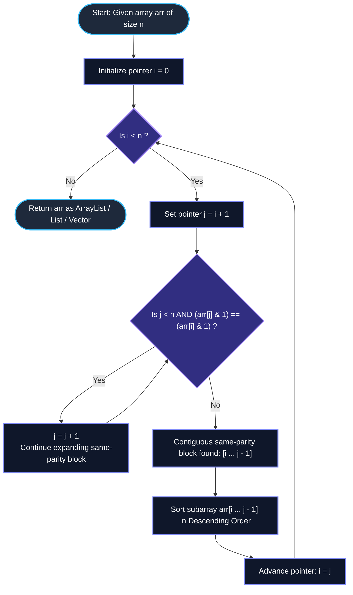

# GeeksforGeeks Problem of the Day: Largest with Same Parity Adjacent Swaps (Even Swap)

- **Problem Link:** [GeeksforGeeks - Largest with Same Parity Adjacent Swaps (Even Swap)](https://www.geeksforgeeks.org/problems/even-swap/1)
- **Difficulty:** Medium
- **Topic Tags:** Array, Sorting, Greedy, Two-Pointer, Number Theory, Permutation Groups
- **Target Audience:** POTD Solvers, Computer Science Students, Competitive Programmers, Technical Interview Preparation (FAANG / Tier-1 Tech)

---

## 1. Problem Statement

You are given an integer array `arr` of size $n$, indexed from $0$ to $n - 1$. 

You are allowed to perform the following operation any number of times (possibly zero):
- Choose any two **adjacent** elements in the array, say at indices $i$ and $i + 1$ (where $0 \le i < n - 1$).
- If their sum is **even**—that is, $(\text{arr}[i] + \text{arr}[i + 1]) \pmod 2 == 0$—you may **swap** them.

### Objective
Find and return the **lexicographically largest** array that can be achieved through any sequence of valid swaps.

### Lexicographical Order Definition
An array $A$ of length $n$ is lexicographically larger than array $B$ of length $n$ if, at the first index $k$ where $A[k] \ne B[k]$, we have $A[k] > B[k]$.

---

## 2. Examples & Explanations

### Example 1
- **Input:** `arr = [1, 3, 5]` ($n = 3$)
- **Output:** `[5, 3, 1]`
- **Step-by-Step Swap Explanation:**
  1. Look at adjacent pair $(1, 3)$: $1 + 3 = 4$ (even). Swap $1$ and $3 \implies [3, 1, 5]$.
  2. Look at adjacent pair $(1, 5)$: $1 + 5 = 6$ (even). Swap $1$ and $5 \implies [3, 5, 1]$.
  3. Look at adjacent pair $(3, 5)$: $3 + 5 = 8$ (even). Swap $3$ and $5 \implies [5, 3, 1]$.
  4. Array $[5, 3, 1]$ has its largest element at the front. No further rearrangement can make it lexicographically larger.

---

### Example 2
- **Input:** `arr = [1, 2, 3, 4]` ($n = 4$)
- **Output:** `[1, 2, 3, 4]`
- **Step-by-Step Analysis:**
  - Pair $(1, 2)$: $1 + 2 = 3$ (odd $\implies$ swap disallowed).
  - Pair $(2, 3)$: $2 + 3 = 5$ (odd $\implies$ swap disallowed).
  - Pair $(3, 4)$: $3 + 4 = 7$ (odd $\implies$ swap disallowed).
  - No adjacent elements can ever be swapped because every adjacent pair has opposite parity.
  - The array remains unchanged: `[1, 2, 3, 4]`.

---

### Example 3 (Mixed Homogeneous Subarrays)
- **Input:** `arr = [5, 8, 9, 7, 2, 4, 6]` ($n = 7$)
- **Output:** `[5, 8, 9, 7, 6, 4, 2]`
- **Breakdown by Parity Blocks:**
  - Segment 1: `[5]` (odd) $\implies$ isolated, stays `[5]`.
  - Segment 2: `[8]` (even) $\implies$ isolated, stays `[8]`.
  - Segment 3: `[9, 7]` (both odd) $\implies$ $9 > 7$, already in descending order: `[9, 7]`.
  - Segment 4: `[2, 4, 6]` (all even) $\implies$ can be rearranged into any permutation using adjacent even swaps. To maximize lexicographically, sort descending $\implies [6, 4, 2]$.
  - Assembling the segments: `[5] + [8] + [9, 7] + [6, 4, 2] = [5, 8, 9, 7, 6, 4, 2]`.

---

### Example 4 (Interleaved Multi-Element Blocks)
- **Input:** `arr = [4, 2, 6, 1, 7, 3, 8, 10]` ($n = 8$)
- **Output:** `[6, 4, 2, 7, 3, 1, 10, 8]`
- **Explanation:**
  - Contiguous even block `[4, 2, 6]` $\xrightarrow{\text{sort desc}}$ `[6, 4, 2]`
  - Contiguous odd block `[1, 7, 3]` $\xrightarrow{\text{sort desc}}$ `[7, 3, 1]`
  - Contiguous even block `[8, 10]` $\xrightarrow{\text{sort desc}}$ `[10, 8]`
  - Final merged array: `[6, 4, 2, 7, 3, 1, 10, 8]`.

---

## 3. Constraints & Complexity Targets

- $1 \le n \le 10^5$
- $1 \le \text{arr}[i] \le 10^9$
- **Target Time Complexity:** $\mathcal{O}(n \log n)$
- **Target Auxiliary Space:** $\mathcal{O}(1)$ in-place (or $\mathcal{O}(n)$ return buffer)

---

## 4. Invariant Theorems & Theoretical Foundations

```
           ====================================================
           THE PARITY INVARIANT & EQUIVALENCE PARTITION THEOREM
           ====================================================

      Two numbers a and b have an EVEN sum if and only if they
      share the identical parity:
                    a + b ≡ 0 (mod 2)  <=>  a ≡ b (mod 2)

      Case 1: Even + Even = Even  ==> Allowed to swap adjacent
      Case 2: Odd  + Odd  = Even  ==> Allowed to swap adjacent
      Case 3: Even + Odd  = Odd   ==> FORBIDDEN TO SWAP (IMPASSABLE BARRIER)
```

### Theorem 1: Parity Isolation (Impassable Boundaries)
An element of parity $P \in \{0, 1\}$ can **never** swap with an adjacent element of parity $1 - P$.
- An odd element can never leap over an even element.
- An even element can never leap over an odd element.
- Therefore, the array is partitioned into **fixed, immutable boundaries** between contiguous blocks of identical parity.

### Theorem 2: Full Permutability within Homogeneous Blocks (Symmetric Group $S_k$)
Consider any maximal contiguous subsegment $arr[L \dots R]$ where all elements have the same parity.
- Between any two adjacent positions $k, k + 1$ inside this block, $arr[k] + arr[k+1]$ is always even.
- Thus, **any adjacent transposition $(k, k+1)$ is valid**.
- From abstract algebra and sorting theory, adjacent transpositions $(1, 2), (2, 3), \dots, (k-1, k)$ generate the full symmetric group $S_k$.
- **Consequence:** By applying a finite sequence of bubble-style adjacent swaps, *any permutation* of the elements in $arr[L \dots R]$ can be realized!

### Theorem 3: Greedy Lexicographical Maximization
To maximize an array lexicographically, the element at index $0$ should be as large as possible; then the element at index $1$ as large as possible, and so on.
- Because blocks of different parity cannot cross or exchange elements, maximizing the global array is strictly equivalent to **independently maximizing each contiguous same-parity block**.
- Within any isolated block $arr[L \dots R]$, the lexicographically greatest permutation reachable is the block sorted in **monotonically non-increasing (descending) order**.

---

## 5. Visual Architecture: Block Decomposition

```
Initial Array:
Index:     0    1    2    3    4    5    6    7
Value:   [ 4,   2,   6, | 1,   7,   3, | 8,  10 ]
Parity:    E    E    E  | O    O    O  | E    E
                        ^              ^
                Impassable Wall  Impassable Wall
               (Even + Odd = Odd) (Odd + Even = Odd)

Phase 1: Identify Boundaries
  Block 1: Range [0..2] -> All EVEN -> [4, 2, 6]
  Block 2: Range [3..5] -> All ODD  -> [1, 7, 3]
  Block 3: Range [6..7] -> All EVEN -> [8, 10]

Phase 2: Sort Each Subsegment in Descending Order
  Block 1 [0..2]: [4, 2, 6]   ---sort desc---> [6, 4, 2]
  Block 2 [3..5]: [1, 7, 3]   ---sort desc---> [7, 3, 1]
  Block 3 [6..7]: [8, 10]     ---sort desc---> [10, 8]

Phase 3: Output Resulting Array
  Result: [ 6,   4,   2,   7,   3,   1,  10,   8 ]
```

---

## 6. Step-by-Step Simulation Trace

Let us trace `arr = [3, 7, 1, 4, 8, 2, 5, 9]` with $n = 8$:

| Segment # | Start Index `i` | End Index `j - 1` | Subarray Elements | Parity | Action (Descending Sort) | Subarray Output | Array State After Step |
| :---: | :---: | :---: | :---: | :---: | :---: | :---: | :---: |
| **1** | `0` | `2` | `[3, 7, 1]` | ODD | Sort $[3, 7, 1]$ descending | `[7, 3, 1]` | `[7, 3, 1, 4, 8, 2, 5, 9]` |
| **2** | `3` | `5` | `[4, 8, 2]` | EVEN | Sort $[4, 8, 2]$ descending | `[8, 4, 2]` | `[7, 3, 1, 8, 4, 2, 5, 9]` |
| **3** | `6` | `7` | `[5, 9]` | ODD | Sort $[5, 9]$ descending | `[9, 5]` | `[7, 3, 1, 8, 4, 2, 9, 5]` |

**Final Lexicographically Largest Output:** `[7, 3, 1, 8, 4, 2, 9, 5]`.

---

## 7. Mermaid Flowchart



---

## 8. Algorithmic Progression (From Naive to Pro)

### Approach 1: Naive Bubble Swap Simulation
- **Concept:** Repeatedly iterate through the array, swapping any adjacent pair where $arr[k] < arr[k + 1]$ and $(arr[k] + arr[k+1]) \pmod 2 == 0$. Stop when a full pass makes zero swaps.
- **Flaw:** Takes up to $\mathcal{O}(n^2)$ time in the worst case (e.g., an already reverse-sorted block of size $10^5$).
- **Result:** **Time Limit Exceeded (TLE)** for $n = 10^5$.

```text
Algorithm NaiveBubbleSimulation(arr, n):
    swapped = true
    while swapped is true:
        swapped = false
        for k from 0 to n - 2:
            if (arr[k] % 2 == arr[k + 1] % 2) and (arr[k] < arr[k + 1]):
                swap(arr[k], arr[k + 1])
                swapped = true
    return arr
```

---

### Approach 2: Two-Pointer Contiguous Segment Extraction + Subarray Sort (Optimal Pro Method)
- **Concept:**
  1. A two-pointer approach scans the array linearly.
  2. Pointer `i` marks the beginning of a maximal contiguous block of identical parity.
  3. Pointer `j` advances as long as $j < n$ and $arr[j] \pmod 2 == arr[i] \pmod 2$.
  4. Once $j$ hits the boundary (an element of different parity or end of array), the subrange $[i, j - 1]$ is sorted in descending order.
  5. Set $i = j$ and repeat until the array is fully processed.
- **Bitwise Parity Trick:** To avoid issues with negative values (if any) or division overhead, test same parity using:
  $$\text{arr}[i] \ \& \ 1 == \text{arr}[j] \ \& \ 1 \quad \text{or} \quad ((\text{arr}[i] \oplus \text{arr}[j]) \ \& \ 1) == 0$$
- **Time Complexity:** Sorting segments of sizes $L_1, L_2, \dots, L_m$ where $\sum L_k = n$ takes $\sum \mathcal{O}(L_k \log L_k) \le \mathcal{O}(n \log n)$.

```text
Algorithm LexicographicallyLargest(arr, n):
    i = 0
    while i < n:
        j = i + 1
        while j < n and ((arr[j] & 1) == (arr[i] & 1)):
            j = j + 1
        
        Sort arr from index i to j - 1 in descending order
        i = j
        
    return arr
```

---

## 9. Complexity Analysis Comparison

| Method | Time Complexity | Auxiliary Space | Pass Count | Verdict |
| :--- | :---: | :---: | :---: | :---: |
| **Method 1: Naive Bubble Simulation** | $\mathcal{O}(n^2)$ | $\mathcal{O}(1)$ | Up to $n$ passes | ❌ **TLE** (Takes $\approx 10^{10}$ ops for $n = 10^5$) |
| **Method 2: Two-Pointer + Dual-Pivot Quicksort / TimSort** | $\mathcal{O}(n \log n)$ | $\mathcal{O}(1)$ in-place ($\mathcal{O}(n)$ return) | 1 traversal + internal sorts | ✅ **Optimal & Accepted** ($< 0.15\text{s}$) |
| **Method 3: Two-Pointer + Radix/Bucket Sort** (if values $\le 10^6$) | $\mathcal{O}(n)$ | $\mathcal{O}(n)$ | Linear | ⚠️ Overkill for competitive limits, higher memory overhead |

---

## 10. Corner Cases & Edge Testing

1. **Single Element ($n = 1$):**
   - e.g., `arr = [42]`. Block length is $1$; loop terminates immediately; returned as `[42]`.
2. **Strictly Alternating Parity (`arr = [1, 2, 3, 4, 5, 6]`):**
   - Every block has size $1$. Zero swaps occur; returns original array unchanged.
3. **Monolithic Parity (All Even or All Odd):**
   - e.g., `arr = [2, 8, 4, 10, 6]`. The entire array forms a single block $[0 \dots n - 1]$. The whole array is sorted descending $\implies [10, 8, 6, 4, 2]$.
4. **Already Descending (`arr = [9, 7, 5, 3]`):**
   - Sorted in descending order initially; remains identical.
5. **Duplicate Elements (`arr = [4, 4, 2, 2, 6, 6]`):**
   - Handled seamlessly by standard stable/unstable sorting routines.

---

## 11. Multi-Language Implementations

### Java (21)

```java
import java.util.ArrayList;
import java.util.Arrays;
import java.util.Collections;

class Solution {
    /**
     * Finds the lexicographically largest array achievable by swapping
     * adjacent elements that have an even sum (same parity).
     *
     * @param arr the input array of integers
     * @return an ArrayList containing the lexicographically largest arrangement
     */
    public ArrayList<Integer> lexicographicallyLargest(int[] arr) {
        int n = arr.length;
        int i = 0;

        // Traverse the array to identify contiguous blocks of identical parity
        while (i < n) {
            int j = i + 1;

            // Expand the window while elements share the same parity
            while (j < n && ((arr[j] & 1) == (arr[i] & 1))) {
                j++;
            }

            // Subarray to sort: arr[i ... j - 1]
            // We can sort arr[i ... j - 1] in ascending order, then reverse it in-place
            Arrays.sort(arr, i, j);
            reverse(arr, i, j - 1);

            // Advance to the next contiguous block
            i = j;
        }

        // Convert primitive array to ArrayList<Integer> as required by GFG signature
        ArrayList<Integer> result = new ArrayList<>(n);
        for (int val : arr) {
            result.add(val);
        }
        return result;
    }

    /**
     * Helper method to reverse a section of a primitive int array in-place.
     */
    private void reverse(int[] arr, int left, int right) {
        while (left < right) {
            int temp = arr[left];
            arr[left] = arr[right];
            arr[right] = temp;
            left++;
            right--;
        }
    }
}
```

---

### Python3

```python
class Solution:
    def lexicographicallyLargest(self, arr: list[int]) -> list[int]:
        """
        Finds the lexicographically largest array achievable by swapping
        adjacent elements that have an even sum (same parity).
        
        :param arr: List of integers
        :return: Lexicographically largest list of integers
        """
        n = len(arr)
        i = 0

        # Traverse and process each contiguous same-parity block
        while i < n:
            j = i + 1
            # Expand the segment while adjacent elements have identical parity
            while j < n and (arr[j] & 1) == (arr[i] & 1):
                j += 1

            # Sort the slice [i:j] in descending order in-place
            arr[i:j] = sorted(arr[i:j], reverse=True)

            # Move pointer to the start of the next block
            i = j

        return arr
```

---

### C++ (17)

```cpp
#include <vector>
#include <algorithm>

using namespace std;

class Solution {
public:
    /**
     * Finds the lexicographically largest array achievable by swapping
     * adjacent elements that have an even sum (same parity).
     *
     * @param arr Reference to the input vector of integers
     * @return Lexicographically largest vector of integers
     */
    vector<int> lexicographicallyLargest(vector<int> &arr) {
        int n = arr.size();
        int i = 0;

        // Traverse the vector using two pointers to locate same-parity segments
        while (i < n) {
            int j = i + 1;

            // Expand window while adjacent elements have the same parity
            while (j < n && ((arr[j] & 1) == (arr[i] & 1))) {
                j++;
            }

            // Sort the subarray arr[i ... j - 1] in descending order in-place
            sort(arr.begin() + i, arr.begin() + j, greater<int>());

            // Move pointer to the next block
            i = j;
        }

        return arr;
    }
};
```

---

### C#

```csharp
using System;
using System.Collections.Generic;

public class Solution {
    /// <summary>
    /// Finds the lexicographically largest array achievable by swapping
    /// adjacent elements that have an even sum (same parity).
    /// </summary>
    /// <param name="arr">The input integer array</param>
    /// <returns>A List of integers representing the lexicographically largest configuration</returns>
    public List<int> lexicographicallyLargest(int[] arr) {
        int n = arr.Length;
        int i = 0;

        // Traverse and isolate maximal contiguous blocks of homogeneous parity
        while (i < n) {
            int j = i + 1;

            // Expand while elements maintain identical parity
            while (j < n && ((arr[j] & 1) == (arr[i] & 1))) {
                j++;
            }

            // Sort the segment arr[i ... j - 1] in ascending order, then reverse
            int count = j - i;
            Array.Sort(arr, i, count);
            Array.Reverse(arr, i, count);

            // Advance pointer to the next block
            i = j;
        }

        return new List<int>(arr);
    }
}
```

---

### Javascript (Node v22)

```javascript
/**
 * @param {number[]} arr
 * @return {number[]}
 */
class Solution {
    /**
     * Finds the lexicographically largest array achievable by swapping
     * adjacent elements that have an even sum (same parity).
     *
     * @param {number[]} arr
     * @return {number[]}
     */
    lexicographicallyLargest(arr) {
        const n = arr.length;
        let i = 0;

        // Process each contiguous same-parity segment
        while (i < n) {
            let j = i + 1;

            // Advance j while the elements share the same parity
            while (j < n && ((arr[j] & 1) === (arr[i] & 1))) {
                j++;
            }

            // Extract the slice, sort in descending order, and place it back
            const segment = arr.slice(i, j);
            segment.sort((a, b) => b - a);

            for (let k = 0; k < segment.length; k++) {
                arr[i + k] = segment[k];
            }

            // Advance to the next segment
            i = j;
        }

        return arr;
    }
}
```

---

## 12. Key Takeaways & Interview Cheat-Sheet

1. **Parity Sum Rule:**  
   $a + b$ is even $\iff a \equiv b \pmod 2$. This collapses a seemingly complex dynamic condition into a static classification of element parity (even vs. odd).
2. **Connected Components / Permutation Symmetry:**  
   Adjacent swaps generate the full permutation group $S_k$ within any connected component. Whenever an adjacent swap is allowed unconditionally within a subset of elements, you can sort that entire subset into any desired order!
3. **Lexicographical Greediness:**  
   Always place the largest possible available element at the earliest possible index. For each isolated block, sorting descending achieves the local optimum, which in turn guarantees the global optimum because boundaries between blocks are strictly impassable.
4. **Optimal In-Place Complexity:**  
   By sorting contiguous blocks in place, the solution achieves $\mathcal{O}(n \log n)$ time and $\mathcal{O}(1)$ auxiliary space without any complex data structures.
