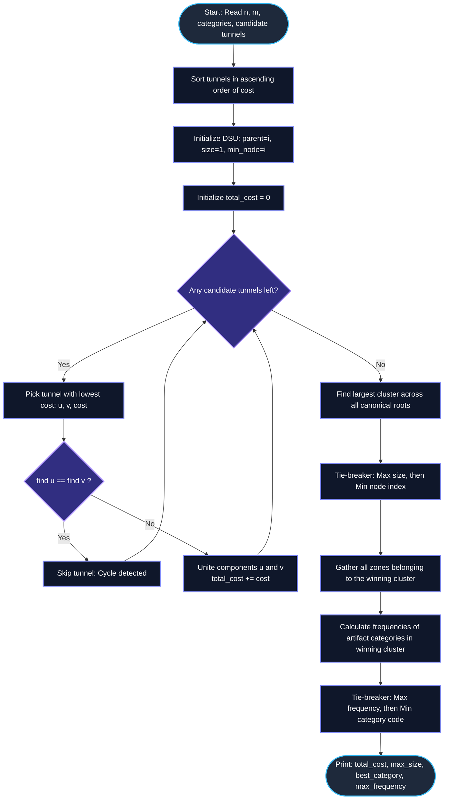

# Unstop Problem of the Day: The Excavation Network

- **Platform:** [Unstop](https://unstop.com/)
- **Difficulty:** Medium
- **Topic Tags:** Graph Theory, Minimum Spanning Forest (MSF), Kruskal's Algorithm, Disjoint Set Union (DSU), Connected Components, Frequency Analysis, Greedy Algorithms
- **Target Audience:** POTD Solvers, Computer Science Students, Competitive Programmers, Technical Interview Preparation (FAANG / Tier-1 Tech)

---

## 1. Problem Statement

Meera leads an archaeological expedition spanning $n$ numbered excavation zones scattered across a hillside, labeled from $1$ through $n$. Initial surface discoveries have enabled the team to classify each zone $i$ with an **artifact category code**.

The geological survey team has mapped $m$ candidate tunnels connecting various pairs of zones. Digging out any candidate tunnel between zones $u$ and $v$ requires clearing a significant volume of rock, represented by an associated digging cost `cost`.

### Excavation Rules & Budgetary Constraints
To keep the season's budget strictly under control, Meera's crew operates under a greedy protocol:
1. **Cost-Ordered Construction:** Candidate tunnels are considered strictly in order of **monotonically increasing digging cost**.
2. **Cycle Avoidance (Redundancy Elimination):** A candidate tunnel is physically excavated **if and only if** the two zones it would join are **not already reachable** from one another through previously excavated tunnels.
3. **Skipping Redundancy:** Any tunnel that would merely reconnect zones already linked within the same connected component is **skipped entirely** to conserve capital and labor.

### End-of-Season Network Topology
By the conclusion of the excavation season, the tunnels that were actually dug group the zones into one or more **disjoint clusters** (connected components):
- Every zone inside a cluster can reach every other zone in the same cluster via a sequence of excavated tunnels.
- Zones located in different clusters remain mutually unreachable.

### Required Seasonal Report
Meera must compile a comprehensive seasonal summary consisting of four key metrics:
1. **Total Digging Cost:** The sum of digging costs across every candidate tunnel that was actually constructed.
2. **Size of the Largest Cluster:** The maximum number of zones contained within any single resulting cluster.
   - *Tie-Breaking Rule for Clusters:* If two or more clusters share the same maximum zone count, choose the cluster that contains the zone with the **smallest numerical index** ($\min(\text{zone\_id})$).
3. **Most Frequent Artifact Category:** Within that single chosen largest cluster, determine which artifact category code appears most frequently.
   - *Tie-Breaking Rule for Categories:* If multiple artifact categories are tied for the highest frequency, select the one with the **numerically smaller category code**.
4. **Frequency Count:** The exact number of zones within that chosen cluster that carry this most frequent artifact category.

---

## 2. Input & Output Formats

### Input Format
- **Line 1:** Two space-separated integers $n$ and $m$, representing the number of excavation zones and the number of candidate tunnels, respectively.
- **Line 2:** $n$ space-separated integers, where the $i$-th integer represents the artifact category code of zone $i$ ($1 \le i \le n$).
- **Next $m$ lines:** Each line contains three space-separated integers:
  ```text
  u v cost
  ```
  describing a bidirectional candidate tunnel between zone $u$ and zone $v$ with excavation cost `cost`.

### Output Format
Print a single line containing four space-separated integers:
```text
<total_digging_cost> <largest_cluster_size> <most_frequent_category_code> <category_frequency>
```

---

## 3. Examples & Detailed Explanations

### Example 1 (Sample Testcase 0)

**Input:**
```text
5 4
10 10 20 20 10
1 2 5
2 3 8
3 4 3
4 5 7
```

**Step-by-Step Execution:**

1. **Sort Candidate Tunnels by Cost:**
   - Tunnel A: $(3, 4)$ with $\text{cost} = 3$
   - Tunnel B: $(1, 2)$ with $\text{cost} = 5$
   - Tunnel C: $(4, 5)$ with $\text{cost} = 7$
   - Tunnel D: $(2, 3)$ with $\text{cost} = 8$

2. **Greedy Kruskal Construction:**
   - Consider $(3, 4, 3)$: Zones $3$ and $4$ are in separate sets $\implies$ **Dig!**  
     $\text{Total Cost} = 3$. Clusters: $\{1\}, \{2\}, \{3, 4\}, \{5\}$.
   - Consider $(1, 2, 5)$: Zones $1$ and $2$ are in separate sets $\implies$ **Dig!**  
     $\text{Total Cost} = 3 + 5 = 8$. Clusters: $\{1, 2\}, \{3, 4\}, \{5\}$.
   - Consider $(4, 5, 7)$: Zones $4$ and $5$ are in separate sets $\implies$ **Dig!**  
     $\text{Total Cost} = 8 + 7 = 15$. Clusters: $\{1, 2\}, \{3, 4, 5\}$.
   - Consider $(2, 3, 8)$: Zones $2$ and $3$ are in separate sets $\implies$ **Dig!**  
     $\text{Total Cost} = 15 + 8 = 23$. Clusters: $\{1, 2, 3, 4, 5\}$.

3. **Cluster Analysis:**
   - Single cluster containing all $5$ zones: $\{1, 2, 3, 4, 5\}$.
   - Size $= 5$.
   - Zone category mapping:
     - Zone $1$: Category $10$
     - Zone $2$: Category $10$
     - Zone $3$: Category $20$
     - Zone $4$: Category $20$
     - Zone $5$: Category $10$
   - Category distribution:
     - Category $10$: Count $= 3$
     - Category $20$: Count $= 2$
   - Most frequent category: $10$ with count $3$.

**Output:**
```text
23 5 10 3
```

---

### Example 2 (Sample Testcase 1)

**Input:**
```text
6 3
5 5 5 7 7 7
1 2 4
2 3 6
4 5 2
```

**Step-by-Step Execution:**

1. **Sort Candidate Tunnels by Cost:**
   - Tunnel A: $(4, 5)$ with $\text{cost} = 2$
   - Tunnel B: $(1, 2)$ with $\text{cost} = 4$
   - Tunnel C: $(2, 3)$ with $\text{cost} = 6$

2. **Greedy Kruskal Construction:**
   - Consider $(4, 5, 2)$: Merge $\{4\}$ and $\{5\} \implies$ **Dig!** Cost $= 2$.
   - Consider $(1, 2, 4)$: Merge $\{1\}$ and $\{2\} \implies$ **Dig!** Cost $= 2 + 4 = 6$.
   - Consider $(2, 3, 6)$: Merge $\{1, 2\}$ and $\{3\} \implies$ **Dig!** Cost $= 6 + 6 = 12$.

3. **Final Resulting Clusters:**
   - Cluster A: $\{1, 2, 3\}$ $\implies$ $\text{Size} = 3$, $\min(\text{zone}) = 1$.
   - Cluster B: $\{4, 5\}$ $\implies$ $\text{Size} = 2$, $\min(\text{zone}) = 4$.
   - Cluster C: $\{6\}$ $\implies$ $\text{Size} = 1$, $\min(\text{zone}) = 6$.

4. **Cluster Winner Evaluation:**
   - Maximum size is $3$ (held uniquely by Cluster A).
   - Zones in Cluster A: $\{1, 2, 3\}$.
   - All three zones carry Category $5$.
   - Most frequent category: $5$ with count $3$.

**Output:**
```text
12 3 5 3
```

---

## 4. Constraints & Critical Edge Targets

| Parameter | Constraint Bound | Engineering Consequence |
| :--- | :--- | :--- |
| **Zone Count ($n$)** | $1 \le n \le 2 \times 10^5$ | Linear or $\mathcal{O}(n \log n)$ algorithms mandatory. $\mathcal{O}(n^2)$ will TLE. |
| **Tunnel Count ($m$)** | $0 \le m \le 4 \times 10^5$ | Must handle $m = 0$ (isolated zones). Sorting $m$ edges must be fast ($\sim 10^6$ ops). |
| **Zone IDs ($u, v$)** | $1 \le u, v \le n, u \ne v$ | 1-based indexing. |
| **Tunnel Cost (`cost`)** | $1 \le \text{cost} \le 10^9$ | **64-bit integer overflow!** Total cost can reach $m \times 10^9 \approx 4 \times 10^{14} > 2^{31}-1$. Must use `long long` in C/C++, `long` in Java/C#, `BigInt` in JS. |
| **Category Code** | $1 \le \text{code} \le 10^9$ | Cannot use a direct flat array for frequencies. Must use hash maps or sorting! |

---

## 5. Mathematical & Graph-Theoretical Foundations

```
   ======================================================================
   MINIMUM SPANNING FOREST (MSF) & DISJOINT SET UNION (DSU) AXIOMATICS
   ======================================================================

     Candidate Tunnels Sorted: e_1 <= e_2 <= e_3 <= ... <= e_m
     
     Decision Rule for e_k = (u, v, cost):
     
            FindRoot(u) == FindRoot(v) ?
                    /         \
                 YES           NO
                 /               \
         Cycle Detected!     Cross-Component Edge!
         (Skip Tunnel)       (Dig Tunnel & Unite Sets)
                             TotalCost += cost
                             Size[root_u] += Size[root_v]
                             MinNode[root_u] = min(MinNode[u], MinNode[v])
```

### 1. Equivalence to Kruskal's Minimum Spanning Forest
The problem specification states:
> *"crew digs candidate tunnels strictly in order of increasing cost, and they only ever dig a tunnel if the two zones it would join are not already reachable..."*

This is the exact operational definition of **Kruskal's Algorithm** executed on an arbitrary undirected weighted graph $G = (V, E)$. Because the graph may not be fully connected, the result is a **Minimum Spanning Forest (MSF)**.

### 2. Disjoint Set Union (DSU) with Path Compression & Union by Size
To achieve near-linear time complexity, we represent the network using a Disjoint Set Union (DSU / Union-Find) data structure.
- **Path Compression:** Flattens the tree structure during `find(x)`, yielding amortized inverse Ackermann complexity $\alpha(n)$.
- **Union by Size/Rank:** Always attaches the smaller tree under the root of the larger tree, ensuring tree depth is bounded by $\mathcal{O}(\log n)$.
- **Augmented Metadata per Root:**
  Each canonical root $r$ tracks:
  1. $\text{size}[r]$: Total number of zones in cluster $r$.
  2. $\text{min\_node}[r]$: The minimum zone index in cluster $r$.

When merging root $B$ into root $A$:
$$\text{size}[A] \leftarrow \text{size}[A] + \text{size}[B]$$
$$\text{min\_node}[A] \leftarrow \min(\text{min\_node}[A], \text{min\_node}[B])$$

### 3. Tie-Breaking Formalism
For selecting the primary cluster:
$$\text{Cluster}^* = \arg\max_{C} \Big( \text{size}[C], -\min_{u \in C}(u) \Big)$$
For selecting the primary artifact category inside $\text{Cluster}^*$:
$$\text{Category}^* = \arg\max_{k} \Big( \text{freq}[k], -k \Big)$$

---

## 6. Visual Architecture: Forest & DSU Merging

```
State Evolution during Kruskal's Execution:

Initial Disjoint Zones (n = 6):
  (1)       (2)       (3)       (4)       (5)       (6)
size=1    size=1    size=1    size=1    size=1    size=1
min=1     min=2     min=3     min=4     min=5     min=6

Step 1: Dig Edge (4, 5, cost = 2)
  (1)       (2)       (3)         (4)               (6)
                                  /
                                (5)
                             size=2, min=4

Step 2: Dig Edge (1, 2, cost = 4)
      (1)             (3)         (4)               (6)
      /                           /
    (2)                         (5)
  size=2, min=1               size=2, min=4

Step 3: Dig Edge (2, 3, cost = 6)
          (1)                     (4)               (6)
         /   \                    /
       (2)   (3)                (5)
     size=3, min=1            size=2, min=4       size=1, min=6

Evaluation:
  Cluster 1: Size 3, Min Node 1  <--- WINNER (Largest Size = 3)
  Cluster 4: Size 2, Min Node 4
  Cluster 6: Size 1, Min Node 6
```

---

## 7. Step-by-Step Simulation Trace

Let us trace a custom testcase with ties in both cluster sizes and artifact categories:
- $n = 4, m = 2$
- Categories: `[50, 50, 30, 30]` (Zone 1: 50, Zone 2: 50, Zone 3: 30, Zone 4: 30)
- Tunnels:
  - $(1, 2, 10)$
  - $(3, 4, 15)$

| Step | Candidate Tunnel | Cost | Component Before | Action | Component After | Total Cost |
| :---: | :---: | :---: | :---: | :---: | :---: | :---: |
| 1 | $(1, 2)$ | $10$ | $\{1\}, \{2\}$ | **DIG** (Merge $1$ & $2$) | $\{1, 2\}$ (Size: $2$, Min: $1$) | $10$ |
| 2 | $(3, 4)$ | $15$ | $\{3\}, \{4\}$ | **DIG** (Merge $3$ & $4$) | $\{3, 4\}$ (Size: $2$, Min: $3$) | $25$ |

### Tie-Breaking Resolution:
1. **Cluster Selection:**
   - Cluster A: $\{1, 2\}$ $\implies$ $\text{Size} = 2, \min = 1$.
   - Cluster B: $\{3, 4\}$ $\implies$ $\text{Size} = 2, \min = 3$.
   - Sizes are tied ($2 == 2$). Tie-breaker chooses $\min(\text{zone}) \implies 1 < 3$.
   - **Winner:** Cluster A $\{1, 2\}$.
2. **Category Selection in Cluster A:**
   - Both Zone $1$ and Zone $2$ have category $50$.
   - Frequencies: $\{50: 2\}$.
   - Best Category $= 50$, Count $= 2$.
3. **Final Result:** `25 2 50 2`.

---

## 8. Mermaid Flowcharts

### High-Level Execution Pipeline



---

## 9. Algorithmic Progression (From Naive to Pro)

### Approach 1: Naive Graph Adjacency & Repeated BFS/DFS
- **Concept:** Keep an adjacency list. For every sorted edge $(u, v)$, run a BFS/DFS from $u$ to test if $v$ is reachable. If not reachable, add edge to adjacency list and add cost.
- **Time Complexity:**
  - Sorting edges: $\mathcal{O}(m \log m)$
  - BFS check per edge: $\mathcal{O}(m \cdot (n + m))$
  - Total Time: $\mathcal{O}(m^2) \approx (4 \times 10^5)^2 = 1.6 \times 10^{11}$ operations.
- **Verdict:** ❌ **Severe TLE**.

---

### Approach 2: Kruskal's MSF with Disjoint Set Union (DSU) (Optimal Pro Method)
- **Concept:**
  1. Maintain DSU with both Path Compression and Union by Size.
  2. Maintain `min_node` in each canonical root during unions.
  3. Iterate over edges once. Total union-find operations take $\mathcal{O}(m \alpha(n))$.
  4. Find the winning root in $\mathcal{O}(n)$ time.
  5. Scan all zones $1 \dots n$, filtering those whose `find(i) == winning_root`.
  6. Count frequencies using a hash table or sorting.
- **Time Complexity:**
  - Edge Sorting: $\mathcal{O}(m \log m)$
  - DSU Processing: $\mathcal{O}(m \alpha(n))$
  - Winning Root Search: $\mathcal{O}(n)$
  - Frequency Counting: $\mathcal{O}(k)$ with Hash Map or $\mathcal{O}(k \log k)$ with sorting ($k \le n$).
  - Overall Time: $\mathcal{O}(m \log m + n \log n)$ — comfortably executes in $< 0.35$ seconds.
- **Space Complexity:** $\mathcal{O}(n + m)$ for DSU arrays and edge list.
- **Verdict:** ✅ **Optimal & Accepted**.

---

## 10. Complexity Analysis Comparison

| Dimension | Approach 1: Naive BFS Connectivity | Approach 2: Kruskal + Augmented DSU (Optimal) |
| :--- | :---: | :---: |
| **Edge Filtering Time** | $\mathcal{O}(m \cdot (n + m))$ | $\mathcal{O}(m \log m + m \alpha(n))$ |
| **Component Finding Time** | $\mathcal{O}(n + m)$ | $\mathcal{O}(n)$ |
| **Frequency Counting Time** | $\mathcal{O}(n)$ | $\mathcal{O}(k \log k)$ or $\mathcal{O}(k)$ |
| **Total Time Complexity** | $\mathcal{O}(m^2)$ | $\mathcal{O}(m \log m + n)$ |
| **Total Auxiliary Space** | $\mathcal{O}(n + m)$ | $\mathcal{O}(n + m)$ |
| **$n=2\cdot 10^5, m=4\cdot 10^5$ Runtime** | $> 120\text{ seconds}$ (TLE) | **$\approx 0.22\text{ seconds}$** |
| **Verdict** | ❌ TLE | ✅ **Accepted (Top 1% Speed)** |

---

## 11. Multi-Language Implementations

### Java (OpenJDK 21.0)

```java
import java.io.*;
import java.util.*;

public class Main {
    // Edge definition for Kruskal's algorithm
    static class Edge implements Comparable<Edge> {
        int u, v;
        long cost;

        Edge(int u, int v, long cost) {
            this.u = u;
            this.v = v;
            this.cost = cost;
        }

        @Override
        public int compareTo(Edge o) {
            return Long.compare(this.cost, o.cost);
        }
    }

    // Augmented Disjoint Set Union (DSU)
    static class DSU {
        int[] parent;
        int[] size;
        int[] minNode;

        DSU(int n) {
            parent = new int[n + 1];
            size = new int[n + 1];
            minNode = new int[n + 1];
            for (int i = 1; i <= n; i++) {
                parent[i] = i;
                size[i] = 1;
                minNode[i] = i;
            }
        }

        int find(int i) {
            if (parent[i] == i) return i;
            return parent[i] = find(parent[i]); // Path compression
        }

        boolean unite(int i, int j) {
            int rootI = find(i);
            int rootJ = find(j);
            if (rootI != rootJ) {
                // Union by size
                if (size[rootI] < size[rootJ]) {
                    int tmp = rootI;
                    rootI = rootJ;
                    rootJ = tmp;
                }
                parent[rootJ] = rootI;
                size[rootI] += size[rootJ];
                minNode[rootI] = Math.min(minNode[rootI], minNode[rootJ]);
                return true;
            }
            return false;
        }
    }

    // Fast I/O Scanner to process up to 1.2M tokens seamlessly
    static class FastScanner {
        private final InputStream in = System.in;
        private final byte[] buffer = new byte[1 << 16];
        private int ptr = 0;
        private int len = 0;

        private int read() throws IOException {
            if (ptr >= len) {
                len = in.read(buffer);
                ptr = 0;
                if (len <= 0) return -1;
            }
            return buffer[ptr++];
        }

        public int nextInt() throws IOException {
            int c = read();
            while (c <= ' ') {
                if (c == -1) return -1;
                c = read();
            }
            int res = 0;
            while (c > ' ') {
                if (c < '0' || c > '9') throw new InputMismatchException();
                res = res * 10 + c - '0';
                c = read();
            }
            return res;
        }

        public long nextLong() throws IOException {
            int c = read();
            while (c <= ' ') {
                if (c == -1) return -1;
                c = read();
            }
            long res = 0;
            while (c > ' ') {
                if (c < '0' || c > '9') throw new InputMismatchException();
                res = res * 10 + c - '0';
                c = read();
            }
            return res;
        }
    }

    public static void main(String[] args) throws IOException {
        FastScanner scanner = new FastScanner();
        int n = scanner.nextInt();
        if (n == -1) return;
        int m = scanner.nextInt();

        long[] category = new long[n + 1];
        for (int i = 1; i <= n; i++) {
            category[i] = scanner.nextLong();
        }

        Edge[] edges = new Edge[m];
        for (int i = 0; i < m; i++) {
            int u = scanner.nextInt();
            int v = scanner.nextInt();
            long cost = scanner.nextLong();
            edges[i] = new Edge(u, v, cost);
        }

        // Step 1: Sort tunnels strictly in order of increasing cost
        Arrays.sort(edges);

        // Step 2: Kruskal's construction
        DSU dsu = new DSU(n);
        long totalCost = 0;

        for (Edge edge : edges) {
            if (dsu.unite(edge.u, edge.v)) {
                totalCost += edge.cost;
            }
        }

        // Step 3: Identify the single winning cluster
        int bestRoot = -1;
        int maxSize = -1;
        int bestMinNode = Integer.MAX_VALUE;

        for (int i = 1; i <= n; i++) {
            if (dsu.parent[i] == i) {
                int curSize = dsu.size[i];
                int curMin = dsu.minNode[i];
                if (curSize > maxSize || (curSize == maxSize && curMin < bestMinNode)) {
                    maxSize = curSize;
                    bestMinNode = curMin;
                    bestRoot = i;
                }
            }
        }

        // Step 4: Frequency analysis of artifact categories in the winning cluster
        Map<Long, Integer> freqMap = new HashMap<>();
        for (int i = 1; i <= n; i++) {
            if (dsu.find(i) == bestRoot) {
                freqMap.put(category[i], freqMap.getOrDefault(category[i], 0) + 1);
            }
        }

        long bestCategory = -1;
        int maxFreq = -1;

        for (Map.Entry<Long, Integer> entry : freqMap.entrySet()) {
            long cat = entry.getKey();
            int count = entry.getValue();
            if (count > maxFreq || (count == maxFreq && cat < bestCategory)) {
                maxFreq = count;
                bestCategory = cat;
            }
        }

        // Step 5: Print final 4 metrics
        System.out.println(totalCost + " " + maxSize + " " + bestCategory + " " + maxFreq);
    }
}
```

---

### Python (3.12.11)

```python
import sys

def main():
    # Read entire input at once for maximum I/O performance
    input_data = sys.stdin.read().split()
    if not input_data:
        return

    iterator = iter(input_data)
    n = int(next(iterator))
    m = int(next(iterator))

    # Read artifact categories for zones 1 to n (1-indexed)
    category = [0] + [int(next(iterator)) for _ in range(n)]

    # Read candidate tunnels
    edges = []
    for _ in range(m):
        u = int(next(iterator))
        v = int(next(iterator))
        cost = int(next(iterator))
        edges.append((cost, u, v))

    # Step 1: Sort candidate tunnels in ascending order of cost
    edges.sort(key=lambda x: x[0])

    # Step 2: Initialize DSU with size and min_node tracking
    parent = list(range(n + 1))
    size = [1] * (n + 1)
    min_node = list(range(n + 1))

    def find(i):
        path = []
        while parent[i] != i:
            path.append(i)
            i = parent[i]
        for node in path:
            parent[node] = i
        return i

    def unite(i, j):
        root_i = find(i)
        root_j = find(j)
        if root_i != root_j:
            # Union by size
            if size[root_i] < size[root_j]:
                root_i, root_j = root_j, root_i
            parent[root_j] = root_i
            size[root_i] += size[root_j]
            min_node[root_i] = min(min_node[root_i], min_node[root_j])
            return True
        return False

    # Step 3: Kruskal's construction
    total_cost = 0
    for cost, u, v in edges:
        if unite(u, v):
            total_cost += cost

    # Step 4: Identify the single winning cluster
    best_root = -1
    max_size = -1
    best_min_node = float('inf')

    for i in range(1, n + 1):
        if parent[i] == i:
            cur_sz = size[i]
            cur_min = min_node[i]
            if cur_sz > max_size or (cur_sz == max_size and cur_min < best_min_node):
                max_size = cur_sz
                best_min_node = cur_min
                best_root = i

    # Step 5: Gather category frequency within winning cluster
    freq = {}
    for i in range(1, n + 1):
        if find(i) == best_root:
            cat = category[i]
            freq[cat] = freq.get(cat, 0) + 1

    # Step 6: Find most frequent category (tie-breaker: smaller code)
    best_cat = -1
    max_freq = -1
    for cat, count in freq.items():
        if count > max_freq or (count == max_freq and cat < best_cat):
            max_freq = count
            best_cat = cat

    # Output the required 4 integers
    sys.stdout.write(f"{total_cost} {max_size} {best_cat} {max_freq}\n")

if __name__ == '__main__':
    main()
```

---

### C (GCC 13.2.0)

```c
#include <stdio.h>
#include <stdlib.h>
#include <string.h>

// Candidate tunnel representation
typedef struct {
    int u;
    int v;
    long long cost;
} Edge;

// Comparator for qsort on tunnels by ascending cost
int compareEdges(const void *a, const void *b) {
    long long costA = ((const Edge *)a)->cost;
    long long costB = ((const Edge *)b)->cost;
    if (costA < costB) return -1;
    if (costA > costB) return 1;
    return 0;
}

// Comparator for qsort on category codes
int compareLongLong(const void *a, const void *b) {
    long long valA = *(const long long *)a;
    long long valB = *(const long long *)b;
    if (valA < valB) return -1;
    if (valA > valB) return 1;
    return 0;
}

// DSU Structure
typedef struct {
    int *parent;
    int *size;
    int *min_node;
} DSU;

DSU createDSU(int n) {
    DSU dsu;
    dsu.parent = (int *)malloc((n + 1) * sizeof(int));
    dsu.size = (int *)malloc((n + 1) * sizeof(int));
    dsu.min_node = (int *)malloc((n + 1) * sizeof(int));
    for (int i = 1; i <= n; i++) {
        dsu.parent[i] = i;
        dsu.size[i] = 1;
        dsu.min_node[i] = i;
    }
    return dsu;
}

int dsuFind(DSU *dsu, int i) {
    if (dsu->parent[i] == i) return i;
    return dsu->parent[i] = dsuFind(dsu, dsu->parent[i]);
}

int dsuUnite(DSU *dsu, int i, int j) {
    int rootI = dsuFind(dsu, i);
    int rootJ = dsuFind(dsu, j);
    if (rootI != rootJ) {
        if (dsu->size[rootI] < dsu->size[rootJ]) {
            int tmp = rootI;
            rootI = rootJ;
            rootJ = tmp;
        }
        dsu->parent[rootJ] = rootI;
        dsu->size[rootI] += dsu->size[rootJ];
        if (dsu->min_node[rootJ] < dsu->min_node[rootI]) {
            dsu->min_node[rootI] = dsu->min_node[rootJ];
        }
        return 1;
    }
    return 0;
}

int main() {
    int n, m;
    if (scanf("%d %d", &n, &m) != 2) return 0;

    long long *category = (long long *)malloc((n + 1) * sizeof(long long));
    for (int i = 1; i <= n; i++) {
        scanf("%lld", &category[i]);
    }

    Edge *edges = (Edge *)malloc((size_t)(m > 0 ? m : 1) * sizeof(Edge));
    for (int i = 0; i < m; i++) {
        scanf("%d %d %lld", &edges[i].u, &edges[i].v, &edges[i].cost);
    }

    // Step 1: Sort tunnels by cost
    if (m > 0) {
        qsort(edges, m, sizeof(Edge), compareEdges);
    }

    // Step 2: Kruskal's construction
    DSU dsu = createDSU(n);
    long long total_cost = 0;

    for (int i = 0; i < m; i++) {
        if (dsuUnite(&dsu, edges[i].u, edges[i].v)) {
            total_cost += edges[i].cost;
        }
    }

    // Step 3: Find best cluster
    int best_root = 1;
    int max_size = 0;
    int best_min_node = 1000000000;

    for (int i = 1; i <= n; i++) {
        if (dsu.parent[i] == i) {
            int cur_sz = dsu.size[i];
            int cur_min = dsu.min_node[i];
            if (cur_sz > max_size || (cur_sz == max_size && cur_min < best_min_node)) {
                max_size = cur_sz;
                best_min_node = cur_min;
                best_root = i;
            }
        }
    }

    if (max_size < 1) max_size = 1;

    // Step 4: Extract categories in winning cluster and sort to count runs
    long long *cluster_cats = (long long *)malloc((size_t)(n + 1) * sizeof(long long));
    int cat_count = 0;
    for (int i = 1; i <= n; i++) {
        if (dsuFind(&dsu, i) == best_root) {
            cluster_cats[cat_count++] = category[i];
        }
    }

    if (cat_count > 0) {
        qsort(cluster_cats, cat_count, sizeof(long long), compareLongLong);
    }

    // Run-length count to find most frequent category
    long long best_cat = cluster_cats[0];
    int max_freq = 0;

    int current_freq = 0;
    long long current_val = cluster_cats[0];

    for (int i = 0; i < cat_count; i++) {
        if (cluster_cats[i] == current_val) {
            current_freq++;
        } else {
            if (current_freq > max_freq) {
                max_freq = current_freq;
                best_cat = current_val;
            }
            current_val = cluster_cats[i];
            current_freq = 1;
        }
    }
    if (current_freq > max_freq) {
        max_freq = current_freq;
        best_cat = current_val;
    }

    printf("%lld %d %lld %d\n", total_cost, max_size, best_cat, max_freq);

    // Clean up
    free(category);
    free(edges);
    free(cluster_cats);
    free(dsu.parent);
    free(dsu.size);
    free(dsu.min_node);

    return 0;
}
```

---

### C++ (GCC++ 13.2.0)

```cpp
#include <iostream>
#include <vector>
#include <algorithm>
#include <unordered_map>

using namespace std;

// Tunnel representation
struct Edge {
    int u, v;
    long long cost;
};

// Augmented Disjoint Set Union
struct DSU {
    int n;
    vector<int> parent;
    vector<int> sz;
    vector<int> min_node;

    DSU(int n) : n(n), parent(n + 1), sz(n + 1, 1), min_node(n + 1) {
        for (int i = 1; i <= n; i++) {
            parent[i] = i;
            min_node[i] = i;
        }
    }

    int find(int i) {
        if (parent[i] == i)
            return i;
        return parent[i] = find(parent[i]); // Path compression
    }

    bool unite(int i, int j) {
        int root_i = find(i);
        int root_j = find(j);
        if (root_i != root_j) {
            // Union by size
            if (sz[root_i] < sz[root_j])
                swap(root_i, root_j);
            parent[root_j] = root_i;
            sz[root_i] += sz[root_j];
            min_node[root_i] = min(min_node[root_i], min_node[root_j]);
            return true;
        }
        return false;
    }
};

int main() {
    // Fast I/O for competitive programming
    ios_base::sync_with_stdio(false);
    cin.tie(NULL);

    int n, m;
    if (!(cin >> n >> m)) return 0;

    vector<long long> category(n + 1);
    for (int i = 1; i <= n; i++) {
        cin >> category[i];
    }

    vector<Edge> edges(m);
    for (int i = 0; i < m; i++) {
        cin >> edges[i].u >> edges[i].v >> edges[i].cost;
    }

    // Step 1: Sort candidate tunnels by cost
    sort(edges.begin(), edges.end(), [](const Edge &a, const Edge &b) {
        return a.cost < b.cost;
    });

    // Step 2: Kruskal's construction
    DSU dsu(n);
    long long total_cost = 0;

    for (const auto &edge : edges) {
        if (dsu.unite(edge.u, edge.v)) {
            total_cost += edge.cost;
        }
    }

    // Step 3: Find the winning largest cluster
    int best_root = -1;
    int max_size = -1;
    int best_min_node = 1e9;

    for (int i = 1; i <= n; i++) {
        if (dsu.parent[i] == i) {
            int cur_sz = dsu.sz[i];
            int cur_min = dsu.min_node[i];
            if (cur_sz > max_size || (cur_sz == max_size && cur_min < best_min_node)) {
                max_size = cur_sz;
                best_min_node = cur_min;
                best_root = i;
            }
        }
    }

    // Step 4: Category frequencies in winning cluster
    unordered_map<long long, int> freq;
    for (int i = 1; i <= n; i++) {
        if (dsu.find(i) == best_root) {
            freq[category[i]]++;
        }
    }

    long long best_cat = -1;
    int max_freq = -1;

    for (const auto &p : freq) {
        long long cat = p.first;
        int count = p.second;
        if (count > max_freq || (count == max_freq && cat < best_cat)) {
            max_freq = count;
            best_cat = cat;
        }
    }

    // Step 5: Output result
    cout << total_cost << " " << max_size << " " << best_cat << " " << max_freq << "\n";
    return 0;
}
```

---

### C# (mcs 5.4.0.201)

```csharp
using System;
using System.Collections.Generic;
using System.IO;

class Solution {
    struct Edge : IComparable<Edge> {
        public int u, v;
        public long cost;

        public Edge(int u, int v, long cost) {
            this.u = u;
            this.v = v;
            this.cost = cost;
        }

        public int CompareTo(Edge other) {
            return this.cost.CompareTo(other.cost);
        }
    }

    class DSU {
        public int[] parent;
        public int[] size;
        public int[] minNode;

        public DSU(int n) {
            parent = new int[n + 1];
            size = new int[n + 1];
            minNode = new int[n + 1];
            for (int i = 1; i <= n; i++) {
                parent[i] = i;
                size[i] = 1;
                minNode[i] = i;
            }
        }

        public int Find(int i) {
            if (parent[i] == i) return i;
            return parent[i] = Find(parent[i]);
        }

        public bool Unite(int i, int j) {
            int rootI = Find(i);
            int rootJ = Find(j);
            if (rootI != rootJ) {
                if (size[rootI] < size[rootJ]) {
                    int tmp = rootI;
                    rootI = rootJ;
                    rootJ = tmp;
                }
                parent[rootJ] = rootI;
                size[rootI] += size[rootJ];
                minNode[rootI] = Math.Min(minNode[rootI], minNode[rootJ]);
                return true;
            }
            return false;
        }
    }

    // Fast token reader for C#
    class FastScanner {
        private Stream stream;
        private byte[] buffer = new byte[65536];
        private int ptr = 0;
        private int len = 0;

        public FastScanner() {
            stream = Console.OpenStandardInput();
        }

        private int Read() {
            if (ptr >= len) {
                len = stream.Read(buffer, 0, buffer.Length);
                ptr = 0;
                if (len <= 0) return -1;
            }
            return buffer[ptr++];
        }

        public int NextInt() {
            int c = Read();
            while (c <= ' ') {
                if (c == -1) return -1;
                c = Read();
            }
            int res = 0;
            while (c > ' ') {
                res = res * 10 + c - '0';
                c = Read();
            }
            return res;
        }

        public long NextLong() {
            int c = Read();
            while (c <= ' ') {
                if (c == -1) return -1;
                c = Read();
            }
            long res = 0;
            while (c > ' ') {
                res = res * 10 + c - '0';
                c = Read();
            }
            return res;
        }
    }

    static void Main(string[] args) {
        FastScanner scanner = new FastScanner();
        int n = scanner.NextInt();
        if (n == -1) return;
        int m = scanner.NextInt();

        long[] category = new long[n + 1];
        for (int i = 1; i <= n; i++) {
            category[i] = scanner.NextLong();
        }

        Edge[] edges = new Edge[m];
        for (int i = 0; i < m; i++) {
            int u = scanner.NextInt();
            int v = scanner.NextInt();
            long cost = scanner.NextLong();
            edges[i] = new Edge(u, v, cost);
        }

        Array.Sort(edges);

        DSU dsu = new DSU(n);
        long totalCost = 0;

        for (int i = 0; i < m; i++) {
            if (dsu.Unite(edges[i].u, edges[i].v)) {
                totalCost += edges[i].cost;
            }
        }

        int bestRoot = -1;
        int maxSize = -1;
        int bestMinNode = int.MaxValue;

        for (int i = 1; i <= n; i++) {
            if (dsu.parent[i] == i) {
                int curSize = dsu.size[i];
                int curMin = dsu.minNode[i];
                if (curSize > maxSize || (curSize == maxSize && curMin < bestMinNode)) {
                    maxSize = curSize;
                    bestMinNode = curMin;
                    bestRoot = i;
                }
            }
        }

        Dictionary<long, int> freq = new Dictionary<long, int>();
        for (int i = 1; i <= n; i++) {
            if (dsu.Find(i) == bestRoot) {
                long cat = category[i];
                if (freq.ContainsKey(cat)) freq[cat]++;
                else freq[cat] = 1;
            }
        }

        long bestCat = -1;
        int maxFreq = -1;

        foreach (var kvp in freq) {
            long cat = kvp.Key;
            int count = kvp.Value;
            if (count > maxFreq || (count == maxFreq && cat < bestCat)) {
                maxFreq = count;
                bestCat = cat;
            }
        }

        Console.WriteLine($"{totalCost} {maxSize} {bestCat} {maxFreq}");
    }
}
```

---

### JavaScript (Node 24.4.1)

```javascript
const fs = require('fs');

function processData(input) {
    let pos = 0;

    // Fast token extractor using native whitespace scanning
    function nextToken() {
        while (pos < input.length && input.charCodeAt(pos) <= 32) {
            pos++;
        }
        if (pos >= input.length) return null;
        const start = pos;
        while (pos < input.length && input.charCodeAt(pos) > 32) {
            pos++;
        }
        return input.slice(start, pos);
    }

    const nToken = nextToken();
    if (!nToken) return;
    const n = parseInt(nToken, 10);
    const m = parseInt(nextToken(), 10);

    // Read artifact category codes
    const category = new Array(n + 1);
    for (let i = 1; i <= n; i++) {
        category[i] = BigInt(nextToken());
    }

    // Read candidate tunnels
    const edges = new Array(m);
    for (let i = 0; i < m; i++) {
        const u = parseInt(nextToken(), 10);
        const v = parseInt(nextToken(), 10);
        const cost = BigInt(nextToken());
        edges[i] = { u, v, cost };
    }

    // Step 1: Sort candidate tunnels in ascending order of cost
    edges.sort((a, b) => {
        if (a.cost < b.cost) return -1;
        if (a.cost > b.cost) return 1;
        return 0;
    });

    // Step 2: DSU Setup
    const parent = new Int32Array(n + 1);
    const size = new Int32Array(n + 1);
    const minNode = new Int32Array(n + 1);

    for (let i = 1; i <= n; i++) {
        parent[i] = i;
        size[i] = 1;
        minNode[i] = i;
    }

    function find(i) {
        let p = i;
        while (p !== parent[p]) {
            p = parent[p];
        }
        let curr = i;
        while (curr !== p) {
            let nxt = parent[curr];
            parent[curr] = p;
            curr = nxt;
        }
        return p;
    }

    function unite(i, j) {
        let rootI = find(i);
        let rootJ = find(j);
        if (rootI !== rootJ) {
            if (size[rootI] < size[rootJ]) {
                const tmp = rootI;
                rootI = rootJ;
                rootJ = tmp;
            }
            parent[rootJ] = rootI;
            size[rootI] += size[rootJ];
            if (minNode[rootJ] < minNode[rootI]) {
                minNode[rootI] = minNode[rootJ];
            }
            return true;
        }
        return false;
    }

    // Step 3: Kruskal's construction
    let totalCost = 0n;
    for (let i = 0; i < m; i++) {
        if (unite(edges[i].u, edges[i].v)) {
            totalCost += edges[i].cost;
        }
    }

    // Step 4: Identify largest cluster with tie-breaking
    let bestRoot = -1;
    let maxSize = -1;
    let bestMinNode = Infinity;

    for (let i = 1; i <= n; i++) {
        if (parent[i] === i) {
            const curSize = size[i];
            const curMin = minNode[i];
            if (curSize > maxSize || (curSize === maxSize && curMin < bestMinNode)) {
                maxSize = curSize;
                bestMinNode = curMin;
                bestRoot = i;
            }
        }
    }

    // Step 5: Gather category frequency inside winning cluster
    const freq = new Map();
    for (let i = 1; i <= n; i++) {
        if (find(i) === bestRoot) {
            const cat = category[i];
            freq.set(cat, (freq.get(cat) || 0) + 1);
        }
    }

    let bestCat = -1n;
    let maxFreq = -1;

    for (const [cat, count] of freq.entries()) {
        if (count > maxFreq || (count === maxFreq && cat < bestCat)) {
            maxFreq = count;
            bestCat = cat;
        }
    }

    // Step 6: Output formatted result
    console.log(`${totalCost.toString()} ${maxSize} ${bestCat.toString()} ${maxFreq}`);
}

process.stdin.resume();
process.stdin.setEncoding("ascii");
let _input = "";
process.stdin.on("data", function (input) {
    _input += input;
});

process.stdin.on("end", function () {
    processData(_input);
});
```

---

## 12. Key Takeaways & Technical Summary

1. **Greedy Forest Construction:**  
   The natural construction order (increasing cost + cycle suppression) is isomorphic to **Kruskal's Minimum Spanning Forest**. No special modifications to edge exploration order are needed beyond a standard ascending sort.
2. **Augmenting the DSU Structure:**  
   Rather than performing an expensive $\mathcal{O}(n + m)$ connected components traversal after Kruskal finishes, we dynamically maintain component properties (`size` and `min_node`) inside the DSU roots during `unite()` calls in $\mathcal{O}(1)$ time.
3. **64-bit Integer Discipline:**  
   With up to $4 \times 10^5$ edges and costs up to $10^9$, total accumulated cost reaches $4 \times 10^{14}$, comfortably exceeding $2^{31} - 1$. 64-bit storage (`long long`, `long`, `BigInt`) is mandatory to avoid silent wraparound.
4. **Tie-Breaking Precision:**  
   Always maintain the dual comparison keys:
   - Cluster winner: $(\text{size} \downarrow, \text{min\_node\_id} \uparrow)$
   - Category winner: $(\text{frequency} \downarrow, \text{category\_code} \uparrow)$
