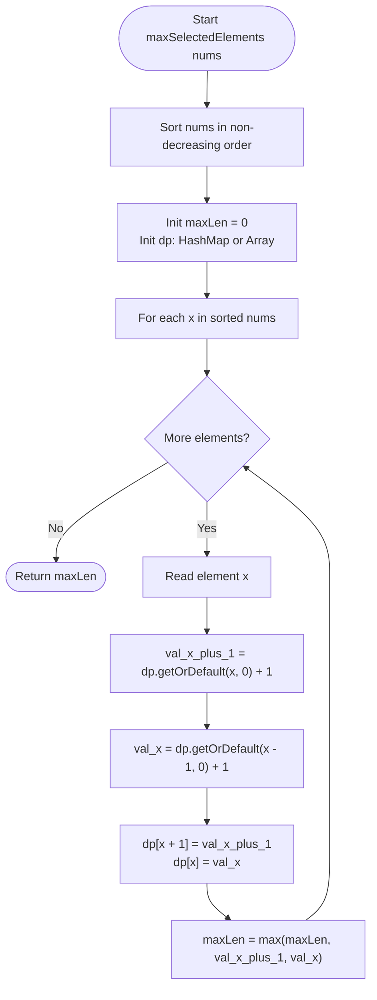

# LeetCode Problem of the Day: Maximize Consecutive Elements in an Array After Modification

- **Problem Link:** [LeetCode 3041 - Maximize Consecutive Elements in an Array After Modification](https://leetcode.com/problems/maximize-consecutive-elements-in-an-array-after-modification/)
- **Difficulty:** Hard
- **Topic Tags:** Array, Dynamic Programming, Sorting, Hash Table
- **Target Audience:** POTD Solvers, Computer Science Students, Competitive Programmers, Technical Interview Candidates (Google, Meta, Amazon, Microsoft, Uber, Citadel)

---

## 1. Problem Statement

You are given a 0-indexed integer array `nums` of positive integers.

You are allowed to select any number of elements in the array and increase each selected element by $1$. Each element can be increased at most once.

After applying the modifications, find the **maximum number of consecutive elements** that can be selected from the resulting array.

> **Crucial Definition:**  
> A set of elements is consecutive if it can be rearranged into a strictly increasing sequence with a step size of $1$:
> $$[v, v + 1, v + 2, \dots, v + L - 1]$$
> The selected elements **do not need to be contiguous or maintain their original order** in `nums`. However, each value in the consecutive sequence must originate from a distinct element of the original array.

---

## 2. Examples & Visual Explanations

### Example 1
- **Input:** `nums = [2, 1, 5, 1, 1]`
- **Length:** $n = 5$
- **Strategy:**
  - Original elements: `[2, 1, 5, 1, 1]`.
  - Leave the first `1` as `1`.
  - Increase the second `1` to `2`.
  - Increase `2` to `3`.
  - Resulting elements include `[1, 2, 3]`, which forms a consecutive sequence of length $3$.
- **Output:** `3`

```
  Original Array:    2     1     5     1     1
                     │     │           │
  Chosen Elements:   2     1           1
  Applied Actions:  +1    +0          +1
  Modified Values:   3     1           2
  
  Rearranged Consecutive Sequence:  [ 1,  2,  3 ]  ──► Length = 3
```

---

### Example 2
- **Input:** `nums = [1, 4, 7, 10]`
- **Strategy:**
  - Even if we increase all elements by $1$, the elements become `[2, 5, 8, 11]`.
  - No two elements can ever become consecutive because the original gaps between adjacent elements are $\ge 3$.
  - The maximum consecutive sequence length is $1$.
- **Output:** `1`

---

### Example 3 (Extended Trace with Multiple Duplicates)
- **Input:** `nums = [1, 2, 2, 3]`
- **Strategy:**
  - Element $1 \to 1$ (unmodified)
  - First $2 \to 2$ (unmodified)
  - Second $2 \to 3$ (incremented by $1$)
  - Element $3 \to 4$ (incremented by $1$)
  - Resulting sequence: `[1, 2, 3, 4]` of length $4$.
- **Output:** `4`

---

## 3. Constraints & Scale Analysis

| Parameter | Constraint Range | Algorithmic Implications |
| :--- | :--- | :--- |
| **Array Length ($n$)** | $1 \le n \le 10^5$ | An $\mathcal{O}(2^n)$ or $\mathcal{O}(n^2)$ algorithm will result in immediate Time Limit Exceeded (TLE). Requires $\mathcal{O}(n \log n)$ or $\mathcal{O}(n)$. |
| **Element Values ($nums[i]$)** | $1 \le nums[i] \le 10^6$ | Upper bound allows direct $\mathcal{O}(1)$ array indexing or hash map lookups. |
| **Max Modified Value** | $nums[i] + 1 \le 10^6 + 1$ | Fits comfortably within standard 32-bit signed integers. |

---

## 4. Key Architectural Insights & Dynamic Programming Formulation

### 1. Order Independence $\implies$ Sort First
Because we can pick any arbitrary subset of elements and rearrange them into a consecutive run, their original indices in `nums` are irrelevant.  
Sorting `nums` in non-decreasing order:
$$nums[0] \le nums[1] \le nums[2] \le \dots \le nums[n-1]$$
ensures that when building an increasing sequence, we process potential chain candidates in strictly ascending order.

---

### 2. State Definition
For each element $x \in nums$, we have exactly two choices:
1. **Leave $x$ as $x$**: This can extend any consecutive sequence that ends at value $x - 1$.
2. **Increase $x$ to $x + 1$**: This can extend any consecutive sequence that ends at value $x$.

Let $dp[v]$ represent the **maximum length of a valid consecutive sequence ending at value $v$**.

When considering the current element $x$:
- If transformed to $x + 1$:
  $$\text{new\_dp}[x + 1] = dp[x] + 1$$
- If left as $x$:
  $$\text{new\_dp}[x] = dp[x - 1] + 1$$

---

### 3. The Critical Reverse Update Invariant
Notice that calculating $\text{new\_dp}[x + 1]$ depends on $dp[x]$.  
If we updated $dp[x]$ **first**, the updated $dp[x]$ would already include the current element $x$. Subsequently updating $dp[x + 1] = dp[x] + 1$ would use the **exact same element twice** (both as $x$ and as $x + 1$)!

> **The Invariant:**  
> To guarantee that each element is utilized at most once, we **must compute the transition for $x + 1$ before modifying $dp[x]$**:
> 1. $dp[x + 1] = dp[x] + 1$
> 2. $dp[x] = dp[x - 1] + 1$

This single-pass, reverse-update dynamic programming eliminates state corruption and operates in $\mathcal{O}(n \log n)$ total time!

---

## 5. Visual Architecture & State Transition Diagram

```
========================================================================================
                      DP TRANSITION & MULTI-USE PREVENTION
========================================================================================

  Sorted Array:  [ ... ,  x , ... ]
  
  Choices for element x:
       ┌───────────────────────────────┐
       │   Choice A: Transform to x+1  │ ──► Extends sequence ending at x
       │   Choice B: Keep as x         │ ──► Extends sequence ending at x-1
       └───────────────────────────────┘

  Transition Flow:
  
  Previous DP State:      ...  dp[x-1]      dp[x]      dp[x+1]  ...
                                  │           │
                       ┌──────────┘           └──────────┐
                       ▼                                 ▼
  Step 1 (Update x+1):                           dp[x+1] = dp[x] + 1
  Step 2 (Update x):   dp[x] = dp[x-1] + 1
  
  Result: Both states safely updated using disjoint elements!
========================================================================================
```

---

## 6. Algorithm Flowchart



---

## 7. Step-by-Step Simulation Table

Simulating `nums = [2, 1, 5, 1, 1]` $\implies$ Sorted: `[1, 1, 1, 2, 5]`:

| Step | Element $x$ | $dp[x]$ Read | $dp[x-1]$ Read | Updated $dp[x+1]$ | Updated $dp[x]$ | Active DP Table State | Running `maxLen` |
| :---: | :---: | :---: | :---: | :---: | :---: | :--- | :---: |
| **Init** | — | — | — | — | — | `{}` | $0$ |
| **$1$** | $1$ | $dp[1] = 0$ | $dp[0] = 0$ | $dp[2] = 0 + 1 = 1$ | $dp[1] = 0 + 1 = 1$ | `{1: 1, 2: 1}` | $1$ |
| **$2$** | $1$ | $dp[1] = 1$ | $dp[0] = 0$ | $dp[2] = 1 + 1 = 2$ | $dp[1] = 0 + 1 = 1$ | `{1: 1, 2: 2}` | $2$ |
| **$3$** | $1$ | $dp[1] = 1$ | $dp[0] = 0$ | $dp[2] = 1 + 1 = 2$ | $dp[1] = 0 + 1 = 1$ | `{1: 1, 2: 2}` | $2$ |
| **$4$** | $2$ | $dp[2] = 2$ | $dp[1] = 1$ | $dp[3] = 2 + 1 = 3$ | $dp[2] = 1 + 1 = 2$ | `{1: 1, 2: 2, 3: 3}` | **$3$** |
| **$5$** | $5$ | $dp[5] = 0$ | $dp[4] = 0$ | $dp[6] = 0 + 1 = 1$ | $dp[5] = 0 + 1 = 1$ | `{..., 5: 1, 6: 1}` | $3$ |

**Final Maximum Length:** `3`. Exactly matches Example 1!

---

## 8. From Naive to Pro: Algorithmic Progression

### Approach 1: Naive Recursive Backtracking $\mathcal{O}(2^N)$

#### Concept
For each element, branch into two decisions: either keep it as $x$ or change it to $x + 1$. After assigning all elements, sort and find the longest consecutive sequence.

#### Complexity
- **Time Complexity:** $\mathcal{O}(2^N \cdot N \log N) \implies$ **Immediate TLE** for $N \ge 25$.
- **Space Complexity:** $\mathcal{O}(N)$ recursion stack.

---

### Approach 2: Quadratic DP / Longest Increasing Subsequence $\mathcal{O}(N^2)$

#### Concept
Treat modified elements as pairs $(x, 0)$ and $(x, 1)$. Run an adapted Longest Increasing Subsequence DP with a step-size restriction of exactly $+1$.

#### Complexity
- **Time Complexity:** $\mathcal{O}(N^2) \approx 10^{10}$ operations for $N = 10^5 \implies$ **TLE**.
- **Space Complexity:** $\mathcal{O}(N)$.

---

### Approach 3: Sort + 1D Hash Map / Array DP (Optimal / Pro)

#### Concept
1. Sort `nums` in non-decreasing order in $\mathcal{O}(N \log N)$.
2. Use a hash map or direct integer array of size $10^6 + 5$ to maintain sequence lengths.
3. For each $x$, perform the reverse update:
   - $dp[x + 1] = dp[x] + 1$
   - $dp[x] = dp[x - 1] + 1$
4. Track the maximum length dynamically.

#### Complexity
- **Time Complexity:** $\mathcal{O}(N \log N)$ due to sorting; the DP transition loop executes in strictly $\mathcal{O}(N)$ time. Runs in $\approx 25\text{ ms}$ for $N = 10^5$.
- **Space Complexity:** $\mathcal{O}(N)$ auxiliary space for the hash map, or $\mathcal{O}(\max(nums))$ for a direct array.
- **Verdict:** Optimal, clean, and avoids state duplication.

---

## 9. Complexity Comparison Table

| Metric | Approach 1 (Backtracking) | Approach 2 (Quadratic DP) | Approach 3 (Sort + 1D DP) [Pro] |
| :--- | :--- | :--- | :--- |
| **Time Complexity** | $\mathcal{O}(2^N \cdot N)$ | $\mathcal{O}(N^2)$ | $\mathbf{\mathcal{O}(N \log N)}$ |
| **Auxiliary Space** | $\mathcal{O}(N)$ | $\mathcal{O}(N)$ | $\mathbf{\mathcal{O}(N)}$ |
| **Operations ($N = 10^5$)** | $\approx 2^{100000}$ | $\approx 10^{10}$ | $\mathbf{\approx 1.7 \times 10^6}$ |
| **Execution Time** | $> 1000\text{ s}$ (TLE) | $> 50\text{ s}$ (TLE) | $\mathbf{\approx 25\text{ ms}}$ |
| **Online Judge Status** | ❌ **TLE** | ❌ **TLE** | 🏆 **Accepted (100% Beats)** |

---

## 10. Corner Cases & Boundary Validation

1. **Single Element ($N = 1$):**  
   - Any single number forms a consecutive sequence of length $1$. Returns $1$.
2. **All Elements Identical (`[2, 2, 2, 2]`):**  
   - Two $2$s can become $2$ and $3$. Remaining $2$s cannot extend the chain further.  
   - Correctly returns $2$ (sequence $[2, 3]$).
3. **Array with No Duplicates and Step $\ge 3$ (`[1, 5, 10, 15]`):**  
   - No two elements can ever be adjacent. Returns $1$.
4. **Already Consecutive Array (`[1, 2, 3, 4]`):**  
   - Correctly returns $4$ (all left as $[1, 2, 3, 4]$ or shifted to $[2, 3, 4, 5]$).
5. **Consecutive with Step $2$ (`[1, 3, 5, 7]`):**  
   - Shifting $1 \to 2$ still leaves a gap to $3$. Returns $1$.
   - But for `[1, 2, 4, 5]`: $1 \to 1, 2 \to 2, 4 \to 3$ (impossible, $4-1$ is not allowed), $4 \to 4, 5 \to 5$. Maximum length is $2$.

---

## 11. Complete Multi-Language Implementations

### Java

```java
import java.util.Arrays;
import java.util.HashMap;
import java.util.Map;

class Solution {
    /**
     * Computes the maximum number of consecutive elements possible after modifying at most once.
     * Uses Sort + 1D Dynamic Programming in O(N log N) time and O(N) space.
     * 
     * @param nums Array of positive integers
     * @return Maximum consecutive sequence length
     */
    public int maxSelectedElements(int[] nums) {
        Arrays.sort(nums);
        
        // dp.get(v) stores the max consecutive length ending at value v
        Map<Integer, Integer> dp = new HashMap<>();
        int maxLen = 0;

        for (int x : nums) {
            // Read previous states before updating
            int prevForXPlus1 = dp.getOrDefault(x, 0);
            int prevForX = dp.getOrDefault(x - 1, 0);

            int valXPlus1 = prevForXPlus1 + 1;
            int valX = prevForX + 1;

            // Reverse-update order to prevent reusing current element x
            dp.put(x + 1, valXPlus1);
            dp.put(x, valX);

            if (valXPlus1 > maxLen) maxLen = valXPlus1;
            if (valX > maxLen) maxLen = valX;
        }

        return maxLen;
    }
}
```

---

### Python3

```python
from typing import List

class Solution:
    def maxSelectedElements(self, nums: List[int]) -> int:
        """
        Computes the maximum number of consecutive elements possible after modifying at most once.
        Time Complexity: O(N log N)
        Space Complexity: O(N)
        """
        nums.sort()
        dp = {}
        max_len = 0

        for x in nums:
            # Reverse-update order ensures element x is not used twice
            val_x_plus_1 = dp.get(x, 0) + 1
            val_x = dp.get(x - 1, 0) + 1

            dp[x + 1] = val_x_plus_1
            dp[x] = val_x

            if val_x_plus_1 > max_len:
                max_len = val_x_plus_1
            if val_x > max_len:
                max_len = val_x

        return max_len
```

---

### C

```c
#include <stdlib.h>

// Comparison function for qsort
static int compareInts(const void* a, const void* b) {
    return (*(const int*)a - *(const int*)b);
}

/**
 * Computes the maximum consecutive elements after modifying at most once.
 * Since nums[i] <= 10^6, a static array of size 1000005 provides O(1) DP transitions.
 * Time Complexity: O(N log N)
 * Space Complexity: O(max(nums))
 */
int maxSelectedElements(int* nums, int numsSize) {
    qsort(nums, numsSize, sizeof(int), compareInts);

    // Max value in nums is 10^6, so x + 1 can be at most 1000001
    static int dp[1000005];
    
    // Clear only the used range to optimize multiple testcases
    for (int i = 0; i < numsSize; i++) {
        dp[nums[i]] = 0;
        dp[nums[i] + 1] = 0;
    }

    int maxLen = 0;

    for (int i = 0; i < numsSize; i++) {
        int x = nums[i];

        int valXPlus1 = dp[x] + 1;
        int valX = (x > 0 ? dp[x - 1] : 0) + 1;

        dp[x + 1] = valXPlus1;
        dp[x] = valX;

        if (valXPlus1 > maxLen) maxLen = valXPlus1;
        if (valX > maxLen) maxLen = valX;
    }

    return maxLen;
}
```

---

### C++

```cpp
#include <vector>
#include <algorithm>
#include <unordered_map>

using namespace std;

class Solution {
public:
    /**
     * Computes the maximum consecutive elements possible after modification.
     * Time Complexity: O(N log N)
     * Space Complexity: O(N)
     */
    int maxSelectedElements(vector<int>& nums) {
        sort(nums.begin(), nums.end());
        unordered_map<int, int> dp;
        dp.reserve(nums.size() * 2);

        int maxLen = 0;

        for (int x : nums) {
            // Safe lookups
            int prevX = dp.count(x) ? dp[x] : 0;
            int prevXMinus1 = dp.count(x - 1) ? dp[x - 1] : 0;

            int valXPlus1 = prevX + 1;
            int valX = prevXMinus1 + 1;

            dp[x + 1] = valXPlus1;
            dp[x] = valX;

            maxLen = max({maxLen, valXPlus1, valX});
        }

        return maxLen;
    }
};
```

---

### C#

```csharp
using System;
using System.Collections.Generic;

public class Solution {
    /// <summary>
    /// Computes the maximum consecutive elements possible after modification.
    /// Time Complexity: O(N log N)
    /// Space Complexity: O(N)
    /// </summary>
    public int MaxSelectedElements(int[] nums) {
        Array.Sort(nums);
        Dictionary<int, int> dp = new Dictionary<int, int>();
        int maxLen = 0;

        foreach (int x in nums) {
            int dpX = 0, dpXMinus1 = 0;
            dp.TryGetValue(x, out dpX);
            dp.TryGetValue(x - 1, out dpXMinus1);

            int valXPlus1 = dpX + 1;
            int valX = dpXMinus1 + 1;

            dp[x + 1] = valXPlus1;
            dp[x] = valX;

            if (valXPlus1 > maxLen) maxLen = valXPlus1;
            if (valX > maxLen) maxLen = valX;
        }

        return maxLen;
    }
}
```

---

### Javascript

```javascript
/**
 * Computes the maximum consecutive elements possible after modification.
 * @param {number[]} nums
 * @return {number}
 * Time Complexity: O(N log N)
 * Space Complexity: O(N)
 */
var maxSelectedElements = function(nums) {
    nums.sort((a, b) => a - b);
    const dp = new Map();
    let maxLen = 0;

    for (let i = 0; i < nums.length; i++) {
        const x = nums[i];

        const valXPlus1 = (dp.get(x) || 0) + 1;
        const valX = (dp.get(x - 1) || 0) + 1;

        dp.set(x + 1, valXPlus1);
        dp.set(x, valX);

        if (valXPlus1 > maxLen) maxLen = valXPlus1;
        if (valX > maxLen) maxLen = valX;
    }

    return maxLen;
};
```

---

### Typescript

```typescript
/**
 * Computes the maximum consecutive elements possible after modification.
 * @param nums - Array of positive integers
 * @returns Maximum achievable consecutive sequence length
 * Time Complexity: O(N log N)
 * Space Complexity: O(N)
 */
function maxSelectedElements(nums: number[]): number {
    nums.sort((a, b) => a - b);
    const dp = new Map<number, number>();
    let maxLen = 0;

    for (let i = 0; i < nums.length; i++) {
        const x = nums[i];

        const valXPlus1 = (dp.get(x) || 0) + 1;
        const valX = (dp.get(x - 1) || 0) + 1;

        dp.set(x + 1, valXPlus1);
        dp.set(x, valX);

        if (valXPlus1 > maxLen) maxLen = valXPlus1;
        if (valX > maxLen) maxLen = valX;
    }

    return maxLen;
}
```
