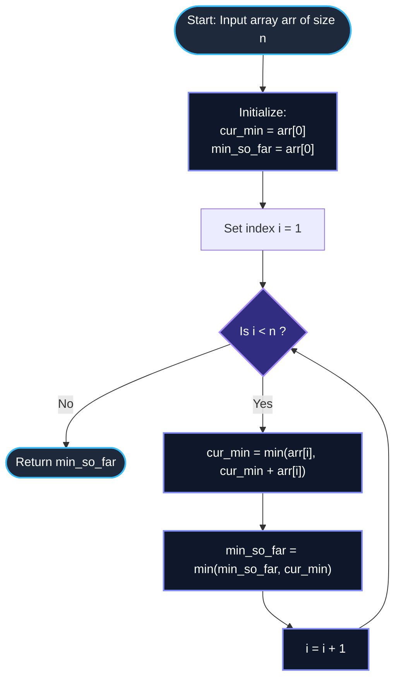

# GeeksforGeeks Problem of the Day: Minimum Sum Subarray (Smallest Sum Contiguous Subarray)

- **Problem Link:** [GeeksforGeeks - Smallest Sum Contiguous Subarray](https://www.geeksforgeeks.org/problems/smallest-sum-contiguous-subarray/1)
- **Difficulty:** Medium
- **Topic Tags:** Array, Dynamic Programming, Kadane's Algorithm, Prefix Sums, Divide and Conquer
- **Target Audience:** POTD Solvers, Computer Science Students, Competitive Programmers, Technical Interview Preparation (FAANG / Tier-1 Tech)

---

## 1. Problem Statement

Given an array of integers `arr` of size $n$, your task is to find the **minimum possible sum** of any non-empty contiguous subarray.

A **subarray** is defined as a contiguous slice of elements within an array $arr[i \dots j]$ where $0 \le i \le j < n$. The sum of this subarray is given by:
$$\text{Sum}(i, j) = \sum_{k=i}^{j} arr[k]$$

### Objective
Find and return the minimum value of $\text{Sum}(i, j)$ across all valid pairs of indices $(i, j)$ such that $0 \le i \le j < n$.

---

## 2. Examples & Explanations

### Example 1
- **Input:** `arr = [3, -4, 2, -3, -1, 7, -5]` ($n = 7$)
- **Output:** `-6`
- **Explanation:**
  - Let us evaluate potential contiguous subsegments:
    - Subarray `[-4]` $\implies \text{Sum} = -4$
    - Subarray `[-4, 2]` $\implies \text{Sum} = -2$
    - Subarray `[-4, 2, -3]` $\implies \text{Sum} = -5$
    - Subarray `[-4, 2, -3, -1]` $\implies \text{Sum} = -4 + 2 - 3 - 1 = -6$
    - Subarray `[-3, -1]` $\implies \text{Sum} = -4$
    - Subarray `[-5]` $\implies \text{Sum} = -5$
  - The minimum contiguous subarray sum across all possible combinations is $-6$, produced by the slice from index $1$ to index $4$: `[-4, 2, -3, -1]`.

---

### Example 2 (All Positive Elements)
- **Input:** `arr = [2, 6, 8, 1, 4]` ($n = 5$)
- **Output:** `1`
- **Explanation:**
  - When every element in the array is strictly positive, appending adjacent elements will strictly increase the sum.
  - Thus, the minimal contiguous subarray must be the smallest single element in the array: $\min(arr) = 1$ at index $3$.

---

### Example 3 (All Negative Elements)
- **Input:** `arr = [-2, -3, -1, -5]` ($n = 4$)
- **Output:** `-11`
- **Explanation:**
  - Adding negative elements continuously decreases the sum.
  - The optimal strategy is to include the entire array:
    $$(-2) + (-3) + (-1) + (-5) = -11$$
  - The contiguous slice `[-2, -3, -1, -5]` achieves the minimal sum of $-11$.

---

### Example 4 (Single Element)
- **Input:** `arr = [-7]` ($n = 1$)
- **Output:** `-7`
- **Explanation:**
  - The only non-empty contiguous subarray is the single element itself: `[-7]`. Sum is $-7$.

---

## 3. Constraints & Complexity Targets

- $1 \le \text{arr.size()} \le 10^5$
- $-10^4 \le \text{arr}[i] \le 10^4$
- **Target Time Complexity:** $\mathcal{O}(n)$ (Single linear scan)
- **Target Auxiliary Space:** $\mathcal{O}(1)$ (Constant space without modifying the array)

---

## 4. Invariant Theorems & Theoretical Foundations

```
========================================================================================
                      KADANE'S MINIMUM DUALITY THEOREM
========================================================================================

  Classic Kadane's Algorithm finds the MAXIMUM contiguous subarray sum:
               dp_max[i] = max(arr[i], dp_max[i - 1] + arr[i])

  By mathematical duality, the MINIMUM contiguous subarray sum satisfies:
               dp_min[i] = min(arr[i], dp_min[i - 1] + arr[i])
========================================================================================
```

### Theorem 1: Dynamic Programming Recurrence for Minimal Sum Ending at Index $i$
Let $dp[i]$ represent the minimum sum of a non-empty contiguous subarray that ends strictly at index $i$.
For any index $i > 0$, we have exactly two mutually exclusive and exhaustive choices:
1. **Extend the existing minimal subarray:** Append $arr[i]$ to the optimal subarray ending at $i - 1$. The sum becomes $dp[i - 1] + arr[i]$.
2. **Restart a new subarray at index $i$:** Discard all preceding elements and begin a fresh subarray consisting solely of $arr[i]$. The sum is $arr[i]$.

To minimize the sum, we choose the smaller of the two alternatives:
$$dp[i] = \min(arr[i], dp[i - 1] + arr[i])$$

**Base Case:**
$$dp[0] = arr[0]$$

**Global Optimum:**
$$\text{GlobalMin} = \min_{0 \le i < n} dp[i]$$

---

### Theorem 2: Prefix Sum Extremum Relation
Let $P[k]$ denote the prefix sum up to index $k$, where $P[-1] = 0$ and $P[k] = \sum_{j=0}^{k} arr[j]$.
The sum of any contiguous slice $arr[i \dots j]$ is:
$$\text{Sum}(i, j) = P[j] - P[i - 1]$$
To minimize $P[j] - P[i - 1]$ for a fixed endpoint $j$:
$$\min_{0 \le i \le j} (P[j] - P[i - 1]) = P[j] - \max_{-1 \le k < j} P[k]$$
This proves that finding the minimum subarray sum ending at $j$ is strictly equivalent to subtracting the **maximum historical prefix sum** from the current prefix sum $P[j]$.

---

### Theorem 3: Negation Duality Principle
Let array $B$ be formed by negating every element of $arr$: $B[i] = -arr[i]$.
Then:
$$\min_{i \le j} \sum_{k=i}^{j} arr[k] = - \max_{i \le j} \sum_{k=i}^{j} (-arr[k]) = - \text{MaxSubarraySum}(B)$$
Thus, any algorithm that solves Maximum Subarray Sum (standard Kadane's) can be directly transformed into a Minimum Subarray Sum solver by inverting the comparison operator ($\max \to \min$) or negating the array values.

---

## 5. Visual Architecture: Dynamic Transition Decision

```
At each index i:
                      arr[i] arrives
                            │
               ┌────────────┴────────────┐
               ▼                         ▼
      [ Extend Previous ]        [ Start Fresh ]
      dp[i - 1] + arr[i]             arr[i]
               │                         │
               └────────────┬────────────┘
                            ▼
               Take min(arr[i], dp[i - 1] + arr[i])
                            │
                            ▼
               cur_min = min(arr[i], cur_min + arr[i])
                            │
                            ▼
           min_so_far = min(min_so_far, cur_min)
```

### Visual State Evolution for `[3, -4, 2, -3, -1, 7, -5]`

```
Index:       0       1       2       3       4       5       6
arr[i]:      3      -4       2      -3      -1       7      -5
           ─────   ─────   ─────   ─────   ─────   ─────   ─────
Option A:   ---     -1      -2      -5      -6       1      -4   (cur_min + arr[i])
Option B:    3      -4       2      -3      -1       7      -5   (arr[i] restart)
           ─────   ─────   ─────   ─────   ─────   ─────   ─────
cur_min:     3      -4      -2      -5      -6       1      -5   min(Option A, Option B)
min_so_far:  3      -4      -4      -5      -6      -6      -6   min overall
                                             ▲
                                             └── GLOBAL MINIMUM REACHED (-6)
```

---

## 6. Step-by-Step Simulation Trace

Let us trace `arr = [3, -4, 2, -3, -1, 7, -5]` step by step:

| Step | Index $i$ | $arr[i]$ | Previous `cur_min` | `cur_min + arr[i]` | `cur_min = min(arr[i], cur_min + arr[i])` | Decision | `min_so_far` |
| :---: | :---: | :---: | :---: | :---: | :---: | :---: | :---: |
| **Init** | $0$ | $3$ | — | — | $3$ | Initialize base state | $3$ |
| **1** | $1$ | $-4$ | $3$ | $3 + (-4) = -1$ | $\min(-4, -1) = \mathbf{-4}$ | **Restart** at index $1$ | $\min(3, -4) = \mathbf{-4}$ |
| **2** | $2$ | $2$ | $-4$ | $-4 + 2 = -2$ | $\min(2, -2) = \mathbf{-2}$ | **Extend** subarray | $\min(-4, -2) = \mathbf{-4}$ |
| **3** | $3$ | $-3$ | $-2$ | $-2 + (-3) = -5$ | $\min(-3, -5) = \mathbf{-5}$ | **Extend** subarray | $\min(-4, -5) = \mathbf{-5}$ |
| **4** | $4$ | $-1$ | $-5$ | $-5 + (-1) = -6$ | $\min(-1, -6) = \mathbf{-6}$ | **Extend** subarray | $\min(-5, -6) = \mathbf{-6}$ |
| **5** | $5$ | $7$ | $-6$ | $-6 + 7 = 1$ | $\min(7, 1) = \mathbf{1}$ | **Extend** subarray | $\min(-6, 1) = \mathbf{-6}$ |
| **6** | $6$ | $-5$ | $1$ | $1 + (-5) = -4$ | $\min(-5, -4) = \mathbf{-5}$ | **Restart** at index $6$ | $\min(-6, -5) = \mathbf{-6}$ |

**Final Result:** `min_so_far = -6`.

---

## 7. Mermaid Flowchart



---

## 8. Algorithmic Progression (From Naive to Pro)

### Method 1: Cubic Brute Force ($\mathcal{O}(n^3)$)
Iterate over all possible subarray start points $i$, end points $j$, and calculate the sum using a third loop.
```text
Algorithm MinSubarraySum_Naive(arr, n):
    min_sum = +INFINITY
    for i from 0 to n - 1:
        for j from i to n - 1:
            current_sum = 0
            for k from i to j:
                current_sum = current_sum + arr[k]
            min_sum = min(min_sum, current_sum)
    return min_sum
```
- **Time Complexity:** $\mathcal{O}(n^3)$ $\implies (10^5)^3 = 10^{15}$ operations. **Massive TLE**.
- **Space Complexity:** $\mathcal{O}(1)$.

---

### Method 2: Quadratic Prefix Accumulation ($\mathcal{O}(n^2)$)
Eliminate the inner $k$ loop by maintaining a running sum as $j$ advances.
```text
Algorithm MinSubarraySum_Quadratic(arr, n):
    min_sum = +INFINITY
    for i from 0 to n - 1:
        current_sum = 0
        for j from i to n - 1:
            current_sum = current_sum + arr[j]
            min_sum = min(min_sum, current_sum)
    return min_sum
```
- **Time Complexity:** $\mathcal{O}(n^2)$ $\implies \frac{(10^5)^2}{2} = 5 \times 10^9$ operations. **TLE**.
- **Space Complexity:** $\mathcal{O}(1)$.

---

### Method 3: Divide and Conquer ($\mathcal{O}(n \log n)$)
Split the array into two halves. The minimal subarray either lies entirely in the left half, entirely in the right half, or crosses the midpoint.
```text
Algorithm MinSubarraySum_DivideConquer(arr, left, right):
    if left == right:
        return arr[left]
    mid = (left + right) / 2
    left_min = MinSubarraySum_DivideConquer(arr, left, mid)
    right_min = MinSubarraySum_DivideConquer(arr, mid + 1, right)
    cross_min = MinCrossingSum(arr, left, mid, right)
    return min(left_min, right_min, cross_min)
```
- **Time Complexity:** $\mathcal{O}(n \log n)$.
- **Space Complexity:** $\mathcal{O}(\log n)$ recursion stack.

---

### Method 4: Kadane's Minimum Subarray Dynamic Programming ($\mathcal{O}(n)$ - Optimal Pro Method)
Track the running minimum subarray sum ending at each index using two scalar variables: `cur_min` and `min_so_far`.
```text
Algorithm MinSubarraySum_Kadane(arr, n):
    cur_min = arr[0]
    min_so_far = arr[0]
    for i from 1 to n - 1:
        cur_min = min(arr[i], cur_min + arr[i])
        min_so_far = min(min_so_far, cur_min)
    return min_so_far
```
- **Time Complexity:** $\mathcal{O}(n)$ — Exactly $n - 1$ scalar iterations.
- **Space Complexity:** $\mathcal{O}(1)$ — Zero additional memory allocated.

---

## 9. Complexity Analysis Comparison

| Metric | Method 1: Brute Force | Method 2: Running Accumulation | Method 3: Divide & Conquer | Method 4: Kadane's Minimum (Optimal) |
| :--- | :---: | :---: | :---: | :---: |
| **Time Complexity** | $\mathcal{O}(n^3)$ | $\mathcal{O}(n^2)$ | $\mathcal{O}(n \log n)$ | $\mathbf{\mathcal{O}(n)}$ |
| **Auxiliary Space** | $\mathcal{O}(1)$ | $\mathcal{O}(1)$ | $\mathcal{O}(\log n)$ stack | $\mathbf{\mathcal{O}(1)}$ |
| **Operations for $n = 10^5$** | $10^{15}$ | $5 \times 10^9$ | $1.7 \times 10^6$ | $\mathbf{10^5}$ ($\approx 1\text{ ms}$) |
| **Verdict** | ❌ TLE | ❌ TLE | ⚠️ Overkill / Recursive | ✅ **Optimal & Accepted** |

---

## 10. Corner Cases & Edge Testing

1. **All Positive Numbers (`[5, 12, 3, 9, 21]`):**
   - Minimum contiguous subarray is the single minimum element: `[3]`. Output: `3`.
2. **All Negative Numbers (`[-4, -7, -2, -1]`):**
   - Combining negatives decreases the sum. Entire array is chosen: $(-4) + (-7) + (-2) + (-1) = -14$. Output: `-14`.
3. **Single Element (`[-42]` or `[100]`):**
   - Loop from index $1$ does not execute; returns the single element directly. Output: `-42` or `100`.
4. **Alternating Signs (`[1, -2, 3, -4, 5, -6]`):**
   - Correctly drops positive contributions when they make the sum worse than starting fresh from a negative element.
5. **Array with Zeros (`[0, 0, 0]` or `[-1, 0, -2]`):**
   - Zeros neither increase nor decrease magnitude, handled seamlessly.

---

## 11. Multi-Language Implementations

### Java (21)

```java
class Solution {
    /**
     * Finds the minimum sum of any non-empty contiguous subarray.
     *
     * @param arr the input array of integers
     * @return the minimum contiguous subarray sum
     */
    public int minSubarraySum(int[] arr) {
        int n = arr.length;
        
        // Base state: initialize with the first element
        int curMin = arr[0];
        int minSoFar = arr[0];

        // Process elements from index 1 to n - 1
        for (int i = 1; i < n; i++) {
            // Decide whether to extend the previous minimum subarray or start a new one
            curMin = Math.min(arr[i], curMin + arr[i]);
            
            // Update the global minimum encountered so far
            minSoFar = Math.min(minSoFar, curMin);
        }

        return minSoFar;
    }
}
```

---

### Python3

```python
class Solution:
    def minSubarraySum(self, arr: list[int]) -> int:
        """
        Finds the minimum sum of any non-empty contiguous subarray using Kadane's algorithm.
        
        :param arr: List of integers
        :return: Minimum contiguous subarray sum
        """
        # Base state: initialize with the first element
        cur_min = arr[0]
        min_so_far = arr[0]

        # Single-pass dynamic programming transition
        for x in arr[1:]:
            cur_min = min(x, cur_min + x)
            min_so_far = min(min_so_far, cur_min)

        return min_so_far
```

---

### C++ (17)

```cpp
#include <vector>
#include <algorithm>

using namespace std;

class Solution {
public:
    /**
     * Finds the minimum sum of any non-empty contiguous subarray.
     *
     * @param arr Reference to the input vector of integers
     * @return Minimum contiguous subarray sum
     */
    int minSubarraySum(vector<int> &arr) {
        int n = arr.size();

        // Base state: initialize with the first element
        int cur_min = arr[0];
        int min_so_far = arr[0];

        // Single linear pass over the vector
        for (int i = 1; i < n; ++i) {
            cur_min = min(arr[i], cur_min + arr[i]);
            min_so_far = min(min_so_far, cur_min);
        }

        return min_so_far;
    }
};
```

---

### C#

```csharp
using System;

class Solution {
    /// <summary>
    /// Finds the minimum sum of any non-empty contiguous subarray.
    /// </summary>
    /// <param name="arr">The input integer array</param>
    /// <returns>The minimum contiguous subarray sum</returns>
    public int minSubarraySum(int[] arr) {
        int n = arr.Length;

        // Base state: initialize with the first element
        int curMin = arr[0];
        int minSoFar = arr[0];

        // Iterate through the array to compute optimal prefix/subsegment choices
        for (int i = 1; i < n; i++) {
            curMin = Math.Min(arr[i], curMin + arr[i]);
            minSoFar = Math.Min(minSoFar, curMin);
        }

        return minSoFar;
    }
}
```

---

### Javascript (Node v22)

```javascript
/**
 * @param {number[]} arr
 * @returns {number}
 */
class Solution {
    /**
     * Finds the minimum sum of any non-empty contiguous subarray.
     * 
     * @param {number[]} arr
     * @returns {number}
     */
    minSubarraySum(arr) {
        const n = arr.length;

        // Base state: initialize with the first element
        let curMin = arr[0];
        let minSoFar = arr[0];

        // Single pass linear scan
        for (let i = 1; i < n; i++) {
            curMin = Math.min(arr[i], curMin + arr[i]);
            minSoFar = Math.min(minSoFar, curMin);
        }

        return minSoFar;
    }
}
```

---

## 12. Key Takeaways & Technical Summary

1. **Kadane's Duality:**  
   The structure of Kadane's Algorithm applies symmetrically to both maximum and minimum contiguous subarray sums. Inverting $\max$ to $\min$ produces the exact minimal contiguous sum in a single linear pass.
2. **Optimal Substructure:**  
   At any index $i$, the optimal subarray ending at $i$ either extends the optimal subarray ending at $i - 1$ or restarts with element $arr[i]$ alone:
   $$\text{cur\_min} = \min(arr[i], \text{cur\_min} + arr[i])$$
3. **Space Optimization:**  
   Instead of maintaining a full $\mathcal{O}(n)$ dynamic programming table `dp[n]`, we only ever need the result from the immediately preceding state $dp[i - 1]$. This compresses the auxiliary space from $\mathcal{O}(n)$ down to $\mathcal{O}(1)$ scalar variables.
4. **All-Positive and All-Negative Invariance:**  
   No special conditional branches are needed for edge distributions. An all-positive array naturally converges to $\min(arr)$, and an all-negative array naturally sums the entire array.
