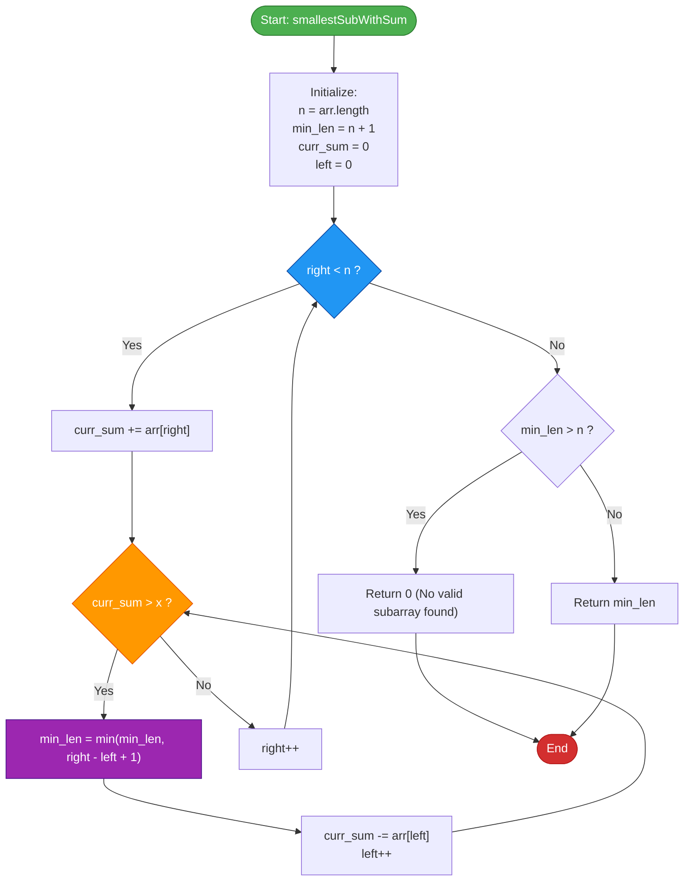

# GeeksforGeeks Problem of the Day: Smallest Subarray Sum Greater Than x

- **Problem Link:** [GeeksforGeeks - Smallest Subarray with Sum Greater Than x](https://www.geeksforgeeks.org/problems/smallest-subarray-with-sum-greater-than-x5651/1)
- **Difficulty:** Easy
- **Topic Tags:** Arrays, Two-Pointer Technique, Sliding Window, Prefix Sum, Binary Search
- **Target Audience:** POTD Solvers, Computer Science Students, Competitive Programmers, Technical Interview Candidates (Amazon, Microsoft, Google, Meta, Goldman Sachs)

---

## 1. Problem Statement

Given an array of integers `arr[]` and a target threshold value `x`, find the length of the **smallest contiguous subarray** whose elements sum to a value **strictly greater than** `x` ($\sum_{k=i}^{j} \text{arr}[k] > x$).

If no such contiguous subarray exists (i.e., even the sum of all elements in the entire array is less than or equal to `x`), return `0`.

### Formal Definition
Find:
$$\min_{(i, j)} \; (j - i + 1) \quad \text{subject to} \quad 0 \le i \le j < n \quad \text{and} \quad \sum_{k=i}^{j} \text{arr}[k] > x$$

If the set of valid pairs $(i, j)$ is empty, the function must evaluate to $0$.

---

## 2. Examples & Visual Walkthroughs

### Example 1
- **Input:** `arr[] = [1, 4, 45, 6, 0, 19]`, `x = 51`
- **Output:** `3`
- **Explanation:**
  - Subarray `[4, 45, 6]` from index $1$ to $3$ yields:
    $$\text{Sum} = 4 + 45 + 6 = 55 > 51$$
  - Subarray length $= 3 - 1 + 1 = 3$.
  - No subarray of length $1$ or $2$ has a sum exceeding $51$. Hence, the minimum length is $3$.

```
Index:       0     1     2     3     4     5
Array:     [ 1,    4,   45,    6,    0,   19 ]
                   └───────────┘
               Subarray: [4, 45, 6]
               Sum = 55 (> 51)
               Length = 3 (Optimal!)
```

---

### Example 2
- **Input:** `arr[] = [1, 10, 5, 2, 7]`, `x = 9`
- **Output:** `1`
- **Explanation:**
  - Element `arr[1] = 10` is strictly greater than $9$.
  - Subarray `[10]` has length $1$ and sum $10 > 9$.
  - Since length $1$ is the theoretical minimum length for any subarray, we immediately achieve the optimal answer.

```
Index:       0     1     2     3     4
Array:     [ 1,   10,    5,    2,    7 ]
                  ▲
             Subarray: [10]
             Sum = 10 (> 9)
             Length = 1 (Theoretical Minimum!)
```

---

### Example 3
- **Input:** `arr[] = [1, 2, 4]`, `x = 8`
- **Output:** `0`
- **Explanation:**
  - Total array sum $= 1 + 2 + 4 = 7$.
  - Since $7 \le 8$, no contiguous subarray can ever achieve a sum strictly greater than $8$.
  - The function returns `0`.

---

### Example 4
- **Input:** `arr[] = [1, 11, 100, 1, 0, 200, 3, 2, 1, 250]`, `x = 280`
- **Output:** `4`
- **Explanation:**
  - Subarray `[100, 1, 0, 200]` (indices $2$ to $5$) has $\text{Sum} = 301 > 280$ with $\text{Length} = 4$.
  - Another valid subarray is `[200, 3, 2, 1, 250]` (indices $5$ to $9$) with $\text{Sum} = 456 > 280$ with $\text{Length} = 5$.
  - The minimum length between them is $\min(4, 5) = 4$.

---

## 3. Constraints & Scale Analysis

| Parameter | Constraint Range | Practical Implication |
| :--- | :--- | :--- |
| **Array Length ($n$)** | $1 \le n \le 10^5$ | An $\mathcal{O}(n^2)$ algorithm performs up to $\approx 10^{10}$ operations and will trigger **Time Limit Exceeded (TLE)**. An $\mathcal{O}(n)$ single-pass solution is strictly required. |
| **Array Elements ($\text{arr}[i]$)** | $0 \le \text{arr}[i] \le 10^9$ | Elements are non-negative. Monotonicity of prefix sums holds. Total sum can reach $10^{14}$, requiring 64-bit integer tracking (`long` / `long long`) to prevent overflow. |
| **Threshold ($x$)** | $0 \le x \le 10^9$ | The condition is strictly greater than (`> x`), not greater than or equal to (`>= x`). |
| **Auxiliary Space** | $\mathcal{O}(1)$ | The optimal algorithm must operate in-place with constant extra memory. |

---

## 4. Algorithmic Insights & Mathematical Mechanics

### 1. The Monotonicity Invariant
Because all elements in `arr[]` are non-negative ($\text{arr}[i] \ge 0$):
$$\text{Adding an element to a window never decreases its sum: } \sum_{k=i}^{j+1} \text{arr}[k] \ge \sum_{k=i}^{j} \text{arr}[k]$$
$$\text{Removing an element from the left never increases its sum: } \sum_{k=i+1}^{j} \text{arr}[k] \le \sum_{k=i}^{j} \text{arr}[k]$$

This fundamental monotonicity guarantees that a **Two-Pointer / Sliding Window (Caterpillar) technique** is globally optimal.

### 2. Window Expansion vs. Contraction
We maintain a dynamic window $[ \text{left}, \text{right} ]$ with accumulated sum $\text{curr\_sum}$:
1. **Expansion Phase (Right Pointer):**
   - Incrementally advance `right` from $0$ to $n - 1$.
   - Add `arr[right]` to `curr_sum`.
2. **Contraction Phase (Left Pointer):**
   - While $\text{curr\_sum} > x$, a valid candidate subarray is found!
   - Update our global minimum length:
     $$\text{min\_len} = \min(\text{min\_len}, \; \text{right} - \text{left} + 1)$$
   - Shrink the window from the left by subtracting `arr[left]` from `curr_sum` and incrementing `left`.
   - Continue shrinking as long as the remaining window sum still strictly exceeds $x$.

### 3. Why is Two-Pointer Strictly $\mathcal{O}(n)$?
Although there is a nested `while` loop inside the `for` loop:
- The pointer `right` advances from $0$ to $n - 1$ exactly $n$ times.
- The pointer `left` advances at most $n$ times across the entire algorithm because it only increments and never resets.
- Therefore, the total number of operations performed across both pointers is at most $2n$.
- Amortized time complexity $= \mathcal{O}(n)$ with $\mathcal{O}(1)$ extra variables.

---

## 5. Step-by-Step Simulation & Trace Table

Let us trace **Example 1**: `arr = [1, 4, 45, 6, 0, 19]`, `x = 51`, initialized with `min_len = infinity`, `curr_sum = 0`, `left = 0`.

| Step | `right` | `arr[right]` | `curr_sum` (before shrink) | Condition: `curr_sum > 51` | `left` | Window Subarray | Window Length | `min_len` Updated |
| :---: | :---: | :---: | :---: | :---: | :---: | :---: | :---: | :---: |
| **1** | $0$ | $1$ | $1$ | $1 > 51$ (False) | $0$ | `[1]` | $1$ | $\infty$ |
| **2** | $1$ | $4$ | $5$ | $5 > 51$ (False) | $0$ | `[1, 4]` | $2$ | $\infty$ |
| **3** | $2$ | $45$ | $50$ | $50 > 51$ (False) | $0$ | `[1, 4, 45]` | $3$ | $\infty$ |
| **4a**| $3$ | $6$ | $56$ | $56 > 51$ (True!) | $0$ | `[1, 4, 45, 6]` | $3 - 0 + 1 = 4$ | $\min(\infty, 4) = \mathbf{4}$ |
| **4b**| $3$ | — | $56 - 1 = 55$ | $55 > 51$ (True!) | $1$ | `[4, 45, 6]` | $3 - 1 + 1 = 3$ | $\min(4, 3) = \mathbf{3}$ |
| **4c**| $3$ | — | $55 - 4 = 51$ | $51 > 51$ (False) | $2$ | `[45, 6]` | $2$ | $\mathbf{3}$ |
| **5** | $4$ | $0$ | $51 + 0 = 51$ | $51 > 51$ (False) | $2$ | `[45, 6, 0]` | $3$ | $\mathbf{3}$ |
| **6a**| $5$ | $19$| $51 + 19 = 70$ | $70 > 51$ (True!) | $2$ | `[45, 6, 0, 19]`| $5 - 2 + 1 = 4$ | $\min(3, 4) = \mathbf{3}$ |
| **6b**| $5$ | — | $70 - 45 = 25$ | $25 > 51$ (False) | $3$ | `[6, 0, 19]` | $3$ | $\mathbf{3}$ |

### Final Result:
- Execution completes. `min_len = 3`.
- Smallest valid subarray is `[4, 45, 6]` with sum $55 > 51$ and length **$3$**.

---

## 6. Algorithm Flowchart



---

## 7. Progression from Naive to Pro

### Method 1: Pure Brute Force (Generate All Subarrays)
- **Concept:** Inspect every possible starting index $i$ and ending index $j$. Calculate the sum of elements from $i$ to $j$ using a third loop.
- **Pseudo-Code:**
  ```text
  function smallestSubWithSumNaive(arr, x):
      n = length(arr)
      min_len = n + 1
      for i from 0 to n - 1:
          for j from i to n - 1:
              current_sum = 0
              for k from i to j:
                  current_sum += arr[k]
              if current_sum > x:
                  min_len = min(min_len, j - i + 1)
      return (min_len > n) ? 0 : min_len
  ```
- **Complexity:**
  - **Time Complexity:** $\mathcal{O}(n^3)$ — Triple nested loops. For $n = 10^5$, operations exceed $10^{15}$.
  - **Auxiliary Space:** $\mathcal{O}(1)$.

---

### Method 2: Improved Nested Loops (Cumulative Sum on the Fly)
- **Concept:** Rather than recomputing the sum with a third loop, maintain a running `sum` inside the inner loop as $j$ expands.
- **Pseudo-Code:**
  ```text
  function smallestSubWithSumCumulative(arr, x):
      n = length(arr)
      min_len = n + 1
      for i from 0 to n - 1:
          current_sum = 0
          for j from i to n - 1:
              current_sum += arr[j]
              if current_sum > x:
                  min_len = min(min_len, j - i + 1)
                  break  // Any further expansion with non-negative numbers only increases length
      return (min_len > n) ? 0 : min_len
  ```
- **Complexity:**
  - **Time Complexity:** $\mathcal{O}(n^2)$ — In worst-case (e.g., total sum $\le x$), runs all pairs. For $n = 10^5$, $\approx 5 \times 10^9$ operations $\implies$ **TLE**.
  - **Auxiliary Space:** $\mathcal{O}(1)$.

---

### Method 3: Prefix Sums + Binary Search ($\mathcal{O}(n \log n)$)
- **Concept:** Compute prefix sums `prefix[k]`. Since all numbers are non-negative, `prefix[]` is monotonically increasing. For each starting index $i$, use binary search (`std::upper_bound` or `bisect_right`) to find the first index $j$ such that:
  $$\text{prefix}[j] - \text{prefix}[i] > x \implies \text{prefix}[j] > x + \text{prefix}[i]$$
- **Pseudo-Code:**
  ```text
  function smallestSubWithSumBinarySearch(arr, x):
      n = length(arr)
      prefix = array of size n + 1 with prefix[0] = 0
      for i from 0 to n - 1:
          prefix[i + 1] = prefix[i] + arr[i]
      
      min_len = n + 1
      for i from 0 to n:
          target = prefix[i] + x
          j = binary_search_first_greater(prefix, target)
          if j <= n:
              min_len = min(min_len, j - i)
      return (min_len > n) ? 0 : min_len
  ```
- **Complexity:**
  - **Time Complexity:** $\mathcal{O}(n \log n)$ — Useful when elements can be non-negative and generalized, but suboptimal here.
  - **Auxiliary Space:** $\mathcal{O}(n)$ to store the prefix sums.

---

### Method 4: Optimal Two-Pointer / Sliding Window (Pro Method)
- **Concept:** Take advantage of the non-decreasing prefix sum nature. Both `left` and `right` traverse the array in one direction without backtracking.
- **Pseudo-Code:**
  ```text
  function smallestSubWithSumOptimal(arr, x):
      n = length(arr)
      min_len = n + 1
      curr_sum = 0
      left = 0
      
      for right from 0 to n - 1:
          curr_sum += arr[right]
          
          while curr_sum > x and left <= right:
              min_len = min(min_len, right - left + 1)
              curr_sum -= arr[left]
              left += 1
              
      return (min_len > n) ? 0 : min_len
  ```
- **Complexity:**
  - **Time Complexity:** $\mathcal{O}(n)$ — Exactly one linear pass.
  - **Auxiliary Space:** $\mathcal{O}(1)$ — Purely constant space.

---

## 8. Complexity Comparison Table

| Metric | Method 1: Pure Brute Force | Method 2: Cumulative Nested Loops | Method 3: Prefix Sum + Binary Search | Method 4: Sliding Window (Optimal) |
| :--- | :---: | :---: | :---: | :---: |
| **Time Complexity** | $\mathcal{O}(n^3)$ | $\mathcal{O}(n^2)$ | $\mathcal{O}(n \log n)$ | $\mathbf{\mathcal{O}(n)}$ |
| **Auxiliary Space** | $\mathcal{O}(1)$ | $\mathcal{O}(1)$ | $\mathcal{O}(n)$ | $\mathbf{\mathcal{O}(1)}$ |
| **Max Operations ($n=10^5$)** | $\sim 10^{15}$ | $\sim 10^{10}$ | $\sim 1.7 \times 10^6$ | $\mathbf{\sim 2 \times 10^5}$ |
| **GFG Execution Time** | Time Limit Exceeded | Time Limit Exceeded | $\approx 0.15\text{ s}$ | $\mathbf{\approx 0.04\text{ s}}$ |
| **Suitability** | Conceptual only | Small inputs ($n \le 10^3$) | Generalization / Follow-up | **Production / POTD Optimal** |

---

## 9. Production Implementations in Multiple Languages

### Java (OpenJDK 21)

```java
/**
 * Problem: Smallest Subarray Sum Greater Than x
 * Platform: GeeksforGeeks POTD
 * Language: Java 21
 */
class Solution {
    public int smallestSubWithSum(int[] arr, int x) {
        int n = arr.length;
        int minLen = n + 1;
        long currSum = 0; // Using 64-bit integer to prevent any potential overflow
        int left = 0;

        for (int right = 0; right < n; right++) {
            currSum += arr[right];

            // Contract the window from the left as long as the sum remains strictly greater than x
            while (currSum > x && left <= right) {
                int currentWindowLen = right - left + 1;
                if (currentWindowLen < minLen) {
                    minLen = currentWindowLen;
                }
                
                // If a subarray of length 1 is found, no smaller length is possible
                if (minLen == 1) {
                    return 1;
                }

                currSum -= arr[left];
                left++;
            }
        }

        // If minLen was never updated, no valid subarray exists
        return (minLen > n) ? 0 : minLen;
    }
}
```

---

### Python3

```python
"""
Problem: Smallest Subarray Sum Greater Than x
Platform: GeeksforGeeks POTD
Language: Python 3
"""
class Solution:
    def smallestSubWithSum(self, arr: list[int], x: int) -> int:
        n = len(arr)
        min_len = n + 1
        curr_sum = 0
        left = 0

        for right in range(n):
            curr_sum += arr[right]

            # Contract window from left while condition is satisfied
            while curr_sum > x and left <= right:
                window_len = right - left + 1
                if window_len < min_len:
                    min_len = window_len
                
                # Early exit: length 1 is the theoretical global minimum
                if min_len == 1:
                    return 1

                curr_sum -= arr[left]
                left += 1

        return 0 if min_len > n else min_len
```

---

### C++ (C++17)

```cpp
/**
 * Problem: Smallest Subarray Sum Greater Than x
 * Platform: GeeksforGeeks POTD
 * Language: C++ 17
 */
#include <vector>
#include <algorithm>

class Solution {
  public:
    int smallestSubWithSum(std::vector<int>& arr, int x) {
        int n = static_cast<int>(arr.size());
        int min_len = n + 1;
        long long curr_sum = 0;
        int left = 0;

        for (int right = 0; right < n; ++right) {
            curr_sum += arr[right];

            // Shrink window from the left while sum exceeds threshold x
            while (curr_sum > x && left <= right) {
                min_len = std::min(min_len, right - left + 1);
                
                // Early exit optimization
                if (min_len == 1) {
                    return 1;
                }

                curr_sum -= arr[left];
                left++;
            }
        }

        return (min_len > n) ? 0 : min_len;
    }
};
```

---

### C#

```csharp
/**
 * Problem: Smallest Subarray Sum Greater Than x
 * Platform: GeeksforGeeks POTD
 * Language: C#
 */
using System;

class Solution {
    public int smallestSubWithSum(int[] arr, int x) {
        int n = arr.Length;
        int minLen = n + 1;
        long currSum = 0;
        int left = 0;

        for (int right = 0; right < n; right++) {
            currSum += arr[right];

            // Shrink window from the left while condition holds
            while (currSum > x && left <= right) {
                int currentWindowLen = right - left + 1;
                if (currentWindowLen < minLen) {
                    minLen = currentWindowLen;
                }

                // Early exit: cannot beat length 1
                if (minLen == 1) {
                    return 1;
                }

                currSum -= arr[left];
                left++;
            }
        }

        return (minLen > n) ? 0 : minLen;
    }
}
```

---

### JavaScript (Node.js v22)

```javascript
/**
 * Problem: Smallest Subarray Sum Greater Than x
 * Platform: GeeksforGeeks POTD
 * Language: JavaScript (Node.js v22)
 * 
 * @param {number[]} arr
 * @param {number} x
 * @return {number}
 */
class Solution {
    smallestSubWithSum(arr, x) {
        const n = arr.length;
        let minLen = n + 1;
        let currSum = 0;
        let left = 0;

        for (let right = 0; right < n; right++) {
            currSum += arr[right];

            // Shrink window from the left while sum strictly exceeds x
            while (currSum > x && left <= right) {
                const windowLen = right - left + 1;
                if (windowLen < minLen) {
                    minLen = windowLen;
                }

                // Short-circuit: 1 is the minimal possible contiguous subarray length
                if (minLen === 1) {
                    return 1;
                }

                currSum -= arr[left];
                left++;
            }
        }

        return minLen > n ? 0 : minLen;
    }
}
```

---

## 10. Edge Cases & Boundary Analysis

1. **Single Element Exceeds Target ($arr[i] > x$):**
   - Handled immediately. When encountered, `right - left + 1 = 1`, updating `minLen = 1` and triggering the early return.
2. **Total Array Sum $\le x$:**
   - The condition `currSum > x` is never triggered. `minLen` remains $n + 1$. The final ternary operator cleanly returns `0`.
3. **Array with Zeros ($0$):**
   - Zero values can appear at the ends or middle of a subarray. While they do not contribute to `currSum`, sliding `left` across zeros keeps `currSum` unchanged while reducing `windowLen`. Our algorithm naturally contracts over zeroes, finding the true minimal length.
4. **Entire Array is Required:**
   - If only the full array sum exceeds $x$, the loop executes completely, finding `minLen = n`, and returns $n$.
5. **Very Large Numbers (Overflow Prevention):**
   - In Java, C++, and C#, `currSum` is declared as a 64-bit integer (`long` / `long long`) so accumulating elements up to $10^{14}$ will never experience 32-bit signed integer overflow.

---

## 11. Interview Masterclass: Key Takeaways & Cheat-Sheet

| Question / Topic | Model Answer |
| :--- | :--- |
| **How do you identify a sliding window problem?** | 1. The problem asks for a contiguous sequence (subarray, substring).<br/>2. It asks for an extremum (minimum or maximum length, count of valid windows).<br/>3. The condition exhibits **monotonicity** (expanding increases/maintains the property, shrinking decreases/maintains it). |
| **Why not binary search on the answer?** | While binary search on the answer length $L \in [1, n]$ with a fixed-length sliding window check works in $\mathcal{O}(n \log n)$, dynamic sliding window solves it in $\mathcal{O}(n)$ directly without the extra logarithmic factor. |
| **What if the array contains negative numbers?** | Monotonicity breaks! Adding an element could decrease the sum, and removing an element could increase it. In that case, sliding window fails and we must use a **monotonic deque** (like in LeetCode 862: *Shortest Subarray with Sum at Least K*) in $\mathcal{O}(n)$ time. |
| **Strictly greater (`> x`) vs. greater than or equal to (`>= x`):** | Pay close attention to strictness. When the problem specifies strictly greater than $x$, the contraction condition must be `curr_sum > x`. A sum of exactly $x$ is invalid. |
