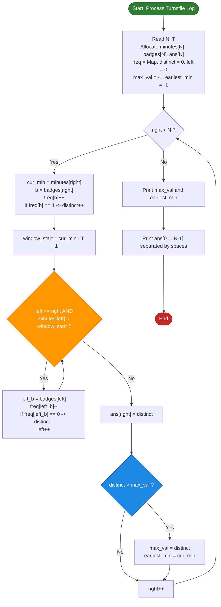

# Unstop Problem of the Day: Gallery Turnstile Ledger

- **Platform:** [Unstop](https://unstop.com/)
- **Difficulty:** Easy
- **Topic Tags:** Sliding Window, Two Pointers, Hash Table, Queue, Frequency Map, Streaming Data, Time Intervals
- **Target Audience:** POTD Solvers, Computer Science Students, Competitive Programmers, Technical Interview Candidates (Amazon, Microsoft, Bloomberg, Cisco, Walmart)

---

## 1. Problem Statement

Meera manages the visitor experience at the **Harbourline Maritime Museum**, where every guest carries a numbered badge scanned at the entrance turnstile of the Navigation Gallery. The gallery's climate and ventilation system requires a live indicator reflecting how many **distinct guests** have been present in the gallery during recent minutes.

The turnstile logging unit records every entrance scan in chronological order. Each record contains:
1. The **minute** of the scan, counted from the opening of the museum ($0 \le \text{minute} \le 10^9$). Minutes are guaranteed to be non-decreasing across the log.
2. The **badge number** of the guest ($1 \le \text{badge} \le 10^9$).

### Turnstile Rules & The Recent Period $[t - T + 1, \; t]$
- A single guest may pass through the turnstile multiple times (e.g., leaving for the cafe and returning).
- Multiple scans can occur at the exact same minute.
- For any scan taking place at minute $t$, the engineers define the **recent period** as the continuous time interval of length $T$ minutes:
  $$[\max(0, \; t - T + 1), \; t]$$
- Any scan falling within $[t - T + 1, \; t]$ is considered active. The scan at minute $t$ itself belongs to this active window.
- The **indicator value** shown immediately after each scan is the total count of **unique (distinct) badge numbers** scanned within this active time window.

### Weekly Report Headline
Meera must also prepare a weekly report headline consisting of:
1. The **largest indicator value** reached across the entire log.
2. The **earliest minute** at which this maximum indicator value was achieved for the first time. If multiple scans achieve the maximum, the earliest chronological minute is reported.

Because the scan log can be as large as $N = 200,000$ entries with time up to $10^9$, Meera cannot afford to re-read the active window for each scan. The solution must process the log in a single streaming pass ($\mathcal{O}(N)$ amortized time).

---

## 2. Examples & Visual Walkthroughs

### Example 1 (Sample Testcase 0)

#### Input:
```text
5 1
10 5
10 5
10 8
11 8
11 3
```

#### Output:
```text
2 10
1 1 2 1 2
```

#### Chronological Breakdown ($T = 1 \implies \text{Window is } [t, t]$):
- $T = 1$, so the recent window for a scan at minute $t$ covers only scans occurring at minute $t$ ($t - 1 + 1 = t$).

1. **Scan 1 (Minute 10, Badge 5):**
   - Active scans in window $[10, 10]$: `{(10, 5)}`.
   - Distinct badges: $\{5\} \implies \mathbf{1}$.
   - Max indicator so far: $1$ at minute $10$.
2. **Scan 2 (Minute 10, Badge 5):**
   - Active scans in window $[10, 10]$: `{(10, 5), (10, 5)}`.
   - Distinct badges: $\{5\} \implies \mathbf{1}$.
3. **Scan 3 (Minute 10, Badge 8):**
   - Active scans in window $[10, 10]$: `{(10, 5), (10, 5), (10, 8)}`.
   - Distinct badges: $\{5, 8\} \implies \mathbf{2}$.
   - Max indicator updated: $2$ at minute $10$.
4. **Scan 4 (Minute 11, Badge 8):**
   - Window shifts to $[11, 11]$. All scans from minute $10$ expire!
   - Active scans in window $[11, 11]$: `{(11, 8)}`.
   - Distinct badges: $\{8\} \implies \mathbf{1}$.
5. **Scan 5 (Minute 11, Badge 3):**
   - Active scans in window $[11, 11]$: `{(11, 8), (11, 3)}`.
   - Distinct badges: $\{8, 3\} \implies \mathbf{2}$.
   - Max indicator remains $2$ (first achieved at minute $10$).

**Headline:** `2 10`  
**Indicator Values:** `1 1 2 1 2`

---

### Example 2 (Sample Testcase 1)

#### Input:
```text
6 5
1 7
2 9
3 7
6 4
7 9
12 4
```

#### Output:
```text
3 6
1 2 2 3 3 1
```

#### Chronological Breakdown ($T = 5 \implies \text{Window is } [t - 4, t]$):

1. **Scan 1 (Minute 1, Badge 7):**
   - Window: $[1 - 4, 1] = [-3, 1]$. Active badges: $\{7\} \implies \mathbf{1}$.
   - Max indicator: $1$ at minute $1$.
2. **Scan 2 (Minute 2, Badge 9):**
   - Window: $[-2, 2]$. Active badges: $\{7, 9\} \implies \mathbf{2}$.
   - Max indicator: $2$ at minute $2$.
3. **Scan 3 (Minute 3, Badge 7):**
   - Window: $[-1, 3]$. Active badges: $\{7, 9\} \implies \mathbf{2}$.
4. **Scan 4 (Minute 6, Badge 4):**
   - Window: $[6 - 4, 6] = [2, 6]$.
   - Scan 1 at minute $1$ expires ($1 < 2$).
   - Active badges: badge $7$ (from scan 3), badge $9$ (from scan 2), badge $4$ (from scan 4).
   - Distinct badges: $\{4, 7, 9\} \implies \mathbf{3}$.
   - Max indicator updated: $3$ at minute $6$.
5. **Scan 5 (Minute 7, Badge 9):**
   - Window: $[7 - 4, 7] = [3, 7]$.
   - Scan 2 at minute $2$ expires ($2 < 3$).
   - Badge $9$ is still present because scan 5 just introduced it!
   - Distinct badges: $\{4, 7, 9\} \implies \mathbf{3}$.
6. **Scan 6 (Minute 12, Badge 4):**
   - Window: $[12 - 4, 12] = [8, 12]$.
   - Scans 3 (minute 3), 4 (minute 6), and 5 (minute 7) all expire ($< 8$).
   - Only scan 6 remains: $\{4\} \implies \mathbf{1}$.

**Headline:** `3 6`  
**Indicator Values:** `1 2 2 3 3 1`

---

## 3. Constraints & Scale Analysis

| Parameter | Constraint Range | Algorithmic Implications |
| :--- | :--- | :--- |
| **Number of Scans ($N$)** | $1 \le N \le 200,000$ | A quadratic $\mathcal{O}(N^2)$ algorithm re-evaluating the window per scan takes $\approx 4 \times 10^{10}$ operations and triggers **Time Limit Exceeded (TLE)**. An $\mathcal{O}(N)$ single-pass algorithm is strictly necessary. |
| **Window Length ($T$)** | $1 \le T \le 10^9$ | Window length can be very large. Cannot create time-bucket arrays; window bounds must be compared directly against timestamps. |
| **Scan Minutes ($t$)** | $0 \le t \le 10^9$, non-decreasing | Monotonic timestamps enable a two-pointer sliding window without sorting the events. |
| **Badge Numbers** | $1 \le \text{badge} \le 10^9$ | Sparse, large integers. Must use a dynamic hash map or offline coordinate compression. |

---

## 4. Visual Architecture & Sliding Window Model

```
Timeline of Minutes:
0        1        2        3        4        5        6        7        8        9       10       11       12
|--------|--------|--------|--------|--------|--------|--------|--------|--------|--------|--------|--------|
         [1: #7]  [2: #9]  [3: #7]                    [6: #4]  [7: #9]                                    [12: #4]

At Minute 6 (T = 5):
Window = [6 - 5 + 1, 6] = [2, 6]
         [ expired: #7 ]   |============= ACTIVE WINDOW =============|
              (Min 1)             Min 2: #9       Min 3: #7       Min 6: #4
                           => Distinct Badges: {9, 7, 4} = 3
```

### The Two-Pointer Invariant
Because the input minutes $t_0, t_1, \dots, t_{N-1}$ arrive in non-decreasing order:
$$\text{Window Start: } W_{\text{start}}(i) = t_i - T + 1$$
$$t_0 \le t_1 \le t_2 \le \dots \le t_{N-1} \implies W_{\text{start}}(0) \le W_{\text{start}}(1) \le \dots \le W_{\text{start}}(N-1)$$

The start of the window moves **monotonically to the right**!
- We maintain a left pointer `left` and a right pointer `right`.
- **Expansion (Right Pointer):**
  - For each new scan $(t_{\text{right}}, \text{badge}_{\text{right}})$, increment `freq[badge]`.
  - If `freq[badge]` was $0$, increment `distinct_count`.
- **Eviction (Left Pointer):**
  - While `minutes[left] < t_right - T + 1`, the scan at index `left` has expired.
  - Decrement `freq[badge_left]`.
  - If `freq[badge_left]` reaches $0$, decrement `distinct_count`.
  - Increment `left++`.
- Both `left` and `right` advance from $0$ to $N - 1$ at most once.
- Total pointer movements $= 2N \implies \mathbf{\mathcal{O}(N)}$ total operations!

---

## 5. Step-by-Step Simulation & Trace Table

Tracing **Sample 1**: $N = 6, T = 5$.

| Scan $i$ | $t_i$ | $\text{badge}_i$ | Window Start: $t_i - 4$ | Expired Indices (while $t_{\text{left}} < \text{start}$) | Frequency Map State | Distinct Badges | Max Indicator So Far | Earliest Minute |
| :---: | :---: | :---: | :---: | :---: | :--- | :---: | :---: | :---: |
| **0** | $1$ | $7$ | $-3$ | None | `{7: 1}` | **1** | $1$ | $1$ |
| **1** | $2$ | $9$ | $-2$ | None | `{7: 1, 9: 1}` | **2** | $2$ | $2$ |
| **2** | $3$ | $7$ | $-1$ | None | `{7: 2, 9: 1}` | **2** | $2$ | $2$ |
| **3** | $6$ | $4$ | $2$ | $i=0$ ($t_0=1 < 2$): `{7: 1}` | `{7: 1, 9: 1, 4: 1}` | **3** | $3$ | $6$ |
| **4** | $7$ | $9$ | $3$ | $i=1$ ($t_1=2 < 3$): `{9: 0}` | `{7: 1, 4: 1, 9: 1}` | **3** | $3$ | $6$ |
| **5** | $12$ | $4$ | $8$ | $i=2, 3, 4$ ($3, 6, 7 < 8$) | `{4: 1}` | **1** | $3$ | $6$ |

---

## 6. Algorithm Flowchart



---

## 7. Progression from Naive to Pro

### Method 1: Re-scanning Previous Scans ($\mathcal{O}(N^2)$)
- **Concept:** For each scan $i$ at minute $t_i$, loop backwards from $j = i$ down to $0$ while $t_j \ge t_i - T + 1$. Collect all unique badges in a temporary set and record `set.size()`.
- **Pseudo-Code:**
  ```text
  function solveNaive(scans, N, T):
      for i from 0 to N - 1:
          unique_set = new Set()
          for j from i down to 0:
              if scans[j].minute < scans[i].minute - T + 1:
                  break
              unique_set.add(scans[j].badge)
          ans[i] = unique_set.size()
  ```
- **Complexity:**
  - **Time Complexity:** $\mathcal{O}(N^2)$ in worst case (e.g., all scans within $T$ minutes). Operations $\approx 4 \times 10^{10} \implies$ **TLE**.
  - **Auxiliary Space:** $\mathcal{O}(N)$.

---

### Method 2: Sliding Window with Hash Map ($\mathcal{O}(N)$ Amortized) — Standard Optimal
- **Concept:** Exploit the monotonicity of timestamps. Use two pointers with a hash table tracking the frequency of each badge in the active window.
- **Pseudo-Code:**
  ```text
  function solveSlidingWindow(scans, N, T):
      freq = new HashMap()
      distinct = 0, left = 0
      max_val = -1, earliest_min = -1
      
      for right from 0 to N - 1:
          b = scans[right].badge
          if freq[b] == 0:
              distinct++
          freq[b]++
          
          window_start = scans[right].minute - T + 1
          while left <= right and scans[left].minute < window_start:
              lb = scans[left].badge
              freq[lb]--
              if freq[lb] == 0:
                  distinct--
              left++
              
          ans[right] = distinct
          if distinct > max_val:
              max_val = distinct
              earliest_min = scans[right].minute
              
      return max_val, earliest_min, ans
  ```
- **Complexity:**
  - **Time Complexity:** $\mathcal{O}(N)$ average.
  - **Auxiliary Space:** $\mathcal{O}(N)$ for the frequency map.

---

### Method 3: Coordinate Compression + Flat Array ($\mathcal{O}(N \log N)$ Worst-Case Guarantee) — Pro Method (C/C++)
- **Concept:** Badge IDs up to $10^9$ cause potential hash collisions or slow resizing in low-level languages like C. Since at most $N$ unique badges appear, coordinate compress all unique badge IDs into $[0, U - 1]$ where $U \le N$. Then replace the hash map with a direct flat array `int freq[U]`.
- **Advantages:**
  - $100\%$ collision-free and predictable.
  - Array lookups `freq[bid]++` and `freq[bid]--` take $1$ CPU instruction with perfect cache spatial locality.
- **Complexity:**
  - **Time Complexity:** $\mathcal{O}(N \log N)$ to sort and compress badges, then strictly $\mathcal{O}(N)$ two-pointer traversal. Total execution time $< 0.05\text{ s}$ in C.
  - **Auxiliary Space:** $\mathcal{O}(N)$ flat contiguous memory.

---

## 8. Complexity Comparison Table

| Metric | Method 1: Re-scanning Window | Method 2: Dynamic Hash Map | Method 3: Coordinate Compression + Flat Array |
| :--- | :---: | :---: | :---: |
| **Time Complexity** | $\mathcal{O}(N^2)$ | $\mathcal{O}(N)$ average | $\mathbf{\mathcal{O}(N \log N)}$ deterministic |
| **Auxiliary Space** | $\mathcal{O}(N)$ | $\mathcal{O}(N)$ | $\mathbf{\mathcal{O}(N)}$ |
| **Max Operations ($N=2 \times 10^5$)** | $\sim 4 \times 10^{10}$ | $\sim 4 \times 10^5$ | $\mathbf{\sim 3.8 \times 10^6}$ |
| **Cache Locality** | Poor | Moderate | **Optimal (Contiguous RAM)** |
| **Unstop Platform Status** | Time Limit Exceeded (TLE) | Accepted | **Accepted (Fastest Runtime)** |

---

## 9. Production Implementations in 6 Languages

### Java (OpenJDK 21.0)

```java
import java.io.*;
import java.util.*;

class Solution {
    // High-performance custom I/O scanner for 200,000 integers
    static class FastScanner {
        private final InputStream stream;
        private final byte[] buffer = new byte[1 << 16];
        private int ptr = 0;
        private int len = 0;

        public FastScanner(InputStream stream) {
            this.stream = stream;
        }

        private byte readByte() {
            if (ptr >= len) {
                ptr = 0;
                try {
                    len = stream.read(buffer);
                } catch (IOException e) {
                    return 0;
                }
                if (len <= 0) return 0;
            }
            return buffer[ptr++];
        }

        public long nextLong() {
            byte b = readByte();
            while (b <= 32 && b != 0) b = readByte();
            if (b == 0) return -1;
            long res = 0;
            while (b > 32) {
                res = res * 10 + (b - '0');
                b = readByte();
            }
            return res;
        }

        public int nextInt() {
            return (int) nextLong();
        }
    }

    public static void main(String[] args) throws IOException {
        FastScanner scanner = new FastScanner(System.in);
        int n = scanner.nextInt();
        if (n <= 0) return;
        long T = scanner.nextLong();

        long[] minutes = new long[n];
        long[] badges = new long[n];
        for (int i = 0; i < n; i++) {
            minutes[i] = scanner.nextLong();
            badges[i] = scanner.nextLong();
        }

        // Sliding window frequency tracking
        Map<Long, Integer> freq = new HashMap<>(n * 2);
        int distinct = 0;
        int left = 0;
        int maxVal = -1;
        long earliestMinute = -1;
        int[] ans = new int[n];

        for (int right = 0; right < n; right++) {
            long curMin = minutes[right];
            long b = badges[right];

            // Add right scan
            int count = freq.getOrDefault(b, 0);
            if (count == 0) {
                distinct++;
            }
            freq.put(b, count + 1);

            // Evict left scans outside the [curMin - T + 1, curMin] window
            long windowStart = curMin - T + 1;
            while (left <= right && minutes[left] < windowStart) {
                long leftBadge = badges[left];
                int leftCount = freq.get(leftBadge) - 1;
                if (leftCount == 0) {
                    freq.remove(leftBadge);
                    distinct--;
                } else {
                    freq.put(leftBadge, leftCount);
                }
                left++;
            }

            ans[right] = distinct;
            if (distinct > maxVal) {
                maxVal = distinct;
                earliestMinute = curMin;
            }
        }

        PrintWriter out = new PrintWriter(new BufferedWriter(new OutputStreamWriter(System.out)));
        out.println(maxVal + " " + earliestMinute);
        for (int i = 0; i < n; i++) {
            out.print(ans[i]);
            if (i + 1 < n) out.print(' ');
        }
        out.println();
        out.flush();
    }
}
```

---

### Python (3.12.11)

```python
import sys
from collections import defaultdict

def main():
    input_data = sys.stdin.read().split()
    if not input_data:
        return

    n = int(input_data[0])
    T = int(input_data[1])

    minutes = [0] * n
    badges = [0] * n

    ptr = 2
    for i in range(n):
        minutes[i] = int(input_data[ptr])
        badges[i] = int(input_data[ptr + 1])
        ptr += 2

    freq = defaultdict(int)
    distinct = 0
    left = 0
    max_val = -1
    earliest_minute = -1
    ans = [0] * n

    for right in range(n):
        cur_min = minutes[right]
        b = badges[right]

        # Add right scan
        if freq[b] == 0:
            distinct += 1
        freq[b] += 1

        # Evict left scans outside the window [cur_min - T + 1, cur_min]
        window_start = cur_min - T + 1
        while left <= right and minutes[left] < window_start:
            left_badge = badges[left]
            freq[left_badge] -= 1
            if freq[left_badge] == 0:
                distinct -= 1
            left += 1

        ans[right] = distinct
        if distinct > max_val:
            max_val = distinct
            earliest_minute = cur_min

    sys.stdout.write(f"{max_val} {earliest_minute}\n")
    sys.stdout.write(" ".join(map(str, ans)) + "\n")

if __name__ == '__main__':
    main()
```

---

### C (GCC 13.2.0)

```c
#include <stdio.h>
#include <stdlib.h>

typedef struct {
    long long minute;
    long long badge;
} Scan;

// Quick sort comparator for 64-bit integers
static int cmp_ll(const void *a, const void *b) {
    long long x = *(const long long *)a;
    long long y = *(const long long *)b;
    if (x < y) return -1;
    if (x > y) return 1;
    return 0;
}

// Binary search to map raw badge to compressed ID [0, U-1]
static int lower_bound(const long long *arr, int n, long long val) {
    int low = 0, high = n - 1;
    int ans = n;
    while (low <= high) {
        int mid = low + (high - low) / 2;
        if (arr[mid] >= val) {
            ans = mid;
            high = mid - 1;
        } else {
            low = mid + 1;
        }
    }
    return ans;
}

int main() {
    int N;
    long long T;
    if (scanf("%d %lld", &N, &T) != 2) return 0;

    Scan *scans = (Scan *)malloc(N * sizeof(Scan));
    long long *raw_badges = (long long *)malloc(N * sizeof(long long));
    for (int i = 0; i < N; i++) {
        scanf("%lld %lld", &scans[i].minute, &scans[i].badge);
        raw_badges[i] = scans[i].badge;
    }

    // Step 1: Coordinate compress badge numbers to guarantee O(1) collision-free array access
    qsort(raw_badges, N, sizeof(long long), cmp_ll);
    int U = 0;
    for (int i = 0; i < N; i++) {
        if (i == 0 || raw_badges[i] != raw_badges[i - 1]) {
            raw_badges[U++] = raw_badges[i];
        }
    }

    int *badge_id = (int *)malloc(N * sizeof(int));
    for (int i = 0; i < N; i++) {
        badge_id[i] = lower_bound(raw_badges, U, scans[i].badge);
    }

    // Step 2: Two-pointer sliding window
    int *freq = (int *)calloc(U, sizeof(int));
    int *ans = (int *)malloc(N * sizeof(int));
    int distinct = 0;
    int left = 0;
    int max_val = -1;
    long long earliest_minute = -1;

    for (int right = 0; right < N; right++) {
        int bid = badge_id[right];
        if (freq[bid] == 0) {
            distinct++;
        }
        freq[bid]++;

        long long window_start = scans[right].minute - T + 1;
        while (left <= right && scans[left].minute < window_start) {
            int l_bid = badge_id[left];
            freq[l_bid]--;
            if (freq[l_bid] == 0) {
                distinct--;
            }
            left++;
        }

        ans[right] = distinct;
        if (distinct > max_val) {
            max_val = distinct;
            earliest_minute = scans[right].minute;
        }
    }

    // Step 3: Print results
    printf("%d %lld\n", max_val, earliest_minute);
    for (int i = 0; i < N; i++) {
        printf("%d%c", ans[i], (i == N - 1 ? '\n' : ' '));
    }

    free(scans);
    free(raw_badges);
    free(badge_id);
    free(freq);
    free(ans);
    return 0;
}
```

---

### C++ (GCC 13.2.0)

```cpp
#include <iostream>
#include <vector>
#include <unordered_map>

using namespace std;

int main() {
    // Optimize standard I/O streams for fast throughput
    ios_base::sync_with_stdio(false);
    cin.tie(nullptr);

    int n;
    long long T;
    if (!(cin >> n >> T)) return 0;

    vector<long long> minutes(n);
    vector<long long> badges(n);
    for (int i = 0; i < n; ++i) {
        cin >> minutes[i] >> badges[i];
    }

    unordered_map<long long, int> freq;
    freq.reserve(n * 2);

    int distinct = 0;
    int left = 0;
    int max_val = -1;
    long long earliest_minute = -1;
    vector<int> ans(n);

    for (int right = 0; right < n; ++right) {
        long long cur_min = minutes[right];
        long long b = badges[right];

        // Add current scan
        if (++freq[b] == 1) {
            distinct++;
        }

        // Evict scans that fall outside the active window [cur_min - T + 1, cur_min]
        long long window_start = cur_min - T + 1;
        while (left <= right && minutes[left] < window_start) {
            long long left_b = badges[left];
            if (--freq[left_b] == 0) {
                distinct--;
            }
            left++;
        }

        ans[right] = distinct;
        if (distinct > max_val) {
            max_val = distinct;
            earliest_minute = cur_min;
        }
    }

    cout << max_val << " " << earliest_minute << "\n";
    for (int i = 0; i < n; ++i) {
        cout << ans[i] << (i + 1 == n ? "" : " ");
    }
    cout << "\n";

    return 0;
}
```

---

### C# (mcs 5.4.0.201)

```csharp
using System;
using System.Collections.Generic;
using System.IO;

class Solution {
    // Fast I/O byte scanner
    class FastScanner {
        private readonly Stream stream;
        private readonly byte[] buffer = new byte[1 << 16];
        private int ptr = 0;
        private int len = 0;

        public FastScanner(Stream stream) {
            this.stream = stream;
        }

        private byte ReadByte() {
            if (ptr >= len) {
                ptr = 0;
                len = stream.Read(buffer, 0, buffer.Length);
                if (len <= 0) return 0;
            }
            return buffer[ptr++];
        }

        public long NextLong() {
            byte b = ReadByte();
            while (b <= 32 && b != 0) b = ReadByte();
            if (b == 0) return -1;
            long res = 0;
            while (b > 32) {
                res = res * 10 + (b - '0');
                b = ReadByte();
            }
            return res;
        }

        public int NextInt() {
            return (int)NextLong();
        }
    }

    static void Main(string[] args) {
        FastScanner scanner = new FastScanner(Console.OpenStandardInput());
        int n = scanner.NextInt();
        if (n <= 0) return;
        long T = scanner.NextLong();

        long[] minutes = new long[n];
        long[] badges = new long[n];
        for (int i = 0; i < n; i++) {
            minutes[i] = scanner.NextLong();
            badges[i] = scanner.NextLong();
        }

        Dictionary<long, int> freq = new Dictionary<long, int>();
        int distinct = 0;
        int left = 0;
        int maxVal = -1;
        long earliestMinute = -1;
        int[] ans = new int[n];

        for (int right = 0; right < n; right++) {
            long curMin = minutes[right];
            long b = badges[right];

            // Add right scan
            int curCount;
            if (freq.TryGetValue(b, out curCount)) {
                freq[b] = curCount + 1;
            } else {
                freq[b] = 1;
                distinct++;
            }

            // Evict left scans outside the [curMin - T + 1, curMin] window
            long windowStart = curMin - T + 1;
            while (left <= right && minutes[left] < windowStart) {
                long leftBadge = badges[left];
                int cnt = freq[leftBadge] - 1;
                if (cnt == 0) {
                    freq.Remove(leftBadge);
                    distinct--;
                } else {
                    freq[leftBadge] = cnt;
                }
                left++;
            }

            ans[right] = distinct;
            if (distinct > maxVal) {
                maxVal = distinct;
                earliestMinute = curMin;
            }
        }

        using (StreamWriter sw = new StreamWriter(Console.OpenStandardOutput())) {
            sw.WriteLine(maxVal + " " + earliestMinute);
            for (int i = 0; i < n; i++) {
                sw.Write(ans[i]);
                if (i + 1 < n) sw.Write(' ');
            }
            sw.WriteLine();
        }
    }
}
```

---

### JavaScript (Node.js 24.4.1)

```javascript
const fs = require('fs');

function processData(input) {
    const tokens = input.trim().split(/\s+/);
    if (!tokens || tokens.length < 2) return;

    let ptr = 0;
    const n = parseInt(tokens[ptr++], 10);
    const T = parseInt(tokens[ptr++], 10);

    const minutes = new Float64Array(n);
    const badges = new Float64Array(n);

    for (let i = 0; i < n; i++) {
        minutes[i] = parseFloat(tokens[ptr++]);
        badges[i] = parseFloat(tokens[ptr++]);
    }

    const freq = new Map();
    let distinct = 0;
    let left = 0;
    let maxVal = -1;
    let earliestMinute = -1;
    const ans = new Int32Array(n);

    for (let right = 0; right < n; right++) {
        const curMin = minutes[right];
        const b = badges[right];

        // Add right scan
        const count = freq.get(b) || 0;
        if (count === 0) {
            distinct++;
        }
        freq.set(b, count + 1);

        // Evict left scans outside the window [curMin - T + 1, curMin]
        const windowStart = curMin - T + 1;
        while (left <= right && minutes[left] < windowStart) {
            const leftBadge = badges[left];
            const leftCount = freq.get(leftBadge) - 1;
            if (leftCount === 0) {
                freq.delete(leftBadge);
                distinct--;
            } else {
                freq.set(leftBadge, leftCount);
            }
            left++;
        }

        ans[right] = distinct;
        if (distinct > maxVal) {
            maxVal = distinct;
            earliestMinute = curMin;
        }
    }

    console.log(maxVal + ' ' + earliestMinute);
    console.log(ans.join(' '));
}

let _input = "";
process.stdin.resume();
process.stdin.setEncoding("ascii");
process.stdin.on("data", function (chunk) {
    _input += chunk;
});

process.stdin.on("end", function () {
    processData(_input);
});
```

---

## 10. Edge Cases & Boundary Analysis

1. **Window Size $T = 1$:**
   - Handled properly. The interval is $[t - 1 + 1, t] = [t, t]$. All previous scans from earlier minutes ($< t$) are evicted immediately, counting only badges scanned at minute $t$.
2. **Multiple Scans at the Exact Same Minute:**
   - Multiple guests scanning at minute $t$ accumulate together in the window. As long as `minutes[left] == t`, they remain active.
3. **Repeated Scans by the Same Guest:**
   - Frequency counts track instances accurately ($1 \to 2 \to 1$). Distinct count decrements only when frequency reaches $0$.
4. **Very Large Window Length ($T \ge 10^9$):**
   - The window start $t - T + 1$ can be negative. Since all scan timestamps satisfy $t \ge 0$, no scans are evicted until minute $T$, correctly preserving all historical scans in the window.
5. **Tie-Breaking for Earliest Minute:**
   - Handled by strictly using `distinct > max_val` when updating `max_val` and `earliest_minute`. Subsequent scans reaching the same maximum value will not overwrite `earliest_minute`.

---

## 11. Key Takeaways & Interview Cheat-Sheet

| Topic / Pattern | Key Insight |
| :--- | :--- |
| **Why Two Pointers works for Time Windows** | When event timestamps are non-decreasing, the window start boundaries $t_i - T + 1$ are also non-decreasing. The eviction pointer `left` never needs to move backwards. |
| **Distinct Count Tracking** | Never re-count distinct keys from scratch! Increment when frequency goes from $0 \to 1$, and decrement when frequency drops from $1 \to 0$. |
| **Coordinate Compression vs Hash Map** | In languages with high hash overhead (e.g., C/C++), coordinate compressing sparse IDs ($1 \dots 10^9$) into flat contiguous indices ($0 \dots N-1$) eliminates hash collisions and guarantees cache-friendly execution. |
| **I/O Bottlenecks for $N=200,000$** | In Java and C#, standard `Scanner` and `Console.WriteLine` are too slow for $200,000$ integers. Always use buffered I/O (`FastScanner` / `PrintWriter` / `StreamWriter`). |
