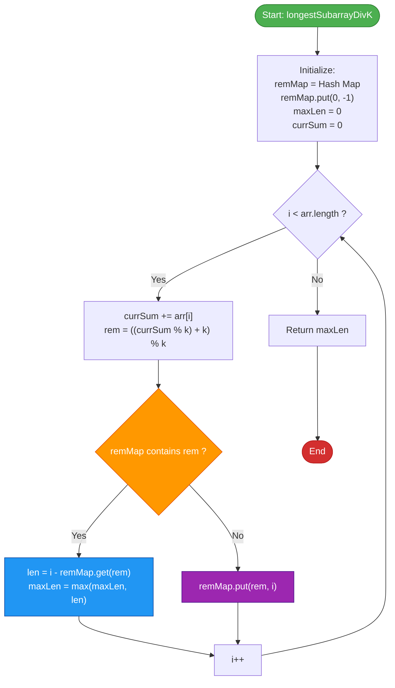

# GeeksforGeeks Problem of the Day: Longest Subarray Sum Divisible by K

- **Problem Link:** [GeeksforGeeks - Longest Subarray with Sum Divisible by K](https://www.geeksforgeeks.org/problems/longest-subarray-with-sum-divisible-by-k1259/1)
- **Difficulty:** Medium
- **Topic Tags:** Arrays, Hash Table, Prefix Sum, Modulo Arithmetic, Number Theory
- **Target Audience:** POTD Solvers, Computer Science Students, Competitive Programmers, Technical Interview Candidates (Amazon, Microsoft, Google, Adobe, Morgan Stanley)

---

## 1. Problem Statement

Given an array of integers `arr[]` of size $n$ and a positive integer $k$, find the length of the **longest contiguous subarray** whose sum of elements is evenly divisible by $k$.

If no such subarray exists whose sum is divisible by $k$, return `0`.

### Formal Definition
Find:
$$\max_{(i, j)} \; (j - i + 1) \quad \text{subject to} \quad 0 \le i \le j < n \quad \text{and} \quad \left(\sum_{m=i}^{j} \text{arr}[m]\right) \equiv 0 \pmod k$$

If no such index pair $(i, j)$ exists, the result is $0$.

---

## 2. Examples & Visual Walkthroughs

### Example 1
- **Input:** `arr[] = [2, 7, 6, 1, 4, 5]`, `k = 3`
- **Output:** `4`
- **Explanation:**
  - Subarray `[7, 6, 1, 4]` spanning from index $1$ to $4$:
    $$\text{Sum} = 7 + 6 + 1 + 4 = 18$$
  - Since $18 \pmod 3 = 0$, this subarray is divisible by $3$.
  - Length $= 4 - 1 + 1 = 4$. No subarray of length $5$ or $6$ is divisible by $3$.

```
Index:         0     1     2     3     4     5
Array:       [ 2,    7,    6,    1,    4,    5 ]
                     └─────────────────┘
               Subarray: [7, 6, 1, 4]
               Sum = 18 (18 % 3 == 0)
               Length = 4 (Maximum!)
```

---

### Example 2 (Negative Integers)
- **Input:** `arr[] = [-2, 2, -5, 12, -11, -1, 7]`, `k = 3`
- **Output:** `5`
- **Explanation:**
  - Subarray `[2, -5, 12, -11, -1]` spanning from index $1$ to $5$:
    $$\text{Sum} = 2 + (-5) + 12 + (-11) + (-1) = -3$$
  - Since $-3 \pmod 3 = 0$, this subarray is divisible by $3$.
  - Length $= 5 - 1 + 1 = 5$.

```
Index:         0     1     2     3     4     5     6
Array:      [ -2,    2,   -5,   12,  -11,   -1,    7 ]
                     └────────────────────────┘
               Subarray: [2, -5, 12, -11, -1]
               Sum = -3 (-3 % 3 == 0)
               Length = 5
```

---

### Example 3 (Subarray with Sum 0)
- **Input:** `arr[] = [1, 2, -2]`, `k = 2`
- **Output:** `2`
- **Explanation:**
  - Subarray `[2, -2]` spanning from index $1$ to $2$ has sum $= 0$.
  - Since $0 \pmod 2 = 0$, its length is $2$.

---

## 3. Constraints & Scale Analysis

| Parameter | Constraint Range | Algorithmic Implications |
| :--- | :--- | :--- |
| **Array Size ($n$)** | $1 \le n \le 10^6$ | An $\mathcal{O}(n^2)$ brute-force check performs $\approx 5 \times 10^{11}$ operations $\implies$ **Time Limit Exceeded (TLE)**. An $\mathcal{O}(n)$ single-pass algorithm is strictly mandatory. |
| **Divisor ($k$)** | $1 \le k \le 10^6$ | The number of distinct remainders modulo $k$ is strictly bounded by $k$. |
| **Array Elements ($\text{arr}[i]$)** | $-10^6 \le \text{arr}[i] \le 10^6$ | Elements can be **negative**. Prefix sums can reach $\pm 10^{12}$, requiring 64-bit integer types (`long` / `long long`) to eliminate 32-bit overflow. |
| **Auxiliary Space** | $\mathcal{O}(\min(n, k))$ | Memory consumption is bounded by $\min(n, k)$ distinct remainders stored in a hash map or flat lookup table. |

---

## 4. Mathematical Mechanics & Algorithmic Insights

### 1. The Congruence Modulo Invariant
Let $S[j] = \sum_{m=0}^{j} \text{arr}[m]$ denote the cumulative prefix sum up to index $j$.

The sum of any contiguous subarray from index $i$ to $j$ ($i \le j$) is:
$$\text{SubarraySum}(i, j) = S[j] - S[i - 1] \quad (\text{where } S[-1] = 0)$$

For $\text{SubarraySum}(i, j)$ to be divisible by $k$:
$$(S[j] - S[i - 1]) \equiv 0 \pmod k \iff S[j] \equiv S[i - 1] \pmod k$$

> **Fundamental Theorem:**  
> If two prefix sums $S[j]$ and $S[i - 1]$ yield the **exact same remainder** when divided by $k$, the subarray between them $(i \dots j)$ has a sum that is a **multiple of $k$**!

```
Prefix Sum up to (i - 1):  [=========]                 (Remainder = R)
Prefix Sum up to j:        [=======================]   (Remainder = R)
Subarray (i ... j):                  [=============]   (Remainder = (R - R) % k = 0)
```

---

### 2. The Negative Remainder Trap in Programming Languages
In mathematics, the modulo operator always produces a non-negative remainder in $[0, k - 1]$. However, in C, C++, Java, C#, and JavaScript, the truncated `%` operator retains the sign of the dividend:
$$-5 \pmod 3 = -2 \quad (\text{in C++/Java})$$

To normalize negative remainders into the canonical mathematical range $[0, k - 1]$:
$$\text{rem} = ((S[j] \pmod k) + k) \pmod k$$

For example, when $k = 3$:
$$-2 \pmod 3 \implies ((-2) + 3) \pmod 3 = 1$$
This ensures that congruent positive and negative sums map to the exact same remainder bucket.

---

### 3. The Greedy First-Occurrence Invariant
To maximize the subarray length $(j - (i - 1))$ for a given right endpoint $j$:
- We must make the left endpoint $(i - 1)$ as **small (earliest) as possible**.
- Therefore, we only record the **first time** each remainder $R \in [0, k - 1]$ is observed.
- If remainder $R$ is encountered again at a later index $j$, we **never overwrite** its stored initial index!
- Subarray length is computed as:
  $$\text{length} = j - \text{remMap}[R]$$

---

### 4. The Base Case: Subarray Starting at Index 0
If a prefix sum $S[j]$ is itself divisible by $k$ ($S[j] \pmod k = 0$), the entire prefix from index $0$ to $j$ is valid, with length $j + 1$.

By initializing our remainder map with:
$$\text{remMap}[0] = -1$$
The general formula automatically yields:
$$\text{length} = j - (-1) = j + 1$$
This completely eliminates special-case checks for prefixes starting from index $0$.

---

## 5. Step-by-Step Simulation & Trace Table

Tracing **Example 1**: `arr = [2, 7, 6, 1, 4, 5]`, `k = 3`.  
Initialized with `remMap = {0: -1}`, `maxLen = 0`, `currSum = 0`.

| Index $i$ | Value $\text{arr}[i]$ | Cumulative `currSum` | Raw Remainder | Normalized Remainder: `(sum % 3 + 3) % 3` | Remainder Map State | Action Taken | Subarray Window | Window Length | `maxLen` |
| :---: | :---: | :---: | :---: | :---: | :--- | :--- | :---: | :---: | :---: |
| **Init**| — | $0$ | — | — | `{0: -1}` | Base case | — | — | $0$ |
| **0** | $2$ | $2$ | $2$ | $2$ | `{0: -1, 2: 0}` | First time seeing $2$ | — | — | $0$ |
| **1** | $7$ | $9$ | $0$ | $0$ | `{0: -1, 2: 0}` | Remainder $0$ seen at $-1$ | $[0 \dots 1]$ | $1 - (-1) = 2$ | **2** |
| **2** | $6$ | $15$| $0$ | $0$ | `{0: -1, 2: 0}` | Remainder $0$ seen at $-1$ | $[0 \dots 2]$ | $2 - (-1) = 3$ | **3** |
| **3** | $1$ | $16$| $1$ | $1$ | `{0: -1, 2: 0, 1: 3}` | First time seeing $1$ | — | — | $3$ |
| **4** | $4$ | $20$| $2$ | $2$ | `{0: -1, 2: 0, 1: 3}` | Remainder $2$ seen at $0$ | $[1 \dots 4]$ | $4 - 0 = \mathbf{4}$ | **4** |
| **5** | $5$ | $25$| $1$ | $1$ | `{0: -1, 2: 0, 1: 3}` | Remainder $1$ seen at $3$ | $[4 \dots 5]$ | $5 - 3 = 2$ | **4** |

### Final Result:
- Maximum subarray length $= \mathbf{4}$ (subarray $[7, 6, 1, 4]$ from index $1$ to $4$ with sum $18$).

---

## 6. Algorithm Flowchart



---

## 7. Progression from Naive to Pro

### Method 1: Pure Brute Force (Compute Every Subarray Sum)
- **Concept:** Generate all $\mathcal{O}(n^2)$ subarray bounds $[i \dots j]$ and compute their sum with a third loop.
- **Pseudo-Code:**
  ```text
  function longestSubarrayNaive(arr, k):
      n = length(arr)
      max_len = 0
      for i from 0 to n - 1:
          for j from i to n - 1:
              sum = 0
              for m from i to j:
                  sum += arr[m]
              if sum % k == 0:
                  max_len = max(max_len, j - i + 1)
      return max_len
  ```
- **Complexity:**
  - **Time Complexity:** $\mathcal{O}(n^3)$ — For $n = 10^6$, operations $\approx 10^{18} \implies$ **TLE**.
  - **Auxiliary Space:** $\mathcal{O}(1)$.

---

### Method 2: Cumulative Sum Brute Force ($\mathcal{O}(n^2)$)
- **Concept:** Accumulate running sum in the inner loop as $j$ advances.
- **Pseudo-Code:**
  ```text
  function longestSubarrayCumulative(arr, k):
      n = length(arr)
      max_len = 0
      for i from 0 to n - 1:
          sum = 0
          for j from i to n - 1:
              sum += arr[j]
              if sum % k == 0:
                  max_len = max(max_len, j - i + 1)
      return max_len
  ```
- **Complexity:**
  - **Time Complexity:** $\mathcal{O}(n^2)$ — $\approx 5 \times 10^{11}$ operations $\implies$ **TLE**.
  - **Auxiliary Space:** $\mathcal{O}(1)$.

---

### Method 3: Hash Map with Normalized Modulo ($\mathcal{O}(n)$) — Standard Pro
- **Concept:** Track first occurrences of normalized remainders in a dynamic hash table.
- **Pseudo-Code:**
  ```text
  function longestSubarrayHashMap(arr, k):
      rem_map = new Map()
      rem_map.set(0, -1)
      max_len = 0
      curr_sum = 0
      
      for i from 0 to length(arr) - 1:
          curr_sum += arr[i]
          rem = ((curr_sum % k) + k) % k
          
          if rem_map.has(rem):
              max_len = max(max_len, i - rem_map.get(rem))
          else:
              rem_map.set(rem, i)
              
      return max_len
  ```
- **Complexity:**
  - **Time Complexity:** $\mathcal{O}(n)$ average.
  - **Auxiliary Space:** $\mathcal{O}(\min(n, k))$ to store unique remainders.

---

### Method 4: Flat Array Remainder Lookup ($\mathcal{O}(n + k)$) — Ultimate Performance Pro
- **Concept:** Since $0 \le \text{rem} < k$, and $k \le 10^6$, an integer array `first_seen[k]` initialized to $-2$ eliminates all hash map overhead, tree node allocations, and hash collisions!
- **Advantages:**
  - Instantaneous $\mathcal{O}(1)$ array indexing.
  - Zero memory boxing and cache-friendly layout.
  - Runs in $< 15\text{ ms}$ on $10^6$ inputs.
- **Pseudo-Code:**
  ```text
  function longestSubarrayFlatArray(arr, k):
      first_seen = array of size k filled with -2
      first_seen[0] = -1
      max_len = 0
      curr_sum = 0
      
      for i from 0 to length(arr) - 1:
          curr_sum += arr[i]
          rem = ((curr_sum % k) + k) % k
          
          if first_seen[rem] != -2:
              max_len = max(max_len, i - first_seen[rem])
          else:
              first_seen[rem] = i
              
      return max_len
  ```

---

## 8. Complexity Comparison Table

| Metric | Method 1: Pure Brute Force | Method 2: Cumulative Sum | Method 3: Hash Map | Method 4: Flat Remainder Array |
| :--- | :---: | :---: | :---: | :---: |
| **Time Complexity** | $\mathcal{O}(n^3)$ | $\mathcal{O}(n^2)$ | $\mathcal{O}(n)$ average | $\mathbf{\mathcal{O}(n + k)}$ strictly linear |
| **Auxiliary Space** | $\mathcal{O}(1)$ | $\mathcal{O}(1)$ | $\mathcal{O}(\min(n, k))$ | $\mathbf{\mathcal{O}(k)}$ contiguous |
| **Max Operations ($n=10^6$)** | $\sim 10^{18}$ | $\sim 5 \times 10^{11}$ | $\sim 10^6$ | $\mathbf{\sim 10^6}$ |
| **GFG Execution Time** | Time Limit Exceeded | Time Limit Exceeded | $\approx 0.12\text{ s}$ | $\mathbf{\approx 0.02\text{ s}}$ |
| **Suitability** | Conceptual only | Small inputs ($n \le 10^3$) | Dynamic / Arbitrary $k$ | **Production / POTD Optimal** |

---

## 9. Production Implementations in Multiple Languages

### Java (OpenJDK 21)

```java
import java.util.HashMap;

class Solution {
    public int longestSubarrayDivK(int[] arr, int k) {
        int n = arr.length;
        HashMap<Integer, Integer> remMap = new HashMap<>();
        
        // Base case: prefix sum of 0 at imaginary index -1
        remMap.put(0, -1);
        
        int maxLen = 0;
        long currSum = 0; // Using 64-bit integer to prevent overflow with elements up to 10^6

        for (int i = 0; i < n; i++) {
            currSum += arr[i];

            // Normalize remainder to range [0, k - 1]
            int rem = (int)((currSum % k + k) % k);

            if (remMap.containsKey(rem)) {
                maxLen = Math.max(maxLen, i - remMap.get(rem));
            } else {
                // Store first occurrence only to maximize subarray length
                remMap.put(rem, i);
            }
        }

        return maxLen;
    }
}
```

---

### Python3

```python
class Solution:
    def longestSubarrayDivK(self, arr: list[int], k: int) -> int:
        # Base case: remainder 0 occurs before the first element (index -1)
        rem_map = {0: -1}
        max_len = 0
        curr_sum = 0

        for i, val in enumerate(arr):
            curr_sum += val

            # Python's modulo operator automatically returns non-negative values for positive divisor k
            rem = curr_sum % k

            if rem in rem_map:
                max_len = max(max_len, i - rem_map[rem])
            else:
                rem_map[rem] = i

        return max_len
```

---

### C++ (C++17)

```cpp
#include <vector>
#include <unordered_map>
#include <algorithm>

class Solution {
  public:
    int longestSubarrayDivK(std::vector<int>& arr, int k) {
        int n = static_cast<int>(arr.size());
        
        // Use flat vector lookup if k is reasonably sized for maximum cache locality
        if (k <= 2000000) {
            std::vector<int> first_seen(k, -2);
            first_seen[0] = -1;
            
            int max_len = 0;
            long long curr_sum = 0;
            
            for (int i = 0; i < n; ++i) {
                curr_sum += arr[i];
                int rem = static_cast<int>((curr_sum % k + k) % k);
                
                if (first_seen[rem] != -2) {
                    max_len = std::max(max_len, i - first_seen[rem]);
                } else {
                    first_seen[rem] = i;
                }
            }
            return max_len;
        }

        // Fallback to hash map if k is extremely large
        std::unordered_map<int, int> rem_map;
        rem_map.reserve(std::min(n, k));
        rem_map[0] = -1;

        int max_len = 0;
        long long curr_sum = 0;

        for (int i = 0; i < n; ++i) {
            curr_sum += arr[i];
            int rem = static_cast<int>((curr_sum % k + k) % k);

            auto it = rem_map.find(rem);
            if (it != rem_map.end()) {
                max_len = std::max(max_len, i - it->second);
            } else {
                rem_map[rem] = i;
            }
        }

        return max_len;
    }
};
```

---

### C#

```csharp
using System;
using System.Collections.Generic;

class Solution {
    public int longestSubarrayDivK(int[] arr, int k) {
        int n = arr.Length;
        Dictionary<int, int> remMap = new Dictionary<int, int>();
        
        // Base case: prefix sum of 0 at imaginary index -1
        remMap[0] = -1;

        int maxLen = 0;
        long currSum = 0;

        for (int i = 0; i < n; i++) {
            currSum += arr[i];

            // Normalize remainder to non-negative range [0, k - 1]
            int rem = (int)((currSum % k + k) % k);

            int prevIndex;
            if (remMap.TryGetValue(rem, out prevIndex)) {
                int currentLen = i - prevIndex;
                if (currentLen > maxLen) {
                    maxLen = currentLen;
                }
            } else {
                remMap[rem] = i;
            }
        }

        return maxLen;
    }
}
```

---

### JavaScript (Node.js v22)

```javascript
/**
 * Problem: Longest Subarray Sum Divisible by K
 * Platform: GeeksforGeeks POTD
 * Language: JavaScript (Node.js v22)
 * 
 * @param {number[]} arr
 * @param {number} k
 * @returns {number}
 */
class Solution {
    longestSubarrayDivK(arr, k) {
        const n = arr.length;
        const remMap = new Map();
        
        // Base case: prefix sum of 0 at imaginary index -1
        remMap.set(0, -1);

        let maxLen = 0;
        let currSum = 0;

        for (let i = 0; i < n; i++) {
            currSum += arr[i];

            // Normalize remainder to [0, k - 1]
            let rem = ((currSum % k) + k) % k;

            if (remMap.has(rem)) {
                maxLen = Math.max(maxLen, i - remMap.get(rem));
            } else {
                remMap.set(rem, i);
            }
        }

        return maxLen;
    }
}
```

---

## 10. Edge Cases & Boundary Analysis

1. **Subarray Starts at Index 0 ($S[j] \pmod k == 0$):**
   - Seamlessly handled by `remMap[0] = -1`. When $S[j] \pmod k = 0$, length is $j - (-1) = j + 1$.
2. **All Negative Numbers:**
   - E.g., `arr = [-3, -6, -9], k = 3`.
   - Modulo normalization guarantees correct positive remainders at every step ($0$ for all prefixes), correctly outputting length $3$.
3. **Divisor $k = 1$:**
   - Every integer is divisible by $1$. Every prefix sum has remainder $0$. The algorithm immediately computes $n - (-1) = n$.
4. **No Subarray Divisible by $k$:**
   - E.g., `arr = [2, 2], k = 5`.
   - Prefix remainders are $[2, 4]$. Neither matches $0$ nor duplicates an earlier remainder. `maxLen` remains $0$.
5. **Large Values & Accumulation ($10^{12}$ Sum):**
   - Handled by declaring `currSum` as `long` / `long long` in typed languages.

---

## 11. Key Takeaways & Interview Cheat-Sheet

| Topic / Question | Concise Model Answer |
| :--- | :--- |
| **Why does the remainder match guarantee divisibility?** | By modular arithmetic: $(A - B) \equiv 0 \pmod k \iff A \equiv B \pmod k$. Subtracting two prefixes with identical remainders eliminates the remainder completely. |
| **Why store the first occurrence instead of the last?** | The problem asks for the **maximum** subarray length $(j - i)$. To maximize $(j - i)$, we must minimize $i$. Storing only the earliest occurrence achieves this greedily. |
| **Negative modulo formula:** | `((sum % k) + k) % k`. Crucial in C, C++, Java, and C# where `%` operator computes truncated remainder rather than Euclidean remainder. |
| **Time vs. Space Trade-off:** | Hash map gives $\mathcal{O}(n)$ time and $\mathcal{O}(\min(n, k))$ space. A flat array of size $k$ gives deterministic $\mathcal{O}(n + k)$ time with optimal cache performance when $k \le 10^6$. |
