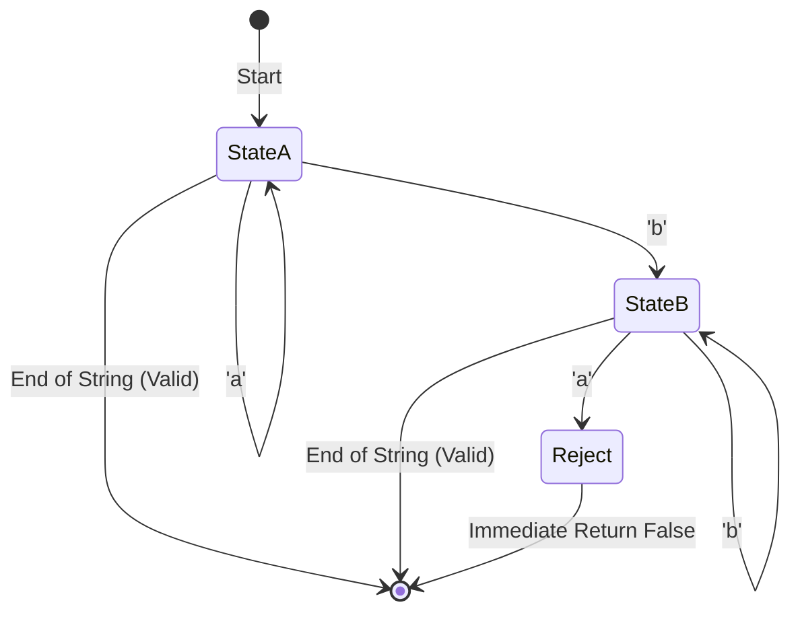
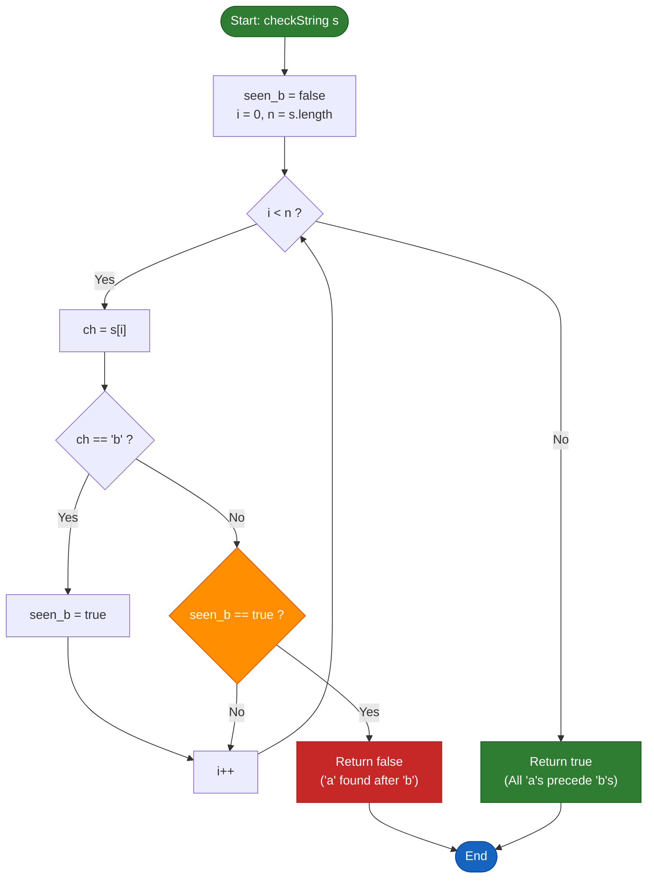

# LeetCode Problem of the Day: Check if All A's Appears Before All B's

- **Problem Link:** [LeetCode 2124 - Check if All A's Appears Before All B's](https://leetcode.com/problems/check-if-all-as-appears-before-all-bs/description/)
- **Difficulty:** Easy
- **Topic Tags:** String, Two Pointers, Deterministic Finite Automaton (DFA), Greedy, Sorting
- **Target Audience:** POTD Solvers, Computer Science Students, Competitive Programmers, Technical Interview Candidates (Amazon, Microsoft, Apple, Bloomberg)

---

## 1. Problem Statement

Given a string `s` consisting of only the characters `'a'` and `'b'`, return `true` if **every** `'a'` appears before **every** `'b'` in the string. Otherwise, return `false`.

### Formal Definition
A string $s$ of length $n$ satisfies the condition if and only if there does **not exist** any pair of indices $(i, j)$ such that:
$$0 \le i < j < n \quad \text{with} \quad s[i] = \text{'b'} \quad \text{and} \quad s[j] = \text{'a'}$$

In other words:
$$\forall i, j \in [0, n - 1], \quad (s[i] = \text{'b'} \land s[j] = \text{'a'}) \implies i > j$$

If no `'a'` exists or no `'b'` exists, the condition is vacuously satisfied, and the function returns `true`.

---

## 2. Examples & Visual Walkthroughs

### Example 1
- **Input:** `s = "aaabbb"`
- **Output:** `true`
- **Explanation:**
  - `'a'` occurs at indices $\{0, 1, 2\}$.
  - `'b'` occurs at indices $\{3, 4, 5\}$.
  - Since $\max(\text{indices of 'a'}) = 2 < \min(\text{indices of 'b'}) = 3$, every `'a'` strictly precedes every `'b'`.

```
Index:       0     1     2     3     4     5
String:      a     a     a     b     b     b
             └─────────┘       └─────────┘
              All 'a's          All 'b's
             Indices 0..2      Indices 3..5
             Result: VALID (true)
```

---

### Example 2
- **Input:** `s = "abab"`
- **Output:** `false`
- **Explanation:**
  - Index $1$ contains `'b'` and index $2$ contains `'a'`.
  - Here $1 < 2$, but $s[1] = \text{'b'}$ appears before $s[2] = \text{'a'}$.
  - This violates the condition, so the function returns `false`.

```
Index:       0     1     2     3
String:      a     b     a     b
                   ▲     ▲
                   │     │
            'b' at 1     'a' at 2
            Violation: 'b' appears before 'a'!
            Result: INVALID (false)
```

---

### Example 3 (Vacuous Truth)
- **Input:** `s = "bbb"`
- **Output:** `true`
- **Explanation:**
  - There are no `'a'`s in the string.
  - Hence, the requirement that "every 'a' appears before every 'b'" holds vacuously.
  - Returns `true`.

---

## 3. Constraints & Scale Analysis

| Parameter | Constraint Range | Algorithmic Implications |
| :--- | :--- | :--- |
| **String Length ($n$)** | $1 \le |s| \le 100$ | The input size is very small, allowing even $\mathcal{O}(n^2)$ checks to pass easily. However, an optimal $\mathcal{O}(n)$ single-pass solution with $\mathcal{O}(1)$ space is expected in technical interviews. |
| **Alphabet Set ($\Sigma$)** | Exclusively `{'a', 'b'}` | Binary alphabet allows elegant boolean state tracking, regex checks, and substring detection. |
| **Time Complexity Target** | $\mathcal{O}(n)$ | Single pass over the characters ($< 1\text{ ms}$). |
| **Auxiliary Space Target** | $\mathcal{O}(1)$ | No heap allocations or extra buffers needed. |

---

## 4. Visual Architecture & State Machine Model

### 1. The "No 'ba' Substring" Theorem
> **Theorem:**  
> A binary string $s \in \{\text{'a'}, \text{'b'}\}^*$ has all `'a'`s before all `'b'`s if and only if the two-character substring `"ba"` **never appears** anywhere in $s$.
>
> $$\text{Valid}(s) \iff \text{"ba"} \notin s$$

**Proof:**
1. **$(\implies)$ Direction:** Suppose $s$ is valid. If `"ba"` existed at index $i$, then $s[i] = \text{'b'}$ and $s[i+1] = \text{'a'}$. Since $i < i + 1$, an `'a'` appears after a `'b'`, contradicting the validity of $s$.
2. **$(\impliedby)$ Direction:** Suppose `"ba"` does not appear in $s$. Assume for contradiction that $s$ is invalid, meaning there exists some $i < j$ such that $s[i] = \text{'b'}$ and $s[j] = \text{'a'}$. As we traverse from index $i$ to $j$, the characters transition from `'b'` to `'a'`. At the exact point of transition, there must exist some adjacent pair $k \in [i, j - 1]$ such that $s[k] = \text{'b'}$ and $s[k+1] = \text{'a'}$. But this implies `"ba"` is present in $s$, a contradiction! $\blacksquare$

---

### 2. Deterministic Finite Automaton (DFA) Model
We can model this problem using a 2-state automaton:



- **State A (Prefix of 'a's):** We have only encountered `'a'` so far.
  - If we read `'a'`: stay in **State A**.
  - If we read `'b'`: transition to **State B** (first `'b'` seen).
- **State B (Suffix of 'b's):** We have seen at least one `'b'`.
  - If we read `'b'`: stay in **State B**.
  - If we read `'a'`: **REJECT!** An `'a'` appeared after a `'b'`. Return `false`.

---

## 5. Step-by-Step Simulation & Trace Table

### Trace of Example 1: `s = "aaabbb"`
- Initialize: `seen_b = false`.

| Index $i$ | Character $s[i]$ | `seen_b` Before | Condition Check | State Transition / Action | `seen_b` After |
| :---: | :---: | :---: | :--- | :--- | :---: |
| **0** | `'a'` | `false` | $s[i] == \text{'a'}$ and `seen_b == false` | Valid `'a'` prefix | `false` |
| **1** | `'a'` | `false` | $s[i] == \text{'a'}$ and `seen_b == false` | Valid `'a'` prefix | `false` |
| **2** | `'a'` | `false` | $s[i] == \text{'a'}$ and `seen_b == false` | Valid `'a'` prefix | `false` |
| **3** | `'b'` | `false` | $s[i] == \text{'b'}$ | First `'b'` encountered | `true` |
| **4** | `'b'` | `true` | $s[i] == \text{'b'}$ | Subsequent `'b'` allowed | `true` |
| **5** | `'b'` | `true` | $s[i] == \text{'b'}$ | Subsequent `'b'` allowed | `true` |

- **Loop ends:** No violations found $\implies$ Return **`true`**.

---

### Trace of Example 2: `s = "abab"`
- Initialize: `seen_b = false`.

| Index $i$ | Character $s[i]$ | `seen_b` Before | Condition Check | State Transition / Action | Result |
| :---: | :---: | :---: | :--- | :--- | :---: |
| **0** | `'a'` | `false` | $s[i] == \text{'a'}$ | Valid `'a'` prefix | Continue |
| **1** | `'b'` | `false` | $s[i] == \text{'b'}$ | First `'b'` seen $\implies$ `seen_b = true` | Continue |
| **2** | `'a'` | `true` | $s[i] == \text{'a'}$ and `seen_b == true` | **VIOLATION!** `'a'` after `'b'` | **Return `false`** |

---

## 6. Algorithm Flowchart



---

## 7. Progression from Naive to Pro

### Method 1: Pairwise Inversion Checking ($\mathcal{O}(n^2)$)
- **Concept:** Check every possible pair of indices $(i, j)$ with $i < j$. If $s[i] == \text{'b'}$ and $s[j] == \text{'a'}$, an inversion exists.
- **Pseudo-Code:**
  ```text
  function checkStringNaive(s):
      n = length(s)
      for i from 0 to n - 1:
          for j from i + 1 to n - 1:
              if s[i] == 'b' and s[j] == 'a':
                  return false
      return true
  ```
- **Complexity:**
  - **Time Complexity:** $\mathcal{O}(n^2)$.
  - **Auxiliary Space:** $\mathcal{O}(1)$.

---

### Method 2: String Sorting Comparison ($\mathcal{O}(n \log n)$)
- **Concept:** Since `'a' < 'b'` in lexicographical order, a string where all `'a'`s precede all `'b'`s is inherently **sorted in non-decreasing order**.
- **Pseudo-Code:**
  ```text
  function checkStringSorting(s):
      sorted_s = sort(s)
      return s == sorted_s
  ```
- **Complexity:**
  - **Time Complexity:** $\mathcal{O}(n \log n)$ due to sorting.
  - **Auxiliary Space:** $\mathcal{O}(n)$ to store the sorted copy.

---

### Method 3: First 'b' vs Last 'a' Pointer Tracking ($\mathcal{O}(n)$)
- **Concept:** Find the index of the first occurrence of `'b'` and the index of the last occurrence of `'a'`. If both exist, we must have $\text{first\_b} > \text{last\_a}$.
- **Pseudo-Code:**
  ```text
  function checkStringPointers(s):
      first_b = s.find_first('b')
      last_a = s.find_last('a')
      if first_b != -1 and last_a != -1:
          return first_b > last_a
      return true
  ```
- **Complexity:**
  - **Time Complexity:** $\mathcal{O}(n)$ via two linear scans.
  - **Auxiliary Space:** $\mathcal{O}(1)$.

---

### Method 4: Single-Pass Adjacent Scan / Substring Check ($\mathcal{O}(n)$ Time, $\mathcal{O}(1)$ Space) — Optimal Pro
- **Concept:** By our theorem, the string is valid if and only if `"ba"` is not a substring. We can check this with a single pass verifying $s[i] == \text{'b'} \land s[i + 1] == \text{'a'}$, or using native `contains("ba")`.
- **Pseudo-Code:**
  ```text
  function checkStringOptimal(s):
      for i from 0 to length(s) - 2:
          if s[i] == 'b' and s[i + 1] == 'a':
              return false
      return true
  ```
- **Complexity:**
  - **Time Complexity:** $\mathcal{O}(n)$ single pass, stops at the very first violation.
  - **Auxiliary Space:** $\mathcal{O}(1)$ strictly constant memory.

---

## 8. Complexity Comparison Table

| Metric | Method 1: Pairwise Nested Loops | Method 2: Sorting Comparison | Method 3: First 'b' vs Last 'a' | Method 4: Substring / Single Pass |
| :--- | :---: | :---: | :---: | :---: |
| **Time Complexity** | $\mathcal{O}(n^2)$ | $\mathcal{O}(n \log n)$ | $\mathcal{O}(n)$ | $\mathbf{\mathcal{O}(n)}$ (Early Exit) |
| **Auxiliary Space** | $\mathcal{O}(1)$ | $\mathcal{O}(n)$ | $\mathcal{O}(1)$ | $\mathbf{\mathcal{O}(1)}$ |
| **Memory Allocations** | None | Clones string | None | **None** |
| **Code Length** | Moderate | 1 line | 4 lines | **1–2 lines** |
| **Interview Quality** | Naive | Suboptimal | Good | **Production Optimal** |

---

## 9. Production Implementations in 7 Languages

### Java (OpenJDK 21)

```java
class Solution {
    public boolean checkString(String s) {
        // Method: The string is valid if and only if "ba" is never present
        return !s.contains("ba");
    }
}
```

*Alternative single-pass pointer implementation:*
```java
class Solution {
    public boolean checkString(String s) {
        int n = s.length();
        for (int i = 0; i < n - 1; i++) {
            if (s.charAt(i) == 'b' && s.charAt(i + 1) == 'a') {
                return false;
            }
        }
        return true;
    }
}
```

---

### Python3

```python
class Solution:
    def checkString(self, s: str) -> bool:
        # A valid string contains no instance of 'b' immediately followed by 'a'
        return "ba" not in s
```

---

### C (GCC 13.2)

```c
#include <stdbool.h>

bool checkString(char* s) {
    if (!s || !*s) return true;

    // Traverse the string inspecting adjacent pairs
    for (int i = 0; s[i] != '\0' && s[i + 1] != '\0'; i++) {
        if (s[i] == 'b' && s[i + 1] == 'a') {
            return false;
        }
    }
    return true;
}
```

---

### C++ (C++17)

```cpp
#include <string>
#include <string_view>

class Solution {
public:
    bool checkString(std::string s) {
        // Fast substring search in O(n) time and O(1) space
        return s.find("ba") == std::string::npos;
    }
};
```

---

### C#

```csharp
public class Solution {
    public bool CheckString(string s) {
        // Returns false if "ba" occurs at any index
        return !s.Contains("ba");
    }
}
```

*Alternative zero-allocation loop:*
```csharp
public class Solution {
    public bool CheckString(string s) {
        for (int i = 0; i < s.Length - 1; i++) {
            if (s[i] == 'b' && s[i + 1] == 'a') {
                return false;
            }
        }
        return true;
    }
}
```

---

### JavaScript (Node.js v22)

```javascript
/**
 * Problem: Check if All A's Appears Before All B's
 * Platform: LeetCode 2124
 * Language: JavaScript (Node.js v22)
 * 
 * @param {string} s
 * @return {boolean}
 */
var checkString = function(s) {
    return !s.includes('ba');
};
```

---

### TypeScript

```typescript
/**
 * Problem: Check if All A's Appears Before All B's
 * Platform: LeetCode 2124
 * Language: TypeScript
 * 
 * @param {string} s
 * @returns {boolean}
 */
function checkString(s: string): boolean {
    return !s.includes('ba');
}
```

---

## 10. Edge Cases & Boundary Analysis

1. **All Characters are `'a'` (`s = "aaaa"`):**
   - No `'b'` appears anywhere. No `"ba"` substring exists. Returns `true`.
2. **All Characters are `'b'` (`s = "bbbb"`):**
   - No `'a'` appears anywhere. Vacuously true. Returns `true`.
3. **Single Character (`s = "a"` or `s = "b"`):**
   - String length is $1$. The loop condition `i < n - 1` is not entered. Returns `true`.
4. **Immediate Inversion (`s = "ba"`):**
   - At index $0$, `s[0] == 'b'` and `s[1] == 'a'`. Detects `"ba"` instantly and returns `false`.
5. **Alternating Pattern (`s = "ababab"`):**
   - Fails at index $1$ where `s[1] == 'b'` and `s[2] == 'a'`. Returns `false`.

---

## 11. Key Takeaways & Interview Cheat-Sheet

| Strategy | Insight |
| :--- | :--- |
| **Substring Reduction** | Global ordering requirements on binary alphabets can almost always be reduced to local transition checks. "All $X$ before all $Y$" $\iff$ "$YX$ never occurs". |
| **Is Sorted Equivalence** | Because `'a' < 'b'`, this problem is mathematically identical to checking if the array is sorted in non-decreasing order (`std::is_sorted(s.begin(), s.end())`). |
| **Zero Memory Overhead** | Avoid creating auxiliary arrays or substrings. Scanning adjacent elements or using `find("ba")` operates strictly in $\mathcal{O}(1)$ extra memory. |
