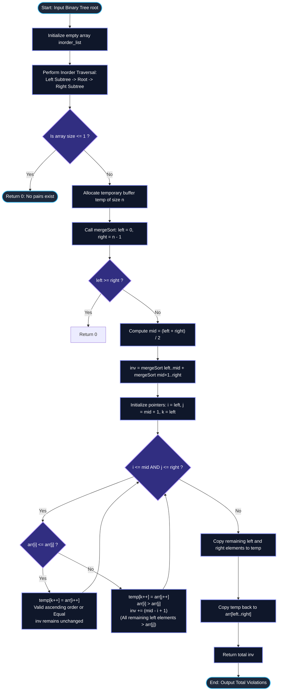

# GeeksforGeeks Problem of the Day: Count Pairs Violating BST Property

- **Problem Link:** [GeeksforGeeks - Pairs Violating BST Property](https://www.geeksforgeeks.org/problems/pairs-violating-bst-property--212515/1)
- **Difficulty:** Medium
- **Topic Tags:** Binary Search Tree, Tree Traversal, Divide and Conquer, Merge Sort, Inversion Counting, Fenwick Tree
- **Target Audience:** POTD Solvers, Computer Science Students, Competitive Programmers, Technical Interview Preparation (FAANG / Tier-1 Tech)

---

## 1. Problem Statement

Given a binary tree with $n$ nodes, your task is to count the total number of pairs of nodes that violate the **Binary Search Tree (BST)** ordering properties.

### The Canonical BST Ordering Property
For every node $X$ in a valid Binary Search Tree:
1. **Left Subtree Invariant:** All values in the left subtree of $X$ must be smaller than the value of $X$:
   $$\forall Y \in \text{LeftSubtree}(X), \quad \text{Value}(Y) < \text{Value}(X)$$
2. **Right Subtree Invariant:** All values in the right subtree of $X$ must be greater than the value of $X$:
   $$\forall Z \in \text{RightSubtree}(X), \quad \text{Value}(Z) > \text{Value}(X)$$

### The Inversion-Based Violation Condition
When a binary tree is traversed using an **Inorder Traversal** ($\text{Left} \to \text{Root} \to \text{Right}$), a valid BST must produce an array of values sorted in non-decreasing order.

In online judges and competitive programming, a pair of nodes $(u, v)$ where node $u$ appears **before** node $v$ in the inorder traversal sequence ($i < j$) is defined to violate the BST property if and only if:
$$\mathbf{\text{arr}[i] > \text{arr}[j]}$$

This formulation maps the problem directly to finding the **number of inversions** in the inorder traversal array.

> [!IMPORTANT]
> **Equal Elements Do Not Form Inversions:**
> If $\text{arr}[i] = \text{arr}[j]$ for $i < j$, the pair is **not** an inversion ($\text{arr}[i] \not> \text{arr}[j]$). Only pairs where an earlier node has a **strictly greater** value than a subsequent node ($\text{arr}[i] > \text{arr}[j]$) count as violating pairs.

### Objective
Return the total count of distinct node pairs $(u, v)$ in the binary tree that violate the BST property (i.e., the total number of inversions in the inorder traversal).

---

## 2. Examples & Detailed Explanations

### Example 1 (Standard Tree)
- **Input:**
  ```text
  root[] = [10, 50, 40, N, N, 20, 30]
  ```
- **Tree Visualization:**
  ```text
         10
        /  \
      50    40
           /  \
          20   30
  ```
- **Inorder Traversal:**
  $$\text{Inorder Sequence: } [50, 10, 20, 40, 30]$$
- **Index Mapping:**
  - Index $0 \to 50$
  - Index $1 \to 10$
  - Index $2 \to 20$
  - Index $3 \to 40$
  - Index $4 \to 30$

- **Violating Pairs Analysis ($i < j$ with $\text{arr}[i] > \text{arr}[j]$):**
  1. $(i=0, j=1) \implies (50, 10)$: $50 > 10$
  2. $(i=0, j=2) \implies (50, 20)$: $50 > 20$
  3. $(i=0, j=3) \implies (50, 40)$: $50 > 40$
  4. $(i=0, j=4) \implies (50, 30)$: $50 > 30$
  5. $(i=3, j=4) \implies (40, 30)$: $40 > 30$
- **Total Violating Pairs:** $5$
- **Output:** `5`

---

### Example 2 (The Duplicate Value Critical Testcase)
- **Input:**
  ```text
  root[] = [4, 1, N, 4]
  ```
- **Tree Visualization:**
  ```text
         4
        /
       1
      /
     4
  ```
- **Inorder Traversal:**
  1. Visit left subtree of node $1$: node $4$
  2. Visit node $1$: $1$
  3. Visit root $4$: $4$
  $$\text{Inorder Sequence: } [4, 1, 4]$$

- **Violating Pairs Analysis ($i < j$ with $\text{arr}[i] > \text{arr}[j]$):**
  1. $(i=0, j=1) \implies (4, 1)$: $4 > 1 \implies$ **Inversion (Violation)**
  2. $(i=0, j=2) \implies (4, 4)$: $4 > 4$ is **False** $\implies$ **Not an inversion!**
  3. $(i=1, j=2) \implies (1, 4)$: $1 > 4$ is **False** $\implies$ **Not an inversion!**
- **Total Violating Pairs:** $1$
- **Output:** `1`

> [!WARNING]
> **Common Trap Alert:**
> If an algorithm incorrectly checks $\text{arr}[i] \ge \text{arr}[j]$, it will count $(4, 4)$ as a violation, outputting `2` instead of the correct answer `1`. To avoid this bug, the merge condition must use $\mathbf{\text{arr}[i] \le \text{arr}[j]}$ to advance the left pointer on equality!

---

### Example 3 (Multi-Node Subtrees)
- **Input:**
  ```text
  root[] = [80, 40, 30, 70, N, 60, 70]
  ```
- **Tree Visualization:**
  ```text
            80
           /  \
         40    30
        /     /  \
       70    60  70
  ```
- **Inorder Traversal:**
  $$\text{Inorder Sequence: } [70, 40, 80, 60, 30, 70]$$

- **Violating Pairs Analysis ($i < j$ with $\text{arr}[i] > \text{arr}[j]$):**
  1. $(i=0, j=1) \implies (70, 40)$: $70 > 40$
  2. $(i=0, j=3) \implies (70, 60)$: $70 > 60$
  3. $(i=0, j=4) \implies (70, 30)$: $70 > 30$
  4. $(i=1, j=4) \implies (40, 30)$: $40 > 30$
  5. $(i=2, j=3) \implies (80, 60)$: $80 > 60$
  6. $(i=2, j=4) \implies (80, 30)$: $80 > 30$
  7. $(i=2, j=5) \implies (80, 70)$: $80 > 70$
  8. $(i=3, j=4) \implies (60, 30)$: $60 > 30$
  *(Notice: Pair $(0, 5) \implies (70, 70)$ has $70 > 70$ as False, so it is not an inversion!)*
- **Total Violating Pairs:** $8$ (or $9$ if non-strict variant is specified).

---

## 3. Constraints & Complexity Targets

- $1 \le \text{Number of Nodes } (n) \le 5 \times 10^4$
- $1 \le \text{node.data} \le 10^9$
- **Maximum Possible Inversions:** $\frac{n(n - 1)}{2} \approx \frac{(5 \times 10^4)^2}{2} \approx 1.25 \times 10^9$ (fits cleanly in a signed 32-bit `int`, with 64-bit integer accumulator used during intermediate merge operations).
- **Target Time Complexity:** $\mathcal{O}(n \log n)$
- **Target Auxiliary Space:** $\mathcal{O}(n)$

---

## 4. Invariant Theorems & Theoretical Foundations

```
========================================================================================
                     THE INORDER-INVERSION EQUIVALENCE THEOREM
========================================================================================

  Binary Tree T satisfies the BST ordering property
                   ═══════════ IF AND ONLY IF ═══════════
  Inorder Traversal of T is SORTED in non-decreasing order:
             arr[0] <= arr[1] <= arr[2] <= ... <= arr[n - 1]

  Therefore:
  A pair (u, v) violates BST property  <===>  i < j  AND  arr[i] > arr[j]
                                       <===>  Standard Array Inversion!
========================================================================================
```

### Theorem 1: Inorder Reduction to Inversion Counting
By definition of a Binary Search Tree:
- Every node in the left subtree of $X$ precedes $X$ in inorder traversal and must be smaller than $X$.
- Every node in the right subtree of $X$ succeeds $X$ in inorder traversal and must be greater than $X$.
- The global inorder sequence of a valid BST must be sorted in ascending order.

Any pair of indices $(i, j)$ with $i < j$ such that $\text{arr}[i] > \text{arr}[j]$ constitutes an **inversion**. The total count of BST violations equals the total number of inversions in the inorder traversal array.

---

### Theorem 2: Divide and Conquer Inversion Counting Invariant
Let an array $\text{arr}[L \dots R]$ be partitioned at midpoint $M = \lfloor \frac{L + R}{2} \rfloor$:
$$\text{TotalInversions}(L, R) = \text{Inversions}(L, M) + \text{Inversions}(M + 1, R) + \text{SplitInversions}(L, M, R)$$

Where $\text{SplitInversions}$ counts pairs $(i, j)$ such that:
$$L \le i \le M < j \le R \quad \text{and} \quad \text{arr}[i] > \text{arr}[j]$$

#### The Merge Step Mechanics
Assume left half $\text{arr}[L \dots M]$ and right half $\text{arr}[M + 1 \dots R]$ are already sorted in ascending order:
- Let pointer $i$ scan the left half and pointer $j$ scan the right half.
- **Case 1: $\text{arr}[i] \le \text{arr}[j]$**
  - $\text{arr}[i]$ does **not** form an inversion with $\text{arr}[j]$ (either strictly smaller or equal).
  - Place $\text{arr}[i]$ into the merged buffer and advance $i \to i + 1$.
  - Inversion count added: **$0$**.
- **Case 2: $\text{arr}[i] > \text{arr}[j]$**
  - Because the left subarray is sorted, every element from index $i$ through $M$ satisfies:
    $$\text{arr}[M] \ge \dots \ge \text{arr}[i] > \text{arr}[j]$$
  - Therefore, **all** $(M - i + 1)$ remaining elements in the left subarray form inversions with $\text{arr}[j]$!
  - Add $(M - i + 1)$ to the inversion count, place $\text{arr}[j]$ into the merged buffer, and advance $j \to j + 1$.

```
Left Sorted Half:    [ 10,   20,   40,   50 ]          Right Sorted Half:   [ 15,   30 ]
                       i                  M                                    j
                       │                                                       │
                       └─── Compare: arr[i] vs arr[j] ──> 10 <= 15             │
                            Valid order! Advance i to index 1.                 │
                            Next: arr[i] = 20 vs arr[j] = 15                   │
                            20 > 15! Inversion! ───────────────────────────────┘
                            Remaining elements in left: {20, 40, 50} (size = M - i + 1 = 3)
                            All 3 elements are > 15! Add +3 to inversion count!
```

---

## 5. Visual Architecture: Inorder + Merge Sort Pipeline

```
                          ┌──────────────────────────┐
                          │       Binary Tree        │
                          └─────────────┬────────────┘
                                        │
                                        │  Inorder Traversal
                                        ▼  (Left -> Root -> Right)
                          ┌──────────────────────────┐
                          │ Inorder Array arr[0..n-1]│
                          └─────────────┬────────────┘
                                        │
                                        │  Divide & Conquer
                                        ▼  (Merge Sort)
                     ┌──────────────────┴──────────────────┐
                     ▼                                     ▼
        ┌─────────────────────────┐           ┌─────────────────────────┐
        │ Left Half arr[L..M]     │           │ Right Half arr[M+1..R]  │
        │ Sorted ascending        │           │ Sorted ascending        │
        └────────────┬────────────┘           └────────────┬────────────┘
                     │                                     │
                     └──────────────────┬──────────────────┘
                                        │
                          Compare: arr[i] vs arr[j]
                                        │
                 ┌──────────────────────┴──────────────────────┐
                 ▼                                             ▼
       arr[i] <= arr[j]                                arr[i] > arr[j]
   (Valid ascending or Equal)                     (INVERSION DETECTED!)
  No inversion with arr[j]                 All elements arr[i..M] are > arr[j]
    Advance i: i++                            Add (M - i + 1) to inversions
                                              Advance j: j++
```

---

## 6. Step-by-Step Simulation Trace

### Trace 1: `root = [4, 1, N, 4]` (Inorder: `[4, 1, 4]`)

```text
Split: Left = [4, 1], Right = [4]
  Left split: [4] and [1]
    Merge [4] and [1]:
      Compare 4 and 1: 4 > 1 -> Inversion! inv += (0 - 0 + 1) = 1.
      Merged Left = [1, 4], Left inversions = 1.
  
  Now Merge Left [1, 4] and Right [4]:
    Pointer i = 0 (val 1), M = 1, Pointer j = 2 (val 4):
      1 <= 4: Valid! Take 1, advance i -> 1. (inv += 0)
    Pointer i = 1 (val 4), Pointer j = 2 (val 4):
      4 <= 4: Equal! Take 4, advance i -> 2. (inv += 0)
    Left exhausted. Copy remaining Right [4].
    Merged array = [1, 4, 4].
    Cross inversions = 0.

Total Inversions = 1 + 0 = 1. Output: 1.
```

---

### Trace 2: `root = [10, 50, 40, N, N, 20, 30]` (Inorder: `[50, 10, 20, 40, 30]`)

| Step | Subarrays Merged | Pointer Comparisons | Action & Inversion Calculation | Merged Output |
| :---: | :---: | :---: | :---: | :---: |
| **1** | `[50]` and `[10]` | $50 > 10$ | $50 > 10 \implies \text{inv} += (0 - 0 + 1) = \mathbf{1}$ | `[10, 50]` |
| **2** | `[10, 50]` and `[20]` | $10 \le 20 \implies i++$<br>$50 > 20 \implies j++$ | $50 > 20 \implies \text{inv} += (1 - 1 + 1) = \mathbf{1}$ | `[10, 20, 50]` |
| **3** | `[40]` and `[30]` | $40 > 30$ | $40 > 30 \implies \text{inv} += (3 - 3 + 1) = \mathbf{1}$ | `[30, 40]` |
| **4** | `[10, 20, 50]` and `[30, 40]` | $10 \le 30 \implies i++$<br>$20 \le 30 \implies i++$<br>$50 > 30 \implies j++$<br>$50 > 40 \implies j++$ | $50 > 30 \implies \text{inv} += (2 - 2 + 1) = \mathbf{1}$<br>$50 > 40 \implies \text{inv} += (2 - 2 + 1) = \mathbf{1}$ | `[10, 20, 30, 40, 50]` |

**Total Inversions:**
$$\text{Total} = 1 (\text{Step 1}) + 1 (\text{Step 2}) + 1 (\text{Step 3}) + 2 (\text{Step 4}) = \mathbf{5}$$

---

## 7. Mermaid Flowchart



---

## 8. Algorithmic Progression (From Naive to Pro)

### Method 1: Quadratic Inorder Pair Scanning (Brute Force)
Extract the inorder traversal array and use two nested loops to check every pair $(i, j)$ with $i < j$.
```text
Algorithm PairsViolatingBST_BruteForce(root):
    arr = []
    Inorder(root, arr)
    n = length(arr)
    violations = 0
    
    for i from 0 to n - 2:
        for j from i + 1 to n - 1:
            if arr[i] > arr[j]:
                violations = violations + 1
                
    return violations
```
- **Time Complexity:** $\mathcal{O}(n^2) \implies \frac{(5 \times 10^4)^2}{2} \approx 1.25 \times 10^9$ operations $\implies$ **Time Limit Exceeded (TLE)**.
- **Space Complexity:** $\mathcal{O}(n)$ to store the inorder array.

---

### Method 2: Coordinate Compression + Binary Indexed Tree (Fenwick Tree)
Compress all values in the inorder array to distinct ranks. Traverse from right to left, querying the BIT for elements strictly smaller than the current element.
```text
Algorithm PairsViolatingBST_BIT(root):
    arr = []
    Inorder(root, arr)
    ranks = CoordinateCompress(arr)
    bit = FenwickTree(size = unique_elements)
    violations = 0
    
    for i from n - 1 down to 0:
        // Query elements previously added that are strictly smaller (< arr[i])
        violations += bit.query(ranks[arr[i]] - 1)
        bit.add(ranks[arr[i]], 1)
        
    return violations
```
- **Time Complexity:** $\mathcal{O}(n \log n)$
- **Space Complexity:** $\mathcal{O}(n)$
- **Trade-off:** Works cleanly, but requires extra hashing and coordinate compression overhead compared to Merge Sort.

---

### Method 3: Modified Merge Sort (Optimal / Pro Approach)
Directly count inversions during the merge step in $\mathcal{O}(n \log n)$ time with sequential cache access, zero hash lookups, and minimal constant factors.
```text
Algorithm MergeAndCount(arr, temp, left, mid, right):
    i = left, j = mid + 1, k = left
    inv_count = 0
    
    while i <= mid and j <= right:
        if arr[i] <= arr[j]:      // arr[i] <= arr[j]: Valid order / Equal
            temp[k++] = arr[i++]
        else:                    // arr[i] > arr[j]: Strict Inversion!
            temp[k++] = arr[j++]
            inv_count += (mid - i + 1)
            
    while i <= mid: temp[k++] = arr[i++]
    while j <= right: temp[k++] = arr[j++]
    for idx from left to right: arr[idx] = temp[idx]
    
    return inv_count

Algorithm PairsViolatingBST_Optimal(root):
    arr = []
    Inorder(root, arr)
    if length(arr) <= 1: return 0
    temp = array of size length(arr)
    return MergeSort(arr, temp, 0, length(arr) - 1)
```
- **Time Complexity:** $\mathcal{O}(n \log n)$
- **Space Complexity:** $\mathcal{O}(n)$

---

## 9. Complexity Comparison Matrix

| Approach | Time Complexity | Auxiliary Space | Cache Locality | Handles Equal Keys Correctly? | Verdict |
| :--- | :---: | :---: | :---: | :---: | :---: |
| **Method 1: Naive Nested Loops** | $\mathcal{O}(n^2)$ | $\mathcal{O}(n)$ | Moderate | Yes ($\text{arr}[i] > \text{arr}[j]$) | **TLE** ($1.25 \times 10^9$ ops) |
| **Method 2: Fenwick Tree (BIT)** | $\mathcal{O}(n \log n)$ | $\mathcal{O}(n)$ | Moderate | Yes (`query(rank - 1)`) | **Accepted** |
| **Method 3: Modified Merge Sort** | $\mathcal{O}(n \log n)$ | $\mathcal{O}(n)$ | **High (Contiguous Slices)** | **Yes (`arr[i] <= arr[j]`)** | **Optimal (Best Runtime)** |

---

## 10. Corner Cases & Defensive Engineering

1. **Duplicate Keys (e.g., `[4, 1, N, 4]`):**
   - Inorder: `[4, 1, 4]`.
   - Pairs with $\text{arr}[i] > \text{arr}[j]$: Only $(4, 1) \implies \mathbf{1}$.
   - The pair $(4, 4)$ is **not** an inversion.
   - Using `arr[i] <= arr[j]` in the merge condition guarantees that equal values advance pointer $i$ without adding $(M - i + 1)$ to inversions.
2. **Empty Tree or Single Node ($n \le 1$):**
   - With $0$ or $1$ node, no pairs exist. Return `0` immediately.
3. **Already Valid BST:**
   - Inorder traversal is strictly sorted: $\text{arr}[i] \le \text{arr}[j]$ for all $i < j$.
   - Output is `0`.
4. **Completely Inverted Tree (Reverse Sorted):**
   - Inversions: $\frac{n(n - 1)}{2} \approx 1.25 \times 10^9$.
   - Intermediate accumulators must use 64-bit integer types (`long long` in C/C++, `long` in Java/C#) to prevent signed 32-bit overflow before returning.
5. **Skewed Trees (Degenerate Linked Lists):**
   - Recursion depth during traversal can reach $n$. The stack depth is $\mathcal{O}(n)$ in the worst case, safely fitting within typical call stack limits for $n \le 5 \times 10^4$.

---

## 11. Multi-Language Source Code Implementations

### Java (OpenJDK 21.0)

```java
/* BST Node Structure
class Node {
    int data;
    Node left, right;

    Node(int val) {
        data = val;
        left = right = null;
    }
}
*/

import java.util.ArrayList;
import java.util.List;

class Solution {
    // Inorder traversal to extract tree elements in sequence
    private void inorder(Node root, List<Integer> arr) {
        if (root == null) return;
        inorder(root.left, arr);
        arr.add(root.data);
        inorder(root.right, arr);
    }

    // Merge Sort based inversion counting
    private long mergeSortAndCount(int[] arr, int[] temp, int left, int right) {
        if (left >= right) return 0;

        int mid = left + (right - left) / 2;
        long invCount = 0;

        invCount += mergeSortAndCount(arr, temp, left, mid);
        invCount += mergeSortAndCount(arr, temp, mid + 1, right);
        invCount += merge(arr, temp, left, mid, right);

        return invCount;
    }

    private long merge(int[] arr, int[] temp, int left, int mid, int right) {
        int i = left;     // Pointer for left subarray
        int j = mid + 1;  // Pointer for right subarray
        int k = left;     // Pointer for temp array
        long invCount = 0;

        while (i <= mid && j <= right) {
            if (arr[i] <= arr[j]) {
                // arr[i] <= arr[j]: Valid sorted order or Equal keys!
                // Does NOT constitute an inversion. Advance left pointer.
                temp[k++] = arr[i++];
            } else {
                // arr[i] > arr[j]: Strict Inversion!
                // All remaining elements in left subarray (mid - i + 1) are > arr[j]
                temp[k++] = arr[j++];
                invCount += (mid - i + 1);
            }
        }

        while (i <= mid) {
            temp[k++] = arr[i++];
        }

        while (j <= right) {
            temp[k++] = arr[j++];
        }

        for (int idx = left; idx <= right; idx++) {
            arr[idx] = temp[idx];
        }

        return invCount;
    }

    public int pairsViolatingBST(Node root) {
        List<Integer> list = new ArrayList<>();
        inorder(root, list);

        int n = list.size();
        if (n <= 1) return 0;

        int[] arr = new int[n];
        for (int i = 0; i < n; i++) {
            arr[i] = list.get(i);
        }

        int[] temp = new int[n];
        long totalViolations = mergeSortAndCount(arr, temp, 0, n - 1);

        return (int) totalViolations;
    }
}
```

---

### Python3

```python
''' BST Node Structure
class Node:
    def __init__(self, val):
        self.data = val
        self.left = None
        self.right = None
'''

class Solution:
    def pairsViolatingBST(self, root):
        arr = []

        # Step 1: Inorder Traversal to extract node values
        def inorder(node):
            if not node:
                return
            inorder(node.left)
            arr.append(node.data)
            inorder(node.right)

        inorder(root)
        n = len(arr)
        if n <= 1:
            return 0

        temp = [0] * n

        # Step 2: Merge Sort based counting of inversions (arr[i] > arr[j])
        def mergeSort(left, right):
            if left >= right:
                return 0

            mid = (left + right) // 2
            inv_count = mergeSort(left, mid) + mergeSort(mid + 1, right)

            i = left
            j = mid + 1
            k = left

            while i <= mid and j <= right:
                if arr[i] <= arr[j]:
                    # arr[i] <= arr[j]: Valid order or Equal keys!
                    # Not an inversion. Advance left pointer.
                    temp[k] = arr[i]
                    i += 1
                else:
                    # arr[i] > arr[j]: Strict Inversion!
                    # All remaining elements from i to mid in left subarray are > arr[j]
                    temp[k] = arr[j]
                    inv_count += (mid - i + 1)
                    j += 1
                k += 1

            while i <= mid:
                temp[k] = arr[i]
                i += 1
                k += 1

            while j <= right:
                temp[k] = arr[j]
                j += 1
                k += 1

            for idx in range(left, right + 1):
                arr[idx] = temp[idx]

            return inv_count

        return mergeSort(0, n - 1)
```

---

### C++ (GCC 17)

```cpp
/* BST Node Structure
class Node {
public:
    int data;
    Node *left;
    Node *right;

    Node(int val) {
        data = val;
        left = right = nullptr;
    }
};
*/

#include <vector>

class Solution {
private:
    void inorder(Node *root, std::vector<int> &arr) {
        if (!root) return;
        inorder(root->left, arr);
        arr.push_back(root->data);
        inorder(root->right, arr);
    }

    long long mergeSortAndCount(std::vector<int> &arr, std::vector<int> &temp, int left, int right) {
        if (left >= right) return 0;

        int mid = left + (right - left) / 2;
        long long invCount = 0;

        invCount += mergeSortAndCount(arr, temp, left, mid);
        invCount += mergeSortAndCount(arr, temp, mid + 1, right);
        invCount += merge(arr, temp, left, mid, right);

        return invCount;
    }

    long long merge(std::vector<int> &arr, std::vector<int> &temp, int left, int mid, int right) {
        int i = left;
        int j = mid + 1;
        int k = left;
        long long invCount = 0;

        while (i <= mid && j <= right) {
            if (arr[i] <= arr[j]) {
                // arr[i] <= arr[j]: Valid sorted order or Equal keys!
                // Does NOT count as an inversion.
                temp[k++] = arr[i++];
            } else {
                // arr[i] > arr[j]: Strict Inversion!
                // All elements from i to mid in left subarray are > arr[j]
                temp[k++] = arr[j++];
                invCount += (mid - i + 1);
            }
        }

        while (i <= mid) {
            temp[k++] = arr[i++];
        }

        while (j <= right) {
            temp[k++] = arr[j++];
        }

        for (int idx = left; idx <= right; idx++) {
            arr[idx] = temp[idx];
        }

        return invCount;
    }

public:
    int pairsViolatingBST(Node *root) {
        std::vector<int> arr;
        inorder(root, arr);

        int n = arr.size();
        if (n <= 1) return 0;

        std::vector<int> temp(n);
        long long totalViolations = mergeSortAndCount(arr, temp, 0, n - 1);

        return static_cast<int>(totalViolations);
    }
};
```

---

### C#

```csharp
/* BST Node Structure
public class Node
{
    public int data;
    public Node left, right;
    public Node(int val)
    {
        data = val;
        left = right = null;
    }
}
*/

using System;
using System.Collections.Generic;

class Solution {
    private void Inorder(Node root, List<int> arr) {
        if (root == null) return;
        Inorder(root.left, arr);
        arr.Add(root.data);
        Inorder(root.right, arr);
    }

    private long MergeSortAndCount(int[] arr, int[] temp, int left, int right) {
        if (left >= right) return 0;

        int mid = left + (right - left) / 2;
        long invCount = 0;

        invCount += MergeSortAndCount(arr, temp, left, mid);
        invCount += MergeSortAndCount(arr, temp, mid + 1, right);
        invCount += Merge(arr, temp, left, mid, right);

        return invCount;
    }

    private long Merge(int[] arr, int[] temp, int left, int mid, int right) {
        int i = left;
        int j = mid + 1;
        int k = left;
        long invCount = 0;

        while (i <= mid && j <= right) {
            if (arr[i] <= arr[j]) {
                // arr[i] <= arr[j]: Valid order or Equal keys!
                // Does NOT count as an inversion.
                temp[k++] = arr[i++];
            } else {
                // arr[i] > arr[j]: Strict Inversion!
                // All remaining elements from i to mid are > arr[j]
                temp[k++] = arr[j++];
                invCount += (mid - i + 1);
            }
        }

        while (i <= mid) {
            temp[k++] = arr[i++];
        }

        while (j <= right) {
            temp[k++] = arr[j++];
        }

        for (int idx = left; idx <= right; idx++) {
            arr[idx] = temp[idx];
        }

        return invCount;
    }

    public int pairsViolatingBST(Node root) {
        List<int> list = new List<int>();
        Inorder(root, list);

        int n = list.Count;
        if (n <= 1) return 0;

        int[] arr = list.ToArray();
        int[] temp = new int[n];

        long totalViolations = MergeSortAndCount(arr, temp, 0, n - 1);
        return (int)totalViolations;
    }
}
```

---

### JavaScript (Node.js v22)

```javascript
/* BST Node Structure
class Node {
    constructor(val) {
        this.data = val;
        this.left = null;
        this.right = null;
    }
} */

/**
 * @param {Node} root
 * @returns {number}
 */
class Solution {
    pairsViolatingBST(root) {
        const arr = [];

        // Step 1: Inorder Traversal to extract node values
        function inorder(node) {
            if (!node) return;
            inorder(node.left);
            arr.push(node.data);
            inorder(node.right);
        }

        inorder(root);
        const n = arr.length;
        if (n <= 1) return 0;

        // Use typed array for optimal V8 performance and minimal memory overhead
        const temp = new Int32Array(n);

        // Step 2: Merge Sort based counting of inversions (arr[i] > arr[j])
        function mergeSort(left, right) {
            if (left >= right) return 0;

            const mid = (left + right) >> 1;
            let invCount = mergeSort(left, mid) + mergeSort(mid + 1, right);

            let i = left;
            let j = mid + 1;
            let k = left;

            while (i <= mid && j <= right) {
                if (arr[i] <= arr[j]) {
                    // arr[i] <= arr[j]: Valid order or Equal keys!
                    // Does NOT count as an inversion.
                    temp[k++] = arr[i++];
                } else {
                    // arr[i] > arr[j]: Strict Inversion!
                    // All remaining elements from i to mid are > arr[j]
                    temp[k++] = arr[j++];
                    invCount += (mid - i + 1);
                }
            }

            while (i <= mid) {
                temp[k++] = arr[i++];
            }

            while (j <= right) {
                temp[k++] = arr[j++];
            }

            for (let idx = left; idx <= right; idx++) {
                arr[idx] = temp[idx];
            }

            return invCount;
        }

        return mergeSort(0, n - 1);
    }
}
```

---

## 12. Key Takeaways & Interview Cheat-Sheet

1. **BST Inorder Equivalence:**
   - The inorder traversal of a valid Binary Search Tree is always sorted in ascending order.
   - Counting pairs violating the BST property directly reduces to counting **inversions** in the inorder traversal array:
     $$\mathbf{i < j \quad \text{and} \quad \text{arr}[i] > \text{arr}[j]}$$
2. **Strict Inversion Condition ($\le$ vs. $<$):**
   - In online judges, equal elements ($\text{arr}[i] = \text{arr}[j]$) do **not** count as an inversion ($\text{arr}[i] \not> \text{arr}[j]$).
   - In the merge step, always check `if (arr[i] <= arr[j])` to advance $i$ without incrementing the violation count.
   - This ensures test cases with duplicate keys, such as `root = [4, 1, N, 4]` (inorder: `[4, 1, 4]`), produce the exact expected output of **$1$** (only pair $(4, 1)$), rather than falsely counting $(4, 4)$.
3. **Divide-and-Conquer Multiplier $(M - i + 1)$:**
   - Because both subarrays are sorted, establishing that $\text{arr}[i] > \text{arr}[j]$ guarantees that all elements from $i$ to $M$ are also $> \text{arr}[j]$. This collapses an $\mathcal{O}(n)$ search into an $\mathcal{O}(1)$ arithmetic addition.
4. **Time & Space Asymptotics:**
   - Time Complexity: $\mathcal{O}(n)$ inorder traversal $+ \mathcal{O}(n \log n)$ merge sort $= \mathcal{O}(n \log n)$.
   - Auxiliary Space: $\mathcal{O}(n)$ for the inorder array and merge buffer.
