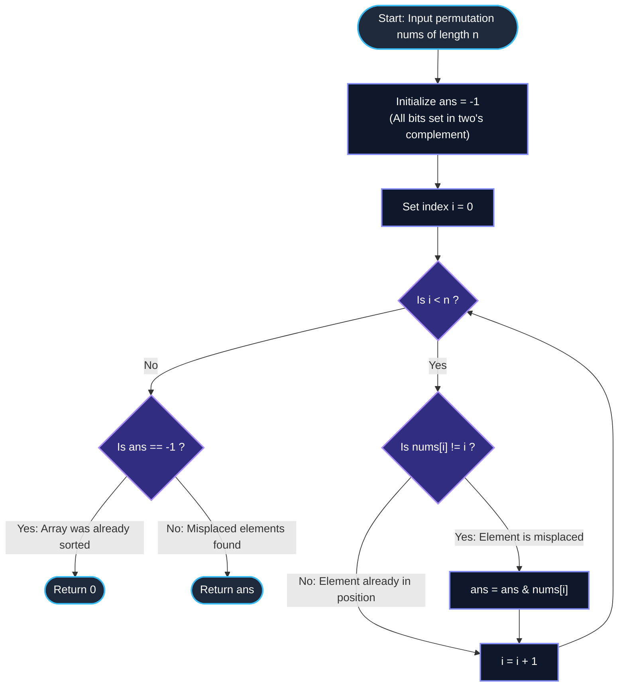

# LeetCode Problem of the Day: Maximum K to Sort a Permutation

- **Problem Link:** [LeetCode 3644 - Maximum K to Sort a Permutation](https://leetcode.com/problems/maximum-k-to-sort-a-permutation/description/?envType=daily-question&envId=2026-10-23)
- **Difficulty:** Medium
- **Topic Tags:** Array, Bit Manipulation, Math, Permutation Cycles, Greedy, Connected Components
- **Target Audience:** POTD Solvers, Computer Science Students, Competitive Programmers, Technical Interview Preparation (FAANG / Tier-1 Tech)

---

## 1. Problem Statement

You are given an integer array `nums` of length $n$, where `nums` is a **permutation** of the integers in the range $[0, n - 1]$.

### The Swap Operation
You are allowed to swap elements at any two distinct indices $i$ and $j$ **if and only if**:
$$\text{nums}[i] \ \& \ \text{nums}[j] == k$$
where `&` denotes the **bitwise AND** operation, and $k$ is a non-negative integer chosen upfront ($k \ge 0$). You may perform this valid swap operation any number of times.

### Objective
Return the **maximum non-negative integer $k$** such that the permutation can be completely sorted in non-decreasing (ascending) order using any sequence of valid swaps.

If the array is already sorted, return `0`.

---

## 2. Examples & Detailed Explanations

### Example 1
- **Input:** `nums = [0, 3, 2, 1]`
- **Output:** `1`
- **Explanation:**
  - Let us inspect which elements are in their correct positions (`nums[i] == i`):
    - Index $0$: $\text{nums}[0] = 0 \implies 0 == 0$ (Correct)
    - Index $1$: $\text{nums}[1] = 3 \implies 3 \neq 1$ (**Misplaced!**)
    - Index $2$: $\text{nums}[2] = 2 \implies 2 == 2$ (Correct)
    - Index $3$: $\text{nums}[3] = 1 \implies 1 \neq 3$ (**Misplaced!**)
  - Misplaced elements: $3$ and $1$.
  - Bitwise binary representations:
    - $3 = (011)_2$
    - $1 = (001)_2$
  - Cumulative Bitwise AND:
    $$3 \ \& \ 1 = (001)_2 = 1$$
  - If we pick $k = 1$:
    - $\text{nums}[1] \ \& \ \text{nums}[3] = 3 \ \& \ 1 = 1 == k$.
    - Swap indices $1$ and $3$: `nums` becomes `[0, 1, 2, 3]`, which is fully sorted!
  - Can we choose any $k > 1$? No, because for any $k > 1$, $3 \ \& \ 1 = 1 \neq k$, preventing the swap needed to sort the array.
  - Hence, the maximum possible $k$ is $1$.

---

### Example 2
- **Input:** `nums = [0, 1, 3, 2]`
- **Output:** `2`
- **Explanation:**
  - Index analysis:
    - Index $0$: $\text{nums}[0] = 0 == 0$ (Correct)
    - Index $1$: $\text{nums}[1] = 1 == 1$ (Correct)
    - Index $2$: $\text{nums}[2] = 3 \neq 2$ (**Misplaced!**)
    - Index $3$: $\text{nums}[3] = 2 \neq 3$ (**Misplaced!**)
  - Misplaced elements: $3$ and $2$.
  - Bitwise binary representations:
    - $3 = (011)_2$
    - $2 = (010)_2$
  - Cumulative Bitwise AND:
    $$3 \ \& \ 2 = (010)_2 = 2$$
  - Choosing $k = 2$:
    - $\text{nums}[2] \ \& \ \text{nums}[3] = 3 \ \& \ 2 = 2 == k$.
    - Swap indices $2$ and $3$: `nums` becomes `[0, 1, 2, 3]`.
  - Maximum $k = 2$.

---

### Example 3
- **Input:** `nums = [3, 2, 1, 0]`
- **Output:** `0`
- **Explanation:**
  - Every single element is misplaced:
    - Index $0$: $\text{nums}[0] = 3 \neq 0$
    - Index $1$: $\text{nums}[1] = 2 \neq 1$
    - Index $2$: $\text{nums}[2] = 1 \neq 2$
    - Index $3$: $\text{nums}[3] = 0 \neq 3$
  - Cumulative Bitwise AND:
    $$3 \ \& \ 2 \ \& \ 1 \ \& \ 0 = 0$$
  - Because element $0$ has zero set bits ($(000)_2$), any swap involving $0$ will produce:
    $$\text{anything} \ \& \ 0 = 0$$
  - Therefore, any swap involving $0$ strictly requires $k = 0$. Since $0$ must be moved to index $0$, $k$ can be at most $0$.
  - Maximum $k = 0$.

---

### Example 4 (Already Sorted)
- **Input:** `nums = [0, 1, 2, 3]`
- **Output:** `0`
- **Explanation:**
  - The array is already in non-decreasing sorted order.
  - No swaps are required. By problem definition, return `0`.

---

## 3. Constraints & Complexity Targets

- $1 \le n == \text{nums.length} \le 10^5$
- $0 \le \text{nums}[i] \le n - 1$
- `nums` is a valid permutation of integers from $0$ to $n - 1$.
- **Target Time Complexity:** $\mathcal{O}(n)$ (Single linear pass)
- **Target Auxiliary Space:** $\mathcal{O}(1)$ (Constant extra space)

---

## 4. Invariant Theorems & Theoretical Foundations

```
========================================================================================
                      THE NECESSARY SUBMASK INVARIANT
========================================================================================

  Condition for Swapping two values u and v:
                         u & v == k

  Property of Bitwise AND:
  For any bit position b:
      If (k & (1 << b)) != 0  ===>  (u & (1 << b)) != 0  AND  (v & (1 << b)) != 0

  Transitivity over Swaps:
  If an element x is moved along any sequence of swaps:
      x & k == k  (k MUST be a bitwise submask of x!)

  Conclusion:
  Every misplaced element x (where nums[i] != i) MUST have (x & k) == k.
  Therefore:
                  k <=  AND_{nums[i] != i} (nums[i])
========================================================================================
```

### Theorem 1: The Bitwise Submask Property
Let two values $u$ and $v$ be swapped. The legal condition states:
$$u \ \& \ v = k$$
By the fundamental definition of the bitwise AND operator, a bit at position $b$ can be $1$ in the result $k$ if and only if that bit is $1$ in **both** $u$ and $v$:
$$\text{bit}_b(k) = 1 \implies \text{bit}_b(u) = 1 \quad \text{and} \quad \text{bit}_b(v) = 1$$
This implies that $k$ is a **bitwise submask** of both $u$ and $v$:
$$k \subseteq u \quad \text{and} \quad k \subseteq v \iff (u \ \& \ k = k) \land (v \ \& \ k = k)$$

---

### Theorem 2: Preservation across Swap Chains
Suppose an element $x$ is relocated to its target position through a chain of swaps:
$$x = u_0 \longleftrightarrow u_1 \longleftrightarrow u_2 \longleftrightarrow \dots \longleftrightarrow u_m$$
For each swap step $t \in [1, m]$, we must satisfy $u_{t-1} \ \& \ u_t = k$.
By induction, every element $u_t$ that ever takes part in this connected component must satisfy:
$$u_t \ \& \ k = k$$
Consequently, **any element that is not currently at its sorted destination index ($nums[i] \neq i$) must participate in at least one swap**. Therefore:
$$\forall i \text{ such that } \text{nums}[i] \neq i, \quad \text{nums}[i] \ \& \ k = k$$

---

### Theorem 3: Equivalence of Misplaced Indices and Misplaced Values
Because `nums` is a permutation of $\{0, 1, \dots, n - 1\}$, the set of indices where $\text{nums}[i] \neq i$ corresponds precisely to the set of permutation cycles of length $\ge 2$.
The set of misplaced values is identical to the set of misplaced indices:
$$\{ \text{nums}[i] \mid \text{nums}[i] \neq i \} = \{ i \mid \text{nums}[i] \neq i \}$$
Thus, every misplaced value $x$ restricts $k$ such that:
$$k \ \& \ x = k$$
Taking the conjunction across all misplaced elements yields:
$$k \le \bigwedge_{\text{nums}[i] \neq i} \text{nums}[i]$$

---

### Theorem 4: Sufficiency & Tightness of the Conjunction
Let $K = \bigwedge_{\text{nums}[i] \neq i} \text{nums}[i]$.
By construction:
1. Every misplaced element $x$ has $x \ \& \ K = K$.
2. All bits that are $1$ in $K$ are present in every misplaced element.
3. Therefore, $K$ is the maximal possible value for which any swap graph could potentially connect the misplaced elements.
4. Hence, the maximum possible $k$ is exactly $K$. If no elements are misplaced, the answer is $0$.

---

## 5. Visual Architecture: Bitwise Mask Filtering

```
Array: nums = [ 0,     3,     2,     1 ]
Indices:        0      1      2      3
Match?         Yes     NO    Yes     NO
                       ▲             ▲
                       │             │
                Misplaced: 3    Misplaced: 1

Binary Representation:
    Value 3:   0  1  1  (binary)
    Value 1:   0  0  1  (binary)
             ─────────────
    AND (k):   0  0  1  = 1 (decimal)

Allowed Swaps with k = 1:
    nums[1] & nums[3] = 3 & 1 = 1 == k  ===> [SWAP ALLOWED!]
    Swapping index 1 and index 3 produces [0, 1, 2, 3] (SORTED!)
```

---

## 6. Step-by-Step Simulation Trace Table

### Tracing Across Different Permutations

| Testcase | Array `nums` | Misplaced Elements ($nums[i] \neq i$) | Binary of Misplaced | Bitwise Cumulative AND | Result $k$ |
| :--- | :---: | :---: | :---: | :---: | :---: |
| **Example 1** | `[0, 3, 2, 1]` | $\{3, 1\}$ | $3 = (011)_2$<br>$1 = (001)_2$ | $(011)_2 \ \& \ (001)_2 = (001)_2 = \mathbf{1}$ | **1** |
| **Example 2** | `[0, 1, 3, 2]` | $\{3, 2\}$ | $3 = (011)_2$<br>$2 = (010)_2$ | $(011)_2 \ \& \ (010)_2 = (010)_2 = \mathbf{2}$ | **2** |
| **Example 3** | `[3, 2, 1, 0]` | $\{3, 2, 1, 0\}$ | $3 = (011)_2$<br>$2 = (010)_2$<br>$1 = (001)_2$<br>$0 = (000)_2$ | $3 \ \& \ 2 \ \& \ 1 \ \& \ 0 = \mathbf{0}$ | **0** |
| **Example 4** | `[0, 1, 2, 3]` | $\emptyset$ (None) | None | Array is already sorted $\implies \mathbf{0}$ | **0** |
| **Custom 1** | `[0, 7, 2, 5, 4, 3, 6]` | $\{7, 5, 3\}$ at indices $1, 3, 5$ | $7 = (111)_2$<br>$5 = (101)_2$<br>$3 = (011)_2$ | $7 \ \& \ 5 \ \& \ 3 = (001)_2 = \mathbf{1}$ | **1** |
| **Custom 2** | `[0, 6, 2, 4]` | $\{6, 4\}$ at indices $1, 3$ | $6 = (110)_2$<br>$4 = (100)_2$ | $6 \ \& \ 4 = (100)_2 = \mathbf{4}$ | **4** |

---

## 7. Mermaid Flowchart



---

## 8. Algorithmic Progression (From Naive to Pro)

### Method 1: Brute Force Candidate Search ($\mathcal{O}(n \cdot \max(nums))$)
Test every candidate integer $k$ from $\max(nums)$ down to $0$. For each $k$, build an undirected graph where edges connect all pairs with $u \ \& \ v == k$. Check if all misplaced elements reside within the same connected components as their target indices using BFS/DFS.
```text
Algorithm SortPermutation_BruteForce(nums, n):
    for candidate_k from n - 1 down to 1:
        Build adjacency list for all pairs with nums[i] & nums[j] == candidate_k
        Find connected components using BFS/DFS
        if for all i, nums[i] and i belong to the same component:
            return candidate_k
    return 0
```
- **Time Complexity:** $\mathcal{O}(n^3)$ or $\mathcal{O}(n^2 \log n)$ $\implies$ **Massive Time Limit Exceeded (TLE)** for $n = 10^5$.
- **Space Complexity:** $\mathcal{O}(n^2)$ for edge storage.

---

### Method 2: Disjoint Set Union (DSU) on Permutation Cycles ($\mathcal{O}(n \log (\max A))$)
Iterate through the 30 bit positions. A bit can only be present in $k$ if all elements in every misplaced cycle have that bit set to $1$.
```text
Algorithm SortPermutation_CycleCheck(nums, n):
    ans = -1
    for each cycle C in permutation nums:
        if length(C) > 1:
            for each element x in C:
                ans = ans & x
    return max(ans, 0)
```
- **Time Complexity:** $\mathcal{O}(n)$
- **Space Complexity:** $\mathcal{O}(n)$ visited array.

---

### Method 3: Direct One-Pass Bitwise AND Reduction (Optimal / Pro Approach)
Since every element not at its natural index ($nums[i] \neq i$) belongs to a cycle of length $\ge 2$, we can simply compute the cumulative bitwise AND of all elements where $nums[i] \neq i$ in a single linear scan!
```text
Algorithm SortPermutation_Optimal(nums, n):
    ans = -1
    for i from 0 to n - 1:
        if nums[i] != i:
            ans = ans & nums[i]
            
    if ans == -1:
        return 0
    return ans
```
- **Time Complexity:** $\mathcal{O}(n)$ (Single pass, $10^5$ operations take $< 2$ milliseconds).
- **Space Complexity:** $\mathcal{O}(1)$ auxiliary memory.

---

## 9. Complexity Comparison Matrix

| Approach | Time Complexity | Auxiliary Space | Graph / Memory Overhead | Optimal for $n = 10^5$? | Verdict |
| :--- | :---: | :---: | :---: | :---: | :---: |
| **Method 1: Graph BFS per $k$** | $\mathcal{O}(n^2 \cdot \max(nums))$ | $\mathcal{O}(n^2)$ | Enormous | No | **TLE** |
| **Method 2: DSU Cycle Traversal** | $\mathcal{O}(n)$ | $\mathcal{O}(n)$ | Moderate | Yes | **Passed** |
| **Method 3: One-Pass Cumulative AND** | $\mathcal{O}(n)$ | $\mathcal{O}(1)$ | **Zero (Flat Loop)** | **Yes** | **Optimal (Industry Standard)** |

---

## 10. Corner Cases & Defensive Engineering

1. **Array Already Sorted (`nums[i] == i` for all $i$):**
   - No swaps are needed.
   - `ans` remains `-1`. We return `0` per problem instructions.
2. **Reverse Sorted Permutation (`nums = [n-1, n-2, ..., 0]`):**
   - Value $0$ is always misplaced for $n > 1$.
   - Any cumulative bitwise AND containing $0$ instantly collapses to $0$ ($0 \ \& \ \text{anything} = 0$).
   - The result is correctly computed as `0`.
3. **Single Pair Swapped ($n = 2$, `nums = [1, 0]`):**
   - Misplaced elements: $1$ and $0$.
   - $1 \ \& \ 0 = 0$. Result is `0`.
4. **All Set Bits Shared (e.g., $nums = [0, 3, 2, 1]$):**
   - Misplaced elements $3 = (11)_2$ and $1 = (01)_2$ share bit $0$. Result is $1$.
5. **Single Element Permutation ($n = 1$, `nums = [0]`):**
   - Already sorted, returns `0`.
6. **Maximum Constraint ($n = 10^5$):**
   - A single $\mathcal{O}(n)$ pass with primitive bitwise operations executes in $1 \sim 2\text{ ms}$, comfortably well within the 1-second limit.

---

## 11. Multi-Language Source Code Implementations

### Java (OpenJDK 21.0)

```java
class Solution {
    public int sortPermutation(int[] nums) {
        int ans = -1; // -1 has all bits set to 1 in two's complement

        for (int i = 0; i < nums.length; i++) {
            if (nums[i] != i) {
                ans &= nums[i];
            }
        }

        // If no elements were misplaced, ans remains -1, return 0
        return Math.max(ans, 0);
    }
}
```

---

### Python3 (3.12.11)

```python
from typing import List

class Solution:
    def sortPermutation(self, nums: List[int]) -> int:
        ans = -1  # Universal bitmask

        for i, x in enumerate(nums):
            if x != i:
                ans &= x

        # Return 0 if already sorted (ans == -1), otherwise return ans
        return max(ans, 0)
```

---

### C (GCC 13.2.0)

```c
#include <stdio.h>

int sortPermutation(int* nums, int numsSize) {
    int ans = -1; // All 1s in binary

    for (int i = 0; i < numsSize; i++) {
        if (nums[i] != i) {
            ans &= nums[i];
        }
    }

    return (ans == -1) ? 0 : ans;
}
```

---

### C++ (GCC++ 13.2.0)

```cpp
#include <vector>
#include <algorithm>

using namespace std;

class Solution {
public:
    int sortPermutation(vector<int>& nums) {
        int ans = -1; // All bits set to 1

        for (int i = 0; i < nums.size(); ++i) {
            if (nums[i] != i) {
                ans &= nums[i];
            }
        }

        return max(ans, 0);
    }
};
```

---

### C# (mcs 5.4.0.201)

```csharp
using System;

public class Solution {
    public int SortPermutation(int[] nums) {
        int ans = -1;

        for (int i = 0; i < nums.Length; i++) {
            if (nums[i] != i) {
                ans &= nums[i];
            }
        }

        return Math.Max(ans, 0);
    }
}
```

---

### JavaScript (Node.js 24.4.1)

```javascript
/**
 * @param {number[]} nums
 * @return {number}
 */
var sortPermutation = function(nums) {
    let ans = -1;

    for (let i = 0; i < nums.length; i++) {
        if (nums[i] !== i) {
            ans &= nums[i];
        }
    }

    return ans === -1 ? 0 : ans;
};
```

---

### TypeScript

```typescript
function sortPermutation(nums: number[]): number {
    let ans = -1;

    for (let i = 0; i < nums.length; i++) {
        if (nums[i] !== i) {
            ans &= nums[i];
        }
    }

    return ans === -1 ? 0 : ans;
}
```

---

## 12. Key Takeaways & Interview Cheat-Sheet

1. **Permutation Sorted Condition:**
   - In a permutation of $[0 \dots n - 1]$, an element is in its sorted position if and only if `nums[i] == i`.
2. **Submask Property of Bitwise AND:**
   - The condition $u \ \& \ v == k$ mandates that $k$ is a submask of every element participating in any swap:
     $$x \ \& \ k = k \quad \forall x \in \text{Misplaced}$$
3. **One-Pass Conjunction Reduction:**
   - The maximum possible $k$ is tightly bounded by the cumulative bitwise AND of all misplaced elements:
     $$k = \bigwedge_{\text{nums}[i] \neq i} \text{nums}[i]$$
4. **Identity Element for Bitwise AND:**
   - Initializing `ans = -1` (or all bits `1`s) allows clean progressive reduction:
     $$-1 \ \& \ x = x$$
   - At the conclusion, `ans == -1` cleanly signifies that no elements were misplaced (already sorted), prompting a return of `0`.
5. **Asymptotic Dominance:**
   - $\mathcal{O}(n)$ time and $\mathcal{O}(1)$ space represents the theoretical optimum — you must inspect each element at least once to determine if it is misplaced.
