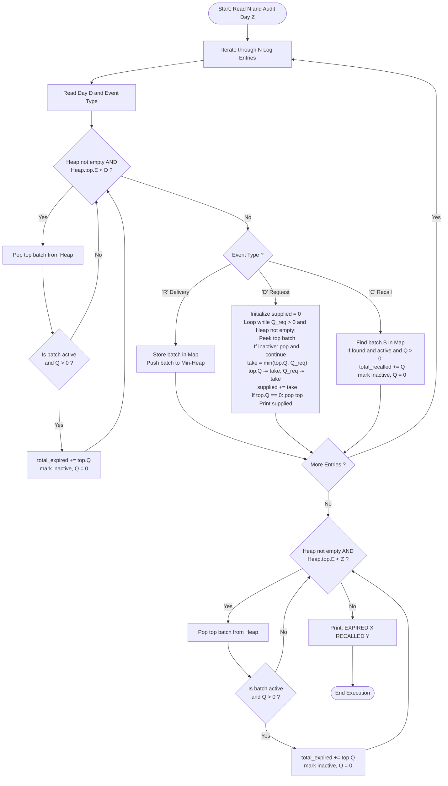

# Unstop Problem of the Day: Shelf Life Ledger

- **Platform:** [Unstop](https://unstop.com/)
- **Difficulty:** Medium
- **Topic Tags:** Priority Queue (Min-Heap), Hash Map, Greedy Algorithms, Lazy Deletion, Simulation, Streaming Event Log
- **Target Audience:** POTD Solvers, Computer Science Students, Competitive Programmers, Technical Interview Preparation (FAANG / Tier-1 Tech)

---

## 1. Problem Statement

Nisha directs the central pharmacy depot at Lakeview District Hospital, managing supply operations for a life-saving temperature-sensitive vaccine. The vaccine arrives in labeled batches. Every batch carries:
1. A unique batch number $B$ ($1 \le B \le 10^9$, delivered at most once).
2. A **last usable day** $E$ ($D \le E \le 10^9$). The batch remains potent throughout day $E$, but spoils and becomes unusable starting on day $E + 1$.
3. An initial quantity of doses $Q$ ($1 \le Q \le 10^9$).

The hospital telemetry log documents three types of sequential chronological events: **Deliveries (`R`)**, **Ward Requests (`D`)**, and **Manufacturer Recalls (`C`)**. The day timestamps $D$ never decrease across consecutive log lines, though multiple events frequently occur on the same day.

### Operational Protocols & Business Rules

#### 1. Pre-Event Expiry Write-Off
Before any event on day $D$ is evaluated, **every batch currently on the shelf whose last usable day is strictly less than $D$ ($E < D$) is already spoiled**.
- All remaining doses in these spoiled batches must immediately be written off as **wasted (expired)** and removed from the active inventory.

#### 2. Ward Request Serving Rule (FEFO: First Expiring, First Out)
When a hospital ward requests $Q$ doses on day $D$:
- The pharmacy dispenses doses starting from the active batch **closest to spoiling** (the one with the minimum $E$ such that $E \ge D$).
- If that batch's remaining stock is insufficient, it is depleted completely, and fulfillment continues from the next closest-to-expiring batch.
- This continues until the request of $Q$ doses is fully satisfied, or until no usable doses remain in the entire pharmacy.
- Any unmet shortfall is **not** carried forward.
- **Output:** Output the exact number of doses actually dispensed for this request on a separate line.

#### 3. Manufacturer Recall Notice
When a recall notice specifies batch number $B$ on day $D$:
- If batch $B$ is currently on the shelf and retains active doses, all of its remaining doses are instantly withdrawn and quarantined.
- These withdrawn doses are tallied under **recalled doses**.
- **Important Invariant:** Doses removed due to a recall are **never** counted as wasted/expired.
- If batch $B$ was never delivered, is already empty, or has already spoiled before day $D$, the notice has no effect.

#### 4. The Final Audit
After all $N$ log entries have been processed, an official audit takes place on an appointed audit day $Z$ ($D_{\text{last}} \le Z$).
- Any batch remaining on the shelf whose last usable day is strictly earlier than $Z$ ($E < Z$) that has not yet been written off is now formally marked as **wasted (expired)**.
- Any batch with $E \ge Z$ remains valid and is neither expired nor recalled.

### Deliverables
1. For every ward request in chronological log order, print the number of doses successfully supplied.
2. After processing all entries and concluding the audit on day $Z$, print a final summary line:
   ```text
   EXPIRED X RECALLED Y
   ```
   where `X` is the grand total of wasted doses and `Y` is the grand total of recalled doses.

---

## 2. Input & Output Formats

### Input Format
- **Line 1:** Two space-separated integers:
  $$N \quad Z$$
  where $N$ is the number of log entries and $Z$ is the audit day.
- **Next $N$ lines:** Each line represents one chronological log entry starting with an integer $D$ (the day), followed by an event character:
  - `D R B E Q`: Delivery of batch $B$ with last usable day $E$ and $Q$ doses.
  - `D D Q`: Ward request for $Q$ doses on day $D$.
  - `D C B`: Recall notice for batch $B$ on day $D$.

### Output Format
- For each ward request (`D D Q`), print a line containing a single integer: the number of doses supplied.
- After all entries, print the final closing audit line:
  ```text
  EXPIRED X RECALLED Y
  ```

### Constraints
- $1 \le N \le 200,000$
- $1 \le D \le 10^9$, with $D$ non-decreasing down the log
- $D \le Z \le 10^9$
- $1 \le B \le 10^9$, each batch number delivered at most once
- $D \le E \le 10^9$, and **all delivered $E$ values are distinct**
- $1 \le Q \le 10^9$

---

## 3. Examples & Detailed Explanations

### Example 1 (Sample Testcase 0)

**Input:**
```text
6 15
1 R 31 6 3
1 R 32 2 5
3 D 4
5 R 33 14 8
8 D 10
9 C 99
```

**Step-by-Step Chronological Walkthrough ($Z = 15$):**

1. **Day 1: `1 R 31 6 3`**
   - Active shelf check: No batches to expire ($E < 1$).
   - Batch $31$ arrives: $E = 6, Q = 3$. Shelf: $\{ (E=6, B=31, Q=3) \}$.
2. **Day 1: `1 R 32 2 5`**
   - Batch $32$ arrives: $E = 2, Q = 5$. Shelf: $\{ (E=2, B=32, Q=5), (E=6, B=31, Q=3) \}$.
3. **Day 3: `3 D 4`**
   - **Pre-event Expiry Check ($E < 3$):**
     - Batch $32$ has $E = 2 < 3$. It is spoiled!
     - Remaining doses in Batch $32$ ($5$) $\implies \text{Total Expired} = 5$.
     - Shelf after eviction: $\{ (E=6, B=31, Q=3) \}$.
   - **Fulfill Ward Request ($Q = 4$):**
     - Earliest expiring batch is $31$ ($E = 6$). Available: $3$.
     - Take $\min(3, 4) = 3$ doses. Batch $31$ is exhausted ($Q = 0$).
     - Remaining request: $4 - 3 = 1$, but shelf is empty!
     - **Output:** `3`
4. **Day 5: `5 R 33 14 8`**
   - Pre-event Expiry: Shelf is empty.
   - Batch $33$ arrives: $E = 14, Q = 8$. Shelf: $\{ (E=14, B=33, Q=8) \}$.
5. **Day 8: `8 D 10`**
   - Pre-event Expiry ($E < 8$): Batch $33$ has $E = 14 \ge 8$. Nothing expires.
   - **Fulfill Ward Request ($Q = 10$):**
     - Earliest expiring batch is $33$ ($E = 14$). Available: $8$.
     - Take $\min(8, 10) = 8$ doses. Batch $33$ is exhausted ($Q = 0$).
     - Remaining request: $2$, shelf empty.
     - **Output:** `8`
6. **Day 9: `9 C 99`**
   - Pre-event Expiry ($E < 9$): Shelf empty.
   - Recall batch $99$: Batch $99$ was never delivered. No effect.
7. **Post-Log Audit on Day $Z = 15$:**
   - Pre-audit Expiry Check ($E < 15$): Shelf empty.

**Final Summary:**
- Wasted: $5$
- Recalled: $0$
- **Output:**
  ```text
  3
  8
  EXPIRED 5 RECALLED 0
  ```

---

### Example 2 (Sample Testcase 1)

**Input:**
```text
9 20
1 R 101 5 10
1 R 102 9 6
2 D 8
3 R 103 4 5
4 D 7
5 R 104 7 4
6 C 102
6 D 3
8 D 20
```

**Step-by-Step Chronological Walkthrough ($Z = 20$):**

1. **Day 1:**
   - Deliver Batch $101$ ($E=5, Q=10$).
   - Deliver Batch $102$ ($E=9, Q=6$).
   - Shelf: $\{ (E=5, B=101, Q=10), (E=9, B=102, Q=6) \}$.
2. **Day 2: Request 8 doses**
   - Minimum $E$ is Batch $101$ ($E=5$). Take $8$ doses $\implies$ Leaves $Q = 2$.
   - **Output:** `8`
3. **Day 3:** Deliver Batch $103$ ($E=4, Q=5$).
   - Shelf: $\{ (E=4, B=103, Q=5), (E=5, B=101, Q=2), (E=9, B=102, Q=6) \}$.
4. **Day 4: Request 7 doses**
   - Minimum $E$ is Batch $103$ ($E=4$). Take $5$ doses $\implies$ Batch $103$ depleted ($Q=0$).
   - Next minimum $E$ is Batch $101$ ($E=5$). Take remaining $2$ doses $\implies$ Batch $101$ depleted ($Q=0$).
   - Total supplied: $5 + 2 = 7$.
   - **Output:** `7`
5. **Day 5:** Deliver Batch $104$ ($E=7, Q=4$).
   - Shelf: $\{ (E=7, B=104, Q=4), (E=9, B=102, Q=6) \}$.
6. **Day 6: Recall Batch 102**
   - Batch $102$ has $Q = 6$ doses remaining.
   - Withdraw $6$ doses $\implies \text{Total Recalled} += 6$, Batch $102$ marked recalled ($Q = 0$).
7. **Day 6: Request 3 doses**
   - Batch $104$ ($E=7$) has $4$ doses. Take $3 \implies$ Leaves $Q = 1$.
   - **Output:** `3`
8. **Day 8: Request 20 doses**
   - **Pre-event Expiry ($E < 8$):**
     - Batch $104$ has $E = 7 < 8$. It is spoiled! Remaining $1$ dose $\implies \text{Total Expired} += 1$.
     - Shelf is now completely empty.
   - Serve request $20$: $0$ usable doses available.
   - **Output:** `0`
9. **Day 20 Audit ($Z = 20$):**
   - Shelf empty $\implies$ no further expirations.

**Final Summary:**
- **Output:**
  ```text
  8
  7
  3
  0
  EXPIRED 1 RECALLED 6
  ```

---

## 4. Mathematical Invariants & Theoretical Foundations

```
========================================================================================
                      FEFO (FIRST EXPIRING, FIRST OUT) INVARIANT
========================================================================================

  At any time D, active inventory is a set of tuples:
         S_D = { (E_i, B_i, Q_i) | E_i >= D, Q_i > 0, not_recalled(B_i) }

  1. Expiry Eviction Invariant:
     All batches with E_i < D are dead upon arrival at day D.
     Because D never decreases, expired batches never become usable again.

  2. Greedy Optimality of FEFO:
     To minimize future waste, always satisfy demand from the batch with:
                   min { E_i | (E_i, B_i, Q_i) in S_D }
========================================================================================
```

### Invariant 1: Total Dose Conservation & 64-Bit Arithmetic
Every dose delivered to the pharmacy depot will eventually end up in exactly one of three mutually exclusive terminal states:
1. **Supplied to a ward** ($\sum \text{supplied}$)
2. **Withdrawn via recall** ($\text{total\_recalled}$)
3. **Discarded due to expiration** ($\text{total\_expired}$)
4. *(Or remaining on shelf if $E \ge Z$)*

Because each batch can contain up to $10^9$ doses and $N \le 200,000$, total doses can reach:
$$\text{Max Doses} = 2 \times 10^5 \times 10^9 = 2 \times 10^{14}$$
This strictly exceeds the 32-bit signed integer boundary ($2^{31} - 1 \approx 2.14 \times 10^9$). All dose quantities, intermediate request subtractions, and accumulation tallies **must be stored in 64-bit signed integers** (`long long` in C/C++, `long` in Java/C#, `BigInt` or standard double in JS).

---

### Invariant 2: Lazy Deletion on Min-Heap
A recall event specifies a batch identifier $B$. Searching a priority queue to remove an arbitrary element takes $\mathcal{O}(K)$ time, degrading overall runtime to $\mathcal{O}(N^2)$.
- **Theorem (Lazy Deletion):**
  Instead of deleting from inside the heap, maintain a hash table of batch records:
  $$\text{batch\_record}[B] = (\text{pointer to batch state})$$
  When a recall for $B$ occurs:
  1. Add its current $Q$ to $\text{total\_recalled}$.
  2. Set its active flag to `false` and $Q = 0$.
  3. When an element is popped or peeked from the top of the min-heap, if it is flagged inactive or has $Q = 0$, simply discard it.
- **Complexity:** Amortized $\mathcal{O}(1)$ for recall, $\mathcal{O}(\log K)$ when the discarded element surfaces at the root of the heap.

---

## 5. System Architecture & Visual Diagrams

```
                       Log Event: (Day D, Type, Args)
                                     │
                                     ▼
                ┌──────────────────────────────────────────┐
                │       Pre-Event Expiry Sweep (E < D)     │
                │   While heap.top.E < D:                  │
                │     top = heap.pop()                     │
                │     if top.active: total_expired += top.Q│
                └────────────────────┬─────────────────────┘
                                     │
                ┌────────────────────┴─────────────────────┐
                │               Route by Type              │
                └──────┬───────────────────┬───────────────┘
                       │                   │               │
            Type == 'R'│        Type == 'D'│    Type == 'C'│
                       ▼                   ▼               ▼
        ┌─────────────────────┐  ┌──────────────────┐  ┌──────────────────┐
        │ Delivery (B, E, Q)  │  │ Ward Request (Q) │  │ Recall (B)       │
        │ 1. Record in Map    │  │ While Q > 0 and  │  │ 1. Look up B     │
        │ 2. heap.push(E, B)  │  │   heap not empty:│  │ 2. If active:    │
        └─────────────────────┘  │     Serve top.Q  │  │      recalled+=Q │
                                 │ Print supplied   │  │      active=false│
                                 └──────────────────┘  └──────────────────┘
```

---

## 6. Step-by-Step Simulation Trace Table

Tracing Sample Testcase 1 ($Z = 20$):

| Step | Day | Event | Heap Top $E$ | Action Details | Doses Supplied | Total Expired | Total Recalled | Active Heap State $\{ (E, Q) \}$ |
| :---: | :---: | :---: | :---: | :---: | :---: | :---: | :---: | :---: |
| **1** | $1$ | `R 101 5 10` | — | Insert batch $101$ | — | $0$ | $0$ | $\{(5, 10)\}$ |
| **2** | $1$ | `R 102 9 6` | $5$ | Insert batch $102$ | — | $0$ | $0$ | $\{(5, 10), (9, 6)\}$ |
| **3** | $2$ | `D 8` | $5$ | Serve $8$ from batch $101$ | **8** | $0$ | $0$ | $\{(5, 2), (9, 6)\}$ |
| **4** | $3$ | `R 103 4 5` | $4$ | Insert batch $103$ | — | $0$ | $0$ | $\{(4, 5), (5, 2), (9, 6)\}$ |
| **5** | $4$ | `D 7` | $4$ | Serve $5$ from $103$ (depleted)<br>Serve $2$ from $101$ (depleted) | **7** | $0$ | $0$ | $\{(9, 6)\}$ |
| **6** | $5$ | `R 104 7 4` | $7$ | Insert batch $104$ | — | $0$ | $0$ | $\{(7, 4), (9, 6)\}$ |
| **7** | $6$ | `C 102` | $7$ | Batch $102$ recalled ($Q=6 \to 0$) | — | $0$ | **6** | $\{(7, 4), (9, 0^*)\}$ |
| **8** | $6$ | `D 3` | $7$ | Serve $3$ from batch $104$ ($Q=4 \to 1$) | **3** | $0$ | $6$ | $\{(7, 1), (9, 0^*)\}$ |
| **9** | $8$ | `D 20` | $7$ | **Expiry Sweep ($E < 8$):**<br>Batch $104$ ($E=7$) expires ($Q=1$)<br>Batch $102$ discarded (recalled)<br>Serve from empty heap | **0** | **1** | $6$ | $\emptyset$ |
| **Audit** | $20$ | Audit Day | — | Heap empty $\implies$ no extra expired | — | **1** | **6** | $\emptyset$ |

---

## 7. Mermaid Flowchart



---

## 8. Algorithmic Progression (From Naive to Pro)

### Method 1: Naive List Scanning ($\mathcal{O}(N^2)$)
- Maintain an unsorted list of all active batches.
- On expiry: linear scan over all batches to find those with $E < D$.
- On request: linear scan to locate the batch with minimum $E \ge D$.
- On recall: linear scan to locate batch with number $B$.
- **Time Complexity:** $\mathcal{O}(N^2) \implies (2 \times 10^5)^2 = 4 \times 10^{10}$ ops $\implies$ **Time Limit Exceeded (TLE)**.

---

### Method 2: Min-Heap + Hash Map with Lazy Deletion ($\mathcal{O}(N \log N)$ Optimal)
- Use a **Min-Heap** prioritized by last usable day $E$.
- Use a **Hash Map** indexed by batch identifier $B$ to access the batch object in $\mathcal{O}(1)$.
- Expiry sweeps simply peek and pop the heap root while $E < D$.
- Requests greedily consume from the heap root.
- Recalls zero out the batch in $\mathcal{O}(1)$ via the hash map; heap handles deletion lazily upon encountering inactive roots.
- **Time Complexity:** $\mathcal{O}(N \log N)$ total time.
- **Space Complexity:** $\mathcal{O}(N)$ memory.

---

## 9. Complexity Comparison Matrix

| Approach | Expiry Sweep | Ward Request | Recall Notice | Total Time ($N = 2 \cdot 10^5$) | Auxiliary Space | Verdict |
| :--- | :---: | :---: | :---: | :---: | :---: | :---: |
| **Method 1: Naive List Scan** | $\mathcal{O}(K)$ | $\mathcal{O}(K)$ | $\mathcal{O}(K)$ | $\mathcal{O}(N^2) \approx 4 \times 10^{10}$ ops | $\mathcal{O}(N)$ | **TLE** |
| **Method 2: Min-Heap + Lazy Deletion** | $\mathcal{O}(\log K)$ amortized | $\mathcal{O}(\log K)$ amortized | $\mathcal{O}(1)$ average | $\mathcal{O}(N \log N) \approx 3.6 \times 10^6$ ops | $\mathcal{O}(N)$ | **Optimal** |

---

## 10. Corner Cases & Defensive Engineering

1. **Batch Expiring on Same Day as Entry ($E = D$):**
   - The problem states: *"A batch is still fine on its last usable day and spoiled from the following day onward."*
   - Therefore, a batch with $E = D$ is **usable** on day $D$. It spoils only when current day becomes strictly greater than $E$ ($D > E \iff E < D$).
2. **Recall of Non-Existent or Already Depleted Batch:**
   - Notice naming a batch that was never delivered, or is already empty/spoiled, must silently change nothing.
3. **Audit Day Expiry Sweep ($Z$):**
   - Batches with $E < Z$ are expired. Batches with $E \ge Z$ remain usable and are **not** expired.
4. **Huge Cumulative Numbers ($2 \cdot 10^{14}$):**
   - Accumulators `totalExpired` and `totalRecalled` must be 64-bit integers.
5. **Multiple Deliveries on Same Day:**
   - Day timestamps never decrease, but multiple deliveries or requests can occur on the same day. The pre-event sweep safely handles repeated days without double-expiring.

---

## 11. Multi-Language Source Code Implementations

### Java (OpenJDK 21.0)

```java
import java.io.*;
import java.util.*;

public class Main {
    static class Batch {
        long b;
        long e;
        long q;
        boolean active;

        Batch(long b, long e, long q) {
            this.b = b;
            this.e = e;
            this.q = q;
            this.active = true;
        }
    }

    // High-performance token reader
    static class FastReader {
        private final InputStream in;
        private final byte[] buffer = new byte[1 << 16];
        private int ptr = 0, len = 0;

        public FastReader(InputStream in) {
            this.in = in;
        }

        private int readByte() {
            if (ptr >= len) {
                ptr = 0;
                try {
                    len = in.read(buffer);
                } catch (IOException e) {
                    return -1;
                }
                if (len <= 0) return -1;
            }
            return buffer[ptr++];
        }

        public String nextToken() {
            int b = readByte();
            while (b <= ' ' && b != -1) b = readByte();
            if (b == -1) return null;
            StringBuilder sb = new StringBuilder();
            while (b > ' ') {
                sb.append((char) b);
                b = readByte();
            }
            return sb.toString();
        }

        public long nextLong() {
            int b = readByte();
            while (b <= ' ' && b != -1) b = readByte();
            if (b == -1) return -1;
            long res = 0;
            while (b >= '0' && b <= '9') {
                res = res * 10 + (b - '0');
                b = readByte();
            }
            return res;
        }

        public int nextInt() {
            return (int) nextLong();
        }
    }

    public static void main(String[] args) throws IOException {
        FastReader scanner = new FastReader(System.in);
        int N = scanner.nextInt();
        if (N <= 0) return;
        long Z = scanner.nextLong();

        // Min-Heap ordered by last usable day E
        PriorityQueue<Batch> heap = new PriorityQueue<>((b1, b2) -> Long.compare(b1.e, b2.e));
        Map<Long, Batch> batchMap = new HashMap<>(N);

        long totalExpired = 0;
        long totalRecalled = 0;
        StringBuilder out = new StringBuilder();

        for (int step = 0; step < N; step++) {
            long day = scanner.nextLong();
            String type = scanner.nextToken();

            // Expire all batches with last usable day E < day
            while (!heap.isEmpty() && heap.peek().e < day) {
                Batch top = heap.poll();
                if (top.active && top.q > 0) {
                    totalExpired += top.q;
                    top.q = 0;
                    top.active = false;
                }
            }

            if ("R".equals(type)) { // Delivery: D R B E Q
                long b = scanner.nextLong();
                long e = scanner.nextLong();
                long q = scanner.nextLong();
                Batch batch = new Batch(b, e, q);
                batchMap.put(b, batch);
                heap.offer(batch);
            } else if ("D".equals(type)) { // Ward Request: D D Q
                long reqQ = scanner.nextLong();
                long supplied = 0;

                while (!heap.isEmpty() && reqQ > 0) {
                    Batch top = heap.peek();
                    if (!top.active || top.q == 0) {
                        heap.poll();
                        continue;
                    }
                    long take = Math.min(top.q, reqQ);
                    top.q -= take;
                    reqQ -= take;
                    supplied += take;

                    if (top.q == 0) {
                        top.active = false;
                        heap.poll();
                    }
                }
                out.append(supplied).append('\n');
            } else if ("C".equals(type)) { // Recall: D C B
                long b = scanner.nextLong();
                Batch batch = batchMap.get(b);
                if (batch != null && batch.active && batch.q > 0) {
                    totalRecalled += batch.q;
                    batch.q = 0;
                    batch.active = false;
                }
            }
        }

        // Final audit sweep on day Z (E < Z)
        while (!heap.isEmpty() && heap.peek().e < Z) {
            Batch top = heap.poll();
            if (top.active && top.q > 0) {
                totalExpired += top.q;
                top.q = 0;
                top.active = false;
            }
        }

        out.append("EXPIRED ").append(totalExpired).append(" RECALLED ").append(totalRecalled).append('\n');
        System.out.print(out);
    }
}
```

---

### Python (3.12.11)

```python
import sys
import heapq

def main():
    input_data = sys.stdin.read().split()
    if not input_data:
        return

    ptr = 0
    N = int(input_data[ptr])
    ptr += 1
    Z = int(input_data[ptr])
    ptr += 1

    heap = []  # Min-heap storing (E, B)
    batches = {}  # B -> [E, Q, active_boolean]

    total_expired = 0
    total_recalled = 0
    output = []

    def expire_batches_before(current_day):
        nonlocal total_expired
        while heap and heap[0][0] < current_day:
            e, b = heapq.heappop(heap)
            if b in batches and batches[b][2]:
                rem_q = batches[b][1]
                if rem_q > 0:
                    total_expired += rem_q
                batches[b][2] = False
                batches[b][1] = 0

    for _ in range(N):
        day = int(input_data[ptr])
        ptr += 1
        op = input_data[ptr]
        ptr += 1

        # Expire batches whose last usable day E < day
        expire_batches_before(day)

        if op == 'R':  # Delivery: D R B E Q
            b = int(input_data[ptr])
            e = int(input_data[ptr + 1])
            q = int(input_data[ptr + 2])
            ptr += 3
            batches[b] = [e, q, True]
            heapq.heappush(heap, (e, b))

        elif op == 'D':  # Ward Request: D D Q
            req_q = int(input_data[ptr])
            ptr += 1
            supplied = 0

            while heap and req_q > 0:
                e, b = heap[0]
                if b not in batches or not batches[b][2] or batches[b][1] == 0:
                    heapq.heappop(heap)
                    continue

                available = batches[b][1]
                take = min(available, req_q)
                batches[b][1] -= take
                req_q -= take
                supplied += take

                if batches[b][1] == 0:
                    batches[b][2] = False
                    heapq.heappop(heap)

            output.append(str(supplied))

        elif op == 'C':  # Recall Notice: D C B
            b = int(input_data[ptr])
            ptr += 1
            if b in batches and batches[b][2]:
                rem_q = batches[b][1]
                if rem_q > 0:
                    total_recalled += rem_q
                batches[b][2] = False
                batches[b][1] = 0

    # Final audit on day Z
    expire_batches_before(Z)

    output.append(f"EXPIRED {total_expired} RECALLED {total_recalled}")
    sys.stdout.write("\n".join(output) + "\n")

if __name__ == '__main__':
    main()
```

---

### C (GCC 13.2.0)

```c
#include <stdio.h>
#include <stdlib.h>
#include <string.h>

#define HASH_SIZE 1048576 // 2^20 power of 2

typedef struct {
    long long b;
    long long e;
    long long q;
    int active;
    int occupied;
} Batch;

static Batch hashTable[HASH_SIZE];

// High-speed 64-bit integer hash mixer
static inline unsigned int hashFunc(long long b) {
    unsigned long long x = (unsigned long long)b;
    x = (x ^ (x >> 30)) * 0xbf58476d1ce4e5b9ULL;
    x = (x ^ (x >> 27)) * 0x94d049bb133111ebULL;
    x = x ^ (x >> 31);
    return (unsigned int)(x & (HASH_SIZE - 1));
}

static Batch* findBatch(long long b) {
    unsigned int idx = hashFunc(b);
    while (hashTable[idx].occupied) {
        if (hashTable[idx].b == b) {
            return &hashTable[idx];
        }
        idx = (idx + 1) & (HASH_SIZE - 1);
    }
    return NULL;
}

static Batch* insertBatch(long long b, long long e, long long q) {
    unsigned int idx = hashFunc(b);
    while (hashTable[idx].occupied) {
        if (hashTable[idx].b == b) {
            hashTable[idx].e = e;
            hashTable[idx].q = q;
            hashTable[idx].active = 1;
            return &hashTable[idx];
        }
        idx = (idx + 1) & (HASH_SIZE - 1);
    }
    hashTable[idx].occupied = 1;
    hashTable[idx].b = b;
    hashTable[idx].e = e;
    hashTable[idx].q = q;
    hashTable[idx].active = 1;
    return &hashTable[idx];
}

// Min-Heap of Batch pointers ordered by expiration date e
static Batch* heap[200005];
static int heapSize = 0;

static void heapPush(Batch* item) {
    int i = ++heapSize;
    while (i > 1 && heap[i / 2]->e > item->e) {
        heap[i] = heap[i / 2];
        i /= 2;
    }
    heap[i] = item;
}

static Batch* heapPop() {
    if (heapSize == 0) return NULL;
    Batch* minItem = heap[1];
    Batch* lastItem = heap[heapSize--];
    int i = 1, child;
    while (i * 2 <= heapSize) {
        child = i * 2;
        if (child + 1 <= heapSize && heap[child + 1]->e < heap[child]->e) {
            child++;
        }
        if (lastItem->e <= heap[child]->e) break;
        heap[i] = heap[child];
        i = child;
    }
    heap[i] = lastItem;
    return minItem;
}

static inline Batch* heapPeek() {
    if (heapSize == 0) return NULL;
    return heap[1];
}

int main() {
    int N;
    long long Z;
    if (scanf("%d %lld", &N, &Z) != 2) return 0;

    long long totalExpired = 0;
    long long totalRecalled = 0;

    for (int step = 0; step < N; step++) {
        long long day;
        char type;
        scanf("%lld %c", &day, &type);

        // Pre-event expiry sweep: expire batches with E < day
        while (heapSize > 0 && heapPeek()->e < day) {
            Batch* top = heapPop();
            if (top->active && top->q > 0) {
                totalExpired += top->q;
                top->q = 0;
                top->active = 0;
            }
        }

        if (type == 'R') { // Delivery: D R B E Q
            long long b, e, q;
            scanf("%lld %lld %lld", &b, &e, &q);
            Batch* batch = insertBatch(b, e, q);
            heapPush(batch);
        } else if (type == 'D') { // Ward Request: D D Q
            long long reqQ;
            scanf("%lld", &reqQ);
            long long supplied = 0;

            while (heapSize > 0 && reqQ > 0) {
                Batch* top = heapPeek();
                if (!top->active || top->q == 0) {
                    heapPop();
                    continue;
                }
                long long take = (top->q < reqQ) ? top->q : reqQ;
                top->q -= take;
                reqQ -= take;
                supplied += take;

                if (top->q == 0) {
                    top->active = 0;
                    heapPop();
                }
            }
            printf("%lld\n", supplied);
        } else if (type == 'C') { // Recall Notice: D C B
            long long b;
            scanf("%lld", &b);
            Batch* batch = findBatch(b);
            if (batch != NULL && batch->active && batch->q > 0) {
                totalRecalled += batch->q;
                batch->q = 0;
                batch->active = 0;
            }
        }
    }

    // Final audit sweep on day Z (E < Z)
    while (heapSize > 0 && heapPeek()->e < Z) {
        Batch* top = heapPop();
        if (top->active && top->q > 0) {
            totalExpired += top->q;
            top->q = 0;
            top->active = 0;
        }
    }

    printf("EXPIRED %lld RECALLED %lld\n", totalExpired, totalRecalled);

    return 0;
}
```

---

### C++ (GCC++ 13.2.0)

```cpp
#include <iostream>
#include <vector>
#include <queue>
#include <unordered_map>
#include <string>
#include <algorithm>

using namespace std;

struct Batch {
    long long b;
    long long e;
    long long q;
    bool active;

    Batch(long long b, long long e, long long q) 
        : b(b), e(e), q(q), active(true) {}
};

struct BatchComparator {
    bool operator()(const Batch* b1, const Batch* b2) const {
        return b1->e > b2->e; // Min-heap: smallest E has highest priority
    }
};

int main() {
    // Fast I/O
    ios_base::sync_with_stdio(false);
    cin.tie(NULL);

    int N;
    long long Z;
    if (!(cin >> N >> Z)) return 0;

    priority_queue<Batch*, vector<Batch*>, BatchComparator> minHeap;
    unordered_map<long long, Batch*> batchMap;
    batchMap.reserve(N * 2);

    long long totalExpired = 0;
    long long totalRecalled = 0;

    for (int step = 0; step < N; step++) {
        long long day;
        char type;
        cin >> day >> type;

        // Expire batches with last usable day E < day
        while (!minHeap.empty() && minHeap.top()->e < day) {
            Batch* top = minHeap.top();
            minHeap.pop();
            if (top->active && top->q > 0) {
                totalExpired += top->q;
                top->q = 0;
                top->active = false;
            }
        }

        if (type == 'R') { // Delivery: D R B E Q
            long long b, e, q;
            cin >> b >> e >> q;
            Batch* batch = new Batch(b, e, q);
            batchMap[b] = batch;
            minHeap.push(batch);
        } else if (type == 'D') { // Ward Request: D D Q
            long long reqQ;
            cin >> reqQ;
            long long supplied = 0;

            while (!minHeap.empty() && reqQ > 0) {
                Batch* top = minHeap.top();
                if (!top->active || top->q == 0) {
                    minHeap.pop();
                    continue;
                }
                long long take = min(top->q, reqQ);
                top->q -= take;
                reqQ -= take;
                supplied += take;

                if (top->q == 0) {
                    top->active = false;
                    minHeap.pop();
                }
            }
            cout << supplied << "\n";
        } else if (type == 'C') { // Recall Notice: D C B
            long long b;
            cin >> b;
            auto it = batchMap.find(b);
            if (it != batchMap.end() && it->second->active && it->second->q > 0) {
                totalRecalled += it->second->q;
                it->second->q = 0;
                it->second->active = false;
            }
        }
    }

    // Final audit sweep on day Z (E < Z)
    while (!minHeap.empty() && minHeap.top()->e < Z) {
        Batch* top = minHeap.top();
        minHeap.pop();
        if (top->active && top->q > 0) {
            totalExpired += top->q;
            top->q = 0;
            top->active = false;
        }
    }

    cout << "EXPIRED " << totalExpired << " RECALLED " << totalRecalled << "\n";

    return 0;
}
```

---

### C# (mcs 5.4.0.201)

```csharp
using System;
using System.Collections.Generic;
using System.IO;
using System.Text;

class Solution {
    class Batch {
        public long b;
        public long e;
        public long q;
        public bool active;

        public Batch(long b, long e, long q) {
            this.b = b;
            this.e = e;
            this.q = q;
            this.active = true;
        }
    }

    // Custom Min-Heap for maximum performance
    class MinHeap {
        private Batch[] data;
        public int Count { get; private set; }

        public MinHeap(int capacity) {
            data = new Batch[capacity + 1];
            Count = 0;
        }

        public void Push(Batch item) {
            int i = ++Count;
            while (i > 1 && data[i / 2].e > item.e) {
                data[i] = data[i / 2];
                i /= 2;
            }
            data[i] = item;
        }

        public Batch Pop() {
            if (Count == 0) return null;
            Batch min = data[1];
            Batch last = data[Count--];
            int i = 1, child;
            while (i * 2 <= Count) {
                child = i * 2;
                if (child + 1 <= Count && data[child + 1].e < data[child].e) {
                    child++;
                }
                if (last.e <= data[child].e) break;
                data[i] = data[child];
                i = child;
            }
            data[i] = last;
            return min;
        }

        public Batch Peek() {
            return Count > 0 ? data[1] : null;
        }
    }

    static void Main(string[] args) {
        using (var reader = new StreamReader(Console.OpenStandardInput(), Encoding.UTF8, false, 1 << 16)) {
            string content = reader.ReadToEnd();
            if (string.IsNullOrWhiteSpace(content)) return;

            string[] tokens = content.Split(new char[] { ' ', '\t', '\r', '\n' }, StringSplitOptions.RemoveEmptyEntries);
            if (tokens.Length < 2) return;

            int ptr = 0;
            int N = int.Parse(tokens[ptr++]);
            long Z = long.Parse(tokens[ptr++]);

            MinHeap heap = new MinHeap(N + 5);
            Dictionary<long, Batch> batchMap = new Dictionary<long, Batch>(N);

            long totalExpired = 0;
            long totalRecalled = 0;
            StringBuilder sb = new StringBuilder();

            for (int step = 0; step < N; step++) {
                long day = long.Parse(tokens[ptr++]);
                string type = tokens[ptr++];

                // Expire batches before current day (E < day)
                while (heap.Count > 0 && heap.Peek().e < day) {
                    Batch top = heap.Pop();
                    if (top.active && top.q > 0) {
                        totalExpired += top.q;
                        top.q = 0;
                        top.active = false;
                    }
                }

                if (type == "R") { // Delivery: D R B E Q
                    long b = long.Parse(tokens[ptr++]);
                    long e = long.Parse(tokens[ptr++]);
                    long q = long.Parse(tokens[ptr++]);
                    Batch batch = new Batch(b, e, q);
                    batchMap[b] = batch;
                    heap.Push(batch);
                } else if (type == "D") { // Ward Request: D D Q
                    long reqQ = long.Parse(tokens[ptr++]);
                    long supplied = 0;

                    while (heap.Count > 0 && reqQ > 0) {
                        Batch top = heap.Peek();
                        if (!top.active || top.q == 0) {
                            heap.Pop();
                            continue;
                        }
                        long take = Math.Min(top.q, reqQ);
                        top.q -= take;
                        reqQ -= take;
                        supplied += take;

                        if (top.q == 0) {
                            top.active = false;
                            heap.Pop();
                        }
                    }
                    sb.Append(supplied).Append('\n');
                } else if (type == "C") { // Recall Notice: D C B
                    long b = long.Parse(tokens[ptr++]);
                    if (batchMap.TryGetValue(b, out Batch batch) && batch.active && batch.q > 0) {
                        totalRecalled += batch.q;
                        batch.q = 0;
                        batch.active = false;
                    }
                }
            }

            // Final audit sweep on day Z (E < Z)
            while (heap.Count > 0 && heap.Peek().e < Z) {
                Batch top = heap.Pop();
                if (top.active && top.q > 0) {
                    totalExpired += top.q;
                    top.q = 0;
                    top.active = false;
                }
            }

            sb.Append("EXPIRED ").Append(totalExpired).Append(" RECALLED ").Append(totalRecalled).Append('\n');
            Console.Write(sb.ToString());
        }
    }
}
```

---

### JavaScript (Node 24.4.1)

```javascript
function processData(input) {
    const tokens = input.trim().split(/\s+/);
    if (!tokens || tokens.length < 2) return;

    let ptr = 0;
    const N = parseInt(tokens[ptr++], 10);
    const Z = BigInt(tokens[ptr++]);

    // Priority Queue (Binary Min-Heap)
    class MinHeap {
        constructor() {
            this.heap = [];
        }

        push(item) {
            this.heap.push(item);
            this._up(this.heap.length - 1);
        }

        pop() {
            if (this.heap.length === 0) return null;
            const top = this.heap[0];
            const bottom = this.heap.pop();
            if (this.heap.length > 0) {
                this.heap[0] = bottom;
                this._down(0);
            }
            return top;
        }

        peek() {
            return this.heap.length > 0 ? this.heap[0] : null;
        }

        get size() {
            return this.heap.length;
        }

        _up(i) {
            while (i > 0) {
                const parent = (i - 1) >> 1;
                if (this.heap[i].e < this.heap[parent].e) {
                    const temp = this.heap[i];
                    this.heap[i] = this.heap[parent];
                    this.heap[parent] = temp;
                    i = parent;
                } else break;
            }
        }

        _down(i) {
            const n = this.heap.length;
            while ((i << 1) + 1 < n) {
                let left = (i << 1) + 1;
                let right = left + 1;
                let smallest = left;
                if (right < n && this.heap[right].e < this.heap[left].e) {
                    smallest = right;
                }
                if (this.heap[smallest].e < this.heap[i].e) {
                    const temp = this.heap[i];
                    this.heap[i] = this.heap[smallest];
                    this.heap[smallest] = temp;
                    i = smallest;
                } else break;
            }
        }
    }

    const heap = new MinHeap();
    const batchMap = new Map();

    let totalExpired = 0n;
    let totalRecalled = 0n;
    const result = [];

    function expireBatchesBefore(currentDay) {
        while (heap.size > 0 && heap.peek().e < currentDay) {
            const top = heap.pop();
            if (top.active && top.q > 0n) {
                totalExpired += top.q;
                top.q = 0n;
                top.active = false;
            }
        }
    }

    for (let step = 0; step < N; step++) {
        const day = BigInt(tokens[ptr++]);
        const type = tokens[ptr++];

        // Pre-event expiry sweep: expire batches with E < day
        expireBatchesBefore(day);

        if (type === 'R') { // Delivery: D R B E Q
            const b = tokens[ptr++];
            const e = BigInt(tokens[ptr++]);
            const q = BigInt(tokens[ptr++]);
            const batch = { b, e, q, active: true };
            batchMap.set(b, batch);
            heap.push(batch);
        } else if (type === 'D') { // Ward Request: D D Q
            let reqQ = BigInt(tokens[ptr++]);
            let supplied = 0n;

            while (heap.size > 0 && reqQ > 0n) {
                const top = heap.peek();
                if (!top.active || top.q === 0n) {
                    heap.pop();
                    continue;
                }
                const take = top.q < reqQ ? top.q : reqQ;
                top.q -= take;
                reqQ -= take;
                supplied += take;

                if (top.q === 0n) {
                    top.active = false;
                    heap.pop();
                }
            }
            result.push(supplied.toString());
        } else if (type === 'C') { // Recall Notice: D C B
            const b = tokens[ptr++];
            const batch = batchMap.get(b);
            if (batch && batch.active && batch.q > 0n) {
                totalRecalled += batch.q;
                batch.q = 0n;
                batch.active = false;
            }
        }
    }

    // Final audit sweep on day Z (E < Z)
    expireBatchesBefore(Z);

    result.push(`EXPIRED ${totalExpired.toString()} RECALLED ${totalRecalled.toString()}`);
    console.log(result.join('\n'));
}

process.stdin.resume();
process.stdin.setEncoding("ascii");
let _input = "";
process.stdin.on("data", function (input) {
    _input += input;
});

process.stdin.on("end", function () {
   processData(_input);
});
```

---

## 12. Key Takeaways & Interview Cheat-Sheet

1. **First-Expiring-First-Out (FEFO) Greedy Strategy:**
   - Always prioritize consuming from the batch with the earliest expiration date ($\min E$).
   - A Min-Priority Queue naturally maintains the minimum element in $\mathcal{O}(1)$ peek and $\mathcal{O}(\log K)$ updates.
2. **Pre-Event Expiry Synchronization:**
   - In time-stepped simulation problems where entities expire over time, always execute the **expiry sweep before** serving requests on that day.
   - Condition: A batch is spoiled if and only if $E < \text{current\_day}$. (If $E = \text{current\_day}$, it remains fine!).
3. **Lazy Deletion for O(1) Recalls:**
   - Instead of removing elements from the middle of a heap ($\mathcal{O}(K)$), use a status flag / pointer (`active = false`, `q = 0`).
   - Clean up expired and recalled nodes lazily when they surface at the top of the heap.
4. **Audit Step Post-Processing:**
   - Do not forget the final sweep: all unserved batches with $E < Z$ on audit day $Z$ must be counted into `totalExpired`.
5. **64-Bit Integer Arithmetic:**
   - $200,000 \times 10^9 = 2 \times 10^{14}$ maximum doses. Standard 32-bit integers will overflow into negative numbers. Always use 64-bit integer types (`long long` / `long` / `BigInt`).
