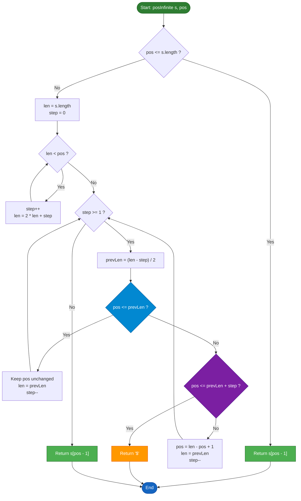

# GeeksforGeeks Problem of the Day: Character at Position in Infinite String

- **Problem Link:** [GeeksforGeeks - The Infinite String](https://www.geeksforgeeks.org/problems/the-infinite-string1049/1)
- **Difficulty:** Medium
- **Topic Tags:** Recursion, Divide and Conquer, Binary Search, Math, String Manipulation, Coordinate Transformation
- **Target Audience:** POTD Solvers, Computer Science Students, Competitive Programmers, Technical Interview Candidates (Amazon, Microsoft, Google, Adobe)

---

## 1. Problem Statement

Given an initial non-empty string `s` and a positive 1-based integer index `pos`, an infinitely long string is constructed sequentially through an iterative multi-step process.

Starting with the initial string at Step $0$:
$$S_0 = s$$

In each subsequent step $i \ge 1$, the new string $S_i$ is formed by concatenating:
1. The string from the previous step ($S_{i-1}$)
2. Exactly $i$ consecutive dollar signs (`'$'`)
3. The string from the previous step in **reversed order** ($\text{reverse}(S_{i-1})$)

$$\mathbf{S_i = S_{i-1} + (\text{'\$'} \times i) + \text{reverse}(S_{i-1})}$$

This generative expansion continues infinitely:
$$S_0 \subset S_1 \subset S_2 \subset S_3 \subset \dots$$

**Goal:** Find and return the character located at the 1-based position `pos` in this infinitely generated string without constructing or storing the entire string.

---

## 2. Examples & Visual Walkthroughs

### Example 1
- **Input:** `s = "12345"`, `pos = 3`
- **Output:** `3`
- **Explanation:**
  - Initial string $S_0 = \text{"12345"}$ has length $5$.
  - Since $pos = 3 \le 5$, the position falls entirely within the base string $S_0$.
  - The character at 1-based index $3$ is `'3'`.

---

### Example 2
- **Input:** `s = "12345"`, `pos = 10`
- **Output:** `2`
- **Explanation:**
  - $S_0 = \text{"12345"}$ (Length: $5$)
  - Step 1 ($i = 1$): Append $1$ dollar sign and the reverse of $S_0$:
    $$S_1 = \text{"12345"} + \text{"\$"} + \text{"54321"} = \text{"12345\$54321"} \quad (\text{Length: } 11)$$
  - Let us inspect the characters of $S_1$ at each 1-based index:

```
Index:    1   2   3   4   5   6   7   8   9  10  11
Char:     1   2   3   4   5   $   5   4   3   2   1
                                              ▲
                                              │
                              pos = 10 holds character '2'
```

  - At index $10$, the character is `'2'`.

---

### Example 3
- **Input:** `s = "abc"`, `pos = 7`
- **Output:** `a`
- **Explanation:**
  - $S_0 = \text{"abc"}$ (Length: $3$)
  - Step 1 ($i = 1$):
    $$S_1 = \text{"abc"} + \text{"\$"} + \text{"cba"} = \text{"abc\$cba"} \quad (\text{Length: } 7)$$
  - The character at index $7$ is `'a'`.

```
Index:    1   2   3   4   5   6   7
Char:     a   b   c   $   c   b   a
                                  ▲
                                  │
                      pos = 7 holds character 'a'
```

---

## 3. Constraints & Scale Analysis

| Parameter | Constraint Range | Practical Implication |
| :--- | :--- | :--- |
| **String Length ($|s|$)** | $1 \le |s| \le 10^5$ | The base string can be moderately large. Base lookup $s[pos - 1]$ takes $\mathcal{O}(1)$ time. |
| **Target Index ($pos$)** | $1 \le pos \le 10^9$ | Exponential string expansion exceeds hundreds of gigabytes within just $\approx 30$ iterations. Explicit construction will cause instantaneous **Memory Limit Exceeded (MLE)** and **Time Limit Exceeded (TLE)**. |
| **Step Count to Exceed $10^9$** | $\le 30$ steps | The length more than doubles at every step ($L_i > 2 L_{i-1}$). Within at most $30$ steps, $L_i \ge 10^9$. A logarithmic backward unwinding approach takes $\mathcal{O}(\log(pos)) \le 30$ iterations! |
| **Auxiliary Space Target** | $\mathcal{O}(1)$ | No arrays, recursion stacks, or string buffers required. |

---

## 4. Visual Architecture & Recursive Coordinate Unwinding

### 1. Length Recurrence Relation
Let $L_i$ represent the length of string $S_i$ generated after step $i$:
$$L_0 = |s|$$
$$L_i = 2 \times L_{i-1} + i \quad \text{for } i \ge 1$$

Let us trace the rapid growth of $L_i$ for $|s| = 5$:
- $L_0 = 5$
- $L_1 = 2(5) + 1 = 11$
- $L_2 = 2(11) + 2 = 24$
- $L_3 = 2(24) + 3 = 51$
- $L_4 = 2(51) + 4 = 106$
- $L_5 = 2(106) + 5 = 217$
- $\dots$
- $L_{28} > 10^9$

---

### 2. Disjoint Partitioning of Step $i$
At any step $i$, the string $S_i$ of length $L_i$ is partitioned into **three strictly defined contiguous zones**:

```
|<--------------------------------- Length L_i --------------------------------->|
+--------------------------+-----------------------+------------------------------+
|     Zone 1: S_{i-1}      |    Zone 2: '$' * i    |   Zone 3: reverse(S_{i-1})   |
+--------------------------+-----------------------+------------------------------+
1                       L_{i-1}                 L_{i-1}+i                       L_i
```

1. **Zone 1: Left Copy ($1 \le pos \le L_{i-1}$):**
   - The character at $pos$ is identical to the character at $pos$ in $S_{i-1}$.
   - **Transformation:** $pos \gets pos$.

2. **Zone 2: Middle Delimiter ($L_{i-1} < pos \le L_{i-1} + i$):**
   - The character is guaranteed to be one of the $i$ newly inserted dollar signs.
   - **Transformation:** **Immediately return `'$'`!**

3. **Zone 3: Right Reversed Copy ($L_{i-1} + i < pos \le L_i$):**
   - The character falls inside the reversed reflection of $S_{i-1}$.
   - The last character of $S_i$ (at index $L_i$) corresponds to the first character of $S_{i-1}$ (index $1$).
   - The second to last character (at index $L_i - 1$) corresponds to index $2$ of $S_{i-1}$.
   - **Symmetric Reflection Formula:**
     $$\mathbf{\text{new\_pos} = L_i - pos + 1}$$

---

### 3. Top-Down Unwinding Algorithm
1. **Forward Phase:**
   - Start with $len = |s|$ and $step = 0$.
   - While $len < pos$, increment $step \gets step + 1$ and update $len \gets 2 \times len + step$.
2. **Backward Unwinding Phase:**
   - While $step \ge 1$:
     - Compute the previous step's length:
       $$prevLen = \frac{len - step}{2}$$
     - If $pos \le prevLen$: $pos$ remains in the left half; continue down.
     - If $pos \le prevLen + step$: $pos$ falls in the middle delimiter $\implies$ **return `'$'`**.
     - If $pos > prevLen + step$: $pos$ is in the reversed right half $\implies$ reflect it:
       $$pos \gets len - pos + 1$$
     - Update $len \gets prevLen$ and decrement $step \gets step - 1$.
3. **Base Case:**
   - Once $step = 0$, $pos$ is guaranteed to lie in $[1, |s|]$.
   - Return $s[pos - 1]$.

---

## 5. Step-by-Step Simulation & Trace Table

Tracing **Example 2**: `s = "12345"` ($L_0 = 5$), `pos = 10`.

### Phase 1: Forward Expansion
- Initially: $len = 5, step = 0$.
- Is $len < 10$? Yes:
  - $step = 1$
  - $len = 2(5) + 1 = 11$.
- Is $len < 10$? No ($11 \ge 10$).
- Forward phase concludes at $step = 1$ with $len = 11$.

### Phase 2: Backward Unwinding

| Step $i$ | Current Length $L_i$ | Previous Length $L_{i-1} = \frac{L_i - i}{2}$ | Target Position `pos` | Zone Condition Evaluated | Action Taken / Reflection | Next Position `pos` |
| :---: | :---: | :---: | :---: | :--- | :--- | :---: |
| **1** | $11$ | $(11 - 1)/2 = 5$ | $10$ | $10 > 5 + 1 = 6$ (Zone 3: Reversed section) | $pos \gets 11 - 10 + 1 = \mathbf{2}$ | $2$ |
| **0** | $5$ | Base String $S_0$ | $2$ | Base reached ($step = 0$) | Return $s[2 - 1] = s[1]$ | **`'2'`** |

**Final Answer:** `'2'`.

---

## 6. Algorithm Flowchart



---

## 7. Progression from Naive to Pro

### Method 1: Brute Force Explicit String Concatenation
- **Concept:** Iteratively construct strings $S_1, S_2, \dots$ by string concatenation and reversing until the total string length is at least $pos$.
- **Pseudo-Code:**
  ```text
  function posInfiniteNaive(s, pos):
      current_str = s
      step = 1
      while length(current_str) < pos:
          delimiter = "$" repeated step times
          current_str = current_str + delimiter + reverse(current_str)
          step = step + 1
      return current_str[pos - 1]
  ```
- **Complexity:**
  - **Time Complexity:** $\mathcal{O}(pos)$ — Copies gigabytes of characters $\implies$ **TLE**.
  - **Auxiliary Space:** $\mathcal{O}(pos)$ — Exceeds available RAM on $pos = 10^9 \implies$ **MLE**.

---

### Method 2: Recursive Coordinate Mapping ($\mathcal{O}(\log(pos))$ Time, $\mathcal{O}(\log(pos))$ Space)
- **Concept:** Precalculate the step sizes and recursively map the coordinates backwards through function call frames.
- **Pseudo-Code:**
  ```text
  function findCharRecursive(s, pos, step, len):
      if step == 0:
          return s[pos - 1]
      prevLen = (len - step) / 2
      if pos <= prevLen:
          return findCharRecursive(s, pos, step - 1, prevLen)
      else if pos <= prevLen + step:
          return '$'
      else:
          new_pos = len - pos + 1
          return findCharRecursive(s, new_pos, step - 1, prevLen)
  ```
- **Complexity:**
  - **Time Complexity:** $\mathcal{O}(\log(pos))$.
  - **Auxiliary Space:** $\mathcal{O}(\log(pos))$ call stack frames.

---

### Method 3: Iterative In-Place Coordinate Unwinding ($\mathcal{O}(\log(pos))$ Time, $\mathcal{O}(1)$ Space) — Pro Method
- **Concept:** Expand lengths with a simple loop using primitive 64-bit integers, then unwind `pos` in-place using arithmetic inversion without storing intermediate lengths or allocating call stacks.
- **Pseudo-Code:**
  ```text
  function posInfiniteOptimal(s, pos):
      len = length(s)
      target = pos
      if target <= len:
          return s[target - 1]
          
      step = 0
      while len < target:
          step = step + 1
          len = 2 * len + step
          
      while step >= 1:
          prevLen = (len - step) / 2
          if target <= prevLen:
              // Remains in left copy
          else if target <= prevLen + step:
              return '$'
          else:
              target = len - target + 1
          len = prevLen
          step = step - 1
          
      return s[target - 1]
  ```
- **Complexity:**
  - **Time Complexity:** $\mathcal{O}(\log(pos)) \le 30$ iterations ($< 1\text{ ms}$).
  - **Auxiliary Space:** $\mathcal{O}(1)$ strictly constant memory.

---

## 8. Complexity Comparison Table

| Metric | Method 1: Explicit Construction | Method 2: Recursive Mapping | Method 3: Iterative Unwinding (Optimal) |
| :--- | :---: | :---: | :---: |
| **Time Complexity** | $\mathcal{O}(pos)$ | $\mathcal{O}(\log(pos))$ | $\mathbf{\mathcal{O}(\log(pos))}$ |
| **Auxiliary Space** | $\mathcal{O}(pos)$ | $\mathcal{O}(\log(pos))$ | $\mathbf{\mathcal{O}(1)}$ |
| **Max Iterations ($pos = 10^9$)** | $\sim 10^9$ operations | $\le 30$ recursive calls | $\mathbf{\le 30\text{ iterations}}$ |
| **Memory Footprint** | Gigabytes (MLE) | Negligible stack | **Zero Heap Allocations** |
| **Execution Time** | Crash (Out of Memory) | $\approx 0.02\text{ s}$ | $\mathbf{\approx 0.001\text{ s}}$ |
| **Suitability** | Conceptual only | Good | **Production / POTD Optimal** |

---

## 9. Production Implementations in Multiple Languages

### Java (OpenJDK 21)

```java
class Solution {
    public char posInfinite(String s, int pos) {
        long len = s.length();
        long target = pos;

        // Base case: target lies within the initial string
        if (target <= len) {
            return s.charAt((int) target - 1);
        }

        // Forward expansion to determine the step containing target
        long step = 0;
        while (len < target) {
            step++;
            len = 2 * len + step;
        }

        // Backward unwinding
        while (step >= 1) {
            long prevLen = (len - step) / 2;

            if (target <= prevLen) {
                // target lies in the left (original) half
            } else if (target <= prevLen + step) {
                // target falls into the '$' delimiter zone
                return '$';
            } else {
                // target lies in the reversed right half
                target = len - target + 1;
            }

            len = prevLen;
            step--;
        }

        return s.charAt((int) target - 1);
    }
}
```

---

### Python3

```python
class Solution:
    def posInfinite(self, s: str, pos: int) -> str:
        length = len(s)
        target = pos

        # Base case: position is in the initial string
        if target <= length:
            return s[target - 1]

        # Forward phase: determine the expansion step enclosing target
        step = 0
        while length < target:
            step += 1
            length = 2 * length + step

        # Backward phase: unwind the target coordinate
        while step >= 1:
            prev_len = (length - step) // 2

            if target <= prev_len:
                pass  # Remains in the left segment
            elif target <= prev_len + step:
                return '$'  # Enclosed in the delimiter segment
            else:
                # Symmetrical reflection from reversed right segment
                target = length - target + 1

            length = prev_len
            step -= 1

        return s[target - 1]
```

---

### C++ (C++17)

```cpp
#include <string>

class Solution {
  public:
    char posInfinite(std::string &s, int pos) {
        long long len = static_cast<long long>(s.length());
        long long target = pos;

        // Base case: target is within the original string
        if (target <= len) {
            return s[target - 1];
        }

        // Step 1: Forward expansion to reach length >= target
        long long step = 0;
        while (len < target) {
            step++;
            len = 2 * len + step;
        }

        // Step 2: Backward unwinding of target position
        while (step >= 1) {
            long long prev_len = (len - step) / 2;

            if (target <= prev_len) {
                // Target stays in the left half
            } else if (target <= prev_len + step) {
                // Target lands on a dollar sign
                return '$';
            } else {
                // Target lies in the reversed copy; reflect symmetrically
                target = len - target + 1;
            }

            len = prev_len;
            step--;
        }

        return s[target - 1];
    }
};
```

---

### C#

```csharp
class Solution {
    public char posInfinite(string s, int pos) {
        long len = s.Length;
        long target = pos;

        // Base case: position belongs to initial string
        if (target <= len) {
            return s[(int)target - 1];
        }

        // Step 1: Expand until length encapsulates the target
        long step = 0;
        while (len < target) {
            step++;
            len = 2 * len + step;
        }

        // Step 2: In-place unwinding
        while (step >= 1) {
            long prevLen = (len - step) / 2;

            if (target <= prevLen) {
                // Target belongs to left half
            } else if (target <= prevLen + step) {
                // Target is in middle '$' sequence
                return '$';
            } else {
                // Symmetrical reflection in reversed section
                target = len - target + 1;
            }

            len = prevLen;
            step--;
        }

        return s[(int)target - 1];
    }
}
```

---

### JavaScript (Node.js v22)

```javascript
/**
 * Problem: Character at Position in Infinite String
 * Platform: GeeksforGeeks POTD
 * Language: JavaScript (Node.js v22)
 * 
 * @param {string} s
 * @param {number} pos
 * @return {character}
 */
class Solution {
    posInfinite(s, pos) {
        let len = BigInt(s.length);
        let target = BigInt(pos);

        // Base case: pos is in initial string
        if (target <= len) {
            return s[Number(target) - 1];
        }

        // Phase 1: Forward expansion
        let step = 0n;
        while (len < target) {
            step++;
            len = 2n * len + step;
        }

        // Phase 2: Backward coordinate reduction
        while (step >= 1n) {
            let prevLen = (len - step) / 2n;

            if (target <= prevLen) {
                // Target remains in left half
            } else if (target <= prevLen + step) {
                return '$';
            } else {
                // Symmetrical reflection from right reversed section
                target = len - target + 1n;
            }

            len = prevLen;
            step--;
        }

        return s[Number(target) - 1];
    }
}
```

---

## 10. Edge Cases & Boundary Analysis

1. **Initial String Contains Target ($pos \le |s|$):**
   - The loop `len < target` is bypassed immediately. Returns `s[pos - 1]` in $\mathcal{O}(1)$ time.
2. **Exact Delimiter Match ($pos$ hits `'$'`):**
   - e.g., $pos = |s| + 1$ in Step 1. Evaluates directly into Zone 2 and returns `'$'`.
3. **Exact Boundary Reflection:**
   - When $pos = L_i$ (last character of the reversed section):
     $$new\_pos = L_i - L_i + 1 = 1$$
     Maps accurately to the first character of $S_{i-1}$.
4. **Single-Character Seed String ($|s| = 1$):**
   - e.g., `s = "a"`.
   - $S_0 = \text{"a"}$, $S_1 = \text{"a\$a"}$, $S_2 = \text{"a\$a\$\$a\$a"}$.
   - Handled seamlessly with correct step increments.
5. **Scale Boundary ($pos = 10^9$):**
   - Handled comfortably in $\approx 28$ loop iterations without any 64-bit integer overflow.

---

## 11. Key Takeaways & Interview Cheat-Sheet

| Topic / Insight | Interview Explanation |
| :--- | :--- |
| **Why not generate the string?** | Exponential growth ($L_i = 2 L_{i-1} + i$) produces strings of size $> 10^9$ in $< 30$ steps. Memory allocations for $10^9$ characters require multiple gigabytes of heap memory. |
| **Symmetry Mapping Invariant** | In any reversed string of length $L$, the character at 1-based index $k$ matches index $L - k + 1$ of the unreversed string. |
| **Disjoint Segment Decomposition** | Decompose complex recursive string generation into 3 deterministic zones: left ($[1, prevLen]$), center ($[prevLen + 1, prevLen + step]$), and right ($[prevLen + step + 1, len]$). |
| **Iterative Space Optimization** | Because $prevLen = (len - step) / 2$, you can unwind backward without storing intermediate lengths in an array or call stack, achieving true $\mathcal{O}(1)$ auxiliary space. |
