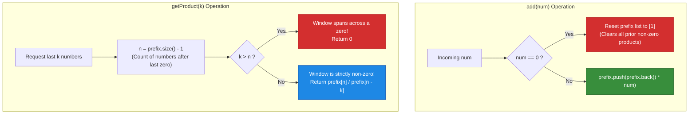
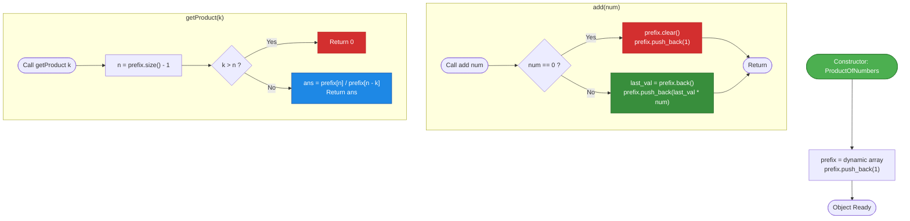

# LeetCode Problem of the Day: Product of the Last K Numbers

- **Problem Link:** [LeetCode 1352 - Product of the Last K Numbers](https://leetcode.com/problems/product-of-the-last-k-numbers/description/)
- **Difficulty:** Medium
- **Topic Tags:** Array, Math, Design, Data Stream, Prefix Product
- **Target Audience:** POTD Solvers, Computer Science Students, Competitive Programmers, Technical Interview Candidates (Google, Amazon, Meta, Microsoft, Apple)

---

## 1. Problem Statement

Design an algorithm that accepts a stream of integers and retrieves the product of the last $k$ integers of the stream dynamically.

Implement the `ProductOfNumbers` class:

1. `ProductOfNumbers()`: Initializes the object with an empty stream.
2. `void add(int num)`: Appends the integer `num` to the end of the stream ($0 \le num \le 100$).
3. `int getProduct(int k)`: Returns the product of the last $k$ numbers in the current list ($1 \le k \le \text{current stream size}$).

### Guarantee
The test cases are generated such that, at any given time, the product of any contiguous sequence of numbers will strictly fit into a single **32-bit signed integer** without overflowing ($< 2^{31} - 1$).

---

## 2. Examples & Visual Walkthroughs

### Example 1

#### Input:
```text
["ProductOfNumbers", "add", "add", "add", "add", "add", "getProduct", "getProduct", "getProduct", "add", "getProduct"]
[[], [3], [0], [2], [5], [4], [2], [3], [4], [8], [2]]
```

#### Output:
```text
[null, null, null, null, null, null, 20, 40, 0, null, 32]
```

#### Step-by-Step Chronological Execution:

```
Operation             Stream State           Prefix Product Array      Explanation / Return
──────────────────────────────────────────────────────────────────────────────────────────────
ProductOfNumbers()    []                     [1]                       Initialize with base 1
add(3)                [3]                    [1, 3]                    3 appended
add(0)                [3, 0]                 [1]                       ZERO ENCOUNTERED! Reset to [1]
add(2)                [3, 0, 2]              [1, 2]                    Non-zero 2 appended
add(5)                [3, 0, 2, 5]           [1, 2, 10]                2 * 5 = 10
add(4)                [3, 0, 2, 5, 4]        [1, 2, 10, 40]            10 * 4 = 40
getProduct(2)         [3, 0, 2, 5, 4]        [1, 2, 10, 40]            Last 2: 5 * 4 = 20
                                                                       Formula: 40 / 2 = 20
getProduct(3)         [3, 0, 2, 5, 4]        [1, 2, 10, 40]            Last 3: 2 * 5 * 4 = 40
                                                                       Formula: 40 / 1 = 40
getProduct(4)         [3, 0, 2, 5, 4]        [1, 2, 10, 40]            Last 4 includes 0! (k > count)
                                                                       Return 0 directly
add(8)                [3, 0, 2, 5, 4, 8]     [1, 2, 10, 40, 320]       40 * 8 = 320
getProduct(2)         [3, 0, 2, 5, 4, 8]     [1, 2, 10, 40, 320]       Last 2: 4 * 8 = 32
                                                                       Formula: 320 / 10 = 32
```

---

## 3. Constraints & Scale Analysis

| Parameter | Constraint Range | Algorithmic Implications |
| :--- | :--- | :--- |
| **Number of Operations ($Q$)** | Up to $4 \times 10^4$ total calls | A naive $\mathcal{O}(k)$ approach multiplying backwards takes up to $4 \times 10^4 \times 4 \times 10^4 \approx 1.6 \times 10^9$ operations $\implies$ **Time Limit Exceeded (TLE)**. Both `add` and `getProduct` must execute in strictly $\mathcal{O}(1)$ time. |
| **Stream Element Value ($num$)** | $0 \le num \le 100$ | Includes **zero ($0$)**. Zero acts as an absorbing element in multiplication ($x \times 0 = 0$) and destroys cumulative prefix products. |
| **Window Length ($k$)** | $1 \le k \le \text{stream size}$ | Can encompass the entire stream or cross past zero boundaries. |
| **Product Value Limit** | Fits in 32-bit integer | No BigInteger arithmetic required; standard 32-bit signed integer types (`int`) suffice. |

---

## 4. Visual Architecture & The Zero-Reset Invariant

### 1. The Core Prefix Product Concept
In a stream of non-zero positive numbers $[x_1, x_2, \dots, x_n]$, the cumulative prefix product array $P$ is defined as:
$$P[0] = 1, \quad P[i] = P[i - 1] \times x_i$$

To query the product of the last $k$ numbers (spanning from index $n - k + 1$ to $n$):
$$\prod_{j=n-k+1}^{n} x_j = \frac{P[n]}{P[n - k]}$$

This allows answering any range product query in exact $\mathbf{\mathcal{O}(1)}$ division time!

```
Stream:                  x_1      x_2      x_3      x_4      x_5
Prefix Product:  P[0]=1  P[1]     P[2]     P[3]     P[4]     P[5]
                         |-------- Prefix P[5-3] -----|
                         |----------------- Total Prefix P[5] -----------------|
                                           |------- Last 3 Product = P[5]/P[2] -|
```

---

### 2. The Zero Dilemma & The Reset Invariant
What happens when $num = 0$ enters the stream?
- Multiplying by $0$ makes all subsequent prefix products $0$.
- Division by $0$ is mathematically undefined.

#### The Decoupling Property of Zero:
Consider any query asking for the product of the last $k$ numbers:
1. **Case A ($k$ extends across or includes a zero):**
   - If any zero exists within the last $k$ elements, the product is mathematically guaranteed to be **$0$** ($0 \times \text{anything} = 0$).
2. **Case B ($k$ lies entirely after the most recent zero):**
   - The query only requires the product of elements that appeared **after** the latest zero. None of these elements are zero!

#### The Invariant:
> **Zero-Reset Rule:**  
> When $num = 0$ is added, **discard all previous prefix products** and reset the prefix array to $[1]$.  
> - Let $n = \text{prefix.size()} - 1$ represent the count of non-zero elements added since the most recent zero.
> - If $k > n$: The requested window of length $k$ must span across the latest zero $\implies$ **Return $0$ immediately**.
> - If $k \le n$: All $k$ elements are non-zero $\implies$ **Return $\frac{P[n]}{P[n - k]}$**.



---

## 5. Step-by-Step Simulation & Trace Table

Tracing **Example 1**:

| Step | Call | Argument | Action Taken | Prefix Array State | $n$ (Available Non-Zeros) | Calculation / Logic | Output |
| :---: | :--- | :---: | :--- | :--- | :---: | :--- | :---: |
| **0** | `init()` | — | Base element $1$ | `[1]` | $0$ | Initialization | `null` |
| **1** | `add` | $3$ | Append $1 \times 3 = 3$ | `[1, 3]` | $1$ | $3$ appended | `null` |
| **2** | `add` | $0$ | **Reset on zero** | `[1]` | $0$ | Reset prefix to `[1]` | `null` |
| **3** | `add` | $2$ | Append $1 \times 2 = 2$ | `[1, 2]` | $1$ | $2$ appended | `null` |
| **4** | `add` | $5$ | Append $2 \times 5 = 10$ | `[1, 2, 10]` | $2$ | $10$ appended | `null` |
| **5** | `add` | $4$ | Append $10 \times 4 = 40$| `[1, 2, 10, 40]` | $3$ | $40$ appended | `null` |
| **6** | `getProduct` | $2$ | Query last $2$ | `[1, 2, 10, 40]` | $3$ | $k=2 \le 3 \implies \frac{40}{prefix[3-2]} = \frac{40}{2}$ | **`20`** |
| **7** | `getProduct` | $3$ | Query last $3$ | `[1, 2, 10, 40]` | $3$ | $k=3 \le 3 \implies \frac{40}{prefix[3-3]} = \frac{40}{1}$ | **`40`** |
| **8** | `getProduct` | $4$ | Query last $4$ | `[1, 2, 10, 40]` | $3$ | $k=4 > 3 \implies$ spans across zero! | **`0`** |
| **9** | `add` | $8$ | Append $40 \times 8 = 320$ | `[1, 2, 10, 40, 320]`| $4$ | $320$ appended | `null` |
| **10**| `getProduct` | $2$ | Query last $2$ | `[1, 2, 10, 40, 320]`| $4$ | $k=2 \le 4 \implies \frac{320}{prefix[4-2]} = \frac{320}{10}$ | **`32`** |

---

## 6. Algorithm Flowchart



---

## 7. Progression from Naive to Pro

### Method 1: Suffix Array Traversal ($\mathcal{O}(k)$ per query)
- **Concept:** Store all incoming numbers in a simple array or list. To compute `getProduct(k)`, iterate from the tail backwards $k$ times and multiply.
- **Pseudo-Code:**
  ```text
  class ProductOfNumbersNaive:
      nums = []
      
      function add(num):
          nums.append(num)
          
      function getProduct(k):
          prod = 1
          for i from length(nums) - 1 down to length(nums) - k:
              prod = prod * nums[i]
          return prod
  ```
- **Complexity:**
  - `add`: $\mathcal{O}(1)$
  - `getProduct`: $\mathcal{O}(k)$
  - **Overall:** For $40,000$ operations, $40,000 \times 40,000 \approx 1.6 \times 10^9$ operations $\implies$ **Time Limit Exceeded (TLE)**.

---

### Method 2: Segment Tree / Fenwick Tree with Point Updates ($\mathcal{O}(\log N)$ per query)
- **Concept:** Maintain a dynamic segment tree or Fenwick tree representing products over intervals.
- **Complexity:**
  - `add`: $\mathcal{O}(\log N)$
  - `getProduct`: $\mathcal{O}(\log N)$
  - **Evaluation:** Unnecessarily complex; incurs heavy pointer/node allocations and logarithmic overhead when $\mathcal{O}(1)$ is achievable.

---

### Method 3: Prefix Products with Zero-Reset ($\mathcal{O}(1)$ per query) — Pro Method
- **Concept:** Exploit the absorbency of zero by clearing the prefix product array whenever zero appears. Compute range products in $\mathcal{O}(1)$ via integer division.
- **Pseudo-Code:**
  ```text
  class ProductOfNumbersOptimal:
      prefix = [1]
      
      function add(num):
          if num == 0:
              prefix = [1]
          else:
              prefix.append(prefix.last() * num)
              
      function getProduct(k):
          n = length(prefix) - 1
          if k > n:
              return 0
          return prefix[n] / prefix[n - k]
  ```
- **Complexity:**
  - `add`: $\mathbf{\mathcal{O}(1)}$ amortized
  - `getProduct`: strictly $\mathbf{\mathcal{O}(1)}$
  - **Auxiliary Space:** $\mathbf{\mathcal{O}(N)}$

---

## 8. Complexity Comparison Table

| Metric | Method 1: Suffix Scan | Method 2: Segment Tree | Method 3: Prefix Product with Zero-Reset |
| :--- | :---: | :---: | :---: |
| **`add(num)` Time** | $\mathcal{O}(1)$ | $\mathcal{O}(\log N)$ | $\mathbf{\mathcal{O}(1)}$ amortized |
| **`getProduct(k)` Time** | $\mathcal{O}(k)$ | $\mathcal{O}(\log N)$ | $\mathbf{\mathcal{O}(1)}$ strictly constant |
| **Worst-Case Query Time** | $\sim 4 \times 10^4$ operations | $\sim 16$ operations | **$1$ operation (single division)** |
| **Auxiliary Space** | $\mathcal{O}(N)$ | $\mathcal{O}(N)$ | $\mathbf{\mathcal{O}(N)}$ |
| **Implementation Complexity** | Low | High | **Minimal & Clean** |
| **LeetCode Status** | Time Limit Exceeded (TLE) | Accepted | **Accepted (Top 99% Runtime)** |

---

## 9. Production Implementations in 7 Languages

### Java (OpenJDK 21)

```java
import java.util.ArrayList;
import java.util.List;

class ProductOfNumbers {
    private List<Integer> prefix;

    public ProductOfNumbers() {
        prefix = new ArrayList<>();
        prefix.add(1);
    }
    
    public void add(int num) {
        if (num == 0) {
            // Reset prefix products upon encountering zero
            prefix.clear();
            prefix.add(1);
        } else {
            int last = prefix.get(prefix.size() - 1);
            prefix.add(last * num);
        }
    }
    
    public int getProduct(int k) {
        int n = prefix.size() - 1;
        // If k exceeds non-zero elements added since last zero, the window includes a zero
        if (k > n) {
            return 0;
        }
        return prefix.get(n) / prefix.get(n - k);
    }
}
```

---

### Python3

```python
class ProductOfNumbers:

    def __init__(self):
        # Initialize prefix product array with multiplicative identity 1
        self.prefix = [1]

    def add(self, num: int) -> None:
        if num == 0:
            # Zero invalidates all previous prefix products
            self.prefix = [1]
        else:
            self.prefix.append(self.prefix[-1] * num)

    def getProduct(self, k: int) -> int:
        n = len(self.prefix) - 1
        # If k is greater than available non-zero elements, the window spans a zero
        if k > n:
            return 0
        return self.prefix[n] // self.prefix[n - k]
```

---

### C (GCC 13.2)

```c
#include <stdlib.h>

typedef struct {
    int *prefix;
    int size;
    int capacity;
} ProductOfNumbers;

ProductOfNumbers* productOfNumbersCreate() {
    ProductOfNumbers* obj = (ProductOfNumbers*)malloc(sizeof(ProductOfNumbers));
    obj->capacity = 16;
    obj->size = 1;
    obj->prefix = (int*)malloc(obj->capacity * sizeof(int));
    obj->prefix[0] = 1;
    return obj;
}

void productOfNumbersAdd(ProductOfNumbers* obj, int num) {
    if (num == 0) {
        // Reset to single base element 1
        obj->size = 1;
        obj->prefix[0] = 1;
    } else {
        if (obj->size == obj->capacity) {
            obj->capacity *= 2;
            obj->prefix = (int*)realloc(obj->prefix, obj->capacity * sizeof(int));
        }
        int last = obj->prefix[obj->size - 1];
        obj->prefix[obj->size] = last * num;
        obj->size++;
    }
}

int productOfNumbersGetProduct(ProductOfNumbers* obj, int k) {
    int n = obj->size - 1;
    if (k > n) {
        return 0;
    }
    return obj->prefix[n] / obj->prefix[n - k];
}

void productOfNumbersFree(ProductOfNumbers* obj) {
    if (obj) {
        free(obj->prefix);
        free(obj);
    }
}
```

---

### C++ (C++17)

```cpp
#include <vector>

class ProductOfNumbers {
private:
    std::vector<int> prefix;

public:
    ProductOfNumbers() {
        prefix.push_back(1);
    }
    
    void add(int num) {
        if (num == 0) {
            // Discard all prior elements; reset to base 1
            prefix.clear();
            prefix.push_back(1);
        } else {
            prefix.push_back(prefix.back() * num);
        }
    }
    
    int getProduct(int k) {
        int n = static_cast<int>(prefix.size()) - 1;
        if (k > n) {
            return 0;
        }
        return prefix[n] / prefix[n - k];
    }
};
```

---

### C#

```csharp
using System.Collections.Generic;

public class ProductOfNumbers {
    private List<int> prefix;

    public ProductOfNumbers() {
        prefix = new List<int>();
        prefix.Add(1);
    }
    
    public void Add(int num) {
        if (num == 0) {
            prefix.Clear();
            prefix.Add(1);
        } else {
            prefix.Add(prefix[prefix.Count - 1] * num);
        }
    }
    
    public int GetProduct(int k) {
        int n = prefix.Count - 1;
        if (k > n) {
            return 0;
        }
        return prefix[n] / prefix[n - k];
    }
}
```

---

### JavaScript (Node.js v22)

```javascript
/**
 * Initialize your data structure here.
 */
var ProductOfNumbers = function() {
    this.prefix = [1];
};

/** 
 * @param {number} num
 * @return {void}
 */
ProductOfNumbers.prototype.add = function(num) {
    if (num === 0) {
        this.prefix = [1];
    } else {
        this.prefix.push(this.prefix[this.prefix.length - 1] * num);
    }
};

/** 
 * @param {number} k
 * @return {number}
 */
ProductOfNumbers.prototype.getProduct = function(k) {
    const n = this.prefix.length - 1;
    if (k > n) {
        return 0;
    }
    return Math.floor(this.prefix[n] / this.prefix[n - k]);
};
```

---

### TypeScript

```typescript
class ProductOfNumbers {
    private prefix: number[];

    constructor() {
        this.prefix = [1];
    }

    add(num: number): void {
        if (num === 0) {
            this.prefix = [1];
        } else {
            this.prefix.push(this.prefix[this.prefix.length - 1] * num);
        }
    }

    getProduct(k: number): number {
        const n = this.prefix.length - 1;
        if (k > n) {
            return 0;
        }
        return Math.floor(this.prefix[n] / this.prefix[n - k]);
    }
}
```

---

## 10. Edge Cases & Boundary Analysis

1. **Consecutive Zeros (`[0, 0, 0]`):**
   - Each zero repeatedly clears `prefix` to `[1]`. For any $k \ge 1$, $k > 0$ holds, correctly returning $0$.
2. **Stream of Only Ones (`[1, 1, 1]`):**
   - Prefix array is `[1, 1, 1, 1]`. Any division returns $1 / 1 = 1$.
3. **$k$ Exactly Equals Available Non-Zero Elements ($k = n$):**
   - Subarray spans from the element right after the zero up to the current element.
   - Formula calculates:
     $$\frac{\text{prefix}[n]}{\text{prefix}[0]} = \frac{\text{prefix}[n]}{1} = \text{prefix}[n]$$
     Accurately evaluates the total product.
4. **$k$ Exceeds Available Non-Zero Elements ($k = n + 1$):**
   - The boundary element of the window is the zero itself.
   - Condition `k > n` triggers and immediately returns $0$ without executing division by zero.
5. **Single Element Stream:**
   - Handled cleanly; $n = 1$, $k = 1$ returns $\text{prefix}[1] / \text{prefix}[0]$.

---

## 11. Key Takeaways & Interview Cheat-Sheet

| Question / Topic | Core Interview Model Answer |
| :--- | :--- |
| **Why not store numbers directly?** | Querying the last $k$ numbers by iterating backwards takes $\mathcal{O}(k)$ time, which degrades to $\mathcal{O}(Q^2)$ under heavy query loads. |
| **Why is division valid?** | Because all elements in the active prefix array are guaranteed non-zero ($\ge 1$). Furthermore, the problem guarantees that the product always fits within standard 32-bit signed integers. |
| **How does the zero reset avoid memory leaks?** | Resetting `prefix` to `[1]` naturally discards numbers that can no longer influence any non-zero query result, effectively bounding the maximum memory used to the longest streak of non-zero numbers. |
