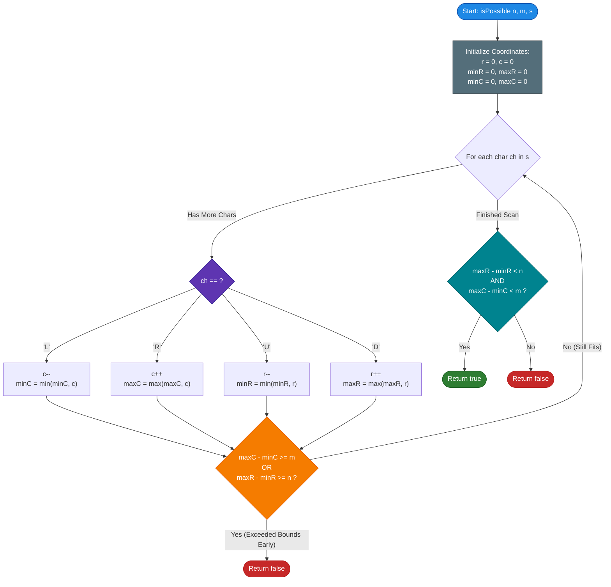

# GeeksforGeeks Problem of the Day: Trace Path

- **Problem Link:** [GeeksforGeeks - Trace Path](https://www.geeksforgeeks.org/problems/trace-path3840/1)
- **Difficulty:** Easy
- **Topic Tags:** Matrix, Simulation, String, Mathematical Geometry, Bounding Box, Optimization
- **Target Audience:** POTD Solvers, Computer Science Students, Competitive Programmers, Technical Interview Preparation (FAANG / Tier-1 Tech)

---

## 1. Problem Statement

Given a grid of dimensions $n \times m$ ($n$ rows and $m$ columns) and a path string $s$ consisting of characters `'L'`, `'R'`, `'U'`, and `'D'` representing directional movements:
- `'L'` : Move one step **Left** (decrease column index)
- `'R'` : Move one step **Right** (increase column index)
- `'U'` : Move one step **Up** (decrease row index)
- `'D'` : Move one step **Down** (increase row index)

Your task is to determine whether there exists **at least one valid starting cell** $(r_0, c_0)$ in the grid ($0 \le r_0 < n$ and $0 \le c_0 < m$) such that following the sequence of moves given in $s$ step-by-step keeps the traveler strictly **inside the grid boundaries at every single moment**.

- If such a starting cell exists, return `true` (or `1`).
- If no starting cell can contain the entire trajectory without stepping out of bounds, return `false` (or `0`).

```text
       Column: 0       1       2    ...   m - 1
Row 0   +-------+-------+-------+-------+-------+
        | (0,0) | (0,1) | (0,2) |  ...  | (0,m) |
Row 1   +-------+-------+-------+-------+-------+
        | (1,0) | (1,1) | (1,2) |  ...  | (1,m) |
 ...    +-------+-------+-------+-------+-------+
Row n-1 | (n,0) | (n,1) | (n,2) |  ...  |(n,m-1)|
        +-------+-------+-------+-------+-------+
        Valid Coordinate Range: 0 <= r < n,  0 <= c < m
```

---

## 2. Examples & Detailed Explanations

### Example 1 (Standard Fit)
- **Input:** `n = 2, m = 3, s = "LLRU"`
- **Matrix Dimensions:** $2$ Rows $\times$ $3$ Columns
- **String Length:** $|s| = 4$

#### Step-by-Step Displacement Trace:
Starting at an arbitrary reference origin $(0, 0)$:
1. Initial: $(r, c) = (0, 0)$
2. Step 1 (`'L'`): $(0, -1)$
3. Step 2 (`'L'`): $(0, -2)$
4. Step 3 (`'R'`): $(0, -1)$
5. Step 4 (`'U'`): $(-1, -1)$

#### Boundary Envelope:
- Row range reached: $[\min(r), \max(r)] = [-1, 0] \implies \text{Height} = 0 - (-1) + 1 = 2$
- Column range reached: $[\min(c), \max(c)] = [-2, 0] \implies \text{Width} = 0 - (-2) + 1 = 3$

#### Boundary Check:
$$\text{Height} = 2 \le n \, (2) \quad \text{and} \quad \text{Width} = 3 \le m \, (3)$$
Both dimensions fit! If we pick the starting position $(r_0, c_0) = (1, 2)$:
- Start at $(1, 2)$
- `'L'` $\to (1, 1)$
- `'L'` $\to (1, 0)$
- `'R'` $\to (1, 1)$
- `'U'` $\to (0, 1)$
Every single coordinate is valid and inside $[0, 1] \times [0, 2]$.
- **Output:** `true`

---

### Example 2 (Oscillating Within Bounds)
- **Input:** `n = 1, m = 2, s = "LRLR"`
- **Matrix Dimensions:** $1$ Row $\times$ $2$ Columns

#### Displacement Trace:
- Step 0: $(0, 0)$
- Step 1 (`'L'`): $(0, -1)$
- Step 2 (`'R'`): $(0, 0)$
- Step 3 (`'L'`): $(0, -1)$
- Step 4 (`'R'`): $(0, 0)$

- Vertical span: $\min(r) = 0, \max(r) = 0 \implies \text{Height} = 1 \le 1$ (Fits row bound)
- Horizontal span: $\min(c) = -1, \max(c) = 0 \implies \text{Width} = 2 \le 2$ (Fits column bound)
- Valid starting cell: $(r_0, c_0) = (0, 1)$.
- **Output:** `true`

---

### Example 3 (Exceeding Bounds - Negative Case)
- **Input:** `n = 2, m = 2, s = "LL"`
- **Matrix Dimensions:** $2$ Rows $\times$ $2$ Columns

#### Displacement Trace:
- Step 0: $(0, 0)$
- Step 1 (`'L'`): $(0, -1)$
- Step 2 (`'L'`): $(0, -2)$

- Horizontal span: $\min(c) = -2, \max(c) = 0 \implies \text{Width} = 0 - (-2) + 1 = 3$
- Required width is $3$, but grid width $m = 2$.
- Because $3 > 2$, no starting cell can accommodate two consecutive Left moves in a $2$-column grid.
- **Output:** `false`

---

### Example 4 (Closed Loop Path)
- **Input:** `n = 2, m = 2, s = "RULD"`
- **Matrix Dimensions:** $2 \times 2$

#### Displacement Trace:
- $(0, 0) \xrightarrow{\text{R}} (0, 1) \xrightarrow{\text{U}} (-1, 1) \xrightarrow{\text{L}} (-1, 0) \xrightarrow{\text{D}} (0, 0)$
- $\min(r) = -1, \max(r) = 0 \implies \text{Height} = 2 \le 2$
- $\min(c) = 0, \max(c) = 1 \implies \text{Width} = 2 \le 2$
- Starting cell $(1, 0)$ stays completely in bounds:
  $(1, 0) \to (1, 1) \to (0, 1) \to (0, 0) \to (1, 0)$.
- **Output:** `true`

---

## 3. Constraints & Complexity Targets

- $1 \le n, m \le 10^4$
- $1 \le |s| \le 10^5$
- String $s$ contains only characters `'L'`, `'R'`, `'U'`, `'D'`.
- **Expected Time Complexity:** $\mathcal{O}(|s|)$
- **Expected Auxiliary Space:** $\mathcal{O}(1)$

---

## 4. Mathematical & Geometric Foundation

### 1. Orthogonal Independence Theorem
Notice that vertical shifts (`'U'`, `'D'`) only affect the **row** coordinate $r$, while horizontal shifts (`'L'`, `'R'`) only affect the **column** coordinate $c$.
$$\Delta r_{t} = \Delta r_{t-1} + \begin{cases} -1 & \text{if } s[t] = \text{'U'} \\ +1 & \text{if } s[t] = \text{'D'} \\ 0 & \text{otherwise} \end{cases}$$
$$\Delta c_{t} = \Delta c_{t-1} + \begin{cases} -1 & \text{if } s[t] = \text{'L'} \\ +1 & \text{if } s[t] = \text{'R'} \\ 0 & \text{otherwise} \end{cases}$$

Because row changes and column changes are completely **decoupled (independent)**, we can analyze the vertical span and horizontal span separately!

---

### 2. The Bounding Box Derivation

Suppose we choose an arbitrary starting cell $(r_0, c_0)$. At any step $t$, the absolute grid cell visited is:
$$r_t = r_0 + \Delta r_t$$
$$c_t = c_0 + \Delta c_t$$

For the entire path to remain valid within the $n \times m$ grid, we must satisfy:
$$\forall t \in [0, |s|]: \quad 0 \le r_0 + \Delta r_t \le n - 1$$
$$\forall t \in [0, |s|]: \quad 0 \le c_0 + \Delta c_t \le m - 1$$

Rearranging for the starting row $r_0$:
$$-\Delta r_t \le r_0 \le (n - 1) - \Delta r_t \quad \forall t$$

Taking the extremes over all time steps $t$:
$$-\min_{t}(\Delta r_t) \le r_0 \le (n - 1) - \max_{t}(\Delta r_t)$$

For at least one integer $r_0$ to exist in this closed interval, the lower bound must not exceed the upper bound:
$$-\min_{t}(\Delta r_t) \le (n - 1) - \max_{t}(\Delta r_t)$$
$$\max_{t}(\Delta r_t) - \min_{t}(\Delta r_t) \le n - 1$$
$$\mathbf{\max_{t}(\Delta r_t) - \min_{t}(\Delta r_t) < n}$$

Equivalently, the **span of rows** (height of the bounding box) is:
$$\text{Span}_r = \max_{t}(\Delta r_t) - \min_{t}(\Delta r_t) + 1 \le n$$

By exact symmetry, the **span of columns** (width of the bounding box) is:
$$\text{Span}_c = \max_{t}(\Delta c_t) - \min_{t}(\Delta c_t) + 1 \le m$$

> [!IMPORTANT]
> **Necessary & Sufficient Condition:**  
> A path can be accommodated inside an $n \times m$ grid if and only if:
> $$\mathbf{\max(r) - \min(r) < n \quad \text{AND} \quad \max(c) - \min(c) < m}$$
>
> If this holds, we can immediately identify the exact range of all valid starting positions:
> $$r_0 \in \big[-\min(r), \; n - 1 - \max(r)\big]$$
> $$c_0 \in \big[-\min(c), \; m - 1 - \max(c)\big]$$
>
> The total number of valid starting cells is:
> $$\text{Valid Starts} = \big(n - (\max(r) - \min(r))\big) \times \big(m - (\max(c) - \min(c))\big)$$

---

## 5. Visual Simulations & ASCII Architectural Diagrams

### The Bounding Box Concept

Imagine the entire path as a rigid rectangular bounding box created by the farthest excursions in all four directions:

```text
               -min(r) (Max Upward Reach)
                    ▲
                    │
-min(c) ◄──────────(0,0)──────────► max(c) (Max Rightward Reach)
(Max Left Reach)    │
                    ▼
               max(r) (Max Downward Reach)

Height of Box = max(r) - min(r) + 1
Width of Box  = max(c) - min(c) + 1
```

If this bounding box has dimensions $\text{Height} \le n$ and $\text{Width} \le m$, it can simply be slid into the grid:

```text
+------------------------- Grid (n x m) ------------------------+
|                                                               |
|        +---- Bounding Box (Span_r x Span_c) ----+             |
|        | (min_r, min_c)                         |             |
|        |         * Start (r0, c0)               |             |
|        |          \                             |             |
|        |           *--> *                       |             |
|        |                 \                      |             |
|        |                  * (max_r, max_c)      |             |
|        +----------------------------------------+             |
|                                                               |
+---------------------------------------------------------------+
```

### Trace Table for Example 1: `n = 2, m = 3, s = "LLRU"`

| Step $t$ | Char $s[t]$ | Current $(r, c)$ | $\min(r)$ | $\max(r)$ | $\min(c)$ | $\max(c)$ | $\Delta \text{Row Span}$ | $\Delta \text{Col Span}$ | Fits $n=2, m=3$? |
| :---: | :---: | :---: | :---: | :---: | :---: | :---: | :---: | :---: | :---: |
| **Start** | `-` | $(0, 0)$ | $0$ | $0$ | $0$ | $0$ | $0 - 0 = 0 < 2$ | $0 - 0 = 0 < 3$ | **Yes** |
| **1** | `'L'` | $(0, -1)$ | $0$ | $0$ | $-1$ | $0$ | $0 - 0 = 0 < 2$ | $0 - (-1) = 1 < 3$ | **Yes** |
| **2** | `'L'` | $(0, -2)$ | $0$ | $0$ | $-2$ | $0$ | $0 - 0 = 0 < 2$ | $0 - (-2) = 2 < 3$ | **Yes** |
| **3** | `'R'` | $(0, -1)$ | $0$ | $0$ | $-2$ | $0$ | $0 - 0 = 0 < 2$ | $0 - (-2) = 2 < 3$ | **Yes** |
| **4** | `'U'` | $(-1, -1)$ | $-1$ | $0$ | $-2$ | $0$ | $0 - (-1) = 1 < 2$ | $0 - (-2) = 2 < 3$ | **Yes** |

**Final Check:** $\text{Row Difference} = 1 < 2$ (Valid) and $\text{Col Difference} = 2 < 3$ (Valid).  
**Conclusion:** Returns `true`.

---

## 6. Algorithm Flowchart



---

## 7. From Naive to Pro: Algorithmic Progression

### Method 1: Naive (Simulation from Every Cell)
- **Concept:** Try every cell $(r_0, c_0) \in [0, n-1] \times [0, m-1]$ as a candidate starting point. Simulate the entire string $s$. If any path finishes all $|s|$ steps without going out of bounds, return `true`. If all $n \times m$ starting cells fail, return `false`.
- **Why it is suboptimal:**
  - Nested loops iterate over $n \times m$ cells.
  - Simulating $|s|$ moves takes $\mathcal{O}(n \times m \times |s|)$ time.
  - For $n = 10^4, m = 10^4, |s| = 10^5$, operations exceed $10^{13}$, causing a severe **Time Limit Exceeded (TLE)**.
- **Pseudocode:**
```text
function isPossible_Naive(n, m, s):
    for r0 from 0 to n - 1:
        for c0 from 0 to m - 1:
            curr_r = r0
            curr_c = c0
            valid = true
            for ch in s:
                if ch == 'L': curr_c -= 1
                else if ch == 'R': curr_c += 1
                else if ch == 'U': curr_r -= 1
                else if ch == 'D': curr_r += 1
                
                if curr_r < 0 or curr_r >= n or curr_c < 0 or curr_c >= m:
                    valid = false
                    break
            if valid:
                return true
    return false
```

---

### Method 2: Better (Full String Scan Bounding Box)
- **Concept:** Start at reference $(0, 0)$. Scan all $|s|$ characters, maintaining the minimum and maximum row and column displacements reached. After reading the entire string, test if $\max(r) - \min(r) < n$ and $\max(c) - \min(c) < m$.
- **Why it is good:**
  - Decoupled from grid dimensions $n$ and $m$.
  - Takes linear time $\mathcal{O}(|s|)$ and $\mathcal{O}(1)$ space.
- **Pseudocode:**
```text
function isPossible_Better(n, m, s):
    r = 0, c = 0
    minR = 0, maxR = 0
    minC = 0, maxC = 0
    
    for ch in s:
        if ch == 'L': c -= 1
        else if ch == 'R': c += 1
        else if ch == 'U': r -= 1
        else if ch == 'D': r += 1
        
        minR = min(minR, r)
        maxR = max(maxR, r)
        minC = min(minC, c)
        maxC = max(maxC, c)
        
    return (maxR - minR < n) and (maxC - minC < m)
```

---

### Method 3: Pro Approach (Monotonic Bounding Box with Early-Exit Pruning)
- **The Core Strategy:**
  - Notice that `maxR - minR` and `maxC - minC` are **monotonically non-decreasing**.
  - Once the required row span reaches or exceeds $n$, or column span reaches or exceeds $m$, it is mathematically **impossible** for any future steps to shrink the span back down!
  - Therefore, we can inspect the condition inside the loop:
    $$\text{if } (\text{maxR} - \text{minR} \ge n) \lor (\text{maxC} - \text{minC} \ge m) \implies \text{return false immediately!}$$
  - **Pruning Advantage:** For long strings like $s = \text{"LLLLLL..."}$ with $|s| = 10^5$ and $m = 2$, this terminates in exactly $2$ iterations instead of $100,000$ iterations!
- **Pseudocode:**
```text
function isPossible_Pro(n, m, s):
    r = 0, c = 0
    minR = 0, maxR = 0
    minC = 0, maxC = 0
    
    for ch in s:
        if ch == 'L':
            c -= 1
            if c < minC: minC = c
        else if ch == 'R':
            c += 1
            if c > maxC: maxC = c
        else if ch == 'U':
            r -= 1
            if r < minR: minR = r
        else if ch == 'D':
            r += 1
            if r > maxR: maxR = r
            
        // Early Exit Pruning: Monotonic expansion check
        if (maxR - minR >= n) or (maxC - minC >= m):
            return false
            
    return true
```

---

## 8. Complexity Comparison Table

| Metric | Method 1: Naive (All-Cell Simulation) | Method 2: Standard Bounding Box | Method 3: Pro (Early-Exit Bounding Box) |
| :--- | :--- | :--- | :--- |
| **Worst-Case Time** | $\mathcal{O}(n \cdot m \cdot \|s\|)$ | $\mathcal{O}(\|s\|)$ | $\mathbf{\mathcal{O}(\|s\|)}$ |
| **Best-Case Time** | $\mathcal{O}(\|s\|)$ | $\mathcal{O}(\|s\|)$ | $\mathbf{\mathcal{O}(1)}$ (Immediate pruning on overflow) |
| **Auxiliary Space** | $\mathcal{O}(1)$ | $\mathcal{O}(1)$ | $\mathbf{\mathcal{O}(1)}$ |
| **String Passes** | Up to $n \times m$ passes | Exactly $1$ pass | **At most $1$ partial pass** |
| **Cache Locality** | Poor (Repeated traversals) | Excellent (Sequential access) | **Optimal & CPU Branch-Predictor Friendly** |
| **Interview Verdict** | TLE ($10^{13}$ ops) | Strong / Accepted | **Flawless Senior / FAANG Standard** |

---

## 9. Comprehensive Corner Cases Handled

1. **$1 \times 1$ Single Cell Grid ($n = 1, m = 1$):**
   - Any move (`'L'`, `'R'`, `'U'`, `'D'`) immediately expands span to $\ge 1$, which is $\ge n$ or $\ge m$.
   - The early exit instantly returns `false`.
2. **Linear Grids ($1 \times m$ or $n \times 1$):**
   - In a $1 \times m$ grid, $n = 1$. Any `'U'` or `'D'` move increases vertical span to $1 \ge n$, triggering early exit `false`.
   - In an $n \times 1$ grid, $m = 1$. Any `'L'` or `'R'` move triggers early exit `false`.
3. **Monodirectional Bursts (e.g., $10^5$ consecutive `'L'`):**
   - Method 3 halts after exactly $m$ steps, saving $10^5 - m$ redundant instructions.
4. **Oscillatory Motions (e.g., `"LRLRLRLR..."`):**
   - $c$ alternates between $0$ and $-1$.
   - $\min(c) = -1, \max(c) = 0 \implies \text{span} = 1$.
   - Safely returns `true` for any $m \ge 2$.
5. **Full Closed Loops (e.g., `"RULD"`):**
   - Returns to origin $(0, 0)$. Correctly verifies that intermediate peaks $\min(r), \max(r), \min(c), \max(c)$ did not breach bounds.
6. **Large Constraints ($n = 10^4, m = 10^4, |s| = 10^5$):**
   - All counters easily fit within standard 32-bit signed integers without overflow.

---

## 10. Complete Multi-Language Implementations

### Java (21)

```java
/**
 * Problem: Trace Path
 * Language: Java 21
 * Time Complexity: O(|s|) worst-case, O(min(|s|, n+m)) best-case
 * Auxiliary Space: O(1)
 */
class Solution {
    public boolean isPossible(int n, int m, String s) {
        int r = 0, c = 0;
        int minR = 0, maxR = 0;
        int minC = 0, maxC = 0;
        
        int len = s.length();
        for (int i = 0; i < len; i++) {
            char ch = s.charAt(i);
            
            switch (ch) {
                case 'L':
                    c--;
                    if (c < minC) minC = c;
                    break;
                case 'R':
                    c++;
                    if (c > maxC) maxC = c;
                    break;
                case 'U':
                    r--;
                    if (r < minR) minR = r;
                    break;
                case 'D':
                    r++;
                    if (r > maxR) maxR = r;
                    break;
            }
            
            // Early Exit Pruning: Dimensions can never shrink
            if ((maxR - minR >= n) || (maxC - minC >= m)) {
                return false;
            }
        }
        
        return true;
    }
}
```

---

### Python3

```python
"""
Problem: Trace Path
Language: Python 3
Time Complexity: O(|s|) worst-case, O(min(|s|, n+m)) best-case
Auxiliary Space: O(1)
"""
class Solution:
    def isPossible(self, n: int, m: int, s: str) -> bool:
        r = 0
        c = 0
        min_r = 0
        max_r = 0
        min_c = 0
        max_c = 0
        
        for ch in s:
            if ch == 'L':
                c -= 1
                if c < min_c:
                    min_c = c
            elif ch == 'R':
                c += 1
                if c > max_c:
                    max_c = c
            elif ch == 'U':
                r -= 1
                if r < min_r:
                    min_r = r
            elif ch == 'D':
                r += 1
                if r > max_r:
                    max_r = r
                    
            # Early Exit Pruning: Bounding box exceeds matrix bounds
            if (max_r - min_r >= n) or (max_c - min_c >= m):
                return False
                
        return True
```

---

### C++ (17)

```cpp
/**
 * Problem: Trace Path
 * Language: C++ (17)
 * Time Complexity: O(|s|) worst-case, O(min(|s|, n+m)) best-case
 * Auxiliary Space: O(1)
 */
#include <string>
#include <algorithm>

using namespace std;

class Solution {
  public:
    bool isPossible(int n, int m, string& s) {
        int r = 0, c = 0;
        int minR = 0, maxR = 0;
        int minC = 0, maxC = 0;
        
        for (char ch : s) {
            switch (ch) {
                case 'L':
                    --c;
                    if (c < minC) minC = c;
                    break;
                case 'R':
                    ++c;
                    if (c > maxC) maxC = c;
                    break;
                case 'U':
                    --r;
                    if (r < minR) minR = r;
                    break;
                case 'D':
                    ++r;
                    if (r > maxR) maxR = r;
                    break;
            }
            
            // Early Exit Pruning: Check if bounding box exceeds grid boundaries
            if ((maxR - minR >= n) || (maxC - minC >= m)) {
                return false;
            }
        }
        
        return true;
    }
};
```

---

### C#

```csharp
/**
 * Problem: Trace Path
 * Language: C#
 * Time Complexity: O(|s|) worst-case, O(min(|s|, n+m)) best-case
 * Auxiliary Space: O(1)
 */
using System;

// Defining alias for cross-platform compatibility with GFG template
using boolean = System.Boolean;

class Solution {
    public boolean isPossible(int n, int m, string s) {
        int r = 0, c = 0;
        int minR = 0, maxR = 0;
        int minC = 0, maxC = 0;
        
        int length = s.Length;
        for (int i = 0; i < length; i++) {
            char ch = s[i];
            switch (ch) {
                case 'L':
                    c--;
                    if (c < minC) minC = c;
                    break;
                case 'R':
                    c++;
                    if (c > maxC) maxC = c;
                    break;
                case 'U':
                    r--;
                    if (r < minR) minR = r;
                    break;
                case 'D':
                    r++;
                    if (r > maxR) maxR = r;
                    break;
            }
            
            // Early Exit Pruning
            if ((maxR - minR >= n) || (maxC - minC >= m)) {
                return false;
            }
        }
        
        return true;
    }
}
```

---

### Javascript (Node v22)

```javascript
/**
 * Problem: Trace Path
 * Language: Javascript (Node v22)
 * Time Complexity: O(|s|) worst-case, O(min(|s|, n+m)) best-case
 * Auxiliary Space: O(1)
 *
 * @param {number} n
 * @param {number} m
 * @param {String} s
 * @return {Boolean}
 */
class Solution {
    isPossible(n, m, s) {
        let r = 0;
        let c = 0;
        let minR = 0;
        let maxR = 0;
        let minC = 0;
        let maxC = 0;
        
        const len = s.length;
        for (let i = 0; i < len; i++) {
            const ch = s.charCodeAt(i);
            
            // 'L' = 76, 'R' = 82, 'U' = 85, 'D' = 68
            if (ch === 76) {        // 'L'
                c--;
                if (c < minC) minC = c;
            } else if (ch === 82) { // 'R'
                c++;
                if (c > maxC) maxC = c;
            } else if (ch === 85) { // 'U'
                r--;
                if (r < minR) minR = r;
            } else if (ch === 68) { // 'D'
                r++;
                if (r > maxR) maxR = r;
            }
            
            // Early Exit Pruning: Monotonic envelope comparison
            if ((maxR - minR >= n) || (maxC - minC >= m)) {
                return false;
            }
        }
        
        return true;
    }
}
```

---

## 11. Line-by-Line Code Walkthrough

Taking the C++ / Java implementation as reference:

1. **State Initialization:**
   ```cpp
   int r = 0, c = 0;
   int minR = 0, maxR = 0;
   int minC = 0, maxC = 0;
   ```
   - Sets our relative frame of reference at $(0, 0)$.
   - All extrema start at $0$, representing the initial stationary moment before any move is taken.

2. **Directional Processing:**
   ```cpp
   switch (ch) {
       case 'L': --c; if (c < minC) minC = c; break;
       case 'R': ++c; if (c > maxC) maxC = c; break;
       case 'U': --r; if (r < minR) minR = r; break;
       case 'D': ++r; if (r > maxR) maxR = r; break;
   }
   ```
   - Adjusts the current displacement `(r, c)`.
   - Conditionally updates the bounding envelope extrema with simple $O(1)$ comparisons rather than calling expensive library math routines.

3. **Monotonic Pruning Guard:**
   ```cpp
   if ((maxR - minR >= n) || (maxC - minC >= m)) {
       return false;
   }
   ```
   - `maxR - minR` is the total vertical span minus one. If this span is $\ge n$, no starting row in $[0, n-1]$ can ever satisfy the path bounds.
   - Because spans can never shrink with further moves, we prune immediately.

4. **Guaranteed Termination:**
   ```cpp
   return true;
   ```
   - If the loop finishes without breaching bounds, a valid starting position is guaranteed to exist at $(r_0, c_0) = (-\min(r), -\min(c))$.

---

## 12. Interview Follow-Ups & Expert Insights

### Question 1: How many distinct valid starting cells exist?
**Answer:** Because row and column movements are independent:
$$\text{Count} = \max\big(0, \, n - (\max(r) - \min(r))\big) \times \max\big(0, \, m - (\max(c) - \min(c))\big)$$

### Question 2: What is an example of an actual starting cell $(r_0, c_0)$?
**Answer:** The canonical top-left-most valid starting position is:
$$r_0 = -\min(r), \quad c_0 = -\min(c)$$
Since $\min(r) \le 0$, $-\min(r) \ge 0$. Furthermore, $r_0 + \max(r) = \max(r) - \min(r) < n \implies r_0 + \max(r) \le n - 1$. Hence, $(-\min(r), -\min(c))$ is guaranteed to stay strictly within $[0, n-1] \times [0, m-1]$.

### Question 3: What if the grid contained obstacles (blocked cells)?
**Answer:**
If obstacles exist, the Bounding Box shortcut cannot be used because valid trajectories cannot step through blocked cells. In that scenario, we must either:
1. Model the grid as a bitmask / bitset shifted according to directions:
   $$\text{ValidMask}_{t} = \text{Shift}(\text{ValidMask}_{t-1}, \text{direction}) \ \& \ \text{FreeCells}$$
2. Or perform multi-source BFS / reachability analysis.
