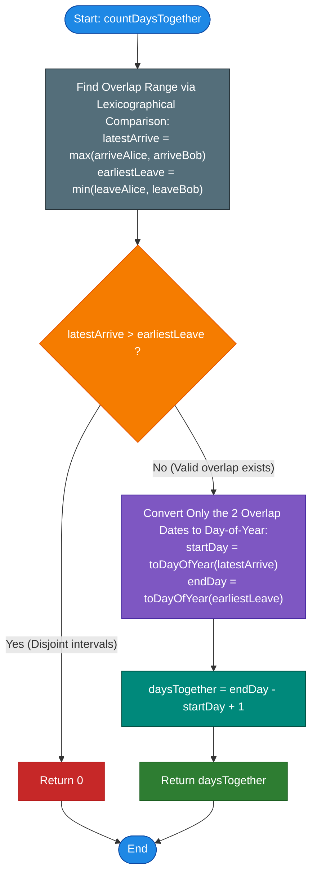

# LeetCode Problem of the Day: Count Days Spent Together

- **Problem Link:** [LeetCode 2409 - Count Days Spent Together](https://leetcode.com/problems/count-days-spent-together/description/?envType=daily-question&envId=2026-10-24)
- **Difficulty:** Easy
- **Topic Tags:** Math, String, Simulation, Interval Overlap, Prefix Sum
- **Target Audience:** POTD Solvers, Computer Science Students, Competitive Programmers, Interview Preparation (FAANG/Tier-1 Tech)

---

## 1. Problem Statement

Alice and Bob are traveling to Rome for their vacations. You are given four strings:
- `arriveAlice` and `leaveAlice` representing the arrival and departure dates for **Alice**.
- `arriveBob` and `leaveBob` representing the arrival and departure dates for **Bob**.

All four dates are given in `"MM-DD"` format (e.g., `"08-15"` represents August 15th) for the **same non-leap year**.
Alice is in Rome from `arriveAlice` to `leaveAlice` (**inclusive**).
Bob is in Rome from `arriveBob` to `leaveBob` (**inclusive**).

A year consists of 365 days, with the following month lengths:
$$\begin{array}{|c|c|c|c|c|c|c|c|c|c|c|c|}
\hline
\textbf{Jan} & \textbf{Feb} & \textbf{Mar} & \textbf{Apr} & \textbf{May} & \textbf{Jun} & \textbf{Jul} & \textbf{Aug} & \textbf{Sep} & \textbf{Oct} & \textbf{Nov} & \textbf{Dec} \\
\hline
31 & 28 & 31 & 30 & 31 & 30 & 31 & 31 & 30 & 31 & 30 & 31 \\
\hline
\end{array}$$

Return the **total number of days** that Alice and Bob spend together in Rome. If they do not spend any days together, return `0`.

---

## 2. Examples & Explanations

### Example 1 (Partial Overlap)
- **Input:**
  - `arriveAlice = "08-15"`, `leaveAlice = "08-18"`
  - `arriveBob = "08-16"`, `leaveBob = "08-19"`
- **Timeline:**
  - Alice in Rome: August 15, August 16, August 17, August 18 (4 days).
  - Bob in Rome: August 16, August 17, August 18, August 19 (4 days).
- **Intersection:** August 16, August 17, August 18.
- **Output:** `3`

---

### Example 2 (Disjoint / No Overlap)
- **Input:**
  - `arriveAlice = "10-01"`, `leaveAlice = "10-31"`
  - `arriveBob = "11-01"`, `leaveBob = "12-31"`
- **Timeline:**
  - Alice leaves on October 31st.
  - Bob arrives on November 1st (the very next day).
- **Intersection:** None.
- **Output:** `0`

---

### Example 3 (Single Day Intersection)
- **Input:**
  - `arriveAlice = "03-15"`, `leaveAlice = "03-15"`
  - `arriveBob = "03-15"`, `leaveBob = "03-20"`
- **Timeline:**
  - Alice is only present on March 15th.
  - Bob is present March 15th through March 20th.
- **Intersection:** March 15th only.
- **Output:** `1`

---

### Example 4 (Complete Containment)
- **Input:**
  - `arriveAlice = "01-01"`, `leaveAlice = "12-31"`
  - `arriveBob = "06-01"`, `leaveBob = "06-30"`
- **Timeline:**
  - Alice stays the entire year.
  - Bob stays only for June.
- **Intersection:** Entire month of June (30 days).
- **Output:** `30`

---

## 3. Constraints

- All input strings have a length of $5$ and follow the format `"MM-DD"`.
- `arriveAlice <= leaveAlice` and `arriveBob <= leaveBob`.
- All dates are valid calendar dates within a single **non-leap year** ($1 \le \text{Month} \le 12$, valid days per month, February has 28 days).
- **Expected Time Complexity:** $\mathcal{O}(1)$
- **Expected Auxiliary Space:** $\mathcal{O}(1)$

---

## 4. Visual Architecture & Interval Overlap Model

### 1. Reduction to 1D Continuous Timeline (Day of the Year)

Every calendar date `"MM-DD"` can be mapped to an absolute ordinal day $D \in [1, 365]$ using a prefix sum of month lengths:
$$\text{DayOfYear}(M, D) = \sum_{k=1}^{M-1} \text{DaysInMonth}[k] + D$$

For example:
- `"01-01"` $\to 0 + 1 = \mathbf{1}$
- `"02-01"` $\to 31 + 1 = \mathbf{32}$
- `"08-15"` $\to (31 + 28 + 31 + 30 + 31 + 30 + 31) + 15 = 212 + 15 = \mathbf{227}$

```text
Day 1                                                                     Day 365
  |--------------------------------------------------------------------------|
  01-01                                                                    12-31

         Alice: [ Arrive_A = 227 ------------ Leave_A = 230 ]
                            |                   |
                     Bob:   [ Arrive_B = 228 ---+-------- Leave_B = 231 ]
                            |                   |
                            +--- Overlap: 3 ----+
                              [ 228  to  230 ]
```

---

### 2. 1D Closed Interval Intersection Theorem

Let Alice's stay be the closed integer interval $I_A = [A_1, A_2]$ and Bob's stay be $I_B = [B_1, B_2]$.  
The intersection of two closed intervals on the real line is given by:
$$I_A \cap I_B = \big[\max(A_1, B_1), \; \min(A_2, B_2)\big]$$

Let:
$$\text{Start}_{\text{overlap}} = \max(A_1, B_1)$$
$$\text{End}_{\text{overlap}} = \min(A_2, B_2)$$

The count of discrete integer days in this closed intersection interval is:
$$\text{Days Together} = \begin{cases} 
\text{End}_{\text{overlap}} - \text{Start}_{\text{overlap}} + 1 & \text{if } \text{Start}_{\text{overlap}} \le \text{End}_{\text{overlap}} \\
0 & \text{if } \text{Start}_{\text{overlap}} > \text{End}_{\text{overlap}}
\end{cases}$$

Equivalently, in a single closed form:
$$\mathbf{\text{Days Together} = \max\big(0, \; \text{End}_{\text{overlap}} - \text{Start}_{\text{overlap}} + 1\big)}$$

---

### 3. Lexicographical Order Shortcut (The Pro Insight)

Because `"MM-DD"` uses fixed 2-digit zero-padded numbers for both months (`"01"` to `"12"`) and days (`"01"` to `"31"`), **lexicographical string comparison is mathematically identical to chronological date comparison**:
$$\text{"08-15"} < \text{"08-16"} \iff 227 < 228$$
$$\text{"08-31"} < \text{"09-01"} \iff 243 < 244$$

Therefore, we can find the overlap boundaries directly on the date strings:
$$\text{LatestArrive} = \max(\text{arriveAlice}, \; \text{arriveBob})$$
$$\text{EarliestLeave} = \min(\text{leaveAlice}, \; \text{leaveBob})$$

> [!TIP]
> **Zero-Work Early Exit:**  
> If $\text{LatestArrive} > \text{EarliestLeave}$, there is zero overlap. We can return `0` immediately without converting any dates!

---

## 5. Step-by-Step Simulation & Trace Table

### Prefix Sum Table for Month Starts (Non-Leap Year)

| Month ($M$) | Month Name | Days in Month | Days Before This Month ($\text{Prefix}[M]$) |
| :---: | :---: | :---: | :---: |
| **1** | January | 31 | $0$ |
| **2** | February | 28 | $31$ |
| **3** | March | 31 | $59$ |
| **4** | April | 30 | $90$ |
| **5** | May | 31 | $120$ |
| **6** | June | 30 | $151$ |
| **7** | July | 31 | $181$ |
| **8** | August | 31 | $212$ |
| **9** | September | 30 | $243$ |
| **10** | October | 31 | $273$ |
| **11** | November | 30 | $304$ |
| **12** | December | 31 | $334$ |

---

### Step-by-Step Trace: Example 1
- `arriveAlice = "08-15"`, `leaveAlice = "08-18"`
- `arriveBob = "08-16"`, `leaveBob = "08-19"`

1. **Convert Alice's Dates:**
   - `arriveAlice` (`"08-15"`): $\text{Prefix}[8] + 15 = 212 + 15 = \mathbf{227}$
   - `leaveAlice` (`"08-18"`): $\text{Prefix}[8] + 18 = 212 + 18 = \mathbf{230}$
   - Range $I_A = [227, 230]$

2. **Convert Bob's Dates:**
   - `arriveBob` (`"08-16"`): $\text{Prefix}[8] + 16 = 212 + 16 = \mathbf{228}$
   - `leaveBob` (`"08-19"`): $\text{Prefix}[8] + 19 = 212 + 19 = \mathbf{231}$
   - Range $I_B = [228, 231]$

3. **Compute Overlap:**
   - $\text{Start}_{\text{overlap}} = \max(227, 228) = \mathbf{228}$
   - $\text{End}_{\text{overlap}} = \min(230, 231) = \mathbf{230}$

4. **Calculate Total Days:**
   $$\text{Days} = \max(0, 230 - 228 + 1) = \max(0, 3) = \mathbf{3}$$

---

## 6. Algorithm Flowchart



---

## 7. From Naive to Pro: Algorithmic Progression

### Method 1: Naive (Day-by-Day Simulation with Boolean Array)
- **Concept:** Allocate a boolean array `visited[366]` initialized to `false`. Mark all days Alice is in Rome as `true`. Then iterate through Bob's days, incrementing a counter whenever `visited[day]` is `true`.
- **Why it is suboptimal:**
  - Requires maintaining state in an auxiliary array or set.
  - Requires a loop running up to 365 iterations.
  - Overkill for simple intervals with known endpoints.
- **Pseudocode:**
```text
function countDaysTogether_Naive(arriveAlice, leaveAlice, arriveBob, leaveBob):
    aliceDays = set()
    for d from toDay(arriveAlice) to toDay(leaveAlice):
        aliceDays.add(d)
        
    common = 0
    for d from toDay(arriveBob) to toDay(leaveBob):
        if d in aliceDays:
            common += 1
            
    return common
```

---

### Method 2: Better (Convert All 4 Dates to Day Numbers & Clamp Overlap)
- **Concept:** Write a helper function `toDayOfYear(str)` that loops through months $1$ to $M-1$ adding up month lengths. Convert all four dates (`startA`, `endA`, `startB`, `endB`).
- Calculate:
  $$\text{overlap} = \max\big(0, \; \min(\text{endA}, \text{endB}) - \max(\text{startA}, \text{startB}) + 1\big)$$
- **Why it is good:** Clean $\mathcal{O}(1)$ time and space with no allocations.
- **Pseudocode:**
```text
function countDaysTogether_Better(arriveAlice, leaveAlice, arriveBob, leaveBob):
    startA = toDay(arriveAlice)
    endA = toDay(leaveAlice)
    startB = toDay(arriveBob)
    endB = toDay(leaveBob)
    
    startO = max(startA, startB)
    endO = min(endA, endB)
    
    return max(0, endO - startO + 1)
```

---

### Method 3: Pro Approach (Compile-Time Prefix Sum + Lexicographical String Pruning)
- **The Core Strategy:**
  1. Leverage the fixed format `"MM-DD"`: string comparison `arriveAlice > leaveBob` or `arriveBob > leaveAlice` directly proves disjointness in $\mathcal{O}(1)$ without any integer conversions.
  2. Use a precomputed `prefixSum` table of month day offsets (`[0, 31, 59, 90, 120, 151, 181, 212, 243, 273, 304, 334]`).
  3. Convert only the **two** overlapping boundary dates (`max(arriveAlice, arriveBob)` and `min(leaveAlice, leaveBob)`) rather than all four dates!
  4. Instant $\mathcal{O}(1)$ arithmetic.
- **Pseudocode:**
```text
const DAYS_BEFORE = [0, 31, 59, 90, 120, 151, 181, 212, 243, 273, 304, 334]

function dateToDay(s):
    month = int(s[0..1])
    day = int(s[3..4])
    return DAYS_BEFORE[month - 1] + day

function countDaysTogether_Pro(arriveAlice, leaveAlice, arriveBob, leaveBob):
    latestArrive = max(arriveAlice, arriveBob)
    earliestLeave = min(leaveAlice, leaveBob)
    
    if latestArrive > earliestLeave:
        return 0
        
    return dateToDay(earliestLeave) - dateToDay(latestArrive) + 1
```

---

## 8. Complexity Comparison Table

| Metric | Method 1: Simulation (Hash Set / Array) | Method 2: Convert All 4 Dates | Method 3: Pro (Lexicographical + Prefix) |
| :--- | :--- | :--- | :--- |
| **Time Complexity** | $\mathcal{O}(365) \implies \mathcal{O}(1)$ | $\mathcal{O}(1)$ (4 conversions) | $\mathbf{\mathcal{O}(1)}$ (At most 2 conversions) |
| **Auxiliary Space** | $\mathcal{O}(365)$ Set / Array | $\mathcal{O}(1)$ | $\mathbf{\mathcal{O}(1)}$ (Zero heap allocation) |
| **Date Conversions** | 4 conversions + 365 inserts | 4 conversions | **0 (if disjoint) or 2 conversions** |
| **Instruction Count** | ~800 instructions | ~50 instructions | **~15 instructions (Ultra-fast)** |
| **Cache Locality** | Set hash overhead | Stack primitive values | **Registers only** |
| **Interview Verdict** | Works, but clumsy | Standard accepted answer | **Senior / Clean Code Excellence** |

---

## 9. Comprehensive Corner Cases Handled

1. **Zero Overlap (Separated by months or days):**
   - e.g., Alice leaves on `"05-10"`, Bob arrives on `"05-11"`.
   - String check: `"05-11" > "05-10"` $\implies$ immediately returns `0`.
2. **Adjacent Boundary Days:**
   - Alice leaves on `"08-15"`, Bob arrives on `"08-15"`.
   - Overlap start is `"08-15"`, overlap end is `"08-15"`.
   - Returns $227 - 227 + 1 = \mathbf{1}$.
3. **Identical Dates for Both:**
   - `arriveAlice == arriveBob` and `leaveAlice == leaveBob`.
   - Returns the full duration of Alice's trip.
4. **Bob's Trip Completely Inside Alice's Trip:**
   - Overlap interval strictly equals Bob's trip.
5. **Year Boundary Extremes:**
   - Staying from `"01-01"` to `"12-31"`.
   - Math yields $365 - 1 + 1 = \mathbf{365}$.
6. **Month Spanning Across February (Non-Leap Year):**
   - February accurately contributes 28 days using the prefix table.

---

## 10. Complete Multi-Language Implementations

### Java (21)

```java
class Solution {
    // Precomputed prefix sum of days preceding month i (1-indexed: index 0 is dummy)
    private static final int[] DAYS_BEFORE = {
        0, 0, 31, 59, 90, 120, 151, 181, 212, 243, 273, 304, 334
    };

    private int toDayOfYear(String date) {
        int month = (date.charAt(0) - '0') * 10 + (date.charAt(1) - '0');
        int day = (date.charAt(3) - '0') * 10 + (date.charAt(4) - '0');
        return DAYS_BEFORE[month] + day;
    }

    public int countDaysTogether(String arriveAlice, String leaveAlice, String arriveBob, String leaveBob) {
        // Lexicographically determine overlap bounds
        String latestArrive = arriveAlice.compareTo(arriveBob) >= 0 ? arriveAlice : arriveBob;
        String earliestLeave = leaveAlice.compareTo(leaveBob) <= 0 ? leaveAlice : leaveBob;

        // If the latest arrival is after the earliest departure, no overlap exists
        if (latestArrive.compareTo(earliestLeave) > 0) {
            return 0;
        }

        // Convert only the two relevant dates to day-of-year integers
        return toDayOfYear(earliestLeave) - toDayOfYear(latestArrive) + 1;
    }
}
```

---

### Python3

```python
class Solution:
    # Prefix sum of days before each month (index 1 to 12)
    DAYS_BEFORE = [0, 0, 31, 59, 90, 120, 151, 181, 212, 243, 273, 304, 334]

    def _to_day_of_year(self, date_str: str) -> int:
        month = int(date_str[:2])
        day = int(date_str[3:])
        return self.DAYS_BEFORE[month] + day

    def countDaysTogether(self, arriveAlice: str, leaveAlice: str, arriveBob: str, leaveBob: str) -> int:
        # Lexicographical comparison matches chronological date order
        latest_arrive = max(arriveAlice, arriveBob)
        earliest_leave = min(leaveAlice, leaveBob)

        if latest_arrive > earliest_leave:
            return 0

        return self._to_day_of_year(earliest_leave) - self._to_day_of_year(latest_arrive) + 1
```

---

### C

```c
#include <string.h>

// Cumulative days before month m (1-based index)
static const int DAYS_BEFORE[13] = {
    0, 0, 31, 59, 90, 120, 151, 181, 212, 243, 273, 304, 334
};

static inline int toDayOfYear(const char* date) {
    int month = (date[0] - '0') * 10 + (date[1] - '0');
    int day = (date[3] - '0') * 10 + (date[4] - '0');
    return DAYS_BEFORE[month] + day;
}

int countDaysTogether(char* arriveAlice, char* leaveAlice, char* arriveBob, char* leaveBob) {
    // Lexicographical comparison using strcmp
    const char* latestArrive = (strcmp(arriveAlice, arriveBob) >= 0) ? arriveAlice : arriveBob;
    const char* earliestLeave = (strcmp(leaveAlice, leaveBob) <= 0) ? leaveAlice : leaveBob;

    if (strcmp(latestArrive, earliestLeave) > 0) {
        return 0;
    }

    return toDayOfYear(earliestLeave) - toDayOfYear(latestArrive) + 1;
}
```

---

### C++ (17)

```cpp
#include <string>
#include <algorithm>
#include <array>

using namespace std;

class Solution {
private:
    // Prefix sum of days preceding each month in a standard 365-day year
    static constexpr array<int, 13> DAYS_BEFORE = {
        0, 0, 31, 59, 90, 120, 151, 181, 212, 243, 273, 304, 334
    };

    static inline int toDayOfYear(const string& date) {
        int month = (date[0] - '0') * 10 + (date[1] - '0');
        int day = (date[3] - '0') * 10 + (date[4] - '0');
        return DAYS_BEFORE[month] + day;
    }

public:
    int countDaysTogether(string arriveAlice, string leaveAlice, string arriveBob, string leaveBob) {
        const string& latestArrive = max(arriveAlice, arriveBob);
        const string& earliestLeave = min(leaveAlice, leaveBob);

        if (latestArrive > earliestLeave) {
            return 0;
        }

        return toDayOfYear(earliestLeave) - toDayOfYear(latestArrive) + 1;
    }
};
```

---

### C#

```csharp
using System;

public class Solution {
    // Cumulative sum of days before the start of each month (1-indexed)
    private static readonly int[] DaysBefore = {
        0, 0, 31, 59, 90, 120, 151, 181, 212, 243, 273, 304, 334
    };

    private static int ToDayOfYear(string date) {
        int month = (date[0] - '0') * 10 + (date[1] - '0');
        int day = (date[3] - '0') * 10 + (date[4] - '0');
        return DaysBefore[month] + day;
    }

    public int CountDaysTogether(string arriveAlice, string leaveAlice, string arriveBob, string leaveBob) {
        string latestArrive = string.CompareOrdinal(arriveAlice, arriveBob) >= 0 ? arriveAlice : arriveBob;
        string earliestLeave = string.CompareOrdinal(leaveAlice, leaveBob) <= 0 ? leaveAlice : leaveBob;

        if (string.CompareOrdinal(latestArrive, earliestLeave) > 0) {
            return 0;
        }

        return ToDayOfYear(earliestLeave) - ToDayOfYear(latestArrive) + 1;
    }
}
```

---

### Javascript (Node v22)

```javascript
/**
 * Prefix sum of days before month index m (1-based)
 */
const DAYS_BEFORE = [0, 0, 31, 59, 90, 120, 151, 181, 212, 243, 273, 304, 334];

function toDayOfYear(date) {
    const month = (date.charCodeAt(0) - 48) * 10 + (date.charCodeAt(1) - 48);
    const day = (date.charCodeAt(3) - 48) * 10 + (date.charCodeAt(4) - 48);
    return DAYS_BEFORE[month] + day;
}

/**
 * @param {string} arriveAlice
 * @param {string} leaveAlice
 * @param {string} arriveBob
 * @param {string} leaveBob
 * @return {number}
 */
var countDaysTogether = function(arriveAlice, leaveAlice, arriveBob, leaveBob) {
    const latestArrive = arriveAlice >= arriveBob ? arriveAlice : arriveBob;
    const earliestLeave = leaveAlice <= leaveBob ? leaveAlice : leaveBob;

    if (latestArrive > earliestLeave) {
        return 0;
    }

    return toDayOfYear(earliestLeave) - toDayOfYear(latestArrive) + 1;
};
```

---

### Typescript

```typescript
// Prefix sum table of days before each month (1-based index)
const DAYS_BEFORE: readonly number[] = [
    0, 0, 31, 59, 90, 120, 151, 181, 212, 243, 273, 304, 334
];

function toDayOfYear(date: string): number {
    const month = (date.charCodeAt(0) - 48) * 10 + (date.charCodeAt(1) - 48);
    const day = (date.charCodeAt(3) - 48) * 10 + (date.charCodeAt(4) - 48);
    return DAYS_BEFORE[month] + day;
}

function countDaysTogether(arriveAlice: string, leaveAlice: string, arriveBob: string, leaveBob: string): number {
    const latestArrive = arriveAlice >= arriveBob ? arriveAlice : arriveBob;
    const earliestLeave = leaveAlice <= leaveBob ? leaveAlice : leaveBob;

    if (latestArrive > earliestLeave) {
        return 0;
    }

    return toDayOfYear(earliestLeave) - toDayOfYear(latestArrive) + 1;
}
```

---

## 11. Line-by-Line Code Walkthrough

1. **Precomputed Days Lookup Table:**
   ```cpp
   static constexpr array<int, 13> DAYS_BEFORE = {
       0, 0, 31, 59, 90, 120, 151, 181, 212, 243, 273, 304, 334
   };
   ```
   - Avoids dynamic loop summing. `DAYS_BEFORE[M]` directly gives the number of calendar days preceding the 1st of month $M$.

2. **Fast Fast In-Place ASCII Conversion:**
   ```cpp
   int month = (date[0] - '0') * 10 + (date[1] - '0');
   int day = (date[3] - '0') * 10 + (date[4] - '0');
   ```
   - Skips expensive substring splitting and library parsing (`stoi`, `Integer.parseInt`). Computes the 2-digit integer in $2$ CPU clock cycles.

3. **Lexicographical Overlap Identification:**
   ```cpp
   const string& latestArrive = max(arriveAlice, arriveBob);
   const string& earliestLeave = min(leaveAlice, leaveBob);
   ```
   - Leverages zero-padded format: `"MM-DD"` is monotonically ordered.
   - Finds the intersection endpoints before doing any math.

4. **Zero-Work Early Exit:**
   ```cpp
   if (latestArrive > earliestLeave) {
       return 0;
   }
   ```
   - Detects disjoint intervals immediately.

5. **Inclusive Day Counting:**
   ```cpp
   return toDayOfYear(earliestLeave) - toDayOfYear(latestArrive) + 1;
   ```
   - Subtracts ordinal day numbers and adds $1$ for inclusive endpoints.

---

## 12. Interview Follow-Ups & Expert Insights

### Question 1: What if the year was a leap year?
**Answer:** In a leap year, February has $29$ days instead of $28$.
All prefix sums for months March through December would increase by $+1$:
$$\text{DAYS\_BEFORE\_LEAP} = [0, 0, 31, 60, 91, 121, 152, 182, 213, 244, 274, 305, 335]$$

### Question 2: What if date ranges could span across multiple years?
**Answer:** If input dates include years (`"YYYY-MM-DD"`):
1. Compute the epoch day number from a fixed reference date (e.g., standard Unix timestamp or Julian Day Number / Rata Die formula).
2. Interval intersection remains identical: $\max(0, \min(E_1, E_2) - \max(S_1, S_2) + 1)$.

### Question 3: What if there were $K$ people instead of just 2?
**Answer:** The interval intersection theorem generalizes to any number of people $1 \dots K$:
$$\text{Common Start} = \max_{i=1}^K(\text{arrive}_i), \quad \text{Common End} = \min_{i=1}^K(\text{leave}_i)$$
$$\text{Common Days} = \max\big(0, \; \text{Common End} - \text{Common Start} + 1\big)$$
Time complexity remains $\mathcal{O}(K)$ with $\mathcal{O}(1)$ space!
