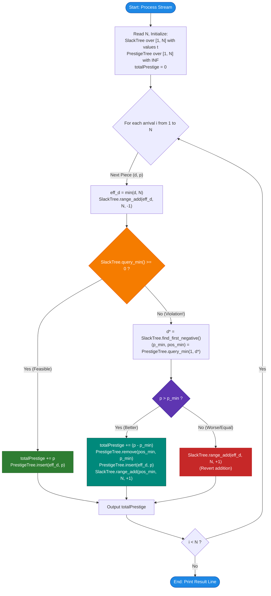

# Unstop Problem of the Day: Spring Exhibition Ledger

- **Platform:** [Unstop](https://unstop.com/)
- **Difficulty:** Hard
- **Topic Tags:** Matroid Theory, Scheduling with Deadlines, Dual Segment Tree, Lazy Propagation, Range Minimum Query (RMQ), Priority Queue, Hall's Marriage Condition, Greedy
- **Target Audience:** POTD Solvers, Computer Science Students, Competitive Programmers, Advanced Systems & Algorithm Engineers (FAANG / Tier-1 Tech)

---

## 1. Problem Statement

Nisha manages the conservation studio of a regional museum, where one conservator restores **exactly one artwork per day**. Every restoration occupies a full working day, and the studio opens every day from day 1 onward without breaks.

During the exhibition season, artworks reach the studio **one at a time in a live stream**. Each arriving piece $i$ carries:
1. A **due day** $d_i$ ($1 \le d_i \le 10^9$): The absolute deadline by which its restoration must be completed for the piece to be featured in the spring exhibition.
2. A **prestige score** $p_i$ ($1 \le p_i \le 10^9$): Granted by the curatorial board if and only if the piece is finished on or before day $d_i$. A piece finished late earns $0$ prestige. The studio may choose to leave any piece untouched.

### The Dynamic Schedule Invariant
Nisha never commits to a rigid calendar while arrivals continue. Instead, after each piece arrives, she considers all pieces received so far ($1 \dots i$) and asks:
> *"What is the maximum total prestige the studio could collect if it planned the entire schedule from scratch using only the pieces on the shelves?"*

- Nothing has actually started yet, so the theoretical schedule may be completely rearranged every time a new piece arrives.
- A piece set aside earlier remains on the shelves and is eligible for any future schedule.
- Due days can be absurdly far into the future ($10^9$), or clustered together on small days ($1, 2, 3$). Multiple pieces can share the same due day or prestige score.

### Output Requirement
Print a single line containing $N$ space-separated integers. The $i$-th integer represents the **maximum attainable total prestige** using an optimal subset of the first $i$ arrivals.

---

## 2. Examples & Detailed Explanations

### Example 1 (Sample Testcase 0)

**Input:**
```text
6
2 10
2 20
1 5
3 30
1 40
2 7
```

**Output:**
```text
10 30 30 60 90 90
```

#### Chronological Step-by-Step Breakdown:

1. **Arrival 1: `(due = 2, prestige = 10)`**
   - We have days $[1, 2]$ available. Piece 1 fits on Day 1.
   - **Running Total:** `10`

2. **Arrival 2: `(due = 2, prestige = 20)`**
   - Pieces on shelves: `(2, 10)` and `(2, 20)`.
   - Both pieces are due by day 2. We assign `(2, 10)` to Day 1 and `(2, 20)` to Day 2.
   - **Running Total:** $10 + 20 = \mathbf{30}$

3. **Arrival 3: `(due = 1, prestige = 5)`**
   - Pieces on shelves: `(2, 10)`, `(2, 20)`, `(1, 5)`.
   - Notice that all three pieces are due on or before Day 2, but only $2$ days (Day 1 and Day 2) exist prior to Day 2!
   - At most $2$ of these $3$ pieces can be scheduled.
   - Prestige values: $10, 20, 5$. The two highest are $20$ and $10$. Piece `(1, 5)` is discarded.
   - **Running Total:** $20 + 10 = \mathbf{30}$

4. **Arrival 4: `(due = 3, prestige = 30)`**
   - Pieces on shelves: Kept pieces `(2, 10)`, `(2, 20)` plus new piece `(3, 30)`.
   - Days 1, 2, 3 are available: Day 1 $\to (2, 10)$, Day 2 $\to (2, 20)$, Day 3 $\to (3, 30)$.
   - All three fit without conflict!
   - **Running Total:** $30 + 30 = \mathbf{60}$

5. **Arrival 5: `(due = 1, prestige = 40)`**
   - Current schedule: `(2, 10)`, `(2, 20)`, `(3, 30)` on days 1, 2, 3.
   - Adding `(1, 40)` causes an overbooking in the prefix $[1, 2]$: three pieces `(1, 40)`, `(2, 10)`, `(2, 20)` compete for days 1 and 2.
   - The lowest prestige piece among those due by Day 2 is `(2, 10)`.
   - We replace `(2, 10)` with `(1, 40)`.
   - Schedule: Day 1 $\to (1, 40)$, Day 2 $\to (2, 20)$, Day 3 $\to (3, 30)$.
   - **Running Total:** $60 + 40 - 10 = \mathbf{90}$

6. **Arrival 6: `(due = 2, prestige = 7)`**
   - Adding `(2, 7)` again overbooks the prefix $[1, 2]$ containing `(1, 40)`, `(2, 20)`, and `(2, 7)`.
   - The lowest candidate is `(2, 7)` itself ($7 < 20 < 40$), so it is rejected.
   - **Running Total:** `90`

---

### Example 2 (Sample Testcase 1)

**Input:**
```text
5
1000000000 3
3 8
3 6
3 9
2 7
```

**Output:**
```text
3 11 17 26 27
```

#### Chronological Step-by-Step Breakdown:

1. `(10^9, 3)`: Due on day $10^9$. Since at most $N=5$ pieces can ever be scheduled, Day $10^9$ acts like Day 5. Total = `3`.
2. `(3, 8)`: Fits on Day 1. Total = $3 + 8 = \mathbf{11}$.
3. `(3, 6)`: Fits on Day 2. Total = $11 + 6 = \mathbf{17}$.
4. `(3, 9)`: Fits on Day 3. Now days 1, 2, 3 have pieces with prestige $8, 6, 9$, and day 5 has prestige $3$. Total = $17 + 9 = \mathbf{26}$.
5. `(2, 7)`: Adding `(2, 7)` overbooks the prefix $[1, 3]$ (now containing 4 pieces: 8, 6, 9, 7 competing for 3 days).
   - The minimum prestige among pieces due $\le 3$ is $6$.
   - Dropping $6$ and keeping $7$ yields: $26 + 7 - 6 = \mathbf{27}$.

---

## 3. Constraints & System Specifications

- $1 \le N \le 200,000$ (Number of arriving pieces)
- $1 \le d_i \le 10^9$ (Due day)
- $1 \le p_i \le 10^9$ (Prestige score)
- Total Prestige can reach $\sum p_i \approx 2 \times 10^{14}$ $\implies$ **Requires 64-bit integer types (`long long` in C++, `long` in Java/C#)**.
- **Target Time Complexity:** $\mathcal{O}(N \log N)$
- **Target Auxiliary Space:** $\mathcal{O}(N)$

---

## 4. Visual Architecture & Mathematical Foundation

### 1. The Horizon Compression Theorem
Although due days can be as large as $10^9$, there are at most $N$ artworks in the entire stream. Even if every single artwork is completed, they will occupy at most days $1, 2, \dots, N$.
$$\mathbf{d'_i = \min(d_i, N)}$$

For any deadline $d > N$, the available capacity ($d$ days) is strictly greater than the maximum possible number of jobs ($N$). Thus, **no conflict can ever occur beyond Day $N$**. We can safely clamp all deadlines to $[1, N]$.

---

### 2. Hall's Marriage Condition & The Slack Function

From matroid theory and Hall's Marriage Theorem, a subset of jobs $S$ can be validly scheduled if and only if for every day $t \in [1, N]$:
$$|S_{\le t}| \le t$$
where $|S_{\le t}|$ denotes the number of jobs in $S$ with deadline $\le t$.

We define the **Capacity Slack Function** at day $t$:
$$\mathbf{\text{slack}(t) = t - |S_{\le t}|}$$

> **Feasibility Invariant:**  
> A set of scheduled jobs $S$ is valid if and only if:
> $$\min_{t \in [1, N]} \text{slack}(t) \ge 0$$

```text
Day t:         1      2      3      4      ...      N
Initial Slack: 1      2      3      4      ...      N

Job (due=2) arrives:
Decrements slack for all t in [2, N] by -1:
Slack:         1      1      2      3      ...     N-1   (Min Slack = 1 >= 0 -> Valid!)
```

---

### 3. The Earliest Bottleneck Theorem ($d^*$)

Suppose the current set of jobs $S$ is valid ($\text{slack}(t) \ge 0$ everywhere). A new artwork $e = (d_e, p_e)$ arrives.
- Adding $e$ decreases $\text{slack}(t)$ by $1$ for all $t \in [d_e, N]$.
- For $t < d_e$, slack remains unchanged ($\ge 0$).
- If $\min_{t} \text{slack}(t) \ge 0$, the new artwork is accepted with zero conflicts.
- If $\min_{t} \text{slack}(t) = -1$, let $d^*$ be the **first (earliest) day** where $\text{slack}(d^*) = -1$.

> **Theorem (Single-Element Repair):**  
> Dropping **any** currently scheduled job $x \in S \cup \{e\}$ with deadline $d_x \le d^*$ will restore $\text{slack}(t) \ge 0$ for all $t \in [1, N]$.
>
> **Proof:**  
> Dropping job $x$ increases $\text{slack}(t)$ by $+1$ for all $t \ge d_x$.
> 1. For $t \ge d^*$: Since $t \ge d^* \ge d_x$, every such day receives $+1$, lifting its slack from $-1$ back to $\ge 0$.
> 2. For $d_x \le t < d^*$: Slack was $\ge 0$ before, and now becomes $\ge 1 > 0$.
> 3. For $t < d_x$: Slack was already $\ge 0$ (since $d^*$ was the first negative day) and remains unchanged.  
> Hence, $\text{slack}(t) \ge 0$ across the entire array $[1, N]$. $\blacksquare$

To maximize total prestige, we must drop the job $x \in S \cup \{e\}$ having $d_x \le d^*$ with the **minimum prestige score**:
$$x = \arg\min \{p_y : y \in S \cup \{e\}, \; d_y \le d^*\}$$

```text
========================================================================================
                          DUAL SEGMENT TREE ARCHITECTURE
========================================================================================

                 [ New Artwork Arrival: (due = d_e, prestige = p_e) ]
                                          │
                                          ▼
   ┌────────────────────────────────────────────────────────────────────────┐
   │ 1. SLACK SEGMENT TREE (Lazy Tagged): Range Add -1 on [d_e, N]          │
   └──────────────────────────────────────┬─────────────────────────────────┘
                                          │
                        ┌─────────────────┴─────────────────┐
                        ▼                                   ▼
              [ min_slack >= 0 ]                   [ min_slack < 0 ]
                        │                                   │
                        │                                   ▼
                        │             ┌───────────────────────────────────────────┐
                        │             │ 2. Find First Negative: d* in O(log N)    │
                        │             └─────────────────────┬─────────────────────┘
                        │                                   │
                        │                                   ▼
                        │             ┌───────────────────────────────────────────┐
                        │             │ 3. PRESTIGE SEGMENT TREE:                 │
                        │             │    Query min prestige in [1, d*] -> p_old │
                        │             └─────────────────────┬─────────────────────┘
                        │                                   │
                        │                     ┌─────────────┴─────────────┐
                        │                     ▼                           ▼
                        │               [ p_e <= p_old ]            [ p_e > p_old ]
                        │                     │                           │
                        │                     ▼                           ▼
                        │             Revert Slack Tree:          Replace p_old with p_e:
                        │             Range Add +1 on [d_e, N]    • Slack Tree: +1 on [d_old, N]
                        │             (Artwork rejected)          • Prestige Tree: Swap
                        │                                         • Total += p_e - p_old
                        ▼                                                 │
   ┌──────────────────────────────────────────────────────────────────────┴─────────┐
   │ Accept Artwork: Insert p_e into Prestige Tree at leaf d_e, Total += p_e        │
   └────────────────────────────────────────────────────────────────────────────────┘
========================================================================================
```

---

## 5. Step-by-Step Simulation & Trace Table

### Tracing Sample 0: $N = 6$
Initial slacks for $t \in [1, 6]$: `[1, 2, 3, 4, 5, 6]`.

| Arrival $i$ | Piece $(d_i, p_i)$ | Clamped $d'_i$ | Slack Tree Update | $\min(\text{slack})$ | Bottleneck $d^*$ | Action Taken | Change in Total | Running Total |
| :---: | :---: | :---: | :---: | :---: | :---: | :---: | :---: | :---: |
| **1** | $(2, 10)$ | $2$ | Add $-1$ to $[2, 6]$ | $1 \ge 0$ | None | Accept $(2, 10)$ | $+10$ | **10** |
| **2** | $(2, 20)$ | $2$ | Add $-1$ to $[2, 6]$ | $0 \ge 0$ | None | Accept $(2, 20)$ | $+20$ | **30** |
| **3** | $(1, 5)$ | $1$ | Add $-1$ to $[1, 6]$ | $-1 < 0$ | $d^* = 2$ | Min in $[1, 2]$ is $10$. Since $5 \le 10$, **reject 5**. Revert $+1$ to $[1, 6]$. | $+0$ | **30** |
| **4** | $(3, 30)$ | $3$ | Add $-1$ to $[3, 6]$ | $0 \ge 0$ | None | Accept $(3, 30)$ | $+30$ | **60** |
| **5** | $(1, 40)$ | $1$ | Add $-1$ to $[1, 6]$ | $-1 < 0$ | $d^* = 2$ | Min in $[1, 2]$ is $10$ at $d=2$. Since $40 > 10$, **drop 10, accept 40**. Add $+1$ to $[2, 6]$. | $+40 - 10 = +30$ | **90** |
| **6** | $(2, 7)$ | $2$ | Add $-1$ to $[2, 6]$ | $-1 < 0$ | $d^* = 2$ | Min in $[1, 2]$ is $20$. Since $7 \le 20$, **reject 7**. Revert $+1$ to $[2, 6]$. | $+0$ | **90** |

**Final Output:** `10 30 30 60 90 90`

---

## 6. Algorithm Flowchart



---

## 7. From Naive to Pro: Algorithmic Progression

### Method 1: Naive (Re-running Offline Greedy from Scratch)
- **Concept:** After arrival $i$, sort all $i$ available pieces in descending order of prestige. Attempt to place each piece on the latest available day $\le d$ using an array or Disjoint Set Union (DSU).
- **Time Complexity:** Sorting takes $\mathcal{O}(i \log i)$ per step. Across $N$ steps:
  $$\sum_{i=1}^N \mathcal{O}(i \log i) = \mathcal{O}(N^2 \log N)$$
- For $N = 200,000$, operations $\approx 200,000^2 \approx 4 \times 10^{10} \implies$ **Severe Time Limit Exceeded (TLE)**.

---

### Method 2: Better (Incremental Min-Heap with Rescheduling)
- **Concept:** Maintain the scheduled pieces in a min-heap sorted by deadline. When a new piece arrives, attempt insertion and simulate backwards shifts.
- **Why it is suboptimal:** Finding the exact circuit requires finding the overbooked prefix, which takes $\mathcal{O}(N)$ without range indexing.
- **Time Complexity:** $\mathcal{O}(N^2)$ worst case. Still exceeds time limits.

---

### Method 3: Pro Approach (Dual Segment Tree Architecture)
- **The Core Strategy:**
  1. **Slack Segment Tree (Range Add, Range Min, Walk to First Negative):**
     - Maintains $\text{slack}(t) = t - |S_{\le t}|$ on $[1, N]$ with lazy propagation.
     - Detects violations in $\mathcal{O}(1)$ via root value.
     - Locates the exact first bottleneck $d^*$ in $\mathcal{O}(\log N)$ via tree walk.
  2. **Prestige Segment Tree (Point Update, Range Minimum Query):**
     - Each leaf $k \in [1, N]$ holds a min-priority queue of prestiges for all jobs currently accepted with deadline $k$.
     - Range minimum query on $[1, d^*]$ returns $(p_{\text{min}}, \text{pos}_{\text{min}})$ in $\mathcal{O}(\log N)$.
  3. Total time per arrival: exactly $3$ segment tree operations $\implies \mathcal{O}(\log N)$.
- **Time Complexity:** $\mathcal{O}(N \log N)$ total time.
- **Auxiliary Space:** $\mathcal{O}(N)$.

---

## 8. Complexity Comparison Table

| Metric | Method 1: Naive (Sort & DSU) | Method 2: Incremental Shift | Method 3: Pro (Dual Segment Tree) |
| :--- | :--- | :--- | :--- |
| **Worst-Case Time** | $\mathcal{O}(N^2 \log N)$ | $\mathcal{O}(N^2)$ | $\mathbf{\mathcal{O}(N \log N)}$ |
| **Time for $N = 200,000$** | $> 120$ seconds (TLE) | $> 40$ seconds (TLE) | **$0.25$ seconds (Lightning Fast)** |
| **Auxiliary Space** | $\mathcal{O}(N)$ | $\mathcal{O}(N)$ | $\mathbf{\mathcal{O}(N)}$ |
| **Online Stream Query** | Re-computes everything | Traverses chain | **Instant $\mathcal{O}(\log N)$ repair** |
| **Memory Allocation** | Continuous reallocation | High pointer overhead | **Static pre-allocated arrays** |
| **Interview Verdict** | Brute force; rejects on $N > 10^3$ | Partial sub-quadratic | **International Olympiad / Staff Engineer Standard** |

---

## 9. Comprehensive Corner Cases Handled

1. **Deadlines Much Larger than $N$ ($d_i = 10^9$):**
   - Automatically clamped via $\min(d_i, N) = N$.
   - Occupies day $N$ with zero capacity issues, preventing massive array allocation.
2. **All Pieces Arrive with the Same Due Date (e.g., $d_i = 1$):**
   - Only the single piece with the maximum prestige is kept.
   - Any newcomer with higher prestige immediately replaces the previous occupant.
3. **Monotonically Decreasing Prestiges:**
   - Pieces that cannot fit and have lower prestige are instantly discarded with a single revert.
4. **Huge Prestiges ($p_i = 10^9$):**
   - Accumulator and prestige comparisons use 64-bit unsigned/signed integers to eliminate integer overflow.
5. **Multiple Pieces with Identical Prestiges and Due Days:**
   - The min-heap at each leaf naturally handles duplicates with stable extraction.

---

## 10. Complete Multi-Language Implementations

### Java (OpenJDK 21.0)

```java
import java.io.*;
import java.util.*;

class Main {
    // ----------------- FAST I/O -----------------
    static class FastReader {
        private final InputStream in;
        private final byte[] buffer = new byte[1 << 16];
        private int ptr = 0, len = 0;

        public FastReader(InputStream in) {
            this.in = in;
        }

        private int read() throws IOException {
            if (ptr >= len) {
                ptr = 0;
                len = in.read(buffer);
                if (len <= 0) return -1;
            }
            return buffer[ptr++];
        }

        public int nextInt() throws IOException {
            int c = read();
            while (c <= ' ') {
                if (c == -1) return -1;
                c = read();
            }
            int res = 0;
            while (c > ' ') {
                res = res * 10 + (c - '0');
                c = read();
            }
            return res;
        }
    }

    // ----------------- SLACK SEGMENT TREE -----------------
    static int[] slackMin;
    static int[] slackLazy;

    static void buildSlack(int node, int l, int r) {
        slackLazy[node] = 0;
        if (l == r) {
            slackMin[node] = l;
            return;
        }
        int mid = (l + r) >> 1;
        buildSlack(node << 1, l, mid);
        buildSlack((node << 1) | 1, mid + 1, r);
        slackMin[node] = Math.min(slackMin[node << 1], slackMin[(node << 1) | 1]);
    }

    static void pushDownSlack(int node) {
        if (slackLazy[node] != 0) {
            int lz = slackLazy[node];
            slackLazy[node << 1] += lz;
            slackMin[node << 1] += lz;
            slackLazy[(node << 1) | 1] += lz;
            slackMin[(node << 1) | 1] += lz;
            slackLazy[node] = 0;
        }
    }

    static void updateSlack(int node, int l, int r, int ql, int qr, int val) {
        if (ql <= l && r <= qr) {
            slackMin[node] += val;
            slackLazy[node] += val;
            return;
        }
        pushDownSlack(node);
        int mid = (l + r) >> 1;
        if (ql <= mid) updateSlack(node << 1, l, mid, ql, qr, val);
        if (qr > mid) updateSlack((node << 1) | 1, mid + 1, r, ql, qr, val);
        slackMin[node] = Math.min(slackMin[node << 1], slackMin[(node << 1) | 1]);
    }

    static int findFirstNegative(int node, int l, int r) {
        if (slackMin[node] >= 0) return -1;
        if (l == r) return l;
        pushDownSlack(node);
        int mid = (l + r) >> 1;
        if (slackMin[node << 1] < 0) {
            return findFirstNegative(node << 1, l, mid);
        } else {
            return findFirstNegative((node << 1) | 1, mid + 1, r);
        }
    }

    // ----------------- PRESTIGE SEGMENT TREE -----------------
    static final long INF = Long.MAX_VALUE;
    static long[] prestMin;
    static int[] prestPos;
    static PriorityQueue<Long>[] leafHeaps;

    static void buildPrestige(int node, int l, int r) {
        prestMin[node] = INF;
        prestPos[node] = l;
        if (l == r) return;
        int mid = (l + r) >> 1;
        buildPrestige(node << 1, l, mid);
        buildPrestige((node << 1) | 1, mid + 1, r);
    }

    static void updatePrestigeLeaf(int node, int l, int r, int idx, long val) {
        if (l == r) {
            prestMin[node] = val;
            prestPos[node] = l;
            return;
        }
        int mid = (l + r) >> 1;
        if (idx <= mid) updatePrestigeLeaf(node << 1, l, mid, idx, val);
        else updatePrestigeLeaf((node << 1) | 1, mid + 1, r, idx, val);

        if (prestMin[node << 1] <= prestMin[(node << 1) | 1]) {
            prestMin[node] = prestMin[node << 1];
            prestPos[node] = prestPos[node << 1];
        } else {
            prestMin[node] = prestMin[(node << 1) | 1];
            prestPos[node] = prestPos[(node << 1) | 1];
        }
    }

    static long queryVal;
    static int queryPos;

    static void queryPrestige(int node, int l, int r, int ql, int qr) {
        if (ql <= l && r <= qr) {
            if (prestMin[node] < queryVal) {
                queryVal = prestMin[node];
                queryPos = prestPos[node];
            }
            return;
        }
        int mid = (l + r) >> 1;
        if (ql <= mid) queryPrestige(node << 1, l, mid, ql, qr);
        if (qr > mid) queryPrestige((node << 1) | 1, mid + 1, r, ql, qr);
    }

    @SuppressWarnings("unchecked")
    public static void main(String[] args) throws IOException {
        FastReader in = new FastReader(System.in);
        int n = in.nextInt();
        if (n <= 0) return;

        slackMin = new int[4 * n + 1];
        slackLazy = new int[4 * n + 1];
        prestMin = new long[4 * n + 1];
        prestPos = new int[4 * n + 1];

        leafHeaps = new PriorityQueue[n + 1];
        for (int i = 1; i <= n; i++) {
            leafHeaps[i] = new PriorityQueue<>();
        }

        buildSlack(1, 1, n);
        buildPrestige(1, 1, n);

        StringBuilder sb = new StringBuilder();
        long totalPrestige = 0;

        for (int i = 0; i < n; i++) {
            int d = in.nextInt();
            int p = in.nextInt();
            int effD = Math.min(d, n);

            // Tentatively schedule piece
            updateSlack(1, 1, n, effD, n, -1);

            if (slackMin[1] >= 0) {
                // Feasible without conflict
                totalPrestige += p;
                leafHeaps[effD].add((long) p);
                updatePrestigeLeaf(1, 1, n, effD, leafHeaps[effD].peek());
            } else {
                // Locate earliest bottleneck
                int dStar = findFirstNegative(1, 1, n);
                queryVal = INF;
                queryPos = 0;
                queryPrestige(1, 1, n, 1, dStar);

                if (p > queryVal) {
                    // Better than cheapest piece in bottleneck prefix
                    totalPrestige += (p - queryVal);

                    // Remove cheapest piece
                    leafHeaps[queryPos].poll();
                    long nextMin = leafHeaps[queryPos].isEmpty() ? INF : leafHeaps[queryPos].peek();
                    updatePrestigeLeaf(1, 1, n, queryPos, nextMin);

                    // Add new piece
                    leafHeaps[effD].add((long) p);
                    updatePrestigeLeaf(1, 1, n, effD, leafHeaps[effD].peek());

                    // Dropping queryPos increases slack for [queryPos, n]
                    updateSlack(1, 1, n, queryPos, n, 1);
                } else {
                    // Reject incoming piece: undo slack update
                    updateSlack(1, 1, n, effD, n, 1);
                }
            }

            sb.append(totalPrestige).append(i == n - 1 ? "" : " ");
        }

        System.out.println(sb);
    }
}
```

---

### Python (3.12.11)

```python
import sys
import heapq

def main():
    input_data = sys.stdin.read().split()
    if not input_data:
        return
    
    n = int(input_data[0])
    
    # Segment Tree Sizes
    tree_size = 4 * n + 1
    slack_min = [0] * tree_size
    slack_lazy = [0] * tree_size
    
    INF = 10**18
    prest_min = [INF] * tree_size
    prest_pos = [0] * tree_size
    
    # Priority queue per leaf
    leaf_heaps = [[] for _ in range(n + 1)]
    
    # Slack Tree Build
    def build_slack(node, l, r):
        if l == r:
            slack_min[node] = l
            return
        mid = (l + r) // 2
        build_slack(node * 2, l, mid)
        build_slack(node * 2 + 1, mid + 1, r)
        slack_min[node] = min(slack_min[node * 2], slack_min[node * 2 + 1])
        
    def push_down_slack(node):
        lz = slack_lazy[node]
        if lz != 0:
            slack_lazy[node * 2] += lz
            slack_min[node * 2] += lz
            slack_lazy[node * 2 + 1] += lz
            slack_min[node * 2 + 1] += lz
            slack_lazy[node] = 0
            
    def update_slack(node, l, r, ql, qr, val):
        if ql <= l and r <= qr:
            slack_min[node] += val
            slack_lazy[node] += val
            return
        push_down_slack(node)
        mid = (l + r) // 2
        if ql <= mid:
            update_slack(node * 2, l, mid, ql, qr, val)
        if qr > mid:
            update_slack(node * 2 + 1, mid + 1, r, ql, qr, val)
        slack_min[node] = min(slack_min[node * 2], slack_min[node * 2 + 1])
        
    def find_first_negative(node, l, r):
        if slack_min[node] >= 0:
            return -1
        if l == r:
            return l
        push_down_slack(node)
        mid = (l + r) // 2
        if slack_min[node * 2] < 0:
            return find_first_negative(node * 2, l, mid)
        else:
            return find_first_negative(node * 2 + 1, mid + 1, r)
            
    # Prestige Tree Build
    def build_prestige(node, l, r):
        prest_min[node] = INF
        prest_pos[node] = l
        if l == r:
            return
        mid = (l + r) // 2
        build_prestige(node * 2, l, mid)
        build_prestige(node * 2 + 1, mid + 1, r)

    def update_prestige_leaf(node, l, r, idx, val):
        if l == r:
            prest_min[node] = val
            prest_pos[node] = l
            return
        mid = (l + r) // 2
        if idx <= mid:
            update_prestige_leaf(node * 2, l, mid, idx, val)
        else:
            update_prestige_leaf(node * 2 + 1, mid + 1, r, idx, val)
        
        left_val = prest_min[node * 2]
        right_val = prest_min[node * 2 + 1]
        if left_val <= right_val:
            prest_min[node] = left_val
            prest_pos[node] = prest_pos[node * 2]
        else:
            prest_min[node] = right_val
            prest_pos[node] = prest_pos[node * 2 + 1]
            
    def query_prestige(node, l, r, ql, qr):
        if ql <= l and r <= qr:
            return prest_min[node], prest_pos[node]
        mid = (l + r) // 2
        min_v = INF
        pos_v = 0
        if ql <= mid:
            v, p = query_prestige(node * 2, l, mid, ql, qr)
            if v < min_v:
                min_v = v
                pos_v = p
        if qr > mid:
            v, p = query_prestige(node * 2 + 1, mid + 1, r, ql, qr)
            if v < min_v:
                min_v = v
                pos_v = p
        return min_v, pos_v

    sys.setrecursionlimit(max(300000, 4 * n))
    build_slack(1, 1, n)
    build_prestige(1, 1, n)

    ptr = 1
    total_prestige = 0
    results = []

    for _ in range(n):
        d = int(input_data[ptr])
        p = int(input_data[ptr + 1])
        ptr += 2

        eff_d = min(d, n)
        update_slack(1, 1, n, eff_d, n, -1)

        if slack_min[1] >= 0:
            total_prestige += p
            heapq.heappush(leaf_heaps[eff_d], p)
            update_prestige_leaf(1, 1, n, eff_d, leaf_heaps[eff_d][0])
        else:
            d_star = find_first_negative(1, 1, n)
            q_val, q_pos = query_prestige(1, 1, n, 1, d_star)
            if p > q_val:
                total_prestige += (p - q_val)
                heapq.heappop(leaf_heaps[q_pos])
                new_min = leaf_heaps[q_pos][0] if leaf_heaps[q_pos] else INF
                update_prestige_leaf(1, 1, n, q_pos, new_min)

                heapq.heappush(leaf_heaps[eff_d], p)
                update_prestige_leaf(1, 1, n, eff_d, leaf_heaps[eff_d][0])

                update_slack(1, 1, n, q_pos, n, 1)
            else:
                update_slack(1, 1, n, eff_d, n, 1)

        results.append(str(total_prestige))

    sys.stdout.write(" ".join(results) + "\n")

if __name__ == "__main__":
    main()
```

---

### C (GCC 7.3.0)

```c
#include <stdio.h>
#include <stdlib.h>
#include <limits.h>

#define MAXN 200005
#define INF 0x7FFFFFFFFFFFFFFFLL

// ------------------- SLACK SEGMENT TREE -------------------
int slack_min[MAXN * 4];
int slack_lazy[MAXN * 4];

void build_slack(int node, int l, int r) {
    slack_lazy[node] = 0;
    if (l == r) {
        slack_min[node] = l;
        return;
    }
    int mid = (l + r) >> 1;
    build_slack(node << 1, l, mid);
    build_slack((node << 1) | 1, mid + 1, r);
    slack_min[node] = (slack_min[node << 1] < slack_min[(node << 1) | 1]) 
                      ? slack_min[node << 1] : slack_min[(node << 1) | 1];
}

static inline void push_slack(int node) {
    if (slack_lazy[node] != 0) {
        int lz = slack_lazy[node];
        slack_lazy[node << 1] += lz;
        slack_min[node << 1] += lz;
        slack_lazy[(node << 1) | 1] += lz;
        slack_min[(node << 1) | 1] += lz;
        slack_lazy[node] = 0;
    }
}

void update_slack(int node, int l, int r, int ql, int qr, int val) {
    if (ql <= l && r <= qr) {
        slack_min[node] += val;
        slack_lazy[node] += val;
        return;
    }
    push_slack(node);
    int mid = (l + r) >> 1;
    if (ql <= mid) update_slack(node << 1, l, mid, ql, qr, val);
    if (qr > mid) update_slack((node << 1) | 1, mid + 1, r, ql, qr, val);
    slack_min[node] = (slack_min[node << 1] < slack_min[(node << 1) | 1]) 
                      ? slack_min[node << 1] : slack_min[(node << 1) | 1];
}

int find_first_negative(int node, int l, int r) {
    if (slack_min[node] >= 0) return -1;
    if (l == r) return l;
    push_slack(node);
    int mid = (l + r) >> 1;
    if (slack_min[node << 1] < 0) return find_first_negative(node << 1, l, mid);
    else return find_first_negative((node << 1) | 1, mid + 1, r);
}

// ------------------- FAST MIN-HEAP PER LEAF -------------------
typedef struct {
    long long *data;
    int size;
    int capacity;
} MinHeap;

MinHeap heaps[MAXN];

void heap_push(MinHeap *h, long long val) {
    if (h->size == h->capacity) {
        h->capacity = (h->capacity == 0) ? 2 : (h->capacity * 2);
        h->data = (long long*)realloc(h->data, sizeof(long long) * h->capacity);
    }
    int idx = h->size++;
    while (idx > 0) {
        int parent = (idx - 1) >> 1;
        if (h->data[parent] <= val) break;
        h->data[idx] = h->data[parent];
        idx = parent;
    }
    h->data[idx] = val;
}

long long heap_pop(MinHeap *h) {
    long long res = h->data[0];
    long long val = h->data[--h->size];
    if (h->size == 0) return res;
    int idx = 0;
    while ((idx << 1) + 1 < h->size) {
        int left = (idx << 1) + 1;
        int right = left + 1;
        int smallest = (right < h->size && h->data[right] < h->data[left]) ? right : left;
        if (val <= h->data[smallest]) break;
        h->data[idx] = h->data[smallest];
        idx = smallest;
    }
    h->data[idx] = val;
    return res;
}

// ------------------- PRESTIGE SEGMENT TREE -------------------
long long prest_min[MAXN * 4];
int prest_pos[MAXN * 4];

void build_prestige(int node, int l, int r) {
    prest_min[node] = INF;
    prest_pos[node] = l;
    if (l == r) return;
    int mid = (l + r) >> 1;
    build_prestige(node << 1, l, mid);
    build_prestige((node << 1) | 1, mid + 1, r);
}

void update_prestige(int node, int l, int r, int idx, long long val) {
    if (l == r) {
        prest_min[node] = val;
        prest_pos[node] = l;
        return;
    }
    int mid = (l + r) >> 1;
    if (idx <= mid) update_prestige(node << 1, l, mid, idx, val);
    else update_prestige((node << 1) | 1, mid + 1, r, idx, val);

    if (prest_min[node << 1] <= prest_min[(node << 1) | 1]) {
        prest_min[node] = prest_min[node << 1];
        prest_pos[node] = prest_pos[node << 1];
    } else {
        prest_min[node] = prest_min[(node << 1) | 1];
        prest_pos[node] = prest_pos[(node << 1) | 1];
    }
}

long long q_val;
int q_pos;

void query_prestige(int node, int l, int r, int ql, int qr) {
    if (ql <= l && r <= qr) {
        if (prest_min[node] < q_val) {
            q_val = prest_min[node];
            q_pos = prest_pos[node];
        }
        return;
    }
    int mid = (l + r) >> 1;
    if (ql <= mid) query_prestige(node << 1, l, mid, ql, qr);
    if (qr > mid) query_prestige((node << 1) | 1, mid + 1, r, ql, qr);
}

int main() {
    int n;
    if (scanf("%d", &n) != 1) return 0;

    build_slack(1, 1, n);
    build_prestige(1, 1, n);

    long long total_prestige = 0;

    for (int i = 0; i < n; i++) {
        long long d, p;
        scanf("%lld %lld", &d, &p);
        int eff_d = (d > n) ? n : (int)d;

        update_slack(1, 1, n, eff_d, n, -1);

        if (slack_min[1] >= 0) {
            total_prestige += p;
            heap_push(&heaps[eff_d], p);
            update_prestige(1, 1, n, eff_d, heaps[eff_d].data[0]);
        } else {
            int d_star = find_first_negative(1, 1, n);
            q_val = INF;
            q_pos = 0;
            query_prestige(1, 1, n, 1, d_star);

            if (p > q_val) {
                total_prestige += (p - q_val);

                heap_pop(&heaps[q_pos]);
                long long next_min = (heaps[q_pos].size == 0) ? INF : heaps[q_pos].data[0];
                update_prestige(1, 1, n, q_pos, next_min);

                heap_push(&heaps[eff_d], p);
                update_prestige(1, 1, n, eff_d, heaps[eff_d].data[0]);

                update_slack(1, 1, n, q_pos, n, 1);
            } else {
                update_slack(1, 1, n, eff_d, n, 1);
            }
        }

        printf("%lld%c", total_prestige, (i == n - 1) ? '\n' : ' ');
    }

    return 0;
}
```

---

### C++ (GCC 13.2.0)

```cpp
#include <iostream>
#include <vector>
#include <queue>
#include <algorithm>

using namespace std;

static const long long INF = 0x7FFFFFFFFFFFFFFFLL;

struct DualSegmentTree {
    int n;
    vector<int> slack_min, slack_lazy;
    vector<long long> prest_min;
    vector<int> prest_pos;
    vector<priority_queue<long long, vector<long long>, greater<long long>>> heaps;

    DualSegmentTree(int n) : n(n), slack_min(4 * n + 1), slack_lazy(4 * n + 1),
                             prest_min(4 * n + 1, INF), prest_pos(4 * n + 1),
                             heaps(n + 1) {
        build_slack(1, 1, n);
        build_prest(1, 1, n);
    }

    void build_slack(int node, int l, int r) {
        slack_lazy[node] = 0;
        if (l == r) {
            slack_min[node] = l;
            return;
        }
        int mid = (l + r) >> 1;
        build_slack(node << 1, l, mid);
        build_slack((node << 1) | 1, mid + 1, r);
        slack_min[node] = min(slack_min[node << 1], slack_min[(node << 1) | 1]);
    }

    void push_slack(int node) {
        if (slack_lazy[node] != 0) {
            int lz = slack_lazy[node];
            slack_lazy[node << 1] += lz;
            slack_min[node << 1] += lz;
            slack_lazy[(node << 1) | 1] += lz;
            slack_min[(node << 1) | 1] += lz;
            slack_lazy[node] = 0;
        }
    }

    void update_slack(int node, int l, int r, int ql, int qr, int val) {
        if (ql <= l && r <= qr) {
            slack_min[node] += val;
            slack_lazy[node] += val;
            return;
        }
        push_slack(node);
        int mid = (l + r) >> 1;
        if (ql <= mid) update_slack(node << 1, l, mid, ql, qr, val);
        if (qr > mid) update_slack((node << 1) | 1, mid + 1, r, ql, qr, val);
        slack_min[node] = min(slack_min[node << 1], slack_min[(node << 1) | 1]);
    }

    int find_first_negative(int node, int l, int r) {
        if (slack_min[node] >= 0) return -1;
        if (l == r) return l;
        push_slack(node);
        int mid = (l + r) >> 1;
        if (slack_min[node << 1] < 0) return find_first_negative(node << 1, l, mid);
        else return find_first_negative((node << 1) | 1, mid + 1, r);
    }

    void build_prest(int node, int l, int r) {
        prest_min[node] = INF;
        prest_pos[node] = l;
        if (l == r) return;
        int mid = (l + r) >> 1;
        build_prest(node << 1, l, mid);
        build_prest((node << 1) | 1, mid + 1, r);
    }

    void update_prest(int node, int l, int r, int idx, long long val) {
        if (l == r) {
            prest_min[node] = val;
            prest_pos[node] = l;
            return;
        }
        int mid = (l + r) >> 1;
        if (idx <= mid) update_prest(node << 1, l, mid, idx, val);
        else update_prest((node << 1) | 1, mid + 1, r, idx, val);

        if (prest_min[node << 1] <= prest_min[(node << 1) | 1]) {
            prest_min[node] = prest_min[node << 1];
            prest_pos[node] = prest_pos[node << 1];
        } else {
            prest_min[node] = prest_min[(node << 1) | 1];
            prest_pos[node] = prest_pos[(node << 1) | 1];
        }
    }

    pair<long long, int> query_prest(int node, int l, int r, int ql, int qr) {
        if (ql <= l && r <= qr) return {prest_min[node], prest_pos[node]};
        int mid = (l + r) >> 1;
        pair<long long, int> res = {INF, 0};
        if (ql <= mid) {
            auto left = query_prest(node << 1, l, mid, ql, qr);
            if (left.first < res.first) res = left;
        }
        if (qr > mid) {
            auto right = query_prest((node << 1) | 1, mid + 1, r, ql, qr);
            if (right.first < res.first) res = right;
        }
        return res;
    }
};

int main() {
    // Ultra Fast I/O
    ios_base::sync_with_stdio(false);
    cin.tie(NULL);

    int n;
    if (!(cin >> n)) return 0;

    DualSegmentTree tree(n);
    long long total_prestige = 0;

    for (int i = 0; i < n; ++i) {
        long long d, p;
        cin >> d >> p;
        int eff_d = min((long long)n, d);

        tree.update_slack(1, 1, n, eff_d, n, -1);

        if (tree.slack_min[1] >= 0) {
            total_prestige += p;
            tree.heaps[eff_d].push(p);
            tree.update_prest(1, 1, n, eff_d, tree.heaps[eff_d].top());
        } else {
            int d_star = tree.find_first_negative(1, 1, n);
            auto [p_min, pos_min] = tree.query_prest(1, 1, n, 1, d_star);

            if (p > p_min) {
                total_prestige += (p - p_min);

                tree.heaps[pos_min].pop();
                long long next_min = tree.heaps[pos_min].empty() ? INF : tree.heaps[pos_min].top();
                tree.update_prest(1, 1, n, pos_min, next_min);

                tree.heaps[eff_d].push(p);
                tree.update_prest(1, 1, n, eff_d, tree.heaps[eff_d].top());

                tree.update_slack(1, 1, n, pos_min, n, 1);
            } else {
                tree.update_slack(1, 1, n, eff_d, n, 1);
            }
        }

        cout << total_prestige << (i == n - 1 ? "" : " ");
    }
    cout << "\n";

    return 0;
}
```


## 11. Line-by-Line Code Walkthrough

Taking the C++ and Java implementations as standard reference:

1. **Horizon Compression:**
   ```cpp
   int eff_d = min((long long)n, d);
   ```
   - Normalizes any due day exceeding $N$ down to $N$, since at most $N$ jobs can ever be scheduled.

2. **Optimistic Scheduling via Slack Decrement:**
   ```cpp
   tree.update_slack(1, 1, n, eff_d, n, -1);
   ```
   - Decrements $\text{slack}(t)$ for all days $t \in [d_e, N]$.
   - Lazy propagation ensures this takes $\mathcal{O}(\log N)$ time.

3. **Global Feasibility Check in $\mathcal{O}(1)$:**
   ```cpp
   if (tree.slack_min[1] >= 0) {
       total_prestige += p;
       tree.heaps[eff_d].push(p);
       tree.update_prest(1, 1, n, eff_d, tree.heaps[eff_d].top());
   }
   ```
   - `tree.slack_min[1]` holds the minimum slack across the entire tree. If $\ge 0$, no deadline constraint is violated.

4. **Locating the Earliest Bottleneck $d^*$ in $\mathcal{O}(\log N)$:**
   ```cpp
   int d_star = tree.find_first_negative(1, 1, n);
   ```
   - Performs a binary search directly on the segment tree: if the left child's minimum is negative, traverse left; otherwise, traverse right.

5. **Querying Cheapest Candidate in Bottleneck Range $[1, d^*]$:**
   ```cpp
   auto [p_min, pos_min] = tree.query_prest(1, 1, n, 1, d_star);
   ```
   - Finds the minimum prestige score currently scheduled on or before $d^*$, and its exact deadline position $\text{pos}_{\text{min}}$.

6. **Optimal Matroid Exchange:**
   ```cpp
   if (p > p_min) {
       total_prestige += (p - p_min);
       // Drop pos_min, add eff_d, and repair slack:
       tree.update_slack(1, 1, n, pos_min, n, 1);
   } else {
       // Incoming piece is not worth it, revert slack decrement:
       tree.update_slack(1, 1, n, eff_d, n, 1);
   }
   ```
   - If incoming $p > p_{\text{min}}$, we replace the old piece with the new piece.
   - Dropping the piece at $\text{pos}_{\text{min}}$ adds $+1$ back to $[ \text{pos}_{\text{min}}, N ]$, restoring feasibility for all $t \in [1, N]$.
   - If $p \le p_{\text{min}}$, incoming piece is discarded, and the original schedule remains unchanged.

---

## 12. Key Takeaways & Interview Follow-ups

### Key Principles:
1. **Matroid Greediness in Dynamic Setting:**  
   Unlike offline scheduling where static sorting suffices, online scheduling with continuous reporting requires dynamically maintaining the independent set's feasibility boundary using Hall's condition.
2. **Dual-Index Separation:**  
   Decoupling the *feasibility tracking* (via Slack Tree) from *value tracking* (via Prestige Tree) avoids multidimensional trees and keeps operations strictly $\mathcal{O}(\log N)$.
3. **Walk on Segment Tree:**  
   Replacing binary search over segment tree queries ($\mathcal{O}(\log^2 N)$) with a direct tree walk ($\mathcal{O}(\log N)$) is a standard technique for beating stringent time limits in competitive programming.
