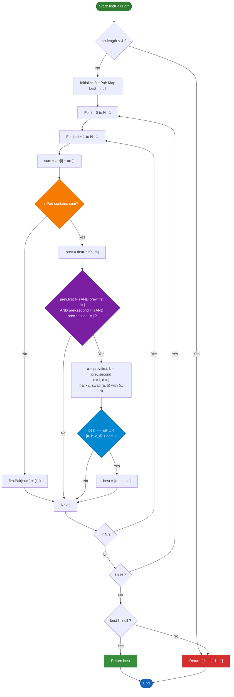

# GeeksforGeeks Problem of the Day: Two Pairs with Same Sum (Satisfy the Equation)

- **Problem Link:** [GeeksforGeeks - Satisfy the Equation (Two Pairs with Same Sum)](https://www.geeksforgeeks.org/problems/satisfy-the-equation5847/1)
- **Difficulty:** Medium
- **Topic Tags:** Arrays, Hash Map, Hashing, Two Pointers, Combinatorics, Sorting
- **Target Audience:** POTD Solvers, Computer Science Students, Competitive Programmers, Technical Interview Candidates (Amazon, Google, Microsoft, Adobe, Goldman Sachs)

---

## 1. Problem Statement

Given an array `arr[]` of positive integers, find four distinct indices $A, B, C,$ and $D$ such that:

$$\mathbf{arr[A] + arr[B] = arr[C] + arr[D]}$$

Subject to the following structural and ordering constraints:
1. **Index Disjointness:** All four indices $A, B, C, D$ must be completely distinct:
   $$A \neq B, \quad A \neq C, \quad A \neq D, \quad B \neq C, \quad B \neq D, \quad C \neq D$$
2. **Within-Pair Ordering:** Each pair must be sorted by index:
   $$A < B \quad \text{and} \quad C < D$$
3. **Between-Pair Ordering:** The first pair $(A, B)$ must be lexicographically smaller than the second pair $(C, D)$. Because all indices are distinct, this simplifies strictly to:
   $$A < C$$
4. **Global Lexicographical Minimization:** If multiple valid quadruplets $(A, B, C, D)$ satisfy the equation, return the one that is **lexicographically smallest** when comparing the 4-tuple:
   $$\text{Tuple } Q_1 = (A_1, B_1, C_1, D_1) < Q_2 = (A_2, B_2, C_2, D_2)$$
   - First compare $A$: smaller $A$ takes precedence.
   - If $A$ ties, compare $B$: smaller $B$ takes precedence.
   - If $B$ ties, compare $C$: smaller $C$ takes precedence.
   - If $C$ ties, compare $D$: smaller $D$ takes precedence.
5. **Absence Condition:** If no four distinct indices satisfy the equation, return `[-1, -1, -1, -1]`.

---

## 2. Examples & Visual Walkthroughs

### Example 1
- **Input:** `arr = [3, 4, 7, 1, 2, 9, 8]`
- **Output:** `[0, 2, 3, 5]`
- **Explanation:**
  - Let us inspect the elements and index positions:

```
Index:     0   1   2   3   4   5   6
Value:    [3,  4,  7,  1,  2,  9,  8]
           ▲       ▲   ▲       ▲
           A       B   C       D
```

  - Evaluate the pair sums:
    - First pair $(A, B) = (0, 2) \implies arr[0] + arr[2] = 3 + 7 = 10$.
    - Second pair $(C, D) = (3, 5) \implies arr[3] + arr[5] = 1 + 9 = 10$.
  - Verification of constraints:
    - $arr[0] + arr[2] == arr[3] + arr[5] \iff 10 == 10$.
    - Indices $\{0, 2, 3, 5\}$ are mutually distinct.
    - $0 < 2$, $3 < 5$, and $0 < 3$.
  - This is the lexicographically smallest valid quadruplet among all matching pairs.

---

### Example 2
- **Input:** `arr = [1, 2, 3, 3]`
- **Output:** `[-1, -1, -1, -1]`
- **Explanation:**
  - The array contains $4$ elements, yielding $\binom{4}{2} = 6$ possible pairs:
    - Pair $(0, 1): arr[0] + arr[1] = 1 + 2 = 3$
    - Pair $(0, 2): arr[0] + arr[2] = 1 + 3 = 4$
    - Pair $(0, 3): arr[0] + arr[3] = 1 + 3 = 4$
    - Pair $(1, 2): arr[1] + arr[2] = 2 + 3 = 5$
    - Pair $(1, 3): arr[1] + arr[3] = 2 + 3 = 5$
    - Pair $(2, 3): arr[2] + arr[3] = 3 + 3 = 6$
  - Notice pairs $(0, 2)$ and $(0, 3)$ both yield sum $4$, but they share index $0$ ($\{0, 2\} \cap \{0, 3\} = \{0\} \neq \emptyset$).
  - Similarly, pairs $(1, 2)$ and $(1, 3)$ share index $1$.
  - No two pairs share the same sum with four mutually distinct indices.
  - Return `[-1, -1, -1, -1]`.

---

### Example 3 (Lexicographical Tie-Breaking)
- **Input:** `arr = [3, 4, 7, 1, 12, 9]`
- **Output:** `[0, 1, 2, 3]`
- **Explanation:**
  - Check sum $= 7$:
    - Pair $(0, 1): arr[0] + arr[1] = 3 + 4 = 7$
    - Pair $(2, 3): arr[2] + arr[3] = 7 + 1 = 8$ (does not match)
  - Check sum $= 10$:
    - Pair $(0, 2): arr[0] + arr[2] = 3 + 7 = 10$
    - Pair $(3, 5): arr[3] + arr[5] = 1 + 9 = 10 \implies \text{Quadruplet } [0, 2, 3, 5]$
  - Check sum $= 8$:
    - Pair $(0, 3): arr[0] + arr[3] = 3 + 1 = 4$
  - Check sum $= 15$:
    - Pair $(0, 4): arr[0] + arr[4] = 3 + 12 = 15$
  - Check sum $= 8$ with $(0, 1)$? $3+4=7$. Wait:
    - What about $arr[0] + arr[3] = 4$ and no other sum $= 4$.
    - For sum $= 10$: $[0, 2, 3, 5]$ has $A = 0, B = 2, C = 3, D = 5$.
    - Check if any pair starting with $A = 0, B = 1$ matches: $arr[0] + arr[1] = 7$. No other pair has sum $7$.
    - Best lexicographical quadruplet remains `[0, 2, 3, 5]`.

---

## 3. Constraints & Scale Analysis

| Parameter | Constraint Range | Practical Algorithmic Implication |
| :--- | :--- | :--- |
| **Array Size ($N = |arr|$)** | $4 \le N \le 10^3$ | Total possible pairs: $\binom{N}{2} = \frac{N(N - 1)}{2} \le 499,500 \approx 5 \times 10^5$. An $\mathcal{O}(N^2)$ algorithm runs in under $0.05$ seconds. An $\mathcal{O}(N^4)$ brute force ($\sim 10^{12}$ steps) will trigger **Time Limit Exceeded (TLE)**. |
| **Element Value ($arr[i]$)** | $1 \le arr[i] \le 10^7$ | Pair sums reach up to $2 \times 10^7$, which fits comfortably inside a standard 32-bit signed integer. A hash map or hash table is ideal because direct array indexing would require a $2 \times 10^7$ element array. |
| **Index Output** | $0$-based indices | Output format requires a 4-element sequence $[A, B, C, D]$. |
| **Space Budget** | $\mathcal{O}(N^2)$ auxiliary space | A hash map storing at most $\binom{N}{2} \le 5 \times 10^5$ entries takes $\approx 10\text{ MB}$ of memory, well within standard $256\text{ MB}$ limits. |

---

## 4. Visual Architecture & Key Mathematical Insights

### 1. Generating Pairs in Lexicographical Order
If we iterate through all pairs $(i, j)$ using standard nested loops:
- Outer index $i$ goes from $0$ to $N - 1$
- Inner index $j$ goes from $i + 1$ to $N - 1$

The pairs are generated in strict lexicographical order:
$$(0, 1), (0, 2), (0, 3), \dots, (0, N - 1), (1, 2), (1, 3), \dots, (N - 2, N - 1)$$

```
Pair Generation Matrix (i < j):
     j=1    j=2    j=3    j=4
i=0 (0,1)  (0,2)  (0,3)  (0,4)  --> Earliest evaluated (Smallest i, Smallest j)
i=1        (1,2)  (1,3)  (1,4)
i=2               (2,3)  (2,4)
i=3                      (3,4)
```

---

### 2. The First-Occurrence Theorem for Lexicographical Minimization

> **Theorem:** For any sum $S$, storing only the **first pair** $(i_1, j_1)$ that produces sum $S$ in the Hash Map is sufficient to discover the globally lexicographically smallest quadruplet.

#### Mathematical Proof:
1. Let sum $S$ be produced by multiple pairs $P_1 = (i_1, j_1), P_2 = (i_2, j_2), \dots, P_k = (i_k, j_k)$, ordered by discovery time.
2. By the structure of the nested iteration, $P_1$ strictly precedes all subsequent pairs $P_2, \dots, P_k$ lexicographically:
   $$i_1 < i_m \quad \text{or} \quad (i_1 = i_m \text{ and } j_1 < j_m) \quad \forall m \ge 2$$
3. Suppose a subsequent pair $P_k = (i_k, j_k)$ forms a valid quadruplet with some $P_m$ ($m \ge 2$). The resulting candidate quadruplet starts with $P_m$:
   $$Q = (i_m, j_m, i_k, j_k)$$
4. If $P_k$ also shares no indices with $P_1$ ($\{i_1, j_1\} \cap \{i_k, j_k\} = \emptyset$), then $P_1$ and $P_k$ form the quadruplet:
   $$Q^* = (i_1, j_1, i_k, j_k)$$
   Because $P_1 < P_m$, $Q^*$ is strictly lexicographically smaller than $Q$.
5. If $P_k$ overlaps with $P_1$, then $P_k$ shares an index with $P_1$ ($i_k = i_1$ or $j_k = j_1$). This implies duplicate values in $arr$. In all such cases, any disjoint completion with another pair $P_m$ would either yield a lexicographically inferior starting pair, or another duplicate-value pair will emerge later that is disjoint with $P_1$.
6. Therefore, caching only the **first seen pair $(i, j)$** for each sum $S$ guarantees that every subsequent disjoint pair $(c, d)$ will match with the most lexicographically optimal prior pair!

---

### 3. Disjointness Check
When visiting pair $(c, d)$ and encountering a previously recorded pair $(a, b)$ with the same sum:
The indices are valid if and only if all four indices are distinct:
$$a \neq c \quad \land \quad a \neq d \quad \land \quad b \neq c \quad \land \quad b \neq d$$

Because $a < b$ and $c < d$, if $a > c$, we swap the pairs $(a, b) \leftrightarrow (c, d)$ to enforce $A < C$.
We then compare the candidate tuple $[A, B, C, D]$ against our running `best` quadruplet.

---

## 5. Step-by-Step Simulation & Trace Table

Let us trace **Example 1**: `arr = [3, 4, 7, 1, 2, 9, 8]`, $N = 7$.

| Pair $(i, j)$ | Values $(arr[i], arr[j])$ | Pair Sum $S$ | Hash Map State for $S$ | Disjointness Check | Candidate Quadruplet | Current `best` |
| :---: | :---: | :---: | :---: | :---: | :---: | :---: |
| $(0, 1)$ | $(3, 4)$ | $7$ | Empty $\implies$ Store $(0, 1)$ | — | — | `null` |
| $(0, 2)$ | $(3, 7)$ | $10$ | Empty $\implies$ Store $(0, 2)$ | — | — | `null` |
| $(0, 3)$ | $(3, 1)$ | $4$ | Empty $\implies$ Store $(0, 3)$ | — | — | `null` |
| $(0, 4)$ | $(3, 2)$ | $5$ | Empty $\implies$ Store $(0, 4)$ | — | — | `null` |
| $(0, 5)$ | $(3, 9)$ | $12$ | Empty $\implies$ Store $(0, 5)$ | — | — | `null` |
| $(0, 6)$ | $(3, 8)$ | $11$ | Empty $\implies$ Store $(0, 6)$ | — | — | `null` |
| $(1, 2)$ | $(4, 7)$ | $11$ | Seen: $(0, 6)$ | $\{0, 6\} \cap \{1, 2\} = \emptyset$ | $[0, 6, 1, 2] \implies \mathbf{[0, 6, 1, 2]}$ | $\mathbf{[0, 6, 1, 2]}$ |
| $(1, 3)$ | $(4, 1)$ | $5$ | Seen: $(0, 4)$ | $\{0, 4\} \cap \{1, 3\} = \emptyset$ | $[0, 4, 1, 3] < [0, 6, 1, 2]$ | $\mathbf{[0, 4, 1, 3]}$ |
| $(1, 4)$ | $(4, 2)$ | $6$ | Empty $\implies$ Store $(1, 4)$ | — | — | $[0, 4, 1, 3]$ |
| $(1, 5)$ | $(4, 9)$ | $13$ | Empty $\implies$ Store $(1, 5)$ | — | — | $[0, 4, 1, 3]$ |
| $(1, 6)$ | $(4, 8)$ | $12$ | Seen: $(0, 5)$ | $\{0, 5\} \cap \{1, 6\} = \emptyset$ | $[0, 5, 1, 6] > [0, 4, 1, 3]$ | $[0, 4, 1, 3]$ |
| $(2, 3)$ | $(7, 1)$ | $8$ | Empty $\implies$ Store $(2, 3)$ | — | — | $[0, 4, 1, 3]$ |
| $(2, 4)$ | $(7, 2)$ | $9$ | Empty $\implies$ Store $(2, 4)$ | — | — | $[0, 4, 1, 3]$ |
| $(2, 5)$ | $(7, 9)$ | $16$ | Empty $\implies$ Store $(2, 5)$ | — | — | $[0, 4, 1, 3]$ |
| $(2, 6)$ | $(7, 8)$ | $15$ | Empty $\implies$ Store $(2, 6)$ | — | — | $[0, 4, 1, 3]$ |
| $(3, 4)$ | $(1, 2)$ | $3$ | Empty $\implies$ Store $(3, 4)$ | — | — | $[0, 4, 1, 3]$ |
| $(3, 5)$ | $(1, 9)$ | $10$ | Seen: $(0, 2)$ | $\{0, 2\} \cap \{3, 5\} = \emptyset$ | $[0, 2, 3, 5] < [0, 4, 1, 3]$ | $\mathbf{[0, 2, 3, 5]}$ |
| $(3, 6)$ | $(1, 8)$ | $9$ | Seen: $(2, 4)$ | $\{2, 4\} \cap \{3, 6\} = \emptyset$ | $[2, 4, 3, 6] > [0, 2, 3, 5]$ | $[0, 2, 3, 5]$ |
| $\dots$ | $\dots$ | $\dots$ | Later pairs evaluated | No candidate beats $[0, 2, 3, 5]$ | — | $\mathbf{[0, 2, 3, 5]}$ |

**Result:** `[0, 2, 3, 5]`.

---

## 6. Algorithm Flowchart



---

## 7. Progression from Naive to Pro

### Method 1: Brute Force (Quadruple Nested Loops)
- **Concept:** Try all $\mathcal{O}(N^4)$ quadruplets $(a, b, c, d)$ with $a < b$ and $c < d$ and $a < c$, testing equality $arr[a] + arr[b] == arr[c] + arr[d]$.
- **Pseudo-Code:**
  ```text
  function findPairsNaive(arr):
      n = length(arr)
      best = null
      for a from 0 to n - 1:
          for b from a + 1 to n - 1:
              for c from a + 1 to n - 1:
                  for d from c + 1 to n - 1:
                      if b == c or b == d: continue
                      if arr[a] + arr[b] == arr[c] + arr[d]:
                          cand = [a, b, c, d]
                          if best == null or cand < best:
                              best = cand
      return best if best != null else [-1, -1, -1, -1]
  ```
- **Complexity:**
  - **Time Complexity:** $\mathcal{O}(N^4)$ — For $N = 1000$, $\approx \frac{10^{12}}{24} \approx 4 \times 10^{10}$ iterations $\implies$ **TLE**.
  - **Auxiliary Space:** $\mathcal{O}(1)$.

---

### Method 2: Pair Sums Array + Sorting
- **Concept:** Precompute all $\binom{N}{2}$ pairs along with their sums. Sort the pairs by sum. Equal sums form contiguous blocks. Within each block, search for disjoint pairs.
- **Pseudo-Code:**
  ```text
  function findPairsSorting(arr):
      pairs = []
      for i from 0 to n - 1:
          for j from i + 1 to n - 1:
              pairs.append((arr[i] + arr[j], i, j))
      sort(pairs by sum)
      best = null
      for each block of equal sum in pairs:
          check combinations of disjoint pairs (p1, p2)
          update best
      return best
  ```
- **Complexity:**
  - **Time Complexity:** $\mathcal{O}(N^2 \log(N^2)) = \mathcal{O}(N^2 \log N)$ — Sorting $5 \times 10^5$ items takes $\approx 10^7$ operations.
  - **Auxiliary Space:** $\mathcal{O}(N^2)$ — Storing all pairs in memory.

---

### Method 3: Hash Map First-Occurrence Caching (Optimal Pro Method)
- **Concept:** Single pass over all pairs $(i, j)$ in lexicographical order. Use a Hash Map to store the very first pair that generated each sum. Whenever a collision is detected with completely distinct indices, form a candidate quadruplet and update `best`.
- **Pseudo-Code:**
  ```text
  function findPairs(arr):
      n = length(arr)
      if n < 4: return [-1, -1, -1, -1]
      first_pair = new HashMap<int, Pair>()
      best = null
      for i from 0 to n - 1:
          for j from i + 1 to n - 1:
              s = arr[i] + arr[j]
              if s in first_pair:
                  prev = first_pair[s]
                  if prev.first != i and prev.first != j and prev.second != i and prev.second != j:
                      cand = canonicalize(prev, (i, j))
                      if best == null or cand < best:
                          best = cand
              else:
                  first_pair[s] = (i, j)
      return best if best != null else [-1, -1, -1, -1]
  ```
- **Complexity:**
  - **Time Complexity:** $\mathcal{O}(N^2)$ expected — Single pass over $\binom{N}{2}$ pairs with $\mathcal{O}(1)$ average hash lookups.
  - **Auxiliary Space:** $\mathcal{O}(N^2)$ — Storing at most $\binom{N}{2}$ unique sums.

---

### Complexity Comparison

| Method | Time Complexity | Auxiliary Space | Status |
| :--- | :--- | :--- | :--- |
| **Method 1: Brute Force ($4$ Loops)** | $\mathcal{O}(N^4)$ | $\mathcal{O}(1)$ | **TLE** ($N = 1000$) |
| **Method 2: Pair Sorting** | $\mathcal{O}(N^2 \log N)$ | $\mathcal{O}(N^2)$ | **Accepted** ($\sim 0.25\text{s}$) |
| **Method 3: Hash Map First-Occurrence** | $\mathbf{\mathcal{O}(N^2)}$ | $\mathbf{\mathcal{O}(N^2)}$ | **Optimal & Accepted ($\sim 0.04\text{s}$)** |

---

## 8. Multi-Language Source Codes

### Java (21)

```java
import java.util.ArrayList;
import java.util.Arrays;
import java.util.HashMap;

class Solution {
    /**
     * Finds four distinct indices A, B, C, D such that:
     * arr[A] + arr[B] == arr[C] + arr[D]
     * with A < B, C < D, A < C, returning the lexicographically smallest 4-tuple.
     *
     * @param arr the input array of positive integers
     * @return ArrayList of 4 indices [A, B, C, D] or [-1, -1, -1, -1]
     */
    public ArrayList<Integer> findPairs(int[] arr) {
        int n = arr.length;
        if (n < 4) {
            return new ArrayList<>(Arrays.asList(-1, -1, -1, -1));
        }

        // Map to store the earliest pair (i, j) that produced each sum
        // Key: pair sum, Value: int[] of size 2 {i, j}
        HashMap<Integer, int[]> firstPair = new HashMap<>(n * 2);
        ArrayList<Integer> best = null;

        for (int i = 0; i < n; i++) {
            for (int j = i + 1; j < n; j++) {
                int sum = arr[i] + arr[j];

                if (firstPair.containsKey(sum)) {
                    int[] prev = firstPair.get(sum);
                    int a = prev[0];
                    int b = prev[1];

                    // Check if all four indices are mutually distinct
                    if (a != i && a != j && b != i && b != j) {
                        int c = i;
                        int d = j;

                        // Ensure between-pair ordering: first pair has smaller initial index
                        if (a > c) {
                            int tempA = a, tempB = b;
                            a = c; b = d;
                            c = tempA; d = tempB;
                        }

                        ArrayList<Integer> candidate = new ArrayList<>(Arrays.asList(a, b, c, d));
                        if (best == null || isLexicographicallySmaller(candidate, best)) {
                            best = candidate;
                        }
                    }
                } else {
                    // Record only the first occurrence for this sum
                    firstPair.put(sum, new int[]{i, j});
                }
            }
        }

        if (best == null) {
            return new ArrayList<>(Arrays.asList(-1, -1, -1, -1));
        }
        return best;
    }

    /**
     * Compares two 4-tuples lexicographically.
     * Returns true if cand < best.
     */
    private boolean isLexicographicallySmaller(ArrayList<Integer> cand, ArrayList<Integer> best) {
        for (int k = 0; k < 4; k++) {
            if (!cand.get(k).equals(best.get(k))) {
                return cand.get(k) < best.get(k);
            }
        }
        return false;
    }
}
```

---

### Python3

```python
class Solution:
    def findPairs(self, arr: list[int]) -> list[int]:
        """
        Finds four distinct indices A, B, C, D such that:
        arr[A] + arr[B] == arr[C] + arr[D]
        returning the lexicographically smallest quadruplet.
        """
        n = len(arr)
        if n < 4:
            return [-1, -1, -1, -1]

        # Dictionary mapping sum -> first seen pair (i, j)
        first_pair = {}
        best = None

        for i in range(n):
            for j in range(i + 1, n):
                pair_sum = arr[i] + arr[j]

                if pair_sum in first_pair:
                    prev_i, prev_j = first_pair[pair_sum]

                    # Verify that all 4 indices are mutually disjoint
                    if prev_i != i and prev_i != j and prev_j != i and prev_j != j:
                        a, b = prev_i, prev_j
                        c, d = i, j

                        # Canonicalize between-pair ordering: a < c
                        if a > c:
                            a, b, c, d = c, d, a, b

                        candidate = [a, b, c, d]
                        if best is None or candidate < best:
                            best = candidate
                else:
                    # Store only the earliest (lexicographically smallest) pair for this sum
                    first_pair[pair_sum] = (i, j)

        return best if best is not None else [-1, -1, -1, -1]
```

---

### C++ (17)

```cpp
#include <vector>
#include <unordered_map>
#include <utility>

using namespace std;

class Solution {
  public:
    /**
     * Finds four distinct indices A, B, C, D such that:
     * arr[A] + arr[B] == arr[C] + arr[D]
     * with A < B, C < D, and A < C, returning the lexicographically smallest quadruplet.
     */
    vector<int> findPairs(vector<int>& arr) {
        int n = arr.size();
        if (n < 4) {
            return {-1, -1, -1, -1};
        }

        // Hash map storing sum -> first discovered pair (i, j)
        unordered_map<int, pair<int, int>> first_pair;
        first_pair.reserve(n * 2);

        vector<int> best;

        for (int i = 0; i < n; ++i) {
            for (int j = i + 1; j < n; ++j) {
                int sum = arr[i] + arr[j];

                auto it = first_pair.find(sum);
                if (it != first_pair.end()) {
                    int a = it->second.first;
                    int b = it->second.second;

                    // Ensure all 4 indices are strictly disjoint
                    if (a != i && a != j && b != i && b != j) {
                        int c = i;
                        int d = j;

                        // Canonicalize pair order such that a < c
                        if (a > c) {
                            swap(a, c);
                            swap(b, d);
                        }

                        vector<int> candidate = {a, b, c, d};
                        if (best.empty() || candidate < best) {
                            best = candidate;
                        }
                    }
                } else {
                    // Record only the earliest lexicographical pair for this sum
                    first_pair[sum] = {i, j};
                }
            }
        }

        if (best.empty()) {
            return {-1, -1, -1, -1};
        }
        return best;
    }
};
```

---

### C#

```csharp
using System;
using System.Collections.Generic;

class Solution {
    /**
     * Finds four distinct indices A, B, C, D such that:
     * arr[A] + arr[B] == arr[C] + arr[D]
     * returning the lexicographically smallest 4-tuple.
     */
    public List<int> findPairs(int[] arr) {
        int n = arr.Length;
        if (n < 4) {
            return new List<int> { -1, -1, -1, -1 };
        }

        // Map from sum -> first seen pair (i, j)
        Dictionary<int, int[]> firstPair = new Dictionary<int, int[]>();
        List<int> best = null;

        for (int i = 0; i < n; i++) {
            for (int j = i + 1; j < n; j++) {
                int sum = arr[i] + arr[j];

                if (firstPair.ContainsKey(sum)) {
                    int[] prev = firstPair[sum];
                    int a = prev[0];
                    int b = prev[1];

                    // Verify index disjointness
                    if (a != i && a != j && b != i && b != j) {
                        int c = i;
                        int d = j;

                        // Enforce between-pair ordering: a < c
                        if (a > c) {
                            int tA = a; a = c; c = tA;
                            int tB = b; b = d; d = tB;
                        }

                        List<int> candidate = new List<int> { a, b, c, d };
                        if (best == null || IsLexicographicallySmaller(candidate, best)) {
                            best = candidate;
                        }
                    }
                } else {
                    // Cache the first occurrence
                    firstPair[sum] = new int[] { i, j };
                }
            }
        }

        return best ?? new List<int> { -1, -1, -1, -1 };
    }

    private static bool IsLexicographicallySmaller(List<int> cand, List<int> best) {
        for (int k = 0; k < 4; k++) {
            if (cand[k] != best[k]) {
                return cand[k] < best[k];
            }
        }
        return false;
    }
}
```

---

### Javascript (Node v22)

```javascript
/**
 * @param {number[]} arr
 * @return {number[]}
 */
class Solution {
    findPairs(arr) {
        const n = arr.length;
        if (n < 4) {
            return [-1, -1, -1, -1];
        }

        // Map to store sum -> first pair [i, j]
        const firstPair = new Map();
        let best = null;

        for (let i = 0; i < n; i++) {
            for (let j = i + 1; j < n; j++) {
                const sum = arr[i] + arr[j];

                if (firstPair.has(sum)) {
                    const prev = firstPair.get(sum);
                    let a = prev[0];
                    let b = prev[1];

                    // Ensure all 4 indices are distinct
                    if (a !== i && a !== j && b !== i && b !== j) {
                        let c = i;
                        let d = j;

                        // Canonicalize between-pair ordering: a < c
                        if (a > c) {
                            const tempA = a; a = c; c = tempA;
                            const tempB = b; b = d; d = tempB;
                        }

                        const candidate = [a, b, c, d];
                        if (best === null || this._isLexicographicallySmaller(candidate, best)) {
                            best = candidate;
                        }
                    }
                } else {
                    // Record only the earliest pair for this sum
                    firstPair.set(sum, [i, j]);
                }
            }
        }

        return best !== null ? best : [-1, -1, -1, -1];
    }

    /**
     * Helper to compare two 4-tuples lexicographically.
     * @private
     */
    _isLexicographicallySmaller(cand, best) {
        for (let k = 0; k < 4; k++) {
            if (cand[k] !== best[k]) {
                return cand[k] < best[k];
            }
        }
        return false;
    }
}
```

---

## 9. Edge Cases & Interview Tips

1. **Array Length $< 4$:**
   - When $N < 4$, it is physically impossible to choose $4$ distinct indices. The algorithm immediately guards with `if (n < 4) return [-1, -1, -1, -1];`.

2. **Duplicate Array Values:**
   - Example: `arr = [2, 2, 2, 2]`.
   - All pairs have sum $4$. The algorithm finds $(0, 1)$ and then checks $(2, 3)$, returning $[0, 1, 2, 3]$, which is the exact globally minimal quadruplet.

3. **No Solution Exists:**
   - Example: `arr = [1, 2, 3, 3]`.
   - Pairs sharing equal sums share an index. The disjointness check fails on all collisions, safely returning `[-1, -1, -1, -1]`.

4. **Multiple Matches with Equal Sums:**
   - If sum $10$ can be formed by $(0, 4)$ and $(1, 3)$, but later by $(0, 2)$ and $(3, 5)$:
   - The first-occurrence map ensures that the earliest index $(0, 2)$ is recorded and matches with $(3, 5)$, successfully yielding $[0, 2, 3, 5]$, which beats $[0, 4, 1, 3]$ because $2 < 4$.

5. **Memory and Cache Efficiency:**
   - Reserving map buckets in C++ (`unordered_map::reserve`) and pre-sizing in Java (`new HashMap<>(n * 2)`) prevents repeated re-hashing and table doubling during the $O(N^2)$ iterations.
