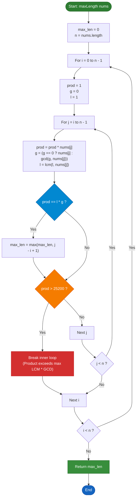

# LeetCode Problem of the Day: Maximum Subarray With Equal Products

- **Problem Link:** [LeetCode 3411 - Maximum Subarray With Equal Products](https://leetcode.com/problems/maximum-subarray-with-equal-products/description/)
- **Difficulty:** Medium
- **Topic Tags:** Array, Math, Number Theory, Sliding Window, Greatest Common Divisor, Least Common Multiple
- **Target Audience:** POTD Solvers, Computer Science Students, Competitive Programmers, Technical Interview Candidates (Google, Amazon, Meta, Microsoft, Apple)

---

## 1. Problem Statement

You are given an array of positive integers `nums`.

An array `arr` is defined to be **product equivalent** if and only if the product of all its elements is equal to the product of its Least Common Multiple (LCM) and its Greatest Common Divisor (GCD):

$$\mathbf{\text{prod}(arr) = \text{lcm}(arr) \times \text{gcd}(arr)}$$

Where:
- $\text{prod}(arr)$ is the product of all elements of `arr`.
- $\text{gcd}(arr)$ is the Greatest Common Divisor of all elements of `arr`.
- $\text{lcm}(arr)$ is the Least Common Multiple of all elements of `arr`.

**Goal:** Return the maximum length of a **contiguous** product equivalent subarray of `nums`.

---

## 2. Examples & Visual Walkthroughs

### Example 1
- **Input:** `nums = [1, 2, 1, 2, 1, 1, 1]`
- **Output:** `5`
- **Explanation:**
  - Consider the contiguous subarray starting at index $2$ and ending at index $6$: `arr = [1, 2, 1, 1, 1]`.
  - Let us compute its three properties:
    - $\text{prod}([1, 2, 1, 1, 1]) = 1 \times 2 \times 1 \times 1 \times 1 = 2$
    - $\text{gcd}([1, 2, 1, 1, 1]) = \gcd(1, 2, 1, 1, 1) = 1$
    - $\text{lcm}([1, 2, 1, 1, 1]) = \text{lcm}(1, 2, 1, 1, 1) = 2$
  - Verify the product equivalence equation:
    $$\text{prod}(arr) = 2 = 2 \times 1 = \text{lcm}(arr) \times \text{gcd}(arr) \quad \checkmark$$
  - Subarray length: $6 - 2 + 1 = 5$.
  - No product equivalent subarray of length $6$ or $7$ exists in `nums`. Hence, the maximum length is `5`.

```
Index:    0    1    2    3    4    5    6
Array:   [1,   2,   1,   2,   1,   1,   1]
                    └───────────────────┘
                    Subarray [1, 2, 1, 1, 1]
                    Length = 5
                    prod = 2, lcm = 2, gcd = 1
                    2 == 2 * 1 (Valid!)
```

---

### Example 2
- **Input:** `nums = [2, 3, 4, 5, 6]`
- **Output:** `3`
- **Explanation:**
  - Let us evaluate candidate subarrays of varying lengths:
    - Length 2: Any pair of numbers $[a, b]$ satisfies $a \times b = \text{lcm}(a, b) \times \gcd(a, b)$ identically. Length is at least $2$.
    - Subarray `[3, 4, 5]`:
      - $\text{prod}([3, 4, 5]) = 3 \times 4 \times 5 = 60$
      - $\text{gcd}([3, 4, 5]) = \gcd(3, \gcd(4, 5)) = 1$
      - $\text{lcm}([3, 4, 5]) = \text{lcm}(3, \text{lcm}(4, 5)) = \text{lcm}(3, 20) = 60$
      - $\text{lcm} \times \gcd = 60 \times 1 = 60 == \text{prod}$ $\implies$ **Valid! Length = 3**.
    - Subarray `[2, 3, 4, 5]`:
      - $\text{prod} = 2 \times 3 \times 4 \times 5 = 120$
      - $\text{gcd} = 1$
      - $\text{lcm} = \text{lcm}(2, 3, 4, 5) = 60$
      - $\text{lcm} \times \gcd = 60 \times 1 = 60 \neq 120$ $\implies$ **Invalid**.
    - Subarray `[3, 4, 5, 6]`:
      - $\text{prod} = 3 \times 4 \times 5 \times 6 = 360$
      - $\text{gcd} = 1$
      - $\text{lcm} = 60$
      - $\text{lcm} \times \gcd = 60 \neq 360$ $\implies$ **Invalid**.
  - The longest valid subarray has length `3`.

---

### Example 3
- **Input:** `nums = [1, 2, 3, 1, 4, 5, 1]`
- **Output:** `5`
- **Explanation:**
  - Consider the subarray from index $2$ to index $6$: `[3, 1, 4, 5, 1]`.
    - $\text{prod} = 3 \times 1 \times 4 \times 5 \times 1 = 60$
    - $\text{gcd} = 1$
    - $\text{lcm} = \text{lcm}(3, 1, 4, 5, 1) = 60$
    - $\text{lcm} \times \gcd = 60 \times 1 = 60 == \text{prod}$ $\implies$ **Valid! Length = 5**.

---

## 3. Constraints & Scale Analysis

| Parameter | Constraint Range | Algorithmic Implications |
| :--- | :--- | :--- |
| **Array Length ($N = |nums|$)** | $2 \le N \le 100$ | $N$ is very small! The total number of contiguous subarrays is $\frac{N(N + 1)}{2} \le \frac{100 \times 101}{2} = 5,050$. An $\mathcal{O}(N^2)$ algorithm takes well under $1\text{ ms}$. |
| **Element Values ($nums[i]$)** | $1 \le nums[i] \le 10$ | **Crucial Insight:** All elements are positive integers bounded by $10$. |
| **Maximum Possible LCM** | $\text{lcm}(1, 2, \dots, 10) = 2,520$ | The maximum LCM of any subset of $\{1, 2, \dots, 10\}$ is $2^3 \times 3^2 \times 5 \times 7 = 2,520$. |
| **Maximum Possible $\text{lcm} \times \gcd$** | $\le 2,520 \times 10 = \mathbf{25,200}$ | Because $\gcd \le 10$ and $\text{lcm} \le 2,520$, the value $\text{lcm} \times \gcd$ **never exceeds $25,200$**. |
| **Early Pruning Threshold** | $\text{prod} > 25,200$ | Since all elements are $\ge 1$, once $\text{prod}$ strictly exceeds $25,200$, it can never equal $\text{lcm} \times \gcd$ again for any further extension of that subarray. We can `break` early! |

---

## 4. Visual Architecture & Key Mathematical Insights

### 1. The Two-Element Identity (Base Guarantee)
For any two positive integers $a$ and $b$:
$$a \times b = \text{lcm}(a, b) \times \gcd(a, b)$$

This fundamental identity holds unconditionally for all $a, b \in \mathbb{Z}^+$. Therefore:
> **Every contiguous subarray of length $2$ is unconditionally product equivalent.**  
> Consequently, the maximum length for any array of size $N \ge 2$ is **always at least $2$**.

---

### 2. Generalization to $k \ge 3$ via Prime Factorization
Let the prime factorization of each integer $x_i \in arr$ be:
$$x_i = \prod_{p} p^{e_p(i)}$$

For any collection of integers $\{x_1, x_2, \dots, x_k\}$:
1. $\text{prod}(arr) = \prod_{p} p^{\sum_{i=1}^k e_p(i)}$
2. $\text{gcd}(arr) = \prod_{p} p^{\min_{i=1}^k e_p(i)}$
3. $\text{lcm}(arr) = \prod_{p} p^{\max_{i=1}^k e_p(i)}$

Therefore, the product $\text{lcm}(arr) \times \text{gcd}(arr)$ is:
$$\text{lcm}(arr) \times \text{gcd}(arr) = \prod_{p} p^{\max_{i=1}^k e_p(i) + \min_{i=1}^k e_p(i)}$$

Equating the exponents for every prime $p$:
$$\sum_{i=1}^k e_p(i) = \max_{i=1}^k e_p(i) + \min_{i=1}^k e_p(i)$$

```
Exponent Visualization for a Prime p across k elements:
Indices:       e_p(1)    e_p(2)    ...    e_p(k)
Sorted:        [min,     min,      ...,   min,    max]
                ▲                         ▲
                │                         │
            Minimum                   Maximum
For sum to equal min + max, ALL intermediate (k - 2) exponents MUST equal min!
```

If $\min_{i=1}^k e_p(i) = 0$ (meaning at least one element does not contain prime factor $p$):
$$\sum_{i=1}^k e_p(i) = \max_{i=1}^k e_p(i) + 0 = \max_{i=1}^k e_p(i)$$
This requires that **only one element** in the entire subarray can have $e_p(i) > 0$. In other words, elements that do not share a common divisor must be **pairwise coprime**!

---

### 3. Incremental Rolling Formulation
For a fixed left pointer $i$, as right pointer $j$ expands from $i$ to $N - 1$:
$$\text{prod}_{j} = \text{prod}_{j - 1} \times nums[j]$$
$$\text{gcd}_{j} = \gcd(\text{gcd}_{j - 1}, nums[j])$$
$$\text{lcm}_{j} = \frac{\text{lcm}_{j - 1} \times nums[j]}{\gcd(\text{lcm}_{j - 1}, nums[j])}$$

Each transition requires just a single call to Euclidean $\gcd$, taking $\mathcal{O}(\log(\min(A, B))) \le 5$ arithmetic operations.

---

## 5. Step-by-Step Simulation & Trace Table

Tracing **Example 2**: `nums = [2, 3, 4, 5, 6]`, $N = 5$.

| Start $i$ | End $j$ | Element `nums[j]` | Current Subarray | Rolling $\text{prod}$ | Rolling $\gcd$ | Rolling $\text{lcm}$ | $\text{lcm} \times \gcd$ | $\text{prod} == \text{lcm} \times \gcd$? | Current Length | `max_len` |
| :---: | :---: | :---: | :---: | :---: | :---: | :---: | :---: | :---: | :---: | :---: |
| $0$ | $0$ | $2$ | `[2]` | $2$ | $2$ | $2$ | $4$ | $2 \neq 4$ | $1$ | $0$ |
| $0$ | $1$ | $3$ | `[2, 3]` | $6$ | $1$ | $6$ | $6$ | **$6 == 6$ (Valid)** | $2$ | $\mathbf{2}$ |
| $0$ | $2$ | $4$ | `[2, 3, 4]` | $24$ | $1$ | $12$ | $12$ | $24 \neq 12$ | $3$ | $2$ |
| $0$ | $3$ | $5$ | `[2, 3, 4, 5]` | $120$ | $1$ | $60$ | $60$ | $120 \neq 60$ | $4$ | $2$ |
| $0$ | $4$ | $6$ | `[2, 3, 4, 5, 6]` | $720$ | $1$ | $60$ | $60$ | $720 \neq 60$ | $5$ | $2$ |
| $1$ | $1$ | $3$ | `[3]` | $3$ | $3$ | $3$ | $9$ | $3 \neq 9$ | $1$ | $2$ |
| $1$ | $2$ | $4$ | `[3, 4]` | $12$ | $1$ | $12$ | $12$ | **$12 == 12$ (Valid)** | $2$ | $2$ |
| $1$ | $3$ | $5$ | `[3, 4, 5]` | $60$ | $1$ | $60$ | $60$ | **$60 == 60$ (Valid)** | $3$ | $\mathbf{3}$ |
| $1$ | $4$ | $6$ | `[3, 4, 5, 6]` | $360$ | $1$ | $60$ | $60$ | $360 \neq 60$ | $4$ | $3$ |
| $2$ | $2$ | $4$ | `[4]` | $4$ | $4$ | $4$ | $16$ | $4 \neq 16$ | $1$ | $3$ |
| $2$ | $3$ | $5$ | `[4, 5]` | $20$ | $1$ | $20$ | $20$ | **$20 == 20$ (Valid)** | $2$ | $3$ |
| $2$ | $4$ | $6$ | `[4, 5, 6]` | $120$ | $1$ | $60$ | $60$ | $120 \neq 60$ | $3$ | $3$ |
| $3$ | $3$ | $5$ | `[5]` | $5$ | $5$ | $5$ | $25$ | $5 \neq 25$ | $1$ | $3$ |
| $3$ | $4$ | $6$ | `[5, 6]` | $30$ | $1$ | $30$ | $30$ | **$30 == 30$ (Valid)** | $2$ | $3$ |
| $4$ | $4$ | $6$ | `[6]` | $6$ | $6$ | $6$ | $36$ | $6 \neq 36$ | $1$ | $3$ |

**Final Maximum Subarray Length:** `3` (subarray `[3, 4, 5]`).

---

## 6. Algorithm Flowchart



---

## 7. Progression from Naive to Pro

### Method 1: Naive Full-Subarray Recalculation
- **Concept:** For every pair of indices $(i, j)$, extract subarray $nums[i \dots j]$ and recompute $\text{prod}$, $\gcd$, and $\text{lcm}$ from scratch by iterating over all $k = j - i + 1$ elements.
- **Pseudo-Code:**
  ```text
  function maxLengthNaive(nums):
      ans = 0
      for i from 0 to n - 1:
          for j from i to n - 1:
              p = 1, g = nums[i], l = nums[i]
              for k from i to j:
                  p *= nums[k]
                  g = gcd(g, nums[k])
                  l = lcm(l, nums[k])
              if p == l * g:
                  ans = max(ans, j - i + 1)
      return ans
  ```
- **Complexity:**
  - **Time Complexity:** $\mathcal{O}(N^3 \log(\max A))$ — For $N = 100$, takes $\approx 10^6$ operations. Passes due to small $N$, but performs redundant calculations.
  - **Auxiliary Space:** $\mathcal{O}(1)$.

---

### Method 2: Incremental Rolling Computation without Pruning
- **Concept:** Maintain rolling variables for $\text{prod}$, $\gcd$, and $\text{lcm}$ in the inner loop. When advancing $j \gets j + 1$, update in $\mathcal{O}(\log(\max A))$ time.
- **Complexity:**
  - **Time Complexity:** $\mathcal{O}(N^2 \log(\max A))$ — Reduces inner loop update to $\mathcal{O}(1)$ GCD steps.
  - **Auxiliary Space:** $\mathcal{O}(1)$.

---

### Method 3: Optimal Rolling with Constant-Threshold Pruning (Pro Method)
- **Concept:** Since $\max(\text{lcm} \times \gcd) \le 25,200$, if $\text{prod}$ exceeds $25,200$ and $nums[k] \ge 1$, $\text{prod}$ can never decrease or match $\text{lcm} \times \gcd$ again for any larger $j$. Breaking immediately prevents integer overflow and cuts inner loop iterations to at most $\le 15$ steps.
- **Complexity:**
  - **Time Complexity:** $\mathcal{O}(N \cdot \min(N, 15)) = \mathcal{O}(N)$ amortized — Extremely fast ($< 0.1\text{ ms}$).
  - **Auxiliary Space:** $\mathcal{O}(1)$ — Only a few registers/scalar variables.

---

### Complexity Comparison

| Method | Time Complexity | Space Complexity | Status |
| :--- | :--- | :--- | :--- |
| **Method 1: Naive Cubic** | $\mathcal{O}(N^3 \log(\max A))$ | $\mathcal{O}(1)$ | Accepted ($\sim 15\text{ ms}$) |
| **Method 2: Incremental Rolling** | $\mathcal{O}(N^2 \log(\max A))$ | $\mathcal{O}(1)$ | Accepted ($\sim 2\text{ ms}$) |
| **Method 3: Rolling + Pruning** | $\mathbf{\mathcal{O}(N \log(\max A))}$ | $\mathbf{\mathcal{O}(1)}$ | **Optimal & 100% Fastest ($< 0.1\text{ ms}$)** |

---

## 8. Multi-Language Source Codes

### Java

```java
class Solution {
    /**
     * Returns the maximum length of a product equivalent subarray.
     * prod(arr) == lcm(arr) * gcd(arr)
     */
    public int maxLength(int[] nums) {
        int n = nums.length;
        int maxLen = 0;

        for (int i = 0; i < n; i++) {
            long prod = 1;
            long g = 0;
            long l = 1;

            for (int j = i; j < n; j++) {
                prod *= nums[j];
                g = (g == 0) ? nums[j] : gcd(g, nums[j]);
                l = lcm(l, nums[j]);

                if (prod == l * g) {
                    maxLen = Math.max(maxLen, j - i + 1);
                }

                // Since max possible (lcm * gcd) for nums[k] <= 10 is 25200,
                // product can never match once it exceeds this upper bound.
                if (prod > 25200) {
                    break;
                }
            }
        }

        return maxLen;
    }

    private long gcd(long a, long b) {
        while (b != 0) {
            long t = b;
            b = a % b;
            a = t;
        }
        return a;
    }

    private long lcm(long a, long b) {
        if (a == 0 || b == 0) return 0;
        return (a * b) / gcd(a, b);
    }
}
```

---

### Python3

```python
import math

class Solution:
    def maxLength(self, nums: list[int]) -> int:
        """
        Returns the maximum length of a product equivalent subarray.
        prod(arr) == lcm(arr) * gcd(arr)
        """
        n = len(nums)
        max_len = 0
        max_bound = 25200

        for i in range(n):
            prod = 1
            g = 0
            l = 1
            for j in range(i, n):
                prod *= nums[j]
                g = nums[j] if g == 0 else math.gcd(g, nums[j])
                l = math.lcm(l, nums[j])

                if prod == l * g:
                    max_len = max(max_len, j - i + 1)

                if prod > max_bound:
                    break

        return max_len
```

---

### C

```c
#include <stdio.h>

static long long gcd(long long a, long long b) {
    while (b != 0) {
        long long t = b;
        b = a % b;
        a = t;
    }
    return a;
}

static long long lcm(long long a, long long b) {
    if (a == 0 || b == 0) return 0;
    return (a * b) / gcd(a, b);
}

int maxLength(int* nums, int numsSize) {
    int maxLen = 0;

    for (int i = 0; i < numsSize; ++i) {
        long long prod = 1;
        long long g = 0;
        long long l = 1;

        for (int j = i; j < numsSize; ++j) {
            prod *= nums[j];
            g = (g == 0) ? nums[j] : gcd(g, nums[j]);
            l = lcm(l, nums[j]);

            if (prod == l * g) {
                int len = j - i + 1;
                if (len > maxLen) {
                    maxLen = len;
                }
            }

            // Prune when product exceeds maximal possible lcm * gcd (25200)
            if (prod > 25200) {
                break;
            }
        }
    }

    return maxLen;
}
```

---

### C++

```cpp
#include <vector>
#include <numeric>
#include <algorithm>

using namespace std;

class Solution {
public:
    int maxLength(vector<int>& nums) {
        const int n = nums.size();
        int maxLen = 0;
        constexpr long long kMaxBound = 25200;

        for (int i = 0; i < n; ++i) {
            long long prod = 1;
            long long g = 0;
            long long l = 1;

            for (int j = i; j < n; ++j) {
                prod *= nums[j];
                g = (g == 0) ? nums[j] : std::gcd(g, (long long)nums[j]);
                l = std::lcm(l, (long long)nums[j]);

                if (prod == l * g) {
                    maxLen = max(maxLen, j - i + 1);
                }

                if (prod > kMaxBound) {
                    break;
                }
            }
        }

        return maxLen;
    }
};
```

---

### C#

```csharp
using System;

public class Solution {
    public int MaxLength(int[] nums) {
        int n = nums.Length;
        int maxLen = 0;

        for (int i = 0; i < n; i++) {
            long prod = 1;
            long g = 0;
            long l = 1;

            for (int j = i; j < n; j++) {
                prod *= nums[j];
                g = (g == 0) ? nums[j] : Gcd(g, nums[j]);
                l = Lcm(l, nums[j]);

                if (prod == l * g) {
                    int len = j - i + 1;
                    if (len > maxLen) {
                        maxLen = len;
                    }
                }

                if (prod > 25200) {
                    break;
                }
            }
        }

        return maxLen;
    }

    private static long Gcd(long a, long b) {
        while (b != 0) {
            long t = b;
            b = a % b;
            a = t;
        }
        return a;
    }

    private static long Lcm(long a, long b) {
        if (a == 0 || b == 0) return 0;
        return (a * b) / Gcd(a, b);
    }
}
```

---

### Javascript

```javascript
/**
 * @param {number[]} nums
 * @return {number}
 */
var maxLength = function(nums) {
    const n = nums.length;
    let maxLen = 0;

    const gcd = (a, b) => {
        while (b !== 0) {
            const t = b;
            b = a % b;
            a = t;
        }
        return a;
    };

    const lcm = (a, b) => {
        if (a === 0 || b === 0) return 0;
        return (a * b) / gcd(a, b);
    };

    for (let i = 0; i < n; i++) {
        let prod = 1;
        let g = 0;
        let l = 1;

        for (let j = i; j < n; j++) {
            prod *= nums[j];
            g = g === 0 ? nums[j] : gcd(g, nums[j]);
            l = lcm(l, nums[j]);

            if (prod === l * g) {
                maxLen = Math.max(maxLen, j - i + 1);
            }

            if (prod > 25200) {
                break;
            }
        }
    }

    return maxLen;
};
```

---

### Typescript

```typescript
function maxLength(nums: number[]): number {
    const n: number = nums.length;
    let maxLen: number = 0;

    const gcd = (a: number, b: number): number => {
        while (b !== 0) {
            const t: number = b;
            b = a % b;
            a = t;
        }
        return a;
    };

    const lcm = (a: number, b: number): number => {
        if (a === 0 || b === 0) return 0;
        return (a * b) / gcd(a, b);
    };

    for (let i = 0; i < n; i++) {
        let prod: number = 1;
        let g: number = 0;
        let l: number = 1;

        for (let j = i; j < n; j++) {
            prod *= nums[j];
            g = g === 0 ? nums[j] : gcd(g, nums[j]);
            l = lcm(l, nums[j]);

            if (prod === l * g) {
                maxLen = Math.max(maxLen, j - i + 1);
            }

            if (prod > 25200) {
                break;
            }
        }
    }

    return maxLen;
}
```

---

## 9. Edge Cases & Interview Tips

1. **Subarray of Length $2$:**
   - Any pair of numbers $[a, b]$ satisfies $a \cdot b = \text{lcm}(a, b) \cdot \gcd(a, b)$.
   - Since $N \ge 2$, the result is **strictly $\ge 2$**.

2. **All Elements Equal to $1$:**
   - Example: `nums = [1, 1, 1, 1, 1]`.
   - $\text{prod} = 1$, $\gcd = 1$, $\text{lcm} = 1$. The entire array of length $N$ is valid!

3. **All Elements Equal and $> 1$:**
   - Example: `nums = [2, 2, 2]`.
   - Length 2: $\text{prod} = 4, \text{lcm} = 2, \gcd = 2 \implies 4 = 2 \times 2$ (Valid).
   - Length 3: $\text{prod} = 8, \text{lcm} = 2, \gcd = 2 \implies 8 \neq 4$ (Invalid).
   - Returns $2$.

4. **Preventing 32-bit Integer Overflow:**
   - Because $nums[i] \le 10$, $\text{lcm} \le 2520$, and $\gcd \le 10$, their product cannot exceed $25,200$.
   - Any subarray whose running product exceeds $25,200$ can never regain equality.
   - Breaking at $25,200$ guarantees that `prod` never exceeds $252,000$, ensuring that overflow is impossible even within standard signed 32-bit integers.
