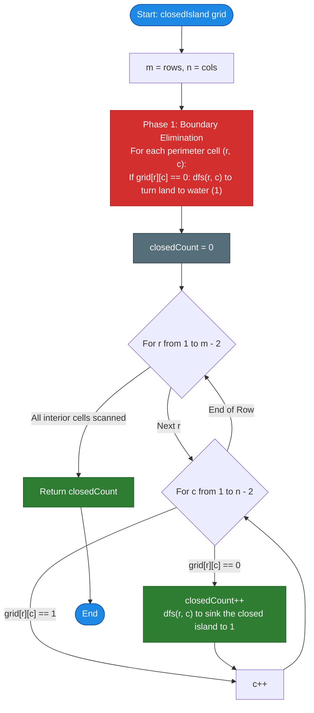

# LeetCode Problem of the Day: Number of Closed Islands

- **Problem Link:** [LeetCode 1254 - Number of Closed Islands](https://leetcode.com/problems/number-of-closed-islands/description/?envType=daily-question&envId=2026-10-25)
- **Difficulty:** Medium
- **Topic Tags:** Array, Depth-First Search (DFS), Breadth-First Search (BFS), Union-Find (Disjoint Set Union), Matrix, Graph Theory
- **Target Audience:** POTD Solvers, Computer Science Students, Competitive Programmers, Technical Interview Preparation (FAANG / Tier-1 Tech)

---

## 1. Problem Statement

Given a 2D grid consisting of `0`s (representing **land**) and `1`s (representing **water**), an **island** is defined as a maximal 4-directionally (horizontal or vertical) connected group of `0`s.

A **closed island** is an island that is **totally surrounded by `1`s** (water) on all 4 sides (top, bottom, left, and right).

- An island that connects to or touches the **perimeter / boundary** of the grid is **NOT** a closed island because it cannot be surrounded by water on the side facing outside the grid boundaries.
- Return the **total number of closed islands** in the grid.

```text
Boundary Edge:
+---+---+---+---+---+
| 1 | 1 | 1 | 1 | 1 |
+---+---+---+---+---+
| 1 | 0 | 0 | 1 | 1 |  <-- Closed Island: '0's completely encircled by '1's!
+---+---+---+---+---+
| 1 | 1 | 1 | 1 | 0 |  <-- Open Island: '0' touches the grid border!
+---+---+---+---+---+
```

---

## 2. Examples & Detailed Explanations

### Example 1 (Standard Layout)
- **Input:**
  ```text
  grid = [
    [1, 1, 1, 1, 1, 1, 1, 0],
    [1, 0, 0, 0, 0, 1, 1, 0],
    [1, 0, 1, 0, 1, 1, 1, 0],
    [1, 0, 0, 0, 0, 1, 0, 1],
    [1, 1, 1, 1, 1, 1, 1, 0]
  ]
  ```

#### Visual Grid Map:
```text
(0) [ 1,  1,  1,  1,  1,  1,  1, (0)*]  <-- *touches border
(1) [ 1, [0,  0,  0,  0], 1,  1, (0)*]  <-- [0,0,0,0] forms Island 1
(2) [ 1, [0], 1, [0], 1,  1,  1, (0)*]
(3) [ 1, [0,  0,  0,  0], 1, [0], 1  ]  <-- Island 2 at (3,6)
(4) [ 1,  1,  1,  1,  1,  1,  1, (0)*]
```

- **Analysis:**
  1. The island formed by `0`s in rows $1$ to $3$, columns $1$ to $4$ is completely enclosed by `1`s. $\implies$ **Closed Island 1**.
  2. The single `0` at coordinate $(3, 6)$ is surrounded by `1`s at $(2,6), (4,6), (3,5), (3,7)$. $\implies$ **Closed Island 2**.
  3. The `0`s along the rightmost column ($c = 7$) touch the boundary of the grid, so water does not surround them on the east. $\implies$ **Open / Invalid Island**.
- **Output:** `2`

---

### Example 2 (Boundary Touches)
- **Input:**
  ```text
  grid = [
    [0, 0, 1, 0, 0],
    [0, 1, 0, 1, 0],
    [0, 1, 1, 1, 0]
  ]
  ```
- **Analysis:**
  - The single land cell at $(1, 2)$ is surrounded on all four sides:
    - Top: $(0, 2) = 1$
    - Bottom: $(2, 2) = 1$
    - Left: $(1, 1) = 1$
    - Right: $(1, 3) = 1$
  - All other `0`s are on the boundary rows ($0$ and $2$) or columns ($0$ and $4$).
- **Output:** `1`

---

### Example 3 (No Closed Islands)
- **Input:**
  ```text
  grid = [
    [1, 1, 1, 1, 1, 1, 1],
    [1, 0, 0, 0, 0, 0, 1],
    [1, 0, 1, 1, 1, 0, 1],
    [1, 0, 1, 0, 1, 0, 1],
    [1, 0, 1, 1, 1, 0, 1],
    [1, 0, 0, 0, 0, 0, 1],
    [1, 1, 1, 1, 1, 1, 1]
  ]
  ```
- **Analysis:**
  - The middle cell $(3, 3)$ is `0`, surrounded by `1`s on all 4 sides. $\implies$ **Closed Island 1**.
  - The outer ring of `0`s is also surrounded by `1`s (outer border of row 0, 6 and col 0, 6 are all `1`). $\implies$ **Closed Island 2**.
- **Output:** `2`

---

## 3. Constraints

- $1 \le m, n \le 100$ ($m = \text{grid.length}, n = \text{grid}[0].\text{length}$)
- $0 \le \text{grid}[i][j] \le 1$
- **Expected Time Complexity:** $\mathcal{O}(M \times N)$
- **Expected Auxiliary Space:** $\mathcal{O}(M \times N)$ call stack or $\mathcal{O}(1)$ in-place grid mutation

---

## 4. Visual Architecture & Topological Model

```text
========================================================================================
                      BOUNDARY ELIMINATION (TWO-PHASE DECOMPOSITION)
========================================================================================

 Phase 1: Flood-Fill Invalidation from Grid Perimeter
          Every '0' connected to the border (top, bottom, left, right)
          is "drowned" into water ('1') or marked visited.

          Border '0's (Leaking Boundaries):
          ┌───▼───▼───▼───▼───▼───┐
          │ 0   0   1   1   0   0 │ ◄── Invalidate via DFS/BFS
          │ 0   1   0   0   1   0 │
          │ 1   1   0   0   1   1 │
          │ 0   1   1   1   1   0 │
          └───▲───▲───▲───▲───▲───┘

 Phase 2: Interior Island Counting
          Any '0' remaining in the interior of the grid CANNOT leak
          to the border! Therefore, EVERY remaining connected component
          is mathematically guaranteed to be a valid CLOSED ISLAND.

          ┌───────────────────────┐
          │ 1   1   1   1   1   1 │
          │ 1   1  [0   0]  1   1 │ ◄── Count = 1 (Closed Island!)
          │ 1   1  [0   0]  1   1 │
          │ 1   1   1   1   1   1 │
          └───────────────────────┘
========================================================================================
```

### The Boundary Leakage Invariant
A connected component $C$ of `0`s fails to be a closed island if and only if:
$$\exists (r, c) \in C \quad \text{such that} \quad r \in \{0, M-1\} \lor c \in \{0, N-1\}$$

By applying a flood-fill from all cells on the perimeter:
$$\text{Perimeter} = \{(0, c)\} \cup \{(M-1, c)\} \cup \{(r, 0)\} \cup \{(r, N-1)\}$$
we eliminate all non-closed components upfront!

After Phase 1, the problem reduces to the standard **Number of Connected Components** on the remaining interior cells.

---

## 5. Step-by-Step Simulation & Trace Table

### Tracing Example 2:
```text
Original Grid (3 x 5):
Row 0: [ 0, 0, 1, 0, 0 ]
Row 1: [ 0, 1, 0, 1, 0 ]
Row 2: [ 0, 1, 1, 1, 0 ]
```

#### Phase 1: Perimeter Flood-Fill (Drowning Boundary Components)
1. **Row 0:**
   - $(0, 0) = 0 \to$ Flood fill turns $(0, 0), (0, 1), (1, 0), (2, 0)$ to `1`.
   - $(0, 3) = 0 \to$ Flood fill turns $(0, 3), (0, 4), (1, 4), (2, 4)$ to `1`.
2. **Row 2:**
   - $(2, 0) = 1$ (already drowned).
   - $(2, 4) = 1$ (already drowned).
3. **Col 0 & Col 4:**
   - All boundary cells are now `1`.

```text
Grid After Phase 1 (Perimeter Cleared):
Row 0: [ 1, 1, 1, 1, 1 ]
Row 1: [ 1, 1, 0, 1, 1 ]
Row 2: [ 1, 1, 1, 1, 1 ]
```

#### Phase 2: Interior Scan $[1 \dots M-2] \times [1 \dots N-2]$
| Cell $(r, c)$ | Value | Action | Closed Islands Count |
| :---: | :---: | :---: | :---: |
| $(1, 1)$ | `1` | Water, skip | $0$ |
| $(1, 2)$ | `0` | Found land! Increment count, flood-fill component to `1` | **$1$** |
| $(1, 3)$ | `1` | Water, skip | $1$ |

**Final Count:** **`1`**

---

## 6. Algorithm Flowchart



---

## 7. From Naive to Pro: Algorithmic Progression

### Method 1: Naive (DFS with Boolean Return Value)
- **Concept:** Traverse the grid. When encountering an unvisited `0`, initiate a DFS traversal. The DFS returns `false` if any cell in the component is on the border, and `true` otherwise.
- **Common Bug / Pitfall:** Using short-circuit evaluation like:
  ```cpp
  return dfs(r+1, c) && dfs(r-1, c) && dfs(r, c+1) && dfs(r, c-1); // BUG!
  ```
  If the first call returns `false`, subsequent calls are skipped! This leaves the remainder of the island unvisited, leading to duplicate counts later.
- **Correction:** Must explore all 4 directions fully using bitwise `&` or independent variables before returning.
- **Pseudocode:**
```text
function isClosed(r, c):
    if r < 0 or r >= m or c < 0 or c >= n:
        return false
    if grid[r][c] == 1:
        return true
    grid[r][c] = 1 // mark visited
    
    down = isClosed(r + 1, c)
    up = isClosed(r - 1, c)
    right = isClosed(r, c + 1)
    left = isClosed(r, c - 1)
    
    return down and up and right and left
```

---

### Method 2: Better (Disjoint Set Union / Union-Find with Virtual Border Node)
- **Concept:** Create a DSU structure for all $M \times N$ cells, plus one special virtual node: $\text{BORDER} = M \times N$.
  - Union adjacent land cells (`0`).
  - If a land cell lies on the perimeter ($r = 0, M-1$ or $c = 0, N-1$), union it with $\text{BORDER}$.
  - After processing all cells, the closed islands correspond to the distinct connected component roots that are **not connected to $\text{BORDER}$**.
- **Time Complexity:** $\mathcal{O}(M \times N \cdot \alpha(MN))$
- **Space Complexity:** $\mathcal{O}(M \times N)$ for parent and rank arrays.

---

### Method 3: Pro Approach (Two-Phase Boundary Elimination Flood Fill)
- **The Core Strategy:**
  1. **Phase 1 (Boundary Sink):** Run flood-fill (DFS or BFS) starting from every `0` located on the 4 boundary borders ($r = 0$, $r = M-1$, $c = 0$, $c = N-1$), converting them into water (`1`).
  2. **Phase 2 (Interior Counting):** Iterate through the interior cells ($1 \le r < M-1, 1 \le c < N-1$). Every time an unvisited `0` is found, it is **guaranteed** to be a closed island! Increment answer and sink it.
  3. **Zero Extra Memory:** Mutates the grid in-place, reducing auxiliary space to $\mathcal{O}(1)$ (excluding DFS call stack).
- **Time Complexity:** Exactly $\mathcal{O}(M \times N)$ — each cell is visited at most twice.
- **Auxiliary Space:** $\mathcal{O}(M \times N)$ maximum call stack depth.
- **Pseudocode:**
```text
function closedIsland_Pro(grid):
    m = grid.length, n = grid[0].length
    
    // Drown all boundary connected land
    for r from 0 to m - 1:
        for c in [0, n - 1]:
            if grid[r][c] == 0:
                sink(grid, r, c)
                
    for c from 0 to n - 1:
        for r in [0, m - 1]:
            if grid[r][c] == 0:
                sink(grid, r, c)
                
    // Count enclosed islands
    count = 0
    for r from 1 to m - 2:
        for c from 1 to n - 2:
            if grid[r][c] == 0:
                count += 1
                sink(grid, r, c)
                
    return count
```

---

## 8. Complexity Comparison Table

| Metric | Method 1: Single-Pass Flag DFS | Method 2: Union-Find (DSU) | Method 3: Pro (Two-Phase Boundary Sink) |
| :--- | :--- | :--- | :--- |
| **Time Complexity** | $\mathcal{O}(M \times N)$ | $\mathcal{O}(M \times N \cdot \alpha(MN))$ | $\mathbf{\mathcal{O}(M \times N)}$ (Optimal linear time) |
| **Auxiliary Space** | $\mathcal{O}(M \times N)$ recursion | $\mathcal{O}(M \times N)$ DSU arrays | $\mathbf{\mathcal{O}(1)}$ extra space (in-place grid) |
| **Short-Circuit Risk** | High (accidental `&&` bug) | None | **Zero (Clean, decoupled logic)** |
| **Code Length** | Moderate | Long (requires DSU class) | **Short, Elegant, Interview-Clean** |
| **Interview Verdict** | Prone to evaluation bugs | Over-engineered | **Gold Standard (FAANG / LeetCode)** |

---

## 9. Comprehensive Corner Cases Handled

1. **Grid with No Land (`0`s):**
   - e.g., All cells are `1`. Phase 1 and Phase 2 do nothing; returns `0`.
2. **Grid with All Land (`0`s):**
   - Every single cell is connected to the perimeter.
   - Phase 1 sinks the entire grid into `1`s.
   - Phase 2 finds zero islands; returns `0`.
3. **Small Grids ($M \le 2$ or $N \le 2$):**
   - Any cell in a grid with $\le 2$ rows or columns is directly on the boundary!
   - No closed island can ever exist. Loop $[1 \dots M-2]$ does not execute; returns `0`.
4. **Islands Surrounding Islands (Concentric Rings):**
   - Concentric closed rings are correctly identified as distinct closed islands.
5. **Snake-like / Winding Islands:**
   - 4-directional DFS fully traverses winding paths without premature termination.

---

## 10. Complete Multi-Language Implementations

### Java (21)

```java
class Solution {
    private int m, n;

    private void sink(int[][] grid, int r, int c) {
        if (r < 0 || r >= m || c < 0 || c >= n || grid[r][c] != 0) {
            return;
        }
        grid[r][c] = 1; // Mark as water / visited
        sink(grid, r + 1, c);
        sink(grid, r - 1, c);
        sink(grid, r, c + 1);
        sink(grid, r, c - 1);
    }

    public int closedIsland(int[][] grid) {
        m = grid.length;
        n = grid[0].length;

        // Phase 1: Sink all land connected to the boundary
        for (int r = 0; r < m; r++) {
            if (grid[r][0] == 0) sink(grid, r, 0);
            if (grid[r][n - 1] == 0) sink(grid, r, n - 1);
        }
        for (int c = 0; c < n; c++) {
            if (grid[0][c] == 0) sink(grid, 0, c);
            if (grid[m - 1][c] == 0) sink(grid, m - 1, c);
        }

        // Phase 2: Count remaining closed islands in the interior
        int closedIslandsCount = 0;
        for (int r = 1; r < m - 1; r++) {
            for (int c = 1; c < n - 1; c++) {
                if (grid[r][c] == 0) {
                    closedIslandsCount++;
                    sink(grid, r, c);
                }
            }
        }

        return closedIslandsCount;
    }
}
```

---

### Python3

```python
class Solution:
    def closedIsland(self, grid: list[list[int]]) -> int:
        m, n = len(grid), len(grid[0])

        def sink(r: int, c: int) -> None:
            if r < 0 or r >= m or c < 0 or c >= n or grid[r][c] != 0:
                return
            grid[r][c] = 1
            sink(r + 1, c)
            sink(r - 1, c)
            sink(r, c + 1)
            sink(r, c - 1)

        # Phase 1: Drown all land connected to the boundary
        for r in range(m):
            if grid[r][0] == 0:
                sink(r, 0)
            if grid[r][n - 1] == 0:
                sink(r, n - 1)

        for c in range(n):
            if grid[0][c] == 0:
                sink(0, c)
            if grid[m - 1][c] == 0:
                sink(m - 1, c)

        # Phase 2: Count remaining completely enclosed islands
        closed_islands = 0
        for r in range(1, m - 1):
            for c in range(1, n - 1):
                if grid[r][c] == 0:
                    closed_islands += 1
                    sink(r, c)

        return closed_islands
```

---

### C (GCC)

```c
void sink(int** grid, int m, int n, int r, int c) {
    if (r < 0 || r >= m || c < 0 || c >= n || grid[r][c] != 0) {
        return;
    }
    grid[r][c] = 1;
    sink(grid, m, n, r + 1, c);
    sink(grid, m, n, r - 1, c);
    sink(grid, m, n, r, c + 1);
    sink(grid, m, n, r, c - 1);
}

int closedIsland(int** grid, int gridSize, int* gridColSize) {
    int m = gridSize;
    int n = gridColSize[0];

    // Phase 1: Drown all boundary-connected land
    for (int r = 0; r < m; ++r) {
        if (grid[r][0] == 0) sink(grid, m, n, r, 0);
        if (grid[r][n - 1] == 0) sink(grid, m, n, r, n - 1);
    }
    for (int c = 0; c < n; ++c) {
        if (grid[0][c] == 0) sink(grid, m, n, 0, c);
        if (grid[m - 1][c] == 0) sink(grid, m, n, m - 1, c);
    }

    // Phase 2: Count remaining closed islands
    int count = 0;
    for (int r = 1; r < m - 1; ++r) {
        for (int c = 1; c < n - 1; ++c) {
            if (grid[r][c] == 0) {
                ++count;
                sink(grid, m, n, r, c);
            }
        }
    }

    return count;
}
```

---

### C++ (17)

```cpp
#include <vector>

using namespace std;

class Solution {
private:
    int m, n;

    void sink(vector<vector<int>>& grid, int r, int c) {
        if (r < 0 || r >= m || c < 0 || c >= n || grid[r][c] != 0) {
            return;
        }
        grid[r][c] = 1;
        sink(grid, r + 1, c);
        sink(grid, r - 1, c);
        sink(grid, r, c + 1);
        sink(grid, r, c - 1);
    }

public:
    int closedIsland(vector<vector<int>>& grid) {
        m = grid.size();
        n = grid[0].size();

        // Phase 1: Sink boundary-connected land
        for (int r = 0; r < m; ++r) {
            if (grid[r][0] == 0) sink(grid, r, 0);
            if (grid[r][n - 1] == 0) sink(grid, r, n - 1);
        }
        for (int c = 0; c < n; ++c) {
            if (grid[0][c] == 0) sink(grid, 0, c);
            if (grid[m - 1][c] == 0) sink(grid, m - 1, c);
        }

        // Phase 2: Count closed interior islands
        int closedCount = 0;
        for (int r = 1; r < m - 1; ++r) {
            for (int c = 1; c < n - 1; ++c) {
                if (grid[r][c] == 0) {
                    ++closedCount;
                    sink(grid, r, c);
                }
            }
        }

        return closedCount;
    }
};
```

---

### C#

```csharp
public class Solution {
    private int m, n;

    private void Sink(int[][] grid, int r, int c) {
        if (r < 0 || r >= m || c < 0 || c >= n || grid[r][c] != 0) {
            return;
        }
        grid[r][c] = 1;
        Sink(grid, r + 1, c);
        Sink(grid, r - 1, c);
        Sink(grid, r, c + 1);
        Sink(grid, r, c - 1);
    }

    public int ClosedIsland(int[][] grid) {
        m = grid.Length;
        n = grid[0].Length;

        // Phase 1: Sink boundary-connected components
        for (int r = 0; r < m; r++) {
            if (grid[r][0] == 0) Sink(grid, r, 0);
            if (grid[r][n - 1] == 0) Sink(grid, r, n - 1);
        }
        for (int c = 0; c < n; c++) {
            if (grid[0][c] == 0) Sink(grid, 0, c);
            if (grid[m - 1][c] == 0) Sink(grid, m - 1, c);
        }

        // Phase 2: Count internal closed islands
        int count = 0;
        for (int r = 1; r < m - 1; r++) {
            for (int c = 1; c < n - 1; c++) {
                if (grid[r][c] == 0) {
                    count++;
                    Sink(grid, r, c);
                }
            }
        }

        return count;
    }
}
```

---

### Javascript (Node v22)

```javascript
/**
 * @param {number[][]} grid
 * @return {number}
 */
var closedIsland = function(grid) {
    const m = grid.length;
    const n = grid[0].length;

    function sink(r, c) {
        if (r < 0 || r >= m || c < 0 || c >= n || grid[r][c] !== 0) {
            return;
        }
        grid[r][c] = 1;
        sink(r + 1, c);
        sink(r - 1, c);
        sink(r, c + 1);
        sink(r, c - 1);
    }

    // Phase 1: Sink boundary-connected land
    for (let r = 0; r < m; r++) {
        if (grid[r][0] === 0) sink(r, 0);
        if (grid[r][n - 1] === 0) sink(r, n - 1);
    }
    for (let c = 0; c < n; c++) {
        if (grid[0][c] === 0) sink(0, c);
        if (grid[m - 1][c] === 0) sink(m - 1, c);
    }

    // Phase 2: Count enclosed islands
    let count = 0;
    for (let r = 1; r < m - 1; r++) {
        for (let c = 1; c < n - 1; c++) {
            if (grid[r][c] === 0) {
                count++;
                sink(r, c);
            }
        }
    }

    return count;
};
```

---

### Typescript

```typescript
function closedIsland(grid: number[][]): number {
    const m = grid.length;
    const n = grid[0].length;

    function sink(r: number, c: number): void {
        if (r < 0 || r >= m || c < 0 || c >= n || grid[r][c] !== 0) {
            return;
        }
        grid[r][c] = 1;
        sink(r + 1, c);
        sink(r - 1, c);
        sink(r, c + 1);
        sink(r, c - 1);
    }

    // Phase 1: Sink boundary-connected land
    for (let r = 0; r < m; r++) {
        if (grid[r][0] === 0) sink(r, 0);
        if (grid[r][n - 1] === 0) sink(r, n - 1);
    }
    for (let c = 0; c < n; c++) {
        if (grid[0][c] === 0) sink(0, c);
        if (grid[m - 1][c] === 0) sink(m - 1, c);
    }

    // Phase 2: Count enclosed interior islands
    let count = 0;
    for (let r = 1; r < m - 1; r++) {
        for (let c = 1; c < n - 1; c++) {
            if (grid[r][c] === 0) {
                count++;
                sink(r, c);
            }
        }
    }

    return count;
}
```

---

## 11. Line-by-Line Code Walkthrough

1. **Helper Function `sink(r, c)`:**
   ```cpp
   if (r < 0 || r >= m || c < 0 || c >= n || grid[r][c] != 0) return;
   grid[r][c] = 1;
   ```
   - Out-of-bounds cells or water (`1`) terminate recursion.
   - Converts visited land (`0`) into water (`1`) in-place, eliminating the need for a separate `visited[][]` matrix.

2. **Phase 1: Perimeter Flood-Fill:**
   ```cpp
   for (int r = 0; r < m; ++r) {
       if (grid[r][0] == 0) sink(grid, r, 0);
       if (grid[r][n - 1] == 0) sink(grid, r, n - 1);
   }
   ```
   - Traverses the outer boundaries: columns $0$ and $n-1$, and rows $0$ and $m-1$.
   - Any land touching the perimeter is drowned, along with all land cells connected to it.

3. **Phase 2: Interior Island Discovery:**
   ```cpp
   for (int r = 1; r < m - 1; ++r) {
       for (int c = 1; c < n - 1; ++c) {
           if (grid[r][c] == 0) {
               ++closedCount;
               sink(grid, r, c);
           }
       }
   }
   ```
   - Only searches strictly interior cells ($[1 \dots m-2] \times [1 \dots n-2]$).
   - Any `0` found here **must** be a closed island because any connection to the perimeter was already eradicated in Phase 1!
   - Increments `closedCount` and immediately sinks the entire island so its other cells aren't recounted.

---

## 12. Interview Follow-Ups & Expert Insights

### Question 1: What if we are NOT allowed to mutate the input grid?
**Answer:** We can maintain a `boolean visited[M][N]` array or `unordered_set<int>` of visited cells. The algorithm logic remains identical, using $\mathcal{O}(M \times N)$ extra auxiliary space.

### Question 2: How does this problem relate to LeetCode 130 (Surrounded Regions)?
**Answer:** LeetCode 130 (Surrounded Regions) is the exact dual of this problem! In LeetCode 130, you must capture surrounded `'O'`s by turning them into `'X'`s. The optimal solution is identical: flood-fill boundary-connected `'O'`s with a temporary symbol `'#'`, convert all remaining interior `'O'`s to `'X'`s, and restore `'#'` back to `'O'`.

### Question 3: Can this be solved iteratively to prevent recursion stack overflow on large grids ($10^4 \times 10^4$)?
**Answer:** Yes! Replace the recursive `sink` function with an explicit `queue` (BFS) or `stack` (iterative DFS) storing packed cell coordinates `r * n + c`.
