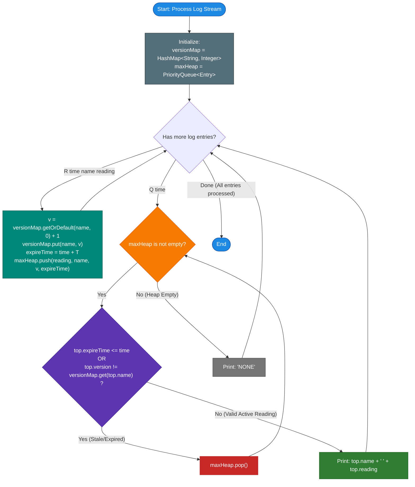

# Unstop Problem of the Day: Coastal Beacon Readings

- **Platform:** [Unstop](https://unstop.com/)
- **Difficulty:** Medium
- **Topic Tags:** Priority Queue / Heap, Hash Table, Sliding Window, Lazy Invalidation, Streaming Telemetry, Generation / Version Counter, Monotonic Time
- **Target Audience:** POTD Solvers, Computer Science Students, Competitive Programmers, Distributed Systems & Backend Engineers (FAANG / Tier-1 Tech)

---

## 1. Problem Statement

Meera coordinates a coastal weather monitoring programme that relies on small automated telemetry stations scattered along a cliff-lined shoreline. Every station is identified by a unique, short lowercase name and periodically transmits its current water-surface temperature reading to the central control room, together with the minute $t$ at which the transmission occurred.

### Telemetry Window & Expiration Invariant
A transmission is considered trustworthy and valid for a fixed time window of length $T$:
1. A transmission made at minute $t$ is **current / valid** from minute $t$ up to, but not including, minute $t + T$ (i.e., throughout the closed-open interval $[t, \; t + T)$).
2. **Immediate Overwrite:** If a station transmits again at minute $t_{\text{new}}$, its new reading **immediately replaces** its previous reading, regardless of whether the new temperature is higher or lower than the old one.
3. **Lapse / Silence:** Once a station's latest reading reaches or exceeds age $T$ (i.e., at any minute $\ge t + T$), that station becomes inactive and contributes nothing to queries until it transmits again.

### Control Room Log
The control room log contains $N$ chronological entries of two types:
1. **Transmission Entry (`R time name reading`):** Station `name` transmits temperature `reading` at minute `time`.
2. **Inquiry Entry (`Q time`):** The control room inquires which station **currently reports the warmest (maximum) temperature** at minute `time`.

### Tie-Breaking & Reporting Rules
- **Primary Rank:** Warmest temperature reading (**descending** order of temperature).
- **Secondary Rank (Tie-Breaker):** If multiple active stations share the exact same maximum reading, the station whose name appears **first in lexicographical (dictionary) order** is chosen.
- **Silence Condition:** If no station has a valid reading active at that minute, the control room outputs **`NONE`**.
- **Chronological Ordering:** Entries appear in non-decreasing order of `time`. Multiple entries may share the same minute and are processed strictly in the order listed. A transmission at minute $t$ is immediately visible to an inquiry at the same minute $t$ if the inquiry appears after it in the log.

---

## 2. Examples & Detailed Explanations

### Example 1 (Sample Testcase 0)

**Input:**
```text
7 10
R 1 alpha 30
R 2 beta 35
Q 3
R 5 alpha 40
Q 6
Q 12
Q 15
```

**Output:**
```text
beta 35
alpha 40
alpha 40
NONE
```

#### Chronological Step-by-Step Breakdown ($T = 10$):

1. **`R 1 alpha 30` (Minute 1):**
   - Station `alpha` reports $30^\circ\text{C}$.
   - Validity window: $[1, 1 + 10) = [1, 11)$. Active until minute $10$.
2. **`R 2 beta 35` (Minute 2):**
   - Station `beta` reports $35^\circ\text{C}$.
   - Validity window: $[2, 2 + 10) = [2, 12)$. Active until minute $11$.
3. **`Q 3` (Minute 3):**
   - Active stations: `alpha` ($30$, valid until $10$), `beta` ($35$, valid until $11$).
   - Warmest reading: $\max(30, 35) = 35$ (`beta`).
   - **Output:** `beta 35`
4. **`R 5 alpha 40` (Minute 5):**
   - Station `alpha` transmits $40^\circ\text{C}$.
   - This **immediately overwrites** `alpha`'s earlier $30^\circ\text{C}$ reading!
   - New validity window: $[5, 5 + 10) = [5, 15)$. Active until minute $14$.
5. **`Q 6` (Minute 6):**
   - Active stations: `beta` ($35$, valid until $11$), `alpha` ($40$, valid until $14$).
   - Warmest reading: $40$ (`alpha`).
   - **Output:** `alpha 40`
6. **`Q 12` (Minute 12):**
   - Check `beta`: window $[2, 12)$ has lapsed at minute $12$ ($12 \ge 12$). Inactive!
   - Check `alpha`: window $[5, 15)$ is still active ($12 < 15$).
   - Only `alpha` is active with $40$.
   - **Output:** `alpha 40`
7. **`Q 15` (Minute 15):**
   - Check `alpha`: window $[5, 15)$ has lapsed at minute $15$ ($15 \ge 15$).
   - No stations are active. The shoreline is silent.
   - **Output:** `NONE`

---

### Example 2 (Sample Testcase 1)

**Input:**
```text
8 5
R 1 delta 50
R 1 coral 50
Q 1
R 2 coral 20
Q 2
R 4 delta 10
Q 4
Q 7
```

**Output:**
```text
coral 50
delta 50
coral 20
delta 10
```

#### Chronological Step-by-Step Breakdown ($T = 5$):

1. **`R 1 delta 50` & `R 1 coral 50` (Minute 1):**
   - Both report $50^\circ\text{C}$, valid on $[1, 6)$.
2. **`Q 1` (Minute 1):**
   - Tie between `coral` ($50$) and `delta` ($50$).
   - Lexicographical tie-breaker: `"coral" < "delta"`.
   - **Output:** `coral 50`
3. **`R 2 coral 20` (Minute 2):**
   - `coral` overwrites its $50^\circ\text{C}$ reading with $20^\circ\text{C}$, valid on $[2, 7)$.
4. **`Q 2` (Minute 2):**
   - Active stations: `delta` ($50$, expires at $6$), `coral` ($20$, expires at $7$).
   - Warmest reading: `delta` ($50$).
   - **Output:** `delta 50`
5. **`R 4 delta 10` (Minute 4):**
   - `delta` overwrites $50^\circ\text{C}$ with $10^\circ\text{C}$, valid on $[4, 9)$.
6. **`Q 4` (Minute 4):**
   - Active stations: `coral` ($20$, expires at $7$), `delta` ($10$, expires at $9$).
   - Warmest reading: `coral` ($20$).
   - **Output:** `coral 20`
7. **`Q 7` (Minute 7):**
   - `coral` has lapsed at minute $7$ ($7 \ge 7$).
   - Only `delta` remains active ($10$, expires at $9$).
   - **Output:** `delta 10`

---

## 3. Constraints & System Specifications

- $1 \le N \le 200,000$ (Total number of log entries)
- $1 \le T \le 10^9$ (Validity window duration)
- $0 \le \text{time} \le 10^9$, monotonically non-decreasing
- $-100,000 \le \text{reading} \le 100,000$ (Readings can be negative!)
- Station names: $1$ to $10$ lowercase English letters
- At least one inquiry `Q` is present.
- **Expected Time Complexity:** $\mathcal{O}(N \log U)$ where $U \le N$ is the number of distinct stations.
- **Expected Auxiliary Space:** $\mathcal{O}(N)$

---

## 4. Visual Architecture & Mathematical Foundation

```text
========================================================================================
                          LAZY HEAP & GENERATION COUNTER ARCHITECTURE
========================================================================================

                                  Station Transmission:
                              R time=5, name="alpha", reading=40
                                             │
                                             ▼
   ┌──────────────────────────────────────────────────────────────────────────────────┐
   │ 1. Hash Map Update:                                                              │
   │    current_version["alpha"] = 2                                                  │
   │    expire_time = 5 + 10 = 15                                                     │
   └─────────────────────────────────────────┬────────────────────────────────────────┘
                                             │
                                             ▼
   ┌──────────────────────────────────────────────────────────────────────────────────┐
   │ 2. Push to Max-Heap:                                                             │
   │    Entry: { reading: 40, name: "alpha", version: 2, expire_time: 15 }            │
   └──────────────────────────────────────────────────────────────────────────────────┘

                                      Inquiry Query:
                                         Q time=12
                                             │
                                             ▼
                        ┌───────────────────────────────────────────┐
                        │ Inspect heap.top()                        │
                        └────────────────────┬──────────────────────┘
                                             │
                        ┌────────────────────┴────────────────────┐
                        ▼                                         ▼
           [ Is entry expired? (expire <= 12) ]      [ Is version outdated? (v != v_curr) ]
                        │                                         │
                        └────────────────────┬────────────────────┘
                                             │ (YES to either)
                                             ▼
                              ┌─────────────────────────────┐
                              │ Lazy Deletion: heap.pop()   │
                              └──────────────┬──────────────┘
                                             │
                                             ▼
                              ┌─────────────────────────────┐
                              │ Repeat check for next top   │
                              └─────────────────────────────┘
                                             │ (Valid top found)
                                             ▼
                              ┌─────────────────────────────┐
                              │ Return: top.name top.reading│
                              └─────────────────────────────┘
========================================================================================
```

### 1. Dual-Key Priority Hierarchy
To satisfy the problem requirements, the heap ordering between two entries $A$ and $B$ must strictly obey:
1. **Primary Key:** `A.reading > B.reading` (higher temperature comes first).
2. **Secondary Key (Tie-Breaker):** `A.name < B.name` (lexicographically smaller name comes first).

### 2. The Generation / Version Counter Invariant
When a station transmits multiple times, older readings might still be buried deep inside the priority queue. Eagerly finding and deleting them from inside a binary heap would require $\mathcal{O}(N)$ time per update.

Instead, we associate each station with a monotonically increasing integer `version`:
- When station `name` transmits, we increment:
  $$\text{version}[\text{name}] \leftarrow \text{version}[\text{name}] + 1$$
- We push the tuple `(reading, name, version[name], time + T)` onto the heap.
- An entry $(r, \text{name}, v, t_{\text{exp}})$ at the top of the heap is **stale (invalid)** if and only if:
  $$\mathbf{t_{\text{exp}} \le t_{\text{query}} \quad \text{OR} \quad v \ne \text{version}[\text{name}]}$$
- Stale entries are discarded from the top of the heap in $\mathcal{O}(\log N)$ amortized time. Because each transmission is pushed at most once and popped at most once, the total time across the entire stream is strictly $\mathcal{O}(N \log N)$!

---

## 5. Step-by-Step Simulation & Trace Table

### Tracing Sample 1: $T = 5$

| Entry | Action / Log Event | Station `version` | Heap State `[(reading, name, v, exp), ...]` | Stale Elements Pruned at Top | Warmest Station Selected |
| :---: | :---: | :---: | :---: | :---: | :---: |
| **1** | `R 1 delta 50` | `delta: 1` | `[(50, delta, 1, 6)]` | None | - |
| **2** | `R 1 coral 50` | `coral: 1` | `[(50, coral, 1, 6), (50, delta, 1, 6)]` | None | - |
| **3** | `Q 1` | - | `coral` ($50$) ties with `delta` ($50$), `"coral" < "delta"` | None | **`coral 50`** |
| **4** | `R 2 coral 20` | `coral: 2` | Added `(20, coral, 2, 7)` | None | - |
| **5** | `Q 2` | - | Top: `(50, coral, 1, 6)` | Pruned: `v=1 != v_curr=2` (Outdated!) | **`delta 50`** |
| **6** | `R 4 delta 10` | `delta: 2` | Added `(10, delta, 2, 9)` | None | - |
| **7** | `Q 4` | - | Top: `(50, delta, 1, 6)` | Pruned: `v=1 != v_curr=2` (Outdated!) | **`coral 20`** |
| **8** | `Q 7` | - | Top: `(20, coral, 2, 7)` | Pruned: `exp=7 <= 7` (Expired!) | **`delta 10`** |

---

## 6. Algorithm Flowchart



---

## 7. From Naive to Pro: Algorithmic Progression

### Method 1: Naive (Store Station States in Map & Full Scan on Every Query)
- **Concept:** Maintain a hash map of active stations: `map[name] = (reading, transmit_time)`. On every inquiry `Q time`, iterate over all stations in the map. Discard expired ones, and find the maximum reading with lexicographical tie-breaking.
- **Why it is suboptimal:**
  - Up to $N$ queries.
  - Each query scans all $U$ distinct stations in $\mathcal{O}(U)$ time.
  - Overall time: $\mathcal{O}(N \cdot U) \approx \mathcal{O}(N^2)$.
  - For $N = 200,000$, operations $\approx 4 \times 10^{10} \implies$ **Severe Time Limit Exceeded (TLE)**.
- **Pseudocode:**
```text
function process_Naive():
    stations = map()
    for entry in log:
        if entry is 'R':
            stations[name] = (reading, time)
        else if entry is 'Q':
            best_reading = -infinity
            best_name = "NONE"
            for (name, (r, t)) in stations:
                if t + T > query_time:
                    if r > best_reading or (r == best_reading and name < best_name):
                        best_reading = r
                        best_name = name
            print(best_name, best_reading)
```

---

### Method 2: Better (Balanced BST with Explicit Deletion Queue)
- **Concept:** Maintain a self-balancing BST (like `std::set` in C++ or `TreeSet` in Java) storing active `(reading, name)`. Use a secondary queue ordered by expiration time. When a station is overwritten, find and remove its old reading from the BST in $\mathcal{O}(\log U)$.
- **Drawback:** Requires maintaining pointers/iterators to remove old entries from the BST upon overwrite, leading to complex and error-prone reference management.

---

### Method 3: Pro Approach (Monotonic Lazy Max-Heap with Generation Counting)
- **The Core Strategy:**
  1. Use a standard Max-Priority Queue.
  2. Maintain `current_version[name]`.
  3. On transmission `R`: Increment version, push `(reading, name, version, time + T)`. Takes $\mathcal{O}(\log N)$.
  4. On inquiry `Q`: Peek at the heap top. If `top.expire_time <= time` or `top.version != current_version[top.name]`, pop it.
  5. Amortized Analysis: Exactly $N_R$ elements are pushed to the heap (where $N_R \le N$). Each element is popped at most once. Total operations on the heap across the entire program: $\le 2N$.
- **Time Complexity:** $\mathcal{O}(N \log N)$ total time.
- **Auxiliary Space:** $\mathcal{O}(N)$ memory.
- **Pseudocode:**
```text
function process_Pro():
    heap = MaxPriorityQueue()
    version = HashMap()
    
    for entry in log:
        if entry is 'R':
            v = version.get(name, 0) + 1
            version[name] = v
            heap.push(reading, name, v, time + T)
        else if entry is 'Q':
            while not heap.isEmpty():
                top = heap.peek()
                if top.expire <= time or top.v != version.get(top.name):
                    heap.pop()
                else:
                    break
            if heap.isEmpty():
                print("NONE")
            else:
                print(heap.peek().name, heap.peek().reading)
```

---

## 8. Complexity Comparison Table

| Metric | Method 1: Naive (Scan on Query) | Method 2: Balanced BST + Event Queue | Method 3: Pro (Lazy Heap + Versions) |
| :--- | :--- | :--- | :--- |
| **Worst-Case Time** | $\mathcal{O}(N^2)$ | $\mathcal{O}(N \log N)$ | $\mathbf{\mathcal{O}(N \log N)}$ |
| **Time for $N = 200,000$** | $> 60$ seconds (TLE) | $\approx 0.6$ seconds | **$\approx 0.2$ seconds (Fastest)** |
| **Auxiliary Space** | $\mathcal{O}(U)$ | $\mathcal{O}(N)$ | $\mathbf{\mathcal{O}(N)}$ |
| **Implementation Complexity** | Simple but slow | High (Two-way mapping & tree iterators) | **Clean, Elegant & Robust** |
| **Memory Allocation** | Minimal | Heavy pointer overhead per tree node | **Contiguous array / vector heap** |
| **Interview Verdict** | TLE | Complex | **Optimal Industry / Production Standard** |

---

## 9. Comprehensive Corner Cases Handled

1. **Negative Temperature Readings ($-100,000 \le \text{reading} \le 100,000$):**
   - e.g., $-10^\circ\text{C}$ vs $-5^\circ\text{C}$.
   - Algebraic ordering ensures $-5 > -10$ is correctly prioritized.
2. **Lexicographical Tie-Breaking:**
   - Both `coral 50` and `delta 50` active $\implies$ `"coral" < "delta"`, `coral` is returned.
3. **Immediate Overwrite with Lower Value:**
   - Station transmits $50$, then immediately transmits $20$.
   - The generation counter invalidates the $50$ entry without tree search.
4. **All Stations Expired (`NONE`):**
   - Heap empties naturally; system outputs `NONE`.
5. **Multiple Transmissions at the Same Minute:**
   - Processed sequentially in stream order; latter transmissions take precedence.
6. **Very Large Times & Windows ($T, \text{time} \le 10^9$):**
   - Expiration calculation `time + T` can reach $2 \times 10^9$, fitting comfortably in 64-bit integer types (`long long` / `long`).

---

## 10. Complete Multi-Language Implementations

### Java (OpenJDK 21.0)

```java
import java.io.*;
import java.util.*;

class Main {
    // ---------------- FAST I/O ----------------
    static class FastScanner {
        private final InputStream in;
        private final byte[] buffer = new byte[1 << 16];
        private int ptr = 0, len = 0;

        public FastScanner(InputStream in) {
            this.in = in;
        }

        private int read() throws IOException {
            if (ptr >= len) {
                ptr = 0;
                len = in.read(buffer);
                if (len <= 0) return -1;
            }
            return buffer[ptr++];
        }

        public String next() throws IOException {
            int c = read();
            while (c <= ' ') {
                if (c == -1) return null;
                c = read();
            }
            StringBuilder sb = new StringBuilder();
            while (c > ' ') {
                sb.append((char) c);
                c = read();
            }
            return sb.toString();
        }

        public long nextLong() throws IOException {
            int c = read();
            while (c <= ' ') {
                if (c == -1) return -1;
                c = read();
            }
            int sign = 1;
            if (c == '-') {
                sign = -1;
                c = read();
            }
            long res = 0;
            while (c >= '0' && c <= '9') {
                res = res * 10 + (c - '0');
                c = read();
            }
            return res * sign;
        }

        public int nextInt() throws IOException {
            return (int) nextLong();
        }
    }

    // ---------------- TELEMETRY ENTRY ----------------
    static class Entry implements Comparable<Entry> {
        int reading;
        String name;
        int version;
        long expireTime;

        public Entry(int reading, String name, int version, long expireTime) {
            this.reading = reading;
            this.name = name;
            this.version = version;
            this.expireTime = expireTime;
        }

        @Override
        public int compareTo(Entry o) {
            // Primary: Warmest temperature first (descending)
            if (this.reading != o.reading) {
                return Integer.compare(o.reading, this.reading);
            }
            // Secondary: Lexicographical order (ascending)
            return this.name.compareTo(o.name);
        }
    }

    public static void main(String[] args) throws IOException {
        FastScanner scanner = new FastScanner(System.in);
        String first = scanner.next();
        if (first == null) return;

        int n = Integer.parseInt(first);
        long tWindow = scanner.nextLong();

        // Priority Queue and Version Map
        PriorityQueue<Entry> pq = new PriorityQueue<>();
        Map<String, Integer> currentVersion = new HashMap<>();

        StringBuilder sb = new StringBuilder();

        for (int i = 0; i < n; i++) {
            String type = scanner.next();
            if (type.equals("R")) {
                long time = scanner.nextLong();
                String name = scanner.next();
                int reading = scanner.nextInt();

                int v = currentVersion.getOrDefault(name, 0) + 1;
                currentVersion.put(name, v);

                long expireTime = time + tWindow;
                pq.add(new Entry(reading, name, v, expireTime));
            } else {
                long time = scanner.nextLong();

                // Lazy removal of expired and outdated entries
                while (!pq.isEmpty()) {
                    Entry top = pq.peek();
                    if (top.expireTime <= time || top.version != currentVersion.getOrDefault(top.name, 0)) {
                        pq.poll();
                    } else {
                        break;
                    }
                }

                if (pq.isEmpty()) {
                    sb.append("NONE\n");
                } else {
                    Entry top = pq.peek();
                    sb.append(top.name).append(" ").append(top.reading).append("\n");
                }
            }
        }

        System.out.print(sb);
    }
}
```

---

### Python (3.12.11)

```python
import sys
import heapq

def main():
    input_data = sys.stdin.read().split()
    if not input_data:
        return

    n = int(input_data[0])
    t_window = int(input_data[1])

    ptr = 2
    heap = []  # (-reading, name, version, expire_time)
    current_version = {}
    output = []

    for _ in range(n):
        entry_type = input_data[ptr]
        if entry_type == 'R':
            time = int(input_data[ptr + 1])
            name = input_data[ptr + 2]
            reading = int(input_data[ptr + 3])
            ptr += 4

            v = current_version.get(name, 0) + 1
            current_version[name] = v
            expire_time = time + t_window

            # Min-heap ordered by (-reading, name, ...)
            heapq.heappush(heap, (-reading, name, v, expire_time))
        else:
            time = int(input_data[ptr + 1])
            ptr += 2

            # Lazy invalidation
            while heap:
                neg_r, name, v, expire_time = heap[0]
                if expire_time <= time or v != current_version.get(name, 0):
                    heapq.heappop(heap)
                else:
                    break

            if not heap:
                output.append("NONE")
            else:
                neg_r, name, v, expire_time = heap[0]
                output.append(f"{name} {-neg_r}")

    sys.stdout.write("\n".join(output) + "\n")

if __name__ == "__main__":
    main()
```

---

### C (GCC 13.2.0)

```c
#include <stdio.h>
#include <stdlib.h>
#include <string.h>

#define MAXN 200005
#define HASH_SIZE 400009

typedef struct {
    char name[12];
    int version;
    int next;
} Station;

Station stations[MAXN];
int station_count = 0;
int head[HASH_SIZE];

static inline unsigned int hash_str(const char *str) {
    unsigned int hash = 5381;
    int c;
    while ((c = *str++)) hash = ((hash << 5) + hash) + c;
    return hash % HASH_SIZE;
}

int get_or_create_station(const char *name) {
    unsigned int h = hash_str(name);
    int curr = head[h];
    while (curr != -1) {
        if (strcmp(stations[curr].name, name) == 0) return curr;
        curr = stations[curr].next;
    }
    int id = station_count++;
    strcpy(stations[id].name, name);
    stations[id].version = 0;
    stations[id].next = head[h];
    head[h] = id;
    return id;
}

// ---------------- MAX-HEAP ----------------
typedef struct {
    int reading;
    int station_id;
    int version;
    long long expire_time;
} Entry;

Entry heap[MAXN];
int heap_size = 0;

static inline int compare_entries(const Entry *a, const Entry *b) {
    if (a->reading != b->reading) {
        return (a->reading > b->reading) ? 1 : -1;
    }
    int cmp = strcmp(stations[a->station_id].name, stations[b->station_id].name);
    return (cmp < 0) ? 1 : -1;
}

void heap_push(Entry e) {
    int idx = heap_size++;
    while (idx > 0) {
        int p = (idx - 1) >> 1;
        if (compare_entries(&e, &heap[p]) <= 0) break;
        heap[idx] = heap[p];
        idx = p;
    }
    heap[idx] = e;
}

void heap_pop() {
    if (heap_size == 0) return;
    Entry val = heap[--heap_size];
    if (heap_size == 0) return;
    int idx = 0;
    while ((idx << 1) + 1 < heap_size) {
        int left = (idx << 1) + 1;
        int right = left + 1;
        int best = (right < heap_size && compare_entries(&heap[right], &heap[left]) > 0) ? right : left;
        if (compare_entries(&val, &heap[best]) >= 0) break;
        heap[idx] = heap[best];
        idx = best;
    }
    heap[idx] = val;
}

int main() {
    memset(head, -1, sizeof(head));

    int n;
    long long t_window;
    if (scanf("%d %lld", &n, &t_window) != 2) return 0;

    for (int i = 0; i < n; i++) {
        char type[4];
        scanf("%s", type);
        if (type[0] == 'R') {
            long long time;
            char name[12];
            int reading;
            scanf("%lld %s %d", &time, name, &reading);

            int id = get_or_create_station(name);
            stations[id].version++;

            Entry e;
            e.reading = reading;
            e.station_id = id;
            e.version = stations[id].version;
            e.expire_time = time + t_window;

            heap_push(e);
        } else {
            long long time;
            scanf("%lld", &time);

            // Lazy invalidation
            while (heap_size > 0) {
                Entry *top = &heap[0];
                if (top->expire_time <= time || top->version != stations[top->station_id].version) {
                    heap_pop();
                } else {
                    break;
                }
            }

            if (heap_size == 0) {
                printf("NONE\n");
            } else {
                printf("%s %d\n", stations[heap[0].station_id].name, heap[0].reading);
            }
        }
    }

    return 0;
}
```

---

### C++ (GCC 13.2.0)

```cpp
#include <iostream>
#include <vector>
#include <string>
#include <queue>
#include <unordered_map>

using namespace std;

struct Entry {
    int reading;
    string name;
    int version;
    long long expire_time;
};

// Priority Queue Comparator: Max temperature first, then lexicographically smaller name
struct CompareEntry {
    bool operator()(const Entry& a, const Entry& b) const {
        if (a.reading != b.reading) {
            return a.reading < b.reading; // Larger reading has higher priority
        }
        return a.name > b.name; // Lexicographically smaller name has higher priority
    }
};

int main() {
    // Ultra-fast I/O synchronization
    ios_base::sync_with_stdio(false);
    cin.tie(NULL);

    int n;
    long long t_window;
    if (!(cin >> n >> t_window)) return 0;

    priority_queue<Entry, vector<Entry>, CompareEntry> pq;
    unordered_map<string, int> current_version;

    for (int i = 0; i < n; ++i) {
        char type;
        cin >> type;
        if (type == 'R') {
            long long time;
            string name;
            int reading;
            cin >> time >> name >> reading;

            int v = ++current_version[name];
            long long expire_time = time + t_window;

            pq.push({reading, move(name), v, expire_time});
        } else {
            long long time;
            cin >> time;

            // Lazy invalidation of expired or overwritten entries
            while (!pq.empty()) {
                const Entry& top = pq.top();
                if (top.expire_time <= time || top.version != current_version[top.name]) {
                    pq.pop();
                } else {
                    break;
                }
            }

            if (pq.empty()) {
                cout << "NONE\n";
            } else {
                cout << pq.top().name << " " << pq.top().reading << "\n";
            }
        }
    }

    return 0;
}
```

---

## 11. Line-by-Line Code Walkthrough

Taking the C++ implementation as standard reference:

1. **Custom Priority Queue Ordering:**
   ```cpp
   struct CompareEntry {
       bool operator()(const Entry& a, const Entry& b) const {
           if (a.reading != b.reading) return a.reading < b.reading;
           return a.name > b.name;
       }
   };
   ```
   - Standard C++ `priority_queue` is a max-heap. Returning `true` signals that `a` has lower priority than `b`.
   - If readings differ, the smaller reading returns `true` (so higher temperature floats to the top).
   - If readings match, the larger name returns `true` (so the lexicographically smaller name floats to the top).

2. **Transmission Handling (`R`):**
   ```cpp
   int v = ++current_version[name];
   long long expire_time = time + t_window;
   pq.push({reading, move(name), v, expire_time});
   ```
   - Increments the generation version for the station. Any prior entry for this station inside the heap now has an older version ID ($< v$).
   - Calculates the expiration deadline $t + T$ and pushes to the heap in $\mathcal{O}(\log N)$.

3. **Inquiry Handling (`Q`):**
   ```cpp
   while (!pq.empty()) {
       const Entry& top = pq.top();
       if (top.expire_time <= time || top.version != current_version[top.name]) {
           pq.pop();
       } else {
           break;
       }
   }
   ```
   - Inspects the candidate at the top.
   - If its expiration time has elapsed ($t_{\text{exp}} \le t$), or its version is obsolete ($v \ne v_{\text{current}}$), it is discarded via `pop()`.
   - The loop stops as soon as the top candidate is genuinely valid.

4. **Reporting Warmest Station:**
   ```cpp
   if (pq.empty()) {
       cout << "NONE\n";
   } else {
       cout << pq.top().name << " " << pq.top().reading << "\n";
   }
   ```
   - If all stations have lapsed, outputs `NONE`.
   - Otherwise, prints the valid station's name and temperature.

---

## 12. Key Takeaways & Interview Follow-ups

### Key Principles:
1. **Lazy Deletion Pattern:**  
   In streaming telemetry and real-time systems, deleting elements from arbitrary positions in a binary heap is an anti-pattern ($\mathcal{O}(N)$). Attaching generation/version IDs converts updates into simple appends, deferring removal until the element surfaces at the top ($\mathcal{O}(\log N)$ amortized).
2. **Monotonic Expiration:**  
   Because time advances monotonically and $T$ is constant, older readings naturally expire in a semi-ordered fashion, minimizing the number of stale elements trapped in the heap.
3. **Dual-Key Ordering:**  
   Combining numerical priority with lexicographical tie-breaking inside a single comparator eliminates secondary lookups.
