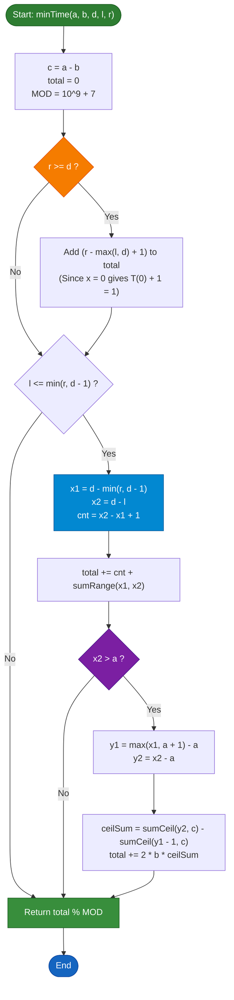

# GeeksforGeeks Problem of the Day: Geek's Destination with Special Jump

- **Problem Link:** [GeeksforGeeks - Geek and Her Destination](https://www.geeksforgeeks.org/problems/geek-and-her-destination--145724/1)
- **Difficulty:** Hard
- **Topic Tags:** Math, Number Theory, Modular Arithmetic, Prefix Sums, Kinematics Simulation, Closed-Form Optimization
- **Target Audience:** POTD Solvers, Computer Science Students, Competitive Programmers, Technical Interview Candidates (Google, Amazon, Microsoft, Directi, CodeNation)

---

## 1. Problem Statement

Geek starts at coordinate $0$ on the positive X-axis at time $t = 0$ and moves in a repeating cyclic pattern:
1. **Forward Phase:** Moves forward by $a$ units at a constant speed of $1$ unit/second (taking $a$ seconds).
2. **Backward Phase:** Moves backward by $b$ units at a constant speed of $1$ unit/second (taking $b$ seconds).

This $(a + b)$-second cycle repeats indefinitely ($0 < b < a$).

### The Special Jump
Geek possesses a **one-time Special Jump** of integer length $j$. At any moment (including mid-cycle), she can trigger this jump to leap forward by exactly $j$ units in **$1$ second**, after which her journey immediately terminates.

### Goal
For every integer jump length $j$ in the inclusive range $[l, r]$, determine the **minimum time** required for Geek to reach or pass destination coordinate $d$ (either by normal cyclic walking alone or by walking to some coordinate and using the special jump of length $j$).

Return the **sum of these minimum times** over all $j \in [l, r]$, modulo $10^9 + 7$:

$$\mathbf{\text{Result} = \left( \sum_{j = l}^{r} \text{MinTime}(a, b, d, j) \right) \bmod (10^9 + 7)}$$

---

## 2. Examples & Visual Walkthroughs

### Example 1
- **Input:** `a = 2, b = 1, d = 5, l = 3, r = 4`
- **Output:** `5`
- **Explanation:**
  - Normal movement walks $2$ units forward ($2\text{s}$), $1$ unit backward ($1\text{s}$), net $+1$ unit per $3\text{s}$ cycle.
  - **For $j = 3$:** Geek needs to reach $d - 3 = 2$.
    - Walk $2$ units forward ($0 \to 2$, takes $2\text{s}$), then jump $+3$ ($2 \to 5$, takes $1\text{s}$).
    - Minimum time $= 2 + 1 = \mathbf{3\text{s}}$.
  - **For $j = 4$:** Geek needs to reach $d - 4 = 1$.
    - Walk $1$ unit forward ($0 \to 1$, takes $1\text{s}$), then jump $+4$ ($1 \to 5$, takes $1\text{s}$).
    - Minimum time $= 1 + 1 = \mathbf{2\text{s}}$.
  - **Total Sum:** $3 + 2 = \mathbf{5}$.

```
Coordinate Line for a = 2, b = 1, d = 5:
  0 ──(+1s)──▶ 1 ──(+1s)──▶ 2 ──(+1s Jump j=3)──────────────▶ 5 (Total: 3s)
               │
               └────────(+1s Jump j=4)──────────────────────▶ 5 (Total: 2s)
```

---

### Example 2
- **Input:** `a = 4, b = 2, d = 8, l = 2, r = 4`
- **Output:** `26`
- **Explanation:**
  - Cycle ($a + b = 6\text{s}$): Forward $+4$ ($4\text{s}$), Backward $-2$ ($2\text{s}$). Net progress per cycle: $c = a - b = 2$ units.
  - Trajectory over time:
    - $t = 0 \to 4$: position $0 \to 4$
    - $t = 4 \to 6$: position $4 \to 2$
    - $t = 6 \to 10$: position $2 \to 6$
    - $t = 10 \to 12$: position $6 \to 4$
    - $t = 12 \to 16$: position $4 \to 8$
  - Evaluating $j \in [2, 4]$:
    - **$j = 2$:** Needs position $8 - 2 = 6$. First reached at $t = 10\text{s}$, plus $1\text{s}$ jump $\implies \mathbf{11\text{s}}$.
    - **$j = 3$:** Needs position $8 - 3 = 5$. First reached at $t = 9\text{s}$, plus $1\text{s}$ jump $\implies \mathbf{10\text{s}}$.
    - **$j = 4$:** Needs position $8 - 4 = 4$. First reached at $t = 4\text{s}$, plus $1\text{s}$ jump $\implies \mathbf{5\text{s}}$.
  - **Total Sum:** $11 + 10 + 5 = \mathbf{26}$.

---

## 3. Constraints & Scale Analysis

| Parameter | Constraint Range | Algorithmic Implications |
| :--- | :--- | :--- |
| **Step Parameters ($a, b$)** | $0 < b < a \le 10$ | Net progress per cycle $c = a - b \ge 1$ is strictly positive, guaranteeing Geek can reach arbitrarily far coordinates. |
| **Destination ($d$)** | $a < d \le 10^8$ | Simulating second-by-second up to $d = 10^8$ takes $\sim 10^9$ steps for even a *single* $j$ $\implies$ **Instant TLE**. |
| **Jump Range ($[l, r]$)** | $0 < l \le r < d$ | There can be up to $10^8$ distinct values of $j$! Even an $\mathcal{O}(1)$-per-$j$ loop iterating from $l$ to $r$ takes $10^8$ iterations, risking **TLE** in slower languages (Python/JavaScript). |
| **Target Complexity** | $\mathcal{O}(1)$ Time & $\mathcal{O}(1)$ Space | A closed-form arithmetic formula summing over $[l, r]$ solves the entire problem in **constant time** ($< 1\text{ ms}$) regardless of how large $d$ or $r - l$ is! |

---

## 4. Mathematical Modeling & Closed-Form Derivation

### 1. First Arrival Time $T(x)$ Without Jumping
Let $c = a - b > 0$ be the net distance gained per full cycle of $(a + b)$ seconds.
After $k$ complete cycles ($k \ge 0$), Geek stands at coordinate $k \cdot c$ at time $k \cdot (a + b)$.

During the $(k + 1)$-th forward phase, she walks continuously from $k \cdot c$ up to $k \cdot c + a$.
Because backward phases only decrease coordinates, the **very first time** she reaches any coordinate $x > 0$ must occur during a forward phase!

For $x \le a$: she reaches $x$ in the very first forward phase ($k = 0$) at time $T(x) = x$.

For $x > a$: we need the smallest integer $k \ge 1$ such that $k \cdot c + a \ge x$:
$$k \cdot c \ge x - a \implies k = \left\lceil \frac{x - a}{c} \right\rceil$$

Once at $k \cdot c$ (time $k(a + b)$), she walks forward the remaining $(x - k \cdot c)$ units:
$$T(x) = k(a + b) + (x - k(a - b)) = x + 2b \cdot k$$

Combining all cases:
$$\mathbf{T(x) = \begin{cases} 0 & \text{if } x \le 0 \\ x & \text{if } 0 < x \le a \\ x + 2b \cdot \left\lceil \dfrac{x - a}{a - b} \right\rceil & \text{if } x > a \end{cases}}$$

---

### 2. Why Special Jump Always Ties or Beats Normal Walking
With a jump of length $j \ge 1$, reaching coordinate $p \ge d - j$ allows jumping to $p + j \ge d$ in $1$ second. Since $T(p)$ is strictly increasing for $p \ge 0$, the optimal departure time is $T(\max(0, d - j))$.

Notice that for every $x \ge 1$:
$$T(x) - T(x - 1) = 1 + 2b \cdot \big(k(x) - k(x - 1)\big) \ge 1$$
Therefore, for any $j \ge 1$:
$$T(\max(0, d - j)) + 1 \le T(d - 1) + 1 \le T(d)$$
Thus, for all $j \ge 1$, **taking the special jump at the earliest possible moment is always optimal**:
$$\text{MinTime}(a, b, d, j) = T(\max(0, d - j)) + 1$$

---

### 3. Summing Over $[l, r]$ in $\mathcal{O}(1)$ Time
As $j$ ranges from $l$ to $r$ (with $1 \le l \le r < d$), the target departure coordinate $x = d - j$ ranges bijectively over the contiguous interval:
$$[x_1, x_2] = [d - r,\; d - l] \subseteq [1,\; d - 1]$$

We need to evaluate:
$$\sum_{x = x_1}^{x_2} \Big( T(x) + 1 \Big) = (x_2 - x_1 + 1) + \sum_{x = x_1}^{x_2} x + 2b \sum_{\substack{x = x_1 \\ x > a}}^{x_2} \left\lceil \frac{x - a}{c} \right\rceil$$

1. **Count Term:** $(x_2 - x_1 + 1)$
2. **Arithmetic Series Term:**
   $$\sum_{x = x_1}^{x_2} x = \frac{(x_2 - x_1 + 1)(x_1 + x_2)}{2}$$
3. **Ceiling Prefix Sum Term:**
   Let $y = x - a$. For $x \in [\max(x_1, a + 1), x_2]$, $y$ spans $[y_1, y_2]$.
   Define $S(M) = \sum_{y = 1}^{M} \left\lceil \frac{y}{c} \right\rceil$:
   - Let $q = \lfloor M / c \rfloor$ and $\text{rem} = M \bmod c$.
   - Values $1, 2, \dots, q$ each appear exactly $c$ times.
   - Value $q + 1$ appears $\text{rem}$ times.
   $$\mathbf{S(M) = c \cdot \frac{q(q + 1)}{2} + \text{rem} \cdot (q + 1)}$$

Then:
$$\sum_{y = y_1}^{y_2} \left\lceil \frac{y}{c} \right\rceil = S(y_2) - S(y_1 - 1)$$

---

### 4. Overflow-Safe Modular Division by $2$
To compute $\frac{U \cdot V}{2} \bmod (10^9 + 7)$ in 64-bit integers without needing 128-bit arithmetic or modular inverses:
- In both $\frac{q(q + 1)}{2}$ and $\frac{(x_2 - x_1 + 1)(x_1 + x_2)}{2}$, the two factors have **opposite parities** (one is guaranteed to be even).
- Simply divide the even factor by $2$ **before** applying `% MOD`:
  ```text
  if (U % 2 == 0): U /= 2
  else:            V /= 2
  result = ((U % MOD) * (V % MOD)) % MOD
  ```

---

## 5. Step-by-Step Simulation & Trace Table

Tracing **Example 2**: `a = 4, b = 2, d = 8, l = 2, r = 4` ($c = a - b = 2$).

1. **Range Mapping:**
   - $x_1 = d - r = 8 - 4 = 4$
   - $x_2 = d - l = 8 - 2 = 6$
   - Interval $[x_1, x_2] = [4, 6]$, count $= 6 - 4 + 1 = 3$.

2. **Base Sum Contributions:**
   - Jump seconds: $3 \times 1 = 3$
   - Linear coordinate sum: $\sum_{x=4}^{6} x = 4 + 5 + 6 = 15$.

3. **Cycle Penalty Term ($x > a = 4$):**
   - Active $x$ values $> 4$: $[5, 6] \implies y = x - 4 \in [1, 2]$ ($y_1 = 1, y_2 = 2$).
   - $S(2)$ with $c = 2$: $q = 2 / 2 = 1, \text{rem} = 0 \implies S(2) = 2 \cdot \frac{1 \cdot 2}{2} + 0 = 2$.
   - $S(0) = 0$.
   - Ceiling sum: $S(2) - S(0) = 2$.
   - Penalty: $2b \times 2 = 2(2) \times 2 = 8$.

4. **Grand Total:**
   - $3 + 15 + 8 = \mathbf{26}$ (Matches Example 2!).

| $j$ | Target $x = d - j$ | $x > a$? | $k = \lceil (x - 4) / 2 \rceil$ | Arrival $T(x) = x + 4k$ | Total $T(x) + 1$ |
| :---: | :---: | :---: | :---: | :---: | :---: |
| $4$ | $4$ | No ($4 \le 4$) | $0$ | $4$ | $\mathbf{5}$ |
| $3$ | $5$ | Yes | $\lceil 1/2 \rceil = 1$ | $5 + 4(1) = 9$ | $\mathbf{10}$ |
| $2$ | $6$ | Yes | $\lceil 2/2 \rceil = 1$ | $6 + 4(1) = 10$ | $\mathbf{11}$ |
| **Sum** | — | — | — | — | **$5 + 10 + 11 = 26$** |

---

## 6. Algorithm Flowchart



---

## 7. Progression from Naive to Pro

### Method 1: Naive Second-by-Second Simulation
- **Concept:** For each $j \in [l, r]$, simulate Geek's walk second-by-second from $t = 0$ until reaching $d$, recording the earliest $t + 1$ where $\text{pos} + j \ge d$.
- **Pseudo-Code:**
  ```text
  function minTimeNaive(a, b, d, l, r):
      total = 0
      for j from l to r:
          pos = 0, time = 0, best = infinity
          while pos < d:
              if pos + j >= d:
                  best = min(best, time + 1)
              if time % (a + b) < a: pos += 1
              else: pos -= 1
              time += 1
          best = min(best, time)
          total = (total + best) % MOD
      return total
  ```
- **Complexity:**
  - **Time Complexity:** $\mathcal{O}\big((r - l + 1) \cdot d\big)$ — Up to $10^{16}$ operations $\implies$ **TLE**.
  - **Auxiliary Space:** $\mathcal{O}(1)$.

---

### Method 2: Closed-Form Time Per Jump $j$
- **Concept:** Replace the inner simulation with the exact formula $T(x) = x + 2b \lceil (x - a) / (a - b) \rceil$ for each $j \in [l, r]$.
- **Pseudo-Code:**
  ```text
  function minTimeLinear(a, b, d, l, r):
      total = 0, c = a - b
      for j from l to r:
          x = max(0, d - j)
          k = 0 if x <= a else ceil((x - a) / c)
          time = x + 2 * b * k + 1
          total = (total + time) % MOD
      return total
  ```
- **Complexity:**
  - **Time Complexity:** $\mathcal{O}(r - l + 1)$ — Up to $10^8$ iterations $\implies$ **TLE** in slower runtimes.
  - **Auxiliary Space:** $\mathcal{O}(1)$.

---

### Method 3: Prefix Ceiling Summation (Optimal Pro Method)
- **Concept:** Sum the arithmetic progression and ceiling series analytically over the mapped interval $[x_1, x_2]$ using $S(M) = c \frac{q(q + 1)}{2} + \text{rem}(q + 1)$.
- **Pseudo-Code:**
  ```text
  function minTime(a, b, d, l, r):
      c = a - b
      x1 = d - min(r, d - 1), x2 = d - l
      total = (x2 - x1 + 1) + sumRange(x1, x2)
      if x2 > a:
          y1 = max(x1, a + 1) - a
          y2 = x2 - a
          total += 2 * b * (sumCeil(y2, c) - sumCeil(y1 - 1, c))
      return total % MOD
  ```
- **Complexity:**
  - **Time Complexity:** $\mathbf{\mathcal{O}(1)}$ — Constant number of arithmetic operations ($< 0.001\text{s}$).
  - **Auxiliary Space:** $\mathbf{\mathcal{O}(1)}$.

---

### Complexity Comparison

| Method | Time Complexity | Space Complexity | Status |
| :--- | :--- | :--- | :--- |
| **Method 1: Simulation Loop** | $\mathcal{O}((r - l + 1) \cdot d)$ | $\mathcal{O}(1)$ | **TLE** ($\sim 10^{16}$ ops) |
| **Method 2: Formula Loop** | $\mathcal{O}(r - l + 1)$ | $\mathcal{O}(1)$ | **TLE** ($\sim 10^8$ ops) |
| **Method 3: Closed-Form Prefix Sum** | $\mathbf{\mathcal{O}(1)}$ | $\mathbf{\mathcal{O}(1)}$ | **Optimal & Accepted ($< 1\text{ms}$)** |

---

## 8. Multi-Language Source Codes

### Java (21)

```java
class Solution {
    private static final long MOD = 1_000_000_007L;

    /**
     * Computes the arithmetic progression sum (l + (l + 1) + ... + r) % MOD
     * without overflowing 64-bit signed integers.
     */
    private long sumRange(long l, long r) {
        if (l > r) return 0;
        long count = r - l + 1;
        long s = l + r;
        // One of 'count' and 's' is guaranteed to be even; halve it before modulo
        if ((count & 1L) == 0) {
            count >>= 1;
        } else {
            s >>= 1;
        }
        return ((count % MOD) * (s % MOD)) % MOD;
    }

    /**
     * Computes sum_{y=1..m} ceil(y / c) % MOD in O(1) time.
     * Each integer 1..q appears c times, and (q + 1) appears (m % c) times.
     */
    private long sumCeil(long m, long c) {
        if (m <= 0) return 0;
        long q = m / c;
        long rem = m % c;

        // Compute q * (q + 1) / 2 safely without overflow
        long f1 = q;
        long f2 = q + 1;
        if ((f1 & 1L) == 0) {
            f1 >>= 1;
        } else {
            f2 >>= 1;
        }
        long tri = ((f1 % MOD) * (f2 % MOD)) % MOD;
        long part1 = ((c % MOD) * tri) % MOD;
        long part2 = ((rem % MOD) * ((q + 1) % MOD)) % MOD;
        return (part1 + part2) % MOD;
    }

    public int minTime(int a, int b, int d, int l, int r) {
        long A = a, B = b, D = d, L = l, R = r;
        long C = A - B; // Net forward distance gained per full (a + b) cycle
        long total = 0;

        // Edge case guard: if j == 0, jumping gives no progress, so walk normally to D
        long jStart = L;
        if (jStart == 0) {
            long k = (D <= A) ? 0 : (D - A + C - 1) / C;
            long tD = (D + 2 * B * k) % MOD;
            total = (total + tD) % MOD;
            jStart = 1;
        }

        if (jStart > R) return (int) total;

        // If jump length j >= D, Geek jumps directly from 0 to >= D in 1 second
        if (R >= D) {
            long low = Math.max(jStart, D);
            long cnt = (R - low + 1) % MOD;
            total = (total + cnt) % MOD;
        }

        // For 1 <= j <= D - 1, target departure coordinate x = D - j spans [x1, x2]
        long jEnd = Math.min(R, D - 1);
        if (jStart <= jEnd) {
            long x1 = D - jEnd;
            long x2 = D - jStart;
            long cnt = (x2 - x1 + 1) % MOD;

            // Add 1 second for each jump plus the base walk distance x
            total = (total + cnt + sumRange(x1, x2)) % MOD;

            // Coordinates x > A incur backward-cycle penalties: 2 * B * ceil((x - A) / C)
            if (x2 > A) {
                long y1 = Math.max(x1, A + 1) - A;
                long y2 = x2 - A;
                long ceilSum = (sumCeil(y2, C) - sumCeil(y1 - 1, C) + MOD) % MOD;
                long extra = (((2 * B) % MOD) * ceilSum) % MOD;
                total = (total + extra) % MOD;
            }
        }

        return (int) total;
    }
}
```

---

### Python3

```python
class Solution:
    def minTime(self, a: int, b: int, d: int, l: int, r: int) -> int:
        MOD = 1_000_000_007
        c = a - b  # Net forward progress gained per full (a + b) cycle

        def sum_range(left: int, right: int) -> int:
            """Computes sum of integers from left to right inclusive, modulo MOD."""
            if left > right:
                return 0
            cnt = right - left + 1
            return ((cnt * (left + right)) // 2) % MOD

        def sum_ceil(m: int, step: int) -> int:
            """Computes sum_{y=1..m} ceil(y / step) % MOD in O(1) time."""
            if m <= 0:
                return 0
            q, rem = divmod(m, step)
            # Full blocks 1..q each repeat 'step' times; partial block (q + 1) repeats 'rem' times
            part1 = step * ((q * (q + 1)) // 2)
            part2 = rem * (q + 1)
            return (part1 + part2) % MOD

        total = 0
        j_start = l

        # Edge case guard: if j == 0, jumping adds 0 distance, so use normal walking time T(d)
        if j_start == 0:
            k = 0 if d <= a else (d - a + c - 1) // c
            total = (total + d + 2 * b * k) % MOD
            j_start = 1

        if j_start > r:
            return total

        # If j >= d, Geek jumps immediately from coordinate 0 in exactly 1 second
        if r >= d:
            low = max(j_start, d)
            total = (total + (r - low + 1)) % MOD

        # For 1 <= j <= d - 1, departure coordinate x = d - j ranges over [x1, x2]
        j_end = min(r, d - 1)
        if j_start <= j_end:
            x1 = d - j_end
            x2 = d - j_start
            cnt = x2 - x1 + 1

            # Each j contributes 1s jump time + base coordinate x
            total = (total + cnt + sum_range(x1, x2)) % MOD

            # Coordinates strictly greater than 'a' require extra cycles: 2 * b * ceil((x - a) / c)
            if x2 > a:
                y1 = max(x1, a + 1) - a
                y2 = x2 - a
                ceil_sum = (sum_ceil(y2, c) - sum_ceil(y1 - 1, c)) % MOD
                total = (total + 2 * b * ceil_sum) % MOD

        return total
```

---

### C++ (17)

```cpp
#include <algorithm>

using namespace std;

class Solution {
  private:
    static constexpr long long MOD = 1000000007LL;

    // Computes (l + (l + 1) + ... + r) % MOD safely in 64-bit arithmetic
    long long sumRange(long long l, long long r) {
        if (l > r) return 0;
        long long count = r - l + 1;
        long long s = l + r;
        // Halve whichever factor is even before applying modulo
        if ((count & 1LL) == 0) {
            count >>= 1;
        } else {
            s >>= 1;
        }
        return ((count % MOD) * (s % MOD)) % MOD;
    }

    // Computes sum_{y=1..m} ceil(y / c) % MOD in O(1) time
    long long sumCeil(long long m, long long c) {
        if (m <= 0) return 0;
        long long q = m / c;
        long long rem = m % c;

        // Halve the even factor of q * (q + 1) to prevent 64-bit overflow
        long long f1 = q;
        long long f2 = q + 1;
        if ((f1 & 1LL) == 0) {
            f1 >>= 1;
        } else {
            f2 >>= 1;
        }
        long long tri = ((f1 % MOD) * (f2 % MOD)) % MOD;
        long long part1 = ((c % MOD) * tri) % MOD;
        long long part2 = ((rem % MOD) * ((q + 1) % MOD)) % MOD;
        return (part1 + part2) % MOD;
    }

  public:
    int minTime(int a, int b, int d, int l, int r) {
        long long A = a, B = b, D = d, L = l, R = r;
        long long C = A - B; // Net forward progress per (a + b) cycle
        long long total = 0;

        // Edge case guard: if j == 0, normal walking to D is optimal
        long long jStart = L;
        if (jStart == 0) {
            long long k = (D <= A) ? 0 : (D - A + C - 1) / C;
            long long tD = (D + 2 * B * k) % MOD;
            total = (total + tD) % MOD;
            jStart = 1;
        }

        if (jStart > R) return static_cast<int>(total);

        // If j >= D, Geek reaches >= D from origin in 1 second via special jump
        if (R >= D) {
            long long low = max(jStart, D);
            long long cnt = (R - low + 1) % MOD;
            total = (total + cnt) % MOD;
        }

        // For 1 <= j <= D - 1, map jump lengths to departure positions x = D - j in [x1, x2]
        long long jEnd = min(R, D - 1);
        if (jStart <= jEnd) {
            long long x1 = D - jEnd;
            long long x2 = D - jStart;
            long long cnt = (x2 - x1 + 1) % MOD;

            // Base contribution: 1s per jump + coordinate x
            total = (total + cnt + sumRange(x1, x2)) % MOD;

            // Add backward-cycle penalty 2 * B * ceil((x - A) / C) for x > A
            if (x2 > A) {
                long long y1 = max(x1, A + 1) - A;
                long long y2 = x2 - A;
                long long ceilSum = (sumCeil(y2, C) - sumCeil(y1 - 1, C) + MOD) % MOD;
                long long extra = (((2 * B) % MOD) * ceilSum) % MOD;
                total = (total + extra) % MOD;
            }
        }

        return static_cast<int>(total);
    }
};
```

---

### C#

```csharp
using System;

class Solution {
    private const long MOD = 1000000007L;

    // Computes (l + (l + 1) + ... + r) % MOD safely without 64-bit overflow
    private static long SumRange(long l, long r) {
        if (l > r) return 0;
        long count = r - l + 1;
        long s = l + r;
        // Divide the even factor by 2 before taking modulo
        if ((count & 1L) == 0) {
            count >>= 1;
        } else {
            s >>= 1;
        }
        return ((count % MOD) * (s % MOD)) % MOD;
    }

    // Computes sum_{y=1..m} ceil(y / c) % MOD in O(1) time
    private static long SumCeil(long m, long c) {
        if (m <= 0) return 0;
        long q = m / c;
        long rem = m % c;

        // Compute q * (q + 1) / 2 safely
        long f1 = q;
        long f2 = q + 1;
        if ((f1 & 1L) == 0) {
            f1 >>= 1;
        } else {
            f2 >>= 1;
        }
        long tri = ((f1 % MOD) * (f2 % MOD)) % MOD;
        long part1 = ((c % MOD) * tri) % MOD;
        long part2 = ((rem % MOD) * ((q + 1) % MOD)) % MOD;
        return (part1 + part2) % MOD;
    }

    public int minTime(int a, int b, int d, int l, int r) {
        long A = a, B = b, D = d, L = l, R = r;
        long C = A - B; // Net progress per full cycle
        long total = 0;

        // Handle j == 0 defensively using normal arrival time T(D)
        long jStart = L;
        if (jStart == 0) {
            long k = (D <= A) ? 0 : (D - A + C - 1) / C;
            long tD = (D + 2 * B * k) % MOD;
            total = (total + tD) % MOD;
            jStart = 1;
        }

        if (jStart > R) return (int)total;

        // For j >= D, a single 1-second jump from 0 reaches or surpasses D
        if (R >= D) {
            long low = Math.Max(jStart, D);
            long cnt = (R - low + 1) % MOD;
            total = (total + cnt) % MOD;
        }

        // Map j in [jStart, min(R, D - 1)] to target coordinate x = D - j in [x1, x2]
        long jEnd = Math.Min(R, D - 1);
        if (jStart <= jEnd) {
            long x1 = D - jEnd;
            long x2 = D - jStart;
            long cnt = (x2 - x1 + 1) % MOD;

            // Add 1 second per jump plus base coordinate sum
            total = (total + cnt + SumRange(x1, x2)) % MOD;

            // Add cycle penalty 2 * B * ceil((x - A) / C) for coordinates x > A
            if (x2 > A) {
                long y1 = Math.Max(x1, A + 1) - A;
                long y2 = x2 - A;
                long ceilSum = (SumCeil(y2, C) - SumCeil(y1 - 1, C) + MOD) % MOD;
                long extra = (((2 * B) % MOD) * ceilSum) % MOD;
                total = (total + extra) % MOD;
            }
        }

        return (int)total;
    }
}
```

---

### Javascript (Node v22)

```javascript
/**
 * @param {number} a
 * @param {number} b
 * @param {number} d
 * @param {number} l
 * @param {number} r
 * @return {number}
 */

class Solution {
    minTime(a, b, d, l, r) {
        // Use BigInt to prevent precision loss beyond Number.MAX_SAFE_INTEGER
        const MOD = 1000000007n;
        const A = BigInt(a);
        const B = BigInt(b);
        const D = BigInt(d);
        const L = BigInt(l);
        const R = BigInt(r);
        const C = A - B; // Net forward progress per full (a + b) cycle

        // Sum of integers in [left, right] modulo MOD
        const sumRange = (left, right) => {
            if (left > right) return 0n;
            const cnt = right - left + 1n;
            return ((cnt * (left + right)) / 2n) % MOD;
        };

        // Sum_{y=1..m} ceil(y / step) % MOD in O(1) time
        const sumCeil = (m, step) => {
            if (m <= 0n) return 0n;
            const q = m / step;
            const rem = m % step;
            const part1 = (step * ((q * (q + 1n)) / 2n)) % MOD;
            const part2 = (rem * (q + 1n)) % MOD;
            return (part1 + part2) % MOD;
        };

        let total = 0n;
        let jStart = L;

        // Defensive check for j == 0 (normal walking time to D)
        if (jStart === 0n) {
            const k = D <= A ? 0n : (D - A + C - 1n) / C;
            const tD = (D + 2n * B * k) % MOD;
            total = (total + tD) % MOD;
            jStart = 1n;
        }

        if (jStart > R) return Number(total);

        // If j >= D, Geek can jump immediately from 0 in 1 second
        if (R >= D) {
            const low = jStart > D ? jStart : D;
            total = (total + (R - low + 1n)) % MOD;
        }

        // Map j in [jStart, min(R, D - 1)] to x = D - j in [x1, x2]
        const jEnd = R < D - 1n ? R : D - 1n;
        if (jStart <= jEnd) {
            const x1 = D - jEnd;
            const x2 = D - jStart;
            const cnt = x2 - x1 + 1n;

            // Add 1 second per jump + linear walk distance sum
            total = (total + cnt + sumRange(x1, x2)) % MOD;

            // Add backward-cycle penalty 2 * B * ceil((x - A) / C) for x > A
            if (x2 > A) {
                const y1 = (x1 > A + 1n ? x1 : A + 1n) - A;
                const y2 = x2 - A;
                const ceilSum = (sumCeil(y2, C) - sumCeil(y1 - 1n, C) + MOD) % MOD;
                total = (total + 2n * B * ceilSum) % MOD;
            }
        }

        return Number(total);
    }
}
```

---

## 9. Edge Cases & Interview Tips

1. **JavaScript Precision Loss (`Number.MAX_SAFE_INTEGER`):**
   - Standard JavaScript `Number` loses integer precision past $2^{53} - 1 \approx 9 \times 10^{15}$. Multiplying two values modulo $10^9 + 7$ can reach $10^{18}$. Always use `BigInt` (`1000000007n`) for modular multiplication in JS.
2. **All Targets Within First Forward Phase ($x_2 \le a$):**
   - When $d - l \le a$, Geek never enters a backward phase for any $j \in [l, r]$. The penalty term is skipped (`if (x2 > A)`), and only the linear progression applies.
3. **Jump Covers Entire Distance ($j \ge d$):**
   - Even if $r \ge d$, $x = \max(0, d - j) = 0$, so Geek jumps immediately from $0$ at $t = 0$ in $1$ second.
4. **Negative Modulo Protection:**
   - When subtracting `sumCeil(y1 - 1, C)` from `sumCeil(y2, C)` under modulo, always add `+ MOD` before taking `% MOD` in C++, Java, C#, and JS to avoid negative remainders.
