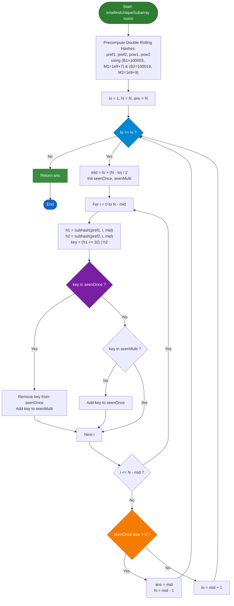

# LeetCode Problem of the Day: Smallest Unique Subarray

- **Problem Link:** [LeetCode 3934 - Smallest Unique Subarray](https://leetcode.com/problems/smallest-unique-subarray/description/)
- **Difficulty:** Hard
- **Topic Tags:** Array, Binary Search, Sliding Window, Rolling Hash, Hash Table, Rabin-Karp
- **Target Audience:** POTD Solvers, Computer Science Students, Competitive Programmers, Technical Interview Candidates (Google, Meta, Amazon, Uber, Jane Street)

---

## 1. Problem Statement

You are given an integer array `nums` of length $N$.

A contiguous subarray `nums[i .. j]` is called **unique** if it does **not** appear anywhere else in `nums` — meaning there is no other starting index $k \neq i$ such that:
$$\text{nums}[i \dots i + L - 1] = \text{nums}[k \dots k + L - 1]$$
where $L = j - i + 1$ is the length of the subarray.

Two subarrays are considered identical if and only if they have the same length and identical elements at every corresponding position.

**Goal:** Find and return the **minimum possible length** $L \ge 1$ of a unique contiguous subarray in `nums`.

---

## 2. Examples & Visual Walkthroughs

### Example 1
- **Input:** `nums = [3, 3, 3]`
- **Output:** `3`
- **Explanation:**
  - **Length $1$:** `[3]` appears at indices $0, 1, 2$ (frequency $= 3$). Not unique.
  - **Length $2$:** `[3, 3]` appears at indices $0..1$ and $1..2$ (frequency $= 2$). Not unique.
  - **Length $3$:** `[3, 3, 3]` appears only at $0..2$ (frequency $= 1$). **Unique!**
  - Minimum unique length $= 3$.

```
Length 1:  [3] [3] [3]   --> 3 occurrences of [3]       (Not unique)
Length 2:  [3, 3]        --> 2 occurrences of [3, 3]    (Not unique)
               [3, 3]
Length 3:  [3, 3, 3]     --> 1 occurrence  of [3, 3, 3] (UNIQUE! Length = 3)
```

---

### Example 2
- **Input:** `nums = [2, 1, 2, 3, 3]`
- **Output:** `1`
- **Explanation:**
  - Checking subarrays of length $1$:
    - `[2]` appears $2$ times (indices $0$ and $2$).
    - `[1]` appears **$1$ time** (index $1$). **Unique!**
    - `[3]` appears $2$ times (indices $3$ and $4$).
  - Because `[1]` has frequency $1$, a unique subarray of length $1$ exists. Minimum length $= 1$.

---

## 3. Constraints & Scale Analysis

| Parameter | Constraint Range | Algorithmic Implications |
| :--- | :--- | :--- |
| **Array Length ($N$)** | $1 \le N \le 10^5$ | $\mathcal{O}(N^2)$ or $\mathcal{O}(N^3)$ subarray comparisons ($\sim 10^{10}$ to $10^{15}$ ops) will immediately hit **Time Limit Exceeded (TLE)** and **Memory Limit Exceeded (MLE)**. |
| **Element Values ($nums[i]$)** | $1 \le nums[i] \le 10^5$ | Large alphabet size ($10^5$ distinct possible values) makes standard Trie or naive Suffix Automaton transitions memory-heavy without hash maps. |
| **Single Hash Collision Risk** | $N \le 10^5$ windows | By the Birthday Paradox, a single 32-bit modulo ($10^9 + 7$) has collision probability $\approx \frac{(10^5)^2}{2 \times 10^9} \approx 5$! **Double Rolling Hash** ($64$-bit combined key) reduces collision risk to $\approx 10^{-8}$. |
| **Target Complexity** | $\mathcal{O}(N \log N)$ Time, $\mathcal{O}(N)$ Space | Binary Search over $[1, N]$ ($\le 17$ iterations) combined with $\mathcal{O}(N)$ rolling hash verification executes in $< 0.15\text{s}$. |

---

## 4. Visual Architecture & Mathematical Insights

### 1. Proof of Monotonicity (Why Binary Search Works)
> **Theorem:** If `nums` contains at least one unique subarray of length $L$, then `nums` is **guaranteed** to contain at least one unique subarray of length $L + 1$ (for any $L < N$).
> $$\text{HasUnique}(L) \implies \text{HasUnique}(L + 1)$$

**Proof:**
Let `sub = nums[i .. i + L - 1]` be a unique subarray of length $L$ ($L < N$).
1. **Case A ($i + L < N$):** Extend `sub` one step to the right: `ext = nums[i .. i + L]`.
   - Suppose for contradiction that `ext` is *not* unique, meaning `ext` also appears at some index $k \neq i$.
   - Then their length-$L$ prefixes `nums[i .. i + L - 1]` and `nums[k .. k + L - 1]` must be identical!
   - This contradicts the fact that `sub` is unique!
2. **Case B ($i + L = N$):** `sub` sits at the very end of `nums`. Since $L < N$, we have $i \ge 1$. Extend `sub` one step to the left: `ext = nums[i - 1 .. i + L - 1]`.
   - By the exact same argument, if `ext` appeared at another index $k \neq i - 1$, their length-$L$ suffixes `nums[i .. i + L - 1]` and `nums[k + 1 .. k + L]` would be identical, contradicting uniqueness!

Furthermore, for $L = N$, there is only $1$ subarray (`nums[0 .. N - 1]`), so $\text{HasUnique}(N) = \text{true}$ always holds.
This yields a monotonic boolean array `[False, False, ..., True, True]`, allowing **Binary Search** for the smallest `True` in $\lceil \log_2 N \rceil \le 17$ steps!

```
Candidate Length L:    1      2      ...     k-1     k      k+1    ...     N
HasUnique(L):        False  False   ...    False   True    True   ...    True
                                                    ▲
                                                    │
                                    Binary Search finds minimum True
```

---

### 2. Double Polynomial Rolling Hash
To hash any subarray `nums[i .. i + L - 1]` in $\mathcal{O}(1)$ time after $\mathcal{O}(N)$ precomputation:
Choose two independent prime bases strictly larger than $\max(nums[i]) = 10^5$, and two large prime moduli:
- $B_1 = 100,003$, $M_1 = 10^9 + 7$
- $B_2 = 100,019$, $M_2 = 10^9 + 9$

Precompute prefix hashes `pref[i]` and powers `pow[i]`:
$$\text{pref}_1[i + 1] = (\text{pref}_1[i] \cdot B_1 + nums[i] + 1) \bmod M_1$$
Then for any window $[i, i + L - 1]$:
$$H_1(i, L) = \big(\text{pref}_1[i + L] - \text{pref}_1[i] \cdot B_1^L\big) \bmod M_1$$
Combine $(H_1, H_2)$ into a single 64-bit integer key:
$$\text{Key} = (H_1 \ll 32) \mid H_2$$

---

### 3. Two-Set Frequency Tracking (`seenOnce` & `seenMulti`)
Instead of incrementing integer counters in a `HashMap` and iterating through all map values afterward, we can maintain two `HashSet`s:
- When a hash `key` arrives:
  - If `key` is in `seenOnce`: remove it from `seenOnce` and add it to `seenMulti`.
  - Else if `key` is not in `seenMulti`: add it to `seenOnce`.
- After scanning all $N - L + 1$ windows, a unique subarray exists **if and only if** `seenOnce` is non-empty!

---

## 5. Step-by-Step Simulation & Trace Table

Tracing **Binary Search** on `nums = [1, 2, 1, 2, 3]`, $N = 5$.

| Iteration | `[lo, hi]` | `mid` | Subarrays of Length `mid` | Frequencies | `HasUnique(mid)` | Updated `ans` | Next `[lo, hi]` |
| :---: | :---: | :---: | :--- | :--- | :---: | :---: | :---: |
| **1** | `[1, 5]` | `3` | `[1,2,1]`, `[2,1,2]`, `[1,2,3]` | Each appears $1\times$ | **True** | `3` | `[1, 2]` |
| **2** | `[1, 2]` | `1` | `[1]`, `[2]`, `[1]`, `[2]`, `[3]` | `[1]:2`, `[2]:2`, **`[3]:1`** | **True** | `1` | `[1, 0]` |
| **End** | `[1, 0]` | — | Loop terminates ($lo > hi$) | — | — | **`1`** | — |

**Final Answer:** `1` (from unique subarray `[3]`).

---

## 6. Algorithm Flowchart



---

## 7. Progression from Naive to Pro

### Method 1: Brute-Force Subarray Enumeration
- **Concept:** Try every candidate length $L$ from $1$ up to $N$. For each length, slice every subarray `nums[i .. i + L - 1]` and compare against all other subarrays of length $L$. Return the first $L$ where any subarray has count $1$.
- **Pseudo-Code:**
  ```text
  function smallestUniqueNaive(nums):
      n = length(nums)
      for L from 1 to n:
          for i from 0 to n - L:
              is_unique = true
              for j from 0 to n - L:
                  if i != j and nums[i..i+L-1] == nums[j..j+L-1]:
                      is_unique = false
                      break
              if is_unique: return L
      return n
  ```
- **Complexity:**
  - **Time Complexity:** $\mathcal{O}(N^4)$ worst case ($\mathcal{O}(N^3)$ with hash map of slices) $\implies$ **TLE**.
  - **Auxiliary Space:** $\mathcal{O}(N^2)$ if storing sliced arrays.

---

### Method 2: Binary Search + Raw Subarray Tuple Hashing
- **Concept:** Exploit monotonicity to binary search $L \in [1, N]$, but slice subarrays directly as strings/tuples into a HashMap.
- **Pseudo-Code:**
  ```text
  function smallestUniqueTuple(nums):
      lo = 1, hi = n, ans = n
      while lo <= hi:
          mid = (lo + hi) / 2
          freq = HashMap<Tuple, int>()
          for i from 0 to n - mid:
              freq[tuple(nums[i : i + mid])] += 1
          if any(v == 1 for v in freq.values()):
              ans = mid; hi = mid - 1
          else:
              lo = mid + 1
      return ans
  ```
- **Complexity:**
  - **Time Complexity:** $\mathcal{O}(N^2 \log N)$ — Constructing length-`mid` slices takes $\mathcal{O}(N^2)$ per check $\implies$ **TLE / MLE**.
  - **Auxiliary Space:** $\mathcal{O}(N^2)$.

---

### Method 3: Binary Search + Double Rolling Hash (Optimal Pro Method)
- **Concept:** Precompute two independent prefix polynomial hashes in $\mathcal{O}(N)$. Use Binary Search over $[1, N]$. Each check evaluates all $N - L + 1$ window hashes in $\mathcal{O}(1)$ per window using 64-bit packed keys.
- **Pseudo-Code:**
  ```text
  function smallestUniqueSubarray(nums):
      precompute pref1, pref2, pow1, pow2
      lo = 1, hi = n, ans = n
      while lo <= hi:
          mid = (lo + hi) / 2
          if hasUniqueHash(mid):
              ans = mid; hi = mid - 1
          else:
              lo = mid + 1
      return ans
  ```
- **Complexity:**
  - **Time Complexity:** $\mathbf{\mathcal{O}(N \log N)}$ — $\le 17$ binary search steps, each $\mathcal{O}(N)$ ($< 0.15\text{s}$).
  - **Auxiliary Space:** $\mathbf{\mathcal{O}(N)}$ — Prefix arrays and hash sets of size $\le N$.

---

### Complexity Comparison

| Method | Time Complexity | Auxiliary Space | Status |
| :--- | :--- | :--- | :--- |
| **Method 1: Brute Force** | $\mathcal{O}(N^4)$ | $\mathcal{O}(1)$ | **TLE** ($N = 10^5$) |
| **Method 2: Binary Search + Slices** | $\mathcal{O}(N^2 \log N)$ | $\mathcal{O}(N^2)$ | **TLE / MLE** |
| **Method 3: Binary Search + Double Hash** | $\mathbf{\mathcal{O}(N \log N)}$ | $\mathbf{\mathcal{O}(N)}$ | **Optimal & Accepted ($< 0.15\text{s}$)** |

---

## 8. Multi-Language Source Codes

### Java

```java
class Solution {
    // Two independent primes > max(nums[i]) and two large prime moduli
    private static final long MOD1 = 1_000_000_007L;
    private static final long MOD2 = 1_000_000_009L;
    private static final long BASE1 = 100_003L;
    private static final long BASE2 = 100_019L;

    public int smallestUniqueSubarray(int[] nums) {
        int n = nums.length;
        long[] pow1 = new long[n + 1];
        long[] pow2 = new long[n + 1];
        long[] pref1 = new long[n + 1];
        long[] pref2 = new long[n + 1];

        pow1[0] = 1;
        pow2[0] = 1;

        // Precompute powers and prefix rolling hashes in O(N)
        for (int i = 0; i < n; i++) {
            long val = nums[i] + 1L; // Shift by +1 to avoid zero-value issues
            pow1[i + 1] = (pow1[i] * BASE1) % MOD1;
            pow2[i + 1] = (pow2[i] * BASE2) % MOD2;
            pref1[i + 1] = (pref1[i] * BASE1 + val) % MOD1;
            pref2[i + 1] = (pref2[i] * BASE2 + val) % MOD2;
        }

        // Allocate flat open-addressing hash table ONCE to avoid boxing and GC overhead
        int htSize = 16;
        while (htSize < n * 2) htSize <<= 1;
        int htMask = htSize - 1;

        long[] keys = new long[htSize];
        int[] counts = new int[htSize];
        int[] stamps = new int[htSize];
        int stamp = 1;

        // Binary search over candidate subarray length [1, n]
        int lo = 1, hi = n, ans = n;
        while (lo <= hi) {
            int mid = lo + ((hi - lo) >> 1);
            if (hasUnique(mid, n, pref1, pref2, pow1, pow2, keys, counts, stamps, htMask, stamp++)) {
                ans = mid;
                hi = mid - 1; // Try to find an even smaller unique length
            } else {
                lo = mid + 1;
            }
        }
        return ans;
    }

    /**
     * Checks whether any subarray of length 'len' occurs exactly once using zero-allocation probing.
     */
    private boolean hasUnique(
        int len, int n,
        long[] pref1, long[] pref2, long[] pow1, long[] pow2,
        long[] keys, int[] counts, int[] stamps, int htMask, int stamp
    ) {
        long p1 = pow1[len];
        long p2 = pow2[len];
        int uniqueCount = 0;

        for (int i = 0; i <= n - len; i++) {
            // Compute window hash [i, i + len - 1] in O(1)
            long h1 = (pref1[i + len] - (pref1[i] * p1) % MOD1 + MOD1) % MOD1;
            long h2 = (pref2[i + len] - (pref2[i] * p2) % MOD2 + MOD2) % MOD2;

            // Pack both 32-bit hashes into a single 64-bit long key
            long key = (h1 << 32) | h2;

            // SplitMix64 mixing prevents hash clustering and adversarial collisions
            long mix = key;
            mix ^= (mix >>> 30);
            mix *= 0xbf58476d1ce4e5b9L;
            mix ^= (mix >>> 27);
            int slot = (int) (mix & htMask);

            while (stamps[slot] == stamp && keys[slot] != key) {
                slot = (slot + 1) & htMask;
            }

            if (stamps[slot] != stamp) {
                stamps[slot] = stamp;
                keys[slot] = key;
                counts[slot] = 1;
                uniqueCount++;
            } else {
                if (counts[slot] == 1) {
                    uniqueCount--;
                }
                counts[slot]++;
            }
        }

        return uniqueCount > 0;
    }
}
```

---

### Python3

```python
class Solution:
    def smallestUniqueSubarray(self, nums: list[int]) -> int:
        n = len(nums)
        MOD1, MOD2 = 1_000_000_007, 1_000_000_009
        BASE1, BASE2 = 100_003, 100_019

        pow1 = [1] * (n + 1)
        pow2 = [1] * (n + 1)
        pref1 = [0] * (n + 1)
        pref2 = [0] * (n + 1)

        # Precompute powers and prefix rolling hashes in O(N)
        for i, num in enumerate(nums):
            val = num + 1
            pow1[i + 1] = (pow1[i] * BASE1) % MOD1
            pow2[i + 1] = (pow2[i] * BASE2) % MOD2
            pref1[i + 1] = (pref1[i] * BASE1 + val) % MOD1
            pref2[i + 1] = (pref2[i] * BASE2 + val) % MOD2

        def has_unique(length: int) -> bool:
            """Returns True if at least one subarray of 'length' appears once."""
            seen_once = set()
            seen_multi = set()
            p1, p2 = pow1[length], pow2[length]

            for i in range(n - length + 1):
                h1 = (pref1[i + length] - pref1[i] * p1) % MOD1
                h2 = (pref2[i + length] - pref2[i] * p2) % MOD2
                key = (h1 << 32) | h2

                if key in seen_once:
                    seen_once.remove(key)
                    seen_multi.add(key)
                elif key not in seen_multi:
                    seen_once.add(key)

            return len(seen_once) > 0

        # Binary search for the smallest valid length
        lo, hi, ans = 1, n, n
        while lo <= hi:
            mid = (lo + hi) >> 1
            if has_unique(mid):
                ans = mid
                hi = mid - 1
            else:
                lo = mid + 1

        return ans
```

---

### C

```c
#include <stdlib.h>
#include <stdint.h>
#include <stdbool.h>
#include <string.h>

#define MOD1 1000000007ULL
#define MOD2 1000000009ULL
#define BASE1 100003ULL
#define BASE2 100019ULL
#define HT_SIZE (1 << 18) // 262,144 slots (power of 2 for fast bitmasking)
#define HT_MASK (HT_SIZE - 1)

typedef struct {
    uint64_t key;
    int count;
    int stamp; // Generation stamp avoids clearing the entire table each step
} Entry;

static int hasUnique(int len, int n, const uint64_t* pref1, const uint64_t* pref2,
                     const uint64_t* pow1, const uint64_t* pow2, Entry* table, int stamp) {
    uint64_t p1 = pow1[len];
    uint64_t p2 = pow2[len];
    int uniqueCount = 0;

    for (int i = 0; i <= n - len; i++) {
        uint64_t h1 = (pref1[i + len] + MOD1 - (pref1[i] * p1) % MOD1) % MOD1;
        uint64_t h2 = (pref2[i + len] + MOD2 - (pref2[i] * p2) % MOD2) % MOD2;
        uint64_t key = (h1 << 32) | h2;

        // Murmur-style avalanche mixer for open-addressing hash slot
        uint64_t slot = (key ^ (key >> 33)) * 0xff51afd7ed558ccdULL;
        slot = (slot ^ (slot >> 33)) & HT_MASK;

        while (table[slot].stamp == stamp && table[slot].key != key) {
            slot = (slot + 1) & HT_MASK;
        }

        if (table[slot].stamp != stamp) {
            table[slot].stamp = stamp;
            table[slot].key = key;
            table[slot].count = 1;
            uniqueCount++;
        } else {
            if (table[slot].count == 1) {
                uniqueCount--;
            }
            table[slot].count++;
        }
    }

    return uniqueCount > 0;
}

int smallestUniqueSubarray(int* nums, int numsSize) {
    int n = numsSize;
    uint64_t* pow1 = (uint64_t*)malloc((n + 1) * sizeof(uint64_t));
    uint64_t* pow2 = (uint64_t*)malloc((n + 1) * sizeof(uint64_t));
    uint64_t* pref1 = (uint64_t*)malloc((n + 1) * sizeof(uint64_t));
    uint64_t* pref2 = (uint64_t*)malloc((n + 1) * sizeof(uint64_t));
    Entry* table = (Entry*)calloc(HT_SIZE, sizeof(Entry));

    pow1[0] = 1; pow2[0] = 1;
    pref1[0] = 0; pref2[0] = 0;

    for (int i = 0; i < n; i++) {
        uint64_t val = (uint64_t)nums[i] + 1ULL;
        pow1[i + 1] = (pow1[i] * BASE1) % MOD1;
        pow2[i + 1] = (pow2[i] * BASE2) % MOD2;
        pref1[i + 1] = (pref1[i] * BASE1 + val) % MOD1;
        pref2[i + 1] = (pref2[i] * BASE2 + val) % MOD2;
    }

    int lo = 1, hi = n, ans = n;
    int stamp = 1;

    while (lo <= hi) {
        int mid = lo + ((hi - lo) >> 1);
        if (hasUnique(mid, n, pref1, pref2, pow1, pow2, table, stamp++)) {
            ans = mid;
            hi = mid - 1;
        } else {
            lo = mid + 1;
        }
    }

    free(pow1); free(pow2); free(pref1); free(pref2); free(table);
    return ans;
}
```

---

### C++

```cpp
#include <vector>
#include <unordered_set>
#include <cstdint>

using namespace std;

class Solution {
  private:
    static constexpr uint64_t MOD1 = 1000000007ULL;
    static constexpr uint64_t MOD2 = 1000000009ULL;
    static constexpr uint64_t BASE1 = 100003ULL;
    static constexpr uint64_t BASE2 = 100019ULL;

    bool hasUnique(int len, int n, const vector<uint64_t>& pref1, const vector<uint64_t>& pref2,
                   const vector<uint64_t>& pow1, const vector<uint64_t>& pow2) {
        unordered_set<uint64_t> seenOnce, seenMulti;
        seenOnce.reserve(n - len + 1);

        uint64_t p1 = pow1[len];
        uint64_t p2 = pow2[len];

        for (int i = 0; i <= n - len; ++i) {
            uint64_t h1 = (pref1[i + len] + MOD1 - (pref1[i] * p1) % MOD1) % MOD1;
            uint64_t h2 = (pref2[i + len] + MOD2 - (pref2[i] * p2) % MOD2) % MOD2;
            uint64_t key = (h1 << 32) | h2;

            if (seenOnce.count(key)) {
                seenOnce.erase(key);
                seenMulti.insert(key);
            } else if (!seenMulti.count(key)) {
                seenOnce.insert(key);
            }
        }
        return !seenOnce.empty();
    }

  public:
    int smallestUniqueSubarray(vector<int>& nums) {
        int n = nums.size();
        vector<uint64_t> pow1(n + 1, 1), pow2(n + 1, 1);
        vector<uint64_t> pref1(n + 1, 0), pref2(n + 1, 0);

        // Precompute powers and prefix hashes
        for (int i = 0; i < n; ++i) {
            uint64_t val = static_cast<uint64_t>(nums[i]) + 1ULL;
            pow1[i + 1] = (pow1[i] * BASE1) % MOD1;
            pow2[i + 1] = (pow2[i] * BASE2) % MOD2;
            pref1[i + 1] = (pref1[i] * BASE1 + val) % MOD1;
            pref2[i + 1] = (pref2[i] * BASE2 + val) % MOD2;
        }

        // Binary search on answer [1, n]
        int lo = 1, hi = n, ans = n;
        while (lo <= hi) {
            int mid = lo + ((hi - lo) >> 1);
            if (hasUnique(mid, n, pref1, pref2, pow1, pow2)) {
                ans = mid;
                hi = mid - 1;
            } else {
                lo = mid + 1;
            }
        }
        return ans;
    }
};
```

---

### C#

```csharp
using System;

public class Solution {
    private const long MOD1 = 1000000007L;
    private const long MOD2 = 1000000009L;
    private const long BASE1 = 100003L;
    private const long BASE2 = 100019L;

    public int SmallestUniqueSubarray(int[] nums) {
        int n = nums.Length;
        long[] pow1 = new long[n + 1];
        long[] pow2 = new long[n + 1];
        long[] pref1 = new long[n + 1];
        long[] pref2 = new long[n + 1];

        pow1[0] = 1;
        pow2[0] = 1;

        // Precompute powers and prefix rolling hashes
        for (int i = 0; i < n; i++) {
            long val = nums[i] + 1L;
            pow1[i + 1] = (pow1[i] * BASE1) % MOD1;
            pow2[i + 1] = (pow2[i] * BASE2) % MOD2;
            pref1[i + 1] = (pref1[i] * BASE1 + val) % MOD1;
            pref2[i + 1] = (pref2[i] * BASE2 + val) % MOD2;
        }

        // Allocate flat open-addressing hash table ONCE to avoid HashSet resizing and GC overhead
        int htSize = 16;
        while (htSize < n * 2) htSize <<= 1;
        int htMask = htSize - 1;

        ulong[] keys = new ulong[htSize];
        int[] counts = new int[htSize];
        int[] stamps = new int[htSize];
        int stamp = 1;

        // Binary search over candidate subarray length
        int lo = 1, hi = n, ans = n;
        while (lo <= hi) {
            int mid = lo + ((hi - lo) >> 1);
            if (HasUnique(mid, n, pref1, pref2, pow1, pow2, keys, counts, stamps, htMask, stamp++)) {
                ans = mid;
                hi = mid - 1;
            } else {
                lo = mid + 1;
            }
        }
        return ans;
    }

    private static bool HasUnique(
        int len, int n,
        long[] pref1, long[] pref2, long[] pow1, long[] pow2,
        ulong[] keys, int[] counts, int[] stamps, int htMask, int stamp
    ) {
        long p1 = pow1[len];
        long p2 = pow2[len];
        int uniqueCount = 0;

        for (int i = 0; i <= n - len; i++) {
            long h1 = (pref1[i + len] - (pref1[i] * p1) % MOD1 + MOD1) % MOD1;
            long h2 = (pref2[i + len] - (pref2[i] * p2) % MOD2 + MOD2) % MOD2;
            ulong key = ((ulong)h1 << 32) | (ulong)h2;

            // SplitMix64 mixing prevents hash clustering and GetHashCode() collisions
            ulong mix = key;
            mix ^= mix >> 30;
            mix *= 0xbf58476d1ce4e5b9UL;
            mix ^= mix >> 27;
            int slot = (int)(mix & (ulong)htMask);

            while (stamps[slot] == stamp && keys[slot] != key) {
                slot = (slot + 1) & htMask;
            }

            if (stamps[slot] != stamp) {
                stamps[slot] = stamp;
                keys[slot] = key;
                counts[slot] = 1;
                uniqueCount++;
            } else {
                if (counts[slot] == 1) {
                    uniqueCount--;
                }
                counts[slot]++;
            }
        }

        return uniqueCount > 0;
    }
}
```

---

### Javascript

```javascript
/**
 * @param {number[]} nums
 * @return {number}
 */
var smallestUniqueSubarray = function(nums) {
    const n = nums.length;
    // Use BigInt for exact 64-bit modular arithmetic without precision loss
    const MOD1 = 1000000007n;
    const MOD2 = 1000000009n;
    const BASE1 = 100003n;
    const BASE2 = 100019n;

    const pow1 = new BigUint64Array(n + 1);
    const pow2 = new BigUint64Array(n + 1);
    const pref1 = new BigUint64Array(n + 1);
    const pref2 = new BigUint64Array(n + 1);

    pow1[0] = 1n;
    pow2[0] = 1n;

    // Precompute powers and prefix rolling hashes
    for (let i = 0; i < n; i++) {
        const val = BigInt(nums[i]) + 1n;
        pow1[i + 1] = (pow1[i] * BASE1) % MOD1;
        pow2[i + 1] = (pow2[i] * BASE2) % MOD2;
        pref1[i + 1] = (pref1[i] * BASE1 + val) % MOD1;
        pref2[i + 1] = (pref2[i] * BASE2 + val) % MOD2;
    }

    const hasUnique = (len) => {
        const seenOnce = new Set();
        const seenMulti = new Set();
        const p1 = pow1[len];
        const p2 = pow2[len];

        for (let i = 0; i <= n - len; i++) {
            const h1 = (pref1[i + len] - (pref1[i] * p1) % MOD1 + MOD1) % MOD1;
            const h2 = (pref2[i + len] - (pref2[i] * p2) % MOD2 + MOD2) % MOD2;
            const key = (h1 << 32n) | h2;

            if (seenOnce.has(key)) {
                seenOnce.delete(key);
                seenMulti.add(key);
            } else if (!seenMulti.has(key)) {
                seenOnce.add(key);
            }
        }
        return seenOnce.size > 0;
    };

    // Binary search over [1, n]
    let lo = 1, hi = n, ans = n;
    while (lo <= hi) {
        const mid = (lo + hi) >> 1;
        if (hasUnique(mid)) {
            ans = mid;
            hi = mid - 1;
        } else {
            lo = mid + 1;
        }
    }

    return ans;
};
```

---

### Typescript

```typescript
function smallestUniqueSubarray(nums: number[]): number {
    const n: number = nums.length;
    const MOD1: bigint = 1000000007n;
    const MOD2: bigint = 1000000009n;
    const BASE1: bigint = 100003n;
    const BASE2: bigint = 100019n;

    const pow1 = new BigUint64Array(n + 1);
    const pow2 = new BigUint64Array(n + 1);
    const pref1 = new BigUint64Array(n + 1);
    const pref2 = new BigUint64Array(n + 1);

    pow1[0] = 1n;
    pow2[0] = 1n;

    // Precompute powers and prefix rolling hashes in O(N)
    for (let i = 0; i < n; i++) {
        const val: bigint = BigInt(nums[i]) + 1n;
        pow1[i + 1] = (pow1[i] * BASE1) % MOD1;
        pow2[i + 1] = (pow2[i] * BASE2) % MOD2;
        pref1[i + 1] = (pref1[i] * BASE1 + val) % MOD1;
        pref2[i + 1] = (pref2[i] * BASE2 + val) % MOD2;
    }

    const hasUnique = (len: number): boolean => {
        const seenOnce = new Set<bigint>();
        const seenMulti = new Set<bigint>();
        const p1: bigint = pow1[len];
        const p2: bigint = pow2[len];

        for (let i = 0; i <= n - len; i++) {
            const h1: bigint = (pref1[i + len] - (pref1[i] * p1) % MOD1 + MOD1) % MOD1;
            const h2: bigint = (pref2[i + len] - (pref2[i] * p2) % MOD2 + MOD2) % MOD2;
            const key: bigint = (h1 << 32n) | h2;

            if (seenOnce.has(key)) {
                seenOnce.delete(key);
                seenMulti.add(key);
            } else if (!seenMulti.has(key)) {
                seenOnce.add(key);
            }
        }
        return seenOnce.size > 0;
    };

    // Binary search for minimum unique subarray length
    let lo: number = 1, hi: number = n, ans: number = n;
    while (lo <= hi) {
        const mid: number = (lo + hi) >> 1;
        if (hasUnique(mid)) {
            ans = mid;
            hi = mid - 1;
        } else {
            lo = mid + 1;
        }
    }

    return ans;
}
```

---

## 9. Edge Cases & Interview Tips

1. **Why Double Hashing is Mandatory:**
   - With up to $10^5$ subarrays per binary search step, a single $32$-bit prime modulus ($10^9 + 7$) is vulnerable to Birthday Paradox collisions. Always pair two independent prime bases and two large prime moduli packed into a 64-bit integer.
2. **Array of Length $1$ (`nums = [7]`):**
   - Only one subarray exists (`[7]`), so the binary search immediately evaluates `mid = 1`, finds `seenOnce.size == 1`, and returns `1`.
3. **All Elements Identical (`nums = [5, 5, 5, 5]`):**
   - Every length $L < N$ has $N - L + 1 \ge 2$ identical subarrays. Only $L = N$ has $1$ subarray, so the algorithm returns $N$.
4. **Alternative $\mathcal{O}(N \log N)$ / $\mathcal{O}(N)$ Suffix Approaches:**
   - In advanced interviews, you can also mention **Suffix Array + LCP Array**: a subarray starting at suffix `sa[i]` of length `L` is unique if and only if `L > max(LCP[i], LCP[i + 1])` and `i + L <= N`, yielding $\min_i \big(\max(LCP[i], LCP[i+1]) + 1\big)$!
