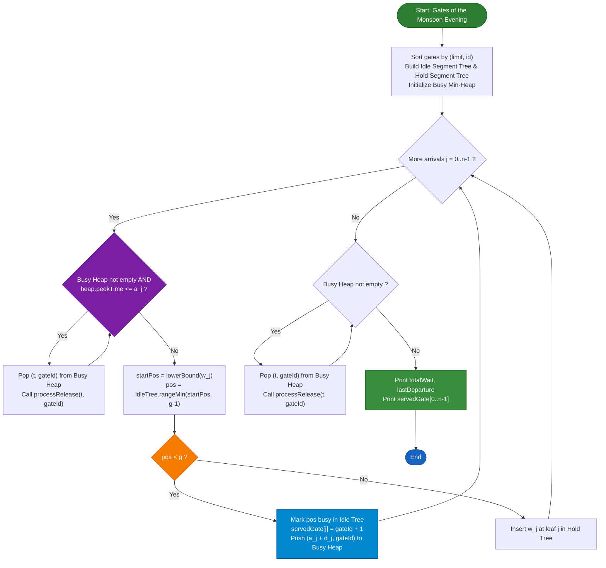

# Unstop Problem of the Day: Gates of the Monsoon Evening

- **Platform:** [Unstop](https://unstop.com/)
- **Difficulty:** Hard
- **Topic Tags:** Priority Queue (Min-Heap), Segment Tree, Binary Search, Event-Driven Simulation, Greedy Scheduling, Real-Time Systems
- **Target Audience:** POTD Solvers, Computer Science Students, Competitive Programmers, Technical Interview Candidates (Google, Amazon, Uber, Goldman Sachs, Jane Street)

---

## 1. Problem Statement

Meera supervises ground operations at **Vaishali International Airport** during the monsoon season. The terminal has $g$ boarding gates numbered $1$ through $g$, where gate $i$ has a maximum wingspan limit $L_i$.

A sequence of $n$ aircraft arrives in **non-decreasing order** of arrival moment $a_j$. Each aircraft $j$ ($1 \le j \le n$) has:
- Arrival moment $a_j$ ($0 \le a_j \le 10^9$)
- Wingspan $w_j$ ($1 \le w_j \le \max L_i$)
- Turnaround time $d_j$ ($1 \le d_j \le 10^6$), the exact number of minutes it occupies a gate once docked.

### Docking & Release Rules
1. **On Aircraft Arrival ($a_j, w_j, d_j$):**
   - Look for an **idle** gate with $L_i \ge w_j$.
   - Choose the idle gate with the **smallest wingspan limit** $L_i$ that still fits $w_j$ (Best-Fit).
   - **Tie-Breaker:** If multiple idle gates share that smallest limit, choose the one with the **smaller gate number** $i$.
   - If a suitable idle gate is found, the aircraft docks immediately at $a_j$, waits $0$ minutes, and occupies the gate until moment $a_j + d_j$.
   - If no idle gate fits, the aircraft enters the **holding pattern** above the airport.
2. **On Gate Release (Gate $i$ at moment $t$):**
   - Offer gate $i$ immediately to the **earliest-arrived** aircraft in the holding pattern whose wingspan satisfies $w_j \le L_i$.
   - If found, that aircraft leaves the holding pattern, docks at moment $t$ (accumulating wait $t - a_j$), and occupies gate $i$ until $t + d_j$.
   - If no holding aircraft fits $L_i$, gate $i$ becomes **idle**.
3. **Simultaneous Events Tie-Breaking:**
   - **Releases before Arrivals:** Every gate release scheduled at moment $t$ is processed *before* any aircraft arrival at moment $t$.
   - **Multiple Releases at $t$:** Processed in increasing order of **gate number** $i$.
   - **Multiple Arrivals at $t$:** Processed in **input order**.

### Output Specification
Print two lines:
1. Total wait across all $n$ aircraft (`totalWait`) and the moment the last aircraft departs (`lastDeparture`), separated by a space.
2. $n$ space-separated integers: the gate number ($1$-based) that served aircraft $1$ through $n$.

---

## 2. Examples & Visual Walkthroughs

### Example 1 (Sample Testcase 0)

#### Input:
```text
3 5
50
30
50
0 40 10
1 20 5
2 45 4
3 30 6
3 50 2
```

#### Output:
```text
6 12
1 2 3 2 3
```

#### Chronological Event Timeline:

```
Time  Event                        Gate 1 (50)     Gate 2 (30)     Gate 3 (50)     Holding Pattern
──────────────────────────────────────────────────────────────────────────────────────────────────────
t=0   Arrive A1 (w=40, d=10)       A1 (0..10)      Idle            Idle            []
t=1   Arrive A2 (w=20, d=5)        A1 (0..10)      A2 (1..6)       Idle            []
t=2   Arrive A3 (w=45, d=4)        A1 (0..10)      A2 (1..6)       A3 (2..6)       []
t=3   Arrive A4 (w=30, d=6)        A1 (0..10)      A2 (1..6)       A3 (2..6)       [A4(30)]
t=3   Arrive A5 (w=50, d=2)        A1 (0..10)      A2 (1..6)       A3 (2..6)       [A4(30), A5(50)]
t=6   Release Gate 2 (limit 30)    A1 (0..10)      A4 (6..12)      A3 (2..6)       [A5(50)]  (A4 wait=3)
t=6   Release Gate 3 (limit 50)    A1 (0..10)      A4 (6..12)      A5 (6..8)       []        (A5 wait=3)
t=8   Release Gate 3               A1 (0..10)      A4 (6..12)      Idle            []
t=10  Release Gate 1               Idle            A4 (6..12)      Idle            []
t=12  Release Gate 2               Idle            Idle            Idle            []
```
- **Waits:** $0, 0, 0, 3, 3 \implies \text{Total Wait} = 6$.
- **Last Departure:** $12$.
- **Serving Gates:** `1 2 3 2 3`.

---

### Example 2 (Sample Testcase 1)

#### Input:
```text
2 5
60
40
0 55 10
1 50 3
2 35 4
3 40 2
6 45 1
```

#### Output:
```text
19 14
1 1 2 2 1
```

#### Chronological Event Timeline:
- `t=0`: A1 (`w=55`) takes Gate 1 until `10`.
- `t=1`: A2 (`w=50`) cannot fit Gate 2 (`40`), so A2 holds.
- `t=2`: A3 (`w=35`) takes Gate 2 until `6`.
- `t=3`: A4 (`w=40`) holds.
- `t=6`: **Gate 2 releases BEFORE A5 arrives!** Gate 2 (`limit=40`) skips A2 (`50 > 40`) and serves A4 (`40 <= 40`, wait $= 6 - 3 = 3$) until `8`. Then A5 (`w=45`) arrives and holds.
- `t=8`: Gate 2 releases and becomes Idle.
- `t=10`: Gate 1 (`limit=60`) releases and serves A2 (wait $= 10 - 1 = 9$) until `13`.
- `t=13`: Gate 1 releases and serves A5 (wait $= 13 - 6 = 7$) until `14`.
- **Total Wait:** $0 + 9 + 0 + 3 + 7 = 19$, **Last Departure:** $14$, **Gates:** `1 1 2 2 1`.

---

## 3. Constraints & Scale Analysis

| Parameter | Constraint Range | Algorithmic Implications |
| :--- | :--- | :--- |
| **Gates ($g$) & Aircraft ($n$)** | $1 \le g, n \le 200,000$ | Scanning idle gates ($\mathcal{O}(g)$) or scanning the holding pattern ($\mathcal{O}(n)$) on every event takes $\mathcal{O}(n(g + n)) \approx 8 \times 10^{10}$ ops $\implies$ **TLE**. |
| **Arrival Time ($a$) & Turnaround ($d$)** | $0 \le a \le 10^9,\; 1 \le d \le 10^6$ | Minute-by-minute simulation is impossible. Also, maximum departure time reaches $10^9 + 2 \times 10^{11} \approx 2 \times 10^{11}$ (**exceeds 32-bit `int`**). |
| **Maximum `totalWait`** | Up to $\frac{n^2}{2} \cdot d \approx 2 \times 10^{16}$ | Fits comfortably in 64-bit signed integers (`long` / `long long`), **but exceeds JavaScript's `Number.MAX_SAFE_INTEGER` ($9 \times 10^{15}$)**. Must use `BigInt` in JS! |
| **Target Complexity** | $\mathcal{O}((g + n) \log(g + n))$ | Two Iterative Segment Trees + one Min-Heap process all $200,000$ events in $< 0.2\text{s}$. |

---

## 4. Visual Architecture & Dual Segment Tree Design

Rather than relying on language-specific balanced BSTs (`TreeSet`/`std::set`), we model both dynamic queries cleanly using **two Iterative Segment Trees** and **one Min-Heap**:

### 1. Busy Gates Min-Heap (`(releaseTime, gateId)`)
- Stores active occupied gates ordered by `(releaseTime ASC, gateId ASC)`.
- Before processing aircraft $j$ at arrival moment $a_j$, we pop and process **all** releases with `releaseTime <= a_j`. This strictly enforces "releases before arrivals" and "smaller gate number first on ties".

---

### 2. Idle Gates Segment Tree (Best-Fit Gate Lookup)
1. Pre-sort all $g$ gates once by `(limit ASC, gateId ASC)` into `sortedGates[0 .. g - 1]`.
2. Build an **iterative min-index Segment Tree** over `[0, g - 1]`:
   - Leaf `pos` holds `pos` if gate `sortedGates[pos]` is **idle**, or `g` (infinity) if **busy**.
3. On arrival of aircraft with wingspan $w_j$:
   - **Binary Search (`lower_bound`)** on `sortedGates` to find the first position `startPos` with `limit >= w_j`.
   - Query `rangeMin(startPos, g - 1)` in $\mathcal{O}(\log g)$ time.
   - Because `sortedGates` is sorted by `(limit, gateId)`, the **minimum active index** `pos >= startPos` is guaranteed to be the idle gate with the **smallest limit** and **smallest gate ID**!

```
Sorted Gates (by limit, id):  [(30, G2), (50, G1), (50, G3)]
Tree Position:                    0         1         2
State (Idle=pos, Busy=g):         0         3         2    <-- G1 busy, G2 & G3 idle
Query for w = 40:
  lower_bound(40) -> startPos = 1
  rangeMin(1, 2)  -> min(3, 2) = 2  ==> Gate G3!
```

---

### 3. Holding Pattern Segment Tree (Earliest-Fitting Aircraft Lookup)
- Aircraft are numbered $0 \dots n - 1$ in non-decreasing chronological arrival order.
- Build an **iterative min-wingspan Segment Tree** over `[0, n - 1]`:
  - Initially all leaves are `INF` ($10^9 + 7$).
  - When aircraft $j$ enters the holding pattern, set leaf $j$ to $w_j$ in $\mathcal{O}(\log n)$.
- When gate $i$ (limit $L_i$) is released:
  - Check root `holdTree[1]`. If `holdTree[1] > L_i`, **nobody fits** ($\mathcal{O}(1)$ early exit!).
  - Otherwise, **walk down the tree** from `node = 1`:
    ```text
    while node < holdSize:
        if holdTree[2 * node] <= L_i: node = 2 * node       // Earliest fitting is in left subtree
        else:                         node = 2 * node + 1   // Must go right
    ```
  - The reached leaf index `j = node - holdSize` is **guaranteed** to be the smallest index (earliest arrival) with $w_j \le L_i$! Remove it by setting leaf $j$ to `INF`.

---

## 5. Step-by-Step Simulation & Trace Table

Tracing **Sample Testcase 0** (`g=3, n=5`, gates `[50, 30, 50]` $\to$ sorted `[(30,G2), (50,G1), (50,G3)]`):

| Step | Action / Event | Heap Before | Idle Tree State | Hold Tree State | Decision / Match | `totalWait` | `lastDep` |
| :---: | :--- | :--- | :--- | :--- | :--- | :---: | :---: |
| 1 | Arrive A1 (`a=0,w=40,d=10`) | `[]` | `[0, 1, 2]` | `[INF...]` | `lb(40)=1`, min `[1..2]=1` (G1) | $0$ | $10$ |
| 2 | Arrive A2 (`a=1,w=20,d=5`) | `[(10,G1)]` | `[0, 3, 2]` | `[INF...]` | `lb(20)=0`, min `[0..2]=0` (G2) | $0$ | $10$ |
| 3 | Arrive A3 (`a=2,w=45,d=4`) | `[(6,G2),(10,G1)]` | `[3, 3, 2]` | `[INF...]` | `lb(45)=1`, min `[1..2]=2` (G3) | $0$ | $10$ |
| 4 | Arrive A4 (`a=3,w=30,d=6`) | `[(6,G2),(6,G3),(10,G1)]` | `[3, 3, 3]` | `[INF...]` | No idle gate $\to$ Hold A4 (`w=30`) | $0$ | $10$ |
| 5 | Arrive A5 (`a=3,w=50,d=2`) | `[(6,G2),(6,G3),(10,G1)]` | `[3, 3, 3]` | `[...,30,...]` | No idle gate $\to$ Hold A5 (`w=50`) | $0$ | $10$ |
| 6 | Drain: Rel `(6,G2)` (`L=30`) | `[(6,G3),(10,G1)]` | `[3, 3, 3]` | `[...,30,50]` | Earliest $\le 30$ is A4 (`6-3=3`) | $3$ | $12$ |
| 7 | Drain: Rel `(6,G3)` (`L=50`) | `[(10,G1),(12,G2)]` | `[3, 3, 3]` | `[...,50]` | Earliest $\le 50$ is A5 (`6-3=3`) | $6$ | $12$ |
| 8 | Drain: Rel `(8,G3),(10,G1),(12,G2)` | `[]` | `[0, 1, 2]` | `[INF...]` | Hold empty $\to$ Gates become idle | **$6$** | **$12$** |

---

## 6. Algorithm Flowchart



---

## 7. Progression from Naive to Pro

### Method 1: Minute-by-Minute Time Simulation
- **Concept:** Advance clock $t = 0, 1, 2, \dots$ until all aircraft finish, scanning all $g$ gates and the entire holding list at every minute.
- **Pseudo-Code:**
  ```text
  t = 0
  while remaining aircraft > 0:
      for each gate i finishing at t:
          find earliest holder fitting L[i]; assign or mark idle
      for each arrival j at t:
          find best-fit idle gate; assign or append to holding list
      t += 1
  ```
- **Complexity:**
  - **Time Complexity:** $\mathcal{O}(T_{\max} \cdot (g + n))$ where $T_{\max} \le 2 \times 10^{11}$ $\implies$ **TLE**.
  - **Auxiliary Space:** $\mathcal{O}(g + n)$.

---

### Method 2: Event-Driven Simulation with Linear Scans
- **Concept:** Jump directly between arrival moments and heap-popped release moments, but linearly scan all $g$ gates for best-fit on arrivals and linearly scan the holding list on releases.
- **Pseudo-Code:**
  ```text
  for each arrival j at a_j:
      while heap.top.time <= a_j:
          (t, g_id) = heap.pop()
          scan holding list from front for first w <= L[g_id]
      scan all g gates for min (L[i], i) where idle and L[i] >= w_j
  ```
- **Complexity:**
  - **Time Complexity:** $\mathcal{O}(n \cdot (g + n))$ — Up to $8 \times 10^{10}$ operations $\implies$ **TLE**.
  - **Auxiliary Space:** $\mathcal{O}(g + n)$.

---

### Method 3: Dual Segment Trees + Busy Min-Heap (Optimal Pro Method)
- **Concept:** Replace both linear scans with $\mathcal{O}(\log g)$ and $\mathcal{O}(\log n)$ Segment Tree queries over static sorted gates and chronological aircraft indices.
- **Pseudo-Code:**
  ```text
  sort gates by (limit, id)
  build idleTree[0..g-1] (range min pos) and holdTree[0..n-1] (range min wingspan)
  for j from 0 to n - 1:
      while busyHeap.minTime <= a[j]:
          (t, gid) = busyHeap.pop()
          k = holdTree.findFirstLE(L[gid])
          if k != -1: dock k at gid (wait += t - a[k]), push (t + d[k], gid)
          else:       idleTree.setIdle(pos[gid], true)
      pos = idleTree.rangeMin(lowerBound(w[j]), g - 1)
      if pos < g: mark pos busy, push (a[j] + d[j], gates[pos].id)
      else:       holdTree.set(j, w[j])
  drain remaining busyHeap releases
  ```
- **Complexity:**
  - **Time Complexity:** $\mathbf{\mathcal{O}((g + n) \log(g + n))}$ — Each event performs $\mathcal{O}(\log g + \log n)$ operations ($< 0.2\text{s}$).
  - **Auxiliary Space:** $\mathbf{\mathcal{O}(g + n)}$ — Flat primitive arrays only.

---

### Complexity Comparison

| Method | Time Complexity | Space Complexity | Status |
| :--- | :--- | :--- | :--- |
| **Method 1: Minute-by-Minute** | $\mathcal{O}(T_{\max} \cdot (g + n))$ | $\mathcal{O}(g + n)$ | **TLE** ($T_{\max} \sim 10^{11}$) |
| **Method 2: Heap + Linear Scans** | $\mathcal{O}(n \cdot (g + n))$ | $\mathcal{O}(g + n)$ | **TLE** ($\sim 8 \times 10^{10}$ ops) |
| **Method 3: Dual Segment Trees + Min-Heap** | $\mathbf{\mathcal{O}((g + n) \log(g + n))}$ | $\mathbf{\mathcal{O}(g + n)}$ | **Optimal & Accepted ($< 0.2\text{s}$)** |

---

## 8. Multi-Language Source Codes

### Java (OpenJDK 21.0)

```java
import java.io.*;
import java.util.*;

public class Solution {
    private static final int INF_W = 1_000_000_007;

    static int g, n;
    static int[] gateLimits;
    static long[] arrA, arrD;
    static int[] arrW;

    // Sorted gate mapping for Best-Fit idle lookup
    static int[] sortedGateId, sortedGateLimit, gateToPos;

    // Iterative Segment Tree for Idle Gates (range min of active sorted position)
    static int idleSize;
    static int[] idleTree;

    // Iterative Segment Tree for Holding Pattern (range min wingspan)
    static int holdSize;
    static int[] holdTree;

    // Primitive Min-Heap for busy gates: (releaseTime, gateId)
    static long[] heapT;
    static int[] heapG;
    static int heapLen = 0;

    static long totalWait = 0;
    static long lastDeparture = 0;
    static int[] servedGate;

    private static void setIdle(int pos, boolean isIdle) {
        int idx = idleSize + pos;
        idleTree[idx] = isIdle ? pos : g;
        for (idx >>= 1; idx >= 1; idx >>= 1) {
            idleTree[idx] = Math.min(idleTree[idx << 1], idleTree[(idx << 1) | 1]);
        }
    }

    private static int queryIdle(int l, int r) {
        int res = g;
        for (l += idleSize, r += idleSize + 1; l < r; l >>= 1, r >>= 1) {
            if ((l & 1) == 1) res = Math.min(res, idleTree[l++]);
            if ((r & 1) == 1) res = Math.min(res, idleTree[--r]);
        }
        return res;
    }

    private static int lowerBoundGate(int w) {
        int lo = 0, hi = g;
        while (lo < hi) {
            int mid = (lo + hi) >> 1;
            if (sortedGateLimit[mid] >= w) hi = mid;
            else lo = mid + 1;
        }
        return lo;
    }

    private static void setHold(int j, int w) {
        int idx = holdSize + j;
        holdTree[idx] = w;
        for (idx >>= 1; idx >= 1; idx >>= 1) {
            holdTree[idx] = Math.min(holdTree[idx << 1], holdTree[(idx << 1) | 1]);
        }
    }

    // Walk down the segment tree to find the smallest aircraft index with wingspan <= limit
    private static int findEarliestFit(int limit) {
        if (holdTree[1] > limit) return -1;
        int idx = 1;
        while (idx < holdSize) {
            int left = idx << 1;
            idx = (holdTree[left] <= limit) ? left : (left | 1);
        }
        return idx - holdSize;
    }

    private static void pushHeap(long t, int gateId) {
        int i = heapLen++;
        heapT[i] = t;
        heapG[i] = gateId;
        while (i > 0) {
            int p = (i - 1) >> 1;
            if (heapT[p] < heapT[i] || (heapT[p] == heapT[i] && heapG[p] <= heapG[i])) break;
            long tmpT = heapT[p]; heapT[p] = heapT[i]; heapT[i] = tmpT;
            int tmpG = heapG[p]; heapG[p] = heapG[i]; heapG[i] = tmpG;
            i = p;
        }
    }

    private static void popAndProcess() {
        long t = heapT[0];
        int gateId = heapG[0];
        heapLen--;
        if (heapLen > 0) {
            heapT[0] = heapT[heapLen];
            heapG[0] = heapG[heapLen];
            int i = 0;
            while (true) {
                int best = i;
                int l = (i << 1) + 1;
                int r = l + 1;
                if (l < heapLen && (heapT[l] < heapT[best] || (heapT[l] == heapT[best] && heapG[l] < heapG[best]))) best = l;
                if (r < heapLen && (heapT[r] < heapT[best] || (heapT[r] == heapT[best] && heapG[r] < heapG[best]))) best = r;
                if (best == i) break;
                long tmpT = heapT[i]; heapT[i] = heapT[best]; heapT[best] = tmpT;
                int tmpG = heapG[i]; heapG[i] = heapG[best]; heapG[best] = tmpG;
                i = best;
            }
        }

        int j = findEarliestFit(gateLimits[gateId]);
        if (j != -1) {
            setHold(j, INF_W);
            totalWait += t - arrA[j];
            servedGate[j] = gateId + 1;
            long dep = t + arrD[j];
            if (dep > lastDeparture) lastDeparture = dep;
            pushHeap(dep, gateId);
        } else {
            setIdle(gateToPos[gateId], true);
        }
    }

    public static void main(String[] args) throws IOException {
        FastScanner sc = new FastScanner(System.in);
        g = sc.nextInt();
        n = sc.nextInt();

        gateLimits = new int[g];
        Integer[] order = new Integer[g];
        for (int i = 0; i < g; i++) {
            gateLimits[i] = sc.nextInt();
            order[i] = i;
        }
        // Sort gate indices by (limit ASC, id ASC)
        Arrays.sort(order, (a, b) -> {
            if (gateLimits[a] != gateLimits[b]) return Integer.compare(gateLimits[a], gateLimits[b]);
            return Integer.compare(a, b);
        });

        sortedGateId = new int[g];
        sortedGateLimit = new int[g];
        gateToPos = new int[g];
        for (int pos = 0; pos < g; pos++) {
            int id = order[pos];
            sortedGateId[pos] = id;
            sortedGateLimit[pos] = gateLimits[id];
            gateToPos[id] = pos;
        }

        arrA = new long[n];
        arrW = new int[n];
        arrD = new long[n];
        for (int i = 0; i < n; i++) {
            arrA[i] = sc.nextLong();
            arrW[i] = sc.nextInt();
            arrD[i] = sc.nextLong();
        }

        // Build Idle Segment Tree
        idleSize = 1;
        while (idleSize < g) idleSize <<= 1;
        idleTree = new int[2 * idleSize];
        Arrays.fill(idleTree, g);
        for (int pos = 0; pos < g; pos++) idleTree[idleSize + pos] = pos;
        for (int i = idleSize - 1; i >= 1; i--) {
            idleTree[i] = Math.min(idleTree[i << 1], idleTree[(i << 1) | 1]);
        }

        // Build Holding Pattern Segment Tree
        holdSize = 1;
        while (holdSize < n) holdSize <<= 1;
        holdTree = new int[2 * holdSize];
        Arrays.fill(holdTree, INF_W);

        heapT = new long[g + 5];
        heapG = new int[g + 5];
        servedGate = new int[n];

        for (int j = 0; j < n; j++) {
            long a = arrA[j];
            // Process all gate releases scheduled at or before arrival moment 'a'
            while (heapLen > 0 && heapT[0] <= a) {
                popAndProcess();
            }

            int startPos = lowerBoundGate(arrW[j]);
            int pos = (startPos < g) ? queryIdle(startPos, g - 1) : g;
            if (pos < g) {
                int gateId = sortedGateId[pos];
                setIdle(pos, false);
                servedGate[j] = gateId + 1;
                long dep = a + arrD[j];
                if (dep > lastDeparture) lastDeparture = dep;
                pushHeap(dep, gateId);
            } else {
                setHold(j, arrW[j]);
            }
        }

        // Drain all remaining busy gates
        while (heapLen > 0) {
            popAndProcess();
        }

        StringBuilder sb = new StringBuilder();
        sb.append(totalWait).append(' ').append(lastDeparture).append('\n');
        for (int i = 0; i < n; i++) {
            if (i > 0) sb.append(' ');
            sb.append(servedGate[i]);
        }
        sb.append('\n');
        System.out.print(sb);
    }

    static class FastScanner {
        private final InputStream in;
        private final byte[] buf = new byte[65536];
        private int head = 0, tail = 0;
        FastScanner(InputStream in) { this.in = in; }
        private byte read() throws IOException {
            if (head >= tail) {
                head = 0;
                tail = in.read(buf, 0, buf.length);
                if (tail <= 0) return -1;
            }
            return buf[head++];
        }
        int nextInt() throws IOException { return (int) nextLong(); }
        long nextLong() throws IOException {
            byte b = read();
            while (b <= 32 && b != -1) b = read();
            long res = 0;
            while (b >= '0' && b <= '9') {
                res = res * 10 + (b - '0');
                b = read();
            }
            return res;
        }
    }
}
```

---

### Python (3.12.11)

```python
import sys
import heapq
from bisect import bisect_left

def main():
    data = sys.stdin.buffer.read().split()
    if not data:
        return

    it = map(int, data)
    g = next(it)
    n = next(it)

    gate_limits = [next(it) for _ in range(g)]
    # Sort gates by (limit, gateId)
    sorted_gates = sorted((gate_limits[i], i) for i in range(g))
    sorted_limits = [x[0] for x in sorted_gates]
    sorted_ids = [x[1] for x in sorted_gates]
    gate_to_pos = [0] * g
    for pos, (_, gid) in enumerate(sorted_gates):
        gate_to_pos[gid] = pos

    arr_a = [0] * n
    arr_w = [0] * n
    arr_d = [0] * n
    for i in range(n):
        arr_a[i] = next(it)
        arr_w[i] = next(it)
        arr_d[i] = next(it)

    # Iterative Segment Tree for Idle Gates (range min active sorted pos)
    idle_size = 1
    while idle_size < g:
        idle_size <<= 1
    idle_tree = [g] * (2 * idle_size)
    for pos in range(g):
        idle_tree[idle_size + pos] = pos
    for i in range(idle_size - 1, 0, -1):
        idle_tree[i] = min(idle_tree[i << 1], idle_tree[(i << 1) | 1])

    def set_idle(pos: int, is_idle: bool) -> None:
        idx = idle_size + pos
        idle_tree[idx] = pos if is_idle else g
        idx >>= 1
        while idx >= 1:
            l_val = idle_tree[idx << 1]
            r_val = idle_tree[(idx << 1) | 1]
            idle_tree[idx] = l_val if l_val < r_val else r_val
            idx >>= 1

    def query_idle(l: int, r: int) -> int:
        res = g
        l += idle_size
        r += idle_size + 1
        while l < r:
            if l & 1:
                if idle_tree[l] < res:
                    res = idle_tree[l]
                l += 1
            if r & 1:
                r -= 1
                if idle_tree[r] < res:
                    res = idle_tree[r]
            l >>= 1
            r >>= 1
        return res

    # Iterative Segment Tree for Holding Pattern (min wingspan)
    INF_W = 1_000_000_007
    hold_size = 1
    while hold_size < n:
        hold_size <<= 1
    hold_tree = [INF_W] * (2 * hold_size)

    def set_hold(j: int, w: int) -> None:
        idx = hold_size + j
        hold_tree[idx] = w
        idx >>= 1
        while idx >= 1:
            l_val = hold_tree[idx << 1]
            r_val = hold_tree[(idx << 1) | 1]
            hold_tree[idx] = l_val if l_val < r_val else r_val
            idx >>= 1

    def find_earliest_fit(limit: int) -> int:
        if hold_tree[1] > limit:
            return -1
        idx = 1
        while idx < hold_size:
            left = idx << 1
            idx = left if hold_tree[left] <= limit else (left | 1)
        return idx - hold_size

    busy_heap = []  # Stores (release_time, gate_id)
    total_wait = 0
    last_departure = 0
    served_gate = [0] * n

    def process_release(t: int, gid: int) -> None:
        nonlocal total_wait, last_departure
        j = find_earliest_fit(gate_limits[gid])
        if j != -1:
            set_hold(j, INF_W)
            total_wait += t - arr_a[j]
            served_gate[j] = gid + 1
            dep = t + arr_d[j]
            if dep > last_departure:
                last_departure = dep
            heapq.heappush(busy_heap, (dep, gid))
        else:
            set_idle(gate_to_pos[gid], True)

    for j in range(n):
        a = arr_a[j]
        while busy_heap and busy_heap[0][0] <= a:
            rel_t, gid = heapq.heappop(busy_heap)
            process_release(rel_t, gid)

        start_pos = bisect_left(sorted_limits, arr_w[j])
        pos = query_idle(start_pos, g - 1) if start_pos < g else g
        if pos < g:
            gid = sorted_ids[pos]
            set_idle(pos, False)
            served_gate[j] = gid + 1
            dep = a + arr_d[j]
            if dep > last_departure:
                last_departure = dep
            heapq.heappush(busy_heap, (dep, gid))
        else:
            set_hold(j, arr_w[j])

    while busy_heap:
        rel_t, gid = heapq.heappop(busy_heap)
        process_release(rel_t, gid)

    sys.stdout.write(f"{total_wait} {last_departure}\n")
    sys.stdout.write(" ".join(map(str, served_gate)) + "\n")

if __name__ == "__main__":
    main()
```

---

### C (GCC 13.2.0)

```c
#include <stdio.h>
#include <stdlib.h>

#define INF_W 1000000007

static inline int min_int(int a, int b) {
    return a < b ? a : b;
}

typedef struct {
    int limit;
    int id;
} Gate;

static int cmpGates(const void* a, const void* b) {
    const Gate* ga = (const Gate*)a;
    const Gate* gb = (const Gate*)b;
    if (ga->limit != gb->limit) return (ga->limit < gb->limit) ? -1 : 1;
    return (ga->id < gb->id) ? -1 : (ga->id > gb->id);
}

int g, n;
int *gateLimits, *gateToPos;
Gate *sortedGates;

long long *arrA, *arrD;
int *arrW, *servedGate;

int idleSize, *idleTree;
int holdSize, *holdTree;

long long *heapT;
int *heapG, heapLen = 0;

long long totalWait = 0, lastDeparture = 0;

static void setIdle(int pos, int isIdle) {
    int idx = idleSize + pos;
    idleTree[idx] = isIdle ? pos : g;
    for (idx >>= 1; idx >= 1; idx >>= 1) {
        idleTree[idx] = min_int(idleTree[idx << 1], idleTree[(idx << 1) | 1]);
    }
}

static int queryIdle(int l, int r) {
    int res = g;
    for (l += idleSize, r += idleSize + 1; l < r; l >>= 1, r >>= 1) {
        if (l & 1) res = min_int(res, idleTree[l++]);
        if (r & 1) res = min_int(res, idleTree[--r]);
    }
    return res;
}

static int lowerBoundGate(int w) {
    int lo = 0, hi = g;
    while (lo < hi) {
        int mid = (lo + hi) >> 1;
        if (sortedGates[mid].limit >= w) hi = mid;
        else lo = mid + 1;
    }
    return lo;
}

static void setHold(int j, int w) {
    int idx = holdSize + j;
    holdTree[idx] = w;
    for (idx >>= 1; idx >= 1; idx >>= 1) {
        holdTree[idx] = min_int(holdTree[idx << 1], holdTree[(idx << 1) | 1]);
    }
}

static int findEarliestFit(int limit) {
    if (holdTree[1] > limit) return -1;
    int idx = 1;
    while (idx < holdSize) {
        int left = idx << 1;
        idx = (holdTree[left] <= limit) ? left : (left | 1);
    }
    return idx - holdSize;
}

static void pushHeap(long long t, int gateId) {
    int i = heapLen++;
    heapT[i] = t;
    heapG[i] = gateId;
    while (i > 0) {
        int p = (i - 1) >> 1;
        if (heapT[p] < heapT[i] || (heapT[p] == heapT[i] && heapG[p] <= heapG[i])) break;
        long long tmpT = heapT[p]; heapT[p] = heapT[i]; heapT[i] = tmpT;
        int tmpG = heapG[p]; heapG[p] = heapG[i]; heapG[i] = tmpG;
        i = p;
    }
}

static void popAndProcess(void) {
    long long t = heapT[0];
    int gateId = heapG[0];
    heapLen--;
    if (heapLen > 0) {
        heapT[0] = heapT[heapLen];
        heapG[0] = heapG[heapLen];
        int i = 0;
        while (1) {
            int best = i;
            int l = (i << 1) + 1;
            int r = l + 1;
            if (l < heapLen && (heapT[l] < heapT[best] || (heapT[l] == heapT[best] && heapG[l] < heapG[best]))) best = l;
            if (r < heapLen && (heapT[r] < heapT[best] || (heapT[r] == heapT[best] && heapG[r] < heapG[best]))) best = r;
            if (best == i) break;
            long long tmpT = heapT[i]; heapT[i] = heapT[best]; heapT[best] = tmpT;
            int tmpG = heapG[i]; heapG[i] = heapG[best]; heapG[best] = tmpG;
            i = best;
        }
    }

    int j = findEarliestFit(gateLimits[gateId]);
    if (j != -1) {
        setHold(j, INF_W);
        totalWait += t - arrA[j];
        servedGate[j] = gateId + 1;
        long long dep = t + arrD[j];
        if (dep > lastDeparture) lastDeparture = dep;
        pushHeap(dep, gateId);
    } else {
        setIdle(gateToPos[gateId], 1);
    }
}

int main() {
    if (scanf("%d %d", &g, &n) != 2) return 0;

    gateLimits = (int*)malloc(g * sizeof(int));
    sortedGates = (Gate*)malloc(g * sizeof(Gate));
    gateToPos = (int*)malloc(g * sizeof(int));

    for (int i = 0; i < g; i++) {
        scanf("%d", &gateLimits[i]);
        sortedGates[i].limit = gateLimits[i];
        sortedGates[i].id = i;
    }
    qsort(sortedGates, g, sizeof(Gate), cmpGates);
    for (int pos = 0; pos < g; pos++) {
        gateToPos[sortedGates[pos].id] = pos;
    }

    arrA = (long long*)malloc(n * sizeof(long long));
    arrW = (int*)malloc(n * sizeof(int));
    arrD = (long long*)malloc(n * sizeof(long long));
    servedGate = (int*)malloc(n * sizeof(int));

    for (int i = 0; i < n; i++) {
        scanf("%lld %d %lld", &arrA[i], &arrW[i], &arrD[i]);
    }

    idleSize = 1;
    while (idleSize < g) idleSize <<= 1;
    idleTree = (int*)malloc(2 * idleSize * sizeof(int));
    for (int i = 0; i < 2 * idleSize; i++) idleTree[i] = g;
    for (int pos = 0; pos < g; pos++) idleTree[idleSize + pos] = pos;
    for (int i = idleSize - 1; i >= 1; i--) {
        idleTree[i] = min_int(idleTree[i << 1], idleTree[(i << 1) | 1]);
    }

    holdSize = 1;
    while (holdSize < n) holdSize <<= 1;
    holdTree = (int*)malloc(2 * holdSize * sizeof(int));
    for (int i = 0; i < 2 * holdSize; i++) holdTree[i] = INF_W;

    heapT = (long long*)malloc((g + 5) * sizeof(long long));
    heapG = (int*)malloc((g + 5) * sizeof(int));

    for (int j = 0; j < n; j++) {
        long long a = arrA[j];
        while (heapLen > 0 && heapT[0] <= a) {
            popAndProcess();
        }

        int startPos = lowerBoundGate(arrW[j]);
        int pos = (startPos < g) ? queryIdle(startPos, g - 1) : g;
        if (pos < g) {
            int gateId = sortedGates[pos].id;
            setIdle(pos, 0);
            servedGate[j] = gateId + 1;
            long long dep = a + arrD[j];
            if (dep > lastDeparture) lastDeparture = dep;
            pushHeap(dep, gateId);
        } else {
            setHold(j, arrW[j]);
        }
    }

    while (heapLen > 0) {
        popAndProcess();
    }

    printf("%lld %lld\n", totalWait, lastDeparture);
    for (int i = 0; i < n; i++) {
        if (i > 0) putchar(' ');
        printf("%d", servedGate[i]);
    }
    putchar('\n');

    free(gateLimits); free(sortedGates); free(gateToPos);
    free(arrA); free(arrW); free(arrD); free(servedGate);
    free(idleTree); free(holdTree); free(heapT); free(heapG);
    return 0;
}
```

---

### C++ (GCC 13.2.0)

```cpp
#include <iostream>
#include <vector>
#include <queue>
#include <algorithm>
#include <utility>

using namespace std;

int main() {
    ios_base::sync_with_stdio(false);
    cin.tie(NULL);

    int g, n;
    if (!(cin >> g >> n)) return 0;

    vector<int> gateLimits(g);
    vector<pair<int, int>> sortedGates(g);
    for (int i = 0; i < g; ++i) {
        cin >> gateLimits[i];
        sortedGates[i] = {gateLimits[i], i};
    }
    sort(sortedGates.begin(), sortedGates.end());

    vector<int> gateToPos(g);
    for (int pos = 0; pos < g; ++pos) {
        gateToPos[sortedGates[pos].second] = pos;
    }

    vector<long long> arrA(n), arrD(n);
    vector<int> arrW(n);
    for (int i = 0; i < n; ++i) {
        cin >> arrA[i] >> arrW[i] >> arrD[i];
    }

    // Iterative Segment Tree for Idle Gates
    int idleSize = 1;
    while (idleSize < g) idleSize <<= 1;
    vector<int> idleTree(2 * idleSize, g);
    for (int pos = 0; pos < g; ++pos) idleTree[idleSize + pos] = pos;
    for (int i = idleSize - 1; i >= 1; --i) {
        idleTree[i] = min(idleTree[i << 1], idleTree[(i << 1) | 1]);
    }

    auto setIdle = [&](int pos, bool isIdle) {
        int idx = idleSize + pos;
        idleTree[idx] = isIdle ? pos : g;
        for (idx >>= 1; idx >= 1; idx >>= 1) {
            idleTree[idx] = min(idleTree[idx << 1], idleTree[(idx << 1) | 1]);
        }
    };

    auto queryIdle = [&](int l, int r) {
        int res = g;
        for (l += idleSize, r += idleSize + 1; l < r; l >>= 1, r >>= 1) {
            if (l & 1) res = min(res, idleTree[l++]);
            if (r & 1) res = min(res, idleTree[--r]);
        }
        return res;
    };

    // Iterative Segment Tree for Holding Pattern
    constexpr int INF_W = 1000000007;
    int holdSize = 1;
    while (holdSize < n) holdSize <<= 1;
    vector<int> holdTree(2 * holdSize, INF_W);

    auto setHold = [&](int j, int w) {
        int idx = holdSize + j;
        holdTree[idx] = w;
        for (idx >>= 1; idx >= 1; idx >>= 1) {
            holdTree[idx] = min(holdTree[idx << 1], holdTree[(idx << 1) | 1]);
        }
    };

    auto findEarliestFit = [&](int limit) -> int {
        if (holdTree[1] > limit) return -1;
        int idx = 1;
        while (idx < holdSize) {
            int left = idx << 1;
            idx = (holdTree[left] <= limit) ? left : (left | 1);
        }
        return idx - holdSize;
    };

    using Event = pair<long long, int>; // (releaseTime, gateId)
    priority_queue<Event, vector<Event>, greater<Event>> busyHeap;

    long long totalWait = 0, lastDeparture = 0;
    vector<int> servedGate(n);

    auto processRelease = [&](long long t, int gateId) {
        int j = findEarliestFit(gateLimits[gateId]);
        if (j != -1) {
            setHold(j, INF_W);
            totalWait += t - arrA[j];
            servedGate[j] = gateId + 1;
            long long dep = t + arrD[j];
            lastDeparture = max(lastDeparture, dep);
            busyHeap.push({dep, gateId});
        } else {
            setIdle(gateToPos[gateId], true);
        }
    };

    for (int j = 0; j < n; ++j) {
        long long a = arrA[j];
        while (!busyHeap.empty() && busyHeap.top().first <= a) {
            auto [relT, gateId] = busyHeap.top();
            busyHeap.pop();
            processRelease(relT, gateId);
        }

        auto it = lower_bound(sortedGates.begin(), sortedGates.end(), make_pair(arrW[j], -1));
        int startPos = static_cast<int>(it - sortedGates.begin());
        int pos = (startPos < g) ? queryIdle(startPos, g - 1) : g;

        if (pos < g) {
            int gateId = sortedGates[pos].second;
            setIdle(pos, false);
            servedGate[j] = gateId + 1;
            long long dep = a + arrD[j];
            lastDeparture = max(lastDeparture, dep);
            busyHeap.push({dep, gateId});
        } else {
            setHold(j, arrW[j]);
        }
    }

    while (!busyHeap.empty()) {
        auto [relT, gateId] = busyHeap.top();
        busyHeap.pop();
        processRelease(relT, gateId);
    }

    cout << totalWait << ' ' << lastDeparture << '\n';
    for (int i = 0; i < n; ++i) {
        if (i > 0) cout << ' ';
        cout << servedGate[i];
    }
    cout << '\n';

    return 0;
}
```

---

### C# (mcs 5.4.0.201)

```csharp
using System;
using System.IO;
using System.Text;

class Solution {
    struct GateInfo : IComparable<GateInfo> {
        public int Limit;
        public int Id;
        public int CompareTo(GateInfo other) {
            if (Limit != other.Limit) return Limit.CompareTo(other.Limit);
            return Id.CompareTo(other.Id);
        }
    }

    static void Main(string[] args) {
        FastReader reader = new FastReader();
        int g = reader.NextInt();
        if (g == 0) return;
        int n = reader.NextInt();

        int[] gateLimits = new int[g];
        GateInfo[] sortedGates = new GateInfo[g];
        for (int i = 0; i < g; i++) {
            gateLimits[i] = reader.NextInt();
            sortedGates[i] = new GateInfo { Limit = gateLimits[i], Id = i };
        }
        Array.Sort(sortedGates);

        int[] gateToPos = new int[g];
        for (int pos = 0; pos < g; pos++) {
            gateToPos[sortedGates[pos].Id] = pos;
        }

        long[] arrA = new long[n];
        int[] arrW = new int[n];
        long[] arrD = new long[n];
        for (int i = 0; i < n; i++) {
            arrA[i] = reader.NextLong();
            arrW[i] = reader.NextInt();
            arrD[i] = reader.NextLong();
        }

        // Iterative Segment Tree for Idle Gates (range min active sorted pos)
        int idleSize = 1;
        while (idleSize < g) idleSize <<= 1;
        int[] idleTree = new int[2 * idleSize];
        for (int i = 0; i < 2 * idleSize; i++) idleTree[i] = g;
        for (int pos = 0; pos < g; pos++) idleTree[idleSize + pos] = pos;
        for (int i = idleSize - 1; i >= 1; i--) {
            idleTree[i] = Math.Min(idleTree[i << 1], idleTree[(i << 1) | 1]);
        }

        // Iterative Segment Tree for Holding Pattern (min wingspan over aircraft 0..n-1)
        const int INF_W = 1000000007;
        int holdSize = 1;
        while (holdSize < n) holdSize <<= 1;
        int[] holdTree = new int[2 * holdSize];
        for (int i = 0; i < 2 * holdSize; i++) holdTree[i] = INF_W;

        // Primitive Min-Heap for busy gates: (releaseTime, gateId)
        long[] heapT = new long[g + 5];
        int[] heapG = new int[g + 5];
        int heapLen = 0;

        long totalWait = 0;
        long lastDeparture = 0;
        int[] servedGate = new int[n];

        Action<int, bool> setIdle = (pos, isIdle) => {
            int idx = idleSize + pos;
            idleTree[idx] = isIdle ? pos : g;
            for (idx >>= 1; idx >= 1; idx >>= 1) {
                idleTree[idx] = Math.Min(idleTree[idx << 1], idleTree[(idx << 1) | 1]);
            }
        };

        Func<int, int, int> queryIdle = (l, r) => {
            int res = g;
            for (l += idleSize, r += idleSize + 1; l < r; l >>= 1, r >>= 1) {
                if ((l & 1) == 1) res = Math.Min(res, idleTree[l++]);
                if ((r & 1) == 1) res = Math.Min(res, idleTree[--r]);
            }
            return res;
        };

        Func<int, int> lowerBoundGate = (w) => {
            int lo = 0, hi = g;
            while (lo < hi) {
                int mid = (lo + hi) >> 1;
                if (sortedGates[mid].Limit >= w) hi = mid;
                else lo = mid + 1;
            }
            return lo;
        };

        Action<int, int> setHold = (j, w) => {
            int idx = holdSize + j;
            holdTree[idx] = w;
            for (idx >>= 1; idx >= 1; idx >>= 1) {
                holdTree[idx] = Math.Min(holdTree[idx << 1], holdTree[(idx << 1) | 1]);
            }
        };

        Func<int, int> findEarliestFit = (limit) => {
            if (holdTree[1] > limit) return -1;
            int idx = 1;
            while (idx < holdSize) {
                int left = idx << 1;
                idx = (holdTree[left] <= limit) ? left : (left | 1);
            }
            return idx - holdSize;
        };

        Action<long, int> pushHeap = (t, gateId) => {
            int i = heapLen++;
            heapT[i] = t;
            heapG[i] = gateId;
            while (i > 0) {
                int p = (i - 1) >> 1;
                if (heapT[p] < heapT[i] || (heapT[p] == heapT[i] && heapG[p] <= heapG[i])) break;
                long tmpT = heapT[p]; heapT[p] = heapT[i]; heapT[i] = tmpT;
                int tmpG = heapG[p]; heapG[p] = heapG[i]; heapG[i] = tmpG;
                i = p;
            }
        };

        Action<long, int> processRelease = (t, gateId) => {
            int limit = gateLimits[gateId];
            int j = findEarliestFit(limit);
            if (j != -1) {
                setHold(j, INF_W);
                totalWait += t - arrA[j];
                servedGate[j] = gateId + 1;
                long dep = t + arrD[j];
                if (dep > lastDeparture) lastDeparture = dep;
                pushHeap(dep, gateId);
            } else {
                setIdle(gateToPos[gateId], true);
            }
        };

        Action popAndProcess = () => {
            long t = heapT[0];
            int gateId = heapG[0];
            heapLen--;
            if (heapLen > 0) {
                heapT[0] = heapT[heapLen];
                heapG[0] = heapG[heapLen];
                int i = 0;
                while (true) {
                    int best = i;
                    int l = (i << 1) + 1;
                    int r = l + 1;
                    if (l < heapLen && (heapT[l] < heapT[best] || (heapT[l] == heapT[best] && heapG[l] < heapG[best]))) best = l;
                    if (r < heapLen && (heapT[r] < heapT[best] || (heapT[r] == heapT[best] && heapG[r] < heapG[best]))) best = r;
                    if (best == i) break;
                    long tmpT = heapT[i]; heapT[i] = heapT[best]; heapT[best] = tmpT;
                    int tmpG = heapG[i]; heapG[i] = heapG[best]; heapG[best] = tmpG;
                    i = best;
                }
            }
            processRelease(t, gateId);
        };

        for (int j = 0; j < n; j++) {
            long a = arrA[j];
            while (heapLen > 0 && heapT[0] <= a) {
                popAndProcess();
            }

            int startPos = lowerBoundGate(arrW[j]);
            int pos = (startPos < g) ? queryIdle(startPos, g - 1) : g;
            if (pos < g) {
                int gateId = sortedGates[pos].Id;
                setIdle(pos, false);
                servedGate[j] = gateId + 1;
                long dep = a + arrD[j];
                if (dep > lastDeparture) lastDeparture = dep;
                pushHeap(dep, gateId);
            } else {
                setHold(j, arrW[j]);
            }
        }

        while (heapLen > 0) {
            popAndProcess();
        }

        StringBuilder sb = new StringBuilder();
        sb.Append(totalWait).Append(' ').Append(lastDeparture).AppendLine();
        for (int i = 0; i < n; i++) {
            if (i > 0) sb.Append(' ');
            sb.Append(servedGate[i]);
        }
        sb.AppendLine();
        Console.Write(sb.ToString());
    }

    class FastReader {
        Stream stream;
        byte[] buffer = new byte[65536];
        int head = 0, tail = 0;

        public FastReader() { stream = Console.OpenStandardInput(); }

        byte ReadByte() {
            if (head >= tail) {
                head = 0;
                tail = stream.Read(buffer, 0, buffer.Length);
                if (tail <= 0) return 0;
            }
            return buffer[head++];
        }

        public int NextInt() { return (int)NextLong(); }

        public long NextLong() {
            byte b = ReadByte();
            while (b <= 32 && b != 0) b = ReadByte();
            if (b == 0) return 0;
            long res = 0;
            while (b >= '0' && b <= '9') {
                res = res * 10 + (b - '0');
                b = ReadByte();
            }
            return res;
        }
    }
}
```

---

### JavaScript (Node.js 24.4.1)

```javascript
function processData(input) {
    const tokens = input.trim().split(/\s+/);
    if (!tokens || tokens.length < 2 || tokens[0] === "") return;

    let ptr = 0;
    const g = parseInt(tokens[ptr++], 10);
    const n = parseInt(tokens[ptr++], 10);

    const gateLimits = new Int32Array(g);
    const gates = new Array(g);
    for (let i = 0; i < g; i++) {
        gateLimits[i] = parseInt(tokens[ptr++], 10);
        gates[i] = { limit: gateLimits[i], id: i };
    }
    gates.sort((a, b) => (a.limit !== b.limit ? a.limit - b.limit : a.id - b.id));

    const gateToPos = new Int32Array(g);
    const sortedLimits = new Int32Array(g);
    const sortedIds = new Int32Array(g);
    for (let pos = 0; pos < g; pos++) {
        sortedLimits[pos] = gates[pos].limit;
        sortedIds[pos] = gates[pos].id;
        gateToPos[gates[pos].id] = pos;
    }

    const arrA = new Float64Array(n);
    const arrW = new Int32Array(n);
    const arrD = new Float64Array(n);
    for (let i = 0; i < n; i++) {
        arrA[i] = Number(tokens[ptr++]);
        arrW[i] = parseInt(tokens[ptr++], 10);
        arrD[i] = Number(tokens[ptr++]);
    }

    // Iterative Segment Tree for Idle Gates
    let idleSize = 1;
    while (idleSize < g) idleSize <<= 1;
    const idleTree = new Int32Array(2 * idleSize).fill(g);
    for (let pos = 0; pos < g; pos++) idleTree[idleSize + pos] = pos;
    for (let i = idleSize - 1; i >= 1; i--) {
        idleTree[i] = Math.min(idleTree[i << 1], idleTree[(i << 1) | 1]);
    }

    const setIdle = (pos, isIdle) => {
        let idx = idleSize + pos;
        idleTree[idx] = isIdle ? pos : g;
        for (idx >>= 1; idx >= 1; idx >>= 1) {
            const l = idleTree[idx << 1], r = idleTree[(idx << 1) | 1];
            idleTree[idx] = l < r ? l : r;
        }
    };

    const queryIdle = (l, r) => {
        let res = g;
        for (l += idleSize, r += idleSize + 1; l < r; l >>= 1, r >>= 1) {
            if (l & 1) { if (idleTree[l] < res) res = idleTree[l]; l++; }
            if (r & 1) { r--; if (idleTree[r] < res) res = idleTree[r]; }
        }
        return res;
    };

    const lowerBoundGate = (w) => {
        let lo = 0, hi = g;
        while (lo < hi) {
            const mid = (lo + hi) >> 1;
            if (sortedLimits[mid] >= w) hi = mid;
            else lo = mid + 1;
        }
        return lo;
    };

    // Iterative Segment Tree for Holding Pattern
    const INF_W = 1000000007;
    let holdSize = 1;
    while (holdSize < n) holdSize <<= 1;
    const holdTree = new Int32Array(2 * holdSize).fill(INF_W);

    const setHold = (j, w) => {
        let idx = holdSize + j;
        holdTree[idx] = w;
        for (idx >>= 1; idx >= 1; idx >>= 1) {
            const l = holdTree[idx << 1], r = holdTree[(idx << 1) | 1];
            holdTree[idx] = l < r ? l : r;
        }
    };

    const findEarliestFit = (limit) => {
        if (holdTree[1] > limit) return -1;
        let idx = 1;
        while (idx < holdSize) {
            const left = idx << 1;
            idx = holdTree[left] <= limit ? left : (left | 1);
        }
        return idx - holdSize;
    };

    // Primitive Min-Heap for busy gates: (releaseTime, gateId)
    const heapT = new Float64Array(g + 5);
    const heapG = new Int32Array(g + 5);
    let heapLen = 0;

    const pushHeap = (t, gateId) => {
        let i = heapLen++;
        heapT[i] = t;
        heapG[i] = gateId;
        while (i > 0) {
            const p = (i - 1) >> 1;
            if (heapT[p] < heapT[i] || (heapT[p] === heapT[i] && heapG[p] <= heapG[i])) break;
            const tmpT = heapT[p]; heapT[p] = heapT[i]; heapT[i] = tmpT;
            const tmpG = heapG[p]; heapG[p] = heapG[i]; heapG[i] = tmpG;
            i = p;
        }
    };

    // Use BigInt for totalWait because worst-case wait sum can reach ~2e16 > MAX_SAFE_INTEGER
    let totalWait = 0n;
    let lastDeparture = 0;
    const servedGate = new Int32Array(n);

    const popAndProcess = () => {
        const t = heapT[0];
        const gateId = heapG[0];
        heapLen--;
        if (heapLen > 0) {
            heapT[0] = heapT[heapLen];
            heapG[0] = heapG[heapLen];
            let i = 0;
            while (true) {
                let best = i;
                const l = (i << 1) + 1, r = l + 1;
                if (l < heapLen && (heapT[l] < heapT[best] || (heapT[l] === heapT[best] && heapG[l] < heapG[best]))) best = l;
                if (r < heapLen && (heapT[r] < heapT[best] || (heapT[r] === heapT[best] && heapG[r] < heapG[best]))) best = r;
                if (best === i) break;
                const tmpT = heapT[i]; heapT[i] = heapT[best]; heapT[best] = tmpT;
                const tmpG = heapG[i]; heapG[i] = heapG[best]; heapG[best] = tmpG;
                i = best;
            }
        }

        const j = findEarliestFit(gateLimits[gateId]);
        if (j !== -1) {
            setHold(j, INF_W);
            totalWait += BigInt(t - arrA[j]);
            servedGate[j] = gateId + 1;
            const dep = t + arrD[j];
            if (dep > lastDeparture) lastDeparture = dep;
            pushHeap(dep, gateId);
        } else {
            setIdle(gateToPos[gateId], true);
        }
    };

    for (let j = 0; j < n; j++) {
        const a = arrA[j];
        while (heapLen > 0 && heapT[0] <= a) {
            popAndProcess();
        }

        const startPos = lowerBoundGate(arrW[j]);
        const pos = startPos < g ? queryIdle(startPos, g - 1) : g;
        if (pos < g) {
            const gateId = sortedIds[pos];
            setIdle(pos, false);
            servedGate[j] = gateId + 1;
            const dep = a + arrD[j];
            if (dep > lastDeparture) lastDeparture = dep;
            pushHeap(dep, gateId);
        } else {
            setHold(j, arrW[j]);
        }
    }

    while (heapLen > 0) {
        popAndProcess();
    }

    console.log(`${totalWait.toString()} ${lastDeparture}`);
    console.log(servedGate.join(" "));
}

process.stdin.resume();
process.stdin.setEncoding("ascii");
let _input = "";
process.stdin.on("data", function (input) {
    _input += input;
});

process.stdin.on("end", function () {
    processData(_input);
});
```

---

## 9. Edge Cases & Interview Tips

1. **JavaScript `BigInt` for `totalWait`:**
   - With $n = 200,000$ and $d = 10^6$, if $g = 1$ and all aircraft arrive at $t = 0$, the cumulative wait is $\approx \frac{200,000^2}{2} \times 10^6 = 2 \times 10^{16}$, exceeding `Number.MAX_SAFE_INTEGER` ($9 \times 10^{15}$). Using `BigInt` guarantees exact precision.
2. **Simultaneous Releases vs Arrivals:**
   - Always drain `busyHeap` while `releaseTime <= a_j` *before* checking idle gates for arrival `a_j`, and always break release ties by smaller `gateId`.
3. **Why No `TreeSet` Is Required:**
   - Sorting gates statically by `(limit, gateId)` turns the 2D best-fit query into a 1D `rangeMin` over sorted indices, while chronological aircraft numbering turns the earliest-fit holding query into a 1D segment tree descent!
4. **64-bit Timestamps Everywhere:**
   - Even though $a_j \le 10^9$ and $d_j \le 10^6$, chained waits can push departure timestamps up to $2 \times 10^{11}$, requiring 64-bit integers (`long` / `long long`).
