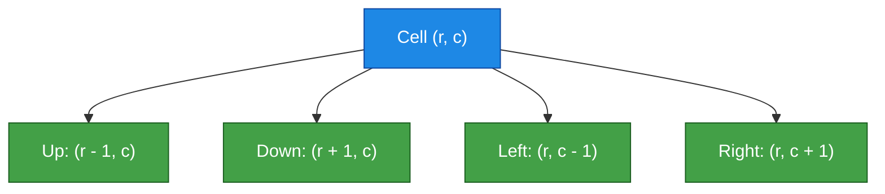
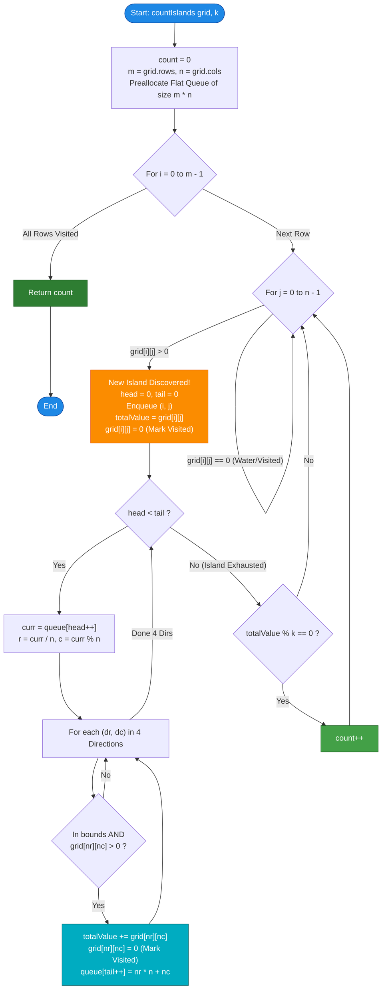

# LeetCode Problem of the Day: Count Islands With Total Value Divisible by K

- **Problem Link:** [LeetCode 3619 - Count Islands With Total Value Divisible by K](https://leetcode.com/problems/count-islands-with-total-value-divisible-by-k/)
- **Difficulty:** Medium
- **Topic Tags:** Array, Depth-First Search (DFS), Breadth-First Search (BFS), Union-Find (DSU), Matrix
- **Target Audience:** POTD Solvers, Computer Science Students, Competitive Programmers, Interview Preparation (FAANG/Tier-1 Tech)

---

## 1. Problem Statement

You are given an $m \times n$ matrix `grid` consisting of non-negative integers, and a positive integer `k`.

- An **island** is defined as a maximal group of positive integers (`grid[r][c] > 0`, representing land) that are **4-directionally connected** (horizontally or vertically).
- Cells with value `0` represent **water** and cannot be part of any island.
- The **total value** of an island is defined as the sum of all cell values belonging to that island.

Your task is to return the **number of islands** whose total value is evenly divisible by `k` (i.e., `total_value % k == 0`).

---

## 2. Examples & Explanations

### Example 1

**Input:**
```python
grid = [
    [0, 2, 1, 0, 0],
    [0, 5, 0, 0, 5],
    [0, 0, 1, 0, 0],
    [0, 1, 4, 7, 0],
    [0, 2, 0, 0, 8]
]
k = 5
```

**Output:** `2`

**Explanation:**
The matrix contains **4 distinct islands**:
1. **Island 1 (Top-Left):** Composed of cells `(0, 1)` with value `2`, `(0, 2)` with value `1`, and `(1, 1)` with value `5`.
   - Total Value $= 2 + 1 + 5 = 8$.
   - Divisibility Check: $8 \pmod 5 = 3 \neq 0$ $\implies$ **Not Divisible**.
2. **Island 2 (Top-Right):** Composed of isolated cell `(1, 4)` with value `5`.
   - Total Value $= 5$.
   - Divisibility Check: $5 \pmod 5 = 0$ $\implies$ **Divisible! (Count = 1)**.
3. **Island 3 (Center-Bottom):** Composed of cells `(2, 2)` with value `1`, `(3, 1)` with value `1`, `(3, 2)` with value `4`, `(3, 3)` with value `7`, and `(4, 1)` with value `2`.
   - Total Value $= 1 + 1 + 4 + 7 + 2 = 15$.
   - Divisibility Check: $15 \pmod 5 = 0$ $\implies$ **Divisible! (Count = 2)**.
4. **Island 4 (Bottom-Right):** Composed of isolated cell `(4, 4)` with value `8`.
   - Total Value $= 8$.
   - Divisibility Check: $8 \pmod 5 = 3 \neq 0$ $\implies$ **Not Divisible**.

**Total Islands Divisible by 5:** `2`.

---

### Example 2

**Input:**
```python
grid = [
    [3, 0, 3, 0],
    [0, 3, 0, 3],
    [3, 0, 3, 0]
]
k = 3
```

**Output:** `6`

**Explanation:**
The grid contains 6 isolated land cells in a checkerboard pattern. None of them share a 4-directional edge with any other land cell:
- Each island consists of exactly one cell with value `3`.
- Total value of each island is `3`.
- Since $3 \pmod 3 = 0$, all **6 islands** are divisible by `k`.

---

### Example 3

**Input:**
```python
grid = [
    [0, 0],
    [0, 0]
]
k = 4
```

**Output:** `0`

**Explanation:**
There are no positive land cells in the grid. Hence, there are `0` islands.

---

### Example 4 (The 64-Bit Integer Overflow Gotcha)

**Input:**
- A grid of size $1000 \times 100$ ($m \times n = 10^5$ cells), where every cell has value $10^6$.
- $k = 10^6$.

**Analysis:**
- All $10^5$ cells are connected into a single giant island.
- $\text{Total Value} = 10^5 \times 10^6 = 10^{11}$.
- In standard 32-bit signed integers, the maximum value is $2^{31} - 1 \approx 2.147 \times 10^9$.
- $10^{11}$ causes a **catastrophic 32-bit integer overflow**, wrapping around to negative numbers and yielding an incorrect modulo check!
- **Rule:** Accumulator variables for total value **must** be 64-bit integers (`long` in Java/C#, `long long` in C/C++).

---

## 3. Constraints

- $m == \text{grid.length}$
- $n == \text{grid}[i]\text{.length}$
- $1 \le m, n \le 1000$
- $1 \le m \times n \le 10^5$
- $0 \le \text{grid}[i][j] \le 10^6$
- $1 \le k \le 10^6$
- **Expected Time Complexity:** $\mathcal{O}(m \times n)$
- **Expected Auxiliary Space:** $\mathcal{O}(m \times n)$ worst-case traversal queue, or $\mathcal{O}(1)$ beyond traversal buffer.

---

## 4. The 3 Critical Engineering Pitfalls

```
+-----------------------------------------------------------------------------------+
|                            CRITICAL PITFALL CHECKLIST                             |
+---+----------------------------+--------------------------------------------------+
| # | Pitfall                    | Impact & Correct Remediation                     |
+---+----------------------------+--------------------------------------------------+
| 1 | 32-bit Integer Overflow    | Max island sum = 10^5 * 10^6 = 10^11 > INT_MAX.   |
|   |                            | Fix: Use 64-bit integers (long / long long).     |
+---+----------------------------+--------------------------------------------------+
| 2 | Call Stack Overflow (DFS)  | Snake/spiral grids reach depth 10^5. Python dies |
|   |                            | at depth 1000. C/C++ segfaults on small stacks.  |
|   |                            | Fix: Use Iterative Breadth-First Search (BFS).   |
+---+----------------------------+--------------------------------------------------+
| 3 | Memory Limit Exceeded (MLE)| Allocating new queue objects inside nested loops |
|   |                            | stresses garbage collectors. Preallocate queue!  |
+---+----------------------------+--------------------------------------------------+
```

---

## 5. Visual Architecture & Island Component Connectivity

### Visual Matrix Map (Example 1)

```
        Col 0    Col 1    Col 2    Col 3    Col 4
Row 0   [ ~0~ ]  [ 2* ]   [ 1* ]   [ ~0~ ]  [ ~0~ ]   <-- Island 1: Sum = 2+1+5 = 8 (8%5!=0)
Row 1   [ ~0~ ]  [ 5* ]   [ ~0~ ]  [ ~0~ ]  [ 5# ]   <-- Island 2: Sum = 5 (5%5==0) [VALID]
Row 2   [ ~0~ ]  [ ~0~ ]  [ 1@ ]   [ ~0~ ]  [ ~0~ ]   
Row 3   [ ~0~ ]  [ 1@ ]   [ 4@ ]   [ 7@ ]   [ ~0~ ]   <-- Island 3: Sum = 1+1+4+7+2 = 15 (15%5==0) [VALID]
Row 4   [ ~0~ ]  [ 2@ ]   [ ~0~ ]  [ ~0~ ]  [ 8$ ]   <-- Island 4: Sum = 8 (8%5!=0)

Legend:
  ~0~ : Water cell
  *   : Cells belonging to Island 1 (Sum = 8)
  #   : Cells belonging to Island 2 (Sum = 5, Divisible by 5)
  @   : Cells belonging to Island 3 (Sum = 15, Divisible by 5)
  $   : Cells belonging to Island 4 (Sum = 8)
```

### 4-Directional Orthogonal Movement Vectors

For any cell $(r, c)$, an island connects exclusively across its 4 orthogonal neighbors:
$$\Delta = \{(-1, 0), (1, 0), (0, -1), (0, 1)\} \implies \{\text{Up}, \text{Down}, \text{Left}, \text{Right}\}$$

Diagonal adjacency does **not** connect islands.



---

## 6. Step-by-Step Simulation & Trace Table

### Tracing Example 1 with $k = 5$

| Island ID | Seed Cell $(r, c)$ | Constituent Cells Connected | Individual Values | Total Island Sum (64-bit) | $\text{Sum} \pmod k$ | Divisible? | Running Count |
| :---: | :---: | :--- | :--- | :---: | :---: | :---: | :---: |
| **1** | `(0, 1)` | `(0,1), (0,2), (1,1)` | `2, 1, 5` | **8** | $8 \pmod 5 = 3$ | **No** | `0` |
| **2** | `(1, 4)` | `(1,4)` | `5` | **5** | $5 \pmod 5 = 0$ | **Yes** | `1` |
| **3** | `(2, 2)` | `(2,2), (3,2), (3,1), (3,3), (4,1)` | `1, 4, 1, 7, 2` | **15** | $15 \pmod 5 = 0$ | **Yes** | `2` |
| **4** | `(4, 4)` | `(4,4)` | `8` | **8** | $8 \pmod 5 = 3$ | **No** | `2` |

**Final Returned Answer:** `2`.

---

## 7. Algorithm Flowchart



---

## 8. From Naive to Pro: Algorithmic Progression

### Method 1: Naive Recursive DFS with Visited Array
- **Concept:** Traverse the matrix. Whenever an unvisited positive cell is found, trigger recursive DFS. Maintain a 2D boolean array `visited[m][n]`.
- **Why it is suboptimal:**
  - Incurs $\mathcal{O}(m \times n)$ auxiliary space for the `visited` matrix.
  - On adversarial test cases (e.g., snake or spiral land patterns of length $10^5$), call-stack depth reaches $10^5$. In Python, this triggers `RecursionError` (limit 1000). In C/C++, it triggers segmentation faults due to process stack limits.
- **Pseudocode:**
```text
function countIslands_NaiveDFS(grid, k):
    m = grid.rows, n = grid.cols
    visited = 2D boolean array of size m x n
    count = 0

    function dfs(r, c):
        if r < 0 or r >= m or c < 0 or c >= n: return 0
        if visited[r][c] or grid[r][c] == 0: return 0
        visited[r][c] = true
        sum = grid[r][c]
        for (dr, dc) in [(-1,0), (1,0), (0,-1), (0,1)]:
            sum += dfs(r + dr, c + dc)
        return sum

    for i from 0 to m - 1:
        for j from 0 to n - 1:
            if grid[i][j] > 0 and not visited[i][j]:
                if dfs(i, j) % k == 0:
                    count++
    return count
```

---

### Method 2: Disjoint Set Union (DSU / Union-Find) with Component Sums
- **Concept:** Treat each cell as a node in a graph labeled $0$ to $m \times n - 1$. Initialize each land cell as its own set with its cell value as the component sum. For each land cell, union with adjacent right and down land cells.
- **Why it is suboptimal:**
  - Requires maintaining `parent`, `rank`, and `sum` arrays of size $10^5$.
  - Additional $\mathcal{O}(\alpha(N))$ overhead per union operation and extra pass over all roots to verify divisibility.
- **Pseudocode:**
```text
function countIslands_DSU(grid, k):
    m = grid.rows, n = grid.cols
    parent = array of size m * n, parent[i] = i
    sum = array of size m * n
    for r, c where grid[r][c] > 0:
        sum[r * n + c] = grid[r][c]

    for r from 0 to m - 1:
        for c from 0 to n - 1:
            if grid[r][c] > 0:
                if c + 1 < n and grid[r][c + 1] > 0: union(r * n + c, r * n + c + 1)
                if r + 1 < m and grid[r + 1][c] > 0: union(r * n + c, (r + 1) * n + c)

    count = 0
    for idx where is_root(idx) and sum[idx] > 0:
        if sum[idx] % k == 0:
            count++
    return count
```

---

### Method 3: Standard BFS with Dynamic Queue & In-Place Marking
- **Concept:** Use Breadth-First Search. Upon discovering an unvisited land cell, mark it as visited by immediately setting `grid[r][c] = 0`. Expand all 4 neighbors using an iterative queue.
- **Advantages:** Completely immune to recursion stack overflow. In-place marking eliminates the `visited` array.
- **Pseudocode:**
```text
function countIslands_BFS(grid, k):
    m = grid.rows, n = grid.cols
    count = 0

    for i from 0 to m - 1:
        for j from 0 to n - 1:
            if grid[i][j] > 0:
                totalValue = 0
                queue = new Queue()
                queue.push((i, j))
                totalValue += grid[i][j]
                grid[i][j] = 0  // Mark visited

                while queue is not empty:
                    (r, c) = queue.pop()
                    for (dr, dc) in [(-1,0), (1,0), (0,-1), (0,1)]:
                        nr = r + dr, nc = c + dc
                        if 0 <= nr < m and 0 <= nc < n and grid[nr][nc] > 0:
                            totalValue += grid[nr][nc]
                            grid[nr][nc] = 0
                            queue.push((nr, nc))

                if totalValue % k == 0:
                    count++
    return count
```

---

### Method 4: Pro Optimal Approach — Preallocated Flat Queue BFS with 64-Bit Arithmetic
- **The Core Strategy:**
  1. **Zero Dynamic Allocation Overhead:** Instead of creating and garbage-collecting new Queue objects for each island, allocate **one flat 1D integer array** of size $m \times n$ upfront (or reuse the indices). Coordinates are packed as `r * n + c`.
  2. **Zero Recursion Depth Risk:** Pure iterative pointer advancement (`head++`, `tail++`).
  3. **In-Place $\mathcal{O}(1)$ State Tracking:** `grid[r][c] = 0` guarantees every cell is queued and processed at most once.
  4. **64-bit Overflow Immunity:** `totalValue` is maintained as a 64-bit integer, preventing overflow on sums up to $10^{11}$.
- **Pseudocode:**
```text
function countIslands_Optimal(grid, k):
    m = grid.rows, n = grid.cols
    count = 0
    queue = array of size m * n  // Allocated once

    for i from 0 to m - 1:
        for j from 0 to n - 1:
            if grid[i][j] > 0:
                head = 0, tail = 0
                queue[tail++] = i * n + j
                totalValue = (64-bit) grid[i][j]
                grid[i][j] = 0

                while head < tail:
                    curr = queue[head++]
                    r = curr / n, c = curr % n

                    for (dr, dc) in [(-1,0), (1,0), (0,-1), (0,1)]:
                        nr = r + dr, nc = c + dc
                        if 0 <= nr < m and 0 <= nc < n and grid[nr][nc] > 0:
                            totalValue += grid[nr][nc]
                            grid[nr][nc] = 0
                            queue[tail++] = nr * n + nc

                if totalValue % k == 0:
                    count++
    return count
```

---

## 9. Complexity Comparison Table

| Metric | Method 1: Recursive DFS | Method 2: Disjoint Set Union (DSU) | Method 3: Standard Object BFS | Method 4: Pro Flat-Queue BFS (Optimal) |
| :--- | :--- | :--- | :--- | :--- |
| **Time Complexity** | $\mathcal{O}(m \times n)$ | $\mathcal{O}(m \times n \cdot \alpha(m \cdot n))$ | $\mathcal{O}(m \times n)$ | $\mathbf{\mathcal{O}(m \times n)}$ |
| **Auxiliary Space** | $\mathcal{O}(m \times n)$ (Stack + Visited) | $\mathcal{O}(m \times n)$ (Parent + Rank + Sum) | $\mathcal{O}(m \times n)$ (Dynamic Queue) | $\mathbf{\mathcal{O}(m \times n)}$ (Single Preallocated Buffer) |
| **Stack Safety** | **Danger:** Segfault / TLE on Snake Grids | Safe (Iterative with path compression) | Safe (Queue-based) | **100% Safe (Iterative array pointers)** |
| **64-Bit Safe** | Depends on local type | Handled via array type | Handled via local type | **Explicitly 64-bit (`long` / `long long`)** |
| **GC / Allocation Pressure** | High frame churn | Multiple large auxiliary arrays | High object allocation per cell | **Zero allocations inside search loop** |
| **Interview Verdict** | Brute force / Risky | Over-engineered | Acceptable | **Gold Standard (Production / FAANG)** |

---

## 10. Comprehensive Corner Cases Handled

1. **All Water Grid (`grid[i][j] == 0` everywhere):** Outer loop finds no positive cells, immediately returns `0`.
2. **All Land Grid (`grid[i][j] > 0` everywhere):** Single giant island encompassing all $m \times n$ cells. Traversal visits all cells, checks `total_sum % k == 0`, and returns `1` or `0`.
3. **Single Cell Grid ($1 \times 1$):** If `grid[0][0] > 0` and `grid[0][0] % k == 0`, returns `1`; otherwise `0`.
4. **Checkerboard Pattern:** Every land cell is an isolated $1 \times 1$ island. Correctly tests each cell independently.
5. **Snake / Spiral Labyrinth:** Traversal depth equals $m \times n = 10^5$. Flat BFS processes this iteratively with zero stack pressure.
6. **Total Value Exceeding $2^{31} - 1$ ($10^{11}$):** 64-bit integer accumulator prevents arithmetic overflow.
7. **$k = 1$:** Every integer is divisible by `1`; correctly counts the total number of islands.
8. **Island Value Exactly Equal to $k$:** Correctly evaluates $k \pmod k = 0$.

---

## 11. Complete Multi-Language Implementations

### Java

```java
class Solution {
    public int countIslands(int[][] grid, int k) {
        int m = grid.length;
        int n = grid[0].length;
        int count = 0;

        int[] dRow = {-1, 1, 0, 0};
        int[] dCol = {0, 0, -1, 1};

        // Preallocate a flat queue to eliminate object allocation inside loops
        int[] queue = new int[m * n];

        for (int i = 0; i < m; i++) {
            for (int j = 0; j < n; j++) {
                if (grid[i][j] > 0) {
                    long totalValue = grid[i][j];
                    grid[i][j] = 0; // Mark visited in-place

                    int head = 0;
                    int tail = 0;
                    queue[tail++] = i * n + j;

                    while (head < tail) {
                        int curr = queue[head++];
                        int r = curr / n;
                        int c = curr % n;

                        for (int d = 0; d < 4; d++) {
                            int nr = r + dRow[d];
                            int nc = c + dCol[d];

                            if (nr >= 0 && nr < m && nc >= 0 && nc < n && grid[nr][nc] > 0) {
                                totalValue += grid[nr][nc];
                                grid[nr][nc] = 0; // Mark visited immediately to prevent duplicates
                                queue[tail++] = nr * n + nc;
                            }
                        }
                    }

                    // Check divisibility using 64-bit safe arithmetic
                    if (totalValue % k == 0) {
                        count++;
                    }
                }
            }
        }

        return count;
    }
}
```

---

### Python3

```python
class Solution:
    def countIslands(self, grid: list[list[int]], k: int) -> int:
        m, n = len(grid), len(grid[0])
        count = 0
        dirs = [(-1, 0), (1, 0), (0, -1), (0, 1)]

        for i in range(m):
            for j in range(n):
                if grid[i][j] > 0:
                    total_value = grid[i][j]
                    grid[i][j] = 0  # Mark visited in-place
                    queue = [(i, j)]
                    head = 0

                    while head < len(queue):
                        r, c = queue[head]
                        head += 1

                        for dr, dc in dirs:
                            nr, nc = r + dr, c + dc
                            if 0 <= nr < m and 0 <= nc < n and grid[nr][nc] > 0:
                                total_value += grid[nr][nc]
                                grid[nr][nc] = 0  # Mark visited immediately
                                queue.append((nr, nc))

                    if total_value % k == 0:
                        count += 1

        return count
```

---

### C

```c
#include <stdlib.h>

int countIslands(int** grid, int gridSize, int* gridColSize, int k) {
    int m = gridSize;
    int n = gridColSize[0];
    int count = 0;

    int dRow[4] = {-1, 1, 0, 0};
    int dCol[4] = {0, 0, -1, 1};

    // Allocate flat queue once for optimal memory and zero recursion stack overhead
    int* queue = (int*)malloc((size_t)m * n * sizeof(int));
    if (!queue) return 0;

    for (int i = 0; i < m; i++) {
        for (int j = 0; j < n; j++) {
            if (grid[i][j] > 0) {
                // Must use long long to prevent 32-bit integer overflow (max sum = 10^11)
                long long totalValue = grid[i][j];
                grid[i][j] = 0; // Mark visited in-place

                int head = 0;
                int tail = 0;
                queue[tail++] = i * n + j;

                while (head < tail) {
                    int curr = queue[head++];
                    int r = curr / n;
                    int c = curr % n;

                    for (int d = 0; d < 4; d++) {
                        int nr = r + dRow[d];
                        int nc = c + dCol[d];

                        if (nr >= 0 && nr < m && nc >= 0 && nc < n && grid[nr][nc] > 0) {
                            totalValue += grid[nr][nc];
                            grid[nr][nc] = 0; // Mark visited immediately
                            queue[tail++] = nr * n + nc;
                        }
                    }
                }

                if (totalValue % k == 0) {
                    count++;
                }
            }
        }
    }

    free(queue);
    return count;
}
```

---

### C++

```cpp
#include <vector>

using namespace std;

class Solution {
public:
    int countIslands(vector<vector<int>>& grid, int k) {
        int m = grid.size();
        int n = grid[0].size();
        int count = 0;

        const int dRow[4] = {-1, 1, 0, 0};
        const int dCol[4] = {0, 0, -1, 1};

        // Flat queue allocated once to avoid vector reallocation and dynamic heap churn
        vector<int> queue(m * n);

        for (int i = 0; i < m; ++i) {
            for (int j = 0; j < n; ++j) {
                if (grid[i][j] > 0) {
                    // 64-bit integer accumulator prevents overflow on sums up to 10^11
                    long long totalValue = grid[i][j];
                    grid[i][j] = 0; // Mark visited in-place

                    int head = 0;
                    int tail = 0;
                    queue[tail++] = i * n + j;

                    while (head < tail) {
                        int curr = queue[head++];
                        int r = curr / n;
                        int c = curr % n;

                        for (int d = 0; d < 4; ++d) {
                            int nr = r + dRow[d];
                            int nc = c + dCol[d];

                            if (nr >= 0 && nr < m && nc >= 0 && nc < n && grid[nr][nc] > 0) {
                                totalValue += grid[nr][nc];
                                grid[nr][nc] = 0; // Mark visited immediately
                                queue[tail++] = nr * n + nc;
                            }
                        }
                    }

                    if (totalValue % k == 0) {
                        count++;
                    }
                }
            }
        }

        return count;
    }
};
```

---

### C#

```csharp
public class Solution {
    public int CountIslands(int[][] grid, int k) {
        int m = grid.Length;
        int n = grid[0].Length;
        int count = 0;

        int[] dRow = { -1, 1, 0, 0 };
        int[] dCol = { 0, 0, -1, 1 };

        // Flat array queue preallocated once to prevent garbage collector pressure
        int[] queue = new int[m * n];

        for (int i = 0; i < m; i++) {
            for (int j = 0; j < n; j++) {
                if (grid[i][j] > 0) {
                    // Use 64-bit integer to prevent integer overflow
                    long totalValue = grid[i][j];
                    grid[i][j] = 0; // Mark visited in-place

                    int head = 0;
                    int tail = 0;
                    queue[tail++] = i * n + j;

                    while (head < tail) {
                        int curr = queue[head++];
                        int r = curr / n;
                        int c = curr % n;

                        for (int d = 0; d < 4; d++) {
                            int nr = r + dRow[d];
                            int nc = c + dCol[d];

                            if (nr >= 0 && nr < m && nc >= 0 && nc < n && grid[nr][nc] > 0) {
                                totalValue += grid[nr][nc];
                                grid[nr][nc] = 0; // Mark visited immediately
                                queue[tail++] = nr * n + nc;
                            }
                        }
                    }

                    if (totalValue % k == 0) {
                        count++;
                    }
                }
            }
        }

        return count;
    }
}
```

---

### Javascript

```javascript
/**
 * @param {number[][]} grid
 * @param {number} k
 * @return {number}
 */
var countIslands = function(grid, k) {
    const m = grid.length;
    const n = grid[0].length;
    let count = 0;

    const dRow = [-1, 1, 0, 0];
    const dCol = [0, 0, -1, 1];

    // Int32Array provides maximum cache locality and zero GC overhead
    const queue = new Int32Array(m * n);

    for (let i = 0; i < m; i++) {
        for (let j = 0; j < n; j++) {
            if (grid[i][j] > 0) {
                // In JS, numbers are double-precision IEEE-754 (safe up to 9 * 10^15 > 10^11)
                let totalValue = grid[i][j];
                grid[i][j] = 0; // Mark visited in-place

                let head = 0;
                let tail = 0;
                queue[tail++] = i * n + j;

                while (head < tail) {
                    const curr = queue[head++];
                    const r = Math.floor(curr / n);
                    const c = curr % n;

                    for (let d = 0; d < 4; d++) {
                        const nr = r + dRow[d];
                        const nc = c + dCol[d];

                        if (nr >= 0 && nr < m && nc >= 0 && nc < n && grid[nr][nc] > 0) {
                            totalValue += grid[nr][nc];
                            grid[nr][nc] = 0; // Mark visited immediately
                            queue[tail++] = nr * n + nc;
                        }
                    }
                }

                if (totalValue % k === 0) {
                    count++;
                }
            }
        }
    }

    return count;
};
```

---

### Typescript

```typescript
function countIslands(grid: number[][], k: number): number {
    const m = grid.length;
    const n = grid[0].length;
    let count = 0;

    const dRow: number[] = [-1, 1, 0, 0];
    const dCol: number[] = [0, 0, -1, 1];

    // Preallocated typed array queue for ultra-fast pointer-based BFS
    const queue = new Int32Array(m * n);

    for (let i = 0; i < m; i++) {
        for (let j = 0; j < n; j++) {
            if (grid[i][j] > 0) {
                let totalValue: number = grid[i][j];
                grid[i][j] = 0; // Mark visited in-place

                let head = 0;
                let tail = 0;
                queue[tail++] = i * n + j;

                while (head < tail) {
                    const curr = queue[head++];
                    const r = Math.floor(curr / n);
                    const c = curr % n;

                    for (let d = 0; d < 4; d++) {
                        const nr = r + dRow[d];
                        const nc = c + dCol[d];

                        if (nr >= 0 && nr < m && nc >= 0 && nc < n && grid[nr][nc] > 0) {
                            totalValue += grid[nr][nc];
                            grid[nr][nc] = 0; // Mark visited immediately
                            queue[tail++] = nr * n + nc;
                        }
                    }
                }

                if (totalValue % k === 0) {
                    count++;
                }
            }
        }
    }

    return count;
}
```
