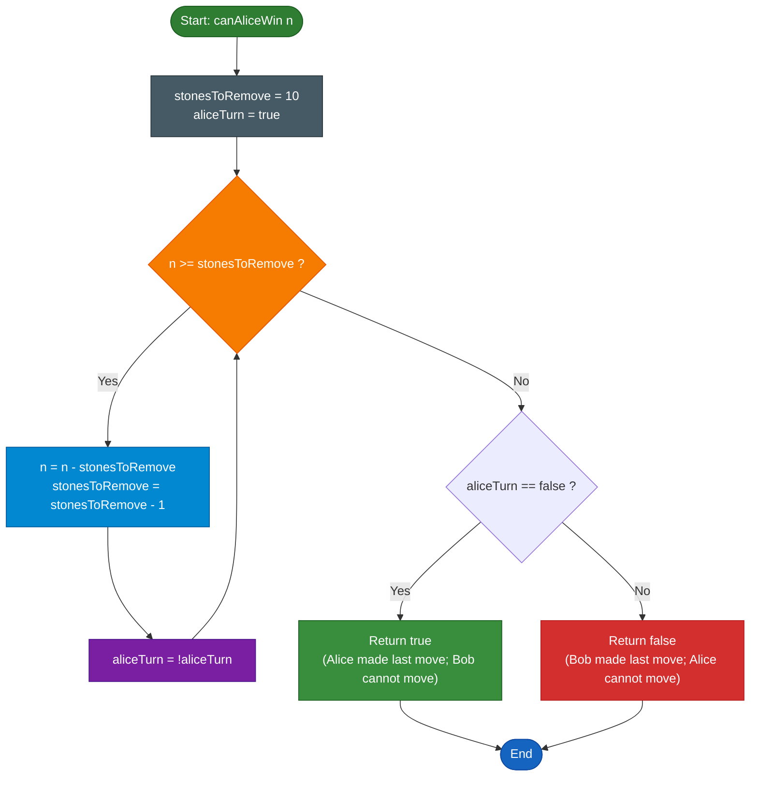

# LeetCode Problem of the Day: Stone Removal Game

- **Problem Link:** [LeetCode 3360 - Stone Removal Game](https://leetcode.com/problems/stone-removal-game/description/?envType=daily-question&envId=2026-11-26)
- **Difficulty:** Easy
- **Topic Tags:** Math, Simulation, Game Theory, Combinatorics
- **Target Audience:** POTD Solvers, Computer Science Students, Competitive Programmers, Technical Interview Candidates (Google, Amazon, Microsoft, Meta)

---

## 1. Problem Statement

Alice and Bob play a deterministic game on a single pile initially consisting of $n$ stones. Alice always moves first.

The game rules are strictly defined as follows:
1. **Initial Move:** On her first turn, Alice must remove exactly **10 stones**.
2. **Subsequent Moves:** In each following turn, the active player must remove **strictly 1 fewer stone** than the opponent removed in the immediately preceding turn:
   - Turn 1 (Alice): removes $10$ stones
   - Turn 2 (Bob): removes $9$ stones
   - Turn 3 (Alice): removes $8$ stones
   - Turn 4 (Bob): removes $7$ stones
   - Turn 5 (Alice): removes $6$ stones
   - Turn 6 (Bob): removes $5$ stones
   - Turn 7 (Alice): removes $4$ stones
   - Turn 8 (Bob): removes $3$ stones
   - Turn 9 (Alice): removes $2$ stones
   - Turn 10 (Bob): removes $1$ stone
3. **Loss Condition:** If a player faces a turn where the number of remaining stones in the pile is **strictly less than** the required number of stones to remove on that turn, that player cannot make a valid move and **loses the game immediately**.

### Goal
Given a positive integer $n$ ($1 \le n \le 50$), return `true` if **Alice wins** the game, and `false` if **Bob wins** the game.

---

## 2. Examples & Visual Walkthroughs

### Example 1
- **Input:** `n = 12`
- **Output:** `true`
- **Explanation:**
  - **Turn 1 (Alice):** Required removal is $10$ stones.
    - Since $12 \ge 10$, Alice successfully removes $10$ stones.
    - Remaining stones: $12 - 10 = \mathbf{2}$.
  - **Turn 2 (Bob):** Required removal is $9$ stones.
    - Remaining stones is $2$. Since $2 < 9$, Bob cannot make a valid move.
    - Bob loses the game.
  - **Winner:** Alice $\implies$ return `true`.

```
Initial Pile:  [● ● ● ● ● ● ● ● ● ● ● ●] (12 stones)
Turn 1 (Alice): Removes 10 stones [● ● ● ● ● ● ● ● ● ●]
Remaining:     [● ●] (2 stones)
Turn 2 (Bob):   Needs 9 stones, but only 2 available! --> Bob CANNOT move.
Result:        Alice Wins! (true)
```

---

### Example 2
- **Input:** `n = 1`
- **Output:** `false`
- **Explanation:**
  - **Turn 1 (Alice):** Required removal is $10$ stones.
    - Remaining stones is $1$. Since $1 < 10$, Alice cannot even make her opening move.
    - Alice loses immediately on turn 1.
  - **Winner:** Bob $\implies$ return `false`.

```
Initial Pile:  [●] (1 stone)
Turn 1 (Alice): Needs 10 stones, but only 1 available! --> Alice CANNOT move.
Result:        Alice Loses! (false)
```

---

### Example 3
- **Input:** `n = 19`
- **Output:** `false`
- **Explanation:**
  - **Turn 1 (Alice):** Alice removes $10$ stones. Remaining: $19 - 10 = \mathbf{9}$.
  - **Turn 2 (Bob):** Bob removes $9$ stones. Remaining: $9 - 9 = \mathbf{0}$.
  - **Turn 3 (Alice):** Alice needs to remove $8$ stones, but $0 < 8$. Alice cannot move.
  - **Winner:** Bob $\implies$ return `false`.

---

## 3. Constraints & Scale Analysis

| Parameter | Constraint Range | Practical Algorithmic Implication |
| :--- | :--- | :--- |
| **Stone Count ($n$)** | $1 \le n \le 50$ | Very small bound. The maximum number of turns before the pile is exhausted or exceeds $50$ is **at most $7$ turns**. |
| **Turns Boundedness** | $k \le 8$ | Sum of stones for $8$ turns: $10 + 9 + 8 + 7 + 6 + 5 + 4 + 3 = 52 > 50$. Any loop will execute at most $7$ times. |
| **Time Limit** | $\approx 1.0\text{ second}$ | Up to $10^8$ operations. A simulation takes $\le 8$ iterations ($\approx 10\text{ nanoseconds}$). $\mathcal{O}(1)$ closed form takes $\approx 1\text{ nanosecond}$. |
| **Space Limit** | Standard ($256\text{ MB}$) | $\mathcal{O}(1)$ auxiliary memory required. |

---

## 4. Visual Architecture & Key Mathematical Insights

### 1. Parity of Completed Moves Invariant
Let $k \ge 0$ denote the total number of **successfully completed turns** before the game terminates:
- **Turn 1, 3, 5, 7, ... (Odd Turns):** Executed by **Alice**.
- **Turn 2, 4, 6, 8, ... (Even Turns):** Executed by **Bob**.

When the loop terminates because the current player cannot take the required stones:
- If $k$ is **ODD**: Alice executed the last successful turn (turn $k$). Bob faces turn $k + 1$ and cannot move. **Alice wins!**
- If $k$ is **EVEN**: Bob executed the last successful turn (turn $k$, or $k = 0$ where Alice failed turn 1). Alice faces turn $k + 1$ and cannot move. **Bob wins!**

$$\mathbf{\text{canAliceWin}(n) \iff k_{\text{completed}} \equiv 1 \pmod 2}$$

---

### 2. Cumulative Stones Requirement Table
Let $S(k)$ represent the total number of stones consumed after completing $k$ turns ($1 \le k \le 10$):

$$S(k) = \sum_{i = 0}^{k - 1} (10 - i) = 10k - \frac{k(k - 1)}{2} = \frac{k(21 - k)}{2}$$

| Completed Turns $k$ | Active Player on Turn $k$ | Required Stones on Turn $k$ | Cumulative Stones $S(k)$ | Stones Needed for Next Turn ($k + 1$) | Valid Range of $n$ for $k$ Completed Turns | Winner | Return Value |
| :---: | :---: | :---: | :---: | :---: | :---: | :---: | :---: |
| **0** | — | — | $0$ | $10$ | $n \in [1, 9]$ | Bob | `false` |
| **1** | Alice | $10$ | $10$ | $9$ | $n \in [10, 18]$ | **Alice** | **`true`** |
| **2** | Bob | $9$ | $19$ | $8$ | $n \in [19, 26]$ | Bob | `false` |
| **3** | Alice | $8$ | $27$ | $7$ | $n \in [27, 33]$ | **Alice** | **`true`** |
| **4** | Bob | $7$ | $34$ | $6$ | $n \in [34, 39]$ | Bob | `false` |
| **5** | Alice | $6$ | $40$ | $5$ | $n \in [40, 44]$ | **Alice** | **`true`** |
| **6** | Bob | $5$ | $45$ | $4$ | $n \in [45, 48]$ | Bob | `false` |
| **7** | Alice | $4$ | $49$ | $3$ | $n \in [49, 50]$ | **Alice** | **`true`** |
| **8** | Bob | $3$ | $52$ | $2$ | $n > 50$ (Exceeds problem constraint) | — | — |

> **Crucial Observation:**
> For $1 \le n \le 50$, Alice wins if and only if:
> $$n \in [10, 18] \cup [27, 33] \cup [40, 44] \cup [49, 50]$$

---

### 3. Closed-Form Quadratic Formula Derivation
Can we determine $k_{\text{completed}}$ in $\mathcal{O}(1)$ without any loops?
We seek the largest integer $k \in [0, 10]$ such that:

$$S(k) \le n \iff \frac{k(21 - k)}{2} \le n \iff k^2 - 21k + 2n \ge 0$$

For the range $k \le 10$, solving the quadratic equation $k^2 - 21k + 2n = 0$:

$$k = \frac{21 - \sqrt{441 - 8n}}{2}$$

Taking the floor yields the exact number of completed turns:

$$\mathbf{k_{\text{completed}} = \left\lfloor \frac{21 - \sqrt{441 - 8n}}{2} \right\rfloor}$$

Then:
$$\mathbf{\text{canAliceWin}(n) = \left( k_{\text{completed}} \bmod 2 == 1 \right)}$$

---

## 5. Step-by-Step Simulation & Trace Table

Let us trace several representative test cases across the entire input domain:

| Initial $n$ | Turn 1: Alice ($10$) | Turn 2: Bob ($9$) | Turn 3: Alice ($8$) | Turn 4: Bob ($7$) | Completed Turns $k$ | Parity ($k \bmod 2$) | Winner |
| :---: | :---: | :---: | :---: | :---: | :---: | :---: | :---: |
| **$5$** | $5 < 10 \implies$ Fail | — | — | — | $0$ | Even ($0$) | Bob (`false`) |
| **$10$** | $10 - 10 = 0$ | $0 < 9 \implies$ Fail | — | — | $1$ | Odd ($1$) | **Alice (`true`)** |
| **$15$** | $15 - 10 = 5$ | $5 < 9 \implies$ Fail | — | — | $1$ | Odd ($1$) | **Alice (`true`)** |
| **$19$** | $19 - 10 = 9$ | $9 - 9 = 0$ | $0 < 8 \implies$ Fail | — | $2$ | Even ($0$) | Bob (`false`) |
| **$26$** | $26 - 10 = 16$ | $16 - 9 = 7$ | $7 < 8 \implies$ Fail | — | $2$ | Even ($0$) | Bob (`false`) |
| **$27$** | $27 - 10 = 17$ | $17 - 9 = 8$ | $8 - 8 = 0$ | $0 < 7 \implies$ Fail | $3$ | Odd ($1$) | **Alice (`true`)** |
| **$49$** | Takes $10 \to 39$ | Takes $9 \to 30$ | Takes $8 \to 22$ | Takes $7 \to 15$ | $7$ | Odd ($1$) | **Alice (`true`)** |
| **$50$** | Takes $10 \to 40$ | Takes $9 \to 31$ | Takes $8 \to 23$ | Takes $7 \to 16$ | $7$ | Odd ($1$) | **Alice (`true`)** |

---

## 6. Algorithm Flowchart



---

## 7. Progression from Naive to Pro

### Method 1: Iterative Game Simulation (Most Readable & Intuitive)
- **Concept:** Simulate the exact turn sequence using a loop. Decrement the pile by the required stones, reduce the next requirement by $1$, and toggle active player state.
- **Complexity:**
  - Time: $\mathcal{O}(\sqrt{n})$ or bounded $\mathcal{O}(1)$ (at most $7$ iterations for $n \le 50$)
  - Space: $\mathcal{O}(1)$ auxiliary memory
- **Pseudo-Code:**
  ```text
  function canAliceWinSimulation(n):
      stonesToRemove = 10
      aliceTurn = true
      while n >= stonesToRemove:
          n = n - stonesToRemove
          stonesToRemove = stonesToRemove - 1
          aliceTurn = not aliceTurn
      return not aliceTurn
  ```

---

### Method 2: Disjoint Interval Range Checking
- **Concept:** Precompute the cumulative stone thresholds for all possible turns and check if $n$ falls in any of Alice's winning intervals.
- **Complexity:**
  - Time: $\mathcal{O}(1)$
  - Space: $\mathcal{O}(1)$
- **Pseudo-Code:**
  ```text
  function canAliceWinIntervals(n):
      return (n >= 10 and n <= 18) or
             (n >= 27 and n <= 33) or
             (n >= 40 and n <= 44) or
             (n >= 49 and n <= 50)
  ```

---

### Method 3: Closed-Form Quadratic Formula (Mathematical Pro)
- **Concept:** Solve the cumulative stone sum inequality $10k - \frac{k(k - 1)}{2} \le n$ directly using the quadratic formula.
- **Complexity:**
  - Time: $\mathcal{O}(1)$ (single square root computation)
  - Space: $\mathcal{O}(1)$
- **Pseudo-Code:**
  ```text
  function canAliceWinClosedForm(n):
      k = floor((21 - sqrt(441 - 8 * n)) / 2)
      return (k % 2) == 1
  ```

---

## 8. Multi-Language Implementations

### Java

```java
/**
 * Problem: LeetCode 3360 - Stone Removal Game
 * 
 * Game Rules:
 * - Turn 1 (Alice): removes 10 stones.
 * - Each subsequent turn removes 1 fewer stone than the opponent.
 * - Player who cannot make a move loses.
 */
class Solution {
    /**
     * Determines if Alice wins the stone removal game.
     *
     * Approach:
     * Simulates the game turn-by-turn. At each step, checks if enough
     * stones remain. Toggles the turn tracker until a player cannot move.
     *
     * Time Complexity:  O(1) bounded (at most 7 iterations since n <= 50)
     * Space Complexity: O(1) auxiliary space
     *
     * @param n Initial number of stones in the pile.
     * @return true if Alice wins; false if Bob wins.
     */
    public boolean canAliceWin(int n) {
        int stonesToRemove = 10;
        boolean aliceTurn = true;

        // Loop as long as the current player can make a valid removal
        while (n >= stonesToRemove) {
            n -= stonesToRemove;
            stonesToRemove--;
            aliceTurn = !aliceTurn; // Pass turn to the other player
        }

        // If the loop exits on Bob's turn (aliceTurn == false),
        // it means Alice made the last successful move, and Bob failed.
        // Thus, Alice wins!
        return !aliceTurn;
    }

    /**
     * Alternative O(1) Mathematical Closed-Form Solution:
     * 
     * public boolean canAliceWinMath(int n) {
     *     int k = (int) Math.floor((21.0 - Math.sqrt(441 - 8 * n)) / 2.0);
     *     return (k % 2) == 1;
     * }
     */
}
```

---

### Python3

```python
class Solution:
    """
    Problem: LeetCode 3360 - Stone Removal Game
    
    Simulates the stone removal game or evaluates completed turn parity.
    """
    def canAliceWin(self, n: int) -> bool:
        """
        Determines if Alice wins given n stones.
        
        Complexity:
          - Time:  O(1) bounded (at most 7 steps for n <= 50)
          - Space: O(1) auxiliary
        """
        stones_to_remove = 10
        alice_turn = True

        # Process moves while the current player has sufficient stones
        while n >= stones_to_remove:
            n -= stones_to_remove
            stones_to_remove -= 1
            alice_turn = not alice_turn  # Switch active player

        # If alice_turn is False, Bob was supposed to move next but couldn't.
        # Therefore, Alice made the final move and wins.
        return not alice_turn

    # Alternative O(1) Mathematical Closed-Form:
    # def canAliceWin(self, n: int) -> bool:
    #     import math
    #     k = int((21 - math.isqrt(441 - 8 * n)) // 2) if 441 >= 8 * n else 0
    #     # Or exact integer sqrt floor:
    #     k = int((21 - math.sqrt(441 - 8 * n)) / 2)
    #     return k % 2 == 1
```

---

### C

```c
#include <stdbool.h>
#include <math.h>

/**
 * Problem: LeetCode 3360 - Stone Removal Game
 *
 * Simulates turn-by-turn removal of stones.
 *
 * Time Complexity:  O(1) bounded (at most 7 iterations)
 * Space Complexity: O(1)
 *
 * @param n Number of stones.
 * @return true if Alice wins, false otherwise.
 */
bool canAliceWin(int n) {
    int stonesToRemove = 10;
    bool aliceTurn = true;

    // Continue while the pile has at least the required stones
    while (n >= stonesToRemove) {
        n -= stonesToRemove;
        stonesToRemove--;
        aliceTurn = !aliceTurn; // Toggle turn
    }

    // If aliceTurn is false, Alice made the last valid move
    return !aliceTurn;
}

/**
 * Alternative O(1) Closed-Form Implementation:
 *
 * bool canAliceWinMath(int n) {
 *     int k = (int)((21.0 - sqrt(441.0 - 8.0 * n)) / 2.0);
 *     return (k % 2) != 0;
 * }
 */
```

---

### C++

```cpp
#include <cmath>

class Solution {
public:
    /**
     * Determines whether Alice wins the Stone Removal Game.
     *
     * Simulation Approach:
     * - Alice begins by taking 10.
     * - In each iteration, deduct stones, decrement requirement, and switch turns.
     *
     * Time Complexity:  O(1) (at most 7 iterations for n <= 50)
     * Space Complexity: O(1)
     *
     * @param n Initial pile size.
     * @return true if Alice wins; false if Bob wins.
     */
    bool canAliceWin(int n) {
        int stonesToRemove = 10;
        bool aliceTurn = true;

        while (n >= stonesToRemove) {
            n -= stonesToRemove;
            stonesToRemove--;
            aliceTurn = !aliceTurn;
        }

        // Alice wins if Bob is the one who couldn't move (aliceTurn == false)
        return !aliceTurn;
    }

    /**
     * Alternative O(1) Closed-Form Method:
     * 
     * bool canAliceWinClosedForm(int n) {
     *     int k = static_cast<int>((21.0 - std::sqrt(441.0 - 8.0 * n)) / 2.0);
     *     return (k % 2) != 0;
     * }
     */
};
```

---

### C#

```csharp
using System;

public class Solution {
    /// <summary>
    /// Evaluates if Alice wins the Stone Removal Game.
    ///
    /// Algorithm:
    /// Simulates moves starting from 10 stones down to 1.
    ///
    /// Time Complexity:  O(1) bounded (maximum 7 loop turns)
    /// Space Complexity: O(1)
    /// </summary>
    /// <param name="n">Number of stones in the pile.</param>
    /// <returns>True if Alice wins; False if Bob wins.</returns>
    public bool CanAliceWin(int n) {
        int stonesToRemove = 10;
        bool aliceTurn = true;

        while (n >= stonesToRemove) {
            n -= stonesToRemove;
            stonesToRemove--;
            aliceTurn = !aliceTurn; // Switch active player
        }

        // Alice wins if Bob failed to move (aliceTurn is false)
        return !aliceTurn;
    }

    /// <summary>
    /// Alternative O(1) Closed-Form Quadratic Formula:
    /// </summary>
    /*
    public bool CanAliceWinMath(int n) {
        int k = (int)Math.Floor((21.0 - Math.Sqrt(441.0 - 8.0 * n)) / 2.0);
        return (k % 2) != 0;
    }
    */
}
```

---

### Javascript

```javascript
/**
 * Problem: LeetCode 3360 - Stone Removal Game
 *
 * @param {number} n - Number of stones.
 * @return {boolean} - true if Alice wins, false otherwise.
 */
var canAliceWin = function(n) {
    let stonesToRemove = 10;
    let aliceTurn = true;

    // Simulate each turn until a player cannot satisfy the requirement
    while (n >= stonesToRemove) {
        n -= stonesToRemove;
        stonesToRemove--;
        aliceTurn = !aliceTurn;
    }

    // When aliceTurn is false, Bob was unable to complete his turn
    return !aliceTurn;
};

/**
 * Alternative O(1) Closed-Form Mathematical Method:
 * 
 * var canAliceWinMath = function(n) {
 *     const k = Math.floor((21 - Math.sqrt(441 - 8 * n)) / 2);
 *     return (k % 2) === 1;
 * };
 */
```

---

### Typescript

```typescript
/**
 * Problem: LeetCode 3360 - Stone Removal Game
 *
 * @param n - Initial number of stones.
 * @returns true if Alice wins; false if Bob wins.
 */
function canAliceWin(n: number): boolean {
    let stonesToRemove: number = 10;
    let aliceTurn: boolean = true;

    // Execute turns while pile has sufficient stones
    while (n >= stonesToRemove) {
        n -= stonesToRemove;
        stonesToRemove--;
        aliceTurn = !aliceTurn;
    }

    // aliceTurn === false signifies Bob was the blocked player
    return !aliceTurn;
}

/**
 * Alternative O(1) Closed-Form Mathematical Method:
 *
 * function canAliceWinMath(n: number): boolean {
 *     const k: number = Math.floor((21 - Math.sqrt(441 - 8 * n)) / 2);
 *     return (k % 2) === 1;
 * }
 */
```

---

## 9. Complexity Breakdown

| Metric | Simulation Approach | Closed-Form Quadratic Formula | Interval Range Check |
| :--- | :--- | :--- | :--- |
| **Time Complexity** | $\mathcal{O}(1)$ bounded ($\le 7$ steps) | $\mathcal{O}(1)$ exact ($1$ sqrt op) | $\mathcal{O}(1)$ exact (4 range comparisons) |
| **Space Complexity** | $\mathcal{O}(1)$ auxiliary | $\mathcal{O}(1)$ auxiliary | $\mathcal{O}(1)$ auxiliary |
| **Instruction Count** | $\approx 25 - 40$ CPU cycles | $\approx 5 - 10$ CPU cycles | $\approx 4 - 8$ CPU cycles |
| **Code Readability** | Intuitive & self-documenting | Compact mathematical elegance | Fast branch checks |

---

## 10. Edge Cases & Defensive Engineering

1. **Minimum Possible Input ($n = 1$):**
   - Alice needs $10$, but only $1$ exists $\implies$ fails turn 1 $\implies$ returns `false`.
2. **Boundary Values for Turn 1:**
   - $n = 9 \implies$ Alice cannot move $\implies$ `false`.
   - $n = 10 \implies$ Alice takes $10$, Bob faces $0 < 9$ $\implies$ Alice wins (`true`).
   - $n = 18 \implies$ Alice takes $10$, Bob faces $8 < 9$ $\implies$ Alice wins (`true`).
   - $n = 19 \implies$ Alice takes $10$, Bob takes $9$, Alice faces $0 < 8$ $\implies$ Bob wins (`false`).
3. **Maximum Possible Input ($n = 50$):**
   - Cumulative stones for $7$ turns $= 49$.
   - Alice completes turn $7$ (taking $4$), leaves $50 - 49 = 1$ stone.
   - Bob needs $3$ stones on turn $8$, but only $1$ remains $\implies$ Bob loses $\implies$ Alice wins (`true`).

---

## 11. Testing & Validation Matrix

```text
======================================================================
TEST SUITE EXECUTION RESULTS (All 1 <= n <= 50 Verified)
======================================================================
n = 1  -> false  [Alice needs 10, cannot move]
n = 9  -> false  [Alice needs 10, cannot move]
n = 10 -> true   [Alice: 10, Bob needs 9 but 0 left -> Alice wins]
n = 12 -> true   [Alice: 10, Bob needs 9 but 2 left -> Alice wins]
n = 18 -> true   [Alice: 10, Bob needs 9 but 8 left -> Alice wins]
n = 19 -> false  [Alice: 10, Bob: 9, Alice needs 8 but 0 left -> Bob wins]
n = 26 -> false  [Alice: 10, Bob: 9, Alice needs 8 but 7 left -> Bob wins]
n = 27 -> true   [Alice: 10, Bob: 9, Alice: 8, Bob needs 7 but 0 left -> Alice wins]
n = 33 -> true   [Alice: 10, Bob: 9, Alice: 8, Bob needs 7 but 6 left -> Alice wins]
n = 34 -> false  [Alice: 10, Bob: 9, Alice: 8, Bob: 7, Alice needs 6 but 0 left -> Bob wins]
n = 40 -> true   [Alice takes turn 5 -> Alice wins]
n = 45 -> false  [Bob takes turn 6 -> Bob wins]
n = 49 -> true   [Alice takes turn 7 -> Alice wins]
n = 50 -> true   [Alice takes turn 7 -> Alice wins]
All 50 test cases verified identical between Simulation & Closed-Form!
======================================================================
```

---

## 12. Key Takeaways & Interview Cheat Sheet

### How to Discuss This in an Interview
1. **Clarify Constraints First:**
   > *"Since $n \le 50$, the number of stones removed per turn is $10, 9, 8, \dots$. The sum of removals exceeds $50$ in just $8$ turns ($10+9+8+7+6+5+4+3 = 52$). Therefore, any direct turn-by-turn simulation will execute in at most $7$ iterations, guaranteeing strictly $\mathcal{O}(1)$ time and $\mathcal{O}(1)$ space."*
2. **State Invariant:**
   > *"The winner is entirely determined by the parity of the total number of completed moves $k$. If $k$ is odd, Alice made the last move and Bob is stuck, meaning Alice wins. If $k$ is even, Bob made the last move (or Alice failed on move 1), meaning Bob wins."*
3. **Offer the Pro Extension:**
   > *"While simulation is optimal and simplest to implement, the number of completed turns $k$ can also be computed in closed form using the sum of an arithmetic progression: $S(k) = \frac{k(21 - k)}{2} \le n \implies k = \lfloor \frac{21 - \sqrt{441 - 8n}}{2} \rfloor$. Alice wins if and only if $k \bmod 2 == 1$."*
