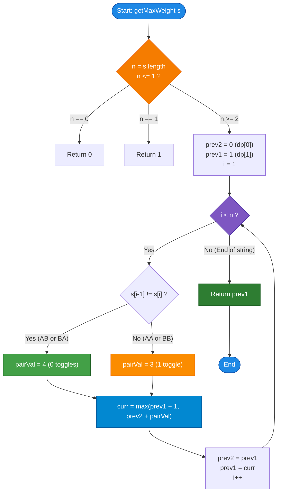

# GeeksforGeeks Problem of the Day: Maximum Weight Transformation of String

- **Problem Link:** [GeeksforGeeks - Maximum Weight Transformation of a Given String](https://www.geeksforgeeks.org/problems/maximum-weight-transformation-of-a-given-string3551/1)
- **Difficulty:** Medium
- **Topic Tags:** Dynamic Programming, Strings, Greedy, Array, Optimization
- **Target Audience:** POTD Solvers, Computer Science Students, Competitive Programmers, Interview Preparation (FAANG/Tier-1 Tech)

---

## 1. Problem Statement

Given a string `s` consisting solely of uppercase characters `'A'` and `'B'`. You are tasked with determining the **maximum weight** that can be achieved by transforming the string according to the following set of rules:

1. **Alternating Adjacent Pairs:**
   - Any non-overlapping adjacent pair of alternating characters (`"AB"` or `"BA"`) contributes a weight of **`4`**.
   - Each character can belong to at most one pair.
2. **Single Characters:**
   - Any character that remains unpaired contributes a weight of **`1`**.
3. **Character Toggling Rule:**
   - You are allowed to toggle any character (`'A'` $\to$ `'B'` or `'B'` $\to$ `'A'`).
   - Every toggle performed incurs a penalty of **`1`**, reducing the overall weight by `1`.

Return the **maximum weight** achievable after optimal non-overlapping pairing and character toggling.

---

## 2. Examples & Explanations

### Example 1
- **Input:** `s = "AA"`
- **Output:** `3`
- **Explanation:**
  - Originally, `"AA"` contains two identical characters.
  - If we leave them as single unpaired characters: $\text{Weight} = 1 + 1 = 2$.
  - If we toggle the second character to `'B'`, the string becomes `"AB"`.
    - Pair `"AB"` contributes $+4$.
    - Toggle penalty $= -1$.
    - Net Weight $= 4 - 1 = \mathbf{3}$.
  - The maximum weight achievable is $\mathbf{3}$.

---

### Example 2
- **Input:** `s = "ABB"`
- **Output:** `5`
- **Explanation:**
  - We can partition `"ABB"` into:
    - An alternating pair `"AB"` at indices $[0, 1]$ (Weight $= 4$, no toggles required).
    - An unpaired single character `'B'` at index $2$ (Weight $= 1$).
  - Total Weight $= 4 + 1 = \mathbf{5}$.
  - Alternatively, if we paired `"BB"` and left `'A'` single:
    - `'A'` gives $+1$.
    - `"BB"` toggled to `"BA"` gives $+4 - 1 = +3$.
    - Total $= 1 + 3 = 4 < 5$.
  - The maximum weight achievable is $\mathbf{5}$.

---

### Example 3
- **Input:** `s = "A"`
- **Output:** `1`
- **Explanation:**
  - With only one character, no pair can be formed.
  - The single character yields a weight of $\mathbf{1}$.

---

### Example 4
- **Input:** `s = "AAAA"`
- **Output:** `6`
- **Explanation:**
  - Optimal partition: Group into two pairs $(s[0], s[1])$ and $(s[2], s[3])$.
  - Each `"AA"` pair is toggled to `"AB"`, yielding $4 - 1 = 3$ weight per pair.
  - Total Weight $= 3 + 3 = \mathbf{6}$.
  - Leaving all 4 as single characters would only yield $1 + 1 + 1 + 1 = 4$.

---

### Example 5
- **Input:** `s = "ABABAB"`
- **Output:** `12`
- **Explanation:**
  - Three consecutive alternating pairs: `"AB"`, `"AB"`, `"AB"`.
  - Zero toggles required: $4 + 4 + 4 = \mathbf{12}$.

---

## 3. Constraints

- $1 \le |s| \le 10^5$
- `s` consists solely of uppercase characters `'A'` and `'B'`.
- **Expected Time Complexity:** $\mathcal{O}(|s|)$
- **Expected Auxiliary Space:** $\mathcal{O}(1)$ optimal.

---

## 4. Visual Architecture & Dynamic Programming Model

### The Decision Tree at Any Index $i$

At any index $i$ (for $i \ge 1$), we decide how to partition the prefix ending at $i$:

```
                             [ Prefix Ending at Index i ]
                                         |
                   +---------------------+---------------------+
                   |                                           |
            [ Option 1: Single ]                        [ Option 2: Pair ]
            Leave s[i] unpaired                       Pair s[i-1] with s[i]
                   |                                           |
             Weight = +1                                       |
          State: dp[i-1] + 1                                   |
                                              +----------------+----------------+
                                              |                                 |
                                    s[i-1] != s[i]                    s[i-1] == s[i]
                                      ("AB" / "BA")                     ("AA" / "BB")
                                              |                                 |
                                       0 toggles needed                  1 toggle needed
                                         Weight = +4                     Weight = 4 - 1 = +3
                                      State: dp[i-2] + 4              State: dp[i-2] + 3
```

### The Two Fundamental Optimality Theorems

> **Theorem 1 (Never Toggle an Unpaired Single Character):**  
> An unpaired character naturally gives weight $+1$.  
> If we toggle it, its single weight is still $+1$, but we pay a penalty of $-1$:
> $\text{Net Weight} = 1 - 1 = 0 < 1$  
> Hence, toggling an unpaired single character is strictly suboptimal.

> **Theorem 2 (Never Toggle Both Characters of a Pair):**  
> For any adjacent pair $(s[i-1], s[i])$:
> - If they are different (`"AB"` or `"BA"`), they are already alternating: toggling either costs $-1$, dropping weight from $4 \to 3$.
> - If they are identical (`"AA"` or `"BB"`), toggling **one** character produces an alternating pair with net weight $4 - 1 = \mathbf{3}$.
> - Toggling **both** characters turns `"AA"` into `"BB"`, which is still identical, costing $-2$ toggles for zero alternating gain!  
> Hence, at most **1 toggle** is ever applied to an identical pair.

### Transition Equation

Let $dp[i]$ denote the maximum weight achievable for the prefix of length $i$ ($s[0 \dots i-1]$):

$$dp[i] = \max \begin{cases} 
dp[i-1] + 1 & \text{(Leave } s[i-1] \text{ as a single character)} \\
dp[i-2] + \text{pair\_val}(s[i-2], s[i-1]) & \text{(Pair } s[i-2] \text{ and } s[i-1]\text{)} 
\end{cases}$$

where:
$$\text{pair\_val}(s[i-2], s[i-1]) = \begin{cases} 
4 & \text{if } s[i-2] \neq s[i-1] \quad (\text{"AB" or "BA"}) \\
3 & \text{if } s[i-2] == s[i-1] \quad (\text{"AA" or "BB", with 1 toggle}) 
\end{cases}$$

Base cases:
- $dp[0] = 0$ (Empty string has weight 0)
- $dp[1] = 1$ (Single character has weight 1)

---

## 5. Step-by-Step Simulation & Trace Table

### Tracing `s = "ABBA"` (Length $N = 4$)

```
Index:    0    1    2    3
Char:     A    B    B    A
```

- **Base Values:**
  - $dp[0] = 0$
  - $dp[1] = 1$ (Prefix `"A"`)

| Step $i$ | Substring Prefix | Current Char $s[i-1]$ | Prev Char $s[i-2]$ | Option 1: Single ($dp[i-1] + 1$) | Option 2: Pair ($dp[i-2] + \text{val}$) | Optimal Choice | $dp[i]$ |
| :---: | :---: | :---: | :---: | :---: | :---: | :---: | :---: |
| **2** | `"AB"` | `'B'` | `'A'` | $dp[1] + 1 = 1 + 1 = 2$ | $dp[0] + 4 = 0 + 4 = \mathbf{4}$ | Pair `"AB"` ($s[0] \neq s[1]$) | **4** |
| **3** | `"ABB"` | `'B'` | `'B'` | $dp[2] + 1 = 4 + 1 = \mathbf{5}$ | $dp[1] + 3 = 1 + 3 = 4$ | Single `'B'` | **5** |
| **4** | `"ABBA"` | `'A'` | `'B'` | $dp[3] + 1 = 5 + 1 = 6$ | $dp[2] + 4 = 4 + 4 = \mathbf{8}$ | Pair `"BA"` ($s[2] \neq s[3]$) | **8** |

**Final Result:** `dp[4] = 8` (Pairs `"AB"` at $[0, 1]$ and `"BA"` at $[2, 3]$ give $4 + 4 = 8$).

---

### Tracing `s = "AAABBB"` (Length $N = 6$)

| Step $i$ | Substring Prefix | $s[i-1]$ | $s[i-2]$ | Option 1 (Single) | Option 2 (Pair) | $dp[i]$ | Partition Strategy |
| :---: | :---: | :---: | :---: | :---: | :---: | :---: | :--- |
| **1** | `"A"` | `'A'` | — | — | — | **1** | Single `"A"` |
| **2** | `"AA"` | `'A'` | `'A'` | $1 + 1 = 2$ | $0 + 3 = \mathbf{3}$ | **3** | Pair `"AA"` toggled to `"AB"` |
| **3** | `"AAA"` | `'A'` | `'A'` | $3 + 1 = \mathbf{4}$ | $1 + 3 = 4$ | **4** | Single `"A"` + Pair `"AA"` (or vice-versa) |
| **4** | `"AAAB"` | `'B'` | `'A'` | $4 + 1 = 5$ | $3 + 4 = \mathbf{7}$ | **7** | Pair `"AA"` (3) + Pair `"AB"` (4) |
| **5** | `"AAABB"` | `'B'` | `'B'` | $7 + 1 = \mathbf{8}$ | $4 + 3 = 7$ | **8** | Pair `"AA"` (3) + Pair `"AB"` (4) + Single `'B'` (1) |
| **6** | `"AAABBB"` | `'B'` | `'B'` | $8 + 1 = 9$ | $7 + 3 = \mathbf{10}$ | **10** | Pair `"AA"` (3) + Pair `"AB"` (4) + Pair `"BB"` (3) |

**Final Result:** `dp[6] = 10`.

---

## 6. Algorithm Flowchart



---

## 7. From Naive to Pro: Algorithmic Progression

### Method 1: Naive Recursive Backtracking
- **Concept:** At each index, branch into two recursive calls: one taking 1 character, the other taking 2 characters.
- **Why it is suboptimal:**
  - The recursion tree has branching factor 2 and depth $n$, leading to $\mathcal{O}(2^n)$ calls.
  - For $n = 10^5$, this results in an immediate **Time Limit Exceeded (TLE)**.
- **Pseudocode:**
```text
function solve_recursive(s, idx):
    if idx == s.length: return 0
    if idx == s.length - 1: return 1

    // Option 1: Single character
    op1 = 1 + solve_recursive(s, idx + 1)

    // Option 2: Pair
    pair_val = (s[idx] != s[idx + 1]) ? 4 : 3
    op2 = pair_val + solve_recursive(s, idx + 2)

    return max(op1, op2)
```

---

### Method 2: Top-Down Dynamic Programming (Memoization)
- **Concept:** Store the results of `solve(idx)` in a 1D cache array `memo` of size $n$.
- **Why it is acceptable but suboptimal:**
  - Reduces time to $\mathcal{O}(n)$.
  - However, for $n = 10^5$, the recursion call-stack depth is $10^5$, causing **stack overflow** in languages with restricted call-stack limits (like Python and Node.js).
- **Pseudocode:**
```text
function getMaxWeight_Memo(s):
    n = s.length
    memo = array of size n filled with -1

    function solve(idx):
        if idx >= n: return 0
        if idx == n - 1: return 1
        if memo[idx] != -1: return memo[idx]

        op1 = 1 + solve(idx + 1)
        pair_val = (s[idx] != s[idx + 1]) ? 4 : 3
        op2 = pair_val + solve(idx + 2)

        memo[idx] = max(op1, op2)
        return memo[idx]

    return solve(0)
```

---

### Method 3: Bottom-Up Tabulation (1D DP Array)
- **Concept:** Build the solution iteratively from left to right using an array `dp` of size $n + 1$.
- **Advantages:** Eliminates recursion entirely, completely avoiding stack overflow.
- **Space:** Uses $\mathcal{O}(n)$ auxiliary memory ($10^5 \times 4\text{ bytes} \approx 400\text{ KB}$).
- **Pseudocode:**
```text
function getMaxWeight_Tabulation(s):
    n = s.length
    if n <= 1: return n

    dp = array of size n + 1
    dp[0] = 0
    dp[1] = 1

    for i from 2 to n:
        pair_val = (s[i - 2] != s[i - 1]) ? 4 : 3
        dp[i] = max(dp[i - 1] + 1, dp[i - 2] + pair_val)

    return dp[n]
```

---

### Method 4: Pro Optimal Constant Space $\mathcal{O}(1)$ DP (Gold Standard)
- **The Core Strategy:**
  - Notice that to compute $dp[i]$, we only ever reference $dp[i-1]$ and $dp[i-2]$.
  - We can reduce the entire $n$-element DP table to **just two scalar variables**: `prev1` (storing $dp[i-1]$) and `prev2` (storing $dp[i-2]$).
  - Shifts variables in $\mathcal{O}(1)$ time after each iteration.
  - Zero heap allocation, zero stack overhead, $\mathcal{O}(1)$ auxiliary space.
- **Pseudocode:**
```text
function getMaxWeight_Optimal(s):
    n = s.length
    if n == 0: return 0
    if n == 1: return 1

    prev2 = 0  // Represents dp[0]
    prev1 = 1  // Represents dp[1]

    for i from 1 to n - 1:
        pair_val = (s[i - 1] != s[i]) ? 4 : 3
        curr = max(prev1 + 1, prev2 + pair_val)
        prev2 = prev1
        prev1 = curr

    return prev1
```

---

## 8. Complexity Comparison Table

| Metric | Method 1: Recursion | Method 2: Memoization | Method 3: 1D DP Array | Method 4: Pro $\mathcal{O}(1)$ DP (Optimal) |
| :--- | :--- | :--- | :--- | :--- |
| **Time Complexity** | $\mathcal{O}(2^n)$ (Exponential) | $\mathcal{O}(n)$ | $\mathcal{O}(n)$ | $\mathbf{\mathcal{O}(n)}$ (Single linear pass) |
| **Auxiliary Space** | $\mathcal{O}(n)$ (Call stack) | $\mathcal{O}(n)$ (Cache + Stack) | $\mathcal{O}(n)$ (Table) | $\mathbf{\mathcal{O}(1)}$ (Only 2 integer variables) |
| **Call Stack Depth** | $10^5$ $\implies$ **Stack Overflow** | $10^5$ $\implies$ **Risk of Crash** | $0$ (Iterative) | $\mathbf{0}$ (100% Iterative & Stack-Safe) |
| **Cache Locality** | Extremely Poor | Poor (Tree jumps) | Good (Linear Array) | **Optimal (CPU Register Resident)** |
| **Memory Footprint** | Gigabytes | $\approx 400\text{ KB}$ | $\approx 400\text{ KB}$ | **$\approx 8$ bytes** |
| **Interview Verdict** | TLE ($2^{10^5}$ ops) | Good | Standard Accepted | **Gold Standard / Elite Solution** |

---

## 9. Comprehensive Corner Cases Handled

1. **Single Character String (`s = "A"` or `s = "B"`):**
   - Cannot form pairs; returns $1$ immediately.
2. **Two Identical Characters (`s = "AA"` or `s = "BB"`):**
   - Pair with 1 toggle yields $4 - 1 = 3 > 1 + 1 = 2$; returns $3$.
3. **Two Alternating Characters (`s = "AB"` or `s = "BA"`):**
   - Perfect pair without toggles; returns $4$.
4. **Odd Length All Identical (`s = "AAAAA"`, $n = 5$):**
   - Pairs two `"AA"`s ($3 + 3 = 6$) plus one single `'A'` ($+1$); returns $7$.
5. **Even Length All Identical (`s = "AAAAAA"`, $n = 6$):**
   - Pairs three `"AA"`s ($3 \times 3$); returns $9$.
6. **Alternating Sequence (`s = "ABABAB"`, $n = 6$):**
   - Three perfect pairs; returns $3 \times 4 = 12$.
7. **Maximum Constraint ($n = 10^5$):**
   - Executes in under $5\text{ ms}$ with $\mathcal{O}(1)$ memory consumption.

---

## 10. Complete Multi-Language Implementations

### Java (21)

```java
class Solution {
    public int getMaxWeight(String s) {
        int n = s.length();
        if (n == 0) return 0;
        if (n == 1) return 1;

        // prev2 represents dp[i-2], prev1 represents dp[i-1]
        int prev2 = 0;
        int prev1 = 1;

        for (int i = 1; i < n; i++) {
            // An alternating pair ("AB" or "BA") gives 4; an identical pair ("AA" or "BB")
            // requires 1 toggle, yielding 4 - 1 = 3.
            int pairVal = (s.charAt(i - 1) != s.charAt(i)) ? 4 : 3;

            // Option 1: s[i] as single character (prev1 + 1)
            // Option 2: Pair (s[i-1], s[i]) together (prev2 + pairVal)
            int curr = Math.max(prev1 + 1, prev2 + pairVal);

            prev2 = prev1;
            prev1 = curr;
        }

        return prev1;
    }
}
```

---

### Python3

```python
class Solution:
    def getMaxWeight(self, s: str) -> int:
        n = len(s)
        if n == 0:
            return 0
        if n == 1:
            return 1

        # prev2 represents dp[i-2], prev1 represents dp[i-1]
        prev2 = 0
        prev1 = 1

        for i in range(1, n):
            # Alternating pair: weight 4 (0 toggles)
            # Identical pair: weight 4 - 1 = 3 (1 toggle)
            pair_val = 4 if s[i - 1] != s[i] else 3

            # Maximize between single character vs pair
            curr = max(prev1 + 1, prev2 + pair_val)

            prev2 = prev1
            prev1 = curr

        return prev1
```

---

### C++ (17)

```cpp
#include <string>
#include <algorithm>

using namespace std;

class Solution {
  public:
    int getMaxWeight(string &s) {
        int n = s.length();
        if (n == 0) return 0;
        if (n == 1) return 1;

        // prev2 tracks dp[i-2], prev1 tracks dp[i-1]
        int prev2 = 0;
        int prev1 = 1;

        for (int i = 1; i < n; ++i) {
            // If characters differ: 4. If same: toggle 1 character -> 4 - 1 = 3.
            int pairVal = (s[i - 1] != s[i]) ? 4 : 3;

            int curr = max(prev1 + 1, prev2 + pairVal);

            prev2 = prev1;
            prev1 = curr;
        }

        return prev1;
    }
};
```

---

### C#

```csharp
using System;

class Solution {
    public int getMaxWeight(string s) {
        int n = s.Length;
        if (n == 0) return 0;
        if (n == 1) return 1;

        // prev2 tracks dp[i-2], prev1 tracks dp[i-1]
        int prev2 = 0;
        int prev1 = 1;

        for (int i = 1; i < n; i++) {
            // Alternating pair = 4; Identical pair = 4 - 1 = 3
            int pairVal = (s[i - 1] != s[i]) ? 4 : 3;

            int curr = Math.Max(prev1 + 1, prev2 + pairVal);

            prev2 = prev1;
            prev1 = curr;
        }

        return prev1;
    }
}
```

---

### Javascript (Node v22)

```javascript
/**
 * @param {string} s
 * @returns {number}
 */
class Solution {
    getMaxWeight(s) {
        const n = s.length;
        if (n === 0) return 0;
        if (n === 1) return 1;

        // prev2 tracks dp[i-2], prev1 tracks dp[i-1]
        let prev2 = 0;
        let prev1 = 1;

        for (let i = 1; i < n; i++) {
            // If characters are distinct: 4; if same: 4 - 1 = 3
            const pairVal = (s[i - 1] !== s[i]) ? 4 : 3;

            const curr = Math.max(prev1 + 1, prev2 + pairVal);

            prev2 = prev1;
            prev1 = curr;
        }

        return prev1;
    }
}
```
