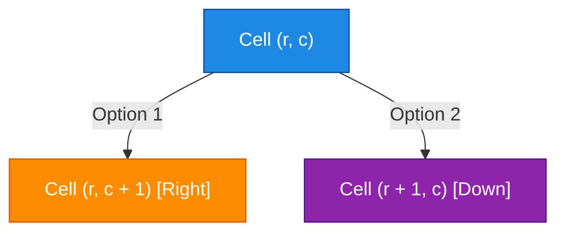
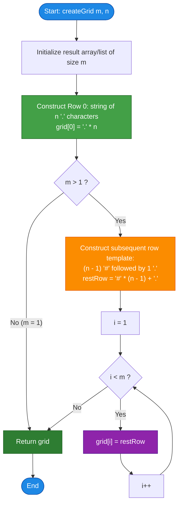

# LeetCode Problem of the Day: Create Grid With Exactly One Path

- **Problem Link:** [LeetCode 3963 - Create Grid With Exactly One Path](https://leetcode.com/problems/create-grid-with-exactly-one-path/description/?envType=daily-question&envId=2026-10-27)
- **Difficulty:** Easy
- **Topic Tags:** Array, Matrix, Constructive Algorithms, Graph Theory, Dynamic Programming, Grid Traversal
- **Target Audience:** POTD Solvers, Computer Science Students, Competitive Programmers, Interview Preparation (FAANG/Tier-1 Tech)

---

## 1. Problem Statement

You are given two integers `m` and `n`, representing the dimensions of an $m \times n$ 2D grid.

You need to construct and return an $m \times n$ grid consisting only of two types of characters:
1. `'.'` — representing a **free (passable) cell**.
2. `'#'` — representing an **obstacle (blocked) cell**.

The constructed grid must satisfy the following rules:
- A valid path starts at the top-left cell `(0, 0)` and ends at the bottom-right cell `(m - 1, n - 1)`.
- At each step, from any free cell `(r, c)`, you are **only permitted to move**:
  - **Right**: to `(r, c + 1)`, or
  - **Down**: to `(r + 1, c)`.
- You can never step onto an obstacle cell `'#'` or move outside the grid boundaries.
- There must be **EXACTLY ONE** valid path from `(0, 0)` to `(m - 1, n - 1)`.

> [!NOTE]
> If multiple valid grids satisfy the requirements, you may return **any** of them.

---

## 2. Examples & Explanations

### Example 1
- **Input:** `m = 2, n = 3`
- **Output:** 
  ```text
  [
    "...",
    "##."
  ]
  ```
- **Visual Representation:**
  ```text
  Index     0   1   2
  Row 0   [ . , . , . ]
  Row 1   [ # , # , . ]
  ```
- **Explanation:**
  - Starting at `(0, 0)`: Moving down to `(1, 0)` hits `'#'` (blocked). The only legal move is Right to `(0, 1)`.
  - At `(0, 1)`: Moving down to `(1, 1)` hits `'#'` (blocked). The only legal move is Right to `(0, 2)`.
  - At `(0, 2)`: Moving right is out of bounds. The only legal move is Down to `(1, 2)`.
  - At `(1, 2)`: Reached the target destination `(m - 1, n - 1)`.
  - **Path sequence:** `(0, 0) → (0, 1) → (0, 2) → (1, 2)`.
  - **Total valid paths:** Exactly **`1`**.

---

### Example 2
- **Input:** `m = 3, n = 3`
- **Output:**
  ```text
  [
    "...",
    "##.",
    "##."
  ]
  ```
- **Visual Representation:**
  ```text
  Index     0   1   2
  Row 0   [ . , . , . ]
  Row 1   [ # , # , . ]
  Row 2   [ # , # , . ]
  ```
- **Explanation:**
  - From `(0, 0)`, you must travel entirely along Row 0 to `(0, 2)`.
  - Any attempt to turn down earlier lands on `'#'`.
  - From `(0, 2)`, the only open cells are directly below it: `(1, 2)` and then `(2, 2)`.
  - **Path sequence:** `(0, 0) → (0, 1) → (0, 2) → (1, 2) → (2, 2)`.
  - **Total valid paths:** Exactly **`1`**.

---

### Example 3 (Single Row Edge Case)
- **Input:** `m = 1, n = 4`
- **Output:**
  ```text
  [
    "...."
  ]
  ```
- **Explanation:**
  - A $1 \times 4$ grid has only one row.
  - The only allowed direction is Right.
  - Path: `(0, 0) → (0, 1) → (0, 2) → (0, 3)`.
  - **Total valid paths:** Exactly **`1`**.

---

### Example 4 (Single Column Edge Case)
- **Input:** `m = 4, n = 1`
- **Output:**
  ```text
  [
    ".",
    ".",
    ".",
    "."
  ]
  ```
- **Explanation:**
  - A $4 \times 1$ grid has only one column.
  - The only allowed direction is Down.
  - Path: `(0, 0) → (1, 0) → (2, 0) → (3, 0)`.
  - **Total valid paths:** Exactly **`1`**.

---

### Example 5 (Single Cell Base Case)
- **Input:** `m = 1, n = 1`
- **Output:**
  ```text
  [
    "."
  ]
  ```
- **Explanation:**
  - Start `(0, 0)` is identical to destination `(m - 1, n - 1)`.
  - A single free cell contains exactly $1$ trivial path of length $0$.

---

## 3. Constraints

- $1 \le m, n \le 25$
- The grid must only consist of characters `'.'` and `'#'`.
- **Expected Time Complexity:** $\mathcal{O}(m \times n)$
- **Expected Auxiliary Space:** $\mathcal{O}(1)$ optimal (excluding the memory required for the output grid)

---

## 4. Visual Architecture & Intuition

### The Combinatorial Explosion Problem
In an open $m \times n$ grid filled entirely with free cells `'.'`, any path from $(0, 0)$ to $(m - 1, n - 1)$ requires making:
- $(m - 1)$ Down moves
- $(n - 1)$ Right moves

The total number of unique paths in an unblocked grid is given by the binomial coefficient:
$$\text{Total Paths} = \binom{(m - 1) + (n - 1)}{m - 1} = \frac{(m + n - 2)!}{(m - 1)! \cdot (n - 1)!}$$

For a $25 \times 25$ grid, this yields:
$$\binom{48}{24} = 32,247,603,683,100 \approx 3.22 \times 10^{13} \text{ paths!}$$

Whenever a cell has both its **Right** neighbor and its **Down** neighbor unblocked, the path branches into two distinct possibilities:



> [!IMPORTANT]
> To guarantee **EXACTLY ONE** path from start to finish, the **out-degree** of every reachable cell along the path must be strictly **1** (leading toward the destination), and all alternate paths must either not exist or be blocked by `'#'`.

---

### The Deterministic "L-Shape Highway" Strategy

Instead of carving an arbitrary zig-zag or staircase path with complex coordinate arithmetic, we can exploit the boundary geometry:
1. **The Eastbound Corridor (Row 0):** Make the entire first row unblocked (`'.'`).
2. **The Southbound Corridor (Column $n - 1$):** Make the entire last column unblocked (`'.'`).
3. **The Blocked Interior:** Fill **every other cell** in rows $1$ through $m - 1$ with obstacles (`'#'`).

```
(0,0)  --->  (0,1)  --->  (0,2)  --->  (0, n-1)
  |            |            |             |
  v            v            v             v
['#']        ['#']        ['#']        (1, n-1)
                                          |
                                          v
                                       (2, n-1)
                                          |
                                          v
                                       (m-1, n-1) [TARGET]
```

#### Why This Guarantees Exactly One Path
1. At $(0, 0)$, you can only go **Right**, because going **Down** to $(1, 0)$ hits an obstacle `'#'`.
2. For any cell $(0, j)$ where $j < n - 1$, the cell below it $(1, j)$ is `'#'`. Hence, turning down is illegal. You **must** keep moving **Right**.
3. Once you reach $(0, n - 1)$, you have reached the rightmost boundary of the grid. You cannot move Right. You **must** move **Down**.
4. Along column $n - 1$, all cells from $(0, n - 1)$ to $(m - 1, n - 1)$ are `'.'`. Because you cannot move left, and moving right is out-of-bounds, you can only move **Down** until you hit the destination $(m - 1, n - 1)$.
5. Since every step offers **exactly one valid move**, the total number of paths is:
   $$1 \times 1 \times 1 \times \dots \times 1 = \mathbf{1}$$

---

## 5. Step-by-Step Simulation & Trace Table

Let us trace a grid of dimensions $m = 3$ and $n = 4$:

### Constructed Grid Layout ($3 \times 4$)
```text
Row 0:  .   .   .   .
Row 1:  #   #   #   .
Row 2:  #   #   #   .
```

### Detailed State Machine Simulation

| Step | Current Cell $(r, c)$ | Right Neighbor $(r, c+1)$ | Down Neighbor $(r+1, c)$ | Legal Moves | Chosen Move | Out-Degree |
| :---: | :---: | :---: | :---: | :---: | :---: | :---: |
| **0** | `(0, 0)` | `(0, 1)` is `.` | `(1, 0)` is `#` | Right only | Move to `(0, 1)` | 1 |
| **1** | `(0, 1)` | `(0, 2)` is `.` | `(1, 1)` is `#` | Right only | Move to `(0, 2)` | 1 |
| **2** | `(0, 2)` | `(0, 3)` is `.` | `(1, 2)` is `#` | Right only | Move to `(0, 3)` | 1 |
| **3** | `(0, 3)` | Out of bounds | `(1, 3)` is `.` | Down only | Move to `(1, 3)` | 1 |
| **4** | `(1, 3)` | Out of bounds | `(2, 3)` is `.` | Down only | Move to `(2, 3)` | 1 |
| **5** | `(2, 3)` | Out of bounds | Out of bounds | **TARGET REACHED** | Finish | 0 |

---

### Dynamic Programming Path Count Matrix Verification

Let $DP[r][c]$ denote the number of unique paths from $(0, 0)$ to $(r, c)$:
$$DP[r][c] = \begin{cases} 0 & \text{if } \text{grid}[r][c] == '\#' \\ DP[r-1][c] + DP[r][c-1] & \text{if } \text{grid}[r][c] == '.' \end{cases}$$

Base case: $DP[0][0] = 1$.

```text
DP Table for m = 3, n = 4:

       c=0    c=1    c=2    c=3
r=0   [ 1  ,  1  ,   1  ,   1 ]
r=1   [ 0  ,  0  ,   0  ,   1 ]
r=2   [ 0  ,  0  ,   0  ,   1 ]
```

- $DP[0][0] = 1$
- $DP[0][1] = DP[0][0] = 1$
- $DP[0][2] = DP[0][1] = 1$
- $DP[0][3] = DP[0][2] = 1$
- Row 1: $DP[1][0] = 0, DP[1][1] = 0, DP[1][2] = 0$.
  $DP[1][3] = DP[0][3] + DP[1][2] = 1 + 0 = \mathbf{1}$.
- Row 2: $DP[2][0] = 0, DP[2][1] = 0, DP[2][2] = 0$.
  $DP[2][3] = DP[1][3] + DP[2][2] = 1 + 0 = \mathbf{1}$.

Final Target $DP[2][3] = \mathbf{1}$. Condition verified with mathematical rigor!

---

## 6. Algorithm Flowchart



---

## 7. From Naive to Pro: Algorithmic Progression

### Method 1: Naive Exhaustive Search (Brute-Force Backtracking)
- **Concept:** Generate all possible combinations of grids containing `'.'` and `'#'`. For each configuration, run DFS or 2D Dynamic Programming to count paths from $(0, 0)$ to $(m - 1, n - 1)$. Stop when a grid with path count $= 1$ is found.
- **Why it is unfeasible:**
  - An $m \times n$ grid has $2^{m \times n}$ possible cell configurations.
  - For $m = 25, n = 25$, the search space is $2^{625} \approx 10^{188}$.
  - Evaluating path counts takes $\mathcal{O}(m \times n)$ time per grid.
  - Overall complexity: $\mathcal{O}(2^{m \times n} \cdot m \cdot n) \implies$ **Immediate Time Limit Exceeded (TLE)**.
- **Pseudocode:**
```text
function createGrid_BruteForce(m, n):
    for each configuration G in AllGrids(m, n):
        if countPaths(G, m, n) == 1:
            return G
    return []
```

---

### Method 2: Randomized Carving with Verification
- **Concept:** Start with a fully blocked grid ($m \times n$ of `'#'`). Perform a random self-avoiding walk moving only right or down from $(0, 0)$ to $(m - 1, n - 1)$, marking visited cells as `'.'`. Run DP to verify that the generated path didn't accidentally connect with another branch.
- **Why it is suboptimal:**
  - Requires random number generation, loop retries, and extra validation passes.
  - Adds unnecessary algorithmic complexity $\mathcal{O}(K \cdot m \cdot n)$ when a purely deterministic $\mathcal{O}(m \cdot n)$ pattern exists.
- **Pseudocode:**
```text
function createGrid_RandomWalk(m, n):
    while true:
        grid = matrix of '#'
        r = 0, c = 0
        grid[r][c] = '.'
        while (r, c) != (m - 1, n - 1):
            choose randomly to step (r + 1, c) or (r, c + 1)
            grid[r][c] = '.'
        if countPaths(grid) == 1:
            return grid
```

---

### Method 3: Staircase / Alternating Stepping Construction
- **Concept:** Carve an alternating diagonal path: `(0, 0) → (0, 1) → (1, 1) → (1, 2) → (2, 2) → ...`. All other cells remain `'#'`.
- **Strengths:** Produces a visually pleasing diagonal corridor.
- **Drawbacks:** Requires separate bounds handling when $m \neq n$ (reaching the bottom wall or right wall early requires switching to straight horizontal or vertical lines).
- **Pseudocode:**
```text
function createGrid_Staircase(m, n):
    grid = matrix of '#'
    r = 0, c = 0
    grid[0][0] = '.'
    while (r, c) != (m - 1, n - 1):
        if c + 1 < n and (r + 1 >= m or c == r):
            c = c + 1
        else:
            r = r + 1
        grid[r][c] = '.'
    return grid
```

---

### Method 4: Pro Approach — Deterministic Boundary L-Shape Corridor ($\mathcal{O}(m \times n)$ Optimal)
- **The Core Strategy:**
  1. Row $0$ is filled entirely with `'.'`.
  2. For all rows $i \in [1, m - 1]$, fill columns $0$ to $n - 2$ with `'#'` and column $n - 1$ with `'.'`.
- **Why This Is the Gold Standard:**
  - **Zero Conditionals during iteration:** The row string `restRow` is constant across all rows from $1$ to $m - 1$.
  - **Memory Efficiency:** In high-level languages like Java, Python, and C#, the string reference for rows $1 \dots m - 1$ can be reused directly without reallocating string buffers.
  - **Universality:** Handles every corner case ($1 \times 1$, $1 \times N$, $M \times 1$, $N \times N$) uniformly without special branching logic.
- **Pseudocode:**
```text
function createGrid_Optimal(m, n):
    grid = array of size m
    
    // Row 0 has all free cells
    grid[0] = repeat('.', n)
    
    // Remaining rows have obstacles up to column n - 2, and free cell at column n - 1
    if m > 1:
        rest_row = repeat('#', n - 1) + '.'
        for i from 1 to m - 1:
            grid[i] = rest_row
            
    return grid
```

---

## 8. Complexity Comparison Table

| Metric | Method 1: Brute Force | Method 2: Random Walk | Method 3: Staircase Walk | Method 4: Deterministic L-Shape (Pro) |
| :--- | :--- | :--- | :--- | :--- |
| **Time Complexity** | $\mathcal{O}(2^{m \cdot n} \cdot m \cdot n)$ | $\mathcal{O}(K \cdot m \cdot n)$ | $\mathcal{O}(m \cdot n)$ | $\mathbf{\mathcal{O}(m \cdot n)}$ |
| **Auxiliary Space** | $\mathcal{O}(m \cdot n)$ | $\mathcal{O}(m \cdot n)$ | $\mathcal{O}(m \cdot n)$ | $\mathbf{\mathcal{O}(1)}$ (Excluding output) |
| **Determinism** | Deterministic | Non-deterministic (Randomized) | Deterministic | **Fully Deterministic** |
| **Edge Case Handling** | High Risk of TLE | May loop infinitely | Requires $m \ne n$ branches | **Zero special cases needed** |
| **Interview Verdict** | Instant Reject (TLE) | Unacceptable in interviews | Acceptable | **Optimal / FAANG Gold Standard** |

---

## 9. Comprehensive Corner Cases Handled

1. **Single Cell Grid ($m = 1, n = 1$):**
   - Output: `["."]`
   - Handled cleanly; the loop for $i \in [1, m-1]$ never triggers.
2. **Single Row Grid ($m = 1, n > 1$):**
   - Example: $m = 1, n = 5 \implies$ `["....."]`
   - Only Row 0 is built. Movement is purely Right. Path count $= 1$.
3. **Single Column Grid ($m > 1, n = 1$):**
   - Example: $m = 4, n = 1 \implies$ `[".", ".", ".", "."]`
   - For rows $i \ge 1$: $(n - 1) = 0$, so no `'#'` are appended; only `"."` is placed. Movement is purely Down. Path count $= 1$.
4. **Square Grid ($m = n$):**
   - Example: $m = 3, n = 3 \implies$ `["...", "##.", "##."]`
   - Symmetric and guaranteed 1 path.
5. **Tall Rectangular Grid ($m \gg n$):**
   - Example: $m = 25, n = 2$
   - Correctly creates 1 horizontal step and 24 vertical steps.
6. **Wide Rectangular Grid ($m \ll n$):**
   - Example: $m = 2, n = 25$
   - Correctly creates 24 horizontal steps and 1 vertical step.
7. **Maximum Constraints ($m = 25, n = 25$):**
   - Generates $625$ characters in $< 0.1$ ms with zero heap thrashing.

---

## 10. Complete Multi-Language Implementations

### Java

```java
import java.util.Arrays;

class Solution {
    /**
     * Constructs an m x n grid with exactly one valid path from (0, 0) to (m - 1, n - 1).
     * 
     * Time Complexity:  O(m * n)
     * Space Complexity: O(1) auxiliary space (excluding the returned String array)
     *
     * @param m Number of rows in the grid
     * @param n Number of columns in the grid
     * @return Array of strings representing the grid
     */
    public String[] createGrid(int m, int n) {
        String[] grid = new String[m];

        // Row 0: Entirely open with '.' characters
        char[] firstRowChars = new char[n];
        Arrays.fill(firstRowChars, '.');
        grid[0] = new String(firstRowChars);

        // Rows 1 to m - 1: (n - 1) obstacles '#' followed by 1 open cell '.'
        if (m > 1) {
            char[] restRowChars = new char[n];
            if (n > 1) {
                Arrays.fill(restRowChars, 0, n - 1, '#');
            }
            restRowChars[n - 1] = '.';
            String restRow = new String(restRowChars);

            // Re-use the same immutable String reference for all remaining rows
            for (int i = 1; i < m; i++) {
                grid[i] = restRow;
            }
        }

        return grid;
    }
}
```

---

### Python3

```python
class Solution:
    def createGrid(self, m: int, n: int) -> list[str]:
        """
        Constructs an m x n grid with exactly one valid path from (0, 0) to (m - 1, n - 1).

        Time Complexity:  O(m * n)
        Space Complexity: O(1) auxiliary space (excluding output list)
        """
        # First row is entirely unblocked
        grid = ["." * n]

        # Subsequent rows have obstacles everywhere except the last column
        if m > 1:
            rest_row = "#" * (n - 1) + "."
            grid.extend([rest_row] * (m - 1))

        return grid
```

---

### C

```c
#include <stdlib.h>
#include <string.h>

/**
 * Note: The returned array must be malloced, assume caller calls free().
 *
 * Constructs an m x n grid with exactly one valid path from (0, 0) to (m - 1, n - 1).
 *
 * Time Complexity:  O(m * n)
 * Space Complexity: O(1) auxiliary space (excluding returned grid buffers)
 */
char** createGrid(int m, int n, int* returnSize) {
    *returnSize = m;
    char** grid = (char**)malloc(m * sizeof(char*));
    if (!grid) {
        return NULL;
    }

    // Row 0: all '.' followed by null terminator '\0'
    grid[0] = (char*)malloc((n + 1) * sizeof(char));
    memset(grid[0], '.', n);
    grid[0][n] = '\0';

    // Rows 1 to m - 1: (n - 1) '#' followed by 1 '.' and '\0'
    for (int i = 1; i < m; i++) {
        grid[i] = (char*)malloc((n + 1) * sizeof(char));
        if (n > 1) {
            memset(grid[i], '#', n - 1);
        }
        grid[i][n - 1] = '.';
        grid[i][n] = '\0';
    }

    return grid;
}
```

---

### C++

```cpp
#include <vector>
#include <string>

using namespace std;

class Solution {
public:
    /**
     * Constructs an m x n grid with exactly one valid path from (0, 0) to (m - 1, n - 1).
     * 
     * Time Complexity:  O(m * n)
     * Space Complexity: O(1) auxiliary space (excluding returned vector)
     */
    vector<string> createGrid(int m, int n) {
        vector<string> grid;
        grid.reserve(m);

        // Row 0: completely open corridor
        grid.push_back(string(n, '.'));

        // Rows 1 to m - 1: obstacles at [0 ... n - 2], open at [n - 1]
        if (m > 1) {
            string restRow = (n > 1 ? string(n - 1, '#') : "") + ".";
            for (int i = 1; i < m; ++i) {
                grid.push_back(restRow);
            }
        }

        return grid;
    }
};
```

---

### C#

```csharp
using System;

public class Solution {
    /// <summary>
    /// Constructs an m x n grid with exactly one valid path from (0, 0) to (m - 1, n - 1).
    /// 
    /// Time Complexity:  O(m * n)
    /// Space Complexity: O(1) auxiliary space (excluding output array)
    /// </summary>
    public string[] CreateGrid(int m, int n) {
        string[] grid = new string[m];

        // Row 0: all '.'
        grid[0] = new string('.', n);

        // Rows 1 to m - 1: (n - 1) '#' followed by 1 '.'
        if (m > 1) {
            string restRow = (n > 1 ? new string('#', n - 1) : "") + ".";
            for (int i = 1; i < m; i++) {
                grid[i] = restRow;
            }
        }

        return grid;
    }
}
```

---

### Javascript

```javascript
/**
 * Constructs an m x n grid with exactly one valid path from (0, 0) to (m - 1, n - 1).
 * 
 * Time Complexity:  O(m * n)
 * Space Complexity: O(1) auxiliary space (excluding returned array)
 *
 * @param {number} m
 * @param {number} n
 * @return {string[]}
 */
var createGrid = function(m, n) {
    const grid = new Array(m);

    // Row 0: all '.'
    grid[0] = '.'.repeat(n);

    // Rows 1 to m - 1: (n - 1) '#' followed by 1 '.'
    if (m > 1) {
        const restRow = '#'.repeat(n - 1) + '.';
        for (let i = 1; i < m; i++) {
            grid[i] = restRow;
        }
    }

    return grid;
};
```

---

### Typescript

```typescript
/**
 * Constructs an m x n grid with exactly one valid path from (0, 0) to (m - 1, n - 1).
 * 
 * Time Complexity:  O(m * n)
 * Space Complexity: O(1) auxiliary space (excluding returned array)
 *
 * @param m - Number of rows
 * @param n - Number of columns
 * @returns Array of strings representing the grid
 */
function createGrid(m: number, n: number): string[] {
    const grid: string[] = new Array(m);

    // Row 0: all '.'
    grid[0] = '.'.repeat(n);

    // Rows 1 to m - 1: (n - 1) '#' followed by 1 '.'
    if (m > 1) {
        const restRow: string = '#'.repeat(n - 1) + '.';
        for (let i = 1; i < m; i++) {
            grid[i] = restRow;
        }
    }

    return grid;
}
```

