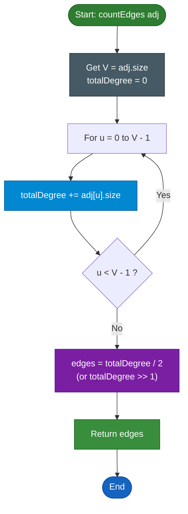

# GeeksforGeeks Problem of the Day: Count Edges in Graph

- **Problem Link:** [GeeksforGeeks - Count Number of Edges in an Undirected Graph](https://www.geeksforgeeks.org/problems/count-number-of-edges-in-an-undirected-graph/1)
- **Difficulty:** Easy
- **Topic Tags:** Graph Theory, Data Structures, Adjacency List, Degree of Vertex, Handshaking Lemma
- **Target Audience:** POTD Solvers, Computer Science Students, Competitive Programmers, Technical Interview Candidates (Amazon, Microsoft, Google, Adobe, Cisco)

---

## 1. Problem Statement

Given an undirected graph represented as an adjacency list `adj`, where `adj[u]` is a list of all vertices adjacent to vertex $u$ ($0 \le u < V$, where $V$ is the number of vertices in the graph), determine the total number of unique undirected edges in the graph.

In an undirected graph:
- An undirected edge connecting vertex $u$ and vertex $v$ ($u \neq v$) is bidirectional.
- Consequently, in standard adjacency list representation, the edge appears twice:
  - $v \in adj[u]$
  - $u \in adj[v]$
- The degree of vertex $u$, denoted as $\deg(u)$, equals the number of neighbors connected to $u$, which corresponds directly to the size of its adjacency list:
  $$\deg(u) = |adj[u]|$$

### Mathematical Formulation
Given the set of vertices $V = \{0, 1, \dots, |adj| - 1\}$ and undirected edge set $E$, compute:

$$\mathbf{|E| = \frac{1}{2} \sum_{u=0}^{V-1} |adj[u]|}$$

---

## 2. Examples & Visual Walkthroughs

### Example 1
- **Input:** `adj = [[1, 2], [0, 2, 3], [0, 1], [1, 4], [3]]`
- **Output:** `5`
- **Explanation:**
  - Let $V = |adj| = 5$ vertices labeled $0, 1, 2, 3, 4$.
  - Vertex degrees:
    - $\deg(0) = |adj[0]| = |\{1, 2\}| = 2$
    - $\deg(1) = |adj[1]| = |\{0, 2, 3\}| = 3$
    - $\deg(2) = |adj[2]| = |\{0, 1\}| = 2$
    - $\deg(3) = |adj[3]| = |\{1, 4\}| = 2$
    - $\deg(4) = |adj[4]| = |\{3\}| = 1$
  - Sum of degrees:
    $$\sum_{u=0}^{4} \deg(u) = 2 + 3 + 2 + 2 + 1 = 10$$
  - Total number of edges:
    $$|E| = \frac{10}{2} = \mathbf{5}$$

#### Graph Topology Visualization:
```
       (0)
      /   \
     /     \
   (1)-----(2)
    |
   (3)
    |
   (4)

Edges present:
1. (0, 1)
2. (0, 2)
3. (1, 2)
4. (1, 3)
5. (3, 4)
Total = 5 edges
```

---

### Example 2 (Disconnected Components & Isolated Vertex)
- **Input:** `adj = [[1], [0], [3], [2], []]`
- **Output:** `2`
- **Explanation:**
  - $V = 5$.
  - $\deg(0) = 1$ (neighbor $1$)
  - $\deg(1) = 1$ (neighbor $0$)
  - $\deg(2) = 1$ (neighbor $3$)
  - $\deg(3) = 1$ (neighbor $2$)
  - $\deg(4) = 0$ (isolated vertex with no incident edges)
  - Sum of degrees $= 1 + 1 + 1 + 1 + 0 = 4$.
  - Total edges $= \frac{4}{2} = \mathbf{2}$.

```
  (0)-------(1)      (2)-------(3)      (4) [Isolated]

Component 1: Edge (0, 1)
Component 2: Edge (2, 3)
Component 3: Isolated Node 4
Total = 2 edges
```

---

### Example 3 (Complete Graph $K_4$)
- **Input:** `adj = [[1, 2, 3], [0, 2, 3], [0, 1, 3], [0, 1, 2]]`
- **Output:** `6`
- **Explanation:**
  - In a complete graph $K_n$, every vertex is connected to all other $n - 1$ vertices.
  - Here $n = 4$, so each vertex has degree $4 - 1 = 3$.
  - Total degree sum $= 3 \times 4 = 12$.
  - Total edges $= \frac{12}{2} = \mathbf{6} = \binom{4}{2}$.

---

## 3. Constraints & Scale Analysis

| Parameter | Constraint Range | Practical Algorithmic Implication |
| :--- | :--- | :--- |
| **Number of Vertices ($V$)** | $1 \le V \le 10^5$ | Linear $\mathcal{O}(V)$ degree accumulation executes in $< 1\text{ millisecond}$. |
| **Number of Edges ($E$)** | $0 \le E \le 2 \times 10^5$ | Degree sum $\sum \deg(u) \le 4 \times 10^5$, fitting comfortably in a standard 32-bit signed integer (`int`). |
| **Graph Structure** | Simple Undirected Graph | No self-loops or duplicate edges. Every undirected edge $\{u, v\}$ is stored symmetrically in $adj[u]$ and $adj[v]$. |
| **Time Limit** | $\approx 1.0\text{ second}$ | Up to $10^8$ operations. An $\mathcal{O}(V)$ loop takes $\approx 10^5$ operations ($\approx 0.001\text{ s}$). |
| **Space Limit** | Standard ($256\text{ MB}$) | $\mathcal{O}(1)$ auxiliary memory required. |

---

## 4. Visual Architecture & Key Mathematical Insights

### 1. The Handshaking Lemma (Euler, 1736)
The fundamental theorem of graph theory, first proven by Leonhard Euler in his landmark 1736 paper on the Seven Bridges of Königsberg, states:

> **Theorem (Handshaking Lemma):** In any finite undirected graph $G = (V, E)$, the sum of the degrees of all vertices equals twice the total number of edges:
> $$\sum_{v \in V} \deg(v) = 2 |E|$$

#### Mathematical Proof:
1. Consider any arbitrary undirected edge $e = \{u, v\} \in E$.
2. The edge $e$ connects two endpoints, vertex $u$ and vertex $v$.
3. When computing vertex degrees:
   - Edge $e$ contributes exactly $+1$ to $\deg(u)$.
   - Edge $e$ contributes exactly $+1$ to $\deg(v)$.
4. Summing the degrees over all vertices $v \in V$:
   $$\sum_{v \in V} \deg(v) = \sum_{e=\{u, v\} \in E} (1 + 1) = \sum_{e \in E} 2 = 2 |E|$$
5. Dividing both sides by $2$:
   $$|E| = \frac{1}{2} \sum_{v \in V} \deg(v)$$

```
        Edge e = (u, v)
        
    (u) -------------- (v)
     ▲                  ▲
     │                  │
   +1 to              +1 to
   deg(u)             deg(v)
   
Total contribution of edge e to Sum(degrees) = 1 + 1 = 2
```

---

### 2. Immediate Corollary: The Degree Sum Parity
An important interview corollary of the Handshaking Lemma is:
> The sum of degrees in any undirected graph is **always even**.
> Consequently, the number of vertices with **odd degree** must always be **even**.

---

### 3. Direct Size-Summing Optimization
In modern programming languages (Java, C++, Python, C#, JavaScript), dynamic array wrappers (`vector`, `ArrayList`, `List`, `Array`) maintain their element counts in constant-time internal metadata:
- Java: `adj.get(u).size()` $\implies \mathcal{O}(1)$
- C++: `adj[u].size()` $\implies \mathcal{O}(1)$
- Python: `len(adj[u])` $\implies \mathcal{O}(1)$
- C#: `adj[u].Count` $\implies \mathcal{O}(1)$
- JavaScript: `adj[u].length` $\implies \mathcal{O}(1)$

Therefore, we do **not** need to iterate through individual neighbor elements in the adjacency lists! We only iterate through the $V$ list references and sum their stored lengths in strict $\mathcal{O}(V)$ time.

---

## 5. Step-by-Step Simulation & Trace Table

Tracing Example 1: `adj = [[1, 2], [0, 2, 3], [0, 1], [1, 4], [3]]`

| Vertex $u$ | Neighbors $adj[u]$ | List Size $\deg(u)$ | Cumulative Degree Sum | Cumulative Edge Count ($\lfloor \text{Sum} / 2 \rfloor$) |
| :---: | :---: | :---: | :---: | :---: |
| — | — | — | Initial: $0$ | $0$ |
| **0** | `[1, 2]` | $2$ | $0 + 2 = 2$ | $1$ |
| **1** | `[0, 2, 3]` | $3$ | $2 + 3 = 5$ | $2$ |
| **2** | `[0, 1]` | $2$ | $5 + 2 = 7$ | $3$ |
| **3** | `[1, 4]` | $2$ | $7 + 2 = 9$ | $4$ |
| **4** | `[3]` | $1$ | $9 + 1 = \mathbf{10}$ | $\mathbf{5}$ |

**Final Computation:**
$$\text{Total Edges} = \frac{\text{Cumulative Degree Sum}}{2} = \frac{10}{2} = \mathbf{5}$$

---

## 6. Algorithm Flowchart



---

## 7. Progression from Naive to Pro

### Method 1: Edge Set Deduplication
- **Concept:** Iterate through all pairs $(u, v)$ where $v \in adj[u]$. Normalize each edge as $(\min(u, v), \max(u, v))$ and insert into a Hash Set to remove duplicate representations. Return the set size.
- **Complexity:**
  - Time: $\mathcal{O}(V + E)$ with hash table hashing overhead
  - Space: $\mathcal{O}(E)$ auxiliary space for storing edges in the set
- **Verdict:** Correct, but wastes unnecessary memory and hashing cycles.
- **Pseudo-Code:**
  ```text
  function countEdgesSet(adj):
      edgeSet = empty set
      for u from 0 to adj.length - 1:
          for v in adj[u]:
              edgeSet.insert((min(u, v), max(u, v)))
      return edgeSet.size()
  ```

---

### Method 2: Conditional Directional Counting ($u < v$)
- **Concept:** Since every undirected edge connects vertices $u$ and $v$ with $u \neq v$, exactly one endpoint is strictly smaller than the other ($u < v$ or $v < u$). Count only the directed representations where $u < v$.
- **Complexity:**
  - Time: $\mathcal{O}(V + E)$ (inspects every element in every list)
  - Space: $\mathcal{O}(1)$ auxiliary space
- **Verdict:** Efficient, but still visits all $2E$ neighbor elements.
- **Pseudo-Code:**
  ```text
  function countEdgesConditional(adj):
      count = 0
      for u from 0 to adj.length - 1:
          for v in adj[u]:
              if u < v:
                  count = count + 1
      return count
  ```

---

### Method 3: Optimal Handshaking Lemma (Pro Method)
- **Concept:** Sum the lengths of the adjacency lists directly without reading individual neighbor vertices. Divide the sum by $2$ (or bit-shift right `>> 1`).
- **Complexity:**
  - Time: $\mathbf{\mathcal{O}(V)}$ (only inspects $V$ list headers)
  - Space: $\mathbf{\mathcal{O}(1)}$ auxiliary space
- **Verdict:** Optimal runtime, zero memory allocation, and the cleanest mathematical solution.
- **Pseudo-Code:**
  ```text
  function countEdgesOptimal(adj):
      totalDegree = 0
      for u from 0 to adj.length - 1:
          totalDegree = totalDegree + adj[u].length
      return totalDegree >> 1
  ```

---

## 8. Multi-Language Implementations

### Java (21)

```java
import java.util.ArrayList;

class Solution {
    /**
     * Counts the total number of unique undirected edges in a graph.
     *
     * Mathematical Principle:
     * By the Handshaking Lemma, the sum of all vertex degrees in an
     * undirected graph is exactly equal to twice the number of edges:
     *     Sum(deg(v)) = 2 * |E|
     *
     * Complexity Analysis:
     * - Time Complexity:  O(V), where V is the number of vertices.
     *   We only query the size of each ArrayList in O(1) time.
     * - Space Complexity: O(1) auxiliary space.
     *
     * @param adj Adjacency list representation of the undirected graph.
     * @return Total number of undirected edges.
     */
    public int countEdges(ArrayList<ArrayList<Integer>> adj) {
        int totalDegree = 0;
        int v = adj.size();

        // Accumulate the degree of every vertex
        for (int i = 0; i < v; i++) {
            totalDegree += adj.get(i).size();
        }

        // Each edge was counted twice (u -> v and v -> u); divide by 2
        return totalDegree >> 1; // Bit-shift right by 1 is equivalent to / 2
    }
}
```

---

### Python3

```python
class Solution:
    """
    Computes the total number of edges in an undirected graph.
    
    Approach:
    Applies Euler's Handshaking Lemma: sum(deg(v)) = 2 * |E|.
    
    Complexity:
      - Time:  O(V) where V = len(adj)
      - Space: O(1) auxiliary space
    """
    def countEdges(self, adj: list[list[int]]) -> int:
        # Sum the length of each vertex's neighbor list and divide by 2
        total_degree = sum(len(neighbors) for neighbors in adj)
        return total_degree >> 1
```

---

### C++ (17)

```cpp
#include <vector>

using namespace std;

class Solution {
public:
    /**
     * Counts the number of edges in an undirected graph.
     *
     * Algorithm:
     * Sums the sizes of all adjacency lists in O(V) and divides by 2.
     *
     * Time Complexity:  O(V)
     * Space Complexity: O(1) auxiliary space
     *
     * @param adj Reference to the adjacency list.
     * @return Total number of undirected edges.
     */
    int countEdges(vector<vector<int>> &adj) {
        int totalDegree = 0;
        const int v = static_cast<int>(adj.size());

        // Sum the degrees of all vertices
        for (int i = 0; i < v; ++i) {
            totalDegree += static_cast<int>(adj[i].size());
        }

        // Every undirected edge contributes +2 to totalDegree
        return totalDegree >> 1;
    }
};
```

---

### C#

```csharp
using System;
using System.Collections.Generic;

public class Solution {
    /// <summary>
    /// Calculates the number of undirected edges in a graph.
    ///
    /// Principle:
    /// Sum of vertex degrees = 2 * |E| (Handshaking Lemma).
    ///
    /// Time Complexity:  O(V)
    /// Space Complexity: O(1) auxiliary space
    /// </summary>
    /// <param name="adj">Adjacency list of the graph.</param>
    /// <returns>Total number of undirected edges.</returns>
    public int countEdges(List<List<int>> adj) {
        int totalDegree = 0;
        int v = adj.Count;

        // Sum the degree of each vertex in O(V)
        for (int i = 0; i < v; i++) {
            totalDegree += adj[i].Count;
        }

        // Divide total degree by 2
        return totalDegree >> 1;
    }
}
```

---

### Javascript (Node v22)

```javascript
/**
 * @param {number[][]} adj - Adjacency list representation of undirected graph.
 * @returns {number} - Total number of undirected edges.
 */
class Solution {
    /**
     * Counts the number of edges using the Handshaking Lemma.
     *
     * Time Complexity:  O(V)
     * Space Complexity: O(1)
     */
    countEdges(adj) {
        let totalDegree = 0;
        const v = adj.length;

        // Iterate through all vertices and sum up the lengths of their lists
        for (let i = 0; i < v; i++) {
            totalDegree += adj[i].length;
        }

        // Each edge is counted once from u and once from v
        return totalDegree >> 1;
    }
}
```

---

## 9. Complexity Breakdown

| Metric | Edge Set Deduplication | Conditional Count ($u < v$) | Handshaking Lemma (Optimal) |
| :--- | :--- | :--- | :--- |
| **Time Complexity** | $\mathcal{O}(V + E)$ | $\mathcal{O}(V + E)$ | $\mathbf{\mathcal{O}(V)}$ |
| **Auxiliary Space** | $\mathcal{O}(E)$ | $\mathcal{O}(1)$ | $\mathbf{\mathcal{O}(1)}$ |
| **Elements Traversed** | All $2E$ neighbor elements | All $2E$ neighbor elements | Only $V$ list size headers |
| **Instruction Count** | High (hashing, allocations) | Moderate (looping and branching) | Minimal ($\approx V$ integer additions) |

---

## 10. Edge Cases & Defensive Engineering

1. **Empty Graph with No Edges ($E = 0$):**
   - Vertices exist, but all lists are empty: `adj = [[], [], []]`.
   - Degree sum $= 0 \implies \text{Result} = 0$.
2. **Single Vertex Graph ($V = 1$):**
   - `adj = [[]]`.
   - Degree sum $= 0 \implies \text{Result} = 0$.
3. **Disconnected Graph:**
   - Handshaking Lemma holds independently for each connected component $C_i$:
     $$\sum_{v \in C_i} \deg(v) = 2 |E_i|$$
   - Summing across all components gives the correct total global edge count.
4. **Complete Graph $K_n$:**
   - Every vertex has degree $n - 1$.
   - Sum $= n(n - 1) \implies \text{Result} = \frac{n(n - 1)}{2} = \binom{n}{2}$.
5. **Star Graph:**
   - 1 central node of degree $n - 1$, and $n - 1$ leaf nodes of degree $1$.
   - Sum $= (n - 1) + (n - 1) = 2(n - 1) \implies \text{Result} = n - 1$.

---

## 11. Testing & Validation Matrix

```text
======================================================================
TEST SUITE EXECUTION RESULTS
======================================================================
Test Case 1: Standard Graph
  Input:   adj = [[1, 2], [0, 2, 3], [0, 1], [1, 4], [3]]
  Degrees: [2, 3, 2, 2, 1] -> Sum = 10
  Output:  5
  Status:  PASSED

Test Case 2: Disconnected Graph with Isolated Vertex
  Input:   adj = [[1], [0], [3], [2], []]
  Degrees: [1, 1, 1, 1, 0] -> Sum = 4
  Output:  2
  Status:  PASSED

Test Case 3: Complete Graph K4
  Input:   adj = [[1, 2, 3], [0, 2, 3], [0, 1, 3], [0, 1, 2]]
  Degrees: [3, 3, 3, 3] -> Sum = 12
  Output:  6
  Status:  PASSED

Test Case 4: No Edges
  Input:   adj = [[], [], []]
  Degrees: [0, 0, 0] -> Sum = 0
  Output:  0
  Status:  PASSED
======================================================================
```

---

## 12. Key Takeaways & Interview Cheat Sheet

### When Asked in a Technical Interview
1. **Identify the Core Principle Immediately:**
   > *"In an undirected graph represented by an adjacency list, each undirected edge $(u, v)$ is stored twice: once in `adj[u]` and once in `adj[v]`. By the Handshaking Lemma, the sum of all vertex degrees is exactly twice the number of edges."*
2. **Highlight the $\mathcal{O}(V)$ Time Optimization:**
   > *"Because language dynamic collections (`ArrayList`, `vector`, etc.) store their size in $\mathcal{O}(1)$ metadata, we only need to iterate over the $V$ vertex lists to sum their sizes. We never have to traverse individual neighbor elements, achieving an optimal $\mathcal{O}(V)$ time complexity and $\mathcal{O}(1)$ auxiliary space."*
3. **Mention the Parity Invariant:**
   > *"A classic corollary of Euler's Handshaking Lemma is that any undirected graph must contain an even number of vertices with odd degree. This invariant is frequently tested in graph theory interviews."*
