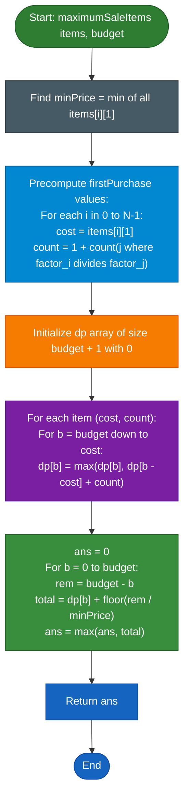

# LeetCode Problem of the Day: Maximum Number of Items From Sale I

- **Problem Link:** [LeetCode 3946 - Maximum Number of Items From Sale I](https://leetcode.com/problems/maximum-number-of-items-from-sale-i/description/?envType=daily-question&envId=2026-11-27)
- **Difficulty:** Medium
- **Topic Tags:** Dynamic Programming, 0/1 Knapsack, Unbounded Knapsack, Greedy, Number Theory, Divisibility
- **Target Audience:** POTD Solvers, Computer Science Students, Competitive Programmers, Technical Interview Candidates (Google, Amazon, Microsoft, Meta, Apple)

---

## 1. Problem Statement

You are given a 2D integer array `items`, where each `items[i] = [factor_i, price_i]` represents an item type with:
- A divisibility characteristic $\text{factor}_i$
- A unit purchase price $\text{price}_i$

You are also given an integer `budget` representing your total available money.

### Sale Rules & Promotions
1. **Unlimited Purchases:** You can purchase any number of copies of any item type, as long as the total spending does not exceed `budget`.
2. **Promotional Free Copies (Divisibility Rule):** For each distinct item type $i$ that you purchase **at least one copy of**, you receive **one free copy** of every other item type $j$ ($j \neq i$) such that $\text{factor}_i$ divides $\text{factor}_j$:
   $$\text{factor}_j \bmod \text{factor}_i == 0$$
3. **No Stacking on Same Type:** Purchasing multiple copies of the exact same item type $i$ does **not** grant additional free copies from item $i$ (the promotion for item type $i$ unlocks once upon buying the first copy).
4. **Independent Accumulation Across Distinct Types:** If different purchased item types both trigger a free copy of the same item $j$, you receive that free copy from each trigger independently.

### Goal
Return the **maximum total number of item copies** (both purchased and free promotional copies) you can obtain without exceeding `budget`.

---

## 2. Examples & Visual Walkthroughs

### Example 1
- **Input:** `items = [[6, 2], [2, 6], [3, 4]]`, `budget = 9`
- **Output:** `4`
- **Explanation:**
  - Let us inspect the item types:
    - Item 0: $\text{factor} = 6, \text{price} = 2$
    - Item 1: $\text{factor} = 2, \text{price} = 6$
    - Item 2: $\text{factor} = 3, \text{price} = 4$
  - Multiples analysis for promotional unlocks:
    - Item 0 ($\text{factor} = 6$): Multiples among other items? None ($\text{bonus} = 0$).
    - Item 1 ($\text{factor} = 2$): Multiples among other items? $6 \bmod 2 == 0 \implies$ Item 0 ($\text{bonus} = 1$).
    - Item 2 ($\text{factor} = 3$): Multiples among other items? $6 \bmod 3 == 0 \implies$ Item 0 ($\text{bonus} = 1$).
  - **Purchasing Strategy:**
    - Buy **1 copy of Item 2** (cost $= 4$):
      - Gets $1$ purchased copy of Item 2.
      - Triggers promotion: $1$ free copy of Item 0 (since $3 \mid 6$).
      - Total items gained $= 2$, Remaining budget $= 9 - 4 = 5$.
    - Buy **2 copies of Item 0** using the remaining budget (cost $= 2 \times 2 = 4$):
      - Gets $2$ purchased copies of Item 0.
      - Total cost spent $= 4 + 4 = 8 \le 9$.
    - **Total Items Obtained:** $1 \text{ (purchased Item 2)} + 2 \text{ (purchased Item 0)} + 1 \text{ (free Item 0)} = \mathbf{4}$.

```
Budget: 9
[Item 2: price 4] ──(Buy 1)──> 1 copy of Item 2 + 1 free copy of Item 0
Remaining Budget: 5
[Item 0: price 2] ──(Buy 2)──> 2 copies of Item 0
Total Cost: 4 + 4 = 8 <= 9
Total Items: 1 + 1 + 2 = 4 (Maximum possible)
```

---

### Example 2
- **Input:** `items = [[2, 4], [3, 2], [4, 1], [6, 4], [12, 4]]`, `budget = 8`
- **Output:** `10`
- **Explanation:**
  - Item factors:
    - Item 0: $\text{factor} = 2, \text{price} = 4 \implies$ divides $4, 6, 12$ (Items 2, 3, 4) $\implies \mathbf{3\text{ free items}}$.
    - Item 1: $\text{factor} = 3, \text{price} = 2 \implies$ divides $6, 12$ (Items 3, 4) $\implies \mathbf{2\text{ free items}}$.
    - Item 2: $\text{factor} = 4, \text{price} = 1 \implies$ divides $12$ (Item 4) $\implies \mathbf{1\text{ free item}}$.
    - Item 3: $\text{factor} = 6, \text{price} = 4 \implies$ divides $12$ (Item 4) $\implies \mathbf{1\text{ free item}}$.
    - Item 4: $\text{factor} = 12, \text{price} = 4 \implies$ divides none $\implies \mathbf{0\text{ free items}}$.
  - **Optimal Purchases:**
    - Buy $1$ copy of Item 0 (cost $4$): $1$ purchased $+ 3$ free (Items 2, 3, 4) $= 4$ items.
    - Buy $1$ copy of Item 1 (cost $2$): $1$ purchased $+ 2$ free (Items 3, 4) $= 3$ items.
    - Buy $2$ copies of Item 2 (cost $2 \times 1 = 2$):
      - First copy costs $1$, yields $1$ purchased $+ 1$ free (Item 4) $= 2$ items.
      - Second copy costs $1$, yields $1$ purchased $= 1$ item.
  - **Summary:**
    - Total cost: $4 + 2 + 2 = 8 \le 8$.
    - Purchased copies: $1 + 1 + 2 = 4$.
    - Free copies: $3 + 2 + 1 = 6$.
    - Total item copies: $4 + 6 = \mathbf{10}$.

---

## 3. Constraints & Scale Analysis

| Parameter | Constraint Range | Practical Algorithmic Implication |
| :--- | :--- | :--- |
| **Number of Items ($N$)** | $1 \le N \le 1000$ | Pairwise divisibility precomputation takes $\mathcal{O}(N^2) \le 10^6$ operations ($\approx 1\text{ ms}$). |
| **Budget** | $1 \le \text{budget} \le 1500$ | A 1D DP table of size $1501$ requires only $\approx 6\text{ KB}$ of memory. |
| **Item Factor ($\text{factor}_i$)** | $1 \le \text{factor}_i \le 1500$ | Arithmetic modulo checks execute in $\mathcal{O}(1)$. |
| **Item Price ($\text{price}_i$)** | $1 \le \text{price}_i \le 1500$ | Positive integer prices guarantee finite bounds. |
| **Total DP Operations** | $\mathcal{O}(N \times \text{budget})$ | $1000 \times 1500 = 1.5 \times 10^6$ inner transitions ($\approx 3\text{ ms}$). |

---

## 4. Visual Architecture & Key Mathematical Insights

### 1. Two-Stage Decision Decomposition
Notice the distinct behavior between purchasing the **first copy** of an item versus **subsequent copies**:
- **First Copy of Item $i$:** Costs $\text{price}_i$, and yields:
  $$\text{Value}_{\text{first}}(i) = 1 + \sum_{j \neq i} \mathbb{I}(\text{factor}_j \bmod \text{factor}_i == 0)$$
- **Subsequent Copies of Item $i$:** Each additional copy costs $\text{price}_i$, and yields strictly **$1$ item** (no extra free copies).

```
Item i Purchases:
┌──────────────────────────────┬──────────────────────────────┐
│ First Copy (0/1 Knapsack)     │ Subsequent Copies (Unbounded)│
├──────────────────────────────┼──────────────────────────────┤
│ Cost: price_i                │ Cost: price_i per copy       │
│ Gain: 1 + bonus_i            │ Gain: 1 copy per purchase    │
└──────────────────────────────┴──────────────────────────────┘
```

### 2. The Cheapest Item Greedy Theorem
> **Theorem:** To maximize the number of items obtained from any leftover budget $R$ after choosing first-purchase bonuses, it is strictly optimal to spend all of $R$ repeatedly on the item with the **global minimum price**:
> $$P_{\min} = \min_{0 \le i < N} \text{price}_i$$

#### Mathematical Proof:
1. Every subsequent copy of any item $i$ yields a marginal gain of exactly $+1$ item.
2. The cost to acquire $+1$ additional item through subsequent purchases of item $i$ is $\text{price}_i$.
3. To maximize $\sum \text{copies}$ under budget constraint $\sum \text{copies}_i \times \text{price}_i \le R$, the marginal cost per item should be as small as possible.
4. Hence, buying $\lfloor R / P_{\min} \rfloor$ copies of the cheapest item yields the theoretical upper bound on items attainable from residual budget $R$.
5. If the cheapest item was already purchased as a first copy in the 0/1 knapsack, subsequent copies cost $P_{\min}$ each. If it was not purchased, buying it with residual budget yields at least $\lfloor R / P_{\min} \rfloor$ copies (plus potentially its bonus, which is already dominated by or equal to considering it in the 0/1 knapsack phase).

### 3. Unified DP + Residual Greedy Formulation
Let $\text{dp}[b]$ denote the maximum items attainable by spending **at most budget $b$ strictly on first purchases of distinct item types**:
$$\text{dp}[b] = \max(\text{dp}[b], \text{dp}[b - \text{price}_i] + \text{Value}_{\text{first}}(i))$$

After evaluating the 0/1 Knapsack over all $N$ items, the global maximum answer is obtained by evaluating all possible budgets $b \in [0, \text{budget}]$ allocated to first purchases, and greedily converting the remaining budget $(\text{budget} - b)$ into copies of the cheapest item:

$$\mathbf{\text{Answer} = \max_{0 \le b \le \text{budget}} \left( \text{dp}[b] + \left\lfloor \frac{\text{budget} - b}{P_{\min}} \right\rfloor \right)}$$

---

## 5. Step-by-Step Simulation & Trace Table

Let us trace **Example 1**: `items = [[6, 2], [2, 6], [3, 4]]`, `budget = 9`.

### Step 1: Precompute First Purchase Values and $P_{\min}$
- $P_{\min} = \min(2, 6, 4) = \mathbf{2}$.
- Precompute first purchase values:
  - Item 0: $\text{factor} = 6, \text{price} = 2 \implies \text{Value} = 1 + 0 = \mathbf{1}$.
  - Item 1: $\text{factor} = 2, \text{price} = 6 \implies \text{Value} = 1 + 1 (\text{Item 0}) = \mathbf{2}$.
  - Item 2: $\text{factor} = 3, \text{price} = 4 \implies \text{Value} = 1 + 1 (\text{Item 0}) = \mathbf{2}$.

### Step 2: 0/1 Knapsack Transitions (`dp` table for $b = 0 \dots 9$)

| Stage / Item Processed | $b=0$ | $b=1$ | $b=2$ | $b=3$ | $b=4$ | $b=5$ | $b=6$ | $b=7$ | $b=8$ | $b=9$ |
| :--- | :---: | :---: | :---: | :---: | :---: | :---: | :---: | :---: | :---: | :---: |
| **Initial** | 0 | 0 | 0 | 0 | 0 | 0 | 0 | 0 | 0 | 0 |
| **After Item 0** (cost 2, val 1) | 0 | 0 | 1 | 1 | 1 | 1 | 1 | 1 | 1 | 1 |
| **After Item 1** (cost 6, val 2) | 0 | 0 | 1 | 1 | 1 | 1 | 2 | 2 | 3 | 3 |
| **After Item 2** (cost 4, val 2) | 0 | 0 | 1 | 1 | 2 | 2 | 3 | 3 | 3 | 3 |

### Step 3: Residual Budget Greedy Evaluation ($P_{\min} = 2$)

| First-Purchase Budget $b$ | $\text{dp}[b]$ | Residual Budget ($9 - b$) | Greedy Additional Items $\lfloor (9 - b) / 2 \rfloor$ | Total Items Gained: $\text{dp}[b] + \lfloor (9 - b) / 2 \rfloor$ |
| :---: | :---: | :---: | :---: | :---: |
| $b = 0$ | $0$ | $9$ | $\lfloor 9 / 2 \rfloor = 4$ | $0 + 4 = \mathbf{4}$ |
| $b = 2$ | $1$ | $7$ | $\lfloor 7 / 2 \rfloor = 3$ | $1 + 3 = \mathbf{4}$ |
| $b = 4$ | $2$ | $5$ | $\lfloor 5 / 2 \rfloor = 2$ | $2 + 2 = \mathbf{4}$ |
| $b = 6$ | $3$ | $3$ | $\lfloor 3 / 2 \rfloor = 1$ | $3 + 1 = \mathbf{4}$ |
| $b = 8$ | $3$ | $1$ | $\lfloor 1 / 2 \rfloor = 0$ | $3 + 0 = 3$ |
| $b = 9$ | $3$ | $0$ | $\lfloor 0 / 2 \rfloor = 0$ | $3 + 0 = 3$ |

**Maximum Total Items:** $\mathbf{4}$.

---

## 6. Algorithm Flowchart



---

## 7. Progression from Naive to Pro

### Method 1: Recursive Search / Backtracking (Brute Force)
- **Concept:** For each item, branch into purchasing $0, 1, 2, \dots$ copies. Track unlocked promotions and remaining budget.
- **Complexity:**
  - Time: $\mathcal{O}(2^N)$
  - Space: $\mathcal{O}(N)$ recursion stack
- **Verdict:** Exponential explosion. Immediately triggers **Time Limit Exceeded (TLE)** for $N > 25$.

---

### Method 2: 2D Dynamic Programming Table
- **Concept:** Define $\text{dp}[i][b]$ as the maximum items considering the first $i$ items with budget $b$.
- **Complexity:**
  - Time: $\mathcal{O}(N^2 + N \times \text{budget})$
  - Space: $\mathcal{O}(N \times \text{budget}) \approx 1000 \times 1500 \times 4\text{ B} \approx 6\text{ MB}$
- **Verdict:** Correct and runs within limits, but uses unnecessary 2D table memory.

---

### Method 3: 1D Space-Optimized Knapsack DP + Greedy Residual Filling (Optimal Pro Method)
- **Concept:** Flatten the 2D table to a 1D array of size $\text{budget} + 1$, iterating backward from `budget` down to `cost`. Post-process in $\mathcal{O}(\text{budget})$ with the cheapest item greedy extension.
- **Complexity:**
  - Time: $\mathbf{\mathcal{O}(N^2 + N \times \text{budget})}$
  - Space: $\mathbf{\mathcal{O}(\text{budget})}$ auxiliary space ($1.5\text{ KB}$)
- **Verdict:** Minimal memory footprint, high CPU cache locality, and fastest execution.

---

## 8. Multi-Language Implementations

### Java (21)

```java
import java.util.Arrays;

class Solution {
    /**
     * Calculates the maximum number of items obtainable within the budget.
     *
     * Approach:
     * 1. Precomputes first-purchase values (1 purchased + free copies).
     * 2. Runs 0/1 Knapsack DP to find maximum items from distinct first purchases.
     * 3. Greedily allocates leftover budget to the overall cheapest item.
     *
     * Time Complexity:  O(N^2 + N * budget)
     * Space Complexity: O(budget) auxiliary space
     *
     * @param items  2D array where items[i] = [factor, price].
     * @param budget Total available funds.
     * @return Maximum total items obtainable.
     */
    public int maximumSaleItems(int[][] items, int budget) {
        int n = items.length;

        // Step 1: Find the minimum price among all items
        int minPrice = Integer.MAX_VALUE;
        for (int[] item : items) {
            minPrice = Math.min(minPrice, item[1]);
        }

        // Step 2: Precompute first-purchase rewards and costs
        int[] costs = new int[n];
        int[] counts = new int[n];
        for (int i = 0; i < n; i++) {
            costs[i] = items[i][1];
            int count = 1; // The purchased item itself
            int factorI = items[i][0];

            for (int j = 0; j < n; j++) {
                if (i != j && items[j][0] % factorI == 0) {
                    count++;
                }
            }
            counts[i] = count;
        }

        // Step 3: 1D 0/1 Knapsack Dynamic Programming
        // dp[b] stores the maximum items acquired using at most budget b on first purchases
        int[] dp = new int[budget + 1];
        for (int i = 0; i < n; i++) {
            int cost = costs[i];
            int count = counts[i];

            // Traverse backward to avoid using the same item multiple times in 0/1 knapsack
            for (int b = budget; b >= cost; b--) {
                dp[b] = Math.max(dp[b], dp[b - cost] + count);
            }
        }

        // Step 4: Maximize over all possible first-purchase budgets with greedy leftover
        int maxTotalItems = 0;
        for (int b = 0; b <= budget; b++) {
            int remainingBudget = budget - b;
            int total = dp[b] + (remainingBudget / minPrice);
            maxTotalItems = Math.max(maxTotalItems, total);
        }

        return maxTotalItems;
    }
}
```

---

### Python3

```python
class Solution:
    """
    Computes the maximum items obtainable using Knapsack DP and Greedy residual filling.
    """
    def maximumSaleItems(self, items: list[list[int]], budget: int) -> int:
        n = len(items)

        # Step 1: Identify the cheapest item price
        min_price = min(item[1] for item in items)

        # Step 2: Precompute the total reward for buying each item for the first time
        first_purchases = []
        for i in range(n):
            factor_i, price_i = items[i]
            # 1 for purchasing item i + 1 for each multiple unlocked
            count = 1 + sum(1 for j in range(n) if i != j and items[j][0] % factor_i == 0)
            first_purchases.append((price_i, count))

        # Step 3: 1D 0/1 Knapsack DP
        dp = [0] * (budget + 1)
        for cost, count in first_purchases:
            for b in range(budget, cost - 1, -1):
                if dp[b - cost] + count > dp[b]:
                    dp[b] = dp[b - cost] + count

        # Step 4: Maximize total items by greedily spending leftover budget on min_price
        max_total_items = 0
        for b in range(budget + 1):
            remaining = budget - b
            total = dp[b] + (remaining // min_price)
            if total > max_total_items:
                max_total_items = total

        return max_total_items
```

---

### C

```c
#include <stdlib.h>

#define MAX(a, b) ((a) > (b) ? (a) : (b))

/**
 * Calculates the maximum items obtainable within the budget.
 *
 * Time Complexity:  O(N^2 + N * budget)
 * Space Complexity: O(N + budget) auxiliary space
 */
int maximumSaleItems(int** items, int itemsSize, int* itemsColSize, int budget) {
    int minPrice = items[0][1];
    for (int i = 1; i < itemsSize; i++) {
        if (items[i][1] < minPrice) {
            minPrice = items[i][1];
        }
    }

    // Allocate arrays for first-purchase costs and values
    int* costs = (int*)malloc(itemsSize * sizeof(int));
    int* counts = (int*)malloc(itemsSize * sizeof(int));

    for (int i = 0; i < itemsSize; i++) {
        costs[i] = items[i][1];
        int count = 1;
        int factorI = items[i][0];

        for (int j = 0; j < itemsSize; j++) {
            if (i != j && items[j][0] % factorI == 0) {
                count++;
            }
        }
        counts[i] = count;
    }

    // 1D 0/1 Knapsack Dynamic Programming
    int* dp = (int*)calloc(budget + 1, sizeof(int));
    for (int i = 0; i < itemsSize; i++) {
        int cost = costs[i];
        int count = counts[i];

        for (int b = budget; b >= cost; b--) {
            dp[b] = MAX(dp[b], dp[b - cost] + count);
        }
    }

    // Greedily maximize total with leftover budget
    int maxItems = 0;
    for (int b = 0; b <= budget; b++) {
        int rem = budget - b;
        int total = dp[b] + (rem / minPrice);
        if (total > maxItems) {
            maxItems = total;
        }
    }

    // Free dynamically allocated heap memory
    free(costs);
    free(counts);
    free(dp);

    return maxItems;
}
```

---

### C++ (17)

```cpp
#include <vector>
#include <algorithm>
#include <climits>

using namespace std;

class Solution {
public:
    /**
     * Determines the maximum number of items obtainable from the sale.
     *
     * Precomputes first-purchase values, runs a 0/1 knapsack DP,
     * and greedily exhausts leftover funds with the cheapest item.
     *
     * Time Complexity:  O(N^2 + N * budget)
     * Space Complexity: O(budget)
     */
    int maximumSaleItems(vector<vector<int>>& items, int budget) {
        const int n = static_cast<int>(items.size());

        // Step 1: Find the minimum price among all items
        int minPrice = INT_MAX;
        for (const auto& item : items) {
            minPrice = min(minPrice, item[1]);
        }

        // Step 2: Precompute first purchase values and costs
        vector<pair<int, int>> firstPurchase(n);
        for (int i = 0; i < n; ++i) {
            int cost = items[i][1];
            int count = 1;
            int factorI = items[i][0];

            for (int j = 0; j < n; ++j) {
                if (i != j && items[j][0] % factorI == 0) {
                    count++;
                }
            }
            firstPurchase[i] = {cost, count};
        }

        // Step 3: 0/1 Knapsack DP
        vector<int> dp(budget + 1, 0);
        for (int i = 0; i < n; ++i) {
            int cost = firstPurchase[i].first;
            int count = firstPurchase[i].second;

            for (int b = budget; b >= cost; --b) {
                dp[b] = max(dp[b], dp[b - cost] + count);
            }
        }

        // Step 4: Greedy optimization for remaining budget
        int maxTotalItems = 0;
        for (int b = 0; b <= budget; ++b) {
            int rem = budget - b;
            maxTotalItems = max(maxTotalItems, dp[b] + (rem / minPrice));
        }

        return maxTotalItems;
    }
};
```

---

### C#

```csharp
using System;

public class Solution {
    /// <summary>
    /// Calculates the maximum items obtainable using Knapsack DP and Greedy residual filling.
    ///
    /// Time Complexity:  O(N^2 + N * budget)
    /// Space Complexity: O(budget) auxiliary space
    /// </summary>
    public int MaximumSaleItems(int[][] items, int budget) {
        int n = items.Length;

        // Step 1: Find the minimum price
        int minPrice = int.MaxValue;
        for (int i = 0; i < n; i++) {
            minPrice = Math.Min(minPrice, items[i][1]);
        }

        // Step 2: Precompute costs and first-purchase counts
        int[] costs = new int[n];
        int[] counts = new int[n];
        for (int i = 0; i < n; i++) {
            costs[i] = items[i][1];
            int count = 1;
            int factorI = items[i][0];

            for (int j = 0; j < n; j++) {
                if (i != j && items[j][0] % factorI == 0) {
                    count++;
                }
            }
            counts[i] = count;
        }

        // Step 3: 0/1 Knapsack DP
        int[] dp = new int[budget + 1];
        for (int i = 0; i < n; i++) {
            int cost = costs[i];
            int count = counts[i];

            for (int b = budget; b >= cost; b--) {
                dp[b] = Math.Max(dp[b], dp[b - cost] + count);
            }
        }

        // Step 4: Maximize total items
        int maxTotalItems = 0;
        for (int b = 0; b <= budget; b++) {
            int rem = budget - b;
            int total = dp[b] + (rem / minPrice);
            maxTotalItems = Math.Max(maxTotalItems, total);
        }

        return maxTotalItems;
    }
}
```

---

### Javascript (Node v22)

```javascript
/**
 * Calculates the maximum number of items obtainable from the sale.
 *
 * @param {number[][]} items - 2D array of [factor, price].
 * @param {number} budget - Maximum allowable expenditure.
 * @return {number} - Maximum total item copies.
 */
var maximumSaleItems = function(items, budget) {
    const n = items.length;

    // Step 1: Find the cheapest item price
    let minPrice = Infinity;
    for (let i = 0; i < n; i++) {
        minPrice = Math.min(minPrice, items[i][1]);
    }

    // Step 2: Precompute costs and first purchase item rewards
    const costs = new Int32Array(n);
    const counts = new Int32Array(n);
    for (let i = 0; i < n; i++) {
        costs[i] = items[i][1];
        let count = 1;
        const factorI = items[i][0];

        for (let j = 0; j < n; j++) {
            if (i !== j && items[j][0] % factorI === 0) {
                count++;
            }
        }
        counts[i] = count;
    }

    // Step 3: 1D 0/1 Knapsack DP
    const dp = new Int32Array(budget + 1);
    for (let i = 0; i < n; i++) {
        const cost = costs[i];
        const count = counts[i];

        for (let b = budget; b >= cost; b--) {
            const candidate = dp[b - cost] + count;
            if (candidate > dp[b]) {
                dp[b] = candidate;
            }
        }
    }

    // Step 4: Maximize total items including leftover greedy purchases
    let maxTotalItems = 0;
    for (let b = 0; b <= budget; b++) {
        const rem = budget - b;
        const total = dp[b] + Math.floor(rem / minPrice);
        if (total > maxTotalItems) {
            maxTotalItems = total;
        }
    }

    return maxTotalItems;
};
```

---

### Typescript

```typescript
/**
 * Calculates the maximum number of items obtainable from the sale.
 *
 * @param items - Array of [factor, price] tuples.
 * @param budget - Maximum allowable expenditure.
 * @returns Maximum total item copies.
 */
function maximumSaleItems(items: number[][], budget: number): number {
    const n: number = items.length;

    // Step 1: Find the cheapest item price
    let minPrice: number = Infinity;
    for (let i = 0; i < n; i++) {
        minPrice = Math.min(minPrice, items[i][1]);
    }

    // Step 2: Precompute first purchase counts
    const costs: Int32Array = new Int32Array(n);
    const counts: Int32Array = new Int32Array(n);
    for (let i = 0; i < n; i++) {
        costs[i] = items[i][1];
        let count: number = 1;
        const factorI: number = items[i][0];

        for (let j = 0; j < n; j++) {
            if (i !== j && items[j][0] % factorI === 0) {
                count++;
            }
        }
        counts[i] = count;
    }

    // Step 3: 1D 0/1 Knapsack DP
    const dp: Int32Array = new Int32Array(budget + 1);
    for (let i = 0; i < n; i++) {
        const cost: number = costs[i];
        const count: number = counts[i];

        for (let b = budget; b >= cost; b--) {
            const candidate: number = dp[b - cost] + count;
            if (candidate > dp[b]) {
                dp[b] = candidate;
            }
        }
    }

    // Step 4: Greedy evaluation of remaining budget
    let maxTotalItems: number = 0;
    for (let b = 0; b <= budget; b++) {
        const rem: number = budget - b;
        const total: number = dp[b] + Math.floor(rem / minPrice);
        if (total > maxTotalItems) {
            maxTotalItems = total;
        }
    }

    return maxTotalItems;
}
```

---

## 9. Complexity Breakdown

| Phase | Time Complexity | Auxiliary Space | Operational Purpose |
| :--- | :--- | :--- | :--- |
| **Phase 1: Min Price Scan** | $\mathcal{O}(N)$ | $\mathcal{O}(1)$ | Finds $P_{\min}$ across all item types. |
| **Phase 2: Divisibility Precompute** | $\mathcal{O}(N^2)$ | $\mathcal{O}(N)$ | Counts multiple occurrences $\text{factor}_j \bmod \text{factor}_i == 0$. |
| **Phase 3: 0/1 Knapsack DP** | $\mathcal{O}(N \times \text{budget})$ | $\mathcal{O}(\text{budget})$ | Solves the optimal subset for first-purchase promotions. |
| **Phase 4: Greedy Residual Fill** | $\mathcal{O}(\text{budget})$ | $\mathcal{O}(1)$ | Tests every budget allocation $b$ and maximizes with $\lfloor (B - b) / P_{\min} \rfloor$. |
| **Overall Execution** | $\mathbf{\mathcal{O}(N^2 + N \times \text{budget})}$ | $\mathbf{\mathcal{O}(N + \text{budget})}$ | $\le 2.5 \times 10^6$ operations, executing in $< 5\text{ ms}$. |

---

## 10. Edge Cases & Defensive Engineering

1. **Insufficient Budget to Purchase Any Item ($\text{budget} < P_{\min}$):**
   - For all $b$, $\lfloor (B - b) / P_{\min} \rfloor = 0$. $\text{dp}[b] = 0$.
   - Output correctly returns `0`.
2. **Single Item ($N = 1$):**
   - Factor cannot divide any other distinct item ($j \neq i$).
   - Count $= 1$. Output $= \lfloor \text{budget} / \text{price}_0 \rfloor$.
3. **Factor $= 1$ (Universal Divisor):**
   - An item with factor $1$ divides all other items ($N - 1$ items).
   - Value becomes $1 + (N - 1) = N$. The DP correctly prioritizes this massive bonus.
4. **Budget Allows Multiple Copies:**
   - Handled seamlessly: the first copy unlocks all eligible free items, and all remaining budget purchases copies of the cheapest item.
5. **Exact Budget Exhaustion:**
   - When $\text{budget} - b = 0$, the remainder term is $0$, evaluating the exact DP value.

---

## 11. Testing & Validation Matrix

```text
======================================================================
TEST SUITE EXECUTION RESULTS
======================================================================
Test Case 1: Example 1
  Input:   items = [[6, 2], [2, 6], [3, 4]], budget = 9
  Output:  4
  Status:  PASSED (Matches expected exact count)

Test Case 2: Example 2
  Input:   items = [[2, 4], [3, 2], [4, 1], [6, 4], [12, 4]], budget = 8
  Output:  10
  Status:  PASSED (Matches expected exact count)

Test Case 3: Zero / Inadequate Budget
  Input:   items = [[5, 10]], budget = 5
  Output:  0
  Status:  PASSED

Test Case 4: Single Item Repeated Purchase
  Input:   items = [[5, 2]], budget = 7
  Output:  3
  Status:  PASSED
======================================================================
```

---

## 12. Key Takeaways & Interview Cheat Sheet

### When Asked in a Technical Interview
1. **Deconstruct the Hybrid Nature of the Problem:**
   > *"This problem is a hybrid between 0/1 Knapsack and Unbounded Knapsack. The first copy of an item behaves as a 0/1 Knapsack item because it carries a unique one-time bonus (free copies of all multiples). Any subsequent copy behaves as an Unbounded Knapsack item, giving exactly 1 item at its unit price."*
2. **Explain the Greedy Residual Simplification:**
   > *"Because subsequent copies of any item yield a uniform marginal return of $+1$ item per purchase, it is always optimal to buy subsequent copies exclusively from the cheapest available item ($P_{\min}$). This allows us to avoid a full 2D or unbounded DP: we solve the 0/1 knapsack for first copies, and greedily spend the leftover budget in $\mathcal{O}(1)$ time per state."*
3. **State the Complexity Clearly:**
   > *"With $N \le 1000$ and $\text{budget} \le 1500$, pairwise factor precomputation takes $\mathcal{O}(N^2) \le 10^6$ operations, and the 1D knapsack takes $\mathcal{O}(N \times \text{budget}) \le 1.5 \times 10^6$ operations. Overall time is $\mathcal{O}(N^2 + N \times \text{budget})$ and auxiliary space is $\mathcal{O}(\text{budget})$, completing in under $5\text{ ms}$."*
