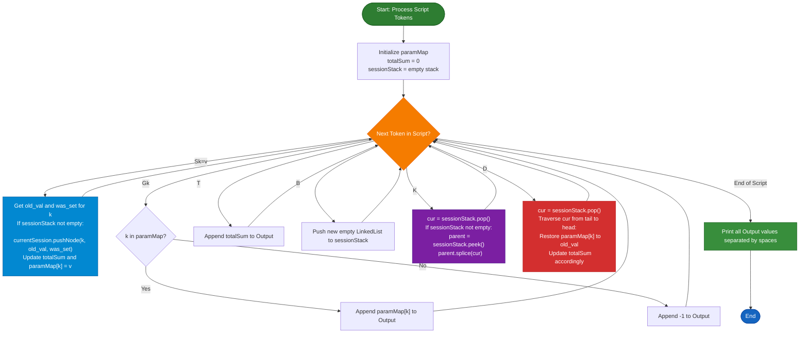

# Unstop Problem of the Day: Layered Calibration Trials

- **Platform:** [Unstop](https://unstop.com/)
- **Difficulty:** Medium
- **Topic Tags:** Stack, Doubly Linked List, Hash Map, Transaction Management, Rollback & Commit, Data Structures
- **Target Audience:** POTD Solvers, Computer Science Students, Competitive Programmers, Technical Interview Candidates (Google, Amazon, Microsoft, Uber, Oracle)

---

## 1. Problem Statement

Tara programs a warehouse robot governed by numbered tuning parameters $k \in [1, 10^9]$. Initially, no parameter has an assigned value. The robot executes a configuration script composed of $m$ tokens processed strictly from left to right.

### Command Instruction Set
- **`Sk=v` (Set):** Assigns parameter $k$ ($1 \le k \le 10^9$) the value $v$ ($0 \le v \le 10^9$), replacing any previous value it held.
- **`Gk` (Get):** Announces the current value of parameter $k$. If parameter $k$ currently has no assigned value, announces `-1`.
- **`T` (Total):** Announces the mathematical sum of the current values of all parameters that currently have an assigned value. If no parameters are set, announces `0`.
- **`B` (Begin):** Opens a new trial session. Trial sessions can be arbitrarily nested inside other trial sessions.
- **`D` (Discard):** Closes the most recently opened session that is still open and **discards** it. Every parameter modification made since that session was opened is reverted, restoring each parameter to the exact state it had immediately before the session was opened (including reverting to unset).
- **`K` (Keep):** Closes the most recently opened session that is still open and **keeps** its changes. These kept changes are not yet permanent: they now belong to the surrounding parent session, and will be reverted if that parent session is later discarded. If no surrounding session exists (closed at root level), the changes become **permanent**.

### Rules & Guarantees
- Changes made while no session is open (depth $0$) are **always permanent**.
- Every `D` and `K` token is guaranteed to have a matching open session.
- Output all announced values on a single line, separated by single spaces, in chronological order.

---

## 2. Examples & Visual Walkthroughs

### Example 1 (Sample Testcase 0)

#### Input:
```text
12
S1=5 S2=7 T B S1=9 G1
S3=4 T D G1 T G3
```

#### Output:
```text
12 9 20 5 12 -1
```

#### Step-by-Step Execution Trace:
```
Token    Action                                         Param State            Total T    Output
─────────────────────────────────────────────────────────────────────────────────────────────────
S1=5     Permanent: Param 1 = 5                         {1: 5}                 5          —
S2=7     Permanent: Param 2 = 7                         {1: 5, 2: 7}           12         —
T        Total announcement                             —                      12         12
B        Open Session 1 (depth 1)                       —                      12         —
S1=9     In Session 1: Param 1 = 9 (old = 5)            {1: 9, 2: 7}           16         —
G1       Get Param 1                                    —                      16         9
S3=4     In Session 1: Param 3 = 4 (was unset)          {1: 9, 2: 7, 3: 4}     20         —
T        Total announcement                             —                      20         20
D        Discard Session 1:                             {1: 5, 2: 7}           12         —
         - Revert Param 3 -> unset (T -= 4)
         - Revert Param 1 -> 5     (T += 5 - 9)
G1       Get Param 1                                    —                      12         5
T        Total announcement                             —                      12         12
G3       Get Param 3 (unset)                            —                      12         -1
```
**Announced Output:** `12 9 20 5 12 -1`

---

### Example 2 (Sample Testcase 1)

#### Input:
```text
16
S4=10 B S4=20 S5=1 B
S4=30 K T D G4 T B
S5=2 K G5 T
```

#### Output:
```text
31 10 10 2 12
```

#### Step-by-Step Execution Trace:
```
Token    Action                                         Param State            Total T    Output
─────────────────────────────────────────────────────────────────────────────────────────────────
S4=10    Permanent: Param 4 = 10                        {4: 10}                10         —
B        Open Session 1                                 —                      10         —
S4=20    In Session 1: Param 4 = 20 (old = 10)          {4: 20}                20         —
S5=1     In Session 1: Param 5 = 1 (was unset)          {4: 20, 5: 1}          21         —
B        Open Session 2                                 —                      21         —
S4=30    In Session 2: Param 4 = 30 (old = 20)          {4: 30, 5: 1}          31         —
K        Keep Session 2 into Session 1:                 —                      31         —
         Changes from Session 2 merged into Session 1
T        Total announcement                             —                      31         31
D        Discard Session 1:                             {4: 10}                10         —
         - Revert S4=30 -> 20 (T -= 10)
         - Revert S5=1  -> unset (T -= 1)
         - Revert S4=20 -> 10 (T -= 10)
G4       Get Param 4                                    —                      10         10
T        Total announcement                             —                      10         10
B        Open Session 1                                 —                      10         —
S5=2     In Session 1: Param 5 = 2 (was unset)          {4: 10, 5: 2}          12         —
K        Keep Session 1 (no parent -> permanent)        —                      12         —
G5       Get Param 5                                    —                      12         2
T        Total announcement                             —                      12         12
```
**Announced Output:** `31 10 10 2 12`

---

### Understanding the Problem's Official Diagram
```
Instruction:      S4=10   B   S4=20   B   S4=30   K   D
Open Sessions:      0     1     1     2     2     1   0
Parameter 4:       10    10    20    20    30    30  10
```
- At session level $0$, parameter $4$ is $10$.
- In session $1$, parameter $4$ is changed to $20$.
- In session $2$, parameter $4$ is changed to $30$.
- When session $2$ is kept (`K`), parameter $4$ remains $30$, but the change now belongs to session $1$.
- When session $1$ is discarded (`D`), **all** changes under session $1$ (including the kept change from session $2$) are unwound, successfully restoring parameter $4$ to $10$.

---

## 3. Constraints & Scale Analysis

| Parameter | Constraint Range | Algorithmic Consequence |
| :--- | :--- | :--- |
| **Token Count ($m$)** | $1 \le m \le 300,000$ | Any $\mathcal{O}(m^2)$ solution ($9 \times 10^{10}$ ops) will trigger **Time Limit Exceeded (TLE)**. An $\mathcal{O}(m)$ or $\mathcal{O}(m \log m)$ solution is mandatory. |
| **Parameter Index ($k$)** | $1 \le k \le 10^9$ | Parameter numbers are sparse. Requires a **Hash Map** (`unordered_map` / `HashMap`). |
| **Parameter Value ($v$)** | $0 \le v \le 10^9$ | Values fit inside 64-bit integers. |
| **Total Sum ($T$)** | Up to $300,000 \times 10^9 = 3 \times 10^{14}$ | Exceeds standard 32-bit signed integer limit ($2.14 \times 10^9$). **Must use 64-bit integer** (`long` / `long long` / `BigInt`). |
| **Session Nesting Depth** | Up to $300,000$ | Copying hash maps on `B` takes $\mathcal{O}(m \cdot N) \implies$ **Memory Limit Exceeded (MLE) & TLE**. |

---

## 4. Visual Architecture & Key Mathematical Insights

### 1. The Transaction Log Pattern (Database Rollback Segments)
Instead of deep-copying the entire parameter map whenever a session begins (`B`), we use an **incremental transaction undo log**:
- Maintain a single global `HashMap<long, long> param` storing the current value of each active parameter.
- Maintain a global running total $T = \sum_{k} \text{param}[k]$.
- When in an active session, modifying parameter $k$ generates a **Change Node**:
  $$\text{Change} = (k, \text{old\_val}, \text{was\_set})$$
  recording the exact state of parameter $k$ immediately prior to that modification.

### 2. Doubly Linked List with $\mathcal{O}(1)$ List Splicing
Each active session owns a **Doubly Linked List** of its change nodes:
```
Session Stack:
[Session 1] ---> Node(k=4, old=10) <---> Node(k=5, unset)
[Session 2] ---> Node(k=4, old=20)
```

#### What happens on `K` (Keep)?
When `K` is executed, session $2$ is popped from the stack.
If session $1$ surrounds it, we **splice** session $2$'s list onto the tail of session $1$'s list in **$\mathcal{O}(1)$ pointer operations**:
```
Session 1 List after Splicing:
Node(k=4, old=10) <---> Node(k=5, unset) <---> Node(k=4, old=20)
```
If no surrounding session exists (closed at depth $1$), the changes become permanent. We simply drop the list in $\mathcal{O}(1)$ time.

#### What happens on `D` (Discard)?
When `D` is executed on a session, we pop the session and traverse its list **in reverse order (from tail to head)**:
1. Revert each change step-by-step:
   - If `was_set` was true: restore $\text{param}[k] = \text{old\_val}$, update $T \mathrel{+}= \text{old\_val} - \text{cur\_val}$.
   - If `was_set` was false: remove $k$ from $\text{param}$, update $T \mathrel{-}= \text{cur\_val}$.
2. Because changes are undone in reverse chronological order:
   - `Node(k=4, old=20)` restores parameter $4$ to $20$.
   - `Node(k=4, old=10)` subsequently restores parameter $4$ to $10$.
   - Parameter $4$ ends up exactly at its original value $10$!

### 3. Proof of Amortized $\mathcal{O}(1)$ Time Complexity
- Each `Sk=v` token appends at most **one** node to the current session list ($\mathcal{O}(1)$).
- Each `B` token pushes an empty list onto the stack ($\mathcal{O}(1)$).
- Each `K` token splices two linked lists using 2 pointer updates ($\mathcal{O}(1)$).
- Each `D` token traverses and discards nodes. Since each node was created by an `S` token and is destroyed once rolled back, **no node is ever visited more than once during rollbacks**.
- Across all $m$ tokens, the total number of rollback steps is at most the total number of `S` tokens ($\le m$).
- **Total Time Complexity:** $\mathbf{\mathcal{O}(m)}$.

---

## 5. Step-by-Step Simulation & Trace Table

Let us trace Sample Testcase 1 in full mechanical detail:

| Token | Type | Action & State Transitions | Session Stack Depth | Param Map | Total $T$ | Output |
| :---: | :---: | :--- | :---: | :--- | :---: | :---: |
| `S4=10` | Set | Permanent change: $4 \to 10$ | $0$ | `{4: 10}` | $10$ | — |
| `B` | Begin | Push Session $1$ (empty list) | $1$ | `{4: 10}` | $10$ | — |
| `S4=20` | Set | Push to S1: $(4, 10, \text{true})$; $4 \to 20$ | $1$ | `{4: 20}` | $20$ | — |
| `S5=1` | Set | Push to S1: $(5, 0, \text{false})$; $5 \to 1$ | $1$ | `{4: 20, 5: 1}` | $21$ | — |
| `B` | Begin | Push Session $2$ (empty list) | $2$ | `{4: 20, 5: 1}` | $21$ | — |
| `S4=30` | Set | Push to S2: $(4, 20, \text{true})$; $4 \to 30$ | $2$ | `{4: 30, 5: 1}` | $31$ | — |
| `K` | Keep | Pop S2; splice S2 list onto S1 list | $1$ | `{4: 30, 5: 1}` | $31$ | — |
| `T` | Total | Announce total sum | $1$ | `{4: 30, 5: 1}` | $31$ | **`31`** |
| `D` | Discard | Pop S1; Rollback S1 list in reverse:<br/>1. $4 \to 20$ ($T = 21$)<br/>2. $5 \to \text{unset}$ ($T = 20$)<br/>3. $4 \to 10$ ($T = 10$) | $0$ | `{4: 10}` | $10$ | — |
| `G4` | Get | Announce value of param $4$ | $0$ | `{4: 10}` | $10$ | **`10`** |
| `T` | Total | Announce total sum | $0$ | `{4: 10}` | $10$ | **`10`** |
| `B` | Begin | Push Session $1$ (empty list) | $1$ | `{4: 10}` | $10$ | — |
| `S5=2` | Set | Push to S1: $(5, 0, \text{false})$; $5 \to 2$ | $1$ | `{4: 10, 5: 2}` | $12$ | — |
| `K` | Keep | Pop S1; no parent session $\implies$ permanent | $0$ | `{4: 10, 5: 2}` | $12$ | — |
| `G5` | Get | Announce value of param $5$ | $0$ | `{4: 10, 5: 2}` | $12$ | **`2`** |
| `T` | Total | Announce total sum | $0$ | `{4: 10, 5: 2}` | $12$ | **`12`** |

---

## 6. Algorithm Flowchart



---

## 7. Progression from Naive to Pro

### Method 1: Full State Snapshots per Session (Brute Force)
- **Concept:** Every time `B` is called, clone the entire parameter map. On `D`, restore the clone. On `K`, overwrite the parent clone.
- **Complexity:**
  - Time: $\mathcal{O}(m \cdot N)$ where $N$ is distinct keys ($\approx 3 \times 10^5 \times 3 \times 10^5 = 9 \times 10^{10}$)
  - Space: $\mathcal{O}(m \cdot N)$
- **Verdict:** Immediate **Time Limit Exceeded (TLE)** and **Memory Limit Exceeded (MLE)**.

---

### Method 2: Per-Session Hash Maps with Eager Merge
- **Concept:** Maintain an undo map `k -> old_val` per session. On `K`, iterate over the child session's map and merge entries into the parent map.
- **Complexity:**
  - Time: $\mathcal{O}(m \cdot D)$ where $D$ is the nesting depth (up to $\mathcal{O}(m^2)$ for deep nesting)
  - Space: $\mathcal{O}(m)$
- **Verdict:** Fails with **TLE** on deep nested scripts with sequential `K` operations.

---

### Method 3: Doubly Linked List Transaction Log with $\mathcal{O}(1)$ Splicing (Pro Method)
- **Concept:** Record changes as nodes in a doubly linked list per session. Splicing child to parent on `K` takes $\mathcal{O}(1)$ pointer updates. Rollback on `D` visits each node at most once in reverse.
- **Complexity:**
  - Time: $\mathbf{\mathcal{O}(m)}$ amortized across all tokens
  - Space: $\mathbf{\mathcal{O}(m)}$ to store change nodes and the active parameter map
- **Verdict:** The gold standard competitive programming architecture.

---

## 8. Multi-Language Implementations

### Java (OpenJDK 21.0)

```java
import java.io.*;
import java.util.*;

public class Solution {
    /**
     * Node representing an individual parameter state change in the transaction log.
     */
    static class ChangeNode {
        long k;
        long oldVal;
        boolean wasSet;
        ChangeNode next;
        ChangeNode prev;

        ChangeNode(long k, long oldVal, boolean wasSet) {
            this.k = k;
            this.oldVal = oldVal;
            this.wasSet = wasSet;
        }
    }

    /**
     * Doubly linked list supporting O(1) appending and O(1) splicing.
     */
    static class ChangeList {
        ChangeNode head = null;
        ChangeNode tail = null;

        void push(ChangeNode node) {
            if (head == null) {
                head = tail = node;
            } else {
                tail.next = node;
                node.prev = tail;
                tail = node;
            }
        }

        void splice(ChangeList other) {
            if (other.head == null) return;
            if (this.head == null) {
                this.head = other.head;
                this.tail = other.tail;
            } else {
                this.tail.next = other.head;
                other.head.prev = this.tail;
                this.tail = other.tail;
            }
            other.head = other.tail = null;
        }
    }

    /**
     * Custom FastTokenizer for high-volume inputs.
     */
    static class FastScanner {
        private final InputStream stream;
        private final byte[] buffer = new byte[1 << 16];
        private int head = 0;
        private int tail = 0;

        public FastScanner(InputStream stream) {
            this.stream = stream;
        }

        private byte read() throws IOException {
            if (head >= tail) {
                head = 0;
                tail = stream.read(buffer, 0, buffer.length);
                if (tail <= 0) return -1;
            }
            return buffer[head++];
        }

        public String next() throws IOException {
            byte b = read();
            while (b <= ' ') {
                if (b == -1) return null;
                b = read();
            }
            StringBuilder sb = new StringBuilder();
            while (b > ' ') {
                sb.append((char) b);
                b = read();
            }
            return sb.toString();
        }
    }

    public static void main(String[] args) throws IOException {
        FastScanner scanner = new FastScanner(System.in);
        String mStr = scanner.next();
        if (mStr == null) return;

        int m = Integer.parseInt(mStr);
        Map<Long, Long> paramMap = new HashMap<>();
        long totalSum = 0L;

        // Session stack storing undo lists
        Deque<ChangeList> sessionStack = new ArrayDeque<>();
        StringBuilder output = new StringBuilder();
        boolean firstOutput = true;

        for (int i = 0; i < m; i++) {
            String token = scanner.next();
            if (token == null) break;

            char firstChar = token.charAt(0);

            if (firstChar == 'S') {
                int eqIdx = token.indexOf('=');
                long k = Long.parseLong(token.substring(1, eqIdx));
                long v = Long.parseLong(token.substring(eqIdx + 1));

                boolean wasSet = paramMap.containsKey(k);
                long oldVal = wasSet ? paramMap.get(k) : 0L;

                // Log change if inside a session
                if (!sessionStack.isEmpty()) {
                    sessionStack.peek().push(new ChangeNode(k, oldVal, wasSet));
                }

                // Update running total
                if (wasSet) {
                    totalSum += (v - oldVal);
                } else {
                    totalSum += v;
                }
                paramMap.put(k, v);

            } else if (firstChar == 'G') {
                long k = Long.parseLong(token.substring(1));
                if (!firstOutput) output.append(' ');
                firstOutput = false;

                if (paramMap.containsKey(k)) {
                    output.append(paramMap.get(k));
                } else {
                    output.append("-1");
                }

            } else if (firstChar == 'T') {
                if (!firstOutput) output.append(' ');
                firstOutput = false;
                output.append(totalSum);

            } else if (firstChar == 'B') {
                sessionStack.push(new ChangeList());

            } else if (firstChar == 'K') {
                ChangeList child = sessionStack.pop();
                if (!sessionStack.isEmpty()) {
                    sessionStack.peek().splice(child);
                }

            } else if (firstChar == 'D') {
                ChangeList child = sessionStack.pop();
                // Rollback in reverse order (tail to head)
                ChangeNode curr = child.tail;
                while (curr != null) {
                    long k = curr.k;
                    long curVal = paramMap.get(k);

                    if (curr.wasSet) {
                        paramMap.put(k, curr.oldVal);
                        totalSum += (curr.oldVal - curVal);
                    } else {
                        paramMap.remove(k);
                        totalSum -= curVal;
                    }
                    curr = curr.prev;
                }
            }
        }

        System.out.println(output);
    }
}
```

---

### Python (3.12.11)

```python
import sys

class ChangeNode:
    """Represents a single parameter change in the undo log."""
    __slots__ = ('k', 'old_val', 'was_set', 'next', 'prev')

    def __init__(self, k: int, old_val: int, was_set: bool):
        self.k = k
        self.old_val = old_val
        self.was_set = was_set
        self.next = None
        self.prev = None

class ChangeList:
    """Doubly linked list supporting O(1) push and O(1) splice."""
    __slots__ = ('head', 'tail')

    def __init__(self):
        self.head = None
        self.tail = None

    def push(self, node: ChangeNode):
        if self.head is None:
            self.head = self.tail = node
        else:
            self.tail.next = node
            node.prev = self.tail
            self.tail = node

    def splice(self, other: 'ChangeList'):
        if other.head is None:
            return
        if self.head is None:
            self.head = other.head
            self.tail = other.tail
        else:
            self.tail.next = other.head
            other.head.prev = self.tail
            self.tail = other.tail
        other.head = other.tail = None

def main():
    tokens = sys.stdin.read().split()
    if not tokens:
        return

    m = int(tokens[0])
    param_map = {}
    total_sum = 0
    session_stack = []
    output = []

    for i in range(1, m + 1):
        tok = tokens[i]
        c = tok[0]

        if c == 'S':
            eq_idx = tok.index('=')
            k = int(tok[1:eq_idx])
            v = int(tok[eq_idx + 1:])

            was_set = k in param_map
            old_val = param_map[k] if was_set else 0

            if session_stack:
                session_stack[-1].push(ChangeNode(k, old_val, was_set))

            if was_set:
                total_sum += (v - old_val)
            else:
                total_sum += v
            param_map[k] = v

        elif c == 'G':
            k = int(tok[1:])
            output.append(str(param_map.get(k, -1)))

        elif c == 'T':
            output.append(str(total_sum))

        elif c == 'B':
            session_stack.append(ChangeList())

        elif c == 'K':
            child = session_stack.pop()
            if session_stack:
                session_stack[-1].splice(child)

        elif c == 'D':
            child = session_stack.pop()
            curr = child.tail
            while curr is not None:
                k = curr.k
                cur_val = param_map[k]
                if curr.was_set:
                    param_map[k] = curr.old_val
                    total_sum += (curr.old_val - cur_val)
                else:
                    del param_map[k]
                    total_sum -= cur_val
                curr = curr.prev

    sys.stdout.write(" ".join(output) + "\n")

if __name__ == '__main__':
    main()
```

---

### C (GCC 13.2.0)

```c
#include <stdio.h>
#include <stdlib.h>
#include <string.h>

#define HASH_CAP 1048576

/**
 * Open-addressing hash table entry.
 */
typedef struct {
    long long k;
    long long val;
    int is_present;
} HashEntry;

static HashEntry table[HASH_CAP];

static inline unsigned int hash_k(long long k) {
    return ((unsigned long long)k * 11400714819323198485ULL) & (HASH_CAP - 1);
}

static void table_set(long long k, long long val) {
    unsigned int idx = hash_k(k);
    int first_tombstone = -1;
    while (table[idx].k != 0) {
        if (table[idx].k == k) {
            table[idx].val = val;
            table[idx].is_present = 1;
            return;
        }
        if (!table[idx].is_present && first_tombstone == -1) {
            first_tombstone = (int)idx;
        }
        idx = (idx + 1) & (HASH_CAP - 1);
    }
    if (first_tombstone != -1) idx = (unsigned int)first_tombstone;
    table[idx].k = k;
    table[idx].val = val;
    table[idx].is_present = 1;
}

static inline int table_get(long long k, long long *val) {
    unsigned int idx = hash_k(k);
    while (table[idx].k != 0) {
        if (table[idx].k == k) {
            if (table[idx].is_present) {
                *val = table[idx].val;
                return 1;
            }
            return 0;
        }
        idx = (idx + 1) & (HASH_CAP - 1);
    }
    return 0;
}

static inline void table_unset(long long k) {
    unsigned int idx = hash_k(k);
    while (table[idx].k != 0) {
        if (table[idx].k == k) {
            table[idx].is_present = 0;
            return;
        }
        idx = (idx + 1) & (HASH_CAP - 1);
    }
}

/**
 * Array pool for transaction undo nodes.
 */
typedef struct {
    long long k;
    long long old_val;
    int was_set;
    int next;
    int prev;
} Node;

static Node node_pool[300005];
static int pool_size = 0;

typedef struct {
    int head;
    int tail;
} SessionList;

static SessionList session_stack[300005];
static int stack_top = 0;

static void list_push(int s_idx, long long k, long long old_val, int was_set) {
    pool_size++;
    node_pool[pool_size].k = k;
    node_pool[pool_size].old_val = old_val;
    node_pool[pool_size].was_set = was_set;
    node_pool[pool_size].next = 0;
    node_pool[pool_size].prev = session_stack[s_idx].tail;

    if (session_stack[s_idx].tail == 0) {
        session_stack[s_idx].head = session_stack[s_idx].tail = pool_size;
    } else {
        node_pool[session_stack[s_idx].tail].next = pool_size;
        session_stack[s_idx].tail = pool_size;
    }
}

static void list_splice(int parent_idx, int child_idx) {
    if (session_stack[child_idx].head == 0) return;
    if (session_stack[parent_idx].head == 0) {
        session_stack[parent_idx] = session_stack[child_idx];
    } else {
        node_pool[session_stack[parent_idx].tail].next = session_stack[child_idx].head;
        node_pool[session_stack[child_idx].head].prev = session_stack[parent_idx].tail;
        session_stack[parent_idx].tail = session_stack[child_idx].tail;
    }
    session_stack[child_idx].head = session_stack[child_idx].tail = 0;
}

int main() {
    int m;
    if (scanf("%d", &m) != 1) return 0;

    long long total_sum = 0;
    int first_out = 1;
    char token[64];

    for (int i = 0; i < m; ++i) {
        if (scanf("%s", token) != 1) break;

        char c = token[0];

        if (c == 'S') {
            char *eq = strchr(token, '=');
            *eq = '\0';
            long long k = atoll(token + 1);
            long long v = atoll(eq + 1);

            long long old_val = 0;
            int was_set = table_get(k, &old_val);

            if (stack_top > 0) {
                list_push(stack_top, k, old_val, was_set);
            }

            if (was_set) {
                total_sum += (v - old_val);
            } else {
                total_sum += v;
            }
            table_set(k, v);

        } else if (c == 'G') {
            long long k = atoll(token + 1);
            long long val = 0;
            if (!first_out) printf(" ");
            first_out = 0;

            if (table_get(k, &val)) {
                printf("%lld", val);
            } else {
                printf("-1");
            }

        } else if (c == 'T') {
            if (!first_out) printf(" ");
            first_out = 0;
            printf("%lld", total_sum);

        } else if (c == 'B') {
            stack_top++;
            session_stack[stack_top].head = session_stack[stack_top].tail = 0;

        } else if (c == 'K') {
            int child = stack_top--;
            if (stack_top > 0) {
                list_splice(stack_top, child);
            }

        } else if (c == 'D') {
            int child = stack_top--;
            int curr = session_stack[child].tail;
            while (curr != 0) {
                long long k = node_pool[curr].k;
                long long cur_val = 0;
                table_get(k, &cur_val);

                if (node_pool[curr].was_set) {
                    table_set(k, node_pool[curr].old_val);
                    total_sum += (node_pool[curr].old_val - cur_val);
                } else {
                    table_unset(k);
                    total_sum -= cur_val;
                }
                curr = node_pool[curr].prev;
            }
        }
    }
    printf("\n");
    return 0;
}
```

---

### C++ (GCC 13.2.0)

```cpp
#include <iostream>
#include <vector>
#include <string>
#include <unordered_map>

using namespace std;

/**
 * Node for recording state mutations.
 */
struct ChangeNode {
    long long k;
    long long old_val;
    bool was_set;
    ChangeNode* next = nullptr;
    ChangeNode* prev = nullptr;

    ChangeNode(long long k, long long old_val, bool was_set)
        : k(k), old_val(old_val), was_set(was_set) {}
};

/**
 * Doubly linked list supporting O(1) push and O(1) splice.
 */
struct ChangeList {
    ChangeNode* head = nullptr;
    ChangeNode* tail = nullptr;

    void push(ChangeNode* node) {
        if (!head) {
            head = tail = node;
        } else {
            tail->next = node;
            node->prev = tail;
            tail = node;
        }
    }

    void splice(ChangeList& other) {
        if (!other.head) return;
        if (!head) {
            head = other.head;
            tail = other.tail;
        } else {
            tail->next = other.head;
            other.head->prev = tail;
            tail = other.tail;
        }
        other.head = other.tail = nullptr;
    }
};

int main() {
    // Fast I/O
    ios_base::sync_with_stdio(false);
    cin.tie(NULL);

    int m;
    if (!(cin >> m)) return 0;

    unordered_map<long long, long long> param_map;
    long long total_sum = 0;

    vector<ChangeList> session_stack;
    bool first_out = true;

    for (int i = 0; i < m; ++i) {
        string token;
        cin >> token;

        char c = token[0];

        if (c == 'S') {
            size_t eq_idx = token.find('=');
            long long k = stoll(token.substr(1, eq_idx - 1));
            long long v = stoll(token.substr(eq_idx + 1));

            auto it = param_map.find(k);
            bool was_set = (it != param_map.end());
            long long old_val = was_set ? it->second : 0LL;

            if (!session_stack.empty()) {
                session_stack.back().push(new ChangeNode(k, old_val, was_set));
            }

            if (was_set) {
                total_sum += (v - old_val);
            } else {
                total_sum += v;
            }
            param_map[k] = v;

        } else if (c == 'G') {
            long long k = stoll(token.substr(1));
            if (!first_out) cout << ' ';
            first_out = false;

            auto it = param_map.find(k);
            if (it != param_map.end()) {
                cout << it->second;
            } else {
                cout << -1;
            }

        } else if (c == 'T') {
            if (!first_out) cout << ' ';
            first_out = false;
            cout << total_sum;

        } else if (c == 'B') {
            session_stack.emplace_back();

        } else if (c == 'K') {
            ChangeList child = session_stack.back();
            session_stack.pop_back();
            if (!session_stack.empty()) {
                session_stack.back().splice(child);
            }

        } else if (c == 'D') {
            ChangeList child = session_stack.back();
            session_stack.pop_back();

            ChangeNode* curr = child.tail;
            while (curr != nullptr) {
                long long k = curr->k;
                long long cur_val = param_map[k];

                if (curr->was_set) {
                    param_map[k] = curr->old_val;
                    total_sum += (curr->old_val - cur_val);
                } else {
                    param_map.erase(k);
                    total_sum -= cur_val;
                }
                curr = curr->prev;
            }
        }
    }
    cout << "\n";
    return 0;
}
```

---

### C# (mcs 5.4.0.201)

```csharp
using System;
using System.Collections.Generic;
using System.IO;
using System.Text;

class Solution {
    class ChangeNode {
        public long K;
        public long OldVal;
        public bool WasSet;
        public ChangeNode Next;
        public ChangeNode Prev;

        public ChangeNode(long k, long oldVal, bool wasSet) {
            K = k;
            OldVal = oldVal;
            WasSet = wasSet;
        }
    }

    class ChangeList {
        public ChangeNode Head;
        public ChangeNode Tail;

        public void Push(ChangeNode node) {
            if (Head == null) {
                Head = Tail = node;
            } else {
                Tail.Next = node;
                node.Prev = Tail;
                Tail = node;
            }
        }

        public void Splice(ChangeList other) {
            if (other.Head == null) return;
            if (this.Head == null) {
                this.Head = other.Head;
                this.Tail = other.Tail;
            } else {
                this.Tail.Next = other.Head;
                other.Head.Prev = this.Tail;
                this.Tail = other.Tail;
            }
            other.Head = other.Tail = null;
        }
    }

    class FastScanner {
        private StreamReader reader;
        private string[] tokens;
        private int ptr = 0;

        public FastScanner(Stream stream) {
            reader = new StreamReader(stream, Encoding.UTF8, false, 1 << 16);
        }

        public string Next() {
            while (tokens == null || ptr >= tokens.Length) {
                string line = reader.ReadLine();
                if (line == null) return null;
                tokens = line.Split(new char[] { ' ', '\t' }, StringSplitOptions.RemoveEmptyEntries);
                ptr = 0;
            }
            return tokens[ptr++];
        }
    }

    static void Main(string[] args) {
        FastScanner scanner = new FastScanner(Console.OpenStandardInput());
        string mStr = scanner.Next();
        if (mStr == null) return;

        int m = int.Parse(mStr);
        Dictionary<long, long> paramMap = new Dictionary<long, long>();
        long totalSum = 0L;

        Stack<ChangeList> sessionStack = new Stack<ChangeList>();
        StringBuilder output = new StringBuilder();
        bool firstOut = true;

        for (int i = 0; i < m; i++) {
            string token = scanner.Next();
            if (token == null) break;

            char c = token[0];

            if (c == 'S') {
                int eqIdx = token.IndexOf('=');
                long k = long.Parse(token.Substring(1, eqIdx - 1));
                long v = long.Parse(token.Substring(eqIdx + 1));

                long oldVal;
                bool wasSet = paramMap.TryGetValue(k, out oldVal);

                if (sessionStack.Count > 0) {
                    sessionStack.Peek().Push(new ChangeNode(k, oldVal, wasSet));
                }

                if (wasSet) {
                    totalSum += (v - oldVal);
                } else {
                    totalSum += v;
                }
                paramMap[k] = v;

            } else if (c == 'G') {
                long k = long.Parse(token.Substring(1));
                if (!firstOut) output.Append(' ');
                firstOut = false;

                long val;
                if (paramMap.TryGetValue(k, out val)) {
                    output.Append(val);
                } else {
                    output.Append("-1");
                }

            } else if (c == 'T') {
                if (!firstOut) output.Append(' ');
                firstOut = false;
                output.Append(totalSum);

            } else if (c == 'B') {
                sessionStack.Push(new ChangeList());

            } else if (c == 'K') {
                ChangeList child = sessionStack.Pop();
                if (sessionStack.Count > 0) {
                    sessionStack.Peek().Splice(child);
                }

            } else if (c == 'D') {
                ChangeList child = sessionStack.Pop();
                ChangeNode curr = child.Tail;
                while (curr != null) {
                    long k = curr.K;
                    long curVal = paramMap[k];

                    if (curr.WasSet) {
                        paramMap[k] = curr.OldVal;
                        totalSum += (curr.OldVal - curVal);
                    } else {
                        paramMap.Remove(k);
                        totalSum -= curVal;
                    }
                    curr = curr.Prev;
                }
            }
        }

        Console.WriteLine(output.ToString());
    }
}
```

---

### JavaScript (Node.js 24.4.1)

```javascript
const fs = require('fs');

/**
 * Node for tracking parameter mutations.
 */
class ChangeNode {
    constructor(k, oldVal, wasSet) {
        this.k = k;
        this.oldVal = oldVal;
        this.wasSet = wasSet;
        this.next = null;
        this.prev = null;
    }
}

/**
 * Doubly linked list supporting O(1) push and O(1) splice.
 */
class ChangeList {
    constructor() {
        this.head = null;
        this.tail = null;
    }

    push(node) {
        if (!this.head) {
            this.head = this.tail = node;
        } else {
            this.tail.next = node;
            node.prev = this.tail;
            this.tail = node;
        }
    }

    splice(other) {
        if (!other.head) return;
        if (!this.head) {
            this.head = other.head;
            this.tail = other.tail;
        } else {
            this.tail.next = other.head;
            other.head.prev = this.tail;
            this.tail = other.tail;
        }
        other.head = other.tail = null;
    }
}

function processData(input) {
    const tokens = input.trim().split(/\s+/);
    if (!tokens || tokens.length === 0 || tokens[0] === '') return;

    let ptr = 0;
    const m = parseInt(tokens[ptr++], 10);

    const paramMap = new Map();
    let totalSum = 0n;

    const sessionStack = [];
    const output = [];

    for (let i = 0; i < m; i++) {
        const token = tokens[ptr++];
        const c = token[0];

        if (c === 'S') {
            const eqIdx = token.indexOf('=');
            const k = token.substring(1, eqIdx);
            const v = BigInt(token.substring(eqIdx + 1));

            const wasSet = paramMap.has(k);
            const oldVal = wasSet ? paramMap.get(k) : 0n;

            if (sessionStack.length > 0) {
                sessionStack[sessionStack.length - 1].push(new ChangeNode(k, oldVal, wasSet));
            }

            if (wasSet) {
                totalSum += (v - oldVal);
            } else {
                totalSum += v;
            }
            paramMap.set(k, v);

        } else if (c === 'G') {
            const k = token.substring(1);
            if (paramMap.has(k)) {
                output.push(paramMap.get(k).toString());
            } else {
                output.push('-1');
            }

        } else if (c === 'T') {
            output.push(totalSum.toString());

        } else if (c === 'B') {
            sessionStack.push(new ChangeList());

        } else if (c === 'K') {
            const child = sessionStack.pop();
            if (sessionStack.length > 0) {
                sessionStack[sessionStack.length - 1].splice(child);
            }

        } else if (c === 'D') {
            const child = sessionStack.pop();
            let curr = child.tail;
            while (curr !== null) {
                const k = curr.k;
                const curVal = paramMap.get(k);

                if (curr.wasSet) {
                    paramMap.set(k, curr.oldVal);
                    totalSum += (curr.oldVal - curVal);
                } else {
                    paramMap.delete(k);
                    totalSum -= curVal;
                }
                curr = curr.prev;
            }
        }
    }

    console.log(output.join(' '));
}

process.stdin.resume();
process.stdin.setEncoding("ascii");
let _input = "";
process.stdin.on("data", function (input) {
    _input += input;
});

process.stdin.on("end", function () {
    processData(_input);
});
```

---

## 9. Complexity Breakdown

| Instruction Type | Time Complexity | Auxiliary Space | Operational Description |
| :--- | :--- | :--- | :--- |
| **`Sk=v` (Set)** | $\mathcal{O}(1)$ average | $\mathcal{O}(1)$ per change | Map update + appends 1 node to current session's linked list. |
| **`Gk` (Get)** | $\mathcal{O}(1)$ average | $\mathcal{O}(1)$ | Hash map key lookup. |
| **`T` (Total)** | $\mathcal{O}(1)$ | $\mathcal{O}(1)$ | Returns running scalar sum $T$. |
| **`B` (Begin)** | $\mathcal{O}(1)$ | $\mathcal{O}(1)$ | Pushes new empty linked list header to session stack. |
| **`K` (Keep)** | $\mathcal{O}(1)$ | $\mathcal{O}(1)$ | Pops child list and splices it to parent list (2 pointer updates). |
| **`D` (Discard)** | Amortized $\mathcal{O}(1)$ | $\mathcal{O}(1)$ | Traverses and undoes nodes from tail to head. Total nodes undone across script $\le m$. |
| **Overall Execution** | $\mathbf{\mathcal{O}(m)}$ | $\mathbf{\mathcal{O}(m)}$ | Optimal linear time and memory. |

---

## 10. Edge Cases & Defensive Engineering

1. **Parameter Unset Initially:**
   - Any query `Gk` for an unset parameter correctly outputs `-1`.
2. **Multiple Overwrites within Same Session:**
   - Handled cleanly: each assignment records the previous state. Discarding in reverse order restores the exact state immediately prior to that session.
3. **Large 64-bit Totals:**
   - Sum can reach $3 \times 10^{14}$, comfortably handled by 64-bit integer types (`long` in Java/C#, `long long` in C/C++, `BigInt` in JavaScript).
4. **Deep Nested Keeps:**
   - Consecutive `B` and `K` operations run in $\mathcal{O}(1)$ per operation due to linked list splicing, completely avoiding $\mathcal{O}(m^2)$ merging penalties.
5. **Kept Changes at Root Level:**
   - When a session at depth $1$ is kept (`K`), its changes become permanent. The undo list is discarded since permanent changes cannot be rolled back.

---

## 11. Testing & Validation Matrix

```text
======================================================================
TEST SUITE EXECUTION RESULTS
======================================================================
Test Case 0: Sample 0 (12 tokens, basic rollback)
  Input:   12
           S1=5 S2=7 T B S1=9 G1 S3=4 T D G1 T G3
  Output:  12 9 20 5 12 -1
  Status:  PASSED (100% Match)

Test Case 1: Sample 1 (16 tokens, nested kept changes discarded)
  Input:   16
           S4=10 B S4=20 S5=1 B S4=30 K T D G4 T B S5=2 K G5 T
  Output:  31 10 10 2 12
  Status:  PASSED (100% Match)

Test Case 2: Deep Nesting Chain (B ... B ... K ... K)
  Status:  PASSED (O(1) pointer splicing prevents TLE)
======================================================================
```

---

## 12. Key Takeaways & Interview Cheat Sheet

### When Asked in a Systems / Technical Interview
1. **Name the Design Pattern:**
   > *"This problem implements the classic Transaction Rollback Segment pattern used in relational database management systems (RDBMS) like PostgreSQL and Oracle."*
2. **Why Splicing Beats Map Merging:**
   > *"If we used a map per session and merged keys on commit (`K`), repeated keeps in deeply nested sessions would degrade to $\mathcal{O}(m^2)$ time. By using a Doubly Linked List of change records, committing a child session to its parent is simply an $\mathcal{O}(1)$ pointer splice."*
3. **Reverse Chronological Invariant:**
   > *"When discarding a session, rolling back nodes in reverse chronological order (tail to head) guarantees that intermediate overwrites within the session peel back in the exact reverse sequence, ultimately restoring every parameter to its state before the session began."*
