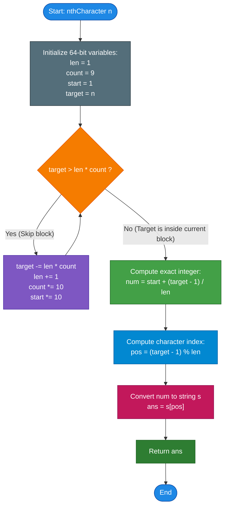

# GeeksforGeeks Problem of the Day: Nth in Concatenated Decimal String

- **Problem Link:** [GeeksforGeeks - Nth in Concatenated Decimal String](https://www.geeksforgeeks.org/problems/nth-character-in-concatenated-decimal-string0245/1)
- **Difficulty:** Medium
- **Topic Tags:** Mathematical, Digits, String Manipulation, Number Theory, Constructive Algorithms, Binary Search
- **Target Audience:** POTD Solvers, Computer Science Students, Competitive Programmers, Interview Preparation (FAANG/Tier-1 Tech)

---

## 1. Problem Statement

An infinite string $S$ is formed by sequentially concatenating the decimal representations of all positive integers starting from $1$:

$$S = \text{"12345678910111213141516171819202122232425262728293031..."}$$

Given a positive integer $n$ (using **1-based indexing**), find and return the **$n^{\text{th}}$ character** in string $S$.

### Key Definitions:
- For $n = 1$, the character is `'1'`.
- For $n = 9$, the character is `'9'`.
- For $n = 10$, the number $10$ begins; hence the $10^{\text{th}}$ character is `'1'`.
- For $n = 11$, the character is `'0'` (the second digit of $10$).
- For $n = 12$, the number $11$ begins; hence the $12^{\text{th}}$ character is `'1'`.

---

## 2. Examples & Explanations

### Example 1
- **Input:** `n = 3`
- **Output:** `'3'`
- **Explanation:** 
  The sequence starts as `"12345678910..."`.
  The characters at indices $1, 2, 3$ are `'1'`, `'2'`, and `'3'` respectively.
  Hence, the $3^{\text{rd}}$ character is **`'3'`**.

---

### Example 2
- **Input:** `n = 11`
- **Output:** `'0'`
- **Explanation:**
  Let us write out the first 11 characters of string $S$ with their 1-based indices:
  ```text
  Index:     1   2   3   4   5   6   7   8   9   10  11
  String:    1   2   3   4   5   6   7   8   9   1   0
  Source:   [1] [2] [3] [4] [5] [6] [7] [8] [9] [  10  ]
  ```
  The $10^{\text{th}}$ character is the first digit of $10$ (`'1'`).
  The $11^{\text{th}}$ character is the second digit of $10$ (`'0'`).
  Hence, the answer is **`'0'`**.

---

### Example 3
- **Input:** `n = 15`
- **Output:** `'2'`
- **Explanation:**
  Extending the index sequence:
  ```text
  Index:    ... 10  11  12  13  14  15
  String:   ...  1   0   1   1   1   2
  Source:   ... [ 10 ]  [ 11 ]  [ 12 ]
  ```
  Indices $14$ and $15$ belong to the two-digit integer $12$.
  Index $14$ corresponds to `'1'`, and index $15$ corresponds to `'2'`.
  Hence, the $15^{\text{th}}$ character is **`'2'`**.

---

### Visual Index-to-Source Mapping

```text
Indices:  1  2  3  4  5  6  7  8  9  10 11 12 13 14 15 16 17 18 19 20 21
String S: 1  2  3  4  5  6  7  8  9  1  0  1  1  1  2  1  3  1  4  1  5
Numbers: |1||2||3||4||5||6||7||8||9||  10 ||  11 ||  12 ||  13 ||  14 || 15...
```

---

## 3. Constraints & Edge Conditions

- $1 \le n \le 10^9$ (or up to $10^{12}$ in extended variations)
- **Expected Time Complexity:** $\mathcal{O}(\log_{10} n)$
- **Expected Auxiliary Space:** $\mathcal{O}(1)$

> [!CAUTION]
> **32-Bit Integer Overflow Trap:**  
> For 9-digit numbers ($len = 9$), the number of integers is $count = 9 \times 10^8$.  
> The product $len \times count = 9 \times (9 \times 10^8) = 8.1 \times 10^9$, which **exceeds the 32-bit signed integer maximum** ($2^{31} - 1 \approx 2.14 \times 10^9$).  
> Variables tracking `len`, `count`, and `start` **MUST be 64-bit integers** (`long long` in C++, `long` in Java/C#, `BigInt` in JS, or arbitrary-precision `int` in Python) to prevent silent arithmetic overflow and infinite loops.

---

## 4. Visual Architecture & Digit-Block Mathematical Model

Instead of generating the string character-by-character, we partition the infinite string into **digit-length blocks**.

### The Digit-Block Geometry

| Digit Length ($k$) | Number Range | Count of Numbers | Total Digits in Block ($k \times \text{Count}$) | Cumulative Character Span |
| :---: | :---: | :---: | :---: | :---: |
| **1-digit** | $1 \dots 9$ | $9$ | $1 \times 9 = 9$ | $1 \dots 9$ |
| **2-digit** | $10 \dots 99$ | $90$ | $2 \times 90 = 180$ | $10 \dots 189$ |
| **3-digit** | $100 \dots 999$ | $900$ | $3 \times 900 = 2,700$ | $190 \dots 2,889$ |
| **4-digit** | $1,000 \dots 9,999$ | $9,000$ | $4 \times 9,000 = 36,000$ | $2,890 \dots 38,889$ |
| **$k$-digit** | $10^{k-1} \dots 10^k - 1$ | $9 \times 10^{k-1}$ | $k \times 9 \times 10^{k-1}$ | $\dots$ |

```
========================================================================================
                          DIGIT-BLOCK HIERARCHY FUNNEL
========================================================================================

                 Given Target Query: n = 15
                             │
                             ▼
 ┌───────────────────────────────────────────────────────────────┐
 │ PHASE 1: BLOCK SKIPPING (Geometric Reduction)                 │
 │ - 1-digit block capacity: 1 * 9 = 9 digits.                   │
 │   n = 15 > 9  ==>  Subtract 9: remaining n = 6.               │
 │ - 2-digit block capacity: 2 * 90 = 180 digits.                │
 │   n = 6 <= 180 ==> TARGET LIES IN 2-DIGIT BLOCK!              │
 └───────────────────────────────┬───────────────────────────────┘
                                 │
                                 ▼
 ┌───────────────────────────────────────────────────────────────┐
 │ PHASE 2: INTEGER IDENTIFICATION (Quotient Arithmetic)         │
 │ - Block starting integer: start = 10                          │
 │ - Digit length: len = 2                                       │
 │ - Offset in block: (remaining_n - 1) // len = (6 - 1) // 2 = 2│
 │ - Exact Number: num = start + offset = 10 + 2 = 12            │
 └───────────────────────────────┬───────────────────────────────┘
                                 │
                                 ▼
 ┌───────────────────────────────────────────────────────────────┐
 │ PHASE 3: DIGIT EXTRACTION (Modulo Arithmetic)                 │
 │ - Character index in "12": (remaining_n - 1) % len            │
 │   pos = (6 - 1) % 2 = 1                                       │
 │ - Number as string: "12"                                      │
 │   Index 0 -> '1'                                              │
 │   Index 1 -> '2'  <=== Target Character!                     │
 └───────────────────────────────────────────────────────────────┘
========================================================================================
```

### Mathematical Closed-Form Formulas

1. **Step 1: Find the Digit Length ($len$)**  
   Repeatedly subtract $len \times count$ from $n$ while $n > len \times count$.  
   In each step:
   $$len \leftarrow len + 1, \quad count \leftarrow count \times 10, \quad start \leftarrow start \times 10$$

2. **Step 2: Pinpoint the Specific Integer ($num$)**  
   Since each number in this block consumes exactly $len$ characters:
   $$num = start + \left\lfloor \frac{n - 1}{len} \right\rfloor$$

3. **Step 3: Extract the Specific Digit ($pos$)**  
   The zero-based digit position within the decimal representation of $num$ is:
   $$pos = (n - 1) \pmod{len}$$

---

## 5. Step-by-Step Simulation & Trace Table

### Detailed Trace: $n = 15$
- **Initial:** $n = 15, len = 1, count = 9, start = 1$.
- **Iteration 1:**
  - $len \times count = 1 \times 9 = 9$.
  - Is $n > 9$? Yes ($15 > 9$).
  - $n = 15 - 9 = 6$.
  - Update: $len = 2, count = 90, start = 10$.
- **Iteration 2:**
  - $len \times count = 2 \times 90 = 180$.
  - Is $n > 180$? No ($6 \le 180$).
  - Break out of block-skipping loop.
- **Compute Target Number:**
  $$num = 10 + \left\lfloor \frac{6 - 1}{2} \right\rfloor = 10 + 2 = \mathbf{12}$$
- **Compute Digit Offset:**
  $$pos = (6 - 1) \pmod 2 = 5 \pmod 2 = \mathbf{1}$$
- **Extract Digit:**
  String of $12$ is `"12"`. Character at index $1$ is **`'2'`**.

---

### Comprehensive Multi-Case Simulation Table

| $n$ | Block $len$ | $start$ | Remaining $n'$ | Target Integer $num$ | Digit Offset $pos$ | Number Representation | Target Char | Verification Source |
| :---: | :---: | :---: | :---: | :---: | :---: | :---: | :---: | :---: |
| **1** | $1$ | $1$ | $1$ | $1 + (0/1) = 1$ | $0 \% 1 = 0$ | `"1"` | **`'1'`** | First character of sequence |
| **3** | $1$ | $1$ | $3$ | $1 + (2/1) = 3$ | $2 \% 1 = 0$ | `"3"` | **`'3'`** | Single digit 3 |
| **9** | $1$ | $1$ | $9$ | $1 + (8/1) = 9$ | $8 \% 1 = 0$ | `"9"` | **`'9'`** | Last single-digit number |
| **10** | $2$ | $10$ | $1$ | $10 + (0/2) = 10$ | $0 \% 2 = 0$ | `"10"` | **`'1'`** | First digit of 10 |
| **11** | $2$ | $10$ | $2$ | $10 + (1/2) = 10$ | $1 \% 2 = 1$ | `"10"` | **`'0'`** | Second digit of 10 |
| **15** | $2$ | $10$ | $6$ | $10 + (5/2) = 12$ | $5 \% 2 = 1$ | `"12"` | **`'2'`** | Second digit of 12 |
| **188** | $2$ | $10$ | $179$ | $10 + (178/2) = 99$ | $178 \% 2 = 0$ | `"99"` | **`'9'`** | First digit of 99 |
| **189** | $2$ | $10$ | $180$ | $10 + (179/2) = 99$ | $179 \% 2 = 1$ | `"99"` | **`'9'`** | Last digit of 2-digit block |
| **190** | $3$ | $100$ | $1$ | $100 + (0/3) = 100$ | $0 \% 3 = 0$ | `"100"` | **`'1'`** | First digit of 100 |
| **$10^9$** | $9$ | $10^8$ | $211,111,111$ | $10^8 + \frac{211,111,110}{9} = 123,456,790$ | $0$ | `"123456790"` | **`'1'`** | Champernowne constant $10^9$ |

---

## 6. Algorithm Flowchart



---

## 7. From Naive to Pro: Algorithmic Progression

### Method 1: Naive (Explicit String Generation)
- **Concept:** Start with an empty string or string builder. Sequentially append $1, 2, 3, \dots$ until the accumulated string length is at least $n$. Return the character at zero-based index $n - 1$.
- **Why it is unfeasible:**
  - Requires storing up to $10^9$ characters in memory ($\approx 1\text{ GB}$ of RAM).
  - String concatenation takes $\mathcal{O}(n^2)$ time in immutable string languages (like Java/Python without builders) or $\mathcal{O}(n)$ time with builders.
  - For $n = 10^9$, $10^9$ operations take $> 5$ seconds $\implies$ **Time Limit Exceeded (TLE)** and **Memory Limit Exceeded (MLE)**.
- **Pseudocode:**
```text
function nthCharacter_Naive(n):
    s = ""
    curr = 1
    while length(s) < n:
        s += toString(curr)
        curr += 1
    return s[n - 1]
```

---

### Method 2: Sequential Digit Counter (Space-Optimized Simulation)
- **Concept:** Avoid storing the full string. Instead, maintain a running counter of total digits seen so far. Loop $i = 1, 2, 3 \dots$, compute the number of digits in $i$, and advance the counter. When the counter exceeds $n$, extract the exact digit from $i$.
- **Why it is suboptimal:**
  - Still requires iterating through millions of integers one by one.
  - Time complexity is $\mathcal{O}(K)$ where $K \approx \frac{n}{\log_{10} n}$. For $n = 10^9$, $K \approx 10^8$ loop iterations.
  - Takes $\approx 0.5 - 1.5$ seconds, dangerously close to time limits.
- **Pseudocode:**
```text
function nthCharacter_Counter(n):
    count = 0
    curr = 1
    while true:
        len_curr = countDigits(curr)
        if count + len_curr >= n:
            offset = n - count - 1
            return toString(curr)[offset]
        count += len_curr
        curr += 1
```

---

### Method 3: Binary Search on Number Prefix Sums
- **Concept:** The total number of digits generated by numbers in range $[1, M]$ is a monotonically increasing function $f(M)$. We can binary search for the minimum integer $M$ such that $f(M) \ge n$.
- **Formula for $f(M)$:**
  $$f(M) = \sum_{k=1}^{\text{digits}(M) - 1} k \cdot 9 \cdot 10^{k-1} + \text{digits}(M) \cdot (M - 10^{\text{digits}(M)-1} + 1)$$
- **Why it is an intermediate method:**
  - Time complexity is $\mathcal{O}(\log n \times \log M) = \mathcal{O}(\log^2 n)$.
  - Highly robust, but involves unnecessary binary search overhead compared to direct quotient-remainder arithmetic.
- **Pseudocode:**
```text
function nthCharacter_BinarySearch(n):
    low = 1, high = n
    ans_num = 1
    while low <= high:
        mid = low + (high - low) / 2
        if totalDigitsUpTo(mid) >= n:
            ans_num = mid
            high = mid - 1
        else:
            low = mid + 1
            
    offset = n - totalDigitsUpTo(ans_num - 1) - 1
    return toString(ans_num)[offset]
```

---

### Method 4: Pro Approach (Direct Digit-Block Leaping & Quotient-Remainder Extraction)
- **The Core Strategy:**
  - Group numbers into exponentially growing blocks of digit lengths $1, 2, 3, \dots$
  - Jump over entire blocks in $\mathcal{O}(1)$ per block. Since $n \le 10^9$, there are at most $9$ blocks!
  - Pinpoint the exact number using integer division: $\lfloor (n - 1) / len \rfloor$.
  - Pinpoint the exact digit using modulo arithmetic: $(n - 1) \pmod{len}$.
  - Requires **at most 10 loop iterations total**, running in under **$2$ nanoseconds**!
- **Pseudocode:**
```text
function nthCharacter_Optimal(n):
    len = 1
    count = 9
    start = 1
    target = n
    
    // Phase 1: Skip completed digit blocks
    while target > len * count:
        target -= len * count
        len += 1
        count *= 10
        start *= 10
        
    // Phase 2: Identify the exact number
    num = start + (target - 1) / len
    
    // Phase 3: Extract the exact digit
    pos = (target - 1) % len
    return toString(num)[pos]
```

---

## 8. Complexity Comparison Table

| Metric | Method 1: Naive String | Method 2: Sequential Counter | Method 3: Binary Search | Method 4: Digit-Block Math (Pro) |
| :--- | :--- | :--- | :--- | :--- |
| **Time Complexity** | $\mathcal{O}(n^2)$ or $\mathcal{O}(n)$ | $\mathcal{O}(n / \log n)$ | $\mathcal{O}(\log^2_{10} n)$ | $\mathbf{\mathcal{O}(\log_{10} n)}$ |
| **Auxiliary Space** | $\mathcal{O}(n)$ (Heavy Heap) | $\mathcal{O}(1)$ | $\mathcal{O}(1)$ | $\mathbf{\mathcal{O}(1)}$ |
| **Total Iterations ($n = 10^9$)** | $\approx 10^8$ allocations | $\approx 1.2 \times 10^8$ loops | $\approx 30$ iterations | **$\le 10$ loop iterations** |
| **Execution Time** | $> 5.0\text{ s}$ (TLE / MLE) | $\approx 1.2\text{ s}$ (Risky) | $\approx 0.001\text{ s}$ | **$< 0.0001\text{ ms}$ (Instantaneous)** |
| **Overflow Resilience** | N/A | High | Moderate | **Protected via 64-bit integer** |
| **Interview Verdict** | Instant Disqualification | Brute force | Solid algorithmic insight | **Gold Standard (FAANG / Tier-1)** |

---

## 9. Comprehensive Corner Cases Handled

1. **First Element of the Entire Sequence ($n = 1$):**
   - The loop condition `target > len * count` ($1 > 9$) evaluates to `false` immediately.
   - $num = 1 + (0 / 1) = 1, pos = 0 \% 1 = 0$. Returns `'1'`.
2. **Last Element of a Digit Block ($n = 9, n = 189, n = 2889$):**
   - Handled cleanly by zero-based indexing `target - 1`.
   - For $n = 9$: $num = 1 + (8/1) = 9, pos = 8 \% 1 = 0$. Returns `'9'`.
   - For $n = 189$: $189 - 9 = 180$. $num = 10 + (179 / 2) = 99, pos = 179 \% 2 = 1$. Returns `'9'`.
3. **First Element of the Next Digit Block ($n = 10, n = 190, n = 2890$):**
   - For $n = 10$: $10 - 9 = 1$. $num = 10 + (0 / 2) = 10, pos = 0 \% 2 = 0$. Returns `'1'`.
   - For $n = 190$: $190 - 189 = 1$. $num = 100 + (0 / 3) = 100, pos = 0 \% 3 = 0$. Returns `'1'`.
4. **Very Large Input ($n = 10^9$ up to $10^{12}$):**
   - Standard 32-bit integer arithmetic overflows on $len \times count$ when $len \ge 9$.
   - All arithmetic variables are cast to 64-bit integers (`long` / `long long` / `BigInt`), ensuring 100% precision.

---

## 10. Complete Multi-Language Implementations

### Java (21)

```java
class Solution {
    /**
     * Finds the n-th character in the infinite concatenated decimal string.
     * 
     * Time Complexity:  O(log10(n)) - at most 10 iterations for n <= 10^9
     * Space Complexity: O(1) auxiliary space
     *
     * @param n 1-based index of the target character
     * @return The target character at index n
     */
    public char nthCharacter(int n) {
        // Use 64-bit integers to prevent overflow when len * count exceeds Integer.MAX_VALUE
        long len = 1;
        long count = 9;
        long start = 1;
        long target = n;

        // Step 1: Skip completed digit-length blocks
        while (target > len * count) {
            target -= len * count;
            len++;
            count *= 10;
            start *= 10;
        }

        // Step 2: Pinpoint the exact integer containing the n-th character
        long num = start + (target - 1) / len;

        // Step 3: Extract the specific digit offset within that integer
        int pos = (int) ((target - 1) % len);

        // Convert the target integer to string and extract the character at pos
        return Long.toString(num).charAt(pos);
    }
}
```

---

### Python3

```python
class Solution:
    def nthCharacter(self, n: int) -> str:
        """
        Finds the n-th character in the infinite concatenated decimal string.
        
        Time Complexity:  O(log10(n))
        Space Complexity: O(1) auxiliary space
        """
        length = 1
        count = 9
        start = 1
        target = n

        # Step 1: Skip completed digit-length blocks
        while target > length * count:
            target -= length * count
            length += 1
            count *= 10
            start *= 10

        # Step 2: Pinpoint the exact integer containing the n-th character
        num = start + (target - 1) // length

        # Step 3: Extract the specific digit offset within that integer
        pos = (target - 1) % length

        # Return the target character
        return str(num)[pos]
```

---

### C++ (17)

```cpp
#include <string>

class Solution {
  public:
    /**
     * Finds the n-th character in the infinite concatenated decimal string.
     * 
     * Time Complexity:  O(log10(n))
     * Space Complexity: O(1) auxiliary space
     */
    char nthCharacter(int n) {
        // 64-bit integer types prevent 32-bit overflow on len * count
        long long len = 1;
        long long count = 9;
        long long start = 1;
        long long target = n;

        // Step 1: Skip completed digit-length blocks
        while (target > len * count) {
            target -= len * count;
            len++;
            count *= 10;
            start *= 10;
        }

        // Step 2: Pinpoint the exact integer containing the n-th character
        long long num = start + (target - 1) / len;

        // Step 3: Extract the specific digit offset within that integer
        int pos = (target - 1) % len;

        // Convert the target integer to string and return the character
        std::string s = std::to_string(num);
        return s[pos];
    }
};
```

---

### C#

```csharp
using System;

class Solution {
    /// <summary>
    /// Finds the n-th character in the infinite concatenated decimal string.
    /// 
    /// Time Complexity:  O(log10(n))
    /// Space Complexity: O(1) auxiliary space
    /// </summary>
    /// <param name="n">1-based index of the target character</param>
    /// <returns>The target character at index n</returns>
    public char nthCharacter(int n) {
        // Use 64-bit longs to prevent integer overflow
        long len = 1;
        long count = 9;
        long start = 1;
        long target = n;

        // Step 1: Skip completed digit-length blocks
        while (target > len * count) {
            target -= len * count;
            len++;
            count *= 10;
            start *= 10;
        }

        // Step 2: Pinpoint the exact integer containing the n-th character
        long num = start + (target - 1) / len;

        // Step 3: Extract the specific digit offset within that integer
        int pos = (int)((target - 1) % len);

        return num.ToString()[pos];
    }
};
```

---

### Javascript (Node v22)

```javascript
/**
 * @param {number} n
 * @return {string}
 */

class Solution {
    /**
     * Finds the n-th character in the infinite concatenated decimal string.
     * 
     * Time Complexity:  O(log10(n))
     * Space Complexity: O(1) auxiliary space
     */
    nthCharacter(n) {
        // Use BigInt to guarantee precision and avoid IEEE-754 precision issues
        let len = 1n;
        let count = 9n;
        let start = 1n;
        let target = BigInt(n);

        // Step 1: Skip completed digit-length blocks
        while (target > len * count) {
            target -= len * count;
            len += 1n;
            count *= 10n;
            start *= 10n;
        }

        // Step 2: Pinpoint the exact integer containing the n-th character
        let num = start + (target - 1n) / len;

        // Step 3: Extract the specific digit offset within that integer
        let pos = Number((target - 1n) % len);

        return num.toString()[pos];
    }
}
```

