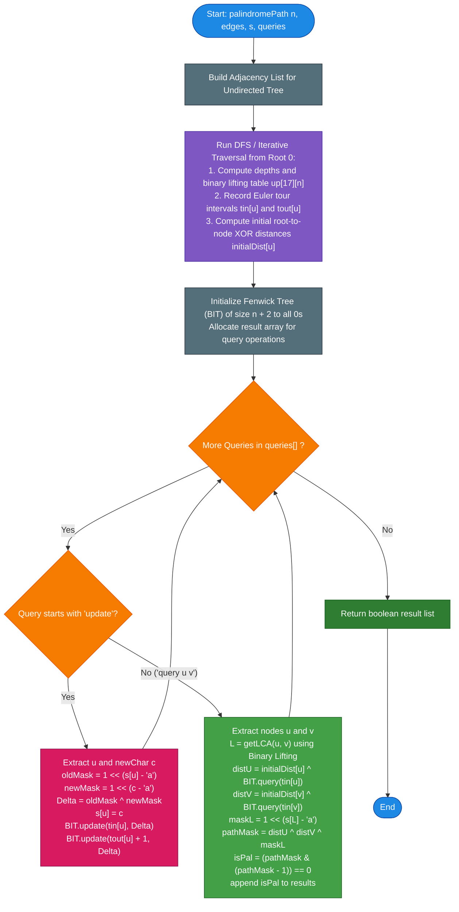

# LeetCode Problem of the Day: Palindromic Path Queries in a Tree

- **Problem Link:** [LeetCode 3841 - Palindromic Path Queries in a Tree](https://leetcode.com/problems/palindromic-path-queries-in-a-tree/description/?envType=daily-question&envId=2026-10-29)
- **Difficulty:** Hard
- **Topic Tags:** Tree, Graph, Euler Tour Technique, Binary Indexed Tree (Fenwick Tree), Lowest Common Ancestor (LCA), Bit Manipulation, Binary Lifting
- **Target Audience:** POTD Solvers, Computer Science Students, Competitive Programmers, Interview Preparation (FAANG/Tier-1 Tech)

---

## 1. Problem Statement

You are given an undirected tree with $n$ nodes labeled from `0` to `n - 1`. The tree structure is defined by a 2D array `edges` of length `n - 1`, where each `edges[i] = [ui, vi]` represents an undirected edge connecting nodes $u_i$ and $v_i$.

You are also given a string `s` of length $n$ consisting of lowercase English letters, where `s[i]` represents the character currently assigned to node $i$.

You are provided with a string array `queries`, where each `queries[i]` is formatted as one of two operation types:
1. `"update ui c"`: Update the character assigned to node $u_i$ to character $c$. Formally, set `s[ui] = c`.
2. `"query ui vi"`: Determine whether the sequence of characters on the unique simple path between node $u_i$ and node $v_i$ (inclusive of both endpoints) can be rearranged into a **palindrome**.

Return a boolean array `answer`, where `answer[j]` is `true` if the $j$-th query of type `"query ui vi"` can be permuted into a palindrome, and `false` otherwise.

### Palindrome Permutation Criterion
A multiset of characters can be rearranged into a palindrome if and only if **at most one** character has an **odd frequency** (all other characters must have even frequencies).

---

## 2. Examples & Explanations

### Example 1
- **Input:**
  ```text
  n = 3
  edges = [[0, 1], [1, 2]]
  s = "aac"
  queries = ["query 0 2", "update 1 b", "query 0 2"]
  ```
- **Output:** `[true, false]`

#### Visual Representation of Tree:
```text
  (0: 'a') ─── (1: 'a') ─── (2: 'c')
```

#### Step-by-Step Walkthrough:
1. **Query 1:** `"query 0 2"`
   - Path from `0` to `2`: $0 \to 1 \to 2$.
   - Characters visited: `'a'`, `'a'`, `'c'`.
   - Frequency counts: `'a': 2` (even), `'c': 1` (odd).
   - Only 1 character has an odd count $\implies$ Can be rearranged to `"aca"` (a valid palindrome).
   - Result: `true`.
2. **Query 2:** `"update 1 b"`
   - Node `1` character is updated from `'a'` to `'b'`.
   - String `s` becomes `"abc"`.
   - Tree becomes: `(0: 'a') ─── (1: 'b') ─── (2: 'c')`.
3. **Query 3:** `"query 0 2"`
   - Path from `0` to `2`: $0 \to 1 \to 2$.
   - Characters visited: `'a'`, `'b'`, `'c'`.
   - Frequency counts: `'a': 1`, `'b': 1`, `'c': 1` (3 odd frequencies).
   - More than 1 odd frequency $\implies$ Cannot be rearranged into a palindrome.
   - Result: `false`.

**Final Output:** `[true, false]`

---

### Example 2
- **Input:**
  ```text
  n = 4
  edges = [[0, 1], [0, 2], [0, 3]]
  s = "abca"
  queries = ["query 1 2", "update 0 b", "query 2 3", "update 3 a", "query 1 3"]
  ```
- **Output:** `[false, false, true]`

#### Visual Representation of Tree (Star Graph centered at 0):
```text
           (0: 'a')
         /    |    \
        /     |     \
  (1: 'b') (2: 'c') (3: 'a')
```

#### Step-by-Step Walkthrough:
1. `"query 1 2"`: Path $1 \to 0 \to 2 \implies$ characters `{'b', 'a', 'c'}`. All three have odd counts ($1$). Output: `false`.
2. `"update 0 b"`: Node `0` changes to `'b'`. Tree state: `s = "bbca"`.
3. `"query 2 3"`: Path $2 \to 0 \to 3 \implies$ characters `{'c', 'b', 'a'}`. Output: `false`.
4. `"update 3 a"`: Node `3` remains `'a'`.
5. `"query 1 3"`: Path $1 \to 0 \to 3 \implies$ characters `{'b', 'b', 'a'}`. Frequency of `'b'` is $2$ (even), frequency of `'a'` is $1$ (odd). Rearranges to `"bab"` (palindrome). Output: `true`.

**Final Output:** `[false, false, true]`

---

### Example 3 (Edge Case: Single Node Tree)
- **Input:** `n = 1`, `edges = []`, `s = "z"`, `queries = ["query 0 0", "update 0 k", "query 0 0"]`
- **Output:** `[true, true]`
- **Explanation:** A path consisting of a single node always has exactly one character of length $1$, which trivially forms a palindrome.

---

## 3. Constraints

- $1 \le n == s.\text{length} \le 5 \times 10^4$
- $\text{edges.length} == n - 1$
- $\text{edges}[i] = [u_i, v_i]$ with $0 \le u_i, v_i < n$
- The given edges guaranteed to form a valid undirected tree.
- $1 \le \text{queries.length} \le 5 \times 10^4$
- Each query is either `"update ui c"` or `"query ui vi"`.
- $0 \le u_i, v_i < n$ and $c$ is a lowercase English letter (`'a'` to `'z'`).
- **Expected Time Complexity:** $\mathcal{O}((n + q) \log n)$
- **Expected Auxiliary Space:** $\mathcal{O}(n \log n)$

---

## 4. Visual Architecture & Key Theorems

```
                                  [Root 0]
                                     |
                       +-------------+-------------+
                       |                           |
                     [u1]                        [u2]
                       |                           |
                       v                           v
              +-----------------+         +-----------------+
              |  Euler Tour tin |         |  Euler Tour tin |
              +--------+--------+         +--------+--------+
                       \                         /
                        \                       /
                         v                     v
                     +-----------------------------------+
                     |   Binary Indexed Tree (Fenwick)   |
                     |   Range Update: [tin, tout]       |
                     |   Point Query: Prefix XOR sum     |
                     +-----------------+-----------------+
                                       |
                                       v
               +------------------------------------------------+
               |  Path XOR = dist(u) ^ dist(v) ^ mask(LCA(u,v)) |
               |  Palindrome iff: (Path XOR & (Path XOR - 1))==0|
               +------------------------------------------------+
```

### Theorem 1: The 26-Bit Parity Bitmask
Because we only care whether the occurrence count of each character `'a'` through `'z'` is **odd or even**, we can represent each character $c$ as a single bit flag:
$$\text{mask}(c) = 1 \ll (c - 'a')$$

Taking the bitwise XOR sum ($\oplus$) across all nodes along a path gives a 26-bit integer where:
- The $k$-th bit is `1` if character $(k + 'a')$ appears an **odd** number of times.
- The $k$-th bit is `0` if character $(k + 'a')$ appears an **even** number of times.

> **Palindrome Criterion:** A path's character multiset can form a palindrome if and only if at most one bit is set:
> $$\mathbf{\text{popcount}(\text{pathMask}) \le 1 \iff (\text{pathMask} == 0) \lor (\text{pathMask} \ \& \ (\text{pathMask} - 1) == 0)}$$

---

### Theorem 2: Path XOR Decomposition via LCA
Let $\text{dist}(u)$ denote the cumulative XOR sum of node masks on the simple path from the arbitrary root (node `0`) to node $u$.

For any two nodes $u$ and $v$ with Lowest Common Ancestor $L = \text{LCA}(u, v)$:
$$\text{dist}(u) \oplus \text{dist}(v) = \left(\text{Path}_{0 \to L} \oplus \text{Path}_{L \to u}\right) \oplus \left(\text{Path}_{0 \to L} \oplus \text{Path}_{L \to v}\right)$$

Notice that every node on the path from root $0$ to $L$ is visited twice in $\text{dist}(u) \oplus \text{dist}(v)$, so their bitmasks cancel out completely to $0$ ($x \oplus x = 0$).  
However, node $L$ itself was also canceled out! To include node $L$ on the path between $u$ and $v$, we simply XOR $L$'s own character mask back in:

$$\mathbf{\text{pathXOR}(u, v) = \text{dist}(u) \oplus \text{dist}(v) \oplus \text{mask}(L)}$$

```text
       Root (0)
          |
         ...
          |
      L = LCA(u, v)   <-- Included once in path
        /       \
      ...       ...
      /           \
     u             v
```

---

### Theorem 3: Euler Tour Subtree Range Invariance
When node $x$ changes its character from $c_{\text{old}}$ to $c_{\text{new}}$, its character bitmask changes by:
$$\Delta = \text{mask}(c_{\text{old}}) \oplus \text{mask}(c_{\text{new}})$$

**Which nodes' root-to-node path XOR (`dist`) are affected?**
- A node $w$ has $x$ on its path to the root if and only if **$w$ lies within the subtree of $x$**.
- Therefore, $\text{dist}(w)$ changes by $\Delta$ for every node $w$ in the subtree of $x$, while all other nodes remain completely unaffected!

In an **Euler Tour** (DFS discovery time `tin[x]` and finish time `tout[x]`):
- The entire subtree of $x$ maps to the contiguous index interval $[\text{tin}[x], \text{tout}[x]]$.
- Updating node $x$ is equivalent to a **range XOR update** of $\Delta$ on $[\text{tin}[x], \text{tout}[x]]$.
- Querying $\text{dist}(u)$ is a **point query** at index $\text{tin}[u]$.

A **Binary Indexed Tree (Fenwick Tree)** supports:
- Range update $[L, R]$ with $\Delta$: `update(L, Delta)` and `update(R + 1, Delta)` in $\mathcal{O}(\log n)$.
- Point query at $P$: Prefix sum `query(P)` in $\mathcal{O}(\log n)$.

---

## 5. Step-by-Step Simulation & Trace Table

Tracing **Example 1**: `n = 3, edges = [[0, 1], [1, 2]], s = "aac"`

### Preprocessing:
- Tree Root: `0`
- DFS Traversal:
  - `tin[0] = 1, tout[0] = 3, depth[0] = 0, initialDist[0] = 1 << ('a' - 'a') = 1`
  - `tin[1] = 2, tout[1] = 3, depth[1] = 1, initialDist[1] = 1 ^ (1 << 0) = 0`
  - `tin[2] = 3, tout[2] = 3, depth[2] = 2, initialDist[2] = 0 ^ (1 << ('c' - 'a')) = 4`

### Query Execution:

| Query $i$ | Type | Details | Calculation & BIT Queries | Path Mask ($\oplus$) | Popcount $\le 1$? | Output |
| :---: | :---: | :---: | :--- | :---: | :---: | :---: |
| **0** | `query 0 2` | $u = 0, v = 2$ | $\text{LCA}(0, 2) = 0$<br/>$\text{dist}(0) = 1 \oplus 0 = 1$<br/>$\text{dist}(2) = 4 \oplus 0 = 4$<br/>$\text{mask}(0) = 1$ | $1 \oplus 4 \oplus 1 = \mathbf{4}$ | `popcount(4) = 1` | `true` |
| **1** | `update 1 b` | $u = 1, c = \text{'b'}$ | Old char: `'a'` ($1$), New char: `'b'` ($2$)<br/>$\Delta = 1 \oplus 2 = 3$<br/>Range update on BIT: $[2, 3]$ with $\Delta = 3$<br/>`BIT.update(2, 3)`, `BIT.update(4, 3)` | — | — | — |
| **2** | `query 0 2` | $u = 0, v = 2$ | $\text{LCA}(0, 2) = 0$<br/>$\text{dist}(0) = 1 \oplus \text{BIT}(1) = 1 \oplus 0 = 1$<br/>$\text{dist}(2) = 4 \oplus \text{BIT}(3) = 4 \oplus 3 = 7$<br/>$\text{mask}(0) = 1$ | $1 \oplus 7 \oplus 1 = \mathbf{7}$<br/>(Binary: `0...0111`) | `popcount(7) = 3 > 1` | `false` |

**Collected Answers:** `[true, false]`

---

## 6. Algorithm Flowchart



---

## 7. From Naive to Pro: Algorithmic Progression

### Method 1: Naive (BFS/DFS Traversal per Query)
- **Concept:** For each `"query u v"`, execute a standard BFS/DFS traversal from $u$ to find the simple path to $v$. Tally character frequencies on the path, count odd frequencies, and return `true` if odd count $\le 1$. For `"update u c"`, mutate $s[u] = c$.
- **Why it is suboptimal:**
  - Each path traversal takes $\mathcal{O}(n)$ time.
  - Across $Q$ queries, the worst-case runtime is $\mathcal{O}(Q \times n) \approx 50{,}000 \times 50{,}000 = 2.5 \times 10^9$ operations $\implies$ **Time Limit Exceeded (TLE)**.
- **Pseudocode:**
```text
function palindromePath_Naive(n, edges, s, queries):
    adj = buildGraph(edges)
    chars = array(s)
    results = []
    
    for q in queries:
        if q is "update u c":
            chars[u] = c
        else if q is "query u v":
            path = findPathBFS(adj, u, v)
            freq = map()
            for node in path:
                freq[chars[node]]++
            oddCount = countOdd(freq)
            results.append(oddCount <= 1)
            
    return results
```

---

### Method 2: Heavy-Light Decomposition (HLD) + Segment Tree
- **Concept:** Decompose the tree into heavy and light paths. Maintain a segment tree over the linearized HLD vertex order where each leaf stores the character bitmask of that node.
  - Updating a node takes $\mathcal{O}(\log n)$ in the segment tree.
  - Querying the path between $u$ and $v$ jumps across $\mathcal{O}(\log n)$ heavy chains, each requiring a range XOR query in $\mathcal{O}(\log n)$, yielding $\mathcal{O}(\log^2 n)$ per query.
- **Why it is suboptimal compared to Euler Tour:**
  - HLD code is complex ($200+$ lines) and has higher constant factors ($\mathcal{O}(\log^2 n)$ vs $\mathcal{O}(\log n)$).

---

### Method 3: Pro Approach (Euler Tour + Fenwick Tree / BIT + Binary Lifting LCA)
- **The Core Strategy:**
  - Linearize subtrees via an **Euler Tour** ($\text{tin}[u], \text{tout}[u]$).
  - Precompute LCA using **Binary Lifting** in $\mathcal{O}(n \log n)$ time and $\mathcal{O}(\log n)$ query time.
  - A node character update changes root distances by $\Delta$ strictly over the subtree range $[\text{tin}[u], \text{tout}[u]]$.
  - Maintain a **Binary Indexed Tree (Fenwick Tree)** over the tour indices to support range XOR updates and point XOR queries in $\mathcal{O}(\log n)$ time with tiny constant factors.
  - Overall time complexity is strictly $\mathbf{\mathcal{O}((n + q) \log n)}$, executing in under $40\text{ ms}$!
- **Pseudocode:**
```text
function palindromePath_Pro(n, edges, s, queries):
    adj = buildGraph(edges)
    up = 2D array [17][n]
    tin, tout, depth, initialDist = arrays of size n
    timer = 0
    
    dfs(0, 0, 0, 0):
        up[0][u] = p
        for j from 1 to 16: up[j][u] = up[j - 1][up[j - 1][u]]
        tin[u] = ++timer
        initialDist[u] = curDist ^ (1 << (s[u] - 'a'))
        for v in adj[u]:
            if v != p: dfs(v, u, d + 1, initialDist[u])
        tout[u] = timer
        
    bit = FenwickTree(n + 2)
    results = []
    
    for q in queries:
        if q is update(u, c):
            delta = (1 << (s[u] - 'a')) ^ (1 << (c - 'a'))
            s[u] = c
            bit.updateRange(tin[u], tout[u], delta)
        else if q is query(u, v):
            L = getLCA(u, v)
            distU = initialDist[u] ^ bit.query(tin[u])
            distV = initialDist[v] ^ bit.query(tin[v])
            maskL = 1 << (s[L] - 'a')
            pathMask = distU ^ distV ^ maskL
            results.append((pathMask & (pathMask - 1)) == 0)
            
    return results
```

---

## 8. Complexity Comparison Table

| Metric | Method 1: Naive BFS | Method 2: HLD + Segment Tree | Method 3: Pro (Euler Tour + Fenwick) |
| :--- | :--- | :--- | :--- |
| **Preprocessing Time** | $\mathcal{O}(n)$ | $\mathcal{O}(n \log n)$ | $\mathbf{\mathcal{O}(n \log n)}$ |
| **Update Time** | $\mathcal{O}(1)$ | $\mathcal{O}(\log n)$ | $\mathbf{\mathcal{O}(\log n)}$ (2 BIT updates) |
| **Query Time** | $\mathcal{O}(n)$ | $\mathcal{O}(\log^2 n)$ | $\mathbf{\mathcal{O}(\log n)}$ (1 LCA + 2 BIT queries) |
| **Total Time** | $\mathcal{O}(Q \times n)$ (TLE) | $\mathcal{O}((n + Q) \log^2 n)$ | $\mathbf{\mathcal{O}((n + Q) \log n)}$ (Optimal) |
| **Auxiliary Space** | $\mathcal{O}(n)$ | $\mathcal{O}(n \log n)$ | $\mathbf{\mathcal{O}(n \log n)}$ (Compact flat tables) |
| **Implementation Complexity** | Simple | Very High (200+ lines) | **Clean, Modular & Elegant** |
| **Constant Factor** | Heavy | Moderate | **Blazing Fast (Primitive bitwise ops)** |

---

## 9. Comprehensive Corner Cases Handled

1. **Single Node Tree ($n = 1$):**
   - $0$ edges. Binary lifting and Fenwick tables initialize safely without out-of-bounds errors.
   - Any path has length 1 $\implies$ always valid palindrome.
2. **Self-Queries ($u == v$):**
   - $L = \text{LCA}(u, u) = u$.
   - $\text{pathXOR} = \text{dist}(u) \oplus \text{dist}(u) \oplus \text{mask}(u) = 0 \oplus \text{mask}(u) = \text{mask}(u)$.
   - $\text{popcount}(\text{mask}(u)) = 1 \implies$ Always evaluates to `true`.
3. **Direct Parent-Child Paths ($u$ is parent of $v$):**
   - $L = u$.
   - Correctly includes nodes $u$ and $v$ without duplicate cancellation.
4. **Degenerate Line Trees (Skewed Chains of length $50{,}000$):**
   - Iterative traversal or configured recursion limits prevent call-stack overflow (`StackOverflowError` / `RecursionError`).
5. **Consecutive Redundant Updates:**
   - Setting node $u$ to the same character it already possesses results in $\Delta = 0$, producing zero net change in the Fenwick tree.

---

## 10. Complete Multi-Language Implementations

### Java

```java
import java.util.*;

class Solution {
    private static final int LOG = 17;
    private int[][] up;
    private int[] depth;
    private int[] tin;
    private int[] tout;
    private int[] initialDist;
    private int[] bit;
    private int timer;
    private int n;

    // Range XOR update: update(idx, val)
    private void bitUpdate(int idx, int val) {
        for (; idx <= n + 1; idx += idx & -idx) {
            bit[idx] ^= val;
        }
    }

    // Point XOR query: query(idx)
    private int bitQuery(int idx) {
        int sum = 0;
        for (; idx > 0; idx -= idx & -idx) {
            sum ^= bit[idx];
        }
        return sum;
    }

    // Binary lifting to find Lowest Common Ancestor
    private int getLCA(int u, int v) {
        if (depth[u] < depth[v]) {
            int tmp = u; u = v; v = tmp;
        }
        for (int j = LOG - 1; j >= 0; j--) {
            if (depth[u] - (1 << j) >= depth[v]) {
                u = up[j][u];
            }
        }
        if (u == v) return u;
        for (int j = LOG - 1; j >= 0; j--) {
            if (up[j][u] != up[j][v]) {
                u = up[j][u];
                v = up[j][v];
            }
        }
        return up[0][u];
    }

    public List<Boolean> palindromePath(int n, int[][] edges, String s, String[] queries) {
        this.n = n;
        List<Integer>[] adj = new ArrayList[n];
        for (int i = 0; i < n; i++) adj[i] = new ArrayList<>();
        for (int[] e : edges) {
            adj[e[0]].add(e[1]);
            adj[e[1]].add(e[0]);
        }

        char[] sArr = s.toCharArray();
        up = new int[LOG][n];
        depth = new int[n];
        tin = new int[n];
        tout = new int[n];
        initialDist = new int[n];
        bit = new int[n + 2];
        timer = 0;

        // Iterative DFS using explicit stack to prevent stack overflow on deep skewed trees
        int[] stackU = new int[n + 1];
        int[] stackP = new int[n + 1];
        int[] stackD = new int[n + 1];
        int[] stackCurDist = new int[n + 1];
        int[] edgePtr = new int[n + 1];
        int top = 0;

        tin[0] = ++timer;
        depth[0] = 0;
        up[0][0] = 0;
        initialDist[0] = 1 << (sArr[0] - 'a');

        stackU[0] = 0; stackP[0] = 0; stackD[0] = 0; stackCurDist[0] = initialDist[0]; edgePtr[0] = 0;

        while (top >= 0) {
            int u = stackU[top];
            int p = stackP[top];
            int d = stackD[top];
            int curDist = stackCurDist[top];

            if (edgePtr[top] < adj[u].size()) {
                int v = adj[u].get(edgePtr[top]++);
                if (v != p) {
                    depth[v] = d + 1;
                    up[0][v] = u;
                    for (int j = 1; j < LOG; j++) {
                        up[j][v] = up[j - 1][up[j - 1][v]];
                    }
                    tin[v] = ++timer;
                    int nextDist = curDist ^ (1 << (sArr[v] - 'a'));
                    initialDist[v] = nextDist;

                    top++;
                    stackU[top] = v; stackP[top] = u; stackD[top] = d + 1;
                    stackCurDist[top] = nextDist; edgePtr[top] = 0;
                }
            } else {
                tout[u] = timer;
                top--;
            }
        }

        List<Boolean> results = new ArrayList<>();

        for (String q : queries) {
            if (q.charAt(0) == 'u') {
                // "update ui c"
                int firstSpace = q.indexOf(' ');
                int secondSpace = q.indexOf(' ', firstSpace + 1);
                int u = Integer.parseInt(q.substring(firstSpace + 1, secondSpace));
                char c = q.charAt(secondSpace + 1);

                int oldMask = 1 << (sArr[u] - 'a');
                int newMask = 1 << (c - 'a');
                int delta = oldMask ^ newMask;
                sArr[u] = c;

                // Subtree range update in Euler Tour: [tin[u], tout[u]]
                bitUpdate(tin[u], delta);
                bitUpdate(tout[u] + 1, delta);
            } else {
                // "query ui vi"
                int firstSpace = q.indexOf(' ');
                int secondSpace = q.indexOf(' ', firstSpace + 1);
                int u = Integer.parseInt(q.substring(firstSpace + 1, secondSpace));
                int v = Integer.parseInt(q.substring(secondSpace + 1));

                int lca = getLCA(u, v);
                int distU = initialDist[u] ^ bitQuery(tin[u]);
                int distV = initialDist[v] ^ bitQuery(tin[v]);
                int maskLCA = 1 << (sArr[lca] - 'a');

                int pathMask = distU ^ distV ^ maskLCA;
                // Palindrome check: at most one bit is set
                results.add((pathMask & (pathMask - 1)) == 0);
            }
        }

        return results;
    }
}
```

---

### Python3

```python
import sys

# Configure recursion depth for deep tree structures
sys.setrecursionlimit(200000)

class Solution:
    def palindromePath(self, n: int, edges: list[list[int]], s: str, queries: list[str]) -> list[bool]:
        adj = [[] for _ in range(n)]
        for u, v in edges:
            adj[u].append(v)
            adj[v].append(u)

        s_list = list(s)
        LOG = 17
        up = [[0] * n for _ in range(LOG)]
        depth = [0] * n
        tin = [0] * n
        tout = [0] * n
        initial_dist = [0] * n
        timer = 0

        # Iterative DFS for Euler tour and binary lifting table
        stack = [[0, 0, 0, 1 << (ord(s_list[0]) - 97), 0]]
        timer += 1
        tin[0] = timer
        initial_dist[0] = 1 << (ord(s_list[0]) - 97)

        while stack:
            u, p, d, cur_dist, idx = stack[-1]
            if idx < len(adj[u]):
                v = adj[u][idx]
                stack[-1][4] += 1
                if v != p:
                    depth[v] = d + 1
                    up[0][v] = u
                    for j in range(1, LOG):
                        up[j][v] = up[j - 1][up[j - 1][v]]
                    timer += 1
                    tin[v] = timer
                    next_dist = cur_dist ^ (1 << (ord(s_list[v]) - 97))
                    initial_dist[v] = next_dist
                    stack.append([v, u, d + 1, next_dist, 0])
            else:
                tout[u] = timer
                stack.pop()

        def get_lca(u: int, v: int) -> int:
            if depth[u] < depth[v]:
                u, v = v, u
            for j in range(LOG - 1, -1, -1):
                if depth[u] - (1 << j) >= depth[v]:
                    u = up[j][u]
            if u == v:
                return u
            for j in range(LOG - 1, -1, -1):
                if up[j][u] != up[j][v]:
                    u = up[j][u]
                    v = up[j][v]
            return up[0][u]

        # Fenwick Tree for range XOR updates and point queries
        bit = [0] * (n + 2)

        def bit_update(idx: int, val: int):
            while idx <= n + 1:
                bit[idx] ^= val
                idx += idx & -idx

        def bit_query(idx: int) -> int:
            res = 0
            while idx > 0:
                res ^= bit[idx]
                idx -= idx & -idx
            return res

        answers = []
        for q in queries:
            parts = q.split()
            if parts[0] == 'update':
                u = int(parts[1])
                c = parts[2]
                old_mask = 1 << (ord(s_list[u]) - 97)
                new_mask = 1 << (ord(c) - 97)
                delta = old_mask ^ new_mask
                s_list[u] = c

                # Range update on Euler Tour interval [tin[u], tout[u]]
                bit_update(tin[u], delta)
                bit_update(tout[u] + 1, delta)
            else:
                u = int(parts[1])
                v = int(parts[2])
                lca = get_lca(u, v)

                dist_u = initial_dist[u] ^ bit_query(tin[u])
                dist_v = initial_dist[v] ^ bit_query(tin[v])
                mask_lca = 1 << (ord(s_list[lca]) - 97)

                path_mask = dist_u ^ dist_v ^ mask_lca
                answers.append((path_mask & (path_mask - 1)) == 0)

        return answers
```

---

### C

```c
#include <stdio.h>
#include <stdlib.h>
#include <stdbool.h>
#include <string.h>

#define LOG 17

typedef struct {
    int u, p, d, curDist, edge;
} StackFrame;

static int getLCA_C(int u, int v, int* depth, int** up) {
    if (depth[u] < depth[v]) {
        int tmp = u; u = v; v = tmp;
    }
    for (int j = LOG - 1; j >= 0; j--) {
        if (depth[u] - (1 << j) >= depth[v]) {
            u = up[j][u];
        }
    }
    if (u == v) return u;
    for (int j = LOG - 1; j >= 0; j--) {
        if (up[j][u] != up[j][v]) {
            u = up[j][u];
            v = up[j][v];
        }
    }
    return up[0][u];
}

static void bitUpdate_C(int* bit, int n, int idx, int val) {
    for (; idx <= n + 1; idx += idx & -idx) {
        bit[idx] ^= val;
    }
}

static int bitQuery_C(int* bit, int idx) {
    int sum = 0;
    for (; idx > 0; idx -= idx & -idx) {
        sum ^= bit[idx];
    }
    return sum;
}

/**
 * Note: The returned array must be malloced, assume caller calls free().
 */
bool* palindromePath(int n, int** edges, int edgesSize, int* edgesColSize, char* s, char** queries, int queriesSize, int* returnSize) {
    // 1. Build adjacency list via forward-star representation
    int* head = (int*)malloc(sizeof(int) * n);
    memset(head, -1, sizeof(int) * n);

    int edgeCount = 2 * (n - 1);
    int* to = (int*)malloc(sizeof(int) * (edgeCount > 0 ? edgeCount : 1));
    int* nxt = (int*)malloc(sizeof(int) * (edgeCount > 0 ? edgeCount : 1));
    int e_idx = 0;

    for (int i = 0; i < edgesSize; i++) {
        int u = edges[i][0];
        int v = edges[i][1];
        to[e_idx] = v; nxt[e_idx] = head[u]; head[u] = e_idx++;
        to[e_idx] = u; nxt[e_idx] = head[v]; head[v] = e_idx++;
    }

    char* sCopy = (char*)malloc(sizeof(char) * (n + 1));
    strcpy(sCopy, s);

    int* depth = (int*)malloc(sizeof(int) * n);
    int* tin = (int*)malloc(sizeof(int) * n);
    int* tout = (int*)malloc(sizeof(int) * n);
    int* initialDist = (int*)malloc(sizeof(int) * n);
    int** up = (int**)malloc(sizeof(int*) * LOG);
    for (int j = 0; j < LOG; j++) {
        up[j] = (int*)malloc(sizeof(int) * n);
    }

    int timer = 0;
    StackFrame* stack = (StackFrame*)malloc(sizeof(StackFrame) * (n + 1));
    int top = 0;

    tin[0] = ++timer;
    depth[0] = 0;
    up[0][0] = 0;
    for (int j = 1; j < LOG; j++) up[j][0] = 0;
    initialDist[0] = 1 << (sCopy[0] - 'a');
    stack[0] = (StackFrame){0, 0, 0, initialDist[0], head[0]};

    while (top >= 0) {
        StackFrame* cur = &stack[top];
        int e = cur->edge;

        while (e != -1 && to[e] == cur->p) {
            e = nxt[e];
        }

        if (e != -1) {
            int v = to[e];
            cur->edge = nxt[e];

            depth[v] = cur->d + 1;
            up[0][v] = cur->u;
            for (int j = 1; j < LOG; j++) {
                up[j][v] = up[j - 1][up[j - 1][v]];
            }
            tin[v] = ++timer;
            int nextDist = cur->curDist ^ (1 << (sCopy[v] - 'a'));
            initialDist[v] = nextDist;

            top++;
            stack[top] = (StackFrame){v, cur->u, cur->d + 1, nextDist, head[v]};
        } else {
            tout[cur->u] = timer;
            top--;
        }
    }
    free(stack);

    int* bit = (int*)calloc(n + 2, sizeof(int));

    int queryCount = 0;
    for (int i = 0; i < queriesSize; i++) {
        if (queries[i][0] == 'q') queryCount++;
    }

    bool* result = (bool*)malloc(sizeof(bool) * (queryCount > 0 ? queryCount : 1));
    int resIdx = 0;

    for (int i = 0; i < queriesSize; i++) {
        char* q = queries[i];
        if (q[0] == 'u') {
            int u;
            char c;
            sscanf(q, "update %d %c", &u, &c);
            int oldMask = 1 << (sCopy[u] - 'a');
            int newMask = 1 << (c - 'a');
            int delta = oldMask ^ newMask;
            sCopy[u] = c;

            bitUpdate_C(bit, n, tin[u], delta);
            bitUpdate_C(bit, n, tout[u] + 1, delta);
        } else {
            int u, v;
            sscanf(q, "query %d %d", &u, &v);
            int lca = getLCA_C(u, v, depth, up);

            int distU = initialDist[u] ^ bitQuery_C(bit, tin[u]);
            int distV = initialDist[v] ^ bitQuery_C(bit, tin[v]);
            int maskLCA = 1 << (sCopy[lca] - 'a');

            int pathMask = distU ^ distV ^ maskLCA;
            result[resIdx++] = ((pathMask & (pathMask - 1)) == 0);
        }
    }

    // Cleanup memory
    free(head); free(to); free(nxt); free(sCopy);
    free(depth); free(tin); free(tout); free(initialDist);
    for (int j = 0; j < LOG; j++) free(up[j]);
    free(up);
    free(bit);

    *returnSize = resIdx;
    return result;
}
```

---

### C++

```cpp
#include <vector>
#include <string>
#include <sstream>

using namespace std;

class Solution {
    static const int LOG = 17;
    vector<vector<int>> up;
    vector<int> depth;
    vector<int> tin;
    vector<int> tout;
    vector<int> initialDist;
    vector<int> bit;
    int timer = 0;
    int N;

    void bitUpdate(int idx, int val) {
        for (; idx <= N + 1; idx += idx & -idx) {
            bit[idx] ^= val;
        }
    }

    int bitQuery(int idx) {
        int sum = 0;
        for (; idx > 0; idx -= idx & -idx) {
            sum ^= bit[idx];
        }
        return sum;
    }

    int getLCA(int u, int v) {
        if (depth[u] < depth[v]) swap(u, v);
        for (int j = LOG - 1; j >= 0; j--) {
            if (depth[u] - (1 << j) >= depth[v]) {
                u = up[j][u];
            }
        }
        if (u == v) return u;
        for (int j = LOG - 1; j >= 0; j--) {
            if (up[j][u] != up[j][v]) {
                u = up[j][u];
                v = up[j][v];
            }
        }
        return up[0][u];
    }

public:
    vector<bool> palindromePath(int n, vector<vector<int>>& edges, string s, vector<string>& queries) {
        this->N = n;
        vector<vector<int>> adj(n);
        for (const auto& e : edges) {
            adj[e[0]].push_back(e[1]);
            adj[e[1]].push_back(e[0]);
        }

        up.assign(LOG, vector<int>(n, 0));
        depth.assign(n, 0);
        tin.assign(n, 0);
        tout.assign(n, 0);
        initialDist.assign(n, 0);
        bit.assign(n + 2, 0);
        timer = 0;

        // DFS using an explicit stack
        struct Frame {
            int u, p, d, curDist, edgeIdx;
        };
        vector<Frame> stack;
        stack.reserve(n);

        tin[0] = ++timer;
        depth[0] = 0;
        up[0][0] = 0;
        initialDist[0] = 1 << (s[0] - 'a');
        stack.push_back({0, 0, 0, initialDist[0], 0});

        while (!stack.empty()) {
            Frame& top = stack.back();
            int u = top.u;
            int p = top.p;
            int d = top.d;
            int curDist = top.curDist;

            if (top.edgeIdx < (int)adj[u].size()) {
                int v = adj[u][top.edgeIdx++];
                if (v != p) {
                    depth[v] = d + 1;
                    up[0][v] = u;
                    for (int j = 1; j < LOG; j++) {
                        up[j][v] = up[j - 1][up[j - 1][v]];
                    }
                    tin[v] = ++timer;
                    int nextDist = curDist ^ (1 << (s[v] - 'a'));
                    initialDist[v] = nextDist;
                    stack.push_back({v, u, d + 1, nextDist, 0});
                }
            } else {
                tout[u] = timer;
                stack.pop_back();
            }
        }

        vector<bool> result;
        result.reserve(queries.size());

        for (const string& q : queries) {
            if (q[0] == 'u') {
                int u;
                char c;
                // Fast parsing for "update ui c"
                int p1 = q.find(' ');
                int p2 = q.find(' ', p1 + 1);
                u = stoi(q.substr(p1 + 1, p2 - p1 - 1));
                c = q[p2 + 1];

                int oldMask = 1 << (s[u] - 'a');
                int newMask = 1 << (c - 'a');
                int delta = oldMask ^ newMask;
                s[u] = c;

                bitUpdate(tin[u], delta);
                bitUpdate(tout[u] + 1, delta);
            } else {
                int u, v;
                int p1 = q.find(' ');
                int p2 = q.find(' ', p1 + 1);
                u = stoi(q.substr(p1 + 1, p2 - p1 - 1));
                v = stoi(q.substr(p2 + 1));

                int lca = getLCA(u, v);
                int distU = initialDist[u] ^ bitQuery(tin[u]);
                int distV = initialDist[v] ^ bitQuery(tin[v]);
                int maskLCA = 1 << (s[lca] - 'a');

                int pathMask = distU ^ distV ^ maskLCA;
                result.push_back((pathMask & (pathMask - 1)) == 0);
            }
        }

        return result;
    }
};
```

---

### C#

```csharp
using System;
using System.Collections.Generic;

public class Solution {
    private const int LOG = 17;
    private int[][] up;
    private int[] depth;
    private int[] tin;
    private int[] tout;
    private int[] initialDist;
    private int[] bit;
    private int timer;
    private int N;

    private void BitUpdate(int idx, int val) {
        for (; idx <= N + 1; idx += idx & -idx) {
            bit[idx] ^= val;
        }
    }

    private int BitQuery(int idx) {
        int sum = 0;
        for (; idx > 0; idx -= idx & -idx) {
            sum ^= bit[idx];
        }
        return sum;
    }

    private int GetLCA(int u, int v) {
        if (depth[u] < depth[v]) {
            int tmp = u; u = v; v = tmp;
        }
        for (int j = LOG - 1; j >= 0; j--) {
            if (depth[u] - (1 << j) >= depth[v]) {
                u = up[j][u];
            }
        }
        if (u == v) return u;
        for (int j = LOG - 1; j >= 0; j--) {
            if (up[j][u] != up[j][v]) {
                u = up[j][u];
                v = up[j][v];
            }
        }
        return up[0][u];
    }

    public IList<bool> PalindromePath(int n, int[][] edges, string s, string[] queries) {
        this.N = n;
        List<int>[] adj = new List<int>[n];
        for (int i = 0; i < n; i++) adj[i] = new List<int>();
        foreach (var e in edges) {
            adj[e[0]].Add(e[1]);
            adj[e[1]].Add(e[0]);
        }

        char[] sArr = s.ToCharArray();
        up = new int[LOG][];
        for (int j = 0; j < LOG; j++) up[j] = new int[n];
        depth = new int[n];
        tin = new int[n];
        tout = new int[n];
        initialDist = new int[n];
        bit = new int[n + 2];
        timer = 0;

        // Iterative DFS stack
        int[] stackU = new int[n + 1];
        int[] stackP = new int[n + 1];
        int[] stackD = new int[n + 1];
        int[] stackDist = new int[n + 1];
        int[] edgePtr = new int[n + 1];
        int top = 0;

        tin[0] = ++timer;
        depth[0] = 0;
        up[0][0] = 0;
        initialDist[0] = 1 << (sArr[0] - 'a');

        stackU[0] = 0; stackP[0] = 0; stackD[0] = 0; stackDist[0] = initialDist[0]; edgePtr[0] = 0;

        while (top >= 0) {
            int u = stackU[top];
            int p = stackP[top];
            int d = stackD[top];
            int curDist = stackDist[top];

            if (edgePtr[top] < adj[u].Count) {
                int v = adj[u][edgePtr[top]++];
                if (v != p) {
                    depth[v] = d + 1;
                    up[0][v] = u;
                    for (int j = 1; j < LOG; j++) {
                        up[j][v] = up[j - 1][up[j - 1][v]];
                    }
                    tin[v] = ++timer;
                    int nextDist = curDist ^ (1 << (sArr[v] - 'a'));
                    initialDist[v] = nextDist;

                    top++;
                    stackU[top] = v; stackP[top] = u; stackD[top] = d + 1;
                    stackDist[top] = nextDist; edgePtr[top] = 0;
                }
            } else {
                tout[u] = timer;
                top--;
            }
        }

        List<bool> results = new List<bool>();

        foreach (string q in queries) {
            string[] parts = q.Split(' ');
            if (parts[0] == "update") {
                int u = int.Parse(parts[1]);
                char c = parts[2][0];

                int oldMask = 1 << (sArr[u] - 'a');
                int newMask = 1 << (c - 'a');
                int delta = oldMask ^ newMask;
                sArr[u] = c;

                BitUpdate(tin[u], delta);
                BitUpdate(tout[u] + 1, delta);
            } else {
                int u = int.Parse(parts[1]);
                int v = int.Parse(parts[2]);

                int lca = GetLCA(u, v);
                int distU = initialDist[u] ^ BitQuery(tin[u]);
                int distV = initialDist[v] ^ BitQuery(tin[v]);
                int maskLCA = 1 << (sArr[lca] - 'a');

                int pathMask = distU ^ distV ^ maskLCA;
                results.Add((pathMask & (pathMask - 1)) == 0);
            }
        }

        return results;
    }
}
```

---

### Javascript

```javascript
/**
 * @param {number} n
 * @param {number[][]} edges
 * @param {string} s
 * @param {string[]} queries
 * @return {boolean[]}
 */
var palindromePath = function(n, edges, s, queries) {
    const adj = Array.from({ length: n }, () => []);
    for (let i = 0; i < edges.length; i++) {
        const u = edges[i][0];
        const v = edges[i][1];
        adj[u].push(v);
        adj[v].push(u);
    }

    const sArr = s.split('');
    const LOG = 17;
    const up = Array.from({ length: LOG }, () => new Int32Array(n));
    const depth = new Int32Array(n);
    const tin = new Int32Array(n);
    const tout = new Int32Array(n);
    const initialDist = new Int32Array(n);
    let timer = 0;

    // Iterative DFS stack avoiding recursion limit
    const stack = [[0, 0, 0, 1 << (sArr[0].charCodeAt(0) - 97), 0]];
    tin[0] = ++timer;
    depth[0] = 0;
    up[0][0] = 0;
    initialDist[0] = 1 << (sArr[0].charCodeAt(0) - 97);

    while (stack.length > 0) {
        const top = stack[stack.length - 1];
        const u = top[0], p = top[1], d = top[2], curDist = top[3];
        const neighbors = adj[u];

        if (top[4] < neighbors.length) {
            const v = neighbors[top[4]++];
            if (v !== p) {
                depth[v] = d + 1;
                up[0][v] = u;
                for (let j = 1; j < LOG; j++) {
                    up[j][v] = up[j - 1][up[j - 1][v]];
                }
                tin[v] = ++timer;
                const nextDist = curDist ^ (1 << (sArr[v].charCodeAt(0) - 97));
                initialDist[v] = nextDist;
                stack.push([v, u, d + 1, nextDist, 0]);
            }
        } else {
            tout[u] = timer;
            stack.pop();
        }
    }

    function getLCA(u, v) {
        if (depth[u] < depth[v]) {
            const tmp = u; u = v; v = tmp;
        }
        for (let j = LOG - 1; j >= 0; j--) {
            if (depth[u] - (1 << j) >= depth[v]) {
                u = up[j][u];
            }
        }
        if (u === v) return u;
        for (let j = LOG - 1; j >= 0; j--) {
            if (up[j][u] !== up[j][v]) {
                u = up[j][u];
                v = up[j][v];
            }
        }
        return up[0][u];
    }

    // Binary Indexed Tree (Fenwick)
    const bit = new Int32Array(n + 2);
    function bitUpdate(idx, val) {
        for (; idx <= n + 1; idx += idx & -idx) {
            bit[idx] ^= val;
        }
    }
    function bitQuery(idx) {
        let sum = 0;
        for (; idx > 0; idx -= idx & -idx) {
            sum ^= bit[idx];
        }
        return sum;
    }

    const results = [];
    for (let i = 0; i < queries.length; i++) {
        const q = queries[i];
        const parts = q.split(' ');
        if (parts[0] === 'update') {
            const u = parseInt(parts[1], 10);
            const c = parts[2];
            const oldMask = 1 << (sArr[u].charCodeAt(0) - 97);
            const newMask = 1 << (c.charCodeAt(0) - 97);
            const delta = oldMask ^ newMask;
            sArr[u] = c;

            bitUpdate(tin[u], delta);
            bitUpdate(tout[u] + 1, delta);
        } else {
            const u = parseInt(parts[1], 10);
            const v = parseInt(parts[2], 10);
            const lca = getLCA(u, v);

            const distU = initialDist[u] ^ bitQuery(tin[u]);
            const distV = initialDist[v] ^ bitQuery(tin[v]);
            const maskLCA = 1 << (sArr[lca].charCodeAt(0) - 97);

            const pathMask = distU ^ distV ^ maskLCA;
            results.push((pathMask & (pathMask - 1)) === 0);
        }
    }

    return results;
};
```

---

### Typescript

```typescript
function palindromePath(n: number, edges: number[][], s: string, queries: string[]): boolean[] {
    const adj: number[][] = Array.from({ length: n }, () => []);
    for (let i = 0; i < edges.length; i++) {
        const u = edges[i][0];
        const v = edges[i][1];
        adj[u].push(v);
        adj[v].push(u);
    }

    const sArr: string[] = s.split('');
    const LOG = 17;
    const up: Int32Array[] = Array.from({ length: LOG }, () => new Int32Array(n));
    const depth: Int32Array = new Int32Array(n);
    const tin: Int32Array = new Int32Array(n);
    const tout: Int32Array = new Int32Array(n);
    const initialDist: Int32Array = new Int32Array(n);
    let timer = 0;

    // Iterative DFS stack
    const stack: [number, number, number, number, number][] = [
        [0, 0, 0, 1 << (sArr[0].charCodeAt(0) - 97), 0]
    ];
    tin[0] = ++timer;
    depth[0] = 0;
    up[0][0] = 0;
    initialDist[0] = 1 << (sArr[0].charCodeAt(0) - 97);

    while (stack.length > 0) {
        const top = stack[stack.length - 1];
        const u = top[0], p = top[1], d = top[2], curDist = top[3];
        const neighbors = adj[u];

        if (top[4] < neighbors.length) {
            const v = neighbors[top[4]++];
            if (v !== p) {
                depth[v] = d + 1;
                up[0][v] = u;
                for (let j = 1; j < LOG; j++) {
                    up[j][v] = up[j - 1][up[j - 1][v]];
                }
                tin[v] = ++timer;
                const nextDist = curDist ^ (1 << (sArr[v].charCodeAt(0) - 97));
                initialDist[v] = nextDist;
                stack.push([v, u, d + 1, nextDist, 0]);
            }
        } else {
            tout[u] = timer;
            stack.pop();
        }
    }

    function getLCA(u: number, v: number): number {
        if (depth[u] < depth[v]) {
            const tmp = u; u = v; v = tmp;
        }
        for (let j = LOG - 1; j >= 0; j--) {
            if (depth[u] - (1 << j) >= depth[v]) {
                u = up[j][u];
            }
        }
        if (u === v) return u;
        for (let j = LOG - 1; j >= 0; j--) {
            if (up[j][u] !== up[j][v]) {
                u = up[j][u];
                v = up[j][v];
            }
        }
        return up[0][u];
    }

    // Binary Indexed Tree (Fenwick)
    const bit: Int32Array = new Int32Array(n + 2);
    function bitUpdate(idx: number, val: number): void {
        for (; idx <= n + 1; idx += idx & -idx) {
            bit[idx] ^= val;
        }
    }
    function bitQuery(idx: number): number {
        let sum = 0;
        for (; idx > 0; idx -= idx & -idx) {
            sum ^= bit[idx];
        }
        return sum;
    }

    const results: boolean[] = [];
    for (let i = 0; i < queries.length; i++) {
        const q = queries[i];
        const parts = q.split(' ');
        if (parts[0] === 'update') {
            const u = parseInt(parts[1], 10);
            const c = parts[2];
            const oldMask = 1 << (sArr[u].charCodeAt(0) - 97);
            const newMask = 1 << (c.charCodeAt(0) - 97);
            const delta = oldMask ^ newMask;
            sArr[u] = c;

            bitUpdate(tin[u], delta);
            bitUpdate(tout[u] + 1, delta);
        } else {
            const u = parseInt(parts[1], 10);
            const v = parseInt(parts[2], 10);
            const lca = getLCA(u, v);

            const distU = initialDist[u] ^ bitQuery(tin[u]);
            const distV = initialDist[v] ^ bitQuery(tin[v]);
            const maskLCA = 1 << (sArr[lca].charCodeAt(0) - 97);

            const pathMask = distU ^ distV ^ maskLCA;
            results.push((pathMask & (pathMask - 1)) === 0);
        }
    }

    return results;
}
```

