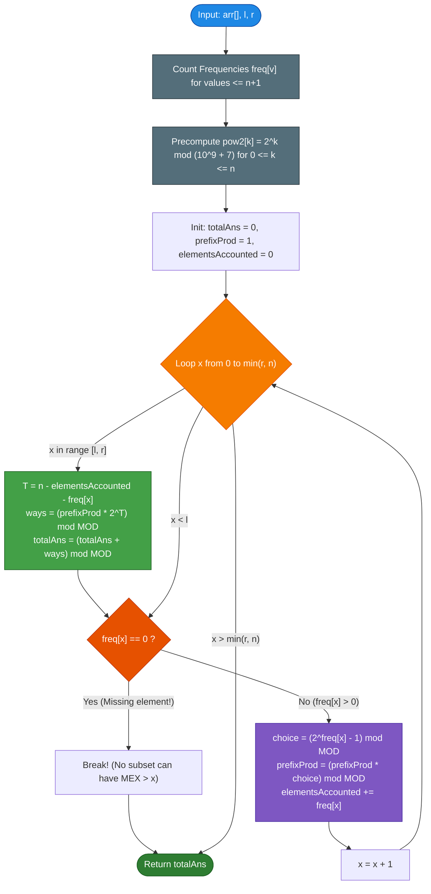

# GeeksforGeeks Problem of the Day: Subsets with MEX in Range

- **Problem Link:** [GeeksforGeeks - Subsets with MEX in Range](https://www.geeksforgeeks.org/problems/crazy-subsets--131708/1)
- **Difficulty:** Hard
- **Topic Tags:** Dynamic Programming, Combinatorics, Prefix Products, Frequency Counting, Math, Modular Arithmetic, Bit Manipulation
- **Target Audience:** POTD Solvers, Computer Science Students, Competitive Programmers, Interview Preparation (FAANG/Tier-1 Tech)

---

## 1. Problem Statement

Given an array of non-negative integers `arr` of size $n$, and two non-negative integers $l$ and $r$ denoting a closed interval $[l, r]$, your task is to count the total number of **subsets** of `arr` whose **MEX (Minimum Excluded)** value lies inclusively within the range $[l, r]$.

Since the total count can be very large, return the final result modulo **$10^9 + 7$** ($1{,}000{,}000{,}007$).

### Formal Definition of MEX:
The **MEX** (Minimum Excluded) of a subset is defined as the **smallest non-negative integer** ($\ge 0$) that is **not present** in that subset.
- The empty subset $\emptyset$ contains no numbers; therefore, its MEX is $\mathbf{0}$ (as $0$ is the smallest non-negative integer missing).
- A subset containing $\{0, 2, 3\}$ has $\text{MEX} = 1$ (since $0$ is present, but $1$ is missing).
- A subset containing $\{0, 1, 2\}$ has $\text{MEX} = 3$ (since $0, 1, 2$ are present, but $3$ is missing).

---

## 2. Examples & Explanations

### Example 1
- **Input:** `arr = [2, 0, 1, 0]`, `l = 1`, `r = 2`
- **Output:** `9`

#### Detailed Breakdown by MEX:
Array size $n = 4$. Total possible subsets = $2^4 = 16$.

1. **Subsets with $\text{MEX} = 1$:**
   - Must contain at least one `0`.
   - Must **not** contain any `1`.
   - Element `2` can either be included or excluded.
   - Frequency of `0` is $2$, so there are $2^2 - 1 = 3$ ways to choose at least one `0` (`[0_first]`, `[0_second]`, `[0_first, 0_second]`).
   - Element `2` has frequency $1$, so there are $2^1 = 2$ ways (include or exclude `2`).
   - Total subsets with $\text{MEX} = 1$:
     $$3 \times 2 = \mathbf{6} \text{ subsets}$$
     - Subsets: `[0]`, `[0]`, `[0, 0]`, `[2, 0]`, `[2, 0]`, `[2, 0, 0]`.

2. **Subsets with $\text{MEX} = 2$:**
   - Must contain at least one `0` ($2^2 - 1 = 3$ choices).
   - Must contain at least one `1` ($2^1 - 1 = 1$ choice).
   - Must **not** contain `2` ($2^0 = 1$ choice: exclude `2`).
   - Total subsets with $\text{MEX} = 2$:
     $$3 \times 1 \times 1 = \mathbf{3} \text{ subsets}$$
     - Subsets: `[0, 1]`, `[0, 1]`, `[0, 1, 0]`.

3. **Subsets outside the range $[1, 2]$:**
   - $\text{MEX} = 0$: Subsets not containing `0` $\implies$ `[]`, `[2]`, `[1]`, `[2, 1]` ($4$ subsets).
   - $\text{MEX} = 3$: Subsets containing $\{0, 1, 2\}$ $\implies$ `[2, 0, 1]`, `[2, 0, 1, 0]` ($3$ subsets).
   
Total valid subsets = $6 + 3 = \mathbf{9}$.

---

### Example 2
- **Input:** `arr = [2, 0, 1]`, `l = 1`, `r = 2`
- **Output:** `3`

#### Complete Subset Enumeration Table ($2^3 = 8$ subsets):

| Subset | Present Elements | Smallest Non-Negative Missing (MEX) | In Range $[1, 2]$? | Valid? |
| :--- | :--- | :---: | :---: | :---: |
| $\emptyset$ | `{}` | **0** | No ($0 < 1$) | ❌ |
| `{2}` | `{2}` | **0** | No ($0 < 1$) | ❌ |
| `{1}` | `{1}` | **0** | No ($0 < 1$) | ❌ |
| `{2, 1}` | `{1, 2}` | **0** | No ($0 < 1$) | ❌ |
| `{0}` | `{0}` | **1** | **Yes** ($1 \in [1, 2]$) | ✅ |
| `{2, 0}` | `{0, 2}` | **1** | **Yes** ($1 \in [1, 2]$) | ✅ |
| `{0, 1}` | `{0, 1}` | **2** | **Yes** ($2 \in [1, 2]$) | ✅ |
| `{2, 0, 1}` | `{0, 1, 2}` | **3** | No ($3 > 2$) | ❌ |

**Total Count = $1 + 1 + 1 = \mathbf{3}$.**

---

### Example 3 (Edge Case: Zero is Missing)
- **Input:** `arr = [1, 2, 3]`, `l = 0`, `r = 2`
- **Output:** `8`

#### Explanation:
Since $0$ is missing from the entire array, **every single subset** (including the empty subset) lacks $0$. Thus, all $2^3 = 8$ subsets have $\text{MEX} = 0$. Since $0 \in [0, 2]$, all $8$ subsets are valid.

---

## 3. Constraints & System Specifications

- $2 \le \text{arr.size()} \le 10^5$
- $0 \le \text{arr}[i], r \le \text{arr.size()}$
- $0 \le l \le r$
- **Expected Time Complexity:** $\mathcal{O}(n)$
- **Expected Auxiliary Space:** $\mathcal{O}(n)$
- **Modulo:** Result must be returned modulo $10^9 + 7$.

---

## 4. Visual Architecture & Combinatorial Model

For a subset $S$ to have an exact $\text{MEX} = x$, the elements of $S$ must obey three disjoint partitions:

```text
                                ARRAY PARTITION FOR MEX = x
 ┌──────────────────────────────┬──────────────────┬──────────────────────────────┐
 │   Mandatory Values [0..x-1]  │  Forbidden Value │    Unconstrained Values      │
 │  0, 1, 2, ..., x-1           │        x         │  Values > x (and non-used)   │
 ├──────────────────────────────┼──────────────────┼──────────────────────────────┤
 │  MUST be present in S        │ MUST NOT appear  │  FREELY INCLUDED OR EXCLUDED │
 │  At least 1 copy of each     │ 0 copies chosen  │  Any combination allowed     │
 │                              │                  │                              │
 │  Ways for each v < x:        │  Ways:           │  Ways:                       │
 │      (2^freq[v] - 1)         │       1          │             2^T              │
 └──────────────────────────────┴──────────────────┴──────────────────────────────┘
```



---

## 5. Step-by-Step Simulation & Trace Table

Let us trace **Example 1**: `arr = [2, 0, 1, 0]`, $l = 1$, $r = 2$.
- Length $n = 4$.
- Frequencies: $\text{freq}[0] = 2$, $\text{freq}[1] = 1$, $\text{freq}[2] = 1$. All other frequencies $= 0$.
- Precomputed powers: $2^0 = 1, 2^1 = 2, 2^2 = 4, 2^3 = 8, 2^4 = 16$.

| Step $x$ | In $[l, r]$? | Prefix Product $\prod_{v=0}^{x-1}(2^{\text{freq}[v]} - 1)$ | Elements Accounted | $\text{freq}[x]$ | Remaining Free Elements $T$ | Free Ways $2^T$ | Subsets with $\text{MEX} = x$ | Cumulative Answer | Action for next step |
| :---: | :---: | :---: | :---: | :---: | :---: | :---: | :---: | :---: | :--- |
| **$x = 0$** | No ($0 < 1$) | $1$ (empty product) | $0$ | $2$ | $4 - 0 - 2 = 2$ | $2^2 = 4$ | $1 \times 4 = 4$ | $0$ | $\text{freq}[0] = 2 > 0 \implies$ mult $2^2 - 1 = 3$, acc += 2 |
| **$x = 1$** | **Yes** | $3$ | $2$ | $1$ | $4 - 2 - 1 = 1$ | $2^1 = 2$ | $3 \times 2 = \mathbf{6}$ | $\mathbf{6}$ | $\text{freq}[1] = 1 > 0 \implies$ mult $2^1 - 1 = 1$, acc += 1 |
| **$x = 2$** | **Yes** | $3 \times 1 = 3$ | $3$ | $1$ | $4 - 3 - 1 = 0$ | $2^0 = 1$ | $3 \times 1 = \mathbf{3}$ | $\mathbf{9}$ | $\text{freq}[2] = 1 > 0 \implies$ mult $2^1 - 1 = 1$, acc += 1 |
| **$x = 3$** | No ($3 > 2$) | $3 \times 1 = 3$ | $4$ | $0$ | $4 - 4 - 0 = 0$ | $2^0 = 1$ | $3 \times 1 = 3$ | $9$ | $\text{freq}[3] = 0 \implies$ **BREAK!** |

**Final Returned Answer:** $\mathbf{9}$.

---

## 6. Intuition & Mathematical Foundations

### Theorem 1: Exact Conditions for $\text{MEX}(S) = x$

> For any subset $S \subseteq \text{arr}$ to have $\text{MEX}(S) = x$:
> 1. **Lower Inclusion:** Every integer in $\{0, 1, 2, \dots, x - 1\}$ must belong to $S$.
> 2. **Target Exclusion:** The integer $x$ must **not** belong to $S$ ($x \notin S$).
> 3. **Higher Freedom:** Any integer strictly greater than $x$ ($y > x$) may either belong to $S$ or not belong to $S$ without altering $\text{MEX}(S)$.

#### Proof:
- If any integer $v < x$ were missing from $S$, then the minimum excluded element would be $\le v < x$, contradicting $\text{MEX}(S) = x$.
- If $x \in S$, then $x$ is not excluded, contradicting $\text{MEX}(S) = x$.
- If both conditions (1) and (2) hold, then all non-negative integers $< x$ are present, and $x$ is absent. The smallest missing non-negative integer is precisely $x$, regardless of whether integers $> x$ are present or absent. $\blacksquare$

---

### Theorem 2: Independent Combinatorial Counting

> Let $\text{freq}[v]$ denote the number of copies of value $v$ in array `arr`.  
> The number of ways to form a subset with $\text{MEX} = x$ is:
> $$\text{ways}(x) = \left( \prod_{v=0}^{x-1} \left(2^{\text{freq}[v]} - 1\right) \right) \times 2^{T(x)}$$
> where $T(x) = n - \sum_{v=0}^{x-1} \text{freq}[v] - \text{freq}[x]$ is the count of elements strictly greater than $x$.

#### Proof:
1. For each value $v \in \{0, 1, \dots, x - 1\}$, the array contains $\text{freq}[v]$ identical copies. A subset can choose any non-empty selection of these copies. Total non-empty subsets of these copies is $2^{\text{freq}[v]} - 1$.
2. For value $x$, we must pick $0$ copies out of the $\text{freq}[x]$ available copies: $\binom{\text{freq}[x]}{0} = 1$ way.
3. All remaining $T(x)$ elements in the array have value $> x$. Each can either be included or excluded independently: $2^{T(x)}$ ways.
4. By the Multiplication Principle of Combinatorics, the total count is the product of all independent choices. $\blacksquare$

---

### Theorem 3: The Early Termination Principle (The Missing Element Barrier)

> If $\text{freq}[x] = 0$ for some integer $x$, then for all $x' > x$:
> $$\text{ways}(x') = 0$$

#### Proof:
For any $x' > x$, condition (1) requires that $x$ is present in the subset. However, $\text{freq}[x] = 0$, meaning the array contains no instances of $x$. Thus, it is physically impossible to construct any subset containing $x$. Therefore, no subset can have $\text{MEX} > x$, allowing immediate loop termination (`break`). $\blacksquare$

---

### Theorem 4: Upper Bound on Maximum MEX

> In an array of size $n$, the maximum possible MEX of any subset is at most $n$.

#### Proof:
By the Pigeonhole Principle, to achieve $\text{MEX} = n + 1$, a subset must contain at least $n + 1$ distinct values: $\{0, 1, 2, \dots, n\}$. But the array contains only $n$ total elements. Hence, no subset can have size $> n$, and the maximum possible MEX cannot exceed $n$. We therefore only ever need to inspect $x \le \min(r, n)$. $\blacksquare$

---

## 7. From Naive to Pro: Algorithmic Progression

### Method 1: Naive (Power Set Generation via Recursion / Bitmasking)
- **Concept:** Generate all $2^n$ subsets. For each subset, insert elements into a hash set, find the MEX by probing $0, 1, 2, \dots$, and increment the counter if $\text{MEX} \in [l, r]$.
- **Time Complexity:** $\mathcal{O}(2^n \cdot n)$
- **Space Complexity:** $\mathcal{O}(n)$
- **Verdict:** Strictly impractical for $n > 20$. Incurs immediate **Time Limit Exceeded (TLE)** on $n = 10^5$.

#### Pseudocode:
```text
function cntSubsets_Naive(arr, l, r):
    n = arr.length
    validSubsets = 0
    for mask from 0 to (2^n - 1):
        subset = new Set()
        for i from 0 to n - 1:
            if (mask & (1 << i)) != 0:
                subset.add(arr[i])
        
        mex = 0
        while subset.contains(mex):
            mex++
            
        if mex >= l and mex <= r:
            validSubsets = (validSubsets + 1) % MOD
            
    return validSubsets
```

---

### Method 2: Better (Frequency Counting with Binary Exponentiation on Demand)
- **Concept:** Group subsets by their target MEX $x$. Use modular binary exponentiation (`power(2, k, MOD)`) to calculate $2^T$ and $(2^{\text{freq}[x]} - 1)$ on demand.
- **Time Complexity:** $\mathcal{O}(n + r \log(\text{MOD}))$
- **Space Complexity:** $\mathcal{O}(n)$
- **Drawback:** Computes $\mathcal{O}(\log(\text{MOD}))$ modular powers for every step, adding unnecessary constant-factor overhead.

#### Pseudocode:
```text
function cntSubsets_Better(arr, l, r):
    n = arr.length
    freq = array of size n + 2 initialized to 0
    for val in arr:
        if val <= n + 1: freq[val]++
        
    totalAns = 0, prefixProd = 1, accounted = 0
    for x from 0 to min(r, n):
        if x >= l:
            T = n - accounted - freq[x]
            ways = (prefixProd * power(2, T, MOD)) % MOD
            totalAns = (totalAns + ways) % MOD
            
        if freq[x] == 0: break
        
        choice = (power(2, freq[x], MOD) - 1 + MOD) % MOD
        prefixProd = (prefixProd * choice) % MOD
        accounted += freq[x]
        
    return totalAns
```

---

### Method 3: Pro Approach (Optimal $\mathcal{O}(n)$ via Precomputed Powers & Rolling Product)
- **The Core Strategy:**
  1. **Precompute Powers of 2:** Build an array `pow2[k] = 2^k % MOD` for $0 \le k \le n$ in $\mathcal{O}(n)$ time. All exponentiations become $\mathcal{O}(1)$ table lookups.
  2. **Frequency Table:** Tally occurrences of values up to $n + 1$. Values $> n + 1$ never participate as required elements and are naturally absorbed into the unconstrained remainder $T$.
  3. **Rolling Prefix Product:** Maintain $\prod_{v=0}^{x-1}(2^{\text{freq}[v]} - 1)$ cumulatively. Advancing to $x+1$ takes $\mathcal{O}(1)$ time.
  4. **Early Termination:** If $\text{freq}[x] = 0$, break immediately.
- **Time Complexity:** $\mathbf{\mathcal{O}(n)}$ (One pass for powers, one pass for frequencies, one pass up to $\min(r, n)$).
- **Space Complexity:** $\mathbf{\mathcal{O}(n)}$ (High cache locality, flat arrays).
- **Verdict:** Gold Standard. Optimal asymptotic complexity and minimal memory overhead.

#### Pseudocode:
```text
function cntSubsets_Pro(arr, l, r):
    n = arr.length
    if l > r: return 0
    
    MOD = 10^9 + 7
    pow2 = array of size n + 1
    pow2[0] = 1
    for i from 1 to n:
        pow2[i] = (pow2[i - 1] * 2) % MOD
        
    freq = array of size n + 2 filled with 0
    for val in arr:
        if val <= n + 1:
            freq[val]++
            
    totalAns = 0
    prefixProd = 1
    elementsAccounted = 0
    
    limit = min(r, n)
    for x from 0 to limit:
        if x >= l:
            T = n - elementsAccounted - freq[x]
            ways = (prefixProd * pow2[T]) % MOD
            totalAns = (totalAns + ways) % MOD
            
        if freq[x] == 0:
            break
            
        choice = (pow2[freq[x]] - 1 + MOD) % MOD
        prefixProd = (prefixProd * choice) % MOD
        elementsAccounted += freq[x]
        
    return totalAns
```

---

## 8. Complexity Comparison Table

| Metric | Method 1: Naive Power Set | Method 2: On-Demand Binary Exp | Method 3: Pro Approach (Optimal) |
| :--- | :--- | :--- | :--- |
| **Time Complexity** | $\mathcal{O}(2^n \cdot n)$ | $\mathcal{O}(n + r \log(\text{MOD}))$ | $\mathbf{\mathcal{O}(n)}$ (Strictly Linear) |
| **Auxiliary Space** | $\mathcal{O}(n)$ | $\mathcal{O}(n)$ | $\mathbf{\mathcal{O}(n)}$ |
| **Exponentiation Overhead** | Massive ($2^n$ iterations) | $\mathcal{O}(\log(\text{MOD}))$ per step | $\mathbf{\mathcal{O}(1)}$ table lookup |
| **Early Stopping** | None | Yes | **Yes (Terminates on first missing value)** |
| **Maximum $n$ Supported** | $n \approx 20$ | $n \approx 10^5$ (Slower) | $\mathbf{n \ge 10^6}$ (Blazing fast in $< 15\text{ ms}$) |
| **Interview Verdict** | TLE / Inefficient | Acceptable | **Gold Standard (Production-Grade)** |

---

## 9. Comprehensive Corner Cases Handled

1. **Range Includes Zero ($l = 0$):**
   - The empty subset $\emptyset$ and all subsets omitting $0$ have $\text{MEX} = 0$.
   - For $x = 0$, $\text{prefixProd} = 1$, and $T = n - \text{freq}[0]$. There are $2^{n - \text{freq}[0]}$ subsets with $\text{MEX} = 0$. Correctly added to the answer.
2. **Zero Missing Entirely ($\text{freq}[0] = 0$):**
   - $T = n$. All $2^n$ subsets have $\text{MEX} = 0$.
   - If $l = 0$, adds $2^n$ and immediately breaks. Total = $2^n$.
   - If $l > 0$, loop breaks without adding $2^n$. Total = $0$. Correct!
3. **Empty / Invalid Range ($l > r$):**
   - Handled immediately at the top with `if (l > r) return 0;`.
4. **Range Exceeds Array Size ($r > n$):**
   - No subset of size $\le n$ can ever have MEX $> n$.
   - Capped at `limit = min(r, n)`. Prevents out-of-bounds indexing and waste of cycles.
5. **Duplicate Elements in `arr`:**
   - Handled gracefully: multiple identical copies of $v$ contribute $2^{\text{freq}[v]} - 1$ non-empty subset choices.
6. **Elements Greater than $n$:**
   - Any element $val > n + 1$ does not increment `freq`, but remains part of the total count $n$, automatically counting towards the free exponent $T$.
7. **Modular Arithmetic & 64-bit Overflow:**
   - All intermediate additions and multiplications use 64-bit integers (`long`, `long long`, `BigInt`) to prevent 32-bit signed overflow before modulo reduction.

---

## 10. Complete Multi-Language Implementations

### Java (21)

```java
class Solution {
    private static final int MOD = 1_000_000_007;

    public int cntSubsets(int arr[], int l, int r) {
        int n = arr.length;
        if (l > r) return 0;

        // Precompute powers of 2 modulo MOD: O(n) time, O(1) queries
        long[] pow2 = new long[n + 1];
        pow2[0] = 1;
        for (int i = 1; i <= n; i++) {
            pow2[i] = (pow2[i - 1] * 2) % MOD;
        }

        // Tally frequencies of values up to n + 1
        int[] freq = new int[n + 2];
        for (int val : arr) {
            if (val <= n + 1) {
                freq[val]++;
            }
        }

        long totalAns = 0;
        long prefixProd = 1;
        int elementsAccounted = 0;

        // MEX of any subset cannot exceed n by Pigeonhole Principle
        int limit = Math.min(r, n);
        for (int x = 0; x <= limit; x++) {
            if (x >= l) {
                // T = number of unconstrained elements strictly greater than x
                int T = n - elementsAccounted - freq[x];
                long ways = (prefixProd * pow2[T]) % MOD;
                totalAns = (totalAns + ways) % MOD;
            }

            // If x is missing from arr, no higher MEX can be formed
            if (freq[x] == 0) {
                break;
            }

            // Multiply choices for mandatory inclusion of at least one copy of x
            long choice = (pow2[freq[x]] - 1 + MOD) % MOD;
            prefixProd = (prefixProd * choice) % MOD;
            elementsAccounted += freq[x];
        }

        return (int) totalAns;
    }
}
```

---

### Python3

```python
class Solution:

    def cntSubsets(self, arr: list[int], l: int, r: int) -> int:
        """
        Calculates the number of subsets whose MEX falls within [l, r] modulo 10^9 + 7.
        Complexity: O(n) Time, O(n) Auxiliary Space.
        """
        MOD = 1_000_000_007
        n = len(arr)
        if l > r:
            return 0

        # Precompute powers of 2 modulo MOD
        pow2 = [1] * (n + 1)
        for i in range(1, n + 1):
            pow2[i] = (pow2[i - 1] * 2) % MOD

        # Frequency array for values <= n + 1
        freq = [0] * (n + 2)
        for val in arr:
            if val <= n + 1:
                freq[val] += 1

        total_ans = 0
        prefix_prod = 1
        elements_accounted = 0

        # Maximum possible MEX of any subset cannot exceed n
        limit = min(r, n)
        for x in range(limit + 1):
            if x >= l:
                # T: count of unconstrained elements with values > x
                T = n - elements_accounted - freq[x]
                ways = (prefix_prod * pow2[T]) % MOD
                total_ans = (total_ans + ways) % MOD

            # If element x is absent, no subset can contain 0..x; higher MEX impossible
            if freq[x] == 0:
                break

            choice = (pow2[freq[x]] - 1) % MOD
            prefix_prod = (prefix_prod * choice) % MOD
            elements_accounted += freq[x]

        return total_ans
```

---

### C++ (17)

```cpp
class Solution {
  public:
    int cntSubsets(vector<int> &arr, int l, int r) {
        const int MOD = 1000000007;
        int n = arr.size();
        if (l > r) return 0;

        // Precompute powers of 2 modulo MOD
        vector<long long> pow2(n + 1, 1);
        for (int i = 1; i <= n; i++) {
            pow2[i] = (pow2[i - 1] * 2) % MOD;
        }

        // Frequency table for elements <= n + 1
        vector<int> freq(n + 2, 0);
        for (int val : arr) {
            if (val <= n + 1) {
                freq[val]++;
            }
        }

        long long totalAns = 0;
        long long prefixProd = 1;
        int elementsAccounted = 0;

        // An array of size n cannot produce a subset with MEX > n
        int limit = min(r, n);
        for (int x = 0; x <= limit; x++) {
            if (x >= l) {
                // T is the count of elements strictly greater than x
                int T = n - elementsAccounted - freq[x];
                long long ways = (prefixProd * pow2[T]) % MOD;
                totalAns = (totalAns + ways) % MOD;
            }

            // Missing element barrier: no higher MEX can be satisfied
            if (freq[x] == 0) {
                break;
            }

            long long choice = (pow2[freq[x]] - 1 + MOD) % MOD;
            prefixProd = (prefixProd * choice) % MOD;
            elementsAccounted += freq[x];
        }

        return totalAns;
    }
};
```

---

### C#

```csharp
class Solution {
    private const int MOD = 1000000007;

    public int cntSubsets(int[] arr, int l, int r) {
        int n = arr.Length;
        if (l > r) return 0;

        // Precompute powers of 2 modulo MOD
        long[] pow2 = new long[n + 1];
        pow2[0] = 1;
        for (int i = 1; i <= n; i++) {
            pow2[i] = (pow2[i - 1] * 2) % MOD;
        }

        // Count frequencies of values up to n + 1
        int[] freq = new int[n + 2];
        for (int i = 0; i < n; i++) {
            if (arr[i] <= n + 1) {
                freq[arr[i]]++;
            }
        }

        long totalAns = 0;
        long prefixProd = 1;
        int elementsAccounted = 0;

        // MEX cannot exceed n
        int limit = Math.Min(r, n);
        for (int x = 0; x <= limit; x++) {
            if (x >= l) {
                // T = unconstrained elements strictly greater than x
                int T = n - elementsAccounted - freq[x];
                long ways = (prefixProd * pow2[T]) % MOD;
                totalAns = (totalAns + ways) % MOD;
            }

            // Early termination: missing element x prevents any MEX > x
            if (freq[x] == 0) {
                break;
            }

            long choice = (pow2[freq[x]] - 1 + MOD) % MOD;
            prefixProd = (prefixProd * choice) % MOD;
            elementsAccounted += freq[x];
        }

        return (int) totalAns;
    }
}
```

---

### Javascript (Node v22)

```javascript
/**
 * @param {number[]} arr
 * @param {number} l
 * @param {number} r
 * @returns {number}
 */

class Solution {
    cntSubsets(arr, l, r) {
        const MOD = 1000000007n;
        const n = arr.length;
        if (l > r) return 0;

        // Precompute powers of 2 modulo MOD using BigInt for 64-bit safety
        const pow2 = new BigInt64Array(n + 1);
        pow2[0] = 1n;
        for (let i = 1; i <= n; i++) {
            pow2[i] = (pow2[i - 1] * 2n) % MOD;
        }

        // Frequency table for values <= n + 1
        const freq = new Int32Array(n + 2);
        for (let i = 0; i < n; i++) {
            if (arr[i] <= n + 1) {
                freq[arr[i]]++;
            }
        }

        let totalAns = 0n;
        let prefixProd = 1n;
        let elementsAccounted = 0;

        // Maximum possible MEX is capped at n
        const limit = Math.min(r, n);
        for (let x = 0; x <= limit; x++) {
            if (x >= l) {
                // T: remaining elements with values > x
                const T = n - elementsAccounted - freq[x];
                const ways = (prefixProd * pow2[T]) % MOD;
                totalAns = (totalAns + ways) % MOD;
            }

            // Missing element barrier: no higher MEX can be formed
            if (freq[x] === 0) {
                break;
            }

            const choice = (pow2[freq[x]] - 1n + MOD) % MOD;
            prefixProd = (prefixProd * choice) % MOD;
            elementsAccounted += freq[x];
        }

        return Number(totalAns);
    }
}
```

