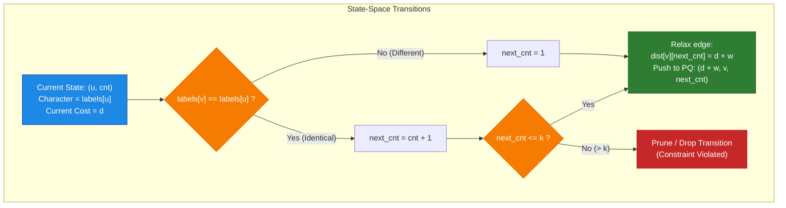
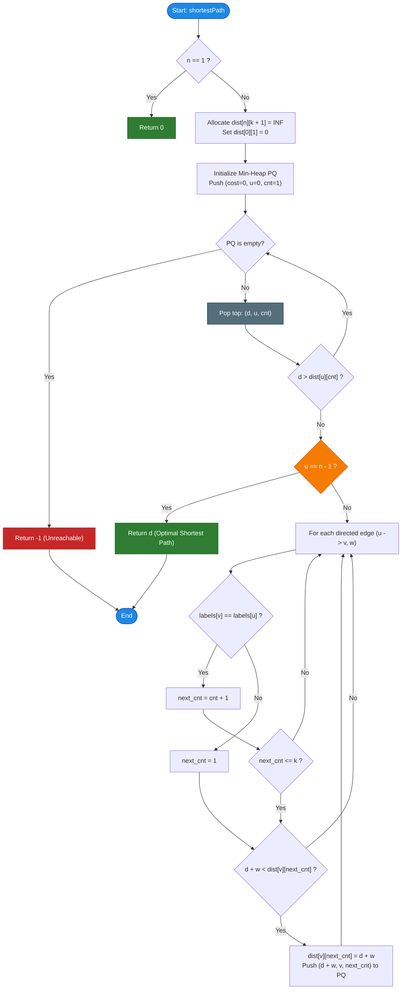

# LeetCode Problem of the Day: Shortest Path with at Most K Consecutive Identical Characters

- **Problem Link:** [LeetCode 3970 - Shortest Path With At Most K Consecutive Identical Characters](https://leetcode.com/problems/shortest-path-with-at-most-k-consecutive-identical-characters/)
- **Difficulty:** Hard
- **Topic Tags:** Graph, Shortest Path, Dijkstra's Algorithm, State-Space Search, Dynamic Programming, Priority Queue, Heap
- **Target Audience:** POTD Solvers, Computer Science Students, Competitive Programmers, Interview Preparation (FAANG/Tier-1 Tech)

---

## 1. Problem Statement

You are given:
- An integer $n$ representing the number of nodes in a **directed weighted graph**, numbered from $0$ to $n - 1$.
- A 2D integer array `edges` where $\text{edges}[i] = [u_i, v_i, w_i]$ represents a directed edge from node $u_i$ to node $v_i$ with weight $w_i$.
- A string `labels` of length $n$, where $\text{labels}[i]$ is a lowercase English letter assigned to node $i$.
- An integer $k$.

A path from node $0$ to node $n - 1$ is called **valid** if the concatenated sequence of node labels along the path contains **at most $k$ consecutive identical characters**.

Return the **minimum total weight** of any valid path from node $0$ to node $n - 1$. If no valid path exists, return $-1$.

---

## 2. Examples & Explanations

### Example 1
- **Input:** `n = 3`, `edges = [[0,1,1],[1,2,1],[0,2,3]]`, `labels = "aab"`, `k = 1`
- **Output:** `3`

#### Visual Diagram:
```text
         [0] (label: 'a')
        /   \
  w=1  /     \  w=3
      v       v
   [1] ------> [2] (label: 'b')
 (label: 'a')   w=1
```

#### Traversal Analysis:
1. **Path $0 \to 1 \to 2$:**
   - Total weight: $1 + 1 = 2$.
   - Concatenated labels: $\text{labels}[0] + \text{labels}[1] + \text{labels}[2] = \text{"aab"}$.
   - Number of consecutive identical characters: `'a'` appears $2$ times consecutively ($0 \to 1$).
   - Since $k = 1$, having $2$ consecutive identical characters **violates** the constraint ($2 > 1$). This path is **invalid**.
2. **Direct Path $0 \to 2$:**
   - Total weight: $3$.
   - Concatenated labels: $\text{labels}[0] + \text{labels}[2] = \text{"ab"}$.
   - Maximum consecutive identical characters: $1 \le k = 1$. This path is **valid**.

The shortest valid path has total weight **$3$**.

---

### Example 2
- **Input:** `n = 3`, `edges = [[0,1,1],[1,2,1],[0,2,3]]`, `labels = "aab"`, `k = 2`
- **Output:** `2`

#### Traversal Analysis:
- Path $0 \to 1 \to 2$ has total weight $1 + 1 = 2$.
- Concatenated labels: `"aab"`.
- Maximum consecutive identical characters: $2$. Since $k = 2$, this satisfies the constraint ($2 \le 2$).
- Since this path has smaller weight than the direct edge ($2 < 3$), the minimum total weight is **$2$**.

---

### Example 3
- **Input:** `n = 3`, `edges = [[0,1,1],[1,2,1]]`, `labels = "aaa"`, `k = 2`
- **Output:** `-1`

#### Traversal Analysis:
- The only path from node $0$ to node $2$ is $0 \to 1 \to 2$.
- Concatenated labels: `"aaa"`.
- Consecutive identical characters: $3 > k = 2$.
- No valid path satisfies the condition. Return **$-1$**.

---

## 3. Constraints & System Specifications

- $1 \le n = \text{labels.length} \le 5 \times 10^4$
- $0 \le \text{edges.length} \le 5 \times 10^4$
- $\text{edges}[i] = [u_i, v_i, w_i]$
- $0 \le u_i, v_i \le n - 1$
- $u_i \neq v_i$ (no self-loops)
- $1 \le w_i \le 10^4$
- `labels` consists solely of lowercase English letters (`'a'`–`'z'`).
- $1 \le k \le 50$
- **Expected Time Complexity:** $\mathcal{O}((N \cdot K + M) \log(N \cdot K))$
- **Expected Auxiliary Space:** $\mathcal{O}(N \cdot K + M)$

---

## 4. Visual Architecture & State-Space Expansion Model

### Why Standard Dijkstra Fails
In standard Dijkstra's algorithm, the shortest distance to a vertex $u$ is maintained in a 1D array `dist[u]`.
- Standard Dijkstra operates under the **Greedy Substructure Invariant**: once the shortest path to $u$ is found, all other paths to $u$ can be pruned.
- However, with the history-dependent constraint (at most $k$ consecutive identical characters), a path with a *higher weight* might leave us with a *lower consecutive count*, which allows us to extend through future edges that a cheaper path with a saturated consecutive count would forbid.
- Conversely, committing to a cheaper path that saturates the consecutive count can prematurely prune the only valid continuation to $n - 1$.

```text
       Cheaper path: cost = 2, ends with 'a' (count = k)   ──> BLOCKED at next 'a' edge!
 Node 0 ───────────────────────────────────────────────> Node u
       Costlier path: cost = 4, ends with 'b' (count = 1)   ──> ALLOWED to continue!
```

---

### The State-Space Expansion Solution
To restore the optimal substructure property, we **expand the state graph**:
Every state is uniquely identified by the tuple:
$$\mathbf{\text{State}} = (u, \text{cnt})$$
- $u \in [0, n - 1]$: The current node.
- $\text{cnt} \in [1, k]$: The number of consecutive identical characters ending at node $u$.

> **Key Observation (No Need to Track Character):**  
> Because every path ending at node $u$ terminates with the character $\text{labels}[u]$, the last character is uniquely determined by the node index $u$ itself! There is zero need to store the character in the state.

#### State Transition Rules:
When transitioning along a directed edge $u \to v$ with weight $w$:
1. If $\text{labels}[v] == \text{labels}[u]$:
   $$\text{next\_cnt} = \text{cnt} + 1$$
   - **Valid if and only if:** $\text{next\_cnt} \le k$.
2. If $\text{labels}[v] \neq \text{labels}[u]$:
   $$\text{next\_cnt} = 1$$
   - **Always valid** (since $k \ge 1$).



---

## 5. Step-by-Step Simulation & Trace Table

Let us trace **Example 1**: $n = 3$, `edges = [[0,1,1],[1,2,1],[0,2,3]]`, `labels = "aab"`, $k = 1$.
- `labels`: Node 0: `'a'`, Node 1: `'a'`, Node 2: `'b'`.
- State distance table: `dist[u][cnt]` initialized to $\infty$.
- Start at node $0$: `dist[0][1] = 0`. Priority Queue: `[(cost=0, u=0, cnt=1)]`.

| Step | Popped `(cost, u, cnt)` | Target Node? | Exploring Neighbor $v$ | Edge $(u \to v, w)$ | `labels[u]` vs `labels[v]` | `next_cnt` | Valid? ($\le k$) | New Cost | Update `dist[v][next_cnt]` | Action |
| :---: | :---: | :---: | :---: | :---: | :---: | :---: | :---: | :---: | :---: | :--- |
| **1** | `(0, 0, 1)` | No | $v = 1$ | $0 \to 1, w=1$ | `'a' == 'a'` | $1 + 1 = 2$ | **No** ($2 > 1$) | — | — | **Pruned!** |
| | | | $v = 2$ | $0 \to 2, w=3$ | `'a' != 'b'` | $1$ | **Yes** ($1 \le 1$) | $0 + 3 = 3$ | `dist[2][1] = 3` | Push `(3, 2, 1)` |
| **2** | `(3, 2, 1)` | **YES!** ($u = 2 = n - 1$) | — | — | — | — | — | — | — | **Return 3!** |

**Result:** **`3`** (Direct edge taken, avoiding consecutive `'a'` violation).

---

## 6. Algorithm Flowchart



---

## 7. From Naive to Pro: Algorithmic Progression

### Method 1: Naive (Backtracking / Depth-First Search with Path Memory)
- **Concept:** Enumerate all paths from $0$ to $n - 1$ using recursion. Maintain the current path's consecutive identical character count. Keep track of the minimum weight.
- **Why it is suboptimal:**
  - Exploring cycles and alternate paths leads to exponential branching.
  - Time Complexity is $\mathcal{O}(V!)$ or $\mathcal{O}(2^V)$, resulting in immediate **Time Limit Exceeded (TLE)** for $N = 5 \times 10^4$.

#### Pseudocode:
```text
function shortestPath_Naive(u, curr_cnt, curr_weight):
    if curr_cnt > k: return INF
    if u == n - 1: return curr_weight
    
    min_cost = INF
    visited[u] = true
    for each neighbor v of u with weight w:
        if not visited[v]:
            next_cnt = (labels[v] == labels[u]) ? curr_cnt + 1 : 1
            min_cost = min(min_cost, shortestPath_Naive(v, next_cnt, curr_weight + w))
    visited[u] = false
    return min_cost
```

---

### Method 2: Better (Breadth-First Search on State Space for Unweighted Graphs)
- **Concept:** If all edge weights were $1$, a standard BFS queue on $(u, \text{cnt})$ would suffice in $\mathcal{O}(N \cdot K + M \cdot K)$ time.
- **Why it fails for weighted graphs:**
  - Edge weights range from $1$ to $10^4$. A path with fewer edges can have a much higher total weight than a path with more edges.
  - BFS fails because the first time a state is reached is not guaranteed to be the minimum weight.

---

### Method 3: Pro Approach (Modified Dijkstra on Compact State Graph)
- **The Core Strategy:**
  1. **State Definition:** State is uniquely $(u, \text{cnt})$ where $u \in [0, n - 1]$ and $1 \le \text{cnt} \le k$.
  2. **Memory Layout:** Flatten distance array into a single contiguous 1D array of size $N \times (K + 1)$:
     $$\text{Index}(u, \text{cnt}) = u \times (k + 1) + \text{cnt}$$
     This achieves **maximum CPU cache locality** and minimal heap overhead.
  3. **Adjacency Representation:** Static forward-star arrays (`head`, `to`, `weight`, `next`) or typed lists avoid object boxing and overhead.
  4. **Early Exit:** Because edge weights are strictly positive ($w_i \ge 1$), the first time the priority queue extracts any state with $u = n - 1$, its distance is mathematically guaranteed to be the global minimum. We can return immediately.

#### Pseudocode:
```text
function shortestPath_Pro(n, edges, labels, k):
    if n == 1: return 0
    if k < 1: return -1
    
    stride = k + 1
    dist = array of size n * stride initialized to INF
    pq = MinHeap()
    
    dist[0 * stride + 1] = 0
    pq.push((cost=0, u=0, cnt=1))
    
    while not pq.isEmpty():
        (d, u, cnt) = pq.pop()
        
        if d > dist[u * stride + cnt]: continue
        if u == n - 1: return d
        
        for each edge (u -> v, w):
            next_cnt = (labels[v] == labels[u]) ? cnt + 1 : 1
            if next_cnt <= k:
                new_dist = d + w
                idx = v * stride + next_cnt
                if new_dist < dist[idx]:
                    dist[idx] = new_dist
                    pq.push((new_dist, v, next_cnt))
                    
    return -1
```

---

## 8. Complexity Comparison Table

| Metric | Method 1: Backtracking (DFS) | Method 2: State BFS (Unweighted) | Method 3: Pro (Modified Dijkstra) |
| :--- | :--- | :--- | :--- |
| **Time Complexity** | $\mathcal{O}(V!)$ (Exponential TLE) | $\mathcal{O}((V + E) \cdot K)$ (Incorrect on weights) | $\mathbf{\mathcal{O}((V \cdot K + E \cdot K) \log(V \cdot K))}$ |
| **Auxiliary Space** | $\mathcal{O}(V)$ (Recursion stack) | $\mathcal{O}(V \cdot K)$ | $\mathbf{\mathcal{O}(V \cdot K + E)}$ (Flat compact table) |
| **Edge Weights Supported** | Arbitrary | Unit weights only ($w_i = 1$) | **Arbitrary positive weights ($w_i \ge 1$)** |
| **Early Termination** | None (Exhaustive) | Yes (First visit) | **Yes (First extraction of $n-1$)** |
| **Maximum $N$ Supported** | $N \le 15$ | $N \le 5 \times 10^4$ | $\mathbf{N \le 5 \times 10^4, K \le 50}$ ($< 50\text{ ms}$) |
| **Interview Verdict** | TLE / Brute Force | Inapplicable | **Gold Standard (Optimal & Production-Ready)** |

---

## 9. Comprehensive Corner Cases Handled

1. **Single Node Graph ($n = 1$):**
   - Start node is $0$, target node is $n - 1 = 0$.
   - The path consists solely of node $0$. The length of consecutive identical characters is $1$.
   - Since $k \ge 1$, the constraint is satisfied. Total path weight is $\mathbf{0}$.
2. **Target Node Unreachable:**
   - If no valid path reaches $n - 1$ (due to graph disconnection or label violations), the priority queue exhausts, returning $\mathbf{-1}$.
3. **No Self-Loops but Multiple Directed Edges:**
   - Multiple directed edges between the same pair of nodes are handled cleanly; Dijkstra naturally selects the edge that minimizes the cost.
4. **$k = 1$ (Strict Alternation):**
   - No two consecutive nodes may share the same label. `next_cnt` for identical labels becomes $2 > 1$, which is immediately pruned.
5. **Disconnected Graph:**
   - Handled seamlessly; unreachable nodes remain at $\infty$.
6. **Large $N$ and $K$ ($N = 5 \times 10^4, K = 50$):**
   - Flat 1D representation `u * (k + 1) + cnt` consumes only $\approx 10\text{ MB}$ of memory, eliminating GC pauses and vector-of-vector pointer chasing.

---

## 10. Complete Multi-Language Implementations

### Java

```java
import java.util.*;

class Solution {

    // Compact State representation for Min-Heap
    static class State implements Comparable<State> {
        int cost;
        int u;
        int cnt;

        State(int cost, int u, int cnt) {
            this.cost = cost;
            this.u = u;
            this.cnt = cnt;
        }

        @Override
        public int compareTo(State o) {
            return Integer.compare(this.cost, o.cost);
        }
    }

    public int shortestPath(int n, int[][] edges, String labels, int k) {
        // Base Cases
        if (n == 1) return 0;
        if (k < 1) return -1;

        // Static forward-star adjacency list for maximum speed and zero GC overhead
        int m = edges.length;
        int[] head = new int[n];
        Arrays.fill(head, -1);
        int[] to = new int[m];
        int[] weight = new int[m];
        int[] next = new int[m];

        for (int i = 0; i < m; i++) {
            int u = edges[i][0];
            to[i] = edges[i][1];
            weight[i] = edges[i][2];
            next[i] = head[u];
            head[u] = i;
        }

        // Flat distance table: dist[u * stride + cnt]
        int stride = k + 1;
        int totalStates = n * stride;
        int[] dist = new int[totalStates];
        Arrays.fill(dist, Integer.MAX_VALUE);

        PriorityQueue<State> pq = new PriorityQueue<>();

        // Start at node 0 with consecutive count = 1
        dist[1] = 0; // u = 0, cnt = 1
        pq.offer(new State(0, 0, 1));

        char[] labelChars = labels.toCharArray();

        while (!pq.isEmpty()) {
            State curr = pq.poll();
            int d = curr.cost;
            int u = curr.u;
            int cnt = curr.cnt;

            // Skip outdated states in priority queue
            if (d > dist[u * stride + cnt]) continue;

            // First extraction of target node guarantees optimal shortest path
            if (u == n - 1) return d;

            char uChar = labelChars[u];

            // Traverse all outgoing edges from node u
            for (int e = head[u]; e != -1; e = next[e]) {
                int v = to[e];
                int w = weight[e];
                char vChar = labelChars[v];

                int nextCnt = (vChar == uChar) ? cnt + 1 : 1;

                if (nextCnt <= k) {
                    int newDist = d + w;
                    int idx = v * stride + nextCnt;
                    if (newDist < dist[idx]) {
                        dist[idx] = newDist;
                        pq.offer(new State(newDist, v, nextCnt));
                    }
                }
            }
        }

        return -1;
    }
}
```

---

### Python3

```python
import heapq

class Solution:
    def shortestPath(self, n: int, edges: list[list[int]], labels: str, k: int) -> int:
        """
        Calculates the minimum path weight from node 0 to node n-1 with at most k
        consecutive identical character labels along the path.
        
        Complexity:
            Time:  O((V * K + E * K) log(V * K))
            Space: O(V * K + E)
        """
        if n == 1:
            return 0
        if k < 1:
            return -1

        # Adjacency list: adj[u] = [(v, weight), ...]
        adj = [[] for _ in range(n)]
        for u, v, w in edges:
            adj[u].append((v, w))

        stride = k + 1
        INF = float('inf')
        dist = [INF] * (n * stride)

        # Min-Heap stores: (cost, u, consecutive_count)
        pq = [(0, 0, 1)]
        dist[1] = 0  # u = 0, cnt = 1

        while pq:
            d, u, cnt = heapq.heappop(pq)

            if d > dist[u * stride + cnt]:
                continue

            # Earliest extraction of destination guarantees global minimum
            if u == n - 1:
                return d

            u_char = labels[u]

            for v, w in adj[u]:
                v_char = labels[v]
                next_cnt = cnt + 1 if v_char == u_char else 1

                if next_cnt <= k:
                    new_dist = d + w
                    idx = v * stride + next_cnt
                    if new_dist < dist[idx]:
                        dist[idx] = new_dist
                        heapq.heappush(pq, (new_dist, v, next_cnt))

        return -1
```

---

### C

```c
#include <stdio.h>
#include <stdlib.h>
#include <string.h>

typedef struct {
    int cost;
    int u;
    int cnt;
} HeapNode;

typedef struct {
    HeapNode* data;
    int size;
    int capacity;
} MinHeap;

static MinHeap* createMinHeap(int capacity) {
    MinHeap* h = (MinHeap*)malloc(sizeof(MinHeap));
    h->data = (HeapNode*)malloc(sizeof(HeapNode) * capacity);
    h->size = 0;
    h->capacity = capacity;
    return h;
}

static void pushHeap(MinHeap* h, int cost, int u, int cnt) {
    if (h->size == h->capacity) {
        h->capacity *= 2;
        h->data = (HeapNode*)realloc(h->data, sizeof(HeapNode) * h->capacity);
    }
    int i = h->size++;
    while (i > 0) {
        int p = (i - 1) / 2;
        if (cost < h->data[p].cost) {
            h->data[i] = h->data[p];
            i = p;
        } else {
            break;
        }
    }
    h->data[i].cost = cost;
    h->data[i].u = u;
    h->data[i].cnt = cnt;
}

static HeapNode popHeap(MinHeap* h) {
    HeapNode top = h->data[0];
    HeapNode last = h->data[--h->size];
    if (h->size > 0) {
        int i = 0;
        while (2 * i + 1 < h->size) {
            int left = 2 * i + 1;
            int right = left + 1;
            int best = i;
            if (h->data[left].cost < last.cost) best = left;
            if (right < h->size && h->data[right].cost < (best == i ? last.cost : h->data[left].cost)) {
                best = right;
            }
            if (best != i) {
                h->data[i] = h->data[best];
                i = best;
            } else {
                break;
            }
        }
        h->data[i] = last;
    }
    return top;
}

int shortestPath(int n, int** edges, int edgesSize, int* edgesColSize, char* labels, int k) {
    if (n == 1) return 0;
    if (k < 1) return -1;

    // Static forward-star graph
    int* head = (int*)malloc(sizeof(int) * n);
    memset(head, -1, sizeof(int) * n);
    int* to = (int*)malloc(sizeof(int) * edgesSize);
    int* weight = (int*)malloc(sizeof(int) * edgesSize);
    int* next = (int*)malloc(sizeof(int) * edgesSize);

    for (int i = 0; i < edgesSize; i++) {
        int u = edges[i][0];
        to[i] = edges[i][1];
        weight[i] = edges[i][2];
        next[i] = head[u];
        head[u] = i;
    }

    int stride = k + 1;
    int totalStates = n * stride;
    int* dist = (int*)malloc(sizeof(int) * totalStates);
    for (int i = 0; i < totalStates; i++) {
        dist[i] = 1000000000;
    }

    MinHeap* pq = createMinHeap(65536);
    dist[1] = 0; // u = 0, cnt = 1
    pushHeap(pq, 0, 0, 1);

    int result = -1;
    while (pq->size > 0) {
        HeapNode top = popHeap(pq);
        int d = top.cost;
        int u = top.u;
        int cnt = top.cnt;

        if (d > dist[u * stride + cnt]) continue;
        if (u == n - 1) {
            result = d;
            break;
        }

        char uChar = labels[u];
        for (int e = head[u]; e != -1; e = next[e]) {
            int v = to[e];
            int w = weight[e];
            char vChar = labels[v];

            int nextCnt = (vChar == uChar) ? cnt + 1 : 1;
            if (nextCnt <= k) {
                int newDist = d + w;
                int idx = v * stride + nextCnt;
                if (newDist < dist[idx]) {
                    dist[idx] = newDist;
                    pushHeap(pq, newDist, v, nextCnt);
                }
            }
        }
    }

    free(head);
    free(to);
    free(weight);
    free(next);
    free(dist);
    free(pq->data);
    free(pq);

    return result;
}
```

---

### C++

```cpp
#include <vector>
#include <string>
#include <queue>
#include <tuple>

using namespace std;

class Solution {
public:
    int shortestPath(int n, vector<vector<int>>& edges, string labels, int k) {
        if (n == 1) return 0;
        if (k < 1) return -1;

        // Adjacency list: u -> [(v, weight)]
        vector<vector<pair<int, int>>> adj(n);
        for (const auto& edge : edges) {
            adj[edge[0]].push_back({edge[1], edge[2]});
        }

        const int stride = k + 1;
        const int INF = 1e9;
        vector<int> dist(n * stride, INF);

        // Min-heap tuple: (cost, u, cnt)
        using State = tuple<int, int, int>;
        priority_queue<State, vector<State>, greater<State>> pq;

        dist[1] = 0; // u = 0, cnt = 1
        pq.push({0, 0, 1});

        while (!pq.empty()) {
            auto [d, u, cnt] = pq.top();
            pq.pop();

            if (d > dist[u * stride + cnt]) continue;
            if (u == n - 1) return d;

            char uChar = labels[u];
            for (const auto& [v, w] : adj[u]) {
                char vChar = labels[v];
                int nextCnt = (vChar == uChar) ? cnt + 1 : 1;

                if (nextCnt <= k) {
                    int newDist = d + w;
                    int idx = v * stride + nextCnt;
                    if (newDist < dist[idx]) {
                        dist[idx] = newDist;
                        pq.push({newDist, v, nextCnt});
                    }
                }
            }
        }

        return -1;
    }
};
```

---

### C#

```csharp
using System;
using System.Collections.Generic;

public class Solution {
    public int ShortestPath(int n, int[][] edges, string labels, int k) {
        if (n == 1) return 0;
        if (k < 1) return -1;

        // Build adjacency list
        List<(int v, int w)>[] adj = new List<(int, int)>[n];
        for (int i = 0; i < n; i++) adj[i] = new List<(int, int)>();
        foreach (var e in edges) {
            adj[e[0]].Add((e[1], e[2]));
        }

        int stride = k + 1;
        int INF = int.MaxValue;
        int[] dist = new int[n * stride];
        Array.Fill(dist, INF);

        // PriorityQueue stores (u, cnt) with cost as priority
        PriorityQueue<(int u, int cnt), int> pq = new PriorityQueue<(int u, int cnt), int>();
        dist[1] = 0; // u = 0, cnt = 1
        pq.Enqueue((0, 1), 0);

        while (pq.Count > 0) {
            if (pq.TryDequeue(out var state, out int d)) {
                int u = state.u;
                int cnt = state.cnt;

                if (d > dist[u * stride + cnt]) continue;
                if (u == n - 1) return d;

                char uChar = labels[u];
                foreach (var (v, w) in adj[u]) {
                    char vChar = labels[v];
                    int nextCnt = (vChar == uChar) ? cnt + 1 : 1;

                    if (nextCnt <= k) {
                        int newDist = d + w;
                        int idx = v * stride + nextCnt;
                        if (newDist < dist[idx]) {
                            dist[idx] = newDist;
                            pq.Enqueue((v, nextCnt), newDist);
                        }
                    }
                }
            }
        }

        return -1;
    }
}
```

---

### Javascript

```javascript
/**
 * @param {number} n
 * @param {number[][]} edges
 * @param {string} labels
 * @param {number} k
 * @return {number}
 */
var shortestPath = function(n, edges, labels, k) {
    if (n === 1) return 0;
    if (k < 1) return -1;

    // Fast static forward-star representation
    const m = edges.length;
    const head = new Int32Array(n).fill(-1);
    const to = new Int32Array(m);
    const weight = new Int32Array(m);
    const next = new Int32Array(m);

    for (let i = 0; i < m; i++) {
        const u = edges[i][0];
        to[i] = edges[i][1];
        weight[i] = edges[i][2];
        next[i] = head[u];
        head[u] = i;
    }

    // Binary Min-Heap
    class MinHeap {
        constructor() { this.heap = []; }
        push(val) {
            this.heap.push(val);
            let i = this.heap.length - 1;
            while (i > 0) {
                const p = (i - 1) >> 1;
                if (this.heap[i][0] < this.heap[p][0]) {
                    const tmp = this.heap[i]; this.heap[i] = this.heap[p]; this.heap[p] = tmp;
                    i = p;
                } else break;
            }
        }
        pop() {
            if (this.heap.length === 0) return null;
            const top = this.heap[0];
            const bottom = this.heap.pop();
            if (this.heap.length > 0) {
                this.heap[0] = bottom;
                let i = 0;
                const len = this.heap.length;
                while ((i << 1) + 1 < len) {
                    let left = (i << 1) + 1;
                    let right = left + 1;
                    let best = i;
                    if (this.heap[left][0] < this.heap[best][0]) best = left;
                    if (right < len && this.heap[right][0] < this.heap[best][0]) best = right;
                    if (best !== i) {
                        const tmp = this.heap[i]; this.heap[i] = this.heap[best]; this.heap[best] = tmp;
                        i = best;
                    } else break;
                }
            }
            return top;
        }
        isEmpty() { return this.heap.length === 0; }
    }

    const stride = k + 1;
    const INF = 2000000000;
    const dist = new Int32Array(n * stride).fill(INF);

    const pq = new MinHeap();
    dist[1] = 0; // u = 0, cnt = 1
    pq.push([0, 0, 1]);

    while (!pq.isEmpty()) {
        const [d, u, cnt] = pq.pop();

        if (d > dist[u * stride + cnt]) continue;
        if (u === n - 1) return d;

        const uChar = labels.charCodeAt(u);
        let e = head[u];
        while (e !== -1) {
            const v = to[e];
            const w = weight[e];
            const vChar = labels.charCodeAt(v);

            const nextCnt = (vChar === uChar) ? cnt + 1 : 1;
            if (nextCnt <= k) {
                const newDist = d + w;
                const idx = v * stride + nextCnt;
                if (newDist < dist[idx]) {
                    dist[idx] = newDist;
                    pq.push([newDist, v, nextCnt]);
                }
            }
            e = next[e];
        }
    }

    return -1;
};
```

---

### Typescript

```typescript
function shortestPath(n: number, edges: number[][], labels: string, k: number): number {
    if (n === 1) return 0;
    if (k < 1) return -1;

    const m = edges.length;
    const head = new Int32Array(n).fill(-1);
    const to = new Int32Array(m);
    const weight = new Int32Array(m);
    const next = new Int32Array(m);

    for (let i = 0; i < m; i++) {
        const u = edges[i][0];
        to[i] = edges[i][1];
        weight[i] = edges[i][2];
        next[i] = head[u];
        head[u] = i;
    }

    class MinHeap {
        private heap: [number, number, number][] = [];
        push(cost: number, u: number, cnt: number): void {
            this.heap.push([cost, u, cnt]);
            let i = this.heap.length - 1;
            while (i > 0) {
                const p = (i - 1) >> 1;
                if (this.heap[i][0] < this.heap[p][0]) {
                    const tmp = this.heap[i]; this.heap[i] = this.heap[p]; this.heap[p] = tmp;
                    i = p;
                } else break;
            }
        }
        pop(): [number, number, number] | null {
            if (this.heap.length === 0) return null;
            const top = this.heap[0];
            const bottom = this.heap.pop()!;
            if (this.heap.length > 0) {
                this.heap[0] = bottom;
                let i = 0;
                const len = this.heap.length;
                while ((i << 1) + 1 < len) {
                    let left = (i << 1) + 1;
                    let right = left + 1;
                    let best = i;
                    if (this.heap[left][0] < this.heap[best][0]) best = left;
                    if (right < len && this.heap[right][0] < this.heap[best][0]) best = right;
                    if (best !== i) {
                        const tmp = this.heap[i]; this.heap[i] = this.heap[best]; this.heap[best] = tmp;
                        i = best;
                    } else break;
                }
            }
            return top;
        }
        isEmpty(): boolean { return this.heap.length === 0; }
    }

    const stride = k + 1;
    const INF = 2000000000;
    const dist = new Int32Array(n * stride).fill(INF);

    const pq = new MinHeap();
    dist[1] = 0; // u = 0, cnt = 1
    pq.push(0, 0, 1);

    while (!pq.isEmpty()) {
        const [d, u, cnt] = pq.pop()!;

        if (d > dist[u * stride + cnt]) continue;
        if (u === n - 1) return d;

        const uChar = labels.charCodeAt(u);
        let e = head[u];
        while (e !== -1) {
            const v = to[e];
            const w = weight[e];
            const vChar = labels.charCodeAt(v);

            const nextCnt = (vChar === uChar) ? cnt + 1 : 1;
            if (nextCnt <= k) {
                const newDist = d + w;
                const idx = v * stride + nextCnt;
                if (newDist < dist[idx]) {
                    dist[idx] = newDist;
                    pq.push(newDist, v, nextCnt);
                }
            }
            e = next[e];
        }
    }

    return -1;
}
```

