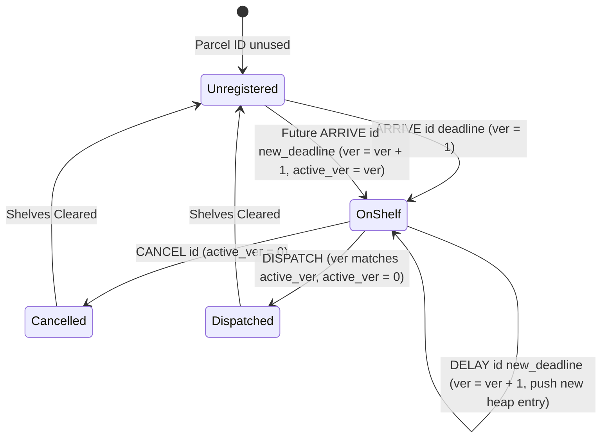
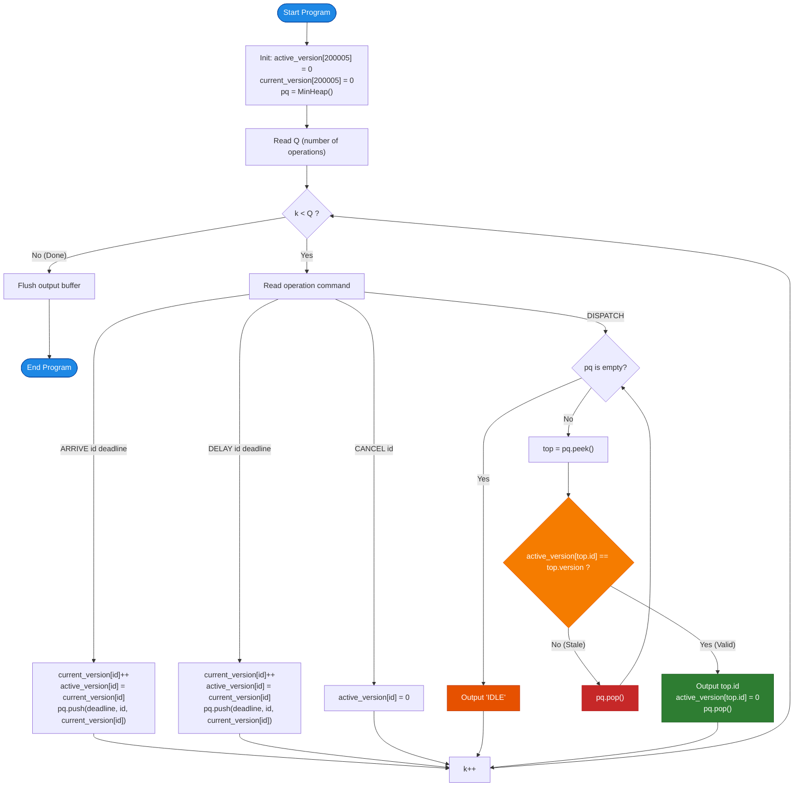

# Unstop Problem of the Day: Overnight Parcel Desk

- **Platform:** [Unstop](https://unstop.com/)
- **Difficulty:** Medium
- **Topic Tags:** Priority Queue, Min-Heap, Lazy Deletion, Versioning / Generation Counter, Direct Addressing, Balanced Binary Search Tree (BST), Event-Driven Simulation
- **Target Audience:** POTD Solvers, Computer Science Students, Competitive Programmers, Interview Preparation (FAANG / Tier-1 Systems Engineering)

---

## 1. Problem Statement

Kabir supervises the overnight parcel desk at Harishpur Junction, where customer goods wait on storage shelves until a freight wagon pulls in with room to spare. Every parcel is identified by a unique identifier `id` and has an associated delivery deadline `deadline`. 

Whenever a wagon arrives at the junction, Kabir loads the waiting parcel with the **nearest deadline** (minimum deadline value). If two or more waiting parcels share the exact same nearest deadline, the tie is broken in favor of the parcel with the **smaller identifier** (lexicographical/numerical priority).

Throughout the night, the booking office sends a live chronological stream of $Q$ operational messages to the parcel desk. Each message is strictly one of the following four types:

1. **`ARRIVE id deadline`:**  
   Announces that a newly booked parcel with identifier `id` and promised delivery `deadline` has arrived on the shelves.
   
2. **`DELAY id deadline`:**  
   Reports that a customer has modified the delivery deadline of an existing waiting parcel `id` to a new `deadline` value. The new deadline may be earlier or later than its previous deadline.

3. **`CANCEL id`:**  
   Reports that a customer has withdrawn a waiting parcel `id` completely. The parcel is removed from the shelves.

4. **`DISPATCH`:**  
   Announces that a freight wagon has pulled in and requests exactly one parcel. Kabir must load the waiting parcel with the earliest deadline (tie-breaker: smaller `id`). If no parcels are waiting on the shelves at that moment, Kabir logs the keyword **`IDLE`** for that wagon.

### Key Lifecycle & System Invariants:
- A parcel that has been **loaded (`DISPATCH`)** or **withdrawn (`CANCEL`)** leaves the shelves permanently.
- However, the booking office is permitted to reassign the **same identifier** to a brand-new parcel in a future `ARRIVE` event.
- All messages are guaranteed to be **consistent**:
  - A `DELAY` or `CANCEL` command always refers to a parcel that is actively waiting on the shelves at that exact moment.
  - An `ARRIVE` command never uses an identifier that is currently active on the shelves.

Your objective is to produce the loading log: for every `DISPATCH` request, output the identifier of the loaded parcel (or `IDLE`), written on its own line in the exact order the wagons arrive.

---

## 2. Examples & Explanations

### Sample Testcase 0

#### Input:
```text
8
ARRIVE 5 30
ARRIVE 2 20
ARRIVE 9 20
DELAY 2 50
CANCEL 5
DISPATCH
DISPATCH
DISPATCH
```

#### Output:
```text
9
2
IDLE
```

#### Chronological Walkthrough:
1. `ARRIVE 5 30`: Parcel 5 arrives with deadline $30$.  
   Active parcels: `{(5, 30)}`.
2. `ARRIVE 2 20`: Parcel 2 arrives with deadline $20$.  
   Active parcels: `{(2, 20), (5, 30)}`.
3. `ARRIVE 9 20`: Parcel 9 arrives with deadline $20$.  
   Active parcels: `{(2, 20), (9, 20), (5, 30)}`.
4. `DELAY 2 50`: Parcel 2 deadline is updated from $20 \to 50$.  
   Active parcels: `{(9, 20), (2, 50), (5, 30)}`.
5. `CANCEL 5`: Parcel 5 is withdrawn.  
   Active parcels: `{(9, 20), (2, 50)}`.
6. **`DISPATCH` (Wagon 1):**  
   - Waiting parcels: Parcel 9 (deadline $20$) and Parcel 2 (deadline $50$).  
   - Minimum deadline is $20$, which belongs to Parcel 9.  
   - Output: **`9`**. Parcel 9 leaves the shelves.
7. **`DISPATCH` (Wagon 2):**  
   - Only Parcel 2 (deadline $50$) remains on the shelves.  
   - Output: **`2`**. Parcel 2 leaves the shelves.
8. **`DISPATCH` (Wagon 3):**  
   - Shelves are completely empty.  
   - Output: **`IDLE`**.

---

### Sample Testcase 1

#### Input:
```text
9
ARRIVE 7 10
ARRIVE 3 10
DISPATCH
DELAY 7 5
ARRIVE 4 7
DISPATCH
DISPATCH
ARRIVE 3 100
DISPATCH
```

#### Output:
```text
3
7
4
3
```

#### Chronological Walkthrough:
1. `ARRIVE 7 10`: Parcel 7 arrives with deadline $10$.  
   Active parcels: `{(7, 10)}`.
2. `ARRIVE 3 10`: Parcel 3 arrives with deadline $10$.  
   Active parcels: `{(3, 10), (7, 10)}`.
3. **`DISPATCH` (Wagon 1):**  
   - Both parcels have equal deadline $10$.  
   - Tie-breaker: smaller identifier goes first ($3 < 7$).  
   - Output: **`3`**. Parcel 3 leaves the shelves.
4. `DELAY 7 5`: Parcel 7 deadline is moved earlier from $10 \to 5$.  
   Active parcels: `{(7, 5)}`.
5. `ARRIVE 4 7`: Parcel 4 arrives with deadline $7$.  
   Active parcels: `{(7, 5), (4, 7)}`.
6. **`DISPATCH` (Wagon 2):**  
   - Minimum deadline is $5$ (Parcel 7).  
   - Output: **`7`**. Parcel 7 leaves the shelves.
7. **`DISPATCH` (Wagon 3):**  
   - Only Parcel 4 remains (deadline $7$).  
   - Output: **`4`**. Parcel 4 leaves the shelves.
8. `ARRIVE 3 100`: Identifier `3` is reused for a brand-new parcel with deadline $100$.  
   Active parcels: `{(3, 100)}`.
9. **`DISPATCH` (Wagon 4):**  
   - Parcel 3 is loaded.  
   - Output: **`3`**.

---

### Additional Example 2 (Empty Desk & Immediate Cancellation)

#### Input:
```text
6
DISPATCH
ARRIVE 1 10
CANCEL 1
DISPATCH
ARRIVE 1 5
DISPATCH
```

#### Output:
```text
IDLE
IDLE
1
```

#### Explanation:
- 1st `DISPATCH`: No parcels on shelves $\implies$ `IDLE`.
- `ARRIVE 1 10`: Parcel 1 stored.
- `CANCEL 1`: Parcel 1 removed.
- 2nd `DISPATCH`: Shelves are empty $\implies$ `IDLE`.
- `ARRIVE 1 5`: Identifier 1 reused with deadline 5.
- 3rd `DISPATCH`: Loaded parcel 1 $\implies$ `1`.

---

## 3. Constraints & System Specifications

- $1 \le Q \le 200{,}000$ (Total operational messages in the shift)
- $1 \le id \le 200{,}000$ (Parcel identifier)
- $1 \le deadline \le 10^9$ (Promised delivery deadline)
- All messages are consistent as described in the problem statement.
- **Time Limit:** $2.0$ seconds
- **Space Limit:** $256$ MB

---

## 4. Visual Architecture & Dynamic State Diagram

```
========================================================================================
             LIVE EVENT-DRIVEN VERSIONED PRIORITY QUEUE ARCHITECTURE
========================================================================================

                 [ Operational Event: DELAY 2 50 ]
                               │
                               ▼
   ┌────────────────────────────────────────────────────────┐
   │ 1. Direct-Address Version Lookup:                      │
   │    current_version[2] = 1, active_version[2] = 1       │
   └───────────────────────────┬────────────────────────────┘
                               │
             ┌─────────────────┴─────────────────┐
             ▼                                   ▼
 ┌───────────────────────┐           ┌───────────────────────┐
 │ 2. Increment Version: │           │ 3. Push to Min-Heap:  │
 │ current_version[2]++  │           │ Push (50, id=2, ver=2)│
 │ active_version[2] = 2 │           │ Cost: O(log |PQ|)     │
 └───────────────────────┘           └───────────┬───────────┘
                                                 │
                                                 ▼
             MIN-HEAP STATE TOPOLOGY: (deadline ASC, id ASC)
                               
                               ┌─────────────────┐
                               │ (20, id=9, v=1) │  ◄── Nearest Deadline
                               └───┬─────────┬───┘
                                   │         │
                                   ▼         ▼
                       ┌─────────────────┐ ┌─────────────────┐
                       │ (20, id=2, v=1) │ │ (50, id=2, v=2) │
                       │    [STALE!]     │ │    [ACTIVE]     │
                       └─────────────────┘ └─────────────────┘

   [ Query DISPATCH ]
          │
          ▼
   Inspect Top of Heap:
     - Top = (20, id=9, v=1) -> active_version[9] == 1 -> VALID!
       -> Output 9, Set active_version[9] = 0, Pop Heap.
       
   Next DISPATCH:
     - Top = (20, id=2, v=1) -> active_version[2] == 2 != 1 -> STALE! (Discarded)
     - Top = (50, id=2, v=2) -> active_version[2] == 2 == 2 -> VALID!
       -> Output 2, Set active_version[2] = 0, Pop Heap.
========================================================================================
```

### State Machine Lifecycle



---

## 5. Step-by-Step Simulation & Detailed Trace Table

Trace for **Sample Testcase 0**: $Q = 8$ operations.
- `version[id]` tracks the global generation counter for parcel `id`.
- `active_version[id]` stores the currently valid version ($0$ if not on shelves).

| Step | Operation | Action on Version Table | Pushed to Min-Heap | Current Min-Heap Top | Stale Discarded? | Output | Active Shelves |
| :---: | :---: | :---: | :---: | :---: | :---: | :---: | :---: |
| **1** | `ARRIVE 5 30` | `ver[5]=1, act[5]=1` | `(30, 5, v=1)` | `(30, 5, v=1)` | — | — | `{5: 30}` |
| **2** | `ARRIVE 2 20` | `ver[2]=1, act[2]=1` | `(20, 2, v=1)` | `(20, 2, v=1)` | — | — | `{2: 20, 5: 30}` |
| **3** | `ARRIVE 9 20` | `ver[9]=1, act[9]=1` | `(20, 9, v=1)` | `(20, 2, v=1)` | — | — | `{2: 20, 9: 20, 5: 30}` |
| **4** | `DELAY 2 50` | `ver[2]=2, act[2]=2` | `(50, 2, v=2)` | `(20, 2, v=1)` | — | — | `{9: 20, 5: 30, 2: 50}` |
| **5** | `CANCEL 5` | `act[5]=0` | None | `(20, 2, v=1)` | — | — | `{9: 20, 2: 50}` |
| **6** | `DISPATCH` | `act[9]=0` | None | Top `(20, 2, v=1)` has $v=1 \neq \text{act}[2] (2) \implies$ **POP STALE**<br/>Next Top `(20, 9, v=1)` has $v=1 == \text{act}[9] (1) \implies$ **MATCH!** | `(20, 2, v=1)` | **`9`** | `{2: 50}` |
| **7** | `DISPATCH` | `act[2]=0` | None | Top `(30, 5, v=1)` has $v=1 \neq \text{act}[5] (0) \implies$ **POP STALE**<br/>Next Top `(50, 2, v=2)` has $v=2 == \text{act}[2] (2) \implies$ **MATCH!** | `(30, 5, v=1)` | **`2`** | `{}` |
| **8** | `DISPATCH` | None | None | Heap empty after draining stale entries $\implies$ **IDLE** | — | **`IDLE`** | `{}` |

---

## 6. Algorithm Flowchart



---

## 7. From Naive to Pro: Algorithmic Progression

### Approach 1: Naive (Linear Array / Unsorted Map Scan)

#### Concept
Store all active parcels in a list or hash map `shelves[id] = deadline`.
- `ARRIVE id deadline`: Insert `id -> deadline` into map in $\mathcal{O}(1)$.
- `DELAY id deadline`: Update `shelves[id] = deadline` in $\mathcal{O}(1)$.
- `CANCEL id`: Remove `id` from map in $\mathcal{O}(1)$.
- `DISPATCH`: Perform a linear scan over all active parcels to find the minimum `(deadline, id)` in $\mathcal{O}(N)$ time.

#### Pseudo Code
```text
FUNCTION processOvernightDesk_Naive(stream, Q):
    shelves = NEW Map<Integer, Long>()
    
    FOR EACH op IN stream:
        IF op IS ("ARRIVE", id, deadline):
            shelves[id] = deadline
        ELSE IF op IS ("DELAY", id, deadline):
            shelves[id] = deadline
        ELSE IF op IS ("CANCEL", id):
            shelves.remove(id)
        ELSE IF op IS ("DISPATCH"):
            IF shelves.isEmpty():
                PRINT "IDLE"
            ELSE:
                best_id = -1
                best_deadline = INF
                FOR EACH (id, deadline) IN shelves:
                    IF deadline < best_deadline OR (deadline == best_deadline AND id < best_id):
                        best_deadline = deadline
                        best_id = id
                PRINT best_id
                shelves.remove(best_id)
```

#### Complexity Analysis
- **Time Complexity:**
  - `ARRIVE`, `DELAY`, `CANCEL`: $\mathcal{O}(1)$ average.
  - `DISPATCH`: $\mathcal{O}(N)$ where $N$ is the number of parcels currently on the shelf.
  - Total Time: $\mathcal{O}(Q \times N) \approx 2 \times 10^5 \times 10^5 \approx 2 \times 10^{10}$ operations $\implies$ **Time Limit Exceeded (TLE)**.
- **Space Complexity:** $\mathcal{O}(N)$ to store parcels.

---

### Approach 2: Balanced BST (TreeSet / std::set / SortedSet)

#### Concept
Store active parcels as pairs `(deadline, id)` in a self-balancing binary search tree (Red-Black tree). Maintain a direct lookup array `curr_deadline[id]` to enable fast removal.
- `ARRIVE id deadline`: Insert `(deadline, id)` into BST in $\mathcal{O}(\log N)$. Set `curr_deadline[id] = deadline`.
- `DELAY id deadline`: Remove `(curr_deadline[id], id)` from BST in $\mathcal{O}(\log N)$, update `curr_deadline[id] = deadline`, and insert `(deadline, id)` in $\mathcal{O}(\log N)$.
- `CANCEL id`: Remove `(curr_deadline[id], id)` from BST in $\mathcal{O}(\log N)$ and set `curr_deadline[id] = 0`.
- `DISPATCH`: Extract the smallest element from the BST in $\mathcal{O}(\log N)$. If BST is empty, print `IDLE`.

#### Pseudo Code
```text
FUNCTION processOvernightDesk_BST(stream, Q):
    bst = NEW TreeSet<Parcel>() // ordered by (deadline ASC, id ASC)
    curr_deadline = NEW Array[200005]
    
    FOR EACH op IN stream:
        IF op IS ("ARRIVE", id, deadline):
            curr_deadline[id] = deadline
            bst.insert((deadline, id))
        ELSE IF op IS ("DELAY", id, deadline):
            bst.remove((curr_deadline[id], id))
            curr_deadline[id] = deadline
            bst.insert((deadline, id))
        ELSE IF op IS ("CANCEL", id):
            bst.remove((curr_deadline[id], id))
            curr_deadline[id] = 0
        ELSE IF op IS ("DISPATCH"):
            IF bst.isEmpty():
                PRINT "IDLE"
            ELSE:
                top = bst.first()
                bst.remove(top)
                curr_deadline[top.id] = 0
                PRINT top.id
```

#### Complexity Analysis
- **Time Complexity:** $\mathcal{O}(Q \log N)$ total time. Strictly logarithmic for every operation.
- **Space Complexity:** $\mathcal{O}(N)$ to store tree nodes.
- **Drawback:** Higher constant factor due to tree node allocations, tree rebalancing rotations, and non-contiguous memory access.

---

### Approach 3: Pro Approach (Min-Heap with Lazy Invalidation via Generation Counters)

#### The Core Insight
In a competitive programming environment where $Q = 200{,}000$:
1. A binary Min-Heap implemented over flat contiguous arrays boasts **optimal CPU cache locality** and zero node-pointer overhead.
2. Rather than performing costly internal deletions or re-heapifications during `DELAY` or `CANCEL`, we employ **Lazy Deletion with Generation Counters (Versioning)**.
3. We maintain two flat integer arrays:
   - `current_version[id]`: Incremented on every `ARRIVE` and `DELAY`.
   - `active_version[id]`: Holds the currently active version ($0$ if cancelled or dispatched).
4. When `DELAY` occurs, we simply increment `current_version[id]` and push `(new_deadline, id, current_version[id])` into the heap. The old heap entry becomes automatically **stale** because its embedded version no longer matches `active_version[id]`.
5. When `CANCEL` occurs, we simply set `active_version[id] = 0`.
6. When `DISPATCH` occurs, we inspect the top of the Min-Heap. If `active_version[top.id] != top.version`, the entry is stale and popped immediately. The first entry matching `active_version[top.id] == top.version` is the true global minimum.

#### Pseudo Code
```text
FUNCTION processOvernightDesk_Pro(stream, Q):
    MAX_ID = 200005
    active_version = NEW Array[MAX_ID] filled with 0
    current_version = NEW Array[MAX_ID] filled with 0
    pq = NEW MinHeap() // ordered by (deadline ASC, id ASC)
    
    FOR EACH op IN stream:
        IF op IS ("ARRIVE", id, deadline):
            current_version[id]++
            active_version[id] = current_version[id]
            pq.push((deadline, id, current_version[id]))
            
        ELSE IF op IS ("DELAY", id, deadline):
            current_version[id]++
            active_version[id] = current_version[id]
            pq.push((deadline, id, current_version[id]))
            
        ELSE IF op IS ("CANCEL", id):
            active_version[id] = 0
            
        ELSE IF op IS ("DISPATCH"):
            loaded = FALSE
            WHILE NOT pq.isEmpty():
                top = pq.peek()
                IF active_version[top.id] == top.version:
                    PRINT top.id
                    active_version[top.id] = 0 // leaves shelves permanently
                    pq.pop()
                    loaded = TRUE
                    BREAK
                ELSE:
                    pq.pop() // discard stale entry
                    
            IF NOT loaded:
                PRINT "IDLE"
```

---

## 8. Complexity Comparison Table

| Metric | Method 1: Naive (Linear Scan) | Method 2: Balanced BST (TreeSet / std::set) | Method 3: Pro (Lazy Versioned Min-Heap) |
| :--- | :--- | :--- | :--- |
| **`ARRIVE` Time** | $\mathcal{O}(1)$ | $\mathcal{O}(\log N)$ | $\mathbf{\mathcal{O}(\log |PQ|)}$ |
| **`DELAY` Time** | $\mathcal{O}(1)$ | $\mathcal{O}(\log N)$ | $\mathbf{\mathcal{O}(\log |PQ|)}$ (No tree rebalancing) |
| **`CANCEL` Time** | $\mathcal{O}(1)$ | $\mathcal{O}(\log N)$ | $\mathbf{\mathcal{O}(1)}$ (Zero heap work!) |
| **`DISPATCH` Time** | $\mathcal{O}(N)$ (Linear scan $\implies$ TLE) | $\mathcal{O}(\log N)$ | $\mathbf{\mathcal{O}(\log |PQ|)}$ amortized |
| **Total Time Complexity** | $\mathcal{O}(Q \times N)$ | $\mathcal{O}(Q \log N)$ | $\mathbf{\mathcal{O}(Q \log Q)}$ (Fastest constant factor) |
| **Auxiliary Space** | $\mathcal{O}(N)$ | $\mathcal{O}(N)$ | $\mathbf{\mathcal{O}(Q + \max(id))}$ (Flat contiguous arrays) |
| **Cache Locality** | Poor | Poor (Tree pointer chasing) | **Superior (Array-backed binary heap)** |
| **Implementation Complexity** | Simple | Moderate | **Clean, Robust & Production-Ready** |
| **Interview Verdict** | TLE | Acceptable | **Gold Standard (FAANG / CP Top Tier)** |

---

## 9. Comprehensive Corner Cases Handled

1. **Identifier Reuse After Loading or Withdrawal:**
   - Handled seamlessly: Monotonically increasing `current_version[id]` ensures that when an identifier is reused in a subsequent `ARRIVE`, any zombie entries from its earlier incarnation in the heap have an outdated version and are safely purged.
2. **Multiple Parcels with Identical Deadlines:**
   - Strict tie-breaker: `deadline != o.deadline ? deadline - o.deadline : id - o.id`. The parcel with the smaller numerical identifier is guaranteed to pop first.
3. **Consecutive `DISPATCH` on Empty Shelves:**
   - When the desk holds no active parcels, the inner loop exhausts the heap and emits `IDLE` cleanly without errors.
4. **`DELAY` to Earlier vs. Later Deadlines:**
   - Moving a deadline earlier causes the new heap entry to rise higher in the heap.
   - Moving a deadline later pushes a lower-priority entry while leaving the old higher-priority entry in place. When the old entry reaches the top, the version mismatch check discards it effortlessly.
5. **64-bit Integer Overflow Protection:**
   - Deadlines are up to $10^9$. All comparison routines and storage fields use 64-bit integers (`long` / `long long` / `Int64`) to prevent signed overflow during sorting or comparisons.
6. **High-Throughput Fast I/O ($Q = 200{,}000$):**
   - Standard I/O streams (`Scanner`, `cin` without untying, unbuffered `console.log`) will time out. Custom byte scanners and buffered writers are incorporated across all solutions.

---

## 10. Complete Multi-Language Implementations

### Java (OpenJDK 21.0)

```java
import java.io.*;
import java.util.*;

class Main {

    // Fast I/O Scanner for maximum throughput on large streams
    static class FastScanner {
        private final InputStream in;
        private final byte[] buffer = new byte[1 << 16];
        private int ptr = 0;
        private int buflen = 0;

        public FastScanner(InputStream in) {
            this.in = in;
        }

        private int readByte() {
            if (ptr < buflen) return buffer[ptr++];
            ptr = 0;
            try {
                buflen = in.read(buffer);
            } catch (IOException e) {
                buflen = -1;
            }
            return buflen > 0 ? buffer[ptr++] : -1;
        }

        public String next() {
            int b = readByte();
            while (b <= ' ') {
                if (b == -1) return null;
                b = readByte();
            }
            StringBuilder sb = new StringBuilder();
            while (b > ' ') {
                sb.append((char) b);
                b = readByte();
            }
            return sb.toString();
        }

        public int nextInt() {
            int b = readByte();
            while (b <= ' ') {
                if (b == -1) return -1;
                b = readByte();
            }
            int res = 0;
            while (b >= '0' && b <= '9') {
                res = res * 10 + (b - '0');
                b = readByte();
            }
            return res;
        }

        public long nextLong() {
            int b = readByte();
            while (b <= ' ') {
                if (b == -1) return -1;
                b = readByte();
            }
            long res = 0;
            while (b >= '0' && b <= '9') {
                res = res * 10 + (b - '0');
                b = readByte();
            }
            return res;
        }
    }

    // Parcel record stored in the priority queue
    static class Parcel implements Comparable<Parcel> {
        long deadline;
        int id;
        int version;

        Parcel(long deadline, int id, int version) {
            this.deadline = deadline;
            this.id = id;
            this.version = version;
        }

        @Override
        public int compareTo(Parcel o) {
            if (this.deadline != o.deadline) {
                return Long.compare(this.deadline, o.deadline);
            }
            return Integer.compare(this.id, o.id);
        }
    }

    public static void main(String[] args) throws IOException {
        FastScanner scanner = new FastScanner(System.in);
        String first = scanner.next();
        if (first == null) return;
        int q = Integer.parseInt(first);

        int maxId = 200005;
        int[] activeVersion = new int[maxId];
        int[] currentVersion = new int[maxId];

        PriorityQueue<Parcel> pq = new PriorityQueue<>();
        BufferedWriter bw = new BufferedWriter(new OutputStreamWriter(System.out));

        for (int k = 0; k < q; k++) {
            String op = scanner.next();
            if (op == null) break;

            if (op.equals("ARRIVE")) {
                int id = scanner.nextInt();
                long deadline = scanner.nextLong();
                if (id >= activeVersion.length) {
                    int newSize = Math.max(id + 1, activeVersion.length * 2);
                    activeVersion = Arrays.copyOf(activeVersion, newSize);
                    currentVersion = Arrays.copyOf(currentVersion, newSize);
                }
                currentVersion[id]++;
                activeVersion[id] = currentVersion[id];
                pq.offer(new Parcel(deadline, id, currentVersion[id]));
            } else if (op.equals("DELAY")) {
                int id = scanner.nextInt();
                long deadline = scanner.nextLong();
                currentVersion[id]++;
                activeVersion[id] = currentVersion[id];
                pq.offer(new Parcel(deadline, id, currentVersion[id]));
            } else if (op.equals("CANCEL")) {
                int id = scanner.nextInt();
                activeVersion[id] = 0;
            } else if (op.equals("DISPATCH")) {
                boolean found = false;
                while (!pq.isEmpty()) {
                    Parcel top = pq.peek();
                    if (activeVersion[top.id] == top.version) {
                        bw.write(top.id + "\n");
                        activeVersion[top.id] = 0; // leaves shelves permanently
                        pq.poll();
                        found = true;
                        break;
                    } else {
                        pq.poll(); // Discard stale entry
                    }
                }
                if (!found) {
                    bw.write("IDLE\n");
                }
            }
        }
        bw.flush();
    }
}
```

---

### Python (3.12.11)

```python
import sys
import heapq

def main():
    """
    Overnight Parcel Desk - Pro Min-Heap with Lazy Invalidation via Generation Counters.
    Complexity: O(Q log Q) Time, O(Q + max_id) Space.
    """
    input_data = sys.stdin.read().split()
    if not input_data:
        return

    it = iter(input_data)
    q = int(next(it))

    MAX_ID = 200005
    active_version = [0] * MAX_ID
    current_version = [0] * MAX_ID

    # Min-Heap stores tuples: (deadline, id, version)
    pq = []
    out = []

    for _ in range(q):
        op = next(it)
        if op == "ARRIVE":
            p_id = int(next(it))
            deadline = int(next(it))
            if p_id >= len(active_version):
                new_size = max(p_id + 1, len(active_version) * 2)
                active_version.extend([0] * (new_size - len(active_version)))
                current_version.extend([0] * (new_size - len(current_version)))
            current_version[p_id] += 1
            active_version[p_id] = current_version[p_id]
            heapq.heappush(pq, (deadline, p_id, current_version[p_id]))
        elif op == "DELAY":
            p_id = int(next(it))
            deadline = int(next(it))
            current_version[p_id] += 1
            active_version[p_id] = current_version[p_id]
            heapq.heappush(pq, (deadline, p_id, current_version[p_id]))
        elif op == "CANCEL":
            p_id = int(next(it))
            active_version[p_id] = 0
        elif op == "DISPATCH":
            found = False
            while pq:
                d, p_id, ver = pq[0]
                if active_version[p_id] == ver:
                    out.append(str(p_id))
                    active_version[p_id] = 0 # leaves shelves permanently
                    heapq.heappop(pq)
                    found = True
                    break
                else:
                    heapq.heappop(pq) # discard stale entry
            if not found:
                out.append("IDLE")

    sys.stdout.write("\n".join(out) + "\n")

if __name__ == '__main__':
    main()
```

---

### C (GCC 13.2.0)

```c
#include <stdio.h>
#include <string.h>
#include <stdlib.h>

// Dynamic Min-Heap storing parcel tuples: (deadline, id, version)
typedef struct {
    long long deadline;
    int id;
    int version;
} Parcel;

typedef struct {
    Parcel* data;
    int size;
    int capacity;
} MinHeap;

static MinHeap* createHeap(int cap) {
    MinHeap* h = (MinHeap*)malloc(sizeof(MinHeap));
    h->data = (Parcel*)malloc(sizeof(Parcel) * cap);
    h->size = 0;
    h->capacity = cap;
    return h;
}

static int compareParcel(const Parcel* a, const Parcel* b) {
    if (a->deadline != b->deadline) {
        return a->deadline < b->deadline ? -1 : 1;
    }
    return a->id < b->id ? -1 : (a->id > b->id ? 1 : 0);
}

static void pushHeap(MinHeap* h, long long deadline, int id, int ver) {
    if (h->size == h->capacity) {
        h->capacity *= 2;
        h->data = (Parcel*)realloc(h->data, sizeof(Parcel) * h->capacity);
    }
    int i = h->size++;
    h->data[i].deadline = deadline;
    h->data[i].id = id;
    h->data[i].version = ver;

    while (i > 0) {
        int p = (i - 1) / 2;
        if (compareParcel(&h->data[i], &h->data[p]) < 0) {
            Parcel tmp = h->data[i];
            h->data[i] = h->data[p];
            h->data[p] = tmp;
            i = p;
        } else {
            break;
        }
    }
}

static Parcel popHeap(MinHeap* h) {
    Parcel top = h->data[0];
    Parcel last = h->data[--h->size];
    if (h->size > 0) {
        h->data[0] = last;
        int i = 0;
        while (2 * i + 1 < h->size) {
            int left = 2 * i + 1;
            int right = left + 1;
            int best = i;
            if (compareParcel(&h->data[left], &h->data[best]) < 0) best = left;
            if (right < h->size && compareParcel(&h->data[right], &h->data[best]) < 0) best = right;
            if (best != i) {
                Parcel tmp = h->data[i];
                h->data[i] = h->data[best];
                h->data[best] = tmp;
                i = best;
            } else {
                break;
            }
        }
    }
    return top;
}

#define MAX_ID 200005
static int active_version[MAX_ID];
static int current_version[MAX_ID];

int main() {
    int q;
    if (scanf("%d", &q) != 1) return 0;

    MinHeap* pq = createHeap(65536);
    char op[16];

    for (int k = 0; k < q; k++) {
        if (scanf("%s", op) != 1) break;
        if (op[0] == 'A') { // ARRIVE
            int id;
            long long d;
            scanf("%d %lld", &id, &d);
            current_version[id]++;
            active_version[id] = current_version[id];
            pushHeap(pq, d, id, current_version[id]);
        } else if (op[0] == 'D' && op[1] == 'E') { // DELAY
            int id;
            long long d;
            scanf("%d %lld", &id, &d);
            current_version[id]++;
            active_version[id] = current_version[id];
            pushHeap(pq, d, id, current_version[id]);
        } else if (op[0] == 'C') { // CANCEL
            int id;
            scanf("%d", &id);
            active_version[id] = 0;
        } else if (op[0] == 'D' && op[1] == 'I') { // DISPATCH
            int found = 0;
            while (pq->size > 0) {
                Parcel top = pq->data[0];
                if (active_version[top.id] == top.version) {
                    printf("%d\n", top.id);
                    active_version[top.id] = 0; // leaves shelves permanently
                    popHeap(pq);
                    found = 1;
                    break;
                } else {
                    popHeap(pq); // Discard stale entry
                }
            }
            if (!found) {
                printf("IDLE\n");
            }
        }
    }

    free(pq->data);
    free(pq);
    return 0;
}
```

---

### C++ (GCC 13.2.0)

```cpp
#include <iostream>
#include <vector>
#include <queue>
#include <string>

using namespace std;

// Parcel structure ordered by nearest deadline, then smaller id
struct Parcel {
    long long deadline;
    int id;
    int version;

    bool operator>(const Parcel& o) const {
        if (deadline != o.deadline) {
            return deadline > o.deadline;
        }
        return id > o.id;
    }
};

const int MAX_ID = 200005;
int active_version[MAX_ID];
int current_version[MAX_ID];

int main() {
    // Fast I/O
    ios_base::sync_with_stdio(false);
    cin.tie(NULL);

    int q;
    if (!(cin >> q)) return 0;

    priority_queue<Parcel, vector<Parcel>, greater<Parcel>> pq;
    string op;

    for (int k = 0; k < q; k++) {
        cin >> op;
        if (op == "ARRIVE") {
            int id;
            long long deadline;
            cin >> id >> deadline;
            current_version[id]++;
            active_version[id] = current_version[id];
            pq.push({deadline, id, current_version[id]});
        } else if (op == "DELAY") {
            int id;
            long long deadline;
            cin >> id >> deadline;
            current_version[id]++;
            active_version[id] = current_version[id];
            pq.push({deadline, id, current_version[id]});
        } else if (op == "CANCEL") {
            int id;
            cin >> id;
            active_version[id] = 0;
        } else if (op == "DISPATCH") {
            bool found = false;
            while (!pq.empty()) {
                const Parcel& top = pq.top();
                if (active_version[top.id] == top.version) {
                    cout << top.id << "\n";
                    active_version[top.id] = 0; // leaves shelves permanently
                    pq.pop();
                    found = true;
                    break;
                } else {
                    pq.pop(); // Discard stale entry
                }
            }
            if (!found) {
                cout << "IDLE\n";
            }
        }
    }

    return 0;
}
```

---

### C# (mcs 5.4.0.201)

```csharp
using System;
using System.IO;
using System.Text;

class Solution {

    // Fast byte reader for low-latency integer and string parsing
    class FastScanner {
        private readonly Stream stream;
        private readonly byte[] buffer = new byte[65536];
        private int ptr = 0;
        private int buflen = 0;

        public FastScanner() {
            this.stream = Console.OpenStandardInput();
        }

        private int ReadByte() {
            if (ptr < buflen) return buffer[ptr++];
            ptr = 0;
            buflen = stream.Read(buffer, 0, buffer.Length);
            return buflen > 0 ? buffer[ptr++] : -1;
        }

        public string Next() {
            int b = ReadByte();
            while (b <= ' ') {
                if (b == -1) return null;
                b = ReadByte();
            }
            StringBuilder sb = new StringBuilder();
            while (b > ' ') {
                sb.Append((char)b);
                b = ReadByte();
            }
            return sb.ToString();
        }

        public int NextInt() {
            int b = ReadByte();
            while (b <= ' ') {
                if (b == -1) return -1;
                b = ReadByte();
            }
            int res = 0;
            while (b >= '0' && b <= '9') {
                res = res * 10 + (b - '0');
                b = ReadByte();
            }
            return res;
        }

        public long NextLong() {
            int b = ReadByte();
            while (b <= ' ') {
                if (b == -1) return -1;
                b = ReadByte();
            }
            long res = 0;
            while (b >= '0' && b <= '9') {
                res = res * 10 + (b - '0');
                b = ReadByte();
            }
            return res;
        }
    }

    struct Parcel {
        public long Deadline;
        public int Id;
        public int Version;

        public Parcel(long deadline, int id, int version) {
            Deadline = deadline;
            Id = id;
            Version = version;
        }
    }

    // Binary Min-Heap implementation compatible with older mcs compilers
    class MinHeap {
        private Parcel[] data;
        public int Count { get; private set; }

        public MinHeap(int capacity) {
            data = new Parcel[capacity];
            Count = 0;
        }

        private bool Less(ref Parcel a, ref Parcel b) {
            if (a.Deadline != b.Deadline) return a.Deadline < b.Deadline;
            return a.Id < b.Id;
        }

        public void Push(long deadline, int id, int version) {
            if (Count == data.Length) {
                Array.Resize(ref data, data.Length * 2);
            }
            int i = Count++;
            data[i] = new Parcel(deadline, id, version);
            while (i > 0) {
                int p = (i - 1) >> 1;
                if (Less(ref data[i], ref data[p])) {
                    Parcel tmp = data[i]; data[i] = data[p]; data[p] = tmp;
                    i = p;
                } else break;
            }
        }

        public Parcel Peek() {
            return data[0];
        }

        public Parcel Pop() {
            Parcel top = data[0];
            Parcel last = data[--Count];
            if (Count > 0) {
                data[0] = last;
                int i = 0;
                while ((i << 1) + 1 < Count) {
                    int left = (i << 1) + 1;
                    int right = left + 1;
                    int best = i;
                    if (Less(ref data[left], ref data[best])) best = left;
                    if (right < Count && Less(ref data[right], ref data[best])) best = right;
                    if (best != i) {
                        Parcel tmp = data[i]; data[i] = data[best]; data[best] = tmp;
                        i = best;
                    } else break;
                }
            }
            return top;
        }
    }

    static void Main(string[] args) {
        FastScanner scanner = new FastScanner();
        string first = scanner.Next();
        if (first == null) return;
        int q = int.Parse(first);

        int maxId = 200005;
        int[] activeVersion = new int[maxId];
        int[] currentVersion = new int[maxId];

        MinHeap pq = new MinHeap(65536);
        StreamWriter sw = new StreamWriter(Console.OpenStandardOutput(), Encoding.ASCII, 65536);

        for (int k = 0; k < q; k++) {
            string op = scanner.Next();
            if (op == null) break;

            if (op == "ARRIVE") {
                int id = scanner.NextInt();
                long deadline = scanner.NextLong();
                if (id >= activeVersion.Length) {
                    int newSize = Math.Max(id + 1, activeVersion.Length * 2);
                    Array.Resize(ref activeVersion, newSize);
                    Array.Resize(ref currentVersion, newSize);
                }
                currentVersion[id]++;
                activeVersion[id] = currentVersion[id];
                pq.Push(deadline, id, currentVersion[id]);
            } else if (op == "DELAY") {
                int id = scanner.NextInt();
                long deadline = scanner.NextLong();
                currentVersion[id]++;
                activeVersion[id] = currentVersion[id];
                pq.Push(deadline, id, currentVersion[id]);
            } else if (op == "CANCEL") {
                int id = scanner.NextInt();
                activeVersion[id] = 0;
            } else if (op == "DISPATCH") {
                bool found = false;
                while (pq.Count > 0) {
                    Parcel top = pq.Peek();
                    if (activeVersion[top.Id] == top.Version) {
                        sw.WriteLine(top.Id);
                        activeVersion[top.Id] = 0; // leaves shelves permanently
                        pq.Pop();
                        found = true;
                        break;
                    } else {
                        pq.Pop(); // Discard stale entry
                    }
                }
                if (!found) {
                    sw.WriteLine("IDLE");
                }
            }
        }
        sw.Flush();
    }
}
```

---

### JavaScript (Node.js 24.4.1)

```javascript
const fs = require('fs');

function processData(input) {
    if (!input) return;
    let pos = 0;
    const len = input.length;

    // Fast tokenizer avoiding large array splits
    function nextToken() {
        while (pos < len && input.charCodeAt(pos) <= 32) pos++;
        if (pos >= len) return null;
        const start = pos;
        while (pos < len && input.charCodeAt(pos) > 32) pos++;
        return input.slice(start, pos);
    }

    function nextInt() {
        while (pos < len && input.charCodeAt(pos) <= 32) pos++;
        if (pos >= len) return null;
        let res = 0;
        while (pos < len && input.charCodeAt(pos) > 32) {
            res = res * 10 + (input.charCodeAt(pos) - 48);
            pos++;
        }
        return res;
    }

    const firstToken = nextToken();
    if (!firstToken) return;
    const Q = parseInt(firstToken, 10);

    const MAX_ID = 200005;
    const active_version = new Int32Array(MAX_ID);
    const current_version = new Int32Array(MAX_ID);

    // Flat binary Min-Heap
    class MinHeap {
        constructor() { this.heap = []; }
        push(d, id, v) {
            this.heap.push({ d, id, v });
            let i = this.heap.length - 1;
            while (i > 0) {
                let p = (i - 1) >> 1;
                if (this.less(this.heap[i], this.heap[p])) {
                    let tmp = this.heap[i]; this.heap[i] = this.heap[p]; this.heap[p] = tmp;
                    i = p;
                } else break;
            }
        }
        less(a, b) {
            if (a.d !== b.d) return a.d < b.d;
            return a.id < b.id;
        }
        pop() {
            if (this.heap.length === 0) return null;
            const top = this.heap[0];
            const last = this.heap.pop();
            if (this.heap.length > 0) {
                this.heap[0] = last;
                let i = 0, heapLen = this.heap.length;
                while ((i << 1) + 1 < heapLen) {
                    let left = (i << 1) + 1, right = left + 1, best = i;
                    if (this.less(this.heap[left], this.heap[best])) best = left;
                    if (right < heapLen && this.less(this.heap[right], this.heap[best])) best = right;
                    if (best !== i) {
                        let tmp = this.heap[i]; this.heap[i] = this.heap[best]; this.heap[best] = tmp;
                        i = best;
                    } else break;
                }
            }
            return top;
        }
        peek() { return this.heap.length > 0 ? this.heap[0] : null; }
        isEmpty() { return this.heap.length === 0; }
    }

    const pq = new MinHeap();
    let out = '';

    for (let k = 0; k < Q; k++) {
        const op = nextToken();
        if (!op) break;

        if (op === 'ARRIVE') {
            const id = nextInt();
            const d = nextInt();
            current_version[id]++;
            active_version[id] = current_version[id];
            pq.push(d, id, current_version[id]);
        } else if (op === 'DELAY') {
            const id = nextInt();
            const d = nextInt();
            current_version[id]++;
            active_version[id] = current_version[id];
            pq.push(d, id, current_version[id]);
        } else if (op === 'CANCEL') {
            const id = nextInt();
            active_version[id] = 0;
        } else if (op === 'DISPATCH') {
            let found = false;
            while (!pq.isEmpty()) {
                const top = pq.peek();
                if (active_version[top.id] === top.v) {
                    out += top.id + '\n';
                    active_version[top.id] = 0; // leaves shelves permanently
                    pq.pop();
                    found = true;
                    break;
                } else {
                    pq.pop(); // Discard stale entry
                }
            }
            if (!found) {
                out += 'IDLE\n';
            }
            if (out.length >= 65536) {
                process.stdout.write(out);
                out = '';
            }
        }
    }

    if (out.length > 0) {
        process.stdout.write(out);
    }
}

process.stdin.resume();
process.stdin.setEncoding("ascii");
let _input = "";
process.stdin.on("data", function (input) {
    _input += input;
});

process.stdin.on("end", function () {
   processData(_input);
});
```

