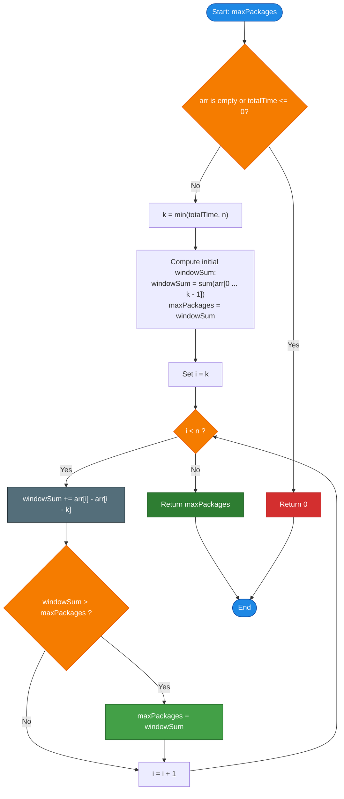

# GeeksforGeeks Problem of the Day: Maximum Packages within Time

- **Problem Link:** [GeeksforGeeks - Maximum Packages within Time](https://www.geeksforgeeks.org/problems/bird-and-maximum-fruit-gathering0509/1)
- **Difficulty:** Easy
- **Topic Tags:** Arrays, Sliding Window, Prefix Sum, Two Pointers, Data Structures, Greedy
- **Target Audience:** POTD Solvers, Computer Science Students, Competitive Programmers, Interview Preparation (FAANG/Tier-1 Tech)

---

## 1. Problem Statement

A delivery agent has to deliver packages at multiple locations arranged in a straight line. 
The number of packages waiting at the $i$-th location is given by an integer array `arr[]`, where `arr[i]` represents the package count at location $i$ (0-indexed).

- The delivery agent can choose to start at **any location** in the line.
- Once started, the agent can only visit **consecutive locations** (moving in one direction along the line).
- Visiting each location takes exactly **$1$ unit of time**.
- The agent is allocated a total time budget of **`totalTime` units**.
- Consequently, the agent can visit at most $\min(\text{totalTime}, n)$ consecutive locations.

Your task is to determine the **maximum total number of packages** the delivery agent can deliver within the given `totalTime`.

---

## 2. Examples & Explanations

### Example 1
- **Input:** `arr = [2, 1, 3, 5, 0, 1, 4]`, `totalTime = 3`
- **Output:** `9`

#### Explanation:
The array size is $n = 7$, and the available time is `totalTime = 3`. The agent can visit any contiguous subarray of size at most $3$:
- Subarray $[0 \dots 2]$: `arr[0] + arr[1] + arr[2] = 2 + 1 + 3 = 6`
- Subarray $[1 \dots 3]$: `arr[1] + arr[2] + arr[3] = 1 + 3 + 5 = 9` $\implies$ **Maximum**
- Subarray $[2 \dots 4]$: `arr[2] + arr[3] + arr[4] = 3 + 5 + 0 = 8`
- Subarray $[3 \dots 5]$: `arr[3] + arr[4] + arr[5] = 5 + 0 + 1 = 6`
- Subarray $[4 \dots 6]$: `arr[4] + arr[5] + arr[6] = 0 + 1 + 4 = 5`

The maximum packages delivered is **`9`** (by visiting locations $1, 2,$ and $3$).

---

### Example 2
- **Input:** `arr = [1, 6, 2, 5, 3, 4]`, `totalTime = 2`
- **Output:** `8`

#### Explanation:
With `totalTime = 2`, the agent visits any two consecutive locations:
- Locations $0$ and $1$: $1 + 6 = 7$
- Locations $1$ and $2$: $6 + 2 = \mathbf{8}$ $\implies$ **Maximum**
- Locations $2$ and $3$: $2 + 5 = 7$
- Locations $3$ and $4$: $5 + 3 = \mathbf{8}$ $\implies$ **Maximum**
- Locations $4$ and $5$: $3 + 4 = 7$

The maximum packages delivered is **`8`**.

---

### Example 3 (Time Greater than or Equal to Array Size)
- **Input:** `arr = [5, 10, 15]`, `totalTime = 5`
- **Output:** `30`

#### Explanation:
Here $n = 3$, but `totalTime = 5`. The agent has enough time to visit all locations in the array:
$$\text{Total packages} = 5 + 10 + 15 = \mathbf{30}$$

---

### Example 4 (Unit Time)
- **Input:** `arr = [10, 20, 30, 5]`, `totalTime = 1`
- **Output:** `30`

#### Explanation:
With `totalTime = 1`, the agent can only visit a single location. The optimal choice is the location with the maximum single value: $\max(10, 20, 30, 5) = \mathbf{30}$.

---

## 3. Constraints & System Specifications

- $1 \le \text{arr.size()} \le 10^5$
- $0 \le \text{arr}[i] \le 10^5$
- $1 \le \text{totalTime} \le 10^8$
- **Expected Time Complexity:** $\mathcal{O}(n)$
- **Expected Auxiliary Space:** $\mathcal{O}(1)$

---

## 4. Visual Architecture & Sliding Window Mechanics

Because the agent can visit at most $k = \min(\text{totalTime}, n)$ consecutive locations and all package counts are non-negative ($\text{arr}[i] \ge 0$), the maximum packages will always be achieved by taking a window of the maximum permissible length $k$.

Instead of recomputing the sum of each window from scratch ($\mathcal{O}(k)$ time per window), we maintain a **fixed-size sliding window of length $k$**:

```text
Initial Window (i = 0 to 2, k = 3):
 ┌─────────────┐
 │  2    1    3│   5    0    1    4      Sum = 2 + 1 + 3 = 6
 └─────────────┘
  [0]  [1]  [2]   [3]  [4]  [5]  [6]

Slide 1 (Subtract arr[0]=2, Add arr[3]=5):
       ┌─────────────┐
  2    │  1    3    5│   0    1    4      Sum = 6 - 2 + 5 = 9  (Max = 9)
       └─────────────┘
 [0]    [1]  [2]  [3]   [4]  [5]  [6]

Slide 2 (Subtract arr[1]=1, Add arr[4]=0):
             ┌─────────────┐
  2    1     │ 3    5    0 │ 1    4      Sum = 9 - 1 + 0 = 8  (Max = 9)
             └─────────────┘
 [0]  [1]     [2]  [3]  [4]  [5]  [6]
```

### Window Transition Invariant:
$$\text{New Window Sum} = \text{Previous Window Sum} - \text{arr}[i - k] + \text{arr}[i]$$

Each slide takes strict $\mathcal{O}(1)$ time. Sliding across all $n - k$ remaining positions yields a total runtime of $\mathcal{O}(n)$.

---

## 5. Step-by-Step Simulation & Trace Table

Let us trace **Example 1**: `arr = [2, 1, 3, 5, 0, 1, 4]`, `totalTime = 3`.
- $n = 7, k = \min(3, 7) = 3$.
- Initial window ($i = 0, 1, 2$): $\text{windowSum} = 2 + 1 + 3 = 6$.
- $\text{maxPackages} = 6$.

| Step / Index $i$ | Subarray Window | Element Leaving (Left) | Element Entering (Right) | Updated `windowSum` | Comparison / Update | Current `maxPackages` |
| :---: | :---: | :---: | :---: | :---: | :---: | :---: |
| **Initial** | $[0 \dots 2] \implies [2, 1, 3]$ | — | — | $6$ | Baseline | **6** |
| **$i = 3$** | $[1 \dots 3] \implies [1, 3, 5]$ | `arr[0] = 2` | `arr[3] = 5` | $6 - 2 + 5 = \mathbf{9}$ | $9 > 6 \implies$ Update | **9** |
| **$i = 4$** | $[2 \dots 4] \implies [3, 5, 0]$ | `arr[1] = 1` | `arr[4] = 0` | $9 - 1 + 0 = \mathbf{8}$ | $8 < 9 \implies$ No change | **9** |
| **$i = 5$** | $[3 \dots 5] \implies [5, 0, 1]$ | `arr[2] = 3` | `arr[5] = 1` | $8 - 3 + 1 = \mathbf{6}$ | $6 < 9 \implies$ No change | **9** |
| **$i = 6$** | $[4 \dots 6] \implies [0, 1, 4]$ | `arr[3] = 5` | `arr[6] = 4` | $6 - 5 + 4 = \mathbf{5}$ | $5 < 9 \implies$ No change | **9** |

**Final Return Value:** **`9`**.

---

## 6. Algorithm Flowchart



---

## 7. From Naive to Pro: Algorithmic Progression

### Method 1: Naive (Nested Loops / Brute Force Subarray Sum)
- **Concept:** For every possible start index $i$ from $0$ to $n - k$, iterate over the next $k$ elements to compute the sum. Keep track of the maximum sum observed.
- **Why it is suboptimal:**
  - Repeatedly adds overlapping elements, leading to redundant calculations.
  - Time Complexity: $\mathcal{O}(n \times k)$. If $k = n/2$, operations $\approx \mathcal{O}(n^2) \approx 10^{10} \implies$ **Time Limit Exceeded (TLE)**.

#### Pseudocode:
```text
function maxPackages_Naive(arr, totalTime):
    n = arr.length
    k = min(totalTime, n)
    maxSum = 0
    
    for i from 0 to n - k:
        currentSum = 0
        for j from i to i + k - 1:
            currentSum += arr[j]
        maxSum = max(maxSum, currentSum)
        
    return maxSum
```

---

### Method 2: Better (Prefix Sum Array)
- **Concept:** Precompute a prefix sum array `pref` where $\text{pref}[i] = \sum_{j=0}^{i-1} \text{arr}[j]$. Any contiguous subarray sum of length $k$ starting at $i$ is calculated in $\mathcal{O}(1)$ time as $\text{pref}[i + k] - \text{pref}[i]$.
- **Why it is still suboptimal:**
  - Requires allocating an auxiliary array of size $n + 1$, consuming $\mathcal{O}(n)$ extra space.
  - Can be solved in-place with $\mathcal{O}(1)$ space.

#### Pseudocode:
```text
function maxPackages_PrefixSum(arr, totalTime):
    n = arr.length
    k = min(totalTime, n)
    pref = array of size n + 1, pref[0] = 0
    
    for i from 0 to n - 1:
        pref[i + 1] = pref[i] + arr[i]
        
    maxSum = 0
    for i from 0 to n - k:
        windowSum = pref[i + k] - pref[i]
        maxSum = max(maxSum, windowSum)
        
    return maxSum
```

---

### Method 3: Pro Approach (Fixed-Size Sliding Window)
- **The Core Strategy:**
  1. Set window size $k = \min(\text{totalTime}, n)$.
  2. Compute the initial sum of the first $k$ elements.
  3. Slide the window one position to the right at each step:
     $$\text{windowSum} = \text{windowSum} + \text{arr}[i] - \text{arr}[i - k]$$
  4. Maintain the global maximum `maxPackages`.
  5. Runs in single-pass linear time with strict $\mathcal{O}(1)$ memory.

#### Pseudocode:
```text
function maxPackages_Pro(arr, totalTime):
    n = arr.length
    if n == 0 or totalTime <= 0:
        return 0
        
    k = min(totalTime, n)
    windowSum = 0
    for i from 0 to k - 1:
        windowSum += arr[i]
        
    maxPackages = windowSum
    for i from k to n - 1:
        windowSum += arr[i] - arr[i - k]
        if windowSum > maxPackages:
            maxPackages = windowSum
            
    return maxPackages
```

---

## 8. Complexity Comparison Table

| Metric | Method 1: Naive (Nested Loops) | Method 2: Prefix Sum Array | Method 3: Pro (Sliding Window) |
| :--- | :--- | :--- | :--- |
| **Time Complexity** | $\mathcal{O}(n \times k)$ (TLE on large $k$) | $\mathcal{O}(n)$ | $\mathbf{\mathcal{O}(n)}$ (Single linear pass) |
| **Auxiliary Space** | $\mathcal{O}(1)$ | $\mathcal{O}(n)$ (Extra prefix array) | $\mathbf{\mathcal{O}(1)}$ (Zero extra memory) |
| **Passes over Array** | $k$ passes | 2 passes (Build + Query) | **1 pass (Streaming friendly)** |
| **Cache Locality** | Poor | Moderate | **Optimal (Sequential access)** |
| **Interview Verdict** | Brute force; TLE | Suboptimal memory | **Gold Standard (Production-Ready)** |

---

## 9. Comprehensive Corner Cases Handled

1. **`totalTime >= n` (Time exceeds array length):**
   - The agent can visit every location in the line.
   - Handled cleanly via $k = \min(\text{totalTime}, n)$. The initial loop sums all $n$ elements, and the sliding loop does not execute.
2. **`totalTime == 1` (Single location):**
   - Window size is $1$. The algorithm slides element by element, tracking $\max(\text{arr}[i])$.
3. **Array with All Zeroes (`arr = [0, 0, 0]`):**
   - Window sum remains $0$ throughout; correctly returns $0$.
4. **Single Element Array (`n = 1`):**
   - Handled directly; window of size $1$ takes `arr[0]` and returns it.
5. **`totalTime <= 0` or Empty Array:**
   - Base check returns $0$ immediately without indexing errors.

---

## 10. Complete Multi-Language Implementations

### Java (21)

```java
class Solution {
    public int maxPackages(int[] arr, int totalTime) {
        int n = arr.length;
        if (n == 0 || totalTime <= 0) return 0;

        // Window size cannot exceed total array length
        int k = Math.min(totalTime, n);

        // Compute sum of the first window
        int windowSum = 0;
        for (int i = 0; i < k; i++) {
            windowSum += arr[i];
        }

        int maxPackages = windowSum;

        // Slide the window across the array
        for (int i = k; i < n; i++) {
            windowSum += arr[i] - arr[i - k];
            if (windowSum > maxPackages) {
                maxPackages = windowSum;
            }
        }

        return maxPackages;
    }
}
```

---

### Python3

```python
class Solution:
    def maxPackages(self, arr: list[int], totalTime: int) -> int:
        n = len(arr)
        if n == 0 or totalTime <= 0:
            return 0

        # Window size is bounded by array length
        k = min(totalTime, n)

        # Sum of the initial window
        window_sum = sum(arr[:k])
        max_packages = window_sum

        # Slide the window from index k to n - 1
        for i in range(k, n):
            window_sum += arr[i] - arr[i - k]
            if window_sum > max_packages:
                max_packages = window_sum

        return max_packages
```

---

### C++ (17)

```cpp
#include <vector>
#include <algorithm>

using namespace std;

class Solution {
  public:
    int maxPackages(vector<int>& arr, int totalTime) {
        int n = arr.size();
        if (n == 0 || totalTime <= 0) return 0;

        // Window size cannot exceed the total number of locations
        int k = min(totalTime, n);

        // Calculate sum of the first window
        int windowSum = 0;
        for (int i = 0; i < k; i++) {
            windowSum += arr[i];
        }

        int maxPackages = windowSum;

        // Slide the window across the array
        for (int i = k; i < n; i++) {
            windowSum += arr[i] - arr[i - k];
            if (windowSum > maxPackages) {
                maxPackages = windowSum;
            }
        }

        return maxPackages;
    }
};
```

---

### C#

```csharp
using System;

class Solution {
    public int maxPackages(int[] arr, int totalTime) {
        int n = arr.Length;
        if (n == 0 || totalTime <= 0) return 0;

        // Effective window length
        int k = Math.Min(totalTime, n);

        // Sum of the first window
        int windowSum = 0;
        for (int i = 0; i < k; i++) {
            windowSum += arr[i];
        }

        int maxPackages = windowSum;

        // Slide the window through the rest of the array
        for (int i = k; i < n; i++) {
            windowSum += arr[i] - arr[i - k];
            if (windowSum > maxPackages) {
                maxPackages = windowSum;
            }
        }

        return maxPackages;
    }
}
```

---

### Javascript (Node v22)

```javascript
/**
 * @param {number[]} arr
 * @param {number} totalTime
 * @returns {number}
 */

class Solution {
    maxPackages(arr, totalTime) {
        const n = arr.length;
        if (n === 0 || totalTime <= 0) return 0;

        // Window size cannot exceed total locations
        const k = Math.min(totalTime, n);

        // Compute initial window sum
        let windowSum = 0;
        for (let i = 0; i < k; i++) {
            windowSum += arr[i];
        }

        let maxPackages = windowSum;

        // Slide the window across the array
        for (let i = k; i < n; i++) {
            windowSum += arr[i] - arr[i - k];
            if (windowSum > maxPackages) {
                maxPackages = windowSum;
            }
        }

        return maxPackages;
    }
}
```

