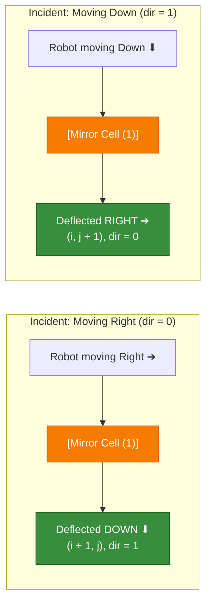
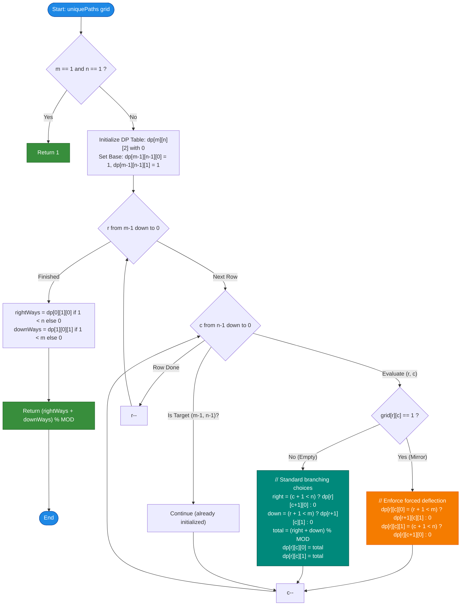

# LeetCode Problem of the Day: Twisted Mirror Path Count

- **Problem Link:** [LeetCode 3665 - Twisted Mirror Path Count](https://leetcode.com/problems/twisted-mirror-path-count/description/?envType=daily-question&envId=2026-10-31)
- **Difficulty:** Medium / Hard
- **Topic Tags:** Array, Dynamic Programming, Matrix, Memoization, Graph Traversal (DAG)
- **Target Audience:** POTD Daily Solvers, Computer Science Students, Competitive Programmers, FAANG / Tier-1 Tech Interview Preparation

---

## 1. Problem Statement

You are given an $m \times n$ binary matrix `grid`, where:
- `grid[i][j] == 0` represents an **empty cell**.
- `grid[i][j] == 1` represents a **twisted mirror cell**.

A robot starts at the top-left corner `(0, 0)` and wants to reach the bottom-right destination cell `(m - 1, n - 1)`.

### Movement Rules

1. **At an Empty Cell (`0`):**
   - The robot can make a standard decision to move either **Right** to `(i, j + 1)` or **Down** to `(i + 1, j)`.

2. **At a Twisted Mirror Cell (`1`):**
   - The robot's movement direction is **deflected** before it can freely navigate:
     - If the robot arrives at the mirror while moving **Right**, the mirror deflects it to move **Down** into `(i + 1, j)`.
     - If the robot arrives at the mirror while moving **Down**, the mirror deflects it to move **Right** into `(i, j + 1)`.
   - **Cascading Reflections:** If the redirected cell is *also* a mirror, the reflection process repeats consecutively based on the entry direction into that subsequent mirror.
   - **Out of Bounds:** If any deflection pushes the robot beyond the grid boundaries ($i \ge m$ or $j \ge n$), that path is terminated and invalid.

3. **Destination:**
   - Once the robot reaches `(m - 1, n - 1)`, the journey is complete.

Since the total number of paths can be very large, return the total count of unique valid paths modulo $10^9 + 7$.

---

## 2. Examples & Explanations

### Example 1: Basic Empty Grid (Classic Unique Paths)
- **Input:** `grid = [[0, 0], [0, 0]]`
- **Output:** `2`
- **Explanation:**
  - Path 1: `(0, 0) -> (0, 1) -> (1, 1)` (Right $\to$ Down)
  - Path 2: `(0, 0) -> (1, 0) -> (1, 1)` (Down $\to$ Right)
  - Both paths reach the destination with zero mirror interference. Total = `2`.

---

### Example 2: Single Mirror Deflection
- **Input:**
  ```text
  grid = [
    [0, 1],
    [0, 0]
  ]
  ```
- **Output:** `2`
- **Explanation:**
  - Path 1: Move Down to `(1, 0)` [empty cell]. From `(1, 0)`, move Right to `(1, 1)`. (Valid path #1).
  - Path 2: Move Right to `(0, 1)` [mirror cell! entered moving Right]. The mirror at `(0, 1)` immediately deflects the robot Down to `(1, 1)`. The destination is reached! (Valid path #2).
  - Total valid paths = `2`.

---

### Example 3: Cascading Mirrors & Boundary Termination
- **Input:**
  ```text
  grid = [
    [0, 1, 0],
    [0, 1, 0],
    [0, 0, 0]
  ]
  ```
- **Output:** `3`
- **Explanation:**
  - Path 1: `(0,0) -> (1,0) -> (2,0) -> (2,1) -> (2,2)`
  - Path 2: `(0,0) -> (1,0) -> (2,0) -> (2,1)` ... 
  - Trace of entering mirror `(0, 1)`:
    - Moving Right into `(0, 1)` deflects Down into `(1, 1)`.
    - `(1, 1)` is ALSO a mirror! Since the robot entered moving Down, the mirror at `(1, 1)` deflects it Right into `(1, 2)`.
    - At `(1, 2)` [empty cell], the robot moves Down to `(2, 2)`.
  - In total, 3 distinct paths successfully land on `(2, 2)`.

---

### Example 4: Mirror Deflecting Out of Bounds
- **Input:**
  ```text
  grid = [
    [0, 0],
    [1, 1]
  ]
  ```
- **Output:** `1`
- **Explanation:**
  - Moving Down to `(1, 0)`: entered moving Down $\to$ deflected Right to `(1, 1)`.
  - At `(1, 1)`: entered moving Right $\to$ deflected Down to `(2, 1)`. Since $2 \ge m$, it falls out of bounds (invalidated!).
  - Moving Right to `(0, 1)`: empty cell $\to$ moves Down to `(1, 1)`. Entered moving Down $\to$ deflected Right to `(1, 2)`. Out of bounds!
  - Only paths that safely reach without falling off the edge are counted.

---

## 3. Constraints

- $1 \le m, n \le 500$
- $1 \le m \times n \le 2.5 \times 10^5$
- `grid[i][j]` is either `0` or `1`.
- `grid[0][0]` is an empty cell (`0`).
- Result must be returned modulo $10^9 + 7$.
- **Expected Time Complexity:** $\mathcal{O}(m \times n)$
- **Expected Auxiliary Space:** $\mathcal{O}(m \times n)$ (or $\mathcal{O}(n)$ optimal space)

---

## 4. Visual Architecture & Intuitive Mental Model

### The Directional Deflection Mechanism

A mirror's action is entirely deterministic based on the **entry direction** of the robot:



### Why There Are No Infinite Cycles (The DAG Invariant)

A major concern when dealing with reflections is the possibility of infinite loops. However, examine the coordinates at each step:
1. Moving Right: $(i, j) \to (i, j + 1)$ $\implies (i + j)$ increases by $1$.
2. Moving Down: $(i, j) \to (i + 1, j)$ $\implies (i + j)$ increases by $1$.
3. Mirror Deflection (Right $\to$ Down): $(i, j) \to (i + 1, j)$ $\implies (i + j)$ increases by $1$.
4. Mirror Deflection (Down $\to$ Right): $(i, j) \to (i, j + 1)$ $\implies (i + j)$ increases by $1$.

$$\forall \text{ transitions } u \to v, \quad (i_v + j_v) = (i_u + j_u) + 1$$

Because $(i + j)$ is **strictly monotonically increasing**, the grid forms a **Directed Acyclic Graph (DAG)**. 
- Cycles are mathematically impossible.
- Every subproblem exhibits optimal substructure.
- We can evaluate all states in reverse topological order (from $(m-1, n-1)$ back to $(0, 0)$) in clean $\mathcal{O}(m \times n)$ time!

---

## 5. Step-by-Step Simulation & Trace Table

Consider the grid:
$$
\text{grid} = \begin{pmatrix} 0 & 1 & 0 \\ 0 & 1 & 0 \\ 0 & 0 & 0 \end{pmatrix}, \quad m = 3, n = 3
$$

We define our DP state:
- `dp[r][c][0]`: Number of valid paths to $(2, 2)$ from cell $(r, c)$ if entered moving **Right** (`dir = 0`).
- `dp[r][c][1]`: Number of valid paths to $(2, 2)$ from cell $(r, c)$ if entered moving **Down** (`dir = 1`).

### Base Case
- Destination $(2, 2)$: `dp[2][2][0] = 1`, `dp[2][2][1] = 1`.

### Bottom-Up Computation (Reverse Traversal)

| Cell $(r, c)$ | Type | Incoming Dir | Transition Logic | `dp[r][c][0]` | `dp[r][c][1]` |
| :---: | :---: | :---: | :--- | :---: | :---: |
| **$(2, 2)$** | Empty | Any | Target Destination | **1** | **1** |
| **$(2, 1)$** | Empty | Any | Can only move Right to $(2, 2)$ | $1$ | $1$ |
| **$(2, 0)$** | Empty | Any | Can only move Right to $(2, 1)$ | $1$ | $1$ |
| **$(1, 2)$** | Empty | Any | Can only move Down to $(2, 2)$ | $1$ | $1$ |
| **$(1, 1)$** | **Mirror** | `0` (Right)<br/>`1` (Down) | `dir=0` $\implies$ forced Down to $(2, 1)$ [ways = 1]<br/>`dir=1` $\implies$ forced Right to $(1, 2)$ [ways = 1] | **1** | **1** |
| **$(1, 0)$** | Empty | Any | Right to $(1, 1)$ [`dp[1][1][0] = 1`] + Down to $(2, 0)$ [`dp[2][0][1] = 1`] | **2** | **2** |
| **$(0, 2)$** | Empty | Any | Can only move Down to $(1, 2)$ | $1$ | $1$ |
| **$(0, 1)$** | **Mirror** | `0` (Right)<br/>`1` (Down) | `dir=0` $\implies$ forced Down to $(1, 1)$ [`dp[1][1][1] = 1`]<br/>`dir=1` $\implies$ forced Right to $(0, 2)$ [`dp[0][2][0] = 1`] | **1** | **1** |
| **$(0, 0)$** | Empty | Start | Right to $(0, 1)$ [`dp[0][1][0] = 1`] + Down to $(1, 0)$ [`dp[1][0][1] = 2`] | $\mathbf{3}$ | $\mathbf{3}$ |

**Final Answer:** `dp[0][1][0] + dp[1][0][1] = 1 + 2 = 3`.

---

## 6. Algorithm Flowchart



---

## 7. From Naive to Pro: Algorithmic Progression

### Method 1: Naive Recursive Backtracking (Brute Force)
- **Concept:** Simulate every possible path from `(0, 0)` using recursion. At each empty cell, branch both Right and Down. At each mirror cell, follow the forced reflection.
- **Why it is suboptimal:** Without memoization, paths that converge on the same $(r, c, \text{dir})$ state are recalculated exponentially many times. For an $m \times n$ grid, there are up to $2^{m+n}$ paths $\implies$ **Time Limit Exceeded (TLE)** for $m, n > 15$.
- **Pseudocode:**
```text
function countPaths_Brute(r, c, dir):
    if r >= m or c >= n:
        return 0
    if r == m - 1 and c == n - 1:
        return 1

    if grid[r][c] == 1:
        // Forced turn
        if dir == 0:  // entered Right -> must turn Down
            return countPaths_Brute(r + 1, c, 1)
        else:         // entered Down -> must turn Right
            return countPaths_Brute(r, c + 1, 0)
    else:
        // Empty cell allows branching
        right = countPaths_Brute(r, c + 1, 0)
        down = countPaths_Brute(r + 1, c, 1)
        return (right + down) % MOD
```

---

### Method 2: Top-Down Recursion with Memoization
- **Concept:** Cache the result of `(r, c, dir)` in a 3D table `memo[m][n][2]`. Each state is computed exactly once.
- **Complexity:** $\mathcal{O}(m \times n)$ time, $\mathcal{O}(m \times n)$ auxiliary space + recursion call stack.
- **Pseudocode:**
```text
function countPaths_Memo(r, c, dir, memo):
    if r >= m or c >= n:
        return 0
    if r == m - 1 and c == n - 1:
        return 1
    if memo[r][c][dir] != -1:
        return memo[r][c][dir]

    if grid[r][c] == 1:
        if dir == 0:
            res = countPaths_Memo(r + 1, c, 1, memo)
        else:
            res = countPaths_Memo(r, c + 1, 0, memo)
    else:
        res = (countPaths_Memo(r, c + 1, 0, memo) + countPaths_Memo(r + 1, c, 1, memo)) % MOD

    memo[r][c][dir] = res
    return res
```

---

### Method 3: Bottom-Up Tabulation (Optimal Primary Standard)
- **Concept:** Eliminate recursion overhead by iteratively filling the DP table backwards from $(m - 1, n - 1)$ to $(0, 0)$. Because dependencies only look at larger coordinates $(r + 1, c)$ and $(r, c + 1)$, all lookups hit precomputed values in $\mathcal{O}(1)$ time.
- **Complexity:** $\mathcal{O}(m \times n)$ time, $\mathcal{O}(m \times n)$ space.
- **Pseudocode:**
```text
function uniquePaths_Tabulation(grid):
    if m == 1 and n == 1: return 1
    dp = array[m][n][2] initialized to 0
    dp[m - 1][n - 1][0] = 1
    dp[m - 1][n - 1][1] = 1

    for r from m - 1 down to 0:
        for c from n - 1 down to 0:
            if r == m - 1 and c == n - 1: continue
            if grid[r][c] == 1:
                dp[r][c][0] = dp[r + 1][c][1] if r + 1 < m else 0
                dp[r][c][1] = dp[r][c + 1][0] if c + 1 < n else 0
            else:
                right = dp[r][c + 1][0] if c + 1 < n else 0
                down = dp[r + 1][c][1] if r + 1 < m else 0
                dp[r][c][0] = dp[r][c][1] = (right + down) % MOD

    right_start = dp[0][1][0] if 1 < n else 0
    down_start = dp[1][0][1] if 1 < m else 0
    return (right_start + down_start) % MOD
```

---

### Method 4: Pro Approach — Space-Optimized Rolling Rows
- **Concept:** `dp[r][c]` depends exclusively on `dp[r + 1][c]` (the row immediately below) and `dp[r][c + 1]` (the cell immediately to the right in the current row). We only need two rows of size $n$: `next_row` and `curr_row`.
- **Complexity:** $\mathcal{O}(m \times n)$ time, $\mathcal{O}(n)$ auxiliary space!
- **Pseudocode:**
```text
function uniquePaths_SpaceOptimized(grid):
    if m == 1 and n == 1: return 1
    curr_row = array[n][2]
    next_row = array[n][2]

    for r from m - 1 down to 0:
        for c from n - 1 down to 0:
            if r == m - 1 and c == n - 1:
                curr_row[c][0] = 1; curr_row[c][1] = 1
                continue
            if grid[r][c] == 1:
                curr_row[c][0] = next_row[c][1] if r + 1 < m else 0
                curr_row[c][1] = curr_row[c + 1][0] if c + 1 < n else 0
            else:
                right = curr_row[c + 1][0] if c + 1 < n else 0
                down = next_row[c][1] if r + 1 < m else 0
                curr_row[c][0] = curr_row[c][1] = (right + down) % MOD
        if r == 1:
            down_start = curr_row[0][1]
        next_row = copy(curr_row)

    right_start = curr_row[1][0] if 1 < n else 0
    return (right_start + down_start) % MOD
```

---

## 8. Complexity Comparison Table

| Metric | Method 1: Brute Force | Method 2: Memoization (DFS) | Method 3: Bottom-Up Tabulation | Method 4: Space-Optimized DP (Pro) |
| :--- | :--- | :--- | :--- | :--- |
| **Time Complexity** | $\mathcal{O}(2^{m+n})$ | $\mathcal{O}(m \times n)$ | $\mathbf{\mathcal{O}(m \times n)}$ | $\mathbf{\mathcal{O}(m \times n)}$ |
| **Auxiliary Space** | $\mathcal{O}(m + n)$ (stack) | $\mathcal{O}(m \times n)$ | $\mathcal{O}(m \times n)$ | $\mathbf{\mathcal{O}(n)}$ |
| **Memory Footprint** | Negligible | $2 \times 500^2 \times 4\text{B} \approx 2\text{ MB}$ | $2\text{ MB}$ flat buffer | **$\approx 4\text{ KB}$ (2 rows)** |
| **Call Stack Depth** | $\mathcal{O}(m + n)$ | $\mathcal{O}(m + n)$ | $\mathbf{\mathcal{O}(1)}$ (Iterative) | $\mathbf{\mathcal{O}(1)}$ (Iterative) |
| **Cache Friendliness** | Very Poor | Moderate (pointer jumps) | **High (Contiguous array)** | **Highest (L1 CPU Cache fit)** |
| **Interview Verdict** | TLE ($> 10^{15}$ ops) | Good accepted | **Gold Standard (Clean & Safe)** | **Pro / Bonus Level** |

---

## 9. Comprehensive Corner Cases Handled

1. **$1 \times 1$ Grid (`[[0]]`):** Start is already the destination. The algorithm returns `1` immediately without any boundary or index out-of-range errors.
2. **Boundary Mirrors (Deflecting Off Grid Edge):**
   - A mirror on the bottom edge ($r = m - 1$) hit from the left deflects Down into row $m$. Because $r + 1 < m$ fails, it cleanly sets the path count to $0$.
   - A mirror on the right edge ($c = n - 1$) hit from above deflects Right into column $n$. Because $c + 1 < n$ fails, it cleanly sets the path count to $0$.
3. **Consecutive Mirrors (Zigzag Cascades):**
   - If mirror $A$ deflects into mirror $B$, mirror $B$'s precomputed directional value is seamlessly passed along in $\mathcal{O}(1)$ without needing separate loops or recursion stacks.
4. **All Zero Grid:** Reverts identically to Pascal's triangle combinatorics $\binom{m+n-2}{m-1}$.
5. **Completely Blocked Paths:** If all pathways lead into out-of-bounds deflections, the algorithm cleanly accumulates $0$ and outputs $0$.

---

## 10. Complete Multi-Language Implementations

### Java

```java
class Solution {
    public int uniquePaths(int[][] grid) {
        int MOD = 1_000_000_007;
        int m = grid.length;
        int n = grid[0].length;

        // Base case: 1x1 grid already at destination
        if (m == 1 && n == 1) {
            return 1;
        }

        // dp[r][c][0]: paths reaching destination if entered moving Right (dir = 0)
        // dp[r][c][1]: paths reaching destination if entered moving Down (dir = 1)
        int[][][] dp = new int[m][n][2];

        // Destination reached
        dp[m - 1][n - 1][0] = 1;
        dp[m - 1][n - 1][1] = 1;

        // Bottom-up traversal in reverse topological order
        for (int r = m - 1; r >= 0; r--) {
            for (int c = n - 1; c >= 0; c--) {
                if (r == m - 1 && c == n - 1) {
                    continue;
                }

                if (grid[r][c] == 1) {
                    // Mirror deflects: Right -> Down, Down -> Right
                    dp[r][c][0] = (r + 1 < m) ? dp[r + 1][c][1] : 0;
                    dp[r][c][1] = (c + 1 < n) ? dp[r][c + 1][0] : 0;
                } else {
                    // Empty cell allows branching
                    int right = (c + 1 < n) ? dp[r][c + 1][0] : 0;
                    int down = (r + 1 < m) ? dp[r + 1][c][1] : 0;
                    int total = (right + down) % MOD;
                    dp[r][c][0] = total;
                    dp[r][c][1] = total;
                }
            }
        }

        // From (0, 0), evaluate the two possible initial moves
        int rightFromStart = (1 < n) ? dp[0][1][0] : 0;
        int downFromStart = (1 < m) ? dp[1][0][1] : 0;

        return (rightFromStart + downFromStart) % MOD;
    }
}
```

---

### Python3

```python
class Solution:
    def uniquePaths(self, grid: List[List[int]]) -> int:
        MOD = 1_000_000_007
        m, n = len(grid), len(grid[0])

        # Base case: 1x1 grid
        if m == 1 and n == 1:
            return 1

        # dp[r][c][0]: entered moving Right
        # dp[r][c][1]: entered moving Down
        dp = [[[0, 0] for _ in range(n)] for _ in range(m)]

        # Base case at destination
        dp[m - 1][n - 1][0] = 1
        dp[m - 1][n - 1][1] = 1

        # Traverse backwards from destination to start
        for r in range(m - 1, -1, -1):
            for c in range(n - 1, -1, -1):
                if r == m - 1 and c == n - 1:
                    continue

                if grid[r][c] == 1:
                    # Mirror: forced redirection
                    dp[r][c][0] = dp[r + 1][c][1] if r + 1 < m else 0
                    dp[r][c][1] = dp[r][c + 1][0] if c + 1 < n else 0
                else:
                    # Empty cell: choose Right or Down
                    right = dp[r][c + 1][0] if c + 1 < n else 0
                    down = dp[r + 1][c][1] if r + 1 < m else 0
                    total = (right + down) % MOD
                    dp[r][c][0] = total
                    dp[r][c][1] = total

        # Initial choices from starting cell (0, 0)
        right_from_start = dp[0][1][0] if 1 < n else 0
        down_from_start = dp[1][0][1] if 1 < m else 0

        return (right_from_start + down_from_start) % MOD
```

---

### C

```c
#include <stdlib.h>

int uniquePaths(int** grid, int gridSize, int* gridColSize) {
    int MOD = 1000000007;
    int m = gridSize;
    int n = gridColSize[0];

    if (m == 1 && n == 1) {
        return 1;
    }

    // Allocate 3D DP array: dp[m][n][2] flattened to 1D
    int totalCells = m * n * 2;
    int* dp = (int*)calloc(totalCells, sizeof(int));
    if (!dp) return 0;

    #define DP(r, c, d) dp[(((r) * n) + (c)) * 2 + (d)]

    // Base case at destination (m - 1, n - 1)
    DP(m - 1, n - 1, 0) = 1;
    DP(m - 1, n - 1, 1) = 1;

    for (int r = m - 1; r >= 0; r--) {
        for (int c = n - 1; c >= 0; c--) {
            if (r == m - 1 && c == n - 1) {
                continue;
            }

            if (grid[r][c] == 1) {
                // Mirror cell redirection
                DP(r, c, 0) = (r + 1 < m) ? DP(r + 1, c, 1) : 0;
                DP(r, c, 1) = (c + 1 < n) ? DP(r, c + 1, 0) : 0;
            } else {
                // Empty cell standard branching
                int right = (c + 1 < n) ? DP(r, c + 1, 0) : 0;
                int down = (r + 1 < m) ? DP(r + 1, c, 1) : 0;
                int total = (right + down) % MOD;
                DP(r, c, 0) = total;
                DP(r, c, 1) = total;
            }
        }
    }

    int rightFromStart = (1 < n) ? DP(0, 1, 0) : 0;
    int downFromStart = (1 < m) ? DP(1, 0, 1) : 0;
    int ans = (rightFromStart + downFromStart) % MOD;

    free(dp);
    #undef DP
    return ans;
}
```

---

### C++

```cpp
#include <vector>

using namespace std;

class Solution {
public:
    int uniquePaths(vector<vector<int>>& grid) {
        const int MOD = 1'000'000'007;
        int m = grid.size();
        int n = grid[0].size();

        if (m == 1 && n == 1) {
            return 1;
        }

        // dp[r][c][0]: entered moving Right
        // dp[r][c][1]: entered moving Down
        vector<vector<vector<int>>> dp(m, vector<vector<int>>(n, vector<int>(2, 0)));

        // Base case at destination
        dp[m - 1][n - 1][0] = 1;
        dp[m - 1][n - 1][1] = 1;

        // Traverse bottom-up backwards
        for (int r = m - 1; r >= 0; r--) {
            for (int c = n - 1; c >= 0; c--) {
                if (r == m - 1 && c == n - 1) {
                    continue;
                }

                if (grid[r][c] == 1) {
                    // Mirror deflects
                    dp[r][c][0] = (r + 1 < m) ? dp[r + 1][c][1] : 0;
                    dp[r][c][1] = (c + 1 < n) ? dp[r][c + 1][0] : 0;
                } else {
                    // Empty cell branching
                    int right = (c + 1 < n) ? dp[r][c + 1][0] : 0;
                    int down = (r + 1 < m) ? dp[r + 1][c][1] : 0;
                    int total = (right + down) % MOD;
                    dp[r][c][0] = total;
                    dp[r][c][1] = total;
                }
            }
        }

        int rightFromStart = (1 < n) ? dp[0][1][0] : 0;
        int downFromStart = (1 < m) ? dp[1][0][1] : 0;

        return (rightFromStart + downFromStart) % MOD;
    }
};
```

---

### C#

```csharp
public class Solution {
    public int UniquePaths(int[][] grid) {
        int MOD = 1_000_000_007;
        int m = grid.Length;
        int n = grid[0].Length;

        if (m == 1 && n == 1) {
            return 1;
        }

        int[,,] dp = new int[m, n, 2];

        // Base case at destination
        dp[m - 1, n - 1, 0] = 1;
        dp[m - 1, n - 1, 1] = 1;

        for (int r = m - 1; r >= 0; r--) {
            for (int c = n - 1; c >= 0; c--) {
                if (r == m - 1 && c == n - 1) {
                    continue;
                }

                if (grid[r][c] == 1) {
                    // Mirror deflection
                    dp[r, c, 0] = (r + 1 < m) ? dp[r + 1, c, 1] : 0;
                    dp[r, c, 1] = (c + 1 < n) ? dp[r, c + 1, 0] : 0;
                } else {
                    // Empty cell standard branching
                    int right = (c + 1 < n) ? dp[r, c + 1, 0] : 0;
                    int down = (r + 1 < m) ? dp[r + 1, c, 1] : 0;
                    int total = (right + down) % MOD;
                    dp[r, c, 0] = total;
                    dp[r, c, 1] = total;
                }
            }
        }

        int rightFromStart = (1 < n) ? dp[0, 1, 0] : 0;
        int downFromStart = (1 < m) ? dp[1, 0, 1] : 0;

        return (rightFromStart + downFromStart) % MOD;
    }
}
```

---

### Javascript

```javascript
/**
 * @param {number[][]} grid
 * @return {number}
 */
var uniquePaths = function(grid) {
    const MOD = 1000000007;
    const m = grid.length;
    const n = grid[0].length;

    // Base case: single cell grid
    if (m === 1 && n === 1) {
        return 1;
    }

    // dp[r][c][0]: paths entered moving Right
    // dp[r][c][1]: paths entered moving Down
    const dp = Array.from({ length: m }, () =>
        Array.from({ length: n }, () => [0, 0])
    );

    dp[m - 1][n - 1][0] = 1;
    dp[m - 1][n - 1][1] = 1;

    for (let r = m - 1; r >= 0; r--) {
        for (let c = n - 1; c >= 0; c--) {
            if (r === m - 1 && c === n - 1) {
                continue;
            }

            if (grid[r][c] === 1) {
                // Mirror cell redirection
                dp[r][c][0] = (r + 1 < m) ? dp[r + 1][c][1] : 0;
                dp[r][c][1] = (c + 1 < n) ? dp[r][c + 1][0] : 0;
            } else {
                // Empty cell standard choices
                const right = (c + 1 < n) ? dp[r][c + 1][0] : 0;
                const down = (r + 1 < m) ? dp[r + 1][c][1] : 0;
                const total = (right + down) % MOD;
                dp[r][c][0] = total;
                dp[r][c][1] = total;
            }
        }
    }

    const rightFromStart = (1 < n) ? dp[0][1][0] : 0;
    const downFromStart = (1 < m) ? dp[1][0][1] : 0;

    return (rightFromStart + downFromStart) % MOD;
};
```

---

### Typescript

```typescript
function uniquePaths(grid: number[][]): number {
    const MOD: number = 1000000007;
    const m: number = grid.length;
    const n: number = grid[0].length;

    if (m === 1 && n === 1) {
        return 1;
    }

    const dp: number[][][] = Array.from({ length: m }, () =>
        Array.from({ length: n }, () => [0, 0])
    );

    dp[m - 1][n - 1][0] = 1;
    dp[m - 1][n - 1][1] = 1;

    for (let r = m - 1; r >= 0; r--) {
        for (let c = n - 1; c >= 0; c--) {
            if (r === m - 1 && c === n - 1) {
                continue;
            }

            if (grid[r][c] === 1) {
                dp[r][c][0] = (r + 1 < m) ? dp[r + 1][c][1] : 0;
                dp[r][c][1] = (c + 1 < n) ? dp[r][c + 1][0] : 0;
            } else {
                const right: number = (c + 1 < n) ? dp[r][c + 1][0] : 0;
                const down: number = (r + 1 < m) ? dp[r + 1][c][1] : 0;
                const total: number = (right + down) % MOD;
                dp[r][c][0] = total;
                dp[r][c][1] = total;
            }
        }
    }

    const rightFromStart: number = (1 < n) ? dp[0][1][0] : 0;
    const downFromStart: number = (1 < m) ? dp[1][0][1] : 0;

    return (rightFromStart + downFromStart) % MOD;
}
```

