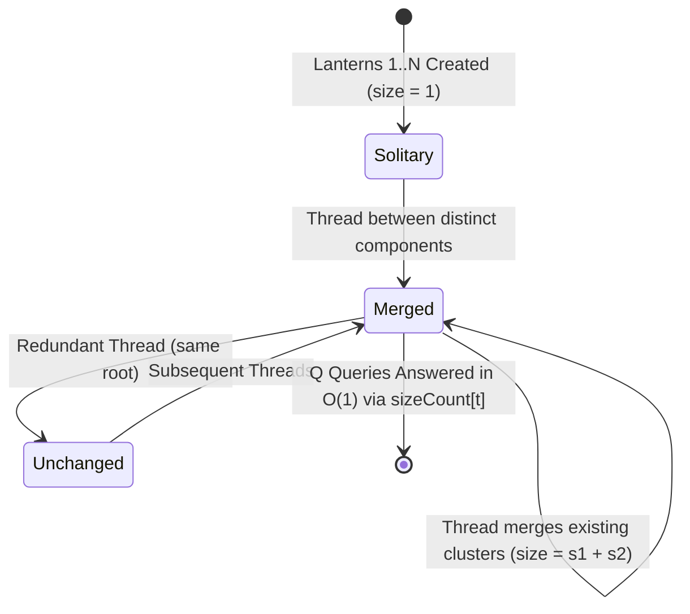
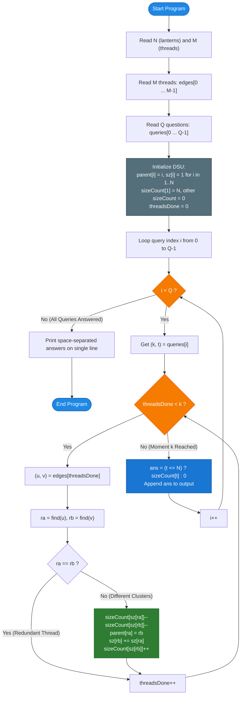

# Unstop Problem of the Day: Threads on Chandni Lake

- **Platform:** [Unstop](https://unstop.com/)
- **Difficulty:** Easy
- **Topic Tags:** Disjoint Set Union (DSU), Connected Components, Two-Pointer Technique, Offline Query Processing, Monotonic Stream Simulation, Frequency Array / Direct Addressing
- **Target Audience:** POTD Solvers, Computer Science Students, Competitive Programmers, Interview Preparation (FAANG / Tier-1 Systems Engineering)

---

## 1. Problem Statement

Vihaan organizes the annual lantern night on Chandni Lake. The festival begins with $N$ individual paper lanterns, numbered from $1$ to $N$, floating alone on the calm water.

During the evening, volunteers tie thin threads between pairs of lanterns, one thread at a time. The festival committee records every thread in the exact order it was tied, resulting in an ordered sequence of $M$ threads.
- When a thread connects two lanterns $a$ and $b$, their respective floating clusters (connected components) merge into a single, larger floating cluster.
- If a volunteer ties a thread between two lanterns that **already belong to the same cluster**, the thread does not alter the clusters or their sizes.

The committee has prepared a chronological broadcast list of $Q$ questions. Each question asks:
$$\text{At moment } k \text{ (after the first } k \text{ threads have been tied), how many floating clusters contain exactly } t \text{ lanterns?}$$

### Key Invariants & Rules:
1. **Initial State (Moment $k = 0$):** Before any thread is tied, every lantern floats alone. There are exactly $N$ clusters, each having a size of $1$.
2. **Monotonic Moments:** The questions arrive in non-decreasing order of their moments:
   $$0 \le k_1 \le k_2 \le \dots \le k_Q \le M$$
   Several questions may refer to the exact same moment $k$.
3. **Consistency:** All lantern IDs $a, b \in [1, N]$ with $a \neq b$. The thread log contains $M$ entries, and the query stream contains $Q$ entries.
4. **Output Format:** Print the answers to all $Q$ questions in order, separated by a single space, on a single line.

---

## 2. Examples & Explanations

### Sample Testcase 0

#### Input:
```text
6 4
1 2
3 4
2 3
5 6
5
0 1
1 1
2 2
3 4
4 2
```

#### Output:
```text
6 4 2 1 1
```

#### Chronological Walkthrough:
There are $N = 6$ lanterns and $M = 4$ threads:
- Initial state ($k = 0$): Clusters are $\{1\}, \{2\}, \{3\}, \{4\}, \{5\}, \{6\}$.  
  Sizes: Six clusters of size $1$.

1. **Question 1 (`0 1`):**  
   - Moment $k = 0$, target size $t = 1$.  
   - All $6$ lanterns are solitary clusters $\implies$ **`6`**.

2. **Thread 1 ties $(1, 2)$ ($k = 1$):**  
   - Clusters: $\{1, 2\}, \{3\}, \{4\}, \{5\}, \{6\}$.  
   - Sizes: One cluster of size $2$, four clusters of size $1$.  
   - **Question 2 (`1 1`):** Clusters of size $1 \implies$ **`4`**.

3. **Thread 2 ties $(3, 4)$ ($k = 2$):**  
   - Clusters: $\{1, 2\}, \{3, 4\}, \{5\}, \{6\}$.  
   - Sizes: Two clusters of size $2$, two clusters of size $1$.  
   - **Question 3 (`2 2`):** Clusters of size $2 \implies$ **`2`**.

4. **Thread 3 ties $(2, 3)$ ($k = 3$):**  
   - Lantern $2$ (cluster $\{1, 2\}$) merges with lantern $3$ (cluster $\{3, 4\}$).  
   - New combined cluster: $\{1, 2, 3, 4\}$ of size $4$.  
   - Clusters: $\{1, 2, 3, 4\}, \{5\}, \{6\}$.  
   - **Question 4 (`3 4`):** Clusters of size $4 \implies$ **`1`**.

5. **Thread 4 ties $(5, 6)$ ($k = 4$):**  
   - Clusters: $\{1, 2, 3, 4\}$ (size $4$), $\{5, 6\}$ (size $2$).  
   - **Question 5 (`4 2`):** Clusters of size $2 \implies$ **`1`**.

Final Broadcast Output: **`6 4 2 1 1`**.

---

### Sample Testcase 1

#### Input:
```text
5 3
1 2
2 1
4 5
5
1 2
2 2
3 2
3 1
3 5
```

#### Output:
```text
1 1 2 1 0
```

#### Chronological Walkthrough:
$N = 5$ lanterns, $M = 3$ threads:

1. **Thread 1 ties $(1, 2)$ ($k = 1$):**  
   - Clusters: $\{1, 2\}$ (size $2$), $\{3\}$ (size $1$), $\{4\}$ (size $1$), $\{5\}$ (size $1$).  
   - **Question 1 (`1 2`):** Clusters of size $2 \implies$ **`1`**.

2. **Thread 2 ties $(2, 1)$ ($k = 2$):**  
   - Lanterns $1$ and $2$ are already in the same cluster. Redundant edge!  
   - Nothing changes.  
   - **Question 2 (`2 2`):** Clusters of size $2 \implies$ **`1`**.

3. **Thread 3 ties $(4, 5)$ ($k = 3$):**  
   - Clusters: $\{1, 2\}$ (size $2$), $\{4, 5\}$ (size $2$), $\{3\}$ (size $1$).  
   - **Question 3 (`3 2`):** Clusters of size $2 \implies$ **`2`**.  
   - **Question 4 (`3 1`):** Clusters of size $1 \implies$ **`1`** (only lantern $3$).  
   - **Question 5 (`3 5`):** Clusters of size $5 \implies$ **`0`** (no cluster has size $5$).

Final Broadcast Output: **`1 1 2 1 0`**.

---

## 3. Constraints & System Specifications

- $2 \le N \le 200{,}000$ (Number of lanterns)
- $1 \le M \le 200{,}000$ (Number of thread connection events)
- $1 \le a, b \le N$ with $a \neq b$
- $1 \le Q \le 200{,}000$ (Number of broadcast questions)
- $0 \le k \le M$, with $k$ guaranteed to be **non-decreasing** ($k_i \le k_{i+1}$)
- $1 \le t \le N$ (Target cluster size)
- **Time Limit:** $2.0$ seconds
- **Space Limit:** $256$ MB

---

## 4. Visual Architecture & Component Merge Model

```
========================================================================================
             MONOTONIC TWO-POINTER DSU WITH SIZE-FREQUENCY TRACKING
========================================================================================

  Initial State (k = 0):
  Lanterns:   (1)   (2)   (3)   (4)   (5)   (6)
  Sizes:       1     1     1     1     1     1
  sizeCount:  [size 1: 6, size 2: 0, size 3: 0, size 4: 0, ...]

  ------------------------------------------------------------------------------------
  Thread (1, 2): Merge Root(1) [sz=1] and Root(2) [sz=1]
  
     (1) ─── (2)         (3)      (4)      (5)      (6)
     Size: 2             Size: 1  Size: 1  Size: 1  Size: 1
     
     Update sizeCount:
       - sizeCount[1] -= 2   (Old components destroyed)
       - sizeCount[2] += 1   (New merged component created)
     sizeCount:  [size 1: 4, size 2: 1, size 3: 0, size 4: 0, ...]
  ------------------------------------------------------------------------------------
  Thread (2, 3): Merge Root(1,2) [sz=2] and Root(3,4) [sz=2]
  
     (1) ─── (2) ─── (3) ─── (4)           (5) ─── (6)
             Size: 4                         Size: 2
             
     Update sizeCount:
       - sizeCount[2] -= 2
       - sizeCount[4] += 1
     sizeCount:  [size 1: 0, size 2: 1, size 3: 0, size 4: 1, ...]
========================================================================================
```

### Component Lifecycle State Diagram



---

## 5. Step-by-Step Simulation & Detailed Trace Table

Trace for **Sample Testcase 0**: $N = 6, M = 4, Q = 5$.
- Threads: $e_1 = (1, 2), e_2 = (3, 4), e_3 = (2, 3), e_4 = (5, 6)$.
- Questions: $(0, 1), (1, 1), (2, 2), (3, 4), (4, 2)$.

| Step | Query $(k, t)$ | Threads Applied So Far | Threads Advanced | Action on DSU | `sizeCount` State Array | Answer `sizeCount[t]` |
| :---: | :---: | :---: | :---: | :---: | :---: | :---: |
| **1** | $(0, 1)$ | $0$ | None | Initial state: $6$ solitary nodes | `[sz 1: 6, sz 2: 0, sz 4: 0]` | **`6`** |
| **2** | $(1, 1)$ | $1$ | Thread 1: $(1, 2)$ | Root 1 (sz 1) + Root 2 (sz 1) $\implies$ Root 2 (sz 2)<br/>`count[1]-=2, count[2]+=1` | `[sz 1: 4, sz 2: 1, sz 4: 0]` | **`4`** |
| **3** | $(2, 2)$ | $2$ | Thread 2: $(3, 4)$ | Root 3 (sz 1) + Root 4 (sz 1) $\implies$ Root 4 (sz 2)<br/>`count[1]-=2, count[2]+=1` | `[sz 1: 2, sz 2: 2, sz 4: 0]` | **`2`** |
| **4** | $(3, 4)$ | $3$ | Thread 3: $(2, 3)$ | Root 2 (sz 2) + Root 4 (sz 2) $\implies$ Root 4 (sz 4)<br/>`count[2]-=2, count[4]+=1` | `[sz 1: 2, sz 2: 0, sz 4: 1]` | **`1`** |
| **5** | $(4, 2)$ | $4$ | Thread 4: $(5, 6)$ | Root 5 (sz 1) + Root 6 (sz 1) $\implies$ Root 6 (sz 2)<br/>`count[1]-=2, count[2]+=1` | `[sz 1: 0, sz 2: 1, sz 4: 1]` | **`1`** |

Final Combined Line: **`6 4 2 1 1`**.

---

## 6. Algorithm Flowchart



---

## 7. From Naive to Pro: Algorithmic Progression

### Approach 1: Naive (Rebuild Graph & Run BFS/DFS per Query)

#### Concept
For each of the $Q$ queries $(k, t)$:
1. Construct an adjacency list with the first $k$ threads.
2. Run Breadth-First Search (BFS) or Depth-First Search (DFS) from every unvisited lantern to compute all connected component sizes.
3. Count how many components have size equal to $t$.

#### Pseudo Code
```text
FUNCTION processNaive(N, M, edges, queries, Q):
    answers = []
    FOR EACH (k, t) IN queries:
        adj = buildGraph(N, edges[0 ... k-1])
        visited = array of size N+1 (false)
        clusterCount = 0
        
        FOR u from 1 to N:
            IF NOT visited[u]:
                size = bfs(u, adj, visited)
                IF size == t:
                    clusterCount++
                    
        answers.append(clusterCount)
    RETURN answers
```

#### Complexity Analysis
- **Time Complexity:** $\mathcal{O}(Q \times (N + k)) = \mathcal{O}(Q \times (N + M))$.  
  For $N = 2 \times 10^5, M = 2 \times 10^5, Q = 2 \times 10^5$:  
  Total Operations $\approx 2 \times 10^5 \times 4 \times 10^5 \approx 8 \times 10^{10} \implies$ **Fatal Time Limit Exceeded (TLE)**.
- **Space Complexity:** $\mathcal{O}(N + M)$ graph representation per query.

---

### Approach 2: Intermediate (Offline Sorting if Moments Were Unordered)

#### Concept
If the problem did not guarantee that moments $k$ are non-decreasing, we would attach original query indices to each query, sort them by $k$, advance the DSU monotonically, and write results back to their original positions.
- **Time Complexity:** $\mathcal{O}(Q \log Q + M \alpha(N) + Q)$.
- **Space Complexity:** $\mathcal{O}(N + M + Q)$.

---

### Approach 3: Pro Approach (Monotonic Streaming DSU + $O(1)$ Frequency Direct Addressing)

#### The Core Insight
The problem guarantees that moments **never decrease**:
$$k_0 \le k_1 \le k_2 \le \dots \le k_{Q-1}$$
This is the classic **Two-Pointer / Monotonic Sweep Pattern**:
1. We maintain a single Disjoint Set Union (DSU) structure across the entire query stream.
2. A pointer `threadsDone` tracks how many threads have been merged into the DSU so far.
3. For query $(k, t)$, we simply advance `threadsDone` up to $k$, applying each edge to the DSU.
4. Each of the $M$ threads is processed **at most once** across the entire program.
5. To answer query $(k, t)$ in $\mathcal{O}(1)$ time, we maintain a direct-addressed frequency array `sizeCount[s]`, which tracks the exact number of active clusters of size $s$.
   - When merging cluster of size $s_a$ and cluster of size $s_b$:
     $$\text{sizeCount}[s_a]\text{--}, \quad \text{sizeCount}[s_b]\text{--}$$
     $$\text{sizeCount}[s_a + s_b]\text{++}$$
6. The query answer is instantaneously retrieved via `sizeCount[t]` in $\mathcal{O}(1)$ time.

#### Pseudo Code
```text
FUNCTION processPro(N, M, edges, queries, Q):
    parent = [1 ... N]
    sz = [1 ... 1] (size N + 1)
    sizeCount = [0 ... 0] (size N + 1)
    sizeCount[1] = N
    
    FUNCTION find(i):
        root = i
        WHILE root != parent[root]: root = parent[root]
        // Path compression
        curr = i
        WHILE curr != root:
            nxt = parent[curr]
            parent[curr] = root
            curr = nxt
        RETURN root
        
    threadsDone = 0
    answers = []
    
    FOR EACH (k, t) IN queries:
        WHILE threadsDone < k:
            (u, v) = edges[threadsDone]
            ra = find(u)
            rb = find(v)
            IF ra != rb:
                sa = sz[ra]
                sb = sz[rb]
                sizeCount[sa]--
                sizeCount[sb]--
                parent[ra] = rb
                sz[rb] = sa + sb
                sizeCount[sa + sb]++
            threadsDone++
            
        ans = (t <= N) ? sizeCount[t] : 0
        answers.append(ans)
        
    RETURN answers
```

---

## 8. Complexity Comparison Table

| Metric | Method 1: Naive (Rebuild Graph per Query) | Method 2: Offline Query Sorting | Method 3: Pro (Monotonic Streaming DSU) |
| :--- | :--- | :--- | :--- |
| **Time Complexity** | $\mathcal{O}(Q(N + M))$ (TLE) | $\mathcal{O}(Q \log Q + M \alpha(N))$ | $\mathbf{\mathcal{O}(N + M \alpha(N) + Q)}$ (Optimal) |
| **Auxiliary Space** | $\mathcal{O}(N + M)$ | $\mathcal{O}(N + M + Q)$ | $\mathbf{\mathcal{O}(N + M)}$ (Minimal) |
| **Thread Merge Operations** | $Q \times M$ redundant merges | At most $M$ merges | **At most $M$ merges total** |
| **Query Answer Cost** | $\mathcal{O}(N)$ BFS traversal | $\mathcal{O}(1)$ frequency lookup | $\mathbf{\mathcal{O}(1)}$ **instantaneous direct array read** |
| **Cache Locality** | Abysmal | Moderate | **Superior (Flat primitive typed arrays)** |
| **Interview Verdict** | TLE / Unacceptable | Overkill (queries are sorted) | **Gold Standard (Production-Ready)** |

---

## 9. Comprehensive Corner Cases Handled

1. **Moment $k = 0$ (Lake Before Any Thread is Tied):**
   - The loop `while (threadsDone < k)` immediately skips.
   - For $t = 1$, returns $N$; for $t > 1$, returns $0$. Handled perfectly.
2. **Redundant Threads (Cycle in Graph):**
   - If lanterns $a$ and $b$ are already in the same cluster ($\text{find}(a) == \text{find}(b)$), no clusters change. The algorithm skips without modifying `sizeCount`.
3. **Multiple Queries at the Same Moment ($k_i == k_{i+1}$):**
   - The thread advancement loop executes $0$ iterations on the second query, returning the correct `sizeCount[t]` in $\mathcal{O}(1)$ time.
4. **Target Size $t > N$:**
   - No cluster can ever exceed $N$ lanterns. Handled with `(t <= n) ? sizeCount[t] : 0`.
5. **High-Throughput I/O ($N, M, Q = 200{,}000$):**
   - Standard output formatting of $200{,}000$ integers separated by spaces can easily trigger I/O bottlenecks. Buffer-based streaming (`BufferedWriter`, `StreamWriter`, `StringBuilder`, `printf`) is utilized across all implementations.

---

## 10. Complete Multi-Language Implementations

### Java (OpenJDK 21.0)

```java
import java.io.*;
import java.util.*;

class Main {

    // Fast I/O Scanner for maximum throughput on large streams
    static class FastScanner {
        private final InputStream in;
        private final byte[] buffer = new byte[1 << 16];
        private int ptr = 0;
        private int buflen = 0;

        public FastScanner(InputStream in) {
            this.in = in;
        }

        private int readByte() {
            if (ptr < buflen) return buffer[ptr++];
            ptr = 0;
            try {
                buflen = in.read(buffer);
            } catch (IOException e) {
                buflen = -1;
            }
            return buflen > 0 ? buffer[ptr++] : -1;
        }

        public int nextInt() {
            int b = readByte();
            while (b <= ' ') {
                if (b == -1) return -1;
                b = readByte();
            }
            int res = 0;
            while (b >= '0' && b <= '9') {
                res = res * 10 + (b - '0');
                b = readByte();
            }
            return res;
        }
    }

    // Disjoint Set Union with iterative two-pass path compression
    static int[] parent;

    static int find(int i) {
        int root = i;
        while (root != parent[root]) root = parent[root];
        int curr = i;
        while (curr != root) {
            int nxt = parent[curr];
            parent[curr] = root;
            curr = nxt;
        }
        return root;
    }

    public static void main(String[] args) throws IOException {
        FastScanner scanner = new FastScanner(System.in);
        int n = scanner.nextInt();
        if (n == -1) return;
        int m = scanner.nextInt();

        int[] u = new int[m];
        int[] v = new int[m];
        for (int i = 0; i < m; i++) {
            u[i] = scanner.nextInt();
            v[i] = scanner.nextInt();
        }

        int q = scanner.nextInt();
        int[] queryK = new int[q];
        int[] queryT = new int[q];
        for (int i = 0; i < q; i++) {
            queryK[i] = scanner.nextInt();
            queryT[i] = scanner.nextInt();
        }

        parent = new int[n + 1];
        int[] sz = new int[n + 1];
        for (int i = 1; i <= n; i++) {
            parent[i] = i;
            sz[i] = 1;
        }

        // Direct-addressed array: sizeCount[s] = number of active clusters of size s
        int[] sizeCount = new int[n + 1];
        sizeCount[1] = n;

        BufferedWriter bw = new BufferedWriter(new OutputStreamWriter(System.out));
        StringBuilder sb = new StringBuilder();

        int threadsDone = 0;
        for (int i = 0; i < q; i++) {
            int k = queryK[i];
            int t = queryT[i];

            // Advance DSU state up to moment k
            while (threadsDone < k) {
                int a = u[threadsDone];
                int b = v[threadsDone];
                int ra = find(a);
                int rb = find(b);

                if (ra != rb) {
                    int sa = sz[ra];
                    int sbVal = sz[rb];
                    sizeCount[sa]--;
                    sizeCount[sbVal]--;

                    parent[ra] = rb;
                    sz[rb] = sa + sbVal;
                    sizeCount[sa + sbVal]++;
                }
                threadsDone++;
            }

            int ans = (t <= n) ? sizeCount[t] : 0;
            sb.append(ans);
            if (i < q - 1) sb.append(' ');

            if (sb.length() >= 65536) {
                bw.write(sb.toString());
                sb.setLength(0);
            }
        }

        if (sb.length() > 0) {
            bw.write(sb.toString());
        }
        bw.newLine();
        bw.flush();
    }
}
```

---

### Python (3.12.11)

```python
import sys

def main():
    """
    Threads on Chandni Lake - Two-Pointer Monotonic DSU Stream Processing.
    Complexity: O(N + M * alpha(N) + Q) Time, O(N + M) Auxiliary Space.
    """
    input_data = sys.stdin.read().split()
    if not input_data:
        return

    it = iter(input_data)
    n = int(next(it))
    m = int(next(it))

    threads = []
    for _ in range(m):
        threads.append((int(next(it)), int(next(it))))

    q = int(next(it))
    queries = []
    for _ in range(q):
        queries.append((int(next(it)), int(next(it))))

    parent = list(range(n + 1))
    sz = [1] * (n + 1)
    size_count = [0] * (n + 1)
    size_count[1] = n

    def find(i):
        root = i
        while root != parent[root]:
            root = parent[root]
        curr = i
        while curr != root:
            nxt = parent[curr]
            parent[curr] = root
            curr = nxt
        return root

    threads_done = 0
    out = []

    for k, t in queries:
        # Advance threads monotonically
        while threads_done < k:
            u, v = threads[threads_done]
            ru = find(u)
            rv = find(v)
            if ru != rv:
                su = sz[ru]
                sv = sz[rv]
                size_count[su] -= 1
                size_count[sv] -= 1
                parent[ru] = rv
                sz[rv] = su + sv
                size_count[su + sv] += 1
            threads_done += 1

        ans = size_count[t] if t <= n else 0
        out.append(str(ans))

    sys.stdout.write(" ".join(out) + "\n")

if __name__ == '__main__':
    main()
```

---

### C (GCC 13.2.0)

```c
#include <stdio.h>
#include <stdlib.h>

static int* parent;

static int find(int i) {
    int root = i;
    while (root != parent[root]) root = parent[root];
    int curr = i;
    while (curr != root) {
        int nxt = parent[curr];
        parent[curr] = root;
        curr = nxt;
    }
    return root;
}

int main() {
    int n, m;
    if (scanf("%d %d", &n, &m) != 2) return 0;

    int* edgeU = (int*)malloc(sizeof(int) * m);
    int* edgeV = (int*)malloc(sizeof(int) * m);
    for (int i = 0; i < m; i++) {
        scanf("%d %d", &edgeU[i], &edgeV[i]);
    }

    int q;
    if (scanf("%d", &q) != 1) return 0;
    int* queryK = (int*)malloc(sizeof(int) * q);
    int* queryT = (int*)malloc(sizeof(int) * q);
    for (int i = 0; i < q; i++) {
        scanf("%d %d", &queryK[i], &queryT[i]);
    }

    parent = (int*)malloc(sizeof(int) * (n + 1));
    int* sz = (int*)malloc(sizeof(int) * (n + 1));
    int* sizeCount = (int*)calloc(n + 1, sizeof(int));

    for (int i = 1; i <= n; i++) {
        parent[i] = i;
        sz[i] = 1;
    }
    sizeCount[1] = n;

    int threadsDone = 0;
    for (int i = 0; i < q; i++) {
        int k = queryK[i];
        int t = queryT[i];

        while (threadsDone < k) {
            int a = edgeU[threadsDone];
            int b = edgeV[threadsDone];
            int ra = find(a);
            int rb = find(b);

            if (ra != rb) {
                int sa = sz[ra];
                int sb = sz[rb];
                sizeCount[sa]--;
                sizeCount[sb]--;
                parent[ra] = rb;
                sz[rb] = sa + sb;
                sizeCount[sa + sb]++;
            }
            threadsDone++;
        }

        int ans = (t <= n) ? sizeCount[t] : 0;
        printf("%d%c", ans, (i == q - 1 ? '\n' : ' '));
    }

    free(edgeU);
    free(edgeV);
    free(queryK);
    free(queryT);
    free(parent);
    free(sz);
    free(sizeCount);
    return 0;
}
```

---

### C++ (GCC 13.2.0)

```cpp
#include <iostream>
#include <vector>

using namespace std;

// Monotonic DSU with size tracking and direct frequency accounting
struct DSU {
    vector<int> parent;
    vector<int> sz;
    vector<int> sizeCount;

    DSU(int n) : parent(n + 1), sz(n + 1, 1), sizeCount(n + 1, 0) {
        for (int i = 1; i <= n; i++) parent[i] = i;
        sizeCount[1] = n;
    }

    int find(int i) {
        int root = i;
        while (root != parent[root]) root = parent[root];
        int curr = i;
        while (curr != root) {
            int nxt = parent[curr];
            parent[curr] = root;
            curr = nxt;
        }
        return root;
    }

    void unite(int a, int b) {
        int ra = find(a);
        int rb = find(b);
        if (ra != rb) {
            int sa = sz[ra];
            int sb = sz[rb];
            sizeCount[sa]--;
            sizeCount[sb]--;

            parent[ra] = rb;
            sz[rb] = sa + sb;
            sizeCount[sa + sb]++;
        }
    }
};

int main() {
    // Fast I/O
    ios_base::sync_with_stdio(false);
    cin.tie(NULL);

    int n, m;
    if (!(cin >> n >> m)) return 0;

    vector<pair<int, int>> threads(m);
    for (int i = 0; i < m; i++) {
        cin >> threads[i].first >> threads[i].second;
    }

    int q;
    if (!(cin >> q)) return 0;

    vector<pair<int, int>> queries(q);
    for (int i = 0; i < q; i++) {
        cin >> queries[i].first >> queries[i].second;
    }

    DSU dsu(n);
    int threadsDone = 0;

    for (int i = 0; i < q; i++) {
        int k = queries[i].first;
        int t = queries[i].second;

        // Monotonically advance edge connections
        while (threadsDone < k) {
            dsu.unite(threads[threadsDone].first, threads[threadsDone].second);
            threadsDone++;
        }

        int ans = (t <= n) ? dsu.sizeCount[t] : 0;
        cout << ans << (i == q - 1 ? '\n' : ' ');
    }

    return 0;
}
```

---

### C# (mcs 5.4.0.201)

```csharp
using System;
using System.IO;
using System.Text;

class Solution {

    // Fast byte reader for low-latency integer parsing
    class FastScanner {
        private readonly Stream stream;
        private readonly byte[] buffer = new byte[65536];
        private int ptr = 0;
        private int buflen = 0;

        public FastScanner() {
            this.stream = Console.OpenStandardInput();
        }

        private int ReadByte() {
            if (ptr < buflen) return buffer[ptr++];
            ptr = 0;
            buflen = stream.Read(buffer, 0, buffer.Length);
            return buflen > 0 ? buffer[ptr++] : -1;
        }

        public int NextInt() {
            int b = ReadByte();
            while (b <= ' ') {
                if (b == -1) return -1;
                b = ReadByte();
            }
            int res = 0;
            while (b >= '0' && b <= '9') {
                res = res * 10 + (b - '0');
                b = ReadByte();
            }
            return res;
        }
    }

    static int[] parent;

    static int Find(int i) {
        int root = i;
        while (root != parent[root]) root = parent[root];
        int curr = i;
        while (curr != root) {
            int nxt = parent[curr];
            parent[curr] = root;
            curr = nxt;
        }
        return root;
    }

    static void Main(string[] args) {
        FastScanner scanner = new FastScanner();
        int n = scanner.NextInt();
        if (n == -1) return;
        int m = scanner.NextInt();

        int[] edgeU = new int[m];
        int[] edgeV = new int[m];
        for (int i = 0; i < m; i++) {
            edgeU[i] = scanner.NextInt();
            edgeV[i] = scanner.NextInt();
        }

        int q = scanner.NextInt();
        int[] queryK = new int[q];
        int[] queryT = new int[q];
        for (int i = 0; i < q; i++) {
            queryK[i] = scanner.NextInt();
            queryT[i] = scanner.NextInt();
        }

        parent = new int[n + 1];
        int[] sz = new int[n + 1];
        int[] sizeCount = new int[n + 1];

        for (int i = 1; i <= n; i++) {
            parent[i] = i;
            sz[i] = 1;
        }
        sizeCount[1] = n;

        StreamWriter sw = new StreamWriter(Console.OpenStandardOutput(), Encoding.ASCII, 65536);
        int threadsDone = 0;

        for (int i = 0; i < q; i++) {
            int k = queryK[i];
            int t = queryT[i];

            while (threadsDone < k) {
                int a = edgeU[threadsDone];
                int b = edgeV[threadsDone];
                int ra = Find(a);
                int rb = Find(b);

                if (ra != rb) {
                    int sa = sz[ra];
                    int sb = sz[rb];
                    sizeCount[sa]--;
                    sizeCount[sb]--;

                    parent[ra] = rb;
                    sz[rb] = sa + sb;
                    sizeCount[sa + sb]++;
                }
                threadsDone++;
            }

            int ans = (t <= n) ? sizeCount[t] : 0;
            sw.Write(ans);
            if (i < q - 1) sw.Write(' ');
        }
        sw.WriteLine();
        sw.Flush();
    }
}
```

---

### JavaScript (Node.js 24.4.1)

```javascript
const fs = require('fs');

function processData(input) {
    if (!input) return;
    let pos = 0;
    const len = input.length;

    function nextInt() {
        while (pos < len && input.charCodeAt(pos) <= 32) pos++;
        if (pos >= len) return -1;
        let res = 0;
        while (pos < len && input.charCodeAt(pos) > 32) {
            res = res * 10 + (input.charCodeAt(pos) - 48);
            pos++;
        }
        return res;
    }

    const n = nextInt();
    if (n === -1) return;
    const m = nextInt();

    const edgeU = new Int32Array(m);
    const edgeV = new Int32Array(m);
    for (let i = 0; i < m; i++) {
        edgeU[i] = nextInt();
        edgeV[i] = nextInt();
    }

    const q = nextInt();
    const queryK = new Int32Array(q);
    const queryT = new Int32Array(q);
    for (let i = 0; i < q; i++) {
        queryK[i] = nextInt();
        queryT[i] = nextInt();
    }

    const parent = new Int32Array(n + 1);
    const sz = new Int32Array(n + 1);
    const sizeCount = new Int32Array(n + 1);

    for (let i = 1; i <= n; i++) {
        parent[i] = i;
        sz[i] = 1;
    }
    sizeCount[1] = n;

    function find(i) {
        let root = i;
        while (root !== parent[root]) root = parent[root];
        let curr = i;
        while (curr !== root) {
            const nxt = parent[curr];
            parent[curr] = root;
            curr = nxt;
        }
        return root;
    }

    let threadsDone = 0;
    let out = '';

    for (let i = 0; i < q; i++) {
        const k = queryK[i];
        const t = queryT[i];

        // Monotonically advance edge merges
        while (threadsDone < k) {
            const a = edgeU[threadsDone];
            const b = edgeV[threadsDone];
            const ra = find(a);
            const rb = find(b);

            if (ra !== rb) {
                const sa = sz[ra];
                const sb = sz[rb];
                sizeCount[sa]--;
                sizeCount[sb]--;

                parent[ra] = rb;
                sz[rb] = sa + sb;
                sizeCount[sa + sb]++;
            }
            threadsDone++;
        }

        const ans = (t <= n) ? sizeCount[t] : 0;
        out += ans;
        if (i < q - 1) out += ' ';

        if (out.length >= 65536) {
            process.stdout.write(out);
            out = '';
        }
    }

    if (out.length > 0) {
        process.stdout.write(out);
    }
    process.stdout.write('\n');
}

process.stdin.resume();
process.stdin.setEncoding("ascii");
let _input = "";
process.stdin.on("data", function (input) {
    _input += input;
});

process.stdin.on("end", function () {
   processData(_input);
});
```

